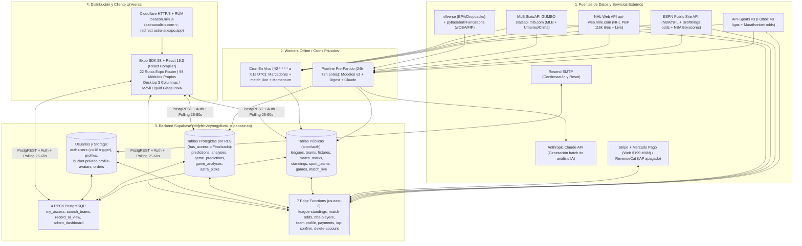

# REPORTE MAESTRO — Ingeniería Inversa Profunda de ASTRA AI (`astraanalisis.com`)

> **Objetivo:** `https://astraanalisis.com/` (*Astra AI* / *Astra Analysis*) · **Operador identificado:** `eliasgutierrezhr@gmail.com` (México) · **Plataforma hermana descubierta:** `tipsterzone.org/t/astra` (`astraanalysisorg-astra.expo.app`)  
> **Fecha de auditoría:** 14 de noviembre de 2026 (Olas 1 + 2 Completas) · **Herramienta principal:** REA (`rea-agents@6.8.0`, skill `v49`, **`83` registros únicos `ev_...`** verificados)  
> **Equipo de análisis:** Coordinador + **12 despliegues de Subagentes Especialistas** en dos olas (*Gemini 4 Carbon High*)  
> **Verificación matemática:** `8/8` suites exactas sobre los **5 deportes** (`EXIT 0` en [verify_astra_math.py](file:///C:/Users/T490s/.gemini/antigravity/worktrees/PitchLab/analyze_pitchlab_competitor_rea/Reportes/analisis-astra/evidence/verify_astra_math.py))

---

## Resumen Ejecutivo

**Astra AI (`astraanalisis.com`)** es una plataforma freemium mexicana de pronósticos deportivos cuantitativos, seguimiento en vivo y análisis narrativos generados con IA que cubre **5 deportes**: **Fútbol (48 ligas)**, **NBA**, **NFL**, **NHL** y **MLB**. A diferencia de competidores puramente estáticos en cliente (como *AztecaVet* o *TouchIQ*, cuyos datos y fórmulas viven incrustados en un solo HTML sin backend) o de filtros descriptivos de rachas históricas (como *LineMate*), Astra AI opera una **arquitectura cliente-servidor moderna de tres capas**:

1. **Cliente Universal Multiplataforma (`Expo SDK 58 + React 19.3 + React Compiler`)**: Una aplicación universal escrita en React Native / Expo Router (`slug: "astra-ai"`, `eas.projectId: "f7056bae-387a-4cb8-856d-8504d0735629"`) desplegada en **Expo EAS Hosting (`astra-ai.expo.app`)** detrás de **Cloudflare HTTP/3**, que sirve un diseño adaptable (*3 columnas tipo terminal financiera en escritorio* vs *dock flotante Liquid Glass en móvil*) e impulsa su instalación como **PWA** para evitar el 15%–30% de comisión de Apple/Google.
2. **Backend Serverless en Supabase (`bbfjdshvlcynngjdkvsk.supabase.co`)**: **14 tablas públicas** en PostgreSQL con **Row-Level Security (RLS) real** (patrón *Soft-Null*: calendarios, marcadores en vivo, clasificaciones y momios son públicos; pronósticos, análisis IA y *Astra Picks* de partidos futuros devuelven `null` sin suscripción activa), **4 funciones RPC** (`my_access`, `search_teams`, `record_ai_view`, `admin_dashboard`) y **7 Edge Functions** (`league-standings`, `match-odds`, `nba-players`, `team-profile`, `payments`, `iap-confirm`, `delete-account`).
3. **Workers Batch + Crons Externos de Bajo Costo (`$57–$101 USD/mes` todo incluido)**: Un pipeline offline en Python/Node ingesta **API-Football v3 (`api-sports.io`)** para las 48 ligas de fútbol (`$19–$29 USD/mes`) y explota **APIs públicas gratuitas** (**ESPN Hidden API**, **NHL Web API oficial**, **MLB StatsAPI GUMBO**, más `nflverse` y `pybaseball`/FanGraphs) para los 4 deportes estadounidenses (`$0 USD`), calcula **modelos estadísticos reales** pre-partido (Dixon–Coles con xG en fútbol, Ratings+Elo en NBA, Puntos+EPA+Elo+QB en NFL, xG por tiro propio + Monte Carlo en NHL, y wOBA+FIP+Binomial Negativa en MLB), genera **1 análisis narrativo por partido en lote usando Claude (Anthropic)** (costo marginal `$0` por lector) y actualiza marcadores/momentum cada **2 minutos (`*/2 * * * *`)**. Monetiza mediante un **pase prepagado acumulable de `$199 MXN por 30 días`** (sin cobro recurrente automático, tras **7 días de prueba gratis sin tarjeta**) vía **Stripe** y **Mercado Pago**, alcanzando punto de equilibrio con apenas **6 a 11 clientes activos**.

### Los 5 Descubrimientos Forenses Más Importantes

1. **Exposición completa de hiperparámetros internos en partidos finalizados (`[OBSERVADO]`):** Aunque Supabase RLS protege los pronósticos de partidos futuros, **abre lectura pública completa (`SELECT *`) en cuanto un partido termina** para alimentar el resumen de equipo (`fetchTeamModel` -> `modelTeamSummary`). Como la columna JSONB `context` guarda toda la telemetría interna del worker, fue posible **reconstruir con precisión de 4 decimales las ecuaciones exactas y pesos de los 5 motores deportivos** (validado en `verify_astra_math.py`).
2. **Desconexión total entre probabilidades y momios — Cero cálculo de Valor Esperado (`EV`) ni *de-vig* (`[OBSERVADO]`):** La Edge Function `match-odds` extrae cuotas de **Marathonbet** (`id=2` en API-Sports, *overround* `+8.64%`) para fútbol y de **DraftKings** (`id="100"` en ESPN Pickcenter, *overround* `+4.16%`) para NBA/NFL/NHL, pero el cliente **oculta la casa de apuestas, descarta la hora de captura, no elimina el margen (*vig*) y jamás cruza la probabilidad del modelo contra la cuota** (`EV`, `fairOdds = 1/p` y `CLV` son inexistentes).
3. **Cero auditoría de calibración incluso en su propio panel de administración (`[OBSERVADO en código cliente]`):** Pese a anunciar en su Paywall *">75% de aciertos en pronósticos de alta confianza"*, el código del panel privado `/administracion` (`mod_0755`, exclusivo para `eliasgutierrezhr@gmail.com`) revela que `admin_dashboard()` mide únicamente **14 KPIs comerciales, altas, ingresos MXN y lecturas de IA** — no tiene **ni una sola métrica de Brier Score, Log-Loss, ECE, ROI o hit-rate real**.
4. **Alucinación grave de Claude detectada en producción por falta de validación post-LLM (`[OBSERVADO]`):** En el juego `NFL 401873052` (*NY Giants vs Washington*), mientras el modelo matemático daba `52.82%` y `+0.9` puntos al local NY Giants, **Claude invirtió completamente local y visitante en los 5 bloques del análisis** y afirmó que el QB *Jayden Daniels* jugaba para los Giants.
5. **Dependencia sin caché servidor sobre endpoints públicos no comerciales y `@supabase/realtime-js` muerto (`[OBSERVADO]`):** Las Edge Functions deportivas consultan ESPN/NHL/MLB en vivo sin caché en base de datos, y todo el tiempo real del frontend funciona por *HTTP polling* cada `25–60 s` (`@supabase/realtime-js` viaja entero en el bundle sin usarse jamás).

---

## 1. Arquitectura Integral de Extremo a Extremo

---

## 2. Frontend, Rutas y Experiencia de Usuario (`01` y `02`)

> Detalle completo en [01-arquitectura-frontend-y-rutas.md](file:///C:/Users/T490s/.gemini/antigravity/worktrees/PitchLab/analyze_pitchlab_competitor_rea/Reportes/analisis-astra/01-arquitectura-frontend-y-rutas.md), [02-ux-diseno-y-funcionalidades-cliente.md](file:///C:/Users/T490s/.gemini/antigravity/worktrees/PitchLab/analyze_pitchlab_competitor_rea/Reportes/analisis-astra/02-ux-diseno-y-funcionalidades-cliente.md) y [module-map.json](file:///C:/Users/T490s/.gemini/antigravity/worktrees/PitchLab/analyze_pitchlab_competitor_rea/Reportes/analisis-astra/evidence/module-map.json).

- **Stack exacto (`[OBSERVADO]`):** **Expo SDK `58.0.0`** + **React `19.3.0`** con **React Compiler habilitado en producción** (`experiments.reactCompiler: true` en `mod_0393`; memoización automática granular con `useMemoCache` y `Symbol.for("react.memo_cache_sentinel")`).
- **Radiografía del bundle (`1.92 MB`, `25` chunks JS, `1,030` módulos Metro):**
  - `entry-*.js` (`1.11 MB`): runtime React/React Native Web, Expo Router y tabla maestra de rutas (`mod_0009`).
  - `__common-*.js` (`662 KB`): **98 módulos propios de negocio/UI de Astra AI**, cliente `@supabase/supabase-js@2.118.0` (incluyendo `@supabase/realtime-js` sin usar), `expo-image`, `expo-blur` y `react-native-svg`.
  - **22 chunks asíncronos de rutas (`148.8 KB` en total, analizados al 100% con REA `ev_06e64c17...`):** mapeados 1:1 a sus archivos `.tsx` originales:
    - **Carteleras (`/(tabs)/*`)**: `index.tsx` (Fútbol), `nba.tsx`, `nfl.tsx`, `nhl.tsx`, `mlb.tsx`.
    - **Detalle Deportivo**: `partido/[id].tsx` (Fútbol), `juego/[sport]/[id].tsx` (US Sports), `equipo/[sport]/[id].tsx` (Perfil e historial de equipo; exige el slug `'futbol'` en español), `historial/[sport]/[teamId]/[matchId].tsx` (visor dual de partido histórico en BD o sintetizado al vuelo), `siguiendo.tsx` (monitor local de hasta `20` partidos y `6` métricas en vivo por partido).
    - **Cuenta, Pagos y Operación**: `cuenta.tsx` (carga perezosa de `expo-image-picker` y `expo-image-manipulator` para avatares), `pago/[id].tsx`, `confirmado.tsx`, `restablecer.tsx`, `eliminar-cuenta.tsx`, `administracion.tsx`.
    - **PWA e Institucional**: `instalar.tsx`, `nosotros.tsx` (metodología y FAQ), `privacidad.tsx`, `terminos.tsx`.
- **Arquitectura adaptable "Dos Apps en Una" (`DESKTOP_MIN = 1024px`, `mod_0775`):**
  - **Escritorio (`>= 1024px`)**: Terminal maestro-detalle de **3 columnas** (`CompetitionSidebar` izquierda de `218px` con ligas fijadas + cartelera central al `40%` + panel derecho de detalle embebido con `?partido=<id>` o `?juego=<id>`).
  - **Móvil (`< 1024px`)**: Navegación inferior flotante `GlassSportsBar` (`mod_1014`) estilo *Liquid Glass* (`backdrop-filter: blur(26px) saturate(165%)`) con lente arrastrable (`PanResponder` + `Animated.spring`) e íconos 3D vectoriales metálicos propios (`mod_1007`).
- **Cachés en memoria y ahorro de peticiones (`mod_0779`, `mod_1009`):** Todo el *polling* se detiene automáticamente cuando la pestaña pasa a segundo plano (`document.visibilityState === 'hidden'`), combinando TTLs en memoria de `30 s` (carteleras, máx. 14 días), `60 s / 5 min` (`nba-players` live/final), `2 min` (`team-profile`), `15 min` (`match-odds`) y `30 min` (`record_ai_view`).

---

## 3. Backend Supabase, Esquema de Base de Datos y APIs (`03`, `04` y `05`)

> Detalle completo en [03-backend-supabase-y-esquema-bd.md](file:///C:/Users/T490s/.gemini/antigravity/worktrees/PitchLab/analyze_pitchlab_competitor_rea/Reportes/analisis-astra/03-backend-supabase-y-esquema-bd.md), [04-edge-functions-rpcs-y-operacion.md](file:///C:/Users/T490s/.gemini/antigravity/worktrees/PitchLab/analyze_pitchlab_competitor_rea/Reportes/analisis-astra/04-edge-functions-rpcs-y-operacion.md), [05-evidencia-runtime-y-payloads-reales.md](file:///C:/Users/T490s/.gemini/antigravity/worktrees/PitchLab/analyze_pitchlab_competitor_rea/Reportes/analisis-astra/05-evidencia-runtime-y-payloads-reales.md) y [database-and-api-contracts.json](file:///C:/Users/T490s/.gemini/antigravity/worktrees/PitchLab/analyze_pitchlab_competitor_rea/Reportes/analisis-astra/evidence/database-and-api-contracts.json).

### 3.1 Las 14 Tablas Públicas de PostgreSQL y el Patrón RLS *Soft-Null*

Astra AI divide su modelo relacional en dos esquemas paralelos (Fútbol histórico original + Deportes US lanzados el `2026-10-17`):

| Dominio | Tabla | Acceso RLS | Rol y Campos Clave Observados |
|---|---|---|---|
| **Fútbol** | `leagues` (`48` filas) | Público | Catálogo de ligas (`id`, `name`, `country`, `logo`, `flag`, `sort_order`). |
| **Fútbol** | `teams` (`1,692` filas) | Público | Equipos con IDs nativos de API-Football (`id`, `name`, `logo`). |
| **Fútbol** | `fixtures` (`30,891` filas) | Público | Calendario (`2024-10` a `2027-06`), marcador total (`home_goals`/`away_goals`), **marcador 90 min (`ft_home`/`ft_away`)** y banderas de señuelo comercial `forecast_ready` / `analysis_ready`. |
| **Fútbol** | `match_marks` | Público | Etiquetas cian en cartelera (`"Ambos marcan"`, `"Más de 2.25 goles"`). |
| **Fútbol** | `predictions` | **RLS `has_access` o Finalizado** | Salidas Poisson/Dixon–Coles (`lambda_home`, `lambda_away`, `p_home`, `p_draw`, `p_away`, `over_05/15/25`, `btts`, `correct_score_top3`) + JSONB `context` completo. |
| **Fútbol** | `analyses` | **RLS `has_access` o Finalizado** | Narrativa de Claude estructurada en 4 secciones (`panorama`, `tactica`, `factores`, `proyeccion`). |
| **Fútbol** | `standings` (`905` filas) | Público | Clasificación persistida en BD para ligas regulares. |
| **Deportes US** | `sport_teams` (`124` filas) | Público | `30` NBA, `32` NFL, `32` NHL, `30` MLB (`PK(sport, id)`). |
| **Deportes US** | `games` (`485` filas) | Público | Juegos NBA/NFL/NHL/MLB desde `2026-10-17` (`PK(sport, id)` con IDs nativos ESPN/NHL/MLB, `scores` por cuarto/periodo/entrada, `forecast_ready`, `analysis_ready`). |
| **Deportes US** | `game_predictions` | **RLS `has_access` o Finalizado** | Probabilidades `win`, tabla `rows` (Moneyline, Spread/Puck/Run Line, Totales) y `context` (`model_components` + `digest` del LLM). |
| **Deportes US** | `game_analyses` | **RLS `has_access` o Finalizado** | Arreglo de 5 secciones narrativas `[{titulo, texto}]` generadas por Claude. |
| **Transversal** | `astra_picks` | **RLS `has_access` o Finalizado** | Picks editoriales manuales en texto libre (`pick`, `confidence_pct`, `tier`, `outcome`). |
| **Transversal** | `match_live` (`2,193` filas) | Público | Estadísticas en vivo, eventos y curva `momentum` actualizada cada 2 min. |
| **Usuarios** | `profiles` + `profile-avatars` | **RLS `auth.uid() = id`** | `display_name`, `created_at`, `avatar_path` (`<uid>/avatar.jpg` privado con URLs firmadas de 1h). |

### 3.2 Los 4 RPCs y las 7 Edge Functions

| Tipo | Nombre | Autenticación | Función Exacta |
|---|---|---|---|
| **RPC** | `my_access()` | Anónimo / JWT | Devuelve estado de acceso (`logged_in`, `has_access`, `trial_ends_at`, `paid_until`, `is_admin`) y configuración comercial (`price_mxn: 199`, `trial_days: 7`, `period_days: 30`, `leagues: 48`, `iap_ios_key: null`). |
| **RPC** | `search_teams(p_query, p_limit)` | Anónimo / JWT | Búsqueda insensible a acentos (`unaccent`) de equipos de fútbol (para deportes US usa `.ilike` directo sobre `sport_teams`). |
| **RPC** | `record_ai_view(p_sport, p_match_id)` | JWT requerido | Registra lectura de análisis IA con deduplicación cada 30 min para telemetría de consumo y detección de *scraping*. |
| **RPC** | `admin_dashboard()` | Solo `eliasgutierrezhr@gmail.com` | Panel comercial privado (`mod_0755`): 14 KPIs de cuentas, retención, ingresos MXN (`revenue_cents`, `revenue_30d_cents`), últimas 80 vistas IA y últimas 80 órdenes. |
| **Edge Fn** | `league-standings` | Pública | Clasificaciones en vivo; en Fútbol es *fallback* cuando `standings` está vacío (ej. Nations League), y en NBA/NFL/NHL/MLB es la vía primaria. |
| **Edge Fn** | `match-odds` | Pública | Devuelve cuotas pre-partido 1X2 / Moneyline decimal desde Marathonbet (Fútbol) o DraftKings vía ESPN (NBA/NFL/NHL). Se apaga al iniciar el partido. |
| **Edge Fn** | `nba-players` | Pública | Proxy en vivo del boxscore individual de ESPN NBA (`14` métricas por jugador, titulares vs banca). |
| **Edge Fn** | `team-profile` | Pública | Perfil de equipo, historial paginado y reconstrucción al vuelo de partidos históricos no almacenados en BD (`stored: false`). |
| **Edge Fn** | `payments` | JWT requerido | `action: "checkout"` (crea orden de `$199 MXN` en Stripe o Mercado Pago) y `action: "order_status"` (sondeado cada `3 s` x `20` en `/pago/[id]`). |
| **Edge Fn** | `iap-confirm` | JWT requerido | Verificación servidor-a-servidor con RevenueCat para compras nativas (`astra_30_dias`). |
| **Edge Fn** | `delete-account` | JWT requerido | Borra `auth.users`, `profiles` y avatar, anonimizando órdenes pagadas previas bajo `'Cuenta eliminada'`. |

---

## 4. De Dónde Recibe los Datos (*Data Provenance*) y Costos Operativos (`07`)

> Detalle completo en [07-fuentes-de-datos-proveedores-y-momios.md](file:///C:/Users/T490s/.gemini/antigravity/worktrees/PitchLab/analyze_pitchlab_competitor_rea/Reportes/analisis-astra/07-fuentes-de-datos-proveedores-y-momios.md) y [data-provenance-matrix.json](file:///C:/Users/T490s/.gemini/antigravity/worktrees/PitchLab/analyze_pitchlab_competitor_rea/Reportes/analisis-astra/evidence/data-provenance-matrix.json).

Astra AI aplica una estrategia de **arbitraje extremo de costos de datos**, pagando únicamente por fútbol y obteniendo los 4 deportes estadounidenses y todos sus momios a costo `$0`:

| Deporte / Capa | Proveedor Confirmado | Evidencia Forense Directa | Costo Estimado |
|---|---|---|---|
| **Fútbol (48 ligas: 29 Tier 1 + 19 Tier 2)** | **API-Football v3 (`api-sports.io`)** | `source: "API-Sports"`, `media.api-sports.io`, estados `matchState`, `"Free Kicks"`, Liga MX `#0` (`id=262`). | **`$19 – $29 USD/mes`** |
| **NBA (calendario, en vivo, lesiones, boxscores)** | **ESPN Hidden Public API** (`site.api.espn.com`) | `eventId` `4019xxxxx`, `a.espncdn.com/combiner/...`, abreviaturas `NO/GS/NY/SA/UTAH`, `"ESPN · Actualizado"`. | **`$0 USD`** *(sin licencia B2B)* |
| **NFL (calendario, en vivo, lesiones + EPA)** | **ESPN Public API** + **`nflverse` (`nflfastR`)** | `eventId` `40187xxxx` + variables exactas `epa_por_dropback` y `techo_estadio: "dome" \| "outdoors"`. | **`$0 USD`** |
| **NHL (calendario, PBP tiros, en vivo, logos)** | **NHL Official Web API (`api-web.nhle.com/v1`)** | `gameId` `202602xxxx`, SVGs `assets.nhle.com`, `116,692` tiros PBP usados para entrenar su modelo xG. | **`$0 USD`** *(sin licencia B2B)* |
| **MLB (calendario, en vivo, clima + sabermetría)** | **MLB StatsAPI (`statsapi.mlb.com`)** + **`pybaseball`/FanGraphs** | `gamePk` 6 dígitos, `mlbstatic.com`, textos GUMBO en inglés + `wOBA`, `FIP` y `park_factor`. | **`$0 USD`** *(sin licencia B2B)* |
| **Momios (`match-odds`)** | **Marathonbet** (`id=2` en API-Sports) + **DraftKings** (`id="100"` en ESPN) | `bookmaker` expuesto en el JSON de red (oculto en UI) + flotantes IEEE-754 exactos (`-620 -> 1.1612903225806452`). | **`$0 USD extra`** |
| **Infraestructura + IA Batch** | **Supabase Pro** + **Anthropic Claude** + **Cloudflare / Worker** | Generación en lote 24h–72h pre-partido (`analyses.created_at` idénticos al microsegundo). | **`$38 – $72 USD/mes`** |
| **TOTAL MENSUAL OPERATIVO** | — | *Break-even* comercial con **6 a 11 suscriptores** de `$199 MXN/mes`. | **`$57 – $101 USD/mes`** |

---

## 5. Qué Modelos Estadísticos y de IA Utiliza (`06`)

> Detalle completo y demostraciones en [06-modelos-estadisticos-picks-e-ia.md](file:///C:/Users/T490s/.gemini/antigravity/worktrees/PitchLab/analyze_pitchlab_competitor_rea/Reportes/analisis-astra/06-modelos-estadisticos-picks-e-ia.md) y [verify_astra_math.py](file:///C:/Users/T490s/.gemini/antigravity/worktrees/PitchLab/analyze_pitchlab_competitor_rea/Reportes/analisis-astra/evidence/verify_astra_math.py).

**El 100% del modelado probabilístico ocurre en el backend**; el cliente JS únicamente formatea porcentajes (`pct`), dibuja barras y evalúa marcadores reglamentarios (`ft_home`/`ft_away` en 90 min para `AET`/`PEN`). Gracias a la exposición pública de `predictions.context` y `game_predictions.context` en partidos terminados, reconstruimos los **5 motores exactos**:

### 5.1 Fútbol (`league_v3`, `national_v3`, `cross_league_v3`)
- **Fuerzas de equipo:** Mezcla fija **`70% xG + 30% goles reales`** (`xg_weight = 0.70`) con decaimiento temporal y ancla Elo. En torneos inter-ligas (`cross_league_v3`), ajusta fuerzas con el **coeficiente UEFA de país** elevado a `0.5` (goles) y `0.2` (córners).
- **Tasas de gol esperadas ($\lambda_H, \lambda_A$)** con derrame de dominio territorial $+0.15(\text{net}_H - \text{net}_A)$ *(error máx. vs BD: `0.0010` goles)*:
  $$\lambda_H = \mu_{H,\text{equal}} \exp\!\big(\text{attack}_H - \text{defense}_A + 0.15(\text{net}_H - \text{net}_A)\big), \qquad \lambda_A = \mu_{A,\text{equal}} \exp\!\big(\text{attack}_A - \text{defense}_H - 0.15(\text{net}_H - \text{net}_A)\big)$$
- **Matriz de marcador:** **Poisson bivariada con corrección exacta de Dixon–Coles (1997)** sobre celdas $(0,0), (1,0), (0,1), (1,1)$ con $\rho$ calibrado por liga (`-0.05` a `-0.09`), reproduciendo `p_home`, `p_draw`, `p_away`, `over_05/15/25`, `btts` y `correct_score_top3` con **error máximo `0.0002`**.
- **Mercados secundarios:** **Binomial Negativa** con parámetro de concentración $r$ por mercado (`shots: 1.708`, `corners: 1.497`, `fouls: 1.095`, `shots_on_target: 1.007`), posesión por diferencia logística exacta (`error 0.00%`) y tarjetas amarillas de árbitro con **Empirical Bayes ($k = 15$ partidos de prior)**.

### 5.2 NBA, NFL, NHL y MLB
- **NBA:** Ensamble lineal **`0.75 * margin_from_ratings + 0.25 * margin_from_elo + rest_adjustment`** (con Elo estilo FiveThirtyEight: `+60` localía y divisor `28.0`), evaluado con Normal efectiva $\sigma_{\text{eff}} \approx 12.25$ pts. **Defecto crítico:** no descuenta numéricamente bajas de estrellas; solo pasa `bajas_reportadas` en texto a Claude.
- **NFL:** Ensamble lineal **`0.35 * margen_puntos + 0.30 * margen_epa + 0.35 * margen_elo + qb_local - qb_visitante + descanso`** (`+0.65` total en domo / `-0.6` exterior), evaluado con Normal exacta **$\sigma_{\text{NFL}} = 13.00$ pts** *(error máx. `0.000107`)*.
- **NHL:** Modelo propio de xG por tiro entrenado sobre `93,598` tiros (`holdout_auc = 0.7477`, `logloss = 0.22524`), sumando tasas por estado de fuerza (`ev5 + pp + sh + evo`) $\times$ `finishing_mult` $\times$ `goalie_goals_mult` del portero probable (`most_starts`), más simulación **Monte Carlo** con `+8.1%` por portería vacía y resolución de OT/SO.
- **MLB:** Proyección ofensiva/pitcheo con `wOBA`, `FIP` de abridor y bullpen, y `park_factor` sobre distribución **Binomial Negativa ($r \approx 5.5$)** para primeras 5 entradas (F5) y 9 entradas.

### 5.3 Picks y Motor Narrativo de IA (`Anthropic Claude`)
- **Picks (`astra_picks` y `match_marks`):** Curaduría manual/semi-editorial en texto libre (incluso con erratas tipográficas como `"tiros de esquinas"` y un `Set([1636276, 1636288])` cableado en `mod_0774`), sin cuota asociada, sin *stake* y sin liquidación cuantitativa verificable.
- **Narrativa con Claude (`mod_1011`):** Un worker serializa las salidas del modelo y un objeto `digest` (rachas, lesiones, contexto) y solicita a **Claude** 4 bloques en fútbol (`panorama`, `tactica`, `factores`, `proyeccion`) o 5 bloques `[{titulo, texto}]` en deportes US. **No existe verificador determinista post-LLM**, lo que provocó la inversión total de equipos y mariscales detectada en `NFL 401873052`.

---

## 6. Autenticación, Pagos, Legal y Estrategia para PitchLab (`08` y `09`)

> Detalle completo en [08-autenticacion-pagos-monetizacion-y-legal.md](file:///C:/Users/T490s/.gemini/antigravity/worktrees/PitchLab/analyze_pitchlab_competitor_rea/Reportes/analisis-astra/08-autenticacion-pagos-monetizacion-y-legal.md) y [09-comparativa-estrategica-vs-pitchlab.md](file:///C:/Users/T490s/.gemini/antigravity/worktrees/PitchLab/analyze_pitchlab_competitor_rea/Reportes/analisis-astra/09-comparativa-estrategica-vs-pitchlab.md).

- **Monetización adaptada a México:** Prueba gratuita de **7 días sin tarjeta** al verificar correo (con validación dual cliente + trigger SQL `>= 18 años`), seguida de pases prepagados acumulables de **`$199 MXN / 30 días` sin cobro recurrente automático** pagables con **Stripe** o **Mercado Pago** (tarjetas/SPEI/OXXO vía polling en `/pago/[id]`). La integración nativa **RevenueCat (`iap-confirm`)** existe en el código pero está desactivada en producción (`iap_ios_key: null`) para empujar la PWA y retener ~94% del ingreso bruto.
- **Cómo gana PitchLab (`v3.2`) frente a Astra AI:**
  1. **Superioridad matemática y de mercado (`EV + De-Vig + CLV + Ledger SHA-256`):** Astra AI vende probabilidades aisladas de las cuotas y presume ">75% de aciertos" sin medir siquiera su propio Brier Score; PitchLab conecta modelo + mercado sin vig, calcula `fairOdds` y valor esperado real, incluye impacto causal de alineaciones/lesiones y audita su calibración con walk-forward estricto.
  2. **Adopción táctica de los aciertos de Astra AI:** (a) Pre-generar **1 análisis LLM por partido en backend** (costo marginal `$0` por lector) añadiendo **validación determinista post-generación** para impedir inversiones local/visitante; (b) ofrecer el **Pase Prepago de `$199 MXN / 30d` con Mercado Pago + Stripe** junto con **Google OAuth en 1 clic**; (c) aplicar el patrón **RLS *Soft-Null*** pero **ocultando los hiperparámetros internos** del JSON público post-partido; y (d) reemplazar el *HTTP polling* por canales push/WebSocket reales.

---

## 7. Secretos, Rutas Ocultas, Calibración Empírica y OSINT Descubiertos en la Ola 2 (`11`–`16`)

En la segunda ola de auditoría profunda con REA (`100` módulos propios aislados sin truncamiento en `astra-first-party/`, `114,883` nodos AST, escenarios interactivos móviles y de rutas ocultas, auditoría empírica `SELECT *` de las `31,376` filas legibles en PostgreSQL y OSINT pasivo DNS/TLS/CT/RDAP) se destaparon **8 secretos estructurales** que permanecían ocultos tras la Ola 1:

1. **Ruta interna `/_sitemap` de Expo Router expuesta públicamente en producción ([11-rutas-ocultas-movil-y-flujos-no-explorados.md](file:///C:/Users/T490s/.gemini/antigravity/worktrees/PitchLab/analyze_pitchlab_competitor_rea/Reportes/analisis-astra/11-rutas-ocultas-movil-y-flujos-no-explorados.md), captura `39`):** Al carecer de `app/+not-found.tsx`, cualquier URL inexistente devuelve HTTP `200` (soft-404) y monta `<Unmatched />` en inglés con un enlace vivo a **`https://astraanalisis.com/_sitemap`**, exponiendo públicamente las 22 rutas internas (incluyendo `/administracion`, `/eliminar-cuenta` y `/pago/[id]`). Además, en móvil se descubrió un bug de conversión donde partidos US finalizados muestran falsamente a visitantes anónimos *"Este partido no tuvo pronóstico previo registrado"* en lugar del `<Paywall>` de \$199 MXN.
2. **Columnas ocultas `model`, `input_tokens` y `output_tokens` en BD: el recorte de costos de `claude-sonnet-5-5` a `claude-haiku-5-5` provocó un `20.7%` de inversiones totales en NFL ([14-auditoria-empirica-bd-calibracion-picks-y-alucinaciones.md](file:///C:/Users/T490s/.gemini/antigravity/worktrees/PitchLab/analyze_pitchlab_competitor_rea/Reportes/analisis-astra/14-auditoria-empirica-bd-calibracion-picks-y-alucinaciones.md)):** Mientras el frontend solo proyecta `sections, created_at`, `SELECT *` sobre las `1,739` filas de `analyses` y `game_analyses` reveló que el fundador operó del `18` al `22` de octubre con **`claude-sonnet-5-5`** (`554` análisis, `0` alucinaciones, ~\$8.60 USD) y el **`2026-10-23T09:57:04Z` migró el 100% del pipeline a `claude-haiku-5-5`** (`1,123` análisis, ~\$6.13 USD) más el pseudo-modelo determinista **`astra:data-notice`** (`62` avisos con `0` tokens). En NFL (`N=29` con Haiku), porque `context.digest` omite nombres dentro de `ratings.home/away` y `quarterbacks.home/away`, Haiku invirtió por completo local/visitante, puntos, spread y QBs titulares en **`6 / 29 = 20.69%`** de los juegos (publicando incluso una autocorrección cruda estilo chat en `401873017`: *"Brock Purdy abre como titular de los Falcons... perdón, de los 49ers visitantes"*).
3. **Nacimiento real de Astra AI (`2026-10-18`, 27 días de vida), MLB como Deporte #1 y bug matemático de extra innings ([14-auditoria-empirica-bd-calibracion-picks-y-alucinaciones.md](file:///C:/Users/T490s/.gemini/antigravity/worktrees/PitchLab/analyze_pitchlab_competitor_rea/Reportes/analisis-astra/14-auditoria-empirica-bd-calibracion-picks-y-alucinaciones.md)):** La primera fila en la historia de Astra AI fue `MLB game_id = 849817` (`2026-10-18T13:16:27Z`, ALCS), antes de NHL (`13:31Z`) y Fútbol (`13:58Z`). Se demostró con residuo máximo de **`0.000787` carreras** la identidad exacta $\mu_{\text{F5}} = \frac{5}{9}\text{FIP}_{\text{SP}}(\text{wOBA}/\overline{\text{wOBA}})\text{PF}$ y $\mu_{\text{Late4}} = \frac{4}{9}\text{FIP}_{\text{BP}}(\text{wOBA}/\overline{\text{wOBA}})\text{PF}$ (`ERA` con peso `0.000` y `HCA = 1.000`), y se descubrió que `totales_mas_de_pct` integra sobre 9 entradas **sin sumar las carreras obligatorias de extra innings** cuando hay empate en la 9.ª (~11% de probabilidad), subestimando los *Overs* de juego completo en `2.5–4.0` pp.
4. **Auditoría empírica de calibración (`1,754` partidos finalizados) e inserción post-partido en `astra_picks` / `match_marks` ([14-auditoria-empirica-bd-calibracion-picks-y-alucinaciones.md](file:///C:/Users/T490s/.gemini/antigravity/worktrees/PitchLab/analyze_pitchlab_competitor_rea/Reportes/analisis-astra/14-auditoria-empirica-bd-calibracion-picks-y-alucinaciones.md)):** Astra AI solo ha generado **`1,900` predicciones en toda su historia** (`0` backfills encubiertos: las únicas `8` filas post-inicio de NBA tienen `is_retrospective = true`). Sus modelos son subconfiados en el extremo alto: cuando $\max(p) \ge 75\%$, aciertan **`96 / 105 = 91.43%`**, pero esa cubeta representa apenas el **`6.01%`** del catálogo (`4.01%` en fútbol); en córners el MAE (`2.7375`) supera la media climatológica por solo `+1.84%`, y en NHL el **`100%` de los porteros (`354/354`)** operó sin confirmar (`BSS = +4.30%` vs `+21.23%` NBA y `+23.72%` NFL). En cambio, en curaduría manual (`astra_picks`), de los `5` picks (`3G-2P`), **solo `2` fueron insertados antes del partido (`1G-1P = 50%`)**, y el último (`1575213`, RB Leipzig 5–2 Augsburg `"Más de 2.5 goles"`) fue insertado **>70 minutos después del pitazo final** en la misma transacción SQL (`2026-11-07T17:32:43Z`) que insertó las `3/3` filas de `match_marks`.
5. **Ilusión visual de "acierto permanente" en `WinBox` y origen del `Set([1636276, 1636288])` ([12-secretos-codigo-fuente-y-auditoria-100-modulos.md](file:///C:/Users/T490s/.gemini/antigravity/worktrees/PitchLab/analyze_pitchlab_competitor_rea/Reportes/analisis-astra/12-secretos-codigo-fuente-y-auditoria-100-modulos.md)):** `WinBox` + `resultOutcome` (`mod_1018`) **nunca evalúan si el pronóstico acertó o falló**: el *check* verde `#5FD39A` marca el resultado real ocurrido (`1`, `X` o `2`) aunque Astra le haya dado `14%`, haciendo que el 100% de los partidos finalizados luzcan un *check* verde. Además, `Set([1636276, 1636288])` en `mod_0774` fue un parche manual del `22-oct` porque `fetchDay` no hace *join* con `astra_picks`.
6. **Dominio registrado hace 6 días, `0` apps nativas y plataforma hermana `tipsterzone.org` descubierta ([15-infraestructura-expo-eas-dns-y-superficie-externa.md](file:///C:/Users/T490s/.gemini/antigravity/worktrees/PitchLab/analyze_pitchlab_competitor_rea/Reportes/analisis-astra/15-infraestructura-expo-eas-dns-y-superficie-externa.md)):** `astraanalisis.com` fue registrado el **`2026-11-08T11:02:28Z`** (su zona Cloudflare elimina HSTS y abre `ACAO: *`, mientras Resend usa DKIM RSA de 1024 bits y `DMARC p=none`), y `u.expo.dev/f7056bae-...` confirma **`0` canales OTA y `0` apps iOS/Android**. El canal oficial de Telegram (`t.me/+9jzp7DYLucM4MDYx`, `3,463` suscriptores) condujo a **`tipsterzone.org/t/astra` (`astraanalysisorg-astra.expo.app`)**, una plataforma hermana de venta de picks (\$99 MXN individual / \$499 MXN mes) alojada bajo la **misma organización de Expo (`astraanalysisorg`)** y los mismos nameservers de Cloudflare.
7. **Huella muerta de `@supabase/*` (`124 KB`), *overfetching* de hasta `93.7%` y `firstContentfulPaint = 0 ms` ([13-superficie-oculta-supabase-openapi-auth-y-rls.md](file:///C:/Users/T490s/.gemini/antigravity/worktrees/PitchLab/analyze_pitchlab_competitor_rea/Reportes/analisis-astra/13-superficie-oculta-supabase-openapi-auth-y-rls.md)):** El `41.38%` del stack de red en `__common` es código muerto o contraproducente en Web (`realtime-js`, `react-native-url-polyfill` sobrescribiendo `window.URL`, `WebAuthn`, `Iceberg`, `SIWE`); `DETAIL_SELECT` descarta el `89.89%` de `prediction` en fútbol, `fetchTeamModel` descarta el `92.38%` en US Sports, `TrendingMatches` descarga `48.6 KB` de fútbol al abrir pestañas US (`97.36%` descartado), `11/12` repositorios carecen de `AbortController`, y los *beacons* RUM de Cloudflare registran `firstContentfulPaint: 0 ms` con el heap V8 creciendo `4.4x` hasta `42.53 MB`.
8. **Prueba formal `JSRG`, proyección `AgentEnv` y Fe de Erratas de 15 puntos ([16-grafo-semantico-rea-agentenv-y-ventaja-pitchlab.md](file:///C:/Users/T490s/.gemini/antigravity/worktrees/PitchLab/analyze_pitchlab_competitor_rea/Reportes/analisis-astra/16-grafo-semantico-rea-agentenv-y-ventaja-pitchlab.md)):** Se probó formalmente sobre los 100 módulos que solo existen `4` RPCs y `7` Edge Functions en cliente, se modelaron `9` herramientas Supabase en `AgentEnv` (*dry-run*), se corrigieron `15` imprecisiones menores de la Ola 1 (`ERR-01`..`ERR-15`) y se contrastó Astra AI contra el motor real `PREDLAB-V3.2` de PitchLab.

---

## 8. Índice Completo de Documentos y Evidencia del Dossier (`00`–`16`)

| Archivo / Carpeta | Descripción |
|---|---|
| [README.md](file:///C:/Users/T490s/.gemini/antigravity/worktrees/PitchLab/analyze_pitchlab_competitor_rea/Reportes/analisis-astra/README.md) | Índice navegable y guía rápida del dossier completo (Olas 1 y 2). |
| [01-arquitectura-frontend-y-rutas.md](file:///C:/Users/T490s/.gemini/antigravity/worktrees/PitchLab/analyze_pitchlab_competitor_rea/Reportes/analisis-astra/01-arquitectura-frontend-y-rutas.md) | Expo SDK 58, React 19.3 Compiler, las 22 rutas `.tsx` y grafo de los 1,030 módulos Metro. |
| [02-ux-diseno-y-funcionalidades-cliente.md](file:///C:/Users/T490s/.gemini/antigravity/worktrees/PitchLab/analyze_pitchlab_competitor_rea/Reportes/analisis-astra/02-ux-diseno-y-funcionalidades-cliente.md) | Sistema visual *Monochrome Dark Luxury*, layout dual Desktop/Móvil, cachés, `siguiendo` y PWA. |
| [03-backend-supabase-y-esquema-bd.md](file:///C:/Users/T490s/.gemini/antigravity/worktrees/PitchLab/analyze_pitchlab_competitor_rea/Reportes/analisis-astra/03-backend-supabase-y-esquema-bd.md) | Topología Cloudflare + EAS + Supabase, diagrama ER de las 14 tablas públicas, Storage y RLS *Soft-Null*. |
| [04-edge-functions-rpcs-y-operacion.md](file:///C:/Users/T490s/.gemini/antigravity/worktrees/PitchLab/analyze_pitchlab_competitor_rea/Reportes/analisis-astra/04-edge-functions-rpcs-y-operacion.md) | Contratos técnicos de los 4 RPCs (incl. radiografía de `admin_dashboard`) y las 7 Edge Functions. |
| [05-evidencia-runtime-y-payloads-reales.md](file:///C:/Users/T490s/.gemini/antigravity/worktrees/PitchLab/analyze_pitchlab_competitor_rea/Reportes/analisis-astra/05-evidencia-runtime-y-payloads-reales.md) | Bitácora de los 5 escenarios autenticados REA iniciales (`130` pasos), capturas `01`–`14` y payloads en vivo. |
| [06-modelos-estadisticos-picks-e-ia.md](file:///C:/Users/T490s/.gemini/antigravity/worktrees/PitchLab/analyze_pitchlab_competitor_rea/Reportes/analisis-astra/06-modelos-estadisticos-picks-e-ia.md) | Reconstrucción matemática exacta de los 5 deportes, momios IEEE-754, picks y auditoría inicial de Claude. |
| [07-fuentes-de-datos-proveedores-y-momios.md](file:///C:/Users/T490s/.gemini/antigravity/worktrees/PitchLab/analyze_pitchlab_competitor_rea/Reportes/analisis-astra/07-fuentes-de-datos-proveedores-y-momios.md) | Pruebas forenses de proveedores (API-Sports, ESPN, NHL, MLB, Marathonbet, DraftKings), crons y costos. |
| [08-autenticacion-pagos-monetizacion-y-legal.md](file:///C:/Users/T490s/.gemini/antigravity/worktrees/PitchLab/analyze_pitchlab_competitor_rea/Reportes/analisis-astra/08-autenticacion-pagos-monetizacion-y-legal.md) | Ciclo Auth, Stripe + Mercado Pago + RevenueCat, LFPDPPP, telemetría y postura de seguridad pasiva. |
| [09-comparativa-estrategica-vs-pitchlab.md](file:///C:/Users/T490s/.gemini/antigravity/worktrees/PitchLab/analyze_pitchlab_competitor_rea/Reportes/analisis-astra/09-comparativa-estrategica-vs-pitchlab.md) | Benchmarking inicial Astra AI vs PitchLab (`v3.2`) + AztecaVet / TouchIQ / LineMate. |
| [10-registro-evidencia-y-limitaciones.md](file:///C:/Users/T490s/.gemini/antigravity/worktrees/PitchLab/analyze_pitchlab_competitor_rea/Reportes/analisis-astra/10-registro-evidencia-y-limitaciones.md) | Ledger consolidado de los **`83` `evidence_id` únicos de REA**, matriz epistémica y fronteras. |
| [11-rutas-ocultas-movil-y-flujos-no-explorados.md](file:///C:/Users/T490s/.gemini/antigravity/worktrees/PitchLab/analyze_pitchlab_competitor_rea/Reportes/analisis-astra/11-rutas-ocultas-movil-y-flujos-no-explorados.md) | **(Ola 2)** Cobertura 100% de rutas, exposición de `/_sitemap`, UI móvil *Liquid Glass*, PWA y flujos `/pago`, `/eliminar-cuenta`, `/confirmado`, `/restablecer` (`capturas 15`–`40`). |
| [12-secretos-codigo-fuente-y-auditoria-100-modulos.md](file:///C:/Users/T490s/.gemini/antigravity/worktrees/PitchLab/analyze_pitchlab_competitor_rea/Reportes/analisis-astra/12-secretos-codigo-fuente-y-auditoria-100-modulos.md) | **(Ola 2)** Auditoría AST línea por línea de los 100 módulos propios (`Set([1636276,1636288])`, `WinBox`, modo `DEMO`, `102` árbitros, `17` exports muertos y `7` bugs). |
| [13-superficie-oculta-supabase-openapi-auth-y-rls.md](file:///C:/Users/T490s/.gemini/antigravity/worktrees/PitchLab/analyze_pitchlab_competitor_rea/Reportes/analisis-astra/13-superficie-oculta-supabase-openapi-auth-y-rls.md) | **(Ola 2)** Internals de `@supabase/supabase-js@2.118.0`, código muerto (`124 KB`), cabeceras Envoy/Gateway, RUM `h3`, *overfetching* y falta de timeouts. |
| [14-auditoria-empirica-bd-calibracion-picks-y-alucinaciones.md](file:///C:/Users/T490s/.gemini/antigravity/worktrees/PitchLab/analyze_pitchlab_competitor_rea/Reportes/analisis-astra/14-auditoria-empirica-bd-calibracion-picks-y-alucinaciones.md) | **(Ola 2)** Génesis `2026-10-18`, columnas ocultas `claude-sonnet-5-5` -> `claude-haiku-5-5`, ecuación exacta MLB, calibración en `1,754` partidos, picks post-partido y `20.7%` de inversiones NFL. |
| [15-infraestructura-expo-eas-dns-y-superficie-externa.md](file:///C:/Users/T490s/.gemini/antigravity/worktrees/PitchLab/analyze_pitchlab_competitor_rea/Reportes/analisis-astra/15-infraestructura-expo-eas-dns-y-superficie-externa.md) | **(Ola 2)** Cloudflare O2O (`astra-ai.expo.app` vs `astraanalisis.com`), EAS Update (`0` canales), DNS/DKIM y plataforma hermana `tipsterzone.org`. |
| [16-grafo-semantico-rea-agentenv-y-ventaja-pitchlab.md](file:///C:/Users/T490s/.gemini/antigravity/worktrees/PitchLab/analyze_pitchlab_competitor_rea/Reportes/analisis-astra/16-grafo-semantico-rea-agentenv-y-ventaja-pitchlab.md) | **(Ola 2)** Grafo semántico `JSRG` completo, proyección `AgentEnv` (*dry-run*), Fe de Erratas `ERR-01`..`ERR-15` y comparativa contra código real de PitchLab `v3.2`. |
| [17-plan-mejoras-pitchlab-vs-astra-motores-y-funciones.md](file:///C:/Users/T490s/.gemini/antigravity/worktrees/PitchLab/analyze_pitchlab_competitor_rea/Reportes/analisis-astra/17-plan-mejoras-pitchlab-vs-astra-motores-y-funciones.md) | **(Estrategia / Roadmap)** Plan maestro accionable (`P0`–`P2`) de qué funciones, motores estadísticos, IA batch, UX en vivo y monetización MXN adoptar de Astra AI y cómo construirlos mejor en PitchLab. |
| [astra-first-party/](file:///C:/Users/T490s/.gemini/antigravity/worktrees/PitchLab/analyze_pitchlab_competitor_rea/Reportes/analisis-astra/astra-first-party) | **(Ola 2)** Los `100` módulos propios y de configuración de Astra AI extraídos con nombres semánticos (`345.9 KB`). |
| [evidence/](file:///C:/Users/T490s/.gemini/antigravity/worktrees/PitchLab/analyze_pitchlab_competitor_rea/Reportes/analisis-astra/evidence) | `verify_astra_math.py` (`8/8 OK`), `production-db-forensic-audit.json`, `code-secrets-and-anomalies.json`, `supabase-deep-surface.json`, `infra-eas-osint-audit.json`, `wave2-routes-and-mobile-audit.json`, `rea-semantic-and-agentenv-audit.json`, `rea-evidence-ledger.json` y `21` payloads reales en `live-payloads/`. |
| [screenshots/](file:///C:/Users/T490s/.gemini/antigravity/worktrees/PitchLab/analyze_pitchlab_competitor_rea/Reportes/analisis-astra/screenshots) | **`40` capturas PNG** verificadas (`01`–`14` Ola 1 + `15`–`40` Ola 2, escritorio + móvil Retina + `/_sitemap`). |
| [app/](file:///C:/Users/T490s/.gemini/antigravity/worktrees/PitchLab/analyze_pitchlab_competitor_rea/Reportes/analisis-astra/app) y [modules/](file:///C:/Users/T490s/.gemini/antigravity/worktrees/PitchLab/analyze_pitchlab_competitor_rea/Reportes/analisis-astra/modules) | Los `25` chunks JS originales + `index.html` y los `286` módulos Metro desempaquetados e indexados. |
