# 01 — Arquitectura Frontend, Expo Router, PWA y Módulos Cliente de Astra AI (`astraanalisis.com`)

**Investigación Forense Pasiva (REA) para PitchLab**  
**Rol:** Subagente 1 — Líder de Arquitectura Frontend, Expo Router, PWA y Módulos Cliente  
**Objetivo Analizado:** `https://astraanalisis.com/` (Astra AI v`1.0.0`)  
**Fecha de Corte Técnico:** 14 de noviembre de 2026  

---

## 1. Resumen Ejecutivo y Marco Epistémico

Astra AI (`https://astraanalisis.com/`) opera una **aplicación universal construida con React `19.3.0`, React Compiler activo, React Native for Web y Expo SDK `58.0.0` (Expo Router con `asyncRoutes` habilitado en Web)**, empaquetada mediante **Metro Bundler** en un contenedor SPA (`web.output: "single"`) compuesto por `index.html` y **25 chunks JavaScript** (`1,923,803` bytes totales en disco).

A partir de un único código fuente TypeScript/TSX compartido, Astra AI despliega:
1. **Aplicación Web / PWA ligera** en `https://astraanalisis.com` (servida detrás de Cloudflare con Cloudflare Web Analytics `2024.11.0`, `manifest.webmanifest` e interceptación temprana de `beforeinstallprompt`), **sin Service Worker ni notificaciones Web Push**.
2. **Aplicaciones nativas iOS y Android** gestionadas con **EAS Build** (`projectId: f7056bae-387a-4cb8-856d-8504d0735629`, `owner: astraanalysisorg`, esquema de deep-linking `astraai://`), bifurcando únicamente los adaptadores específicos de plataforma (como `iap.web.ts` en `mod_0929` frente al cliente nativo de RevenueCat / Apple App Store / Google Play Billing).

### Protocolo de Rigor Epistémico
En estricto apego a la metodología forense pasiva con **REA (`reverse-engineer-anything`)**, todo hallazgo en este documento se clasifica explícitamente bajo tres categorías:
- **`[OBSERVADO]`**: Hecho verificado directamente en el código empaquetado de producción, manifiestos incrustados o capturas pasivas, citando el módulo Metro (`mod_XXXX`), el archivo `.js` con su hash **SHA-256** y el identificador de evidencia REA (`ev_...`).
- **`[INFERIDO]`**: Reconstrucción lógica de alta confianza derivada de convenciones de compilación de Metro/Expo, nombres de símbolos, estructura de rutas o contratos de API (por ejemplo, rutas originales de archivos en `src/` o versión mayor de paquetes sin `package.json` literal en el bundle).
- **`[DESCONOCIDO]`**: Información ausente de los artefactos web de producción y no verificable de forma pasiva sin acceso al repositorio privado, binarios `.ipa`/`.apk` o consola de infraestructura.

### Trazabilidad de Evidencias REA (`evidence_id`)

| `evidence_id` de REA | Herramienta / Vista | Alcance y Resultado Técnico |
| :--- | :--- | :--- |
| `ev_65da2d799f8e38fb47969ed42788d109282794ea80635bed7d2772a7977cc222` | Captura pasiva inicial (`raw/01-landing-capture.json`) | `[OBSERVADO]` Tráfico inicial de landing page, carga de chunks base, `manifest.webmanifest` (HTTP 200), fuentes `.woff2` y consultas públicas a Supabase. |
| `ev_42e6c7319eb27372b49758df47887b2764d276a39d760c6d6f0874b7f5d03bc6` | Recorrido autenticado pasivo (`raw/02-authenticated-tour.json`) | `[OBSERVADO]` Sesión autenticada en navegador, llaves reales en `window.localStorage` (`sb-bbfjdshvlcynngjdkvsk-auth-token`, avisos descartados) y llamadas autenticadas a RPCs/Edge Functions. |
| `ev_87d52f5c34a65dd9f3669f452fc3fd0e3cbb89aa735d2471899965d48008996e` | `analyze_javascript_application` (sobre `app/` completo) | `[OBSERVADO]` Contenedor `cb5a4ab3b3262cbfb2ee0b0f888cd19a192302dd1bd13e1fac29b13fc9020ad6`; saturó el presupuesto semántico de `100,000` nodos AST al procesar `entry-*.js`, truncando el análisis profundo sobre `__common-*.js` y `__expo-metro-runtime-*.js`. |
| `ev_9128d949f1c6848ac0415f7e3c5ec6e730b5e713df6d1d5218bce46d86373799` | `inspect_analysis_view` (`javascript-routes` / `routes` sobre `ev_87d52f5c...`) | `[OBSERVADO]` Recuperación estática de 6 destinos literales de navegación (`/`, `/instalar`, `/mlb`, `/nba`, `/nfl`, `/nhl`) referenciados en `__common-a2fe500f62154dabe8c8c7eb8fa31525.js`. |
| `ev_06e64c17364017f73c15a045e58ee4b196cf76f035801944f4802b98175dffcb` | **Nuevo** `analyze_javascript_application` (`source_paths` = 22 chunks de ruta) | `[OBSERVADO]` Análisis estático focalizado con `detail: "summary"` sobre los 22 route chunks ligeros (`unselected_files: 4` = `entry`, `__common`, `__expo-metro-runtime`, `index.html`). **Cobertura del 100% sin truncamiento semántico.** |
| `ev_79b34436d8a68b8d8e0cfa57dfe273135f3851875b2be7776fe5408425768de5` | `inspect_analysis_view` (`kind: "summary"` sobre `ev_06e64c17...`) | `[OBSERVADO]` `parsed_javascript_files: 22`, `parse_failures: 0`, `text_bytes_read: 148,771`, `visited_ast_nodes: 44,694`, `findings: 132`, `examination: {complete: 22, limited: 0}`, `semantic.truncated: false`. |
| `ev_267a3a963e9c079e6c7afa2371070946d3c184e9f15b673df8a3603cac53ffd1` | `inspect_analysis_view` (`kind: "page"`, `collection: "modules"` sobre `ev_06e64c17...`) | `[OBSERVADO]` Inventario semántico de `147` unidades modulares internas detectadas a través de los 22 chunks de rutas. |
| `ev_ff621e6d81d0c2142b93fa36ded6127d0a25c95518366602854601c48dbfdb2f` | `inspect_analysis_view` (`kind: "javascript-routes"`, `collection: "routes"` sobre `ev_06e64c17...`) | `[OBSERVADO]` Confirma `0` declaraciones `<Route path=...>` dentro de los chunks hoja: en Expo Router con Metro `asyncRoutes`, los chunks hoja exportan únicamente `default` y el registro declarativo reside en `mod_0009` (`entry-*.js`). |
| `ev_86f4effd51e3429c8818ae84f21084804c129fb851627eea5b10a17dbbdb282a` | `inspect_analysis_view` (`kind: "javascript-routes"`, `collection: "summary"` sobre `ev_06e64c17...`) | `[OBSERVADO]` Certifica `complete: 22`, `partial: 0` sobre los 22 archivos seleccionados. |
| `ev_056ff46d3093b4745ffe522786f74a58c01a7e31d8d0e2d4c58e9a54a110b878` | `inspect_analysis_view` (`kind: "javascript-routes"`, `collection: "sources"` sobre `ev_06e64c17...`) | `[OBSERVADO]` Verificación individual de estado `complete` y ausencia de errores de parseo en cada uno de los 22 route chunks. |

---

## 2. Análisis Estático REA de los 22 Route Chunks y Mecánica de Metro Bundler

### 2.1 Resolución del Truncamiento Semántico mediante `source_paths` Explícito (`[OBSERVADO]`)
En el análisis preliminar (`ev_87d52f5c...`), el archivo monolítico de arranque `entry-2f163e0b9ce05e4953b73986af77f2b7.js` (`1,109,576` B; 746 módulos Metro) consumió el límite de seguridad del motor semántico de REA (`100,000` nodos AST), provocando que `__common-a2fe500f62154dabe8c8c7eb8fa31525.js` (`662,415` B) y chunks subsecuentes quedaran parcialmente examinados.

Al ejecutar `rea:analyze_javascript_application` aislando explícitamente los **22 chunks de rutas** en `source_paths` (`ev_06e64c17364017f73c15a045e58ee4b196cf76f035801944f4802b98175dffcb`, inspeccionado en `ev_79b34436d8a68b8d8e0cfa57dfe273135f3851875b2be7776fe5408425768de5`), REA completó el grafo semántico íntegro sin truncamiento:
- **Archivos JS analizados:** `22 / 22` (`parse_failures: 0`, `examination.complete: 22`, `examination.limited: 0`, `semantic.truncated: false`).
- **Volumen procesado:** `148,771` bytes de código minificado -> **`44,694` nodos AST visitados** -> **`147` registros modulares** (`ev_267a3a96...`) -> **`132` hallazgos semánticos**.
- **Grafo de flujo reconstruido por REA (`ev_79b34436...`):**
  - `data-flow`: `36,838` aristas
  - `object-flow`: `4,399` aristas
  - `closure`: `2,234` capturas léxicas (consistente con los bloques `useMemoCache` emitidos por React Compiler)
  - `call-flow`: `629` sitios de llamada inter-procedimiento
  - `promise-ownership`: `122` cadenas asíncronas (fetch de partidos, checkout, borrado de cuenta, restablecimiento PKCE, recorte de avatar y dashboard administrativo)
  - `boundary`: `19` cruces de frontera DOM/Web API (`window.location`, `window.history.replaceState`, `window.confirm`, `localStorage`, `FileReader`/`canvas`)
  - `timer`: `8` temporizadores (`setTimeout` de `LaunchSplash` a `2000ms`, enfriamiento de reenvío de correo cada `1000ms`, polling de orden de pago cada `3000ms`, etc.)

### 2.2 Por Qué Expo Router Oculta la Tabla de Rutas a Analizadores Basados en JSX (`[OBSERVADO]`)
La combinación de `ev_ff621e6d...` (0 rutas declarativas en los 22 chunks hoja), `ev_9128d949...` (6 strings de ruta en `__common-*.js`) y la inspección directa de `entry-2f163e0b9ce05e4953b73986af77f2b7.js` demuestra cómo opera el **Async Bundle Splitting de Expo Router + Metro**:

1. **Runtime Metro (`__expo-metro-runtime-8c088df87a31e4e6accd81c554ec290d.js`)**: Inicializa el registro global de módulos `__d(factory, moduleId, dependencyMap)`, el resolvedor `__r(moduleId)` y `__registerSegment` para hidratar scripts secundarios inyectados dinámicamente vía `<script async>`.
2. **Manifiesto de Contexto Asíncrono (`mod_0009` en `entry-2f163e0b9ce05e4953b73986af77f2b7.js`)**: Compilación del `require.context("./app", true, ...)` de Expo Router (`mod_0008`). A diferencia de todos los demás módulos Metro cuyo tercer argumento en `__d(...)` es un arreglo numérico `[dep0, dep1, ...]`, **`mod_0009` recibe un objeto diccionario** que asocia cada índice de dependencia con el ID del módulo raíz de la ruta (`748`–`769`) e incluye una subtabla `"paths"` con las URLs exactas de los chunks a descargar bajo demanda:

```javascript
// [OBSERVADO] Extracto estructural de mod_0009 en entry-2f163e0b9ce05e4953b73986af77f2b7.js
// Mapa de módulo -> [depIndex, moduleId]
"./(tabs)/_layout.tsx": [0, 748],
"./(tabs)/index.tsx":   [1, 749],
// ... (hasta "./terminos.tsx": [21, 769])

// Tercer argumento de __d(..., 9, { ... }):
{
  "0": 748, "1": 749, "2": 750, "3": 751, "4": 752, "5": 753,
  "6": 754, "7": 755, "8": 756, "9": 757, "10": 758, "11": 759,
  "12": 760, "13": 761, "14": 762, "15": 763, "16": 764, "17": 765,
  "18": 766, "19": 767, "20": 768, "21": 769,
  "paths": {
    "748": "/_expo/static/js/web/_layout-9e71532af65e3f948330147e2b7b16d2.js",
    // ... (22 chunks en total)
  }
}
```

3. **Cargador Perezoso (`mod_0010` / `mod_0011` `__loadBundleAsync`)**: Cuando Expo Router navega a una ruta cuyo `moduleId` aún no está registrado en memoria, invoca `r(d[index])` a través de `mod_0010`, descarga primero `__common-a2fe500f62154dabe8c8c7eb8fa31525.js` (si no ha sido cargado) y el chunk específico de la ruta desde `/_expo/static/js/web/*.js`, y resuelve el `export default` del módulo `748`–`769`.
4. **Nota Forense sobre `_index.json` (`[OBSERVADO]`)**: El índice preextraído `Reportes/analisis-astra/modules/_index.json` contiene `1,029` entradas (omitiendo `mod_0009`) precisamente porque su extractor buscó firmas `__d(..., id, [...])` con corchetes y pasó por alto el objeto literal `{...}` del módulo `9`. Nuestro entregable [module-map.json](file:///C:/Users/T490s/.gemini/antigravity/worktrees/PitchLab/analyze_pitchlab_competitor_rea/Reportes/analisis-astra/evidence/module-map.json) corrige esta omisión e incorpora `mod_0009` con sus 22 aristas hacia `748`–`769`, completando los **1,030 módulos reales (`0`..`1029`)** del grafo Metro.

---

## 3. Inventario Completo de Artefactos Web (`index.html` + 25 Chunks JS)

Todos los valores de tamaño y SHA-256 siguientes son **`[OBSERVADO]`** directamente sobre `Reportes/analisis-astra/app/` (`root_artifact_sha256: cb5a4ab3b3262cbfb2ee0b0f888cd19a192302dd1bd13e1fac29b13fc9020ad6`, `source_manifest_sha256: 6bfc087ffe7c0e519f178c61691db7dbe65d91761257c4d16d67aba9bdf2e07d`):

| # | Archivo en `app/` | Bytes | Hash SHA-256 | Categoría | Módulos Metro Contenidos | Rol Arquitectónico |
| :-: | :--- | --: | :--- | :--- | :--- | :--- |
| 1 | `index.html` | 2,492 | `4be76fa6d2268b4e7e409fcb8ab560e1e7ce5948894fd1ff8b6923510fc5e7a7` | Documento Raíz | N/A | Shell HTML (`lang="es"`), meta PWA/Apple, captura `window.__astraInstallPrompt`, `preconnect` a Supabase y `api-sports.io`, carga de 3 scripts iniciales + beacon Cloudflare. |
| 2 | `__expo-metro-runtime-8c088df87a31e4e6accd81c554ec290d.js` | 3,751 | `80e3ab02b3bac22608cdf29a2e3cc1270616a695bbe479f7f500941e8d2bbe41` | Runtime Metro | Bootstrap `__d` / `__r` | Registro de módulos Metro, resolución de dependencias y soporte de segmentos asíncronos. |
| 3 | `entry-2f163e0b9ce05e4953b73986af77f2b7.js` | 1,109,576 | `4a2898b1d46769bde7a43cd2a5f91bd89d39c203df11222ccd70a2ba22a4d98d` | Entrypoint Core | `0`–`747` (`748` total incl. `mod_0009` y `mod_0393`) | React `19.3.0`, React DOM, React Native Web core, React Navigation, núcleo de Expo Router, `expo-constants` (`mod_0393`), `expo-glass-effect` (`mod_0670`) y tabla `mod_0009`. |
| 4 | `__common-a2fe500f62154dabe8c8c7eb8fa31525.js` | 662,415 | `c4a4cead00034bc5492bc041e4fdafa13bb057d5f9e58b9ac75e0c356c017492` | Chunk Compartido | `770`–`772`, `775`–`790`, `834`–`839`, `862`–`864`, `866`–`869`, `871`–`1029` (`200` mód.) | `@supabase/*` `2.118.0`, `react-native-svg`, `expo-image` (+Blurhash/Thumbhash), `expo-blur`, `AsyncStorage`, tokens `C`/`F`, `AppShell`, `GlassSportsBar`, repositorios y componentes compartidos. |
| 5 | `_layout-b3da769553b5a6bcc3093bb023a44b7f.js` | 38,589 | `ba86c397ba7c6ae85d0472322ccada83eaec70509bdb6890386e7292c7177c43` | Route Chunk (Root) | `754`, `791`–`833` (`44` mód.) | `app/_layout.tsx` (`mod_0754`), `expo-font`, `expo-asset`, `expo-splash-screen`, `expo-status-bar`, 9 fuentes `.woff2` (`823`–`831`), `LaunchSplash` (`832`) y `TrialWelcome` (`833`). |
| 6 | `_layout-9e71532af65e3f948330147e2b7b16d2.js` | 399 | `c753d9cd12a830828bd4373fed8304883c9ab367c1218213c09ceffe693d72ae` | Route Chunk (Tabs) | `748` (`1` mód.) | `app/(tabs)/_layout.tsx`: envuelve `<Slot />` en `<AppShell>`. |
| 7 | `index-1423f7b5e0c45b7b203640adbdc42677.js` | 17,924 | `0d61b1aa4bb889eadabdefff77023632827636808e026e063c532e241a91d117` | Route Chunk | `749`, `773`, `774` (`3` mód.) | `app/(tabs)/index.tsx` (`/`), `FootballScreen` (`773`) y `LeagueSection`/`MatchRow` (`774`). |
| 8 | `mlb-4d63e84434c3dbe316f6e762cf54c167.js` | 370 | `783e80cb8aa96c4d8bd1a2fbc8132df40810c20bcbcbf77bb36866d25d1ace9e` | Route Chunk | `750` (`1` mód.) | `app/(tabs)/mlb.tsx` (`/mlb`) -> `<SportScreen sport="mlb" />`. |
| 9 | `nba-be21dcd74fed6ac8380a1113c6326078.js` | 370 | `9627c359b1152bb8eeb3b23c43aad3821f43e7567bb0981ce9b0c30cf05a5ec7` | Route Chunk | `751` (`1` mód.) | `app/(tabs)/nba.tsx` (`/nba`) -> `<SportScreen sport="nba" />`. |
| 10 | `nfl-eeea91192df42b63b6337f868b652d37.js` | 370 | `de83502abb98743e54b00f399548a764c8c85989a64faa402baac6ab68f1203e` | Route Chunk | `752` (`1` mód.) | `app/(tabs)/nfl.tsx` (`/nfl`) -> `<SportScreen sport="nfl" />`. |
| 11 | `nhl-35c5dcf527e2b32f27cbcd14d44d27ef.js` | 370 | `7c96ba03a3ce22694992d87ded4879908fb004c85796bbc5595f6ea28121b33d` | Route Chunk | `753` (`1` mód.) | `app/(tabs)/nhl.tsx` (`/nhl`) -> `<SportScreen sport="nhl" />`. |
| 12 | `administracion-db0312943212c59d203e733a9a3ecfed.js` | 11,221 | `94b440fd61491e82755ea64b7ff667972b4d257267b46b067478eb36860c61b2` | Route Chunk | `755` (`1` mód.) | `app/administracion.tsx` (`/administracion`): consola interna de métricas, cuentas, IA y pagos. |
| 13 | `confirmado-ea12a64b546d50dfee3ef1e3fbad2714.js` | 1,694 | `9f65290681661577bc37fc35fe6dd37c5e1d0552559563dae7c84c4d5f6fa607` | Route Chunk | `756` (`1` mód.) | `app/confirmado.tsx` (`/confirmado`): callback de verificación de email. |
| 14 | `cuenta-6de60b93179704310df6552a70994b81.js` | 37,938 | `9590f80cf74538a54c822e2006dd7daa90917bf025b5b7ab18eaa4b822f0283c` | Route Chunk | `757`, `840`–`861` (`23` mód.) | `app/cuenta.tsx` (`/cuenta`), `ProfileEditor` (`840`), `expo-image-picker` (`841`–`844`), `expo-image-manipulator` (`845`–`858`), `profile.ts` (`859`), `profileValidation` (`860`) y `ConfirmationResend` (`861`). |
| 15 | `eliminar-cuenta-8b00a1afa1f45f3250627a9ca3154efc.js` | 3,138 | `e99e40df1f59959322d7fb61a7ed72c18fef9692775c8756933b1f22a4bbf246` | Route Chunk | `758` (`1` mód.) | `app/eliminar-cuenta.tsx` (`/eliminar-cuenta`): flujo de baja definitiva. |
| 16 | `[id]-1c9b77ff32fe4b75c1b5df98e4b4acc2.js` | 9,641 | `24633ab7b1a398ccfa04a3ff3c9c9d77af7b8c5dc66b07ce831997166b162d06` | Route Chunk | `759`, `865` (`2` mód.) | `app/equipo/[sport]/[id].tsx` + `TeamProfileScreen` (`865`). |
| 17 | `[matchId]-bffa67a80cc9ec9e08ea55e97555b4e2.js` | 5,010 | `2dfabcb5d7d852d29d8da2b6011606ae00c4f78ee95553a09e44fb9585af7df1` | Route Chunk | `760` (`1` mód.) | `app/historial/[sport]/[teamId]/[matchId].tsx`: ficha de encuentro histórico. |
| 18 | `instalar-0a3225cb4bb3206b7795b8e128e050ca.js` | 1,145 | `08e1ded65d93fbea104aa0ec6f3d2a9063c345392aceef111ec795ee98db1d87` | Route Chunk | `761` (`1` mód.) | `app/instalar.tsx` (`/instalar`): asistente PWA. |
| 19 | `[id]-d958bd3185d181ad162a4cc99da35d2c.js` | 929 | `4247fa5cd96e86cf14679228c82ffa2a084f8f70b4e391beda3c2dac3a891561` | Route Chunk | `762` (`1` mód.) | `app/juego/[sport]/[id].tsx`: detalle móvil o `<Redirect>` desktop para NHL/MLB/NBA/NFL. |
| 20 | `nosotros-1087ff396845303a336510385643566a.js` | 5,419 | `e8f00c5b1dc6aac5030683c3f9564d95f4386eb64bf43ede2baf360b332a5ef1` | Route Chunk | `763`, `870` (`2` mód.) | `app/nosotros.tsx` (`/nosotros`) + `ABOUT_FAQ` y redes sociales (`870`). |
| 21 | `[id]-640d8e37fab6cdee75166c44fc39efd5.js` | 2,919 | `cd0c23a7845fea20d15b5f1e30a4c942b194fdb7523693de8018f4dffed98688` | Route Chunk | `764` (`1` mód.) | `app/pago/[id].tsx`: polling post-checkout web. |
| 22 | `[id]-a7d7ec8ae26ff91045d9d5a83bfb5536.js` | 705 | `1137d1e34ea736728157ad40bf5bed431b22e44a5f161a5594fbb8cdf44ef1da` | Route Chunk | `765` (`1` mód.) | `app/partido/[id].tsx`: detalle móvil de fútbol o `<Redirect>` desktop a `/?partido=`. |
| 23 | `privacidad-ebdf8782b2c1e7d6e3ccaa3f6f362872.js` | 4,168 | `aafb72411aa16565428dc62da6745034e89fbb27ec9683793e845883ef0ad3df` | Route Chunk | `766` (`1` mód.) | `app/privacidad.tsx` (`/privacidad`): aviso integral de privacidad. |
| 24 | `restablecer-ee313ddec28ef0dd0fb73115ff93f170.js` | 2,847 | `80c76835a2d8f9389c8ec09726d1faeb8f5833ef5acb29f758eb65eec926fa9d` | Route Chunk | `767` (`1` mód.) | `app/restablecer.tsx` (`/restablecer`): cambio de contraseña vía hash o PKCE. |
| 25 | `siguiendo-df598f9acb2b09505d43493f8aa5f151.js` | 469 | `0b348ae77c09cb24438cd97431bba11d4fd24df46357dced8b89615d9a1b5b57` | Route Chunk | `768` (`1` mód.) | `app/siguiendo.tsx` (`/siguiendo`): vista completa de partidos y métricas seguidas. |
| 26 | `terminos-cc492529fdf523d3fadb0c2fd1304f5c.js` | 3,136 | `21952ae98e71ec65cbfba6d6a2f4c8e85d394320034c7b53030050da6d5e87f5` | Route Chunk | `769` (`1` mód.) | `app/terminos.tsx` (`/terminos`): términos dinámicos con precio/vigencia desde `my_access`. |

### Observación sobre la Distribución de Peso de Bundles (`[OBSERVADO]`)
- **92.1% del código JS total (`1,775,742` B de `1,921,311` B)** se descarga inmediatamente en la primera visita a cualquier página (`__expo-metro-runtime` + `entry` + `__common`), más `_layout-b3da7695...js` (`38.6` KB) y el chunk de la ruta activa (`0.4` KB – `17.9` KB).
- El único subsistema pesado genuinamente diferido fuera de la ruta crítica inicial es el **pipeline de selección y recorte de imagen de perfil** (`expo-image-picker` `mod_0841`–`0844` + `expo-image-manipulator` `mod_0845`–`0858` + `ProfileEditor` `mod_0840`), empaquetado de forma exclusiva en `cuenta-6de60b93179704310df6552a70994b81.js` (`37,938` B).

---

## 4. Stack Tecnológico y Versiones Exactas

| Tecnología / Paquete | Versión Exacta | Estado Epistémico | Módulo(s) y Evidencia Exacta en el Bundle | Notas Técnicas Relevantes |
| :--- | :--- | :--- | :--- | :--- |
| **React** | **`19.3.0`** | `[OBSERVADO]` | `mod_0013` (`entry-2f163e0b...js`, `e.version = "19.3.0"`) | Última generación de React 19 con soporte nativo para runtime de compilador. |
| **React DOM** | **`19.3.0`** | `[OBSERVADO]` | `mod_0088` / `mod_0092` (`reconcilerVersion: "19.3.0"`) | Hidratación/renderizado CSR con `createRoot` sobre `<div id="root">`. |
| **React Compiler (`babel-plugin-react-compiler`)** | **Activo (`19.3.0` runtime)** | `[OBSERVADO]` | `mod_0393` (`experiments.reactCompiler: true`), `mod_0013.__COMPILER_RUNTIME`, `mod_0770`, `mod_0873` | Todos los componentes propios de Astra invocan `_c = r(d[0]).c(N)` (`useMemoCache`), comparando slots contra `Symbol.for("react.memo_cache_sentinel")` y `Symbol.for("react.early_return_sentinel")`. |
| **Expo SDK** | **`58.0.0`** | `[OBSERVADO]` | `mod_0393` (`sdkVersion: "58.0.0"`) | SDK de vanguardia (2026); `platforms: ["ios", "android", "web"]`, `bundler: "metro"`, `output: "single"`. |
| **Expo Router** | **Bundled con SDK 58** (`~55.x` / línea v6) | `[INFERIDO]` (desde SDK 58) / `[OBSERVADO]` en uso | `mod_0005`, `mod_0008`–`0011`, `mod_0337`–`0747`, `mod_0771`, `mod_0874`–`0894` | Configurado con `typedRoutes: false` y `extra.router.router.asyncRoutes.web: true` (`mod_0393`). |
| **React Native for Web** | **`~0.21.x`** (reporta `0.0.0` en `Platform`) | `[OBSERVADO]` / `[INFERIDO]` | `mod_0015`–`0269`, `mod_0920`–`0926` | Provee `View`, `Text`, `Pressable`, `ScrollView`, `Modal`, `Animated`, `PanResponder`, `StyleSheet` y `AccessibilityInfo`. |
| **`@supabase/supabase-js`** | **`2.118.0`** | `[OBSERVADO]` | `mod_0936` (`'X-Client-Info': 'supabase-js/2.118.0'`) | Inicializado en `mod_0778` contra `https://bbfjdshvlcynngjdkvsk.supabase.co` con publishable key `sb_publishable_...`. |
| **`@supabase/auth-js`** | **`2.118.0`** | `[OBSERVADO]` | `mod_0961`–`0978` (`mod_0965`: `version = "2.118.0"`) | Configurado con `storage: AsyncStorage`, `autoRefreshToken: true`, `persistSession: true`, `detectSessionInUrl: false`. |
| **`@supabase/postgrest-js` & `functions-js`** | **`2.118.0` suite** | `[OBSERVADO]` | `mod_0938`–`0943` (`__common-a2fe500f...js`) | Usados intensivamente para tablas, RPCs (`my_access`, `search_teams`, `record_ai_view`, `admin_dashboard`) y 7 Edge Functions. |
| **`@supabase/storage-js`** | **`2.118.0`** | `[OBSERVADO]` | `mod_0959`–`0960` (`storage-js/2.118.0`) | Usado para `upload`, `remove` y `createSignedUrl` en el bucket `profile-avatars`. |
| **`@supabase/realtime-js`** | **`2.118.0`** *(Código muerto)* | `[OBSERVADO]` | `mod_0944`–`0958` (`mod_0948`: `version = "2.118.0"`) | **Hallazgo clave:** Se descarga en `__common-*.js` por ser dependencia estática de `supabase-js`, pero **ningún módulo de Astra llama a `.channel()` ni abre WebSockets**; todo el tiempo real se resuelve por HTTP polling (`useLoad`). |
| **`react-native-url-polyfill`** | **`4.0.0`** | `[OBSERVADO]` | `mod_0930`–`0935` (`mod_0933` incluye `package.json` completo) | El `package.json` embebido en `mod_0933` expone incluso dependencias del autor (`typescript: ^5.9.2`, `@typescript/native-preview: ^7.0.0-dev.20260706.1`). |
| **`expo-image` + `blurhash` + `thumbhash`** | **SDK 58 bundled** | `[OBSERVADO]` | `mod_0979`–`1006` (`blurhash`: `995`–`998`; `thumbhash`: `999`) | Usado en `TeamLogo`, `LeagueLogo` (`mod_0783`), `ProfileAvatar` (`mod_0864`) y `MatchHeader` (`mod_0868`) con `cachePolicy="memory-disk"`, aunque Astra **no pasa hashes Blurhash/Thumbhash** desde la BD (usa iniciales circulares como fallback). |
| **`expo-blur` & `expo-glass-effect`** | **SDK 58 bundled** | `[OBSERVADO]` | `expo-blur`: `mod_0895`–`0898`; `expo-glass-effect`: `mod_0670` | `GlassSportsBar` (`mod_1014`) usa `BlurView` (`intensity=65`, `tint="dark"`). Importa `expo-glass-effect` (`d[9] = 670`) para paridad con iOS 26 Liquid Glass, pero en el árbol JSX web esa importación no se invoca. |
| **`react-native-svg`** | **SDK 58 bundled** | `[OBSERVADO]` | `mod_0905`–`0919`, `mod_0927`–`0928` | Renderiza el isotipo `AstraLogo`, los 20 iconos 2D (`mod_0789`), los 5 iconos 3D con gradientes (`mod_1007`), el gráfico `MomentumCard` y barras de `LiveStatistics` (`mod_0869`). |
| **`@react-native-async-storage/async-storage`** | **SDK 58 Web Adapter** | `[OBSERVADO]` | `mod_0899`–`0904` (`__common-a2fe500f...js`) | En Web delega directamente sobre `window.localStorage`. |
| **`expo-image-picker` & `expo-image-manipulator`** | **SDK 58 Web Adapters** | `[OBSERVADO]` | `mod_0841`–`0844` y `mod_0845`–`0858` (`cuenta-6de60b93...js`) | Implementados sobre `<input type="file">` y HTML5 `<canvas>` 2D; aislados por code-splitting en `/cuenta`. |
| **`react-helmet-async`** | **Bundled por Expo Router** | `[OBSERVADO]` | `mod_0745` (`entry-2f163e0b...js`) | Gestiona el `<head>` dinámico de documentos en Expo Router Web. |
| **Cloudflare Web Analytics** | **`2024.11.0`** | `[OBSERVADO]` | `index.html` (`static.cloudflareinsights.com/beacon.min.js`) | Token público `a2e12c4123a6420ca4eb3f4855145537`, `spa: 2` (tracking automático de cambios History API). |

---

## 5. Arquitectura Completa de Rutas en Expo Router (Las 22 Rutas)

### 5.1 Jerarquía de Layouts y Flujo de Navegación (`[OBSERVADO]`)

```mermaid
flowchart TD
    Root["mod_0754: app/_layout.tsx<br/>RootLayout (_layout-b3da7695...js)"]
    Providers["SafeAreaProvider -> AuthProvider (834)<br/>-> FollowedProvider (835) -> InstallProvider (836)"]
    Overlays["LaunchSplash 2000ms (832) + TrialWelcome (833)"]
    Stack["Expo Router <Stack screenOptions={{ headerShown: false }}>"]
    TabsLayout["mod_0748: app/(tabs)/_layout.tsx<br/>Envuelve <Slot /> en <AppShell> (mod_0772)"]

    Root --> Providers --> Stack
    Providers --> Overlays
    Stack --> TabsLayout

    subgraph Tabs["Grupo (tabs) — Con AppShell, Topbar Desktop / GlassSportsBar Móvil"]
        R_Idx["mod_0749: index.tsx (/)<br/>FootballScreen (773) ?fecha=&partido="]
        R_Mlb["mod_0750: mlb.tsx (/mlb)<br/>SportScreen('mlb') ?fecha=&juego="]
        R_Nba["mod_0751: nba.tsx (/nba)<br/>SportScreen('nba') ?fecha=&juego="]
        R_Nfl["mod_0752: nfl.tsx (/nfl)<br/>SportScreen('nfl') ?fecha=&juego="]
        R_Nhl["mod_0753: nhl.tsx (/nhl)<br/>SportScreen('nhl') ?fecha=&juego="]
    end

    TabsLayout --> R_Idx & R_Mlb & R_Nba & R_Nfl & R_Nhl

    subgraph Standalone["Pantallas Fuera de (tabs) — Usan PageFrame / DocPage o Detalle Móvil"]
        R_Partido["mod_0765: partido/[id].tsx<br/>Desktop -> Redirect /?partido=id<br/>Móvil -> MatchDetail (784)"]
        R_Juego["mod_0762: juego/[sport]/[id].tsx<br/>Desktop -> Redirect /sport?juego=id<br/>Móvil -> SportDetail (867)"]
        R_Equipo["mod_0759: equipo/[sport]/[id].tsx<br/>TeamProfileScreen (865)"]
        R_Hist["mod_0760: historial/[sport]/[teamId]/[matchId].tsx<br/>Ficha histórica o MatchDetail/SportDetail"]
        R_Sig["mod_0768: siguiendo.tsx<br/>FollowedList (872)"]
        R_Cuenta["mod_0757: cuenta.tsx<br/>Auth Login/Signup 18+ / Perfil / Suscripción"]
        R_Pago["mod_0764: pago/[id].tsx<br/>Polling Stripe / Mercado Pago"]
        R_Conf["mod_0756: confirmado.tsx<br/>Callback verificación correo"]
        R_Rest["mod_0767: restablecer.tsx<br/>Reset password PKCE / Hash"]
        R_Elim["mod_0758: eliminar-cuenta.tsx<br/>Confirmación 'ELIMINAR'"]
        R_Admin["mod_0755: administracion.tsx<br/>Guard: isDashboardOwner(email)"]
        R_Inst["mod_0761: instalar.tsx<br/>Guía PWA multiplataforma"]
        R_Nos["mod_0763: nosotros.tsx<br/>FAQ de modelos IA + Redes"]
        R_Priv["mod_0766: privacidad.tsx<br/>Aviso de privacidad"]
        R_Term["mod_0769: terminos.tsx<br/>Términos dinámicos MXN"]
    end

    Stack --> R_Partido & R_Juego & R_Equipo & R_Hist & R_Sig & R_Cuenta & R_Pago & R_Conf & R_Rest & R_Elim & R_Admin & R_Inst & R_Nos & R_Priv & R_Term
```



### 5.2 Catálogo Exhaustivo de las 22 Rutas (`mod_0009` + `mod_0748`–`mod_0769`, `[OBSERVADO]`)

| Módulo | Ruta Fuente en `mod_0009` | Patrón URL Público | Chunk JS (`/_expo/static/js/web/...`) | Parámetros URL / Query | Guardas y Comportamiento Adaptable |
| :-: | :--- | :--- | :--- | :--- | :--- |
| `mod_0754` | `./_layout.tsx` | *(Layout raíz)* | `_layout-b3da769553b5a6bcc3093bb023a44b7f.js` | N/A | Redirige `REDIRECT_HOSTS` a `SITE_URL`; carga 9 fuentes `.woff2`; monta proveedores globales, `LaunchSplash` (`2s`), `<Stack>` y `TrialWelcome`. |
| `mod_0748` | `./(tabs)/_layout.tsx` | *(Grupo tabs)* | `_layout-9e71532af65e3f948330147e2b7b16d2.js` | N/A | Envuelve las 5 pestañas deportivas en `<AppShell>` (`mod_0772`). |
| `mod_0749` | `./(tabs)/index.tsx` | `/` | `index-1423f7b5e0c45b7b203640adbdc42677.js` | `?fecha=YYYY-MM-DD`, `?partido=<id>` | Pública (pestaña `Análisis con IA` protegida por `<Paywall>`). En desktop abre `<MatchDetail embedded>` en el 3er panel si existe `?partido=`. |
| `mod_0750` | `./(tabs)/mlb.tsx` | `/mlb` | `mlb-4d63e84434c3dbe316f6e762cf54c167.js` | `?fecha=YYYY-MM-DD`, `?juego=<id>` | Pública + `<Paywall>` en pestaña IA. Renderiza `<SportScreen sport="mlb" />` (`mod_0790`). |
| `mod_0751` | `./(tabs)/nba.tsx` | `/nba` | `nba-be21dcd74fed6ac8380a1113c6326078.js` | `?fecha=YYYY-MM-DD`, `?juego=<id>` | Pública + `<Paywall>` en pestaña IA. Renderiza `<SportScreen sport="nba" />` (`mod_0790`). |
| `mod_0752` | `./(tabs)/nfl.tsx` | `/nfl` | `nfl-eeea91192df42b63b6337f868b652d37.js` | `?fecha=YYYY-MM-DD`, `?juego=<id>` | Pública + `<Paywall>` en pestaña IA. Renderiza `<SportScreen sport="nfl" />` (`mod_0790`). |
| `mod_0753` | `./(tabs)/nhl.tsx` | `/nhl` | `nhl-35c5dcf527e2b32f27cbcd14d44d27ef.js` | `?fecha=YYYY-MM-DD`, `?juego=<id>` | Pública + `<Paywall>` en pestaña IA. Renderiza `<SportScreen sport="nhl" />` (`mod_0790`). |
| `mod_0765` | `./partido/[id].tsx` | `/partido/:id` | `[id]-a7d7ec8ae26ff91045d9d5a83bfb5536.js` | `id` (entero `> 0`) | **Colapso Desktop:** Si `useIsDesktop()` es `true` y `id` es válido, retorna `<Redirect href={"/?partido=" + id} />`. En móvil renderiza `<MatchDetail fixtureId={id} />`. |
| `mod_0762` | `./juego/[sport]/[id].tsx` | `/juego/:sport/:id` | `[id]-d958bd3185d181ad162a4cc99da35d2c.js` | `sport` (`nhl\|mlb\|nba\|nfl`), `id` (`> 0`) | **Colapso Desktop:** Si `useIsDesktop()` es `true`, retorna `<Redirect href={"/" + sport + "?juego=" + id} />`. En móvil renderiza `<SportDetail />`. |
| `mod_0759` | `./equipo/[sport]/[id].tsx` | `/equipo/:sport/:id` | `[id]-1c9b77ff32fe4b75c1b5df98e4b4acc2.js` | `sport` (`football\|nhl\|mlb\|nba\|nfl`), `id` (`> 0`) | Pública. Valida parámetros con `teamSport(sport)` y envuelve `<TeamProfileScreen>` (`mod_0865`) en `<PageFrame maxWidth={720}>`. |
| `mod_0760` | `./historial/[sport]/[teamId]/[matchId].tsx` | `/historial/:sport/:teamId/:matchId` | `[matchId]-bffa67a80cc9ec9e08ea55e97555b4e2.js` | `sport`, `teamId`, `matchId` (`> 0`) | Pública. Consulta `fetchHistoricalMatch` (Edge Function `team-profile`). Si `match.stored === true`, reutiliza `<MatchDetail>` o `<SportDetail>`; si no, pinta marcador, sede y estadísticas históricas sin pestaña IA. |
| `mod_0768` | `./siguiendo.tsx` | `/siguiendo` | `siguiendo-df598f9acb2b09505d43493f8aa5f151.js` | Ninguno | Pública (almacenamiento local en dispositivo). Renderiza `<PageFrame maxWidth={560}><FollowedList /></PageFrame>`. |
| `mod_0757` | `./cuenta.tsx` | `/cuenta` | `cuenta-6de60b93179704310df6552a70994b81.js` | Ninguno | Si `!user`: formulario `Segmented` (`Iniciar sesión` / `Crear cuenta` con validación `>= 18` años `DD/MM/AAAA`, recuperación de clave y reenvío de confirmación). Si `user`: `ProfileEditor`, `SubscriptionCard`, botón condicional `Panel de administración` (`isDashboardOwner`), `Cerrar sesión` y `Eliminar cuenta`. |
| `mod_0764` | `./pago/[id].tsx` | `/pago/:id` | `[id]-640d8e37fab6cdee75166c44fc39efd5.js` | `id` (UUID/ID de orden) | Requiere `user` para consultar `orderStatus(id)` (si `!user`, estado `'login'` pide iniciar sesión). Hace polling cada `3,000 ms` hasta `20` intentos (`60 s`), llama a `refresh()` al confirmar `'paid'`. |
| `mod_0756` | `./confirmado.tsx` | `/confirmado` | `confirmado-ea12a64b546d50dfee3ef1e3fbad2714.js` | Hash `#error=...` o query `?error=...` | Lee errores OAuth/GoTrue en `window.location`, limpia la URL con `window.history.replaceState({}, '', '/confirmado')` y muestra confirmación de cuenta verificada. |
| `mod_0767` | `./restablecer.tsx` | `/restablecer` | `restablecer-ee313ddec28ef0dd0fb73115ff93f170.js` | `#access_token=...&refresh_token=...&type=recovery` o `?code=...` | Soporta flujo implícito (`supabase.auth.setSession`) y PKCE (`supabase.auth.exchangeCodeForSession`), limpia tokens de la URL con `replaceState`, exige contraseña `>= 8` caracteres, ejecuta `updateUser({ password })` y cierra sesión global (`signOut`). |
| `mod_0758` | `./eliminar-cuenta.tsx` | `/eliminar-cuenta` | `eliminar-cuenta-8b00a1afa1f45f3250627a9ca3154efc.js` | Ninguno | Requiere `user` (si no, muestra CTA a `/cuenta`). Exige escribir exactamente `ELIMINAR` + confirmación nativa (`window.confirm` en web / `Alert.alert` en nativo) antes de invocar `deleteAccount()` (Edge Function `delete-account`). |
| `mod_0755` | `./administracion.tsx` | `/administracion` | `administracion-db0312943212c59d203e733a9a3ecfed.js` | Estado interno `tab`, `search`, `page` | **Doble guarda:** En cliente verifica `user && isDashboardOwner(user.email)` (`mod_0839`, mostrando `"No disponible"` si falla); en servidor el RPC `admin_dashboard` valida identidad y devuelve `42501`/`PGRST301` si no está autorizado. |
| `mod_0761` | `./instalar.tsx` | `/instalar` | `instalar-0a3225cb4bb3206b7795b8e128e050ca.js` | Ninguno | Pública (`maxWidth: 520`). Si `installed === true` confirma `"Astra AI está instalada"`; si no, renderiza `<InstallButton prominent />` + `<InstallInstructions />`. |
| `mod_0763` | `./nosotros.tsx` | `/nosotros` | `nosotros-1087ff396845303a336510385643566a.js` | Ninguno | Pública (`maxWidth: 680`). Acordeón de 6 preguntas `ABOUT_FAQ` (`mod_0870`) y botones circulares a Telegram (`https://t.me/astraanalysis`) e Instagram (`https://www.instagram.com/astra.analysis`). |
| `mod_0766` | `./privacidad.tsx` | `/privacidad` | `privacidad-ebdf8782b2c1e7d6e3ccaa3f6f362872.js` | Ninguno | Pública (`DocPage`, `maxWidth: 680`). Aviso legal conforme a LFPDPPP (México), fechado el `20 de octubre de 2026`. |
| `mod_0769` | `./terminos.tsx` | `/terminos` | `terminos-cc492529fdf523d3fadb0c2fd1304f5c.js` | Ninguno | Pública (`DocPage`, `maxWidth: 680`). Interpola dinámicamente `access?.price_mxn ?? 199`, `access?.period_days ?? 30` y `access?.trial_days ?? 7`. |

### 5.3 Detalle Forense en las Declaraciones de `<Stack>` (`mod_0754`, `[OBSERVADO]`)
En `mod_0754` (`app/_layout.tsx`), el desarrollador declaró explícitamente **14 `<Stack.Screen>`** dentro del `<Stack>`:
- `(tabs)`, `siguiendo`, `partido/[id]` (`animation: "slide_from_right"`), `juego/[sport]/[id]` (`animation: "slide_from_right"`), `equipo/[sport]/[id]` (`animation: "slide_from_right"`), `historial/[sport]/[teamId]/[matchId]` (`animation: "slide_from_right"`), `nosotros` (`animation: "fade"`), `cuenta` (`animation: "fade"`), `administracion` (`animation: "fade"`), `confirmado` (`animation: "fade"`), `restablecer` (`animation: "fade"`), `eliminar-cuenta` (`animation: "fade"`), `pago/[id]` (`animation: "fade"`), `terminos` (`animation: "fade"`) y `privacidad` (`animation: "fade"`) — **15 pantallas explícitas**, mientras que **`instalar` (`mod_0761`) no tiene `<Stack.Screen name="instalar" />` explícito** en `mod_0754` y es registrada automáticamente por Expo Router a partir de `mod_0009` con las opciones por defecto del `<Stack>` (`headerShown: false`, `contentStyle: { backgroundColor: '#0B0F10' }`).

---

## 6. Grafo de Módulos Cliente y Arquitectura Interna (`module-map.json`)

El mapa completo máquina-legible (`id -> module_key -> origin -> package -> category -> inferred_name -> inferred_path -> chunk -> chunk_sha256 -> exports -> dependencies -> astra_dependencies -> dependents -> astra_dependents -> architectural_role`) se encuentra generado y validado en:
- [module-map.json](file:///C:/Users/T490s/.gemini/antigravity/worktrees/PitchLab/analyze_pitchlab_competitor_rea/Reportes/analisis-astra/evidence/module-map.json)

### 6.1 Radiografía Cuantitativa del Bundle Completo (`0`..`1029`, `[OBSERVADO]`)

| Segmento de IDs | Cantidad | Origen Real Verificado | Contenido Exacto |
| :--- | --: | :--- | :--- |
| `mod_0000` – `mod_0008`, `mod_0010` – `mod_0392`, `mod_0394` – `mod_0744` | `743` | Vendor (en `entry-*.js`) | Polyfills Metro, React `19.3.0`, React DOM `19.3.0`, `react-native-web` core, `@react-navigation/*`, `react-native-safe-area-context` (`270`–`271`), núcleo de `expo-router` y `expo-glass-effect` (`670`). |
| `mod_0009` y `mod_0393` | **`2`** | **Astra Generated Config** (`entry-*.js`) | `mod_0009`: tabla asíncrona de las 22 rutas de Astra. `mod_0393`: `ExponentConstants.web.js` con el `app.json` completo de Astra AI incrustado. |
| `mod_0748` – `mod_0769`, `0772` – `0790`, `0822` – `0840`, `0859` – `0872`, `0929`, `1007` – `1029` | **`98`** | **Astra First-Party** (Código propio de Astra AI) | Las 22 rutas/layouts, shell adaptable, design system, 3 proveedores de estado + 1 contexto de búsqueda, 9 repositorios/servicios de datos, adaptador `iap.web.ts`, utilidades de dominio y 11 módulos de assets/constantes. |
| Resto de `mod_0745` – `mod_1029` (`745`–`747`, `770`–`771`, `791`–`821`, `841`–`858`, `873`–`928`, `930`–`1006`) | **`187`** | Vendor Code-Split (`entry`, `_layout`, `cuenta`, `__common`) | `react-helmet-async`, `react/compiler-runtime`, submódulos `expo-router`, `expo-font`, `expo-asset`, `expo-image-picker`, `expo-image-manipulator`, `expo-blur`, `AsyncStorage`, `react-native-svg`, `react-native-url-polyfill`, `@supabase/*` `2.118.0` y `expo-image` (`blurhash` + `thumbhash`). |
| **Total Grafo Metro** | **`1,030`** | **`100` propios/config + `930` vendor** | **`287` módulos (`mod_0009` + `mod_0393` + `mod_0745`..`1029`) documentados individualmente en `module-map.json`.** |

### 6.2 Tabla Maestra de los 100 Módulos Propios y de Configuración de Astra AI

> **Nota epistémica:** `ID`, `Chunk`, `Tamaño`, `Exports` y `Dependencias` son **`[OBSERVADO]`**; `Nombre Lógico` y `Ruta Fuente Inferida` son **`[INFERIDO]`** a partir de exports, strings UI y topología de imports.

#### A. Manifiestos Generados, Layouts y Rutas (`24` módulos)
*(Los 22 módulos de rutas `mod_0748`–`mod_0769` se detallaron en la Sección 5.2; se listan aquí junto con los 2 módulos de configuración generada para completitud del índice).*
- **`mod_0009`** (`ExpoRouterAsyncContext`, `entry-*.js`, `1,899` B): Mapa `require.context` hacia `748`–`769` y diccionario `paths`.
- **`mod_0393`** (`ExpoConstantsWebManifest`, `entry-*.js`, `2,018` B): Manifiesto `app.json` embebido en `expo-constants`.
- **`mod_0748`–`mod_0769`** (`22` módulos): Layouts y rutas de `app/`.

#### B. Proveedores de Estado Global y Contextos (`4` módulos)
| Módulo | Nombre Lógico (`[INFERIDO]`) | Ruta Inferida | Exports (`[OBSERVADO]`) | Dependientes Astra | Rol Arquitectónico |
| :-: | :--- | :--- | :--- | :--- | :--- |
| `mod_0785` | `InterfaceSearchContext` | `src/context/InterfaceSearchContext.ts` | `InterfaceSearchContext`, `useInterfaceSearch` | `772`, `773`, `790` | Conecta el `<SearchBar>` de la barra superior desktop (`AppShell`) con `FootballScreen` y `SportScreen`. |
| `mod_0834` | `AuthProvider` | `src/context/AuthContext.tsx` | `AuthProvider`, `authErrorText`, `useAuth` | `754`, `755`, `757`, `758`, `764`, `767`, `769`, `772`, `782`, `784`, `786`, `833`, `840`, `863`, `867`, `1017` | Sesión Supabase, lectura/refresco de `profiles`, URLs firmadas de avatar (cada 45 min), permisos comerciales `my_access` (cada 5 min) y fachada hacia Edge Functions `payments`, `iap-confirm` y `delete-account`. |
| `mod_0835` | `FollowedProvider` | `src/context/FollowedContext.tsx` | `FollowedProvider`, `useFollowed` | `754`, `772`, `786`, `872` | Estado persistente (`astra.followed-matches.v1`) y polling cada 60 s de marcadores y métricas en vivo para partidos seguidos. |
| `mod_0836` | `InstallProvider` | `src/context/InstallContext.tsx` | `InstallButton`, `InstallInstructions`, `InstallProvider`, `useInstall` | `754`, `761`, `772`, `1012` | Detección standalone, consumo de `window.__astraInstallPrompt` y modal de instrucciones PWA específicas por OS/navegador. |

#### C. Shell Adaptable y Navegación (`8` módulos)
| Módulo | Nombre Lógico (`[INFERIDO]`) | Exports (`[OBSERVADO]`) | Rol Arquitectónico |
| :-: | :--- | :--- | :--- |
| `mod_0772` | `AppShell` | `AppShell`, `BOTTOM_BAR_SPACE` | Marco adaptable principal: topbar + tabs horizontales 3D + `TrendingMatches` + `AppAnnouncements` + `AppUtilities` en desktop; `BlurTargetView` + `GlassSportsBar` flotante en móvil. |
| `mod_0780` | `DateStrip` | `DateStrip` | Selector de fecha compacto (`‹ Hoy ›`) en desktop y tira horizontal de 7 días (`-3` a `+3`) en móvil. |
| `mod_0781` | `AboutButton` | `AboutButton` | Botón circular `44×44` (`MailIcon`) hacia `/nosotros`. |
| `mod_0782` | `AccountNavigationButtons` | `AccountButton`, `AccountRailItem` | Acceso a `/cuenta` mostrando `<ProfileAvatar>` autenticado o `<UserIcon>`. |
| `mod_0786` | `MatchWorkspaceAndSidebar` | `CompetitionSidebar`, `MatchFilters`, `MatchWorkspace` | Layout maestro-detalle de 3 columnas en desktop (`218px` sidebar + `40%` lista + panel derecho de detalle), competiciones fijadas, `Mis equipos` y chips de filtro. |
| `mod_0832` | `LaunchSplash` | `LaunchSplash` | Overlay negro `#000000` (`zIndex: 10000`) con isotipo `AstraLogo` durante `2,000 ms` exactos al arrancar. |
| `mod_1014` | `GlassSportsBar` | `GlassSportsBar` | Dock móvil flotante estilo Liquid Glass (`BlurView` + `PanResponder` + `Animated.spring`) para alternar entre los 5 deportes. |

#### D. Sistema de Diseño, Iconografía y Assets (`19` módulos)
- **Tokens y Tipografía:** `mod_0775` (`C`, `F`, `DESKTOP_MIN = 1024`, `MOBILE_MAX = 680`), `mod_0822` (`APP_FONTS`) y `mod_0823`–`0831` (9 archivos `.woff2`: Sora 600/700/800, Figtree 400/400i/500/600/700, Arimo 600).
- **Componentes Base UI y Logos:** `mod_0783` (`AstraLogo`, `TeamLogo`, `LeagueLogo`), `mod_0787` (`SearchBar`), `mod_0837` (`LOGO_PATH`, `LOGO_RATIO`, `LOGO_VIEWBOX`), `mod_0838` (`PageFrame`, `Card`, `Title`, `Body`, `Field`, `Button`, `Note`, `Segmented`), `mod_0864` (`ProfileAvatar`), `mod_0871` (`DocPage`, `DocSection`, `LEGAL_OWNER`, `LEGAL_UPDATED`, `useContactLine`).
- **Iconografía y Fondos:** `mod_0789` (23 exports de iconos SVG 2D), `mod_1007` (5 iconos SVG 3D monocromáticos metálicos por deporte), `mod_1024` (`match-background.jpeg`), `mod_0870` (`ABOUT_FAQ`, `ASTRA_SOCIALS`).

#### E. Pantallas y Componentes de Dominio Deportivo / Comercial (`18` módulos)
- **Fútbol y Deportes EE. UU.:** `mod_0773` (`FootballScreen`), `mod_0774` (`LeagueSection`, `MatchRow`, `TeamResults`, `groupByLeague`), `mod_0784` (`MatchDetail`), `mod_0790` (`SportScreen`), `mod_0867` (`SportDetail`), `mod_0788` (`TrendingMatches`).
- **Tarjetas de Partido y En Vivo:** `mod_0868` (`MatchHeader`, `DetailHeader`, `CompetitionRow`, `StatCard`, `PendingCard`, `TeamsValue`, `WinBox`, `AnalysisCard`, `Disclaimer`), `mod_0869` (`MatchTabs`, `MomentumCard`, `MatchInfoCard`, `LiveStatistics`, `MatchEvents`), `mod_1020` (`StandingsCard`), `mod_1022` (`MatchOddsCard`), `mod_1026` (`NbaPlayersCard`).
- **Equipos, Seguimiento, Avisos y Monetización:** `mod_0865` (`TeamProfileScreen`), `mod_0872` (`FollowButton`, `FollowStatisticButton`, `MatchShortcut`, `AppUtilities`, `FollowedList`), `mod_0833` (`TrialWelcome`), `mod_1012` (`AppAnnouncements`), `mod_1013` (`NbaLaunchNotice`), `mod_0840` (`ProfileEditor`), `mod_0861` (`ConfirmationResend`), `mod_0863` (`Paywall`, `SubscriptionCard`, `PayButtons`, `AccessLoading`).

#### F. Capa de Servicios de Datos, Plataforma y Utilidades (`27` módulos)
- **Repositorios y Clientes de API (`13` módulos):** `mod_0778` (`supabase`, `DEMO`, `SITE_URL`, `REDIRECT_HOSTS`, `WEB_URL`), `mod_0776` (`fetchDay`, `fetchFixture`, `searchTeams`), `mod_1011` (`fetchSportDay`, `fetchSportGame`, `searchSportTeams`, `LEAGUE_LOGO`, `SPORT_META`), `mod_1008` (`demoFixtures`), `mod_1010` (`fetchAstraPick`), `mod_1015` (`fetchLiveMatch`, `sportIndexAt`, `statNumber`), `mod_0866` (`fetchTeamProfile`, `fetchHistoricalMatch`, `fetchTeamModel`, `teamSport`, `SPORT_LABELS`), `mod_1021` (`fetchLeagueStandings`), `mod_1023` (`fetchMatchOdds`), `mod_1027` (`fetchNbaPlayers`), `mod_1017` (`useAiActivity`), `mod_0859` (`updateDisplayName`, `uploadProfileAvatar`, `removeProfileAvatar`), `mod_0839` (`fetchAdminDashboard`, `isDashboardOwner`, `DASHBOARD_OWNER`).
- **Adaptador Multiplataforma (`1` módulo):** `mod_0929` (`iap.web.ts`: `IAP_SUPPORTED = false`, stubs de tienda).
- **Hooks y Utilidades Puras (`13` módulos):** `mod_0777` (fechas y formatos `es-MX`), `mod_0779` (`useIsDesktop`, `useLoad`, `usePinnedLeagues`, `useDebounced`), `mod_0860` (validación binaria JPEG y nombre), `mod_0862` (cooldown de confirmación 60 s), `mod_1009` (`createScheduleCache`), `mod_1016` (reglas puras de seguimiento `FOLLOW_LIMIT=20`, `FOLLOW_METRIC_LIMIT=6`), `mod_1018` (`resultOutcome`, `footballEventPeriods`), `mod_1019` (`refereeDetails` con ~95 árbitros), `mod_1025` (`footballAnalysisSections`), `mod_1028` (`playerGroups`, `shootingPercentage`), `mod_1029` (`modelTeamSummary`).

*(Nota de conteo: `2` config + `22` rutas/layouts + `4` contextos + `7` shell + `19` diseño/assets + `19` dominio UI + `27` servicios/utilidades = **`100` módulos propios/config** + **`187` módulos vendor** = **`287` módulos en `module-map.json`**).*

---

## 7. Estrategia Multiplataforma: Web PWA + Apps Nativas iOS/Android

### 7.1 Manifiesto `app.json` Reconstruido desde `mod_0393` (`[OBSERVADO]`)
El módulo `mod_0393` (`entry-2f163e0b9ce05e4953b73986af77f2b7.js`) expone literalmente la configuración de compilación de Expo/EAS:

```json
{
  "name": "Astra AI",
  "slug": "astra-ai",
  "version": "1.0.0",
  "orientation": "portrait",
  "icon": "./assets/images/icon.png",
  "scheme": "astraai",
  "userInterfaceStyle": "dark",
  "backgroundColor": "#07080A",
  "splash": {
    "image": "./assets/images/splash-icon.png",
    "resizeMode": "contain",
    "backgroundColor": "#07080A"
  },
  "web": {
    "output": "single",
    "bundler": "metro",
    "favicon": "./assets/images/favicon.png",
    "themeColor": "#07080A",
    "backgroundColor": "#07080A"
  },
  "plugins": [
    "expo-router",
    "expo-font",
    "expo-image",
    [
      "expo-splash-screen",
      {
        "backgroundColor": "#07080A",
        "image": "./assets/images/splash-icon.png",
        "imageWidth": 200
      }
    ]
  ],
  "experiments": {
    "typedRoutes": false,
    "reactCompiler": true
  },
  "extra": {
    "router": {
      "origin": false,
      "asyncRoutes": { "web": true }
    },
    "eas": {
      "projectId": "f7056bae-387a-4cb8-856d-8504d0735629"
    }
  },
  "owner": "astraanalysisorg",
  "sdkVersion": "58.0.0",
  "platforms": ["ios", "android", "web"]
}
```

### 7.2 Arquitectura Web PWA (`index.html` + `mod_0836` + `mod_0761`)
1. **Metadatos e Iconografía (`index.html`, SHA-256 `4be76fa6...`, `[OBSERVADO]`)**:
   - `<link rel="manifest" href="/manifest.webmanifest" />` (verificado con HTTP `200` en `ev_65da2d79...`), `<link rel="apple-touch-icon" sizes="180x180" href="/apple-touch-icon.png" />`, `<meta name="theme-color" content="#07080A" />`, `<meta name="mobile-web-app-capable" content="yes" />`, `<meta name="apple-mobile-web-app-capable" content="yes" />` y `<meta name="apple-mobile-web-app-status-bar-style" content="black-translucent" />`.
   - Optimización temprana de red con `<link rel="preconnect" href="https://bbfjdshvlcynngjdkvsk.supabase.co" crossorigin />` y `<link rel="preconnect" href="https://media.api-sports.io" crossorigin />`.
2. **Captura Pre-React del Evento de Instalación (`window.__astraInstallPrompt`, `[OBSERVADO]`)**:
   - Dado que `entry-*.js` (`1.1` MB) y `__common-*.js` (`662` KB) tardan cientos de milisegundos en descargarse y ejecutarse, Chrome/Edge podría disparar `beforeinstallprompt` antes de que `InstallProvider` monte sus `useEffect`. Astra resuelve esta condición de carrera inyectando un script inline síncrono en el `<head>` de `index.html`:
     ```javascript
     window.__astraInstallPrompt = null;
     window.addEventListener('beforeinstallprompt', function (e) {
       e.preventDefault();
       window.__astraInstallPrompt = e;
     });
     window.addEventListener('appinstalled', function () {
       window.__astraInstallPrompt = null;
     });
     ```
3. **Máquina de Estados de `InstallProvider` (`mod_0836`, `[OBSERVADO]`)**:
   - Detecta modo instalado comprobando `window.matchMedia('(display-mode: standalone)').matches` o `window.navigator.standalone === true` (iOS Safari), suscribiéndose además al evento `change` del `MediaQueryList`.
   - Al montar, rescata `window.__astraInstallPrompt` si ya fue capturado, y registra sus propios listeners para `beforeinstallprompt` y `appinstalled`.
   - Si existe prompt diferido (`canPrompt`), `<InstallButton>` ejecuta `promptEvent.prompt()`, espera `promptEvent.userChoice` y limpia `window.__astraInstallPrompt` si `outcome === 'accepted'`.
   - Si el navegador no soporta `beforeinstallprompt` (Safari iOS/macOS, Firefox), al pulsar `Instalar app` abre un `<Modal>` con `<InstallInstructions />`, que detecta la plataforma mediante User-Agent + heurística de iPadOS (`platform === 'Macintosh' && navigator.maxTouchPoints > 1`):
     - **iOS / iPadOS:** 3 pasos (*Botón Compartir en Safari -> "Agregar a pantalla de inicio" -> "Agregar"*).
     - **Android sin prompt:** 3 pasos (*Menú de tres puntos en Chrome -> "Instalar aplicación" o "Agregar a pantalla principal" -> Confirmar*).
     - **Escritorio (macOS/Windows):** 2 pasos (*Icono de instalar en la barra de direcciones de Chrome/Edge -> "Instalar"*).
4. **Ausencia Total de Service Worker y Web Push (`[OBSERVADO]`)**:
   - Búsqueda exhaustiva en `index.html` y en los 25 chunks JS confirma **`0` referencias a `navigator.serviceWorker.register`, Workbox o `PushManager`**.
   - El propio componente `FollowedList` (`mod_0872`) lo declara explícitamente al usuario: *"Tus partidos y estadísticas se guardan en este dispositivo y se actualizan mientras usas Astra AI. **No se envían avisos con la app cerrada.**"*
   - En consecuencia, la PWA de Astra AI es un **acceso directo standalone sin modo offline ni notificaciones push en segundo plano**.

### 7.3 Canonicalización de Dominios, Enlaces Profundos y Bifurcación Web vs. Nativo
1. **Redirección Canónica en Cliente (`REDIRECT_HOSTS`, `mod_0778` + `mod_0754`, `[OBSERVADO]`)**:
   - `mod_0778` define `SITE_URL = 'https://astraanalisis.com'` y `REDIRECT_HOSTS = ['astra-ai.expo.app', 'www.astraanalisis.com']`.
   - El `useEffect` de `RootLayout` (`mod_0754`) verifica `Platform.OS === 'web'` y si `window.location.hostname` coincide con `REDIRECT_HOSTS`, ejecuta `window.location.replace(SITE_URL + pathname + search + hash)`. Esto revela **`[INFERIDO]`** que el frontend web se despliega (o desplegó originalmente) sobre **EAS Hosting (`astra-ai.expo.app`)** con dominio personalizado `astraanalisis.com` gestionado vía Cloudflare.
   - Adicionalmente, `WEB_URL` (`mod_0778`) toma `window.location.origin` cuando el host es `localhost` o `127.0.0.1` (para pruebas locales de callbacks de Supabase Auth) y fija `SITE_URL` en cualquier otro entorno, incluyendo las apps nativas.
2. **Esquema Nativo y Enlaces de Retorno (`[OBSERVADO]`)**:
   - El esquema nativo registrado en `mod_0393` es `astraai://`.
   - Sin embargo, los flujos de correo transaccional de Supabase Auth (`signUp` en `mod_0757`, `resend` en `mod_0861` y `resetPasswordForEmail` en `mod_0757`) envían siempre `emailRedirectTo` / `redirectTo` apuntando a URLs HTTPS web (`https://astraanalisis.com/confirmado` y `https://astraanalisis.com/restablecer`), procesando en `/restablecer` (`mod_0767`) tanto tokens implícitos en `#hash` como códigos PKCE `?code=` con `detectSessionInUrl: false` manual para evitar colisiones entre Expo Router y GoTrue.
3. **Bifurcación de Pagos: Stripe/Mercado Pago (Web) vs. RevenueCat/IAP (iOS & Android) (`[OBSERVADO]`)**:
   - En el bundle web se resuelve el archivo específico de plataforma `iap.web.ts` (`mod_0929`), que exporta `IAP_SUPPORTED = false` y devuelve `'Disponible solo en la app.'` en `buyStoreProduct`.
   - En `AuthProvider` (`mod_0834`), cuando `Platform.OS !== 'web'` y `IAP_SUPPORTED === true` **`[INFERIDO desde código compartido en mod_0834 y textos legales en mod_0766/0769]`**, la app nativa inicializa **RevenueCat** (`iapReady`), sincroniza compras de Apple App Store / Google Play contra la Edge Function `iap-confirm` (`confirmStorePurchases`) y desvincula la identidad nativa al cerrar sesión (`iapLogout`).
   - En Web (`mod_0863` `PayButtons`), se renderizan dos botones de pago único por periodo (`Pago con tarjeta` vía **Stripe** y **Mercado Pago**), invocando la Edge Function `payments` (`action: "checkout"`) con `return_url: WEB_URL`, la cual redirige al checkout alojado y retorna a `/pago/[id]` (`mod_0764`).

---

## 8. Síntesis Epistémica: OBSERVADO vs. INFERIDO vs. DESCONOCIDO

### Hechos `[OBSERVADO]`
1. **100% de cobertura estática REA** sobre los 22 chunks de rutas (`ev_06e64c17...` / `ev_79b34436...`, `0` errores de parseo, `44,694` nodos AST, `semantic.truncated: false`), complementada por `ev_87d52f5c...` y `ev_9128d949...` sobre `entry` y `__common`.
2. **Stack exacto:** React `19.3.0`, React DOM `19.3.0`, React Compiler activo (`useMemoCache` + `react.memo_cache_sentinel`), Expo SDK `58.0.0`, `@supabase/supabase-js` `2.118.0`, `react-native-url-polyfill` `4.0.0`, Cloudflare Web Analytics `2024.11.0`.
3. **1,030 módulos Metro (`0`..`1029`)** repartidos en `25` chunks JS: `98` módulos first-party de Astra AI + `2` módulos de configuración generada (`mod_0009` y `mod_0393`) + `930` módulos vendor (`187` de ellos en los chunks secundarios/común).
4. **22 archivos de rutas Expo Router** mapeados en `mod_0009`, con colapso automático Maestro-Detalle en escritorio (`>= 1024px`) mediante `<Redirect>` de `/partido/[id]` a `/?partido=[id]` y de `/juego/[sport]/[id]` a `/[sport]?juego=[id]`.
5. **PWA sin Service Worker ni Web Push**, pero con captura síncrona pre-React de `window.__astraInstallPrompt` e instrucciones adaptativas por plataforma (`InstallProvider` `mod_0836`), y empaquetado de `@supabase/realtime-js` sin uso efectivo (todo el refresco en vivo es HTTP polling).

### Hechos `[INFERIDO]`
1. **Nombres y rutas originales del árbol `src/`** documentados en [module-map.json](file:///C:/Users/T490s/.gemini/antigravity/worktrees/PitchLab/analyze_pitchlab_competitor_rea/Reportes/analisis-astra/evidence/module-map.json), deducidos de los nombres de funciones/componentes compilados, exports y dominio funcional.
2. **Hosting primario en EAS Hosting (`astra-ai.expo.app`)** detrás de proxy/CDN Cloudflare en `astraanalisis.com`, evidenciado por `REDIRECT_HOSTS = ['astra-ai.expo.app', 'www.astraanalisis.com']` en `mod_0778` y `owner: "astraanalysisorg"` / `eas.projectId` en `mod_0393`.
3. **Existencia de un módulo hermano `iap.native.ts` (o `iap.ts`)** basado en `react-native-purchases` (RevenueCat) para iOS/Android que implementa la misma interfaz exportada por `mod_0929` (`IAP_SUPPORTED`, `iapReady`, `getStoreProduct`, `buyStoreProduct`, `iapLogout`) y se valida contra la Edge Function `iap-confirm`.

### Aspectos `[DESCONOCIDOS]`
1. **Contenido exacto de `manifest.webmanifest` en disco** más allá de su código HTTP `200` y los colores `#07080A` definidos en `mod_0393` (`web.themeColor` / `web.backgroundColor`), ya que el cuerpo JSON del manifiesto no fue persistido como archivo independiente en `app/`.
2. **Configuración de Universal Links / App Links nativos** (`apple-app-site-association` / `assetlinks.json`) e identificadores `bundleIdentifier` (iOS) / `package` (Android), los cuales Expo omite del manifiesto `ExponentConstants.web.js` al compilar para el target Web.
3. **Estado de publicación efectiva en App Store y Google Play Store**, dado que en Web los avisos de instalación (`mod_1012`) dirigen exclusivamente a la guía PWA (`/instalar`) y no enlazan badges de tiendas nativas.
