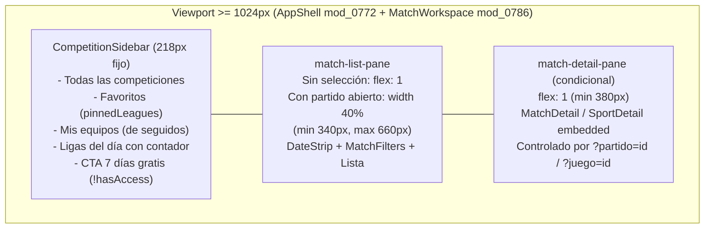

# 02 — UX, Sistema de Diseño, Caché, Persistencia y Funcionalidades Cliente de Astra AI (`astraanalisis.com`)

**Investigación Forense Pasiva (REA) para PitchLab**  
**Rol:** Subagente 1 — Líder de Arquitectura Frontend, Expo Router, PWA y Módulos Cliente  
**Objetivo Analizado:** `https://astraanalisis.com/` (Astra AI v`1.0.0`)  
**Referencias Cruzadas:** [01-arquitectura-frontend-y-rutas.md](file:///C:/Users/T490s/.gemini/antigravity/worktrees/PitchLab/analyze_pitchlab_competitor_rea/Reportes/analisis-astra/01-arquitectura-frontend-y-rutas.md) · [module-map.json](file:///C:/Users/T490s/.gemini/antigravity/worktrees/PitchLab/analyze_pitchlab_competitor_rea/Reportes/analisis-astra/evidence/module-map.json)

---

## 1. Filosofía Visual y Resumen de UX

El análisis exhaustivo de los 98 módulos first-party de Astra AI (`__common-a2fe500f62154dabe8c8c7eb8fa31525.js`, SHA-256 `c4a4cead00034bc5492bc041e4fdafa13bb057d5f9e58b9ac75e0c356c017492`, y los 22 chunks de ruta auditados en `ev_06e64c17364017f73c15a045e58ee4b196cf76f035801944f4802b98175dffcb` / `ev_79b34436d8a68b8d8e0cfa57dfe273135f3851875b2be7776fe5408425768de5`) revela una dirección de producto sumamente disciplinada que combina tres pilares:

1. **Estética "Monochrome Dark Luxury" (`[OBSERVADO]` en `mod_0775` y `mod_1007`)**: A diferencia de las casas de apuestas tradicionales saturadas de verde neón o amarillo, Astra AI utiliza una escala acromática fría de carbón azulado (`#0B0F10` -> `#131819` -> `#22292B`) donde el color primario de acento (`C.accent`) es **blanco puro frío (`#F5F7F7`)** con tinta invertida (`#0B0F10`). Incluso los 5 iconos 3D de deportes (`mod_1007`) prescinden del naranja del balón de básquetbol o del café del ovoide NFL para renderizarse como **esculturas metálicas monocromáticas en plata/titanio**. El color cromático se reserva estrictamente para señales semánticas de alta densidad informativa (en vivo `#FF394C`, acierto verificado `#5FD39A`, partido destacado `#5BC8F5`, momentum local `#50BF68` vs. visita `#8C83FF`).
2. **Arquitectura Adaptable "Dos Apps en Una" (`[OBSERVADO]` en `mod_0772`, `mod_0786`, `mod_1014`)**: Por debajo de `1024px` se comporta como una aplicación móvil nativa con tira de fechas táctil y barra flotante traslúcida **Liquid Glass** (`GlassSportsBar`) controlada por gestos continuos (`PanResponder`) y resortes físicos. A partir de `1024px` se transforma en una **terminal analítica de 3 paneles** (`CompetitionSidebar` + lista maestra al `40%` + panel de detalle embebido vía `?partido=` / `?juego=`), interceptando incluso enlaces directos a `/partido/[id]` para no abandonar jamás el workspace multi-columna.
3. **Arquitectura "Local-First Ligera + Polling Inteligente" (`[OBSERVADO]` en `mod_0779`, `mod_1009`, `mod_1016`)**: Las preferencias no críticas (ligas favoritas, hasta 20 partidos seguidos con hasta 6 métricas en vivo cada uno, y descarte secuencial de avisos) viven íntegramente en `AsyncStorage` (`window.localStorage`) sin requerir cuenta, mientras que la actualización de marcadores se apoya en cachés de promesas en memoria (`createScheduleCache`) y timers `setInterval` que se pausan automáticamente cuando la pestaña pierde visibilidad (`document.visibilityState === 'hidden'`).

---

## 2. Sistema de Diseño Completo (`mod_0775` y Módulos UI)

### 2.1 Breakpoints y Constantes Espaciales (`[OBSERVADO]`)

| Constante | Valor | Módulo Fuente | Uso Exacto en el Layout |
| :--- | --: | :-: | :--- |
| `DESKTOP_MIN` | `1024` px | `mod_0775` | Umbral único de `useIsDesktop()` (`width >= 1024` en `mod_0779`): activa `desktop-topbar`, `MatchWorkspace` de 3 paneles y redirecciones `<Redirect>` de rutas de detalle hacia query params. |
| `MOBILE_MAX` | `680` px | `mod_0775` | Ancho máximo de lectura en contenedores móviles/centrados y páginas documentales (`nosotros`, `privacidad`, `terminos`, `cuenta` usa `480px`, `instalar` `520px`, `siguiendo` `560px`, `equipo` `720px`, `administracion` `940px`). |
| `BOTTOM_BAR_SPACE` | `120` px | `mod_0772` | `paddingBottom` inyectado en listas móviles para evitar que la barra flotante `GlassSportsBar` (`height: 78` + safe area + leyenda) oculte el último partido. |

### 2.2 Paleta de Colores: Objeto `C` (`mod_0775`) y Colores Semánticos Auxiliares (`[OBSERVADO]`)

#### A. Los 19 Tokens Oficiales de `C` (`mod_0775` en `__common-a2fe500f62154dabe8c8c7eb8fa31525.js`)
| Token | Valor Hex / RGBA | Rol Semántico en la Interfaz |
| :--- | :--- | :--- |
| `C.bg` | `#0B0F10` | Fondo raíz de todas las pantallas, `<Stack>` y áreas de trabajo. |
| `C.surface` | `#131819` | Superficie primaria de tarjetas (`Card`, `LeagueSection`, `WinBox`, cabeceras, sidebar). |
| `C.raised` | `#22292B` | Superficie elevada para estados hover, badges secundarios y controles interactivos. |
| `C.inset` | `#0F1415` | Fondo hundido para campos de texto (`Field`), cajas internas de métricas y `Segmented`. |
| `C.line` | `#222A2C` | Divisores finos de `1px` entre filas de partidos, tablas y cabeceras. |
| `C.border` | `#303A3D` | Bordes estructurales de tarjetas destacadas, inputs enfocados suaves, botones `ghost` y modales. |
| `C.chip` | `#1C2426` | Fondo de píldoras de filtro (`MatchFilters`), pestañas inactivas y atajos (`MatchShortcut`). |
| `C.crest` | `#242D30` | Círculo contenedor de respaldo para escudos de equipos (`TeamLogo`) y avatares (`ProfileAvatar`). |
| `C.tile` | `#ECEEF2` | Mosaico claro cuadrado-redondeado detrás de `LeagueLogo` (`mod_0783`) para garantizar contraste de logos oscuros (p. ej. Premier League o UEFA). |
| `C.tileInk` | `#2A2E36` | Color de las iniciales de texto dentro de `LeagueLogo` cuando no existe imagen de liga. |
| `C.ink` | `#F5F7F7` | Texto primario de máximo contraste, marcadores e iconos activos. |
| `C.soft` | `#BEC7CA` | Texto secundario de lectura larga (párrafos de análisis IA, documentos legales, nombres de ligas). |
| `C.muted` | `#919DA2` | Texto terciario (subtítulos, etiquetas de métricas, estados pre-partido, pestañas inactivas). |
| `C.faint` | `#68757A` | Texto tenue (placeholders de inputs, descargos de responsabilidad, separadores `·`). |
| `C.accent` | `#F5F7F7` | Acento primario monocromático (botones `primary`, píldoras activas, bordes de foco). |
| `C.onAccent` | `#0B0F10` | Texto e iconos oscuros renderizados sobre fondos `C.accent`. |
| `C.accentWash` | `rgba(255,255,255,0.08)` | Lavado translúcido para filas seleccionadas en desktop, insignias `IA` y hover sutil. |
| `C.live` | `#FF394C` | Rojo carmesí vibrante para el punto pulsante/indicador `EN VIVO`, minutos en juego y tarjetas rojas. |
| `C.win` | `#5FD39A` | Verde esmeralda menta para pronósticos acertados (`WinBox`), notas de éxito (`Note kind="ok"`) y vigencia activa. |

#### B. Colores Hardcodeados Fuera de `C` Detectados en Módulos Específicos (`[OBSERVADO]`)
- **`#07080A`** (`index.html`, `mod_0393`): Fondo ultraprofundo del documento HTML, `theme-color` de la PWA y splash nativo.
- **`#000000`** (`mod_0832` `LaunchSplash`): Negro absoluto durante los `2,000 ms` de la cortina inicial de marca.
- **`#5BC8F5`** (`mod_0774` `MatchRow` y `mod_0868` `DetailHeader`): Azul celeste eléctrico reservado para etiquetas editoriales de `match_marks` y `Selección de Astra`.
- **`#C42A44` / `#FF7A8A`** (`mod_0838` `Button` / `Note`, `mod_0755` admin): Rojo destructivo para el botón `danger` (`/eliminar-cuenta`) y rosa coral legible sobre fondo oscuro para mensajes de error.
- **`#50BF68` y `#8C83FF`** (`mod_0869` `MomentumCard` y `LiveStatistics`): Par cromático daltónico-amigable **Verde Local (`#50BF68`) vs. Violeta Visita (`#8C83FF`)** en gráficos de presión minuto a minuto y barras comparativas.
- **`#164B35` y `#57292C`** (`mod_0865` `TeamProfileScreen`): Fondos semánticos de insignias de racha histórica (`G` Ganado en verde bosque / `P` Perdido en vino oscuro).

### 2.3 Tipografía: Objeto `F` (`mod_0775`) y Fuentes Web `.woff2` (`mod_0822`–`0831`, `[OBSERVADO]`)

Todas las fuentes se precargan en `RootLayout` (`mod_0754`) mediante `useFonts(APP_FONTS)` (`mod_0822`) con política **`FontDisplay.SWAP`**, evitando bloqueo indefinido de texto (FOIT):

| Token `F` | Familia / Peso | Archivo Asset Empaquetado (`/assets/...`) | Módulo | Aplicación Tipográfica Exacta |
| :--- | :--- | :--- | :-: | :--- |
| `F.display` | `Sora_800ExtraBold` | `Sora_800ExtraBold.03b61ed53fecad7ae48be6d459045e67.woff2` | `mod_0826` | Marcadores grandes en vivo/finales, titulares hero y KPIs principales. |
| `F.displayBold` | `Sora_700Bold` | `Sora_700Bold.c263194ab532d4bc28e68daebf8489a2.woff2` | `mod_0825` | Títulos de páginas (`Title`), encabezados de modales (`TrialWelcome`), precios y valores de `StatCard`. |
| `F.displaySemi` | `Sora_600SemiBold` | `Sora_600SemiBold.37aa816f225710668f86958f18aa3fc3.woff2` | `mod_0824` | Subtítulos de tarjetas, nombres de secciones (`Tendencias · Hoy`) y porcentajes en `WinBox`. |
| `F.light` | `Figtree_400Regular` | `Figtree_400Regular.0cca936acae12ecc9d9701858573efb8.woff2` | `mod_0827` | Cuerpo narrativo extenso (análisis IA de Claude, FAQ, privacidad y términos). |
| `F.italic` | `Figtree_400Regular_Italic` | `Figtree_400Regular_Italic.2ba6eb85f2edffb444a2aaa318c566e0.woff2` | `mod_0828` | Firma institucional `"Astra Analysis"` en `LaunchSplash` y barra inferior móvil, notas aclaratorias. |
| `F.body` | `Figtree_500Medium` | `Figtree_500Medium.0710568e35ac185e42fa1b848529938f.woff2` | `mod_0829` | Texto estándar de interfaz, inputs, nombres de equipos no resaltados y metadatos. |
| `F.bodySemi` | `Figtree_600SemiBold` | `Figtree_600SemiBold.5aadf4f256256c0f203a44b73bcfda4d.woff2` | `mod_0830` | Pestañas, chips de filtro, nombres de ligas, etiquetas de botones secundarios y filas de tablas. |
| `F.bodyBold` | `Figtree_700Bold` | `Figtree_700Bold.db913db65ba64eddc3928ba88b0a4ded.woff2` | `mod_0831` | Botones CTA primarios, equipo ganador en `MatchRow`, badges `EN VIVO` e `IA`. |
| `F.time` | `Arimo_600SemiBold` | `Arimo_600SemiBold.d39c110135b2d9a08ce628df62d7a30e.woff2` | `mod_0823` | Columnas de hora de inicio (`19:00`), minutos de partido y cronómetros numéricos alineados. |

> **Detalle de ingeniería UI (`[OBSERVADO]`):** En marcadores, cuotas decimales, porcentajes de `WinBox`, tablas de posiciones y relojes de enfriamiento, Astra aplica sistemáticamente `fontVariant: ['tabular-nums']` para impedir saltos horizontales de layout cuando cambian los dígitos en vivo.

### 2.4 Kit de Componentes Compartidos e Iconografía 2D / 3D (`[OBSERVADO]`)

1. **Primitivas de Página y Formulario (`mod_0838`)**:
   - `<PageFrame title maxWidth backHref>`: Estructura uniforme de todas las páginas fuera de `(tabs)` con barra superior de `56px`, botón circular `Volver` (que ejecuta `router.back()` si `router.canGoBack()` es verdadero o navega a `backHref ?? '/'`), `<AstraLogo size={26} />` centrado absolutamente con `pointerEvents="none"` y `<ScrollView keyboardShouldPersistTaps="handled">`.
   - `<Card>`, `<Title>`, `<Body>`, `<Field>` (borde reactivo `focused ? C.accent : C.border`), `<Button>` (`kind: 'primary' | 'danger' | 'ghost'`, bloqueo de doble clic y `ActivityIndicator`), `<Note>` (`kind: 'error' | 'ok'` con `accessibilityLiveRegion="polite"`) y `<Segmented>` (selector deslizable de 2+ opciones para Login/Registro).
2. **Logos con Resiliencia Visual (`mod_0783` + `mod_0837`)**:
   - `<AstraLogo>`: Renderiza el trazado vectorial `LOGO_PATH` (`viewBox="0 0 1022 549"`, proporción `1.861566:1`).
   - `<TeamLogo>`: Usa `<Image>` de `expo-image` con `cachePolicy="memory-disk"` y `transition={120}`. Si `logo` es `null` o dispara `onError`, conmuta en estado local `failed = true` hacia un círculo `C.crest` con `initials(name)` (máx. 2 letras generadas por `mod_0777` omitiendo conectores vacíos).
   - `<LeagueLogo>`: Envuelve el escudo de la competición dentro de una loseta clara `C.tile` (`#ECEEF2`, `borderRadius: round(size * 0.26)`) escalando la imagen interna al `68%`, resolviendo de raíz el problema clásico de logos de ligas negros/azul marino invisibles en interfaces dark-mode.
3. **Iconografía Vectorial Propia 2D (`mod_0789`) y 3D Escultórica (`mod_1007`)**:
   - **`mod_0789` (23 símbolos exportados)**: Librería cero-dependencias externas sobre `react-native-svg` (`SearchIcon`, `CloseIcon`, `CalendarIcon`, `StarIcon` con relleno dinámico, `BackIcon`, `ShareIcon`, `ChevronIcon` rotatorio, `BallIcon`, `HockeyIcon`, `GoalIcon`, `SubstitutionIcon`, `StadiumIcon`, `WhistleIcon`, `BaseballIcon`, `BasketballIcon`, `SparkIcon` de IA, `UserIcon`, `CheckIcon`, `MailIcon`, `TelegramIcon`, `InstagramIcon`, `AmericanFootballIcon`, `FlameIcon`).
   - **`mod_1007` (`Sport3DIcons`, `24,995` bytes)**: Cinco ilustraciones `64×64` (`Football3DIcon`, `Hockey3DIcon`, `Basketball3DIcon`, `AmericanFootball3DIcon`, `Baseball3DIcon`) diseñadas con hasta **7 gradientes `<RadialGradient>` y `<LinearGradient>` cada una** (tonos `#FFFFFF` -> `#D9DEE3` -> `#8C969E` -> `#2B3238` -> `#0D1114`). Incluyen elipse de sombra proyectada en la base, volumen esférico/elipsoidal con luz especular superior-izquierda, costuras punteadas (`strokeDasharray`), gajos pentagonales de balón de fútbol, disco estriado de hockey con brillo lateral y anillo de luz de rebote (`rim light`). Se renderizan a `26px` en la barra desktop y a `30px` dentro de `GlassSportsBar` móvil.

---

## 3. Shell Adaptable, Navegación Física y Avisos Secuenciales

### 3.1 Secuencia de Inicio y Orquestación Anti-Ruido de Banners (`[OBSERVADO]`)
1. **`LaunchSplash` (`mod_0832` invocado por `mod_0754`)**: Al cargar la app en frío, un `setTimeout` de **`2,000 ms`** mantiene visible una capa absoluta negra (`#000000`, `zIndex: 10000`) con `<AstraLogo>` al `60%` del ancho de ventana (tope `320px`) y el texto en cursiva `Astra Analysis`.
2. **`TrialWelcome` (`mod_0833`)**: Únicamente cuando `splashDone === true`, `auth.loading === false`, `!user` (visitante no autenticado) y la ruta actual **no** pertenece al conjunto excluido (`/cuenta`, `/confirmado`, `/restablecer`, `/eliminar-cuenta`, `/pago`, `/administracion`, `/privacidad`, `/terminos`, `/nosotros`), presenta un modal invitando a activar **`7 días de acceso ilimitado a Astra AI`** (`Comenzar prueba gratis` -> `/cuenta` o `Explorar primero`). Su cierre vive solo en estado React de memoria (`dismissed`), por lo que reaparece en nuevas recargas completas de visitantes anónimos.
3. **Cadena Secuencial `AppAnnouncements` (`mod_1012`) -> `NbaLaunchNotice` (`mod_1013`)**:
   - Ubicada dentro de `AppShell` justo debajo del carrusel de tendencias.
   - `AppAnnouncements` verifica primero si la app ya corre instalada (`installed`) o si `'astra.notice.install-2026-10-21.dismissed' === '1'` en `AsyncStorage`. Si **no** ha sido descartado, muestra el banner `Instala Astra AI · Abre partidos y análisis desde tu pantalla de inicio` con botón `Instalar` y botón `×`.
   - **Regla de no-apilamiento:** Solo cuando el aviso de instalación no aplica o ya fue cerrado (`!visible`), `AppAnnouncements` retorna `<NbaLaunchNotice />` (`mod_1013`), el cual verifica `'astra.notice.nba-launch-2026-10-21.dismissed'` (ocultándose automáticamente si el usuario ya está en `/nba`) y promociona `Nuevo deporte · Nuestra IA de NBA ya llegó` con `<Basketball3DIcon size={38} />`.

### 3.2 Workspace Maestro-Detalle de Escritorio (`>= 1024px`, `mod_0772` + `mod_0786`, `[OBSERVADO]`)

- **Sincronización del Buscador Superior (`InterfaceSearchContext`, `mod_0785`)**: En escritorio, el `<SearchBar>` no se dibuja dentro de la columna central sino en la `desktop-topbar` global (`mod_0772`), compartiendo `[search, setSearch]` vía contexto con `FootballScreen` (`mod_0773`) o `SportScreen` (`mod_0790`), y limpiándose automáticamente al cambiar `pathname` entre deportes.
- **Derivación Inteligente de `Mis equipos` en `CompetitionSidebar` (`mod_0786`)**: Astra no tiene una tabla separada de "equipos seguidos"; en su lugar, `CompetitionSidebar` inspecciona en tiempo real la lista `followed` de `useFollowed()`, extrae los pares únicos `(sport, teamId, name, logo)` de todos los partidos seguidos por el usuario y genera accesos directos hacia `/equipo/[sport]/[id]`.

### 3.3 Física Liquid Glass en Móvil (`< 1024px`, `GlassSportsBar` `mod_1014`, `[OBSERVADO]`)
En viewports menores a `1024px`, `AppShell` oculta la barra superior de deportes y ancla en la zona inferior (`bottom: max(insets.bottom, 10)`) el componente `GlassSportsBar`:
- **Capas ópticas:** Contenedor `height: 78`, `maxWidth: 440`, `borderRadius: 39`, con `BlurView` (`intensity={65}`, `tint="dark"`, `blurTarget={targetRef}` apuntando al `BlurTargetView` de `AppShell`), reforzado en Web con `backdropFilter: 'blur(26px) saturate(165%)'`, `WebkitBackdropFilter: 'blur(26px) saturate(165%)'`, fondo translúcido `rgba(18, 24, 26, 0.72)` y borde especular `rgba(255, 255, 255, 0.14)`.
- **Lente interactivo con `PanResponder` y resortes:**
  - Calcula el ancho de cada una de las 5 celdas (`slotWidth = innerWidth / 5`) y posiciona una cápsula activa (`backgroundColor: 'rgba(255, 255, 255, 0.13)'`, borde `rgba(255, 255, 255, 0.22)`).
  - Al tocar o arrastrar horizontalmente el dedo sobre la barra (`onMoveShouldSetPanResponder: |dx| > 4`), convierte la posición `x` en índice `[0..4]` mediante `sportIndexAt` (`mod_1015`), anima la traslación con `Animated.spring(..., { damping: 20, stiffness: 220, mass: 0.6 })` y amplifica la escala de la lente a **`1.07x`** (`{ damping: 16, stiffness: 260 }`), navegando con `router.replace(href)` al soltar el dedo.
  - **Accesibilidad:** Consulta `AccessibilityInfo.isReduceMotionEnabled()` y se suscribe a `reduceMotionChanged`; si el usuario activó reducción de movimiento en su sistema operativo, reemplaza todas las animaciones `spring` por `setValue` instantáneo.

### 3.4 Algoritmo Multi-Deporte de `TrendingMatches` (`mod_0788`, `[OBSERVADO]`)
El carrusel horizontal `Tendencias · Hoy` ejecuta cada **`60,000 ms`** un `Promise.allSettled` consultando en paralelo el día actual (`startOfDay(new Date())`) de los **5 deportes** (`fetchDay` + `fetchSportDay` para `nhl`, `nba`, `mlb`, `nfl`):
1. Puntúa el estado del encuentro: **En vivo (`0`) > Próximo (`1`) > Finalizado (`2`)** (descartando partidos cancelados/pospuestos).
2. En Fútbol, aplica prioridad de élite verificando pertenencia al conjunto `FEATURED_FOOTBALL_LEAGUES = new Set([2, 3, 39, 140, 135, 78, 61, 262, 94])` (UEFA Champions League `2`, Europa League `3`, Premier League `39`, LaLiga `140`, Serie A `135`, Bundesliga `78`, Ligue 1 `61`, **Liga MX `262`** y Primeira Liga `94`), desempatando por prioridad de predicción IA y hora de arranque.
3. Selecciona hasta **`4` partidos destacados por deporte** (`perSportCap = 4`) y los intercala/ordena globalmente hasta un máximo de **`20` tarjetas** (`maxTotal = 20`), garantizando diversidad de ligas incluso en sábados saturados de fútbol europeo.

---

## 4. Caché en Memoria, Polling y Persistencia Local

### 4.1 Arquitectura de `createScheduleCache` (`mod_1009`) y Cachés en Memoria (`[OBSERVADO]`)

`mod_1009` implementa una fábrica minimalista y efectiva de caché de promesas (`createScheduleCache(ttlMs = 30000)`):
- Mantiene un `Map` interno donde cada entrada guarda `{ expiresAt: number, promise: Promise<T> }`.
- **Deduplicación en vuelo + caché temporal:** Si dos componentes (por ejemplo `FootballScreen` y `TrendingMatches` al montar simultáneamente en `/`) piden la misma llave `YYYY-MM-DD` antes de `expiresAt`, **reciben exactamente la misma instancia `Promise`** sin duplicar queries a Supabase.
- **Resiliencia ante errores:** Adjunta `.catch(() => { if (cache.get(key) === entry) cache.delete(key); })` para purgar de inmediato promesas rechazadas y no envenenar el caché durante 30 segundos si hubo un corte momentáneo de red.
- **Acotación de memoria:** Antes de insertar una llave nueva, si `cache.size >= 14` (equivalente a 2 semanas de navegación de fechas), desaloja en orden FIFO la entrada más antigua (`cache.delete(cache.keys().next().value)`).

#### Matriz Completa de Cachés y Deduplicadores en Memoria del Cliente (`[OBSERVADO]`)

| Módulo | Subsistema | Estructura | TTL | Capacidad Máx. | Comportamiento Especial |
| :-: | :--- | :--- | --: | --: | :--- |
| `mod_1009` (`0776`, `1011`) | `createScheduleCache` (Fútbol y US Sports por día) | `Map<dayKey, {expiresAt, promise}>` | `30 s` (`30,000 ms`) | `14` llaves por instancia | Deduplica peticiones simultáneas (`Screen` + `TrendingMatches`); purga automática en error. |
| `mod_0866` | `fetchTeamProfile` (Perfiles de equipo) | `Map<sport:id, {expiresAt, data}>` | `2 min` (`120,000 ms`) | `100` equipos | Evita re-invocar la Edge Function `team-profile` al ir y volver desde un partido histórico. |
| `mod_1023` | `fetchMatchOdds` (Cuotas pre-partido) | `cache` `Map` + `inflight` `Map` separados | `15 min` (`900,000 ms`) | `300` partidos | Valida cuotas decimales `> 1`; cachea incluso respuestas vacías `null` para no martillar `match-odds`. |
| `mod_1027` | `fetchNbaPlayers` (Box-score jugadores NBA) | `cache` `Map` + `inflight` `Map` separados | **`60 s`** (en vivo) / **`5 min`** (final) | `100` juegos | TTL adaptativo según si el payload devuelto indica partido finalizado o activo. |
| `mod_1017` | `useAiActivity` (Telemetría `record_ai_view`) | `Map<userId:sport:matchId, timestamp>` | `30 min` (`1,800,000 ms`) | `300` vistas | Evita inflar métricas de lectura IA si el usuario alterna pestañas repetidamente; incluye `AbortController` de `4,000 ms`. |
| `mod_0862` | `confirmationCooldown` (Reenvío email signup) | `Map<emailLower, expiresAt>` | `60 s` (`60,000 ms`) | `100` correos | Protege contra abuso de `supabase.auth.resend` y detecta `over_email_send_rate_limit`. |

### 4.2 Polling Consciente de Visibilidad (`useLoad` en `mod_0779`, `[OBSERVADO]`)
Dado que Astra AI **no abre canales WebSocket de Supabase Realtime**, toda actualización en tiempo real depende del hook `useLoad(loader, deps, refreshMs)` (`mod_0779`) y efectos homólogos:
- En Web, antes de disparar cada tick del `setInterval(..., refreshMs)`, comprueba `document.visibilityState === 'hidden'` y **omite la descarga si la pestaña está en segundo plano**.
- Registra un listener en `document.addEventListener('visibilitychange', ...)`: en cuanto el usuario regresa a la pestaña (`visibilityState !== 'hidden'`), ejecuta una recarga silenciosa inmediata (`silent = true`, sin borrar los datos ya pintados ni mostrar skeleton).

| Frecuencia | Pantallas / Servicios que la Ejecutan (`[OBSERVADO]`) |
| :--- | :--- |
| **Cada `3 s`** (máx. 20 ticks = `60 s`) | `mod_0764` (`/pago/[id]`): Verificación post-checkout `orderStatus(id)` contra Edge Function `payments`. |
| **Cada `30 s`** (`30,000 ms`) | `mod_0784` (`MatchDetail`) y `mod_0867` (`SportDetail`): `fetchLiveMatch` sobre tabla `match_live` (marcador al segundo, minuto, eventos, momentum y estadísticas en vivo) cuando el partido no ha terminado. |
| **Cada `60 s`** (`60,000 ms`) | Carteleras del día actual en `FootballScreen` (`mod_0773`) y `SportScreen` (`mod_0790`), `TrendingMatches` (`mod_0788`), `FollowedProvider` (`mod_0835`), `fetchFixture`/`fetchSportGame` en fichas abiertas y `NbaPlayersCard` (`mod_1026`) en juegos en vivo. *(Para fechas pasadas o futuras el polling de cartelera se desactiva: `refreshMs = 0`)*. |
| **Cada `5 min`** (`300,000 ms`) | `AuthProvider` (`mod_0834`): refresco de permisos `my_access`; `StandingsCard` (`mod_1020`): tabla de posiciones; `NbaPlayersCard` en juegos terminados. |
| **Cada `15 min`** (`900,000 ms`) | `MatchOddsCard` (`mod_1022`): refresco de cuotas pre-partido. |
| **Cada `45 min`** (`2,700,000 ms`) | `AuthProvider` (`mod_0834`): regeneración proactiva de `createSignedUrl(avatar_path, 3600)` antes de que caduque la URL firmada de `60 min` del avatar. |

### 4.3 Inventario Exacto de Llaves en `AsyncStorage` / `window.localStorage` (`[OBSERVADO]`)

| Llave Exacta en `localStorage` | Módulo Lector/Escritor | Esquema del Valor Almacenado | Propósito y Reglas de Validación |
| :--- | :-: | :--- | :--- |
| `sb-bbfjdshvlcynngjdkvsk-auth-token` | `mod_0778` + `@supabase/auth-js` (`mod_0965`) | Objeto JSON de sesión GoTrue (`access_token`, `refresh_token`, `expires_at`, `user`) | **`[OBSERVADO en ev_42e6c731...]`** Persistencia de sesión autenticada y auto-refresh de JWT. *(Valores de tokens omitidos por protocolo de seguridad).* |
| `astra.pinnedLeagues` | `mod_0779` (`usePinnedLeagues`) | `number[]` (JSON, p. ej. `[262, 39, 2]`) | IDs numéricos de ligas de fútbol marcadas con estrella (`Favoritos`), ordenadas al tope de `FootballScreen` y `CompetitionSidebar`. |
| `astra.followed-matches.v1` | `mod_0835` + `mod_1016` (`parseFollows`) | `Array<{ sport: 'football'\|'nhl'\|'mlb'\|'nba'\|'nfl', id: number, home: string, away: string, homeLogo: string\|null, awayLogo: string\|null, league: string, kickoff: string, addedAt: number, metrics?: Array<{ key: string, label: string }> }>` | Lista local de partidos y métricas en vivo seguidas en el dispositivo. Sanitizada estrictamente por `parseFollows`: máx. **`20` partidos** (`FOLLOW_LIMIT`) y **`6` métricas por partido** (`FOLLOW_METRIC_LIMIT`). |
| `astra.notice.install-2026-10-21.dismissed` | `mod_1012` (`AppAnnouncements`) | `"1"` (string literal) | **`[OBSERVADO en código y en ev_42e6c731...]`** Marca como cerrado el banner primario de instalación PWA y desbloquea la evaluación del siguiente aviso. |
| `astra.notice.nba-launch-2026-10-21.dismissed` | `mod_1013` (`NbaLaunchNotice`) | `"1"` (string literal) | **`[OBSERVADO en código y en ev_42e6c731...]`** Marca como cerrado el banner promocional del lanzamiento del modelo IA de NBA. |

*(Adicionalmente, en el tour autenticado `ev_42e6c731...` se observa que el runtime de `supabase.auth` utiliza llaves efímeras de sincronización entre pestañas cuando `navigator.locks` no aplica).*

### 4.4 Modo `DEMO` (`mod_0778`, `mod_1008`, `mod_1011`): Activación y Hallazgos Forenses (`[OBSERVADO]`)
1. **Cuándo se activa:** En `mod_0778`, el código evalúa si las constantes de URL y llave publicable de Supabase están presentes; de ser así, crea el cliente `supabase` y exporta `DEMO = (supabase === null)`. Dado que en el bundle de producción ambas constantes están incrustadas literalmente (`https://bbfjdshvlcynngjdkvsk.supabase.co` y `sb_publishable_...`), **`supabase` jamás es `null` y `DEMO` vale `false` de forma permanente en producción**. Su único propósito es permitir desarrollo de UI offline / previews sin secretos configurados, empaquetando ~`22 KB` de datos sintéticos muertos en `__common-*.js`.
2. **Estructura revelada por los fixtures `DEMO`:**
   - `mod_1008` (`demoFixtures` de Fútbol): Contiene 5 partidos de **Liga MX (`id: 262`, `Clausura - 14`)** (América vs Cruz Azul, Tigres UANL vs Monterrey, Guadalajara vs Toluca, Pumas UNAM vs León, Pachuca vs Santos Laguna) y 1 de **LaLiga (`id: 140`)** (Real Madrid vs Barcelona), revelando la firma interna del modelo de fútbol: `model_version: "league_v2"` y el objeto `params: { lambda_home, lambda_away, rho, corners_r, fou_r }`.
   - `mod_1011` (fixtures `DEMO` de NHL, MLB, NBA y NFL): Incluye una nota de demostración escrita por los propios autores de Astra que **confirma explícitamente el LLM utilizado en producción**:
     > *`"Partido de demostración con datos ilustrativos. En la app real el análisis sale del modelo y de Claude."`* (`mod_1011`, `__common-a2fe500f62154dabe8c8c7eb8fa31525.js`).

---

## 5. Análisis Profundo de Funcionalidades de Producto en Cliente

### 5.1 Sistema de Seguimiento `Mis Partidos` (`siguiendo`, `mod_1016` + `mod_0835` + `mod_0872`, `[OBSERVADO]`)
- **Doble granularidad de seguimiento:** El usuario puede seguir el partido completo desde `FollowButton` (cabecera de `MatchDetail` / `SportDetail`) o pulsar la estrella `FollowStatisticButton` junto a cualquier métrica individual dentro de `LiveStatistics` (p. ej. *Tiros a puerta*, *Tiros de esquina*, *xG*, *Triples* o *Hits*). Si el usuario marca una métrica de un partido que aún no seguía, `toggleMetric` en `mod_0835` **agrega automáticamente el partido a la lista de seguidos** junto con esa métrica.
- **Límites duros en cliente (`mod_1016`):**
  - `FOLLOW_LIMIT = 20`: Al intentar seguir un partido #21, el estado no desborda ni elimina silenciosamente el primero; devuelve estado de límite alcanzado y muestra aviso en UI.
  - `FOLLOW_METRIC_LIMIT = 6`: Hasta 6 estadísticas monitoreadas por partido.
- **Cruce en tiempo real (`withFollowStatistics`, `mod_1016`):** Cada `60 s`, `FollowedProvider` (`mod_0835`) agrupa los IDs seguidos por deporte (`fixtures` para fútbol, `games` para US sports) y descarga en bloque las filas correspondientes de `match_live`, cruzando por clave normalizada (o etiqueta en minúsculas) los valores local/visita de cada estadística elegida.
- **Superficies de visualización (`mod_0872`):**
  - `AppUtilities`: Tira horizontal compacta renderizada permanentemente en `AppShell` cuando el usuario sigue al menos un partido (mostrando marcador en vivo y las primeras **3 métricas** seguidas por tarjeta).
  - `/siguiendo` (`FollowedList`): Gestor dedicado con marcador completo, las **6 métricas** seguidas, borrado individual y botón `Vaciar lista`.

### 5.2 Fichas de Partido, Gráficos SVG en Vivo y Diccionario de Árbitros (`mod_0784`, `mod_0867`, `mod_0868`, `mod_0869`, `mod_1018`–`1028`, `[OBSERVADO]`)
Tanto `MatchDetail` (Fútbol) como `SportDetail` (NHL/MLB/NBA/NFL) organizan la experiencia en **3 pestañas (`MatchTabs`, `mod_0869`)**:

1. **Pestaña `Detalles`**:
   - **`MatchOddsCard` (`mod_1022` + `mod_1023`)**: Solo visible antes del inicio (`matchState === 'upcoming'`); muestra cuotas decimales 1X2 (fútbol) o Ganador incl. prórroga (US sports) obtenidas de la Edge Function `match-odds`.
   - **`MomentumCard` (`mod_0869`)**: Gráfico vectorial `<Svg>` bidireccional minuto a minuto alimentado por `live.momentum`: barras positivas hacia arriba en verde `#50BF68` cuando domina el local y hacia abajo en violeta `#8C83FF` cuando domina el visitante, superponiendo marcadores puntuales de goles y tarjetas rojas sobre la línea de tiempo.
   - **`MatchEvents` (`mod_0869` + `mod_1018`)**: Cronología vertical dividida en `Primer tiempo`, `Segundo tiempo` y `Tiempo extra` (`footballEventPeriods`), diferenciando goles, autogoles, penales, tarjetas amarillas/rojas y sustituciones (`SubstitutionIcon`).
   - **`MatchInfoCard` + `refereeDetails` (`mod_0869` + `mod_1019`)**: Muestra estadio, ciudad, clima y árbitro central. Como los proveedores de datos deportivos suelen entregar únicamente el nombre del árbitro sin nacionalidad, **`mod_1019` incorpora un motor local con normalización Unicode NFD, 38 códigos de país con emoji de bandera y un catálogo curado de ~95 árbitros recurrentes** (incluyendo silbantes de Liga MX como César Arturo Ramos, Marco Antonio Ortiz, Adonai Escobedo, Fernando Guerrero, Luis Enrique Santander, Katia Itzel García, más árbitros élite de UEFA, Premier League, LaLiga y CONMEBOL), además de pintar sus promedios históricos de tarjetas amarillas y rojas por partido si vienen en el contexto.
   - **`StandingsCard` (`mod_1020` + `mod_1021`)**: Tabla de clasificación pre-partido que resalta las filas del equipo local y visitante; en fútbol filtra inteligentemente sub-tablas de torneos cortos (`Apertura` / `Clausura`) o grupos de copa para no mezclar fases.

2. **Pestaña `Análisis con IA` (Núcleo Monetizado)**:
   - **Compuerta de Acceso y Telemetría:** Si `!access?.has_access`, renderiza `<Paywall />` (`mod_0863`). Si tiene acceso activo (`paid` o `trial`), ejecuta `useAiActivity(sport, matchId, true)` (`mod_1017`), enviando un RPC `record_ai_view` deduplicado por ventanas de 30 minutos.
   - **`WinBox` (`mod_0868` + `mod_1018`)**: Presenta la distribución de probabilidad del modelo (`Local / Empate / Visita` en fútbol o `Local / Visita` en US sports) resaltando la opción de mayor probabilidad. Si el encuentro ya concluyó (`matchState === 'finished'`), compara la opción principal del modelo contra `resultOutcome` (`mod_1018`) y, cuando coinciden, despliega un sello verde `#5FD39A` con `<CheckIcon>` verificando el acierto. Debajo, si existe fila en `astra_picks` (`mod_1010`), renderiza el bloque destacado **`Selección de Astra`** *(nota forense: en la lista de fútbol `mod_0774`, además del campo dinámico `match_marks`, existe un conjunto cableado `new Set([1636276, 1636288])` que fuerza la etiqueta `"Selección de Astra"` en esos dos `fixture_id` específicos)*.
   - **Tarjetas Cuantitativas (`StatCard`, `mod_0868`)**: En fútbol despliega *Goles esperados (xG del modelo)*, *Ambos equipos anotan*, *Más de 2.5 goles*, *Tiros de esquina proyectados* y *Faltas proyectadas*; en US sports adapta dinámicamente las métricas a totales proyectados (`Over/Under`), margen esperado (`Spread`) y probabilidades por periodo.
   - **Narrativa Estructurada (`footballAnalysisSections`, `mod_1025`)**: Divide el reporte generado por Claude en hasta 6 tarjetas temáticas (`Resumen`, `Goles`, `Tiros de esquina`, `Faltas`, `Contexto`, `A tener en cuenta`). Si el registro de `analyses` en BD carece de texto explícito para córners o faltas pero `predictions` sí contiene `corners_total`/`fouls_total`, `mod_1025` **sintetiza automáticamente en cliente un párrafo estadístico de respaldo** para que la interfaz nunca muestre huecos.

3. **Pestaña `Estadísticas`**:
   - **`LiveStatistics` (`mod_0869`)**: Barras horizontales enfrentadas con gradientes lineales SVG (`#50BF68` vs `#8C83FF`) y botón estrella `FollowStatisticButton` en cada renglón.
   - **`NbaPlayersCard` (`mod_1026`–`1028`, exclusivo NBA)**: Consume la Edge Function `nba-players`, agrupa jugadores por equipo en `Titulares`, `Banca` y `Por confirmar`, ofrece ordenamiento instantáneo por `Puntos`, `Rebotes` o `Asistencias` (`playerGroups`), y al expandir un jugador revela 14 métricas de box-score con cálculo automático de porcentajes de tiro (`shootingPercentage`: `TC`, `3P`, `TL`).

### 5.3 Perfiles de Equipo y Transparencia Matemática de los 5 Modelos (`mod_0865`, `mod_0870`, `mod_1029`, `[OBSERVADO]`)
Al tocar cualquier escudo o nombre de equipo se navega a `/equipo/[sport]/[id]` (`TeamProfileScreen`, `mod_0865`), que cruza datos de la Edge Function `team-profile` (`mod_0866`) con el JSON `prediction.context` del último partido modelado del club (`fetchTeamModel` -> `modelTeamSummary` en `mod_1029`). Cruzando `mod_1029` con `ABOUT_FAQ` (`mod_0870`), quedan completamente documentados los **5 motores estadísticos de Astra AI**:

| Deporte | Arquitectura Matemática Declarada (`mod_0870`) | Variables Extraídas en Cliente por `modelTeamSummary` (`mod_1029`) |
| :--- | :--- | :--- |
| **Fútbol** | **Dixon–Coles** (ataque/defensa ajustados por fuerza de liga y ventaja local + corrección de marcadores bajos) + **Binomial Negativa** para córners y faltas. | Goles esperados a favor/en contra ajustados por rival, medias de tiros de esquina y faltas. |
| **NHL** | Tasas **5 contra 5 de xG** + equipos especiales (**Power Play / Penalty Kill**) + ajuste de **portero confirmado** + simulación **Monte Carlo**. | `xGF/60` y `xGA/60` en 5v5, eficiencia PP/PK y ahorro de goles del guardameta (`GSAx` / SV%). |
| **NBA** | **Ratings ofensivo y defensivo ajustados por calendario**, ritmo de posesiones, descanso/back-to-back + **Elo con margen de victoria (MOV)** sobre distribución **Normal**. | `Offensive Rating`, `Defensive Rating`, `Net Rating`, ritmo (`Pace`) y rating `Elo`. |
| **NFL** | Modelo híbrido de **puntos por partido y EPA por jugada** (ofensivo/defensivo), ajuste de **quarterback, descanso y estadio techado (roof)** + **Elo MOV**. | `EPA/jugada` ofensivo y defensivo, puntos proyectados y rating `Elo`. |
| **MLB** | **Alineación ponderada por wOBA** + abridor (**FIP, xFIP, SIERA**), estado del **bullpen**, **factor de parque** y clima sobre **Binomial Negativa**. | `wOBA` proyectado del lineup, `FIP`/`SIERA` del abridor y `FIP` del bullpen. |

En la pestaña `Últimos partidos` de `TeamProfileScreen`, si un encuentro pasado tiene `stored === true` en la base de Astra, navega directamente a `/partido/[id]` o `/juego/[sport]/[id]`; en caso contrario navega a `/historial/[sport]/[teamId]/[matchId]` (`mod_0760`), garantizando cobertura histórica continua aunque el partido sea anterior a la ventana de predicciones almacenadas.

### 5.4 Cuenta, Filtro de Mayoría de Edad (`18+`), Pipeline Binario JPEG y Flujo de Pago (`[OBSERVADO]`)
1. **Verificación de Edad `>= 18` en Registro (`mod_0757`)**:
   - El formulario `Crear cuenta` exige nombre completo, fecha de nacimiento en formato `DD/MM/AAAA` (auto-formateando las barras `/` mientras el usuario escribe), correo, contraseña (`>= 8` caracteres), confirmación de contraseña y casilla obligatoria de aceptación de Términos, Privacidad y mayoría de edad.
   - Valida calendario real (incluyendo días exactos por mes y años bisiestos), rechaza edades `< 18` o `> 120` años, y envía `full_name` y `birth_date` (`YYYY-MM-DD`) en `options.data` de `supabase.auth.signUp`.
2. **Pipeline Endurecido de Foto de Perfil (`mod_0840` + `mod_0860` + `mod_0859`)**:
   - `ProfileEditor` (`mod_0840`) abre `ImagePicker.launchImageLibraryAsync`, rechaza en origen archivos `> 15 MB` (`15 * 1024 * 1024`), calcula un recorte cuadrado centrado `1:1` sobre `min(width, height)` y redimensiona si supera `512 px` mediante `ImageManipulator.manipulateAsync(..., { compress: 0.8, format: SaveFormat.JPEG, base64: true })`.
   - Antes de tocar la red, `avatarBody` (`mod_0860`) decodifica el Base64 a `ArrayBuffer`, impone un segundo tope estricto de **`2 MB`** post-compresión y **verifica los primeros 3 bytes del binario contra la firma mágica JPEG (`0xFF 0xD8 0xFF`)**, además de validar con regex que la ruta destino cumpla `^[0-9a-f]{8}-...-[0-9a-f]{12}\/avatar\.jpg$` antes de subir con `contentType: 'image/jpeg'` y `upsert: true` al bucket privado `profile-avatars`.
3. **Paywall, Precios y Polling de Checkout (`mod_0863` + `mod_0764`)**:
   - Precio base observado en cliente y términos (`mod_0769` / `mod_0863`): **`$199 MXN` por `30 días`** de acceso único no-autorenovable en Web (con **`7 días de prueba gratis`** si `access.trial_eligible === true`).
   - En Web, `<PayButtons>` ofrece **Pago con tarjeta (Stripe)** y **Mercado Pago**, llamando a `startCheckout(provider)` -> Edge Function `payments` (`action: 'checkout'`).
   - Al regresar del proveedor a `/pago/[id]` (`mod_0764`), una máquina de 6 estados (`checking`, `paid`, `pending`, `failed`, `login`, `error`) consulta `orderStatus(id)` cada `3,000 ms` hasta `20` intentos (`60 s`); en cuanto detecta `'paid'`, ejecuta `refresh()` en `AuthProvider` para desbloquear de inmediato todas las pestañas de `Análisis con IA`.

### 5.5 Consola Interna de Administración (`/administracion`, `mod_0755` + `mod_0839`, `[OBSERVADO]`)
Empaquetada en su propio chunk (`administracion-db0312943212c59d203e733a9a3ecfed.js`, `11,221` B), la ruta `/administracion` expone exactamente qué métricas operativas monitorea el equipo de Astra AI:
- **Control de acceso:** El enlace `Panel de administración` en `/cuenta` y la vista `/administracion` verifican en cliente `isDashboardOwner(user.email)` contra la constante `DASHBOARD_OWNER` (`mod_0839`), mientras que los datos provienen exclusivamente del RPC `admin_dashboard(p_section, p_search, p_page)` protegido en PostgreSQL (`42501` / `PGRST301`).
- **Las 4 Pestañas Operativas (`mod_0755`)**:
  1. **`Resumen`**: Tarjetas KPI de cuentas totales, cuentas activas últimos 7 días (`active_7d`), suscripciones pagadas activas (`paid_active`), pruebas activas (`trials_active`), ingresos últimos 30 días (`revenue_30d_mxn`) e ingresos históricos (`revenue_total_mxn` — aclarando en UI que contabiliza cobros web y excluye comisiones/tiendas nativas si no están conciliadas), serie diaria de 14 días (nuevos registros, usuarios activos, vistas de IA y compras) y desglose de consumo de IA por deporte en los últimos 30 días.
  2. **`Cuentas`**: Directorio buscable (con debounce de `300 ms`) y paginado (hasta página `400`) mostrando nombre, email, estado de acceso (`Pagado`, `Prueba`, `Sin acceso`), fecha de expiración, conteo de lecturas IA y última actividad.
  3. **`Uso de IA`**: Bitácora cronológica alimentada por `record_ai_view` con usuario, deporte, partido consultado y marca de tiempo.
  4. **`Compras`**: Registro de órdenes de pago con proveedor (`Stripe` / `Mercado Pago` / IAP), monto en `MXN`, estado (`paid`, `pending`, `failed`) y fecha.

---

## 6. Síntesis Epistémica: OBSERVADO vs. INFERIDO vs. DESCONOCIDO

### Hechos `[OBSERVADO]`
1. **Tokens de diseño exactos (`mod_0775`)**: 19 colores en `C` (estética monocromática oscura `#0B0F10` / `#F5F7F7` con rojo `#FF394C` y verde `#5FD39A`), 9 variantes tipográficas en `F` (**Sora** 600–800, **Figtree** 400–700, **Arimo** 600) con `FontDisplay.SWAP`, y breakpoints `DESKTOP_MIN = 1024` / `MOBILE_MAX = 680`.
2. **Iconografía 100% propia en SVG**: 23 exports 2D en `mod_0789` y 5 ilustraciones 3D metálicas monocromáticas en `mod_1007`.
3. **Persistencia local acotada y transparente**: 5 llaves en `localStorage` (`sb-bbfjdshvlcynngjdkvsk-auth-token`, `astra.pinnedLeagues`, `astra.followed-matches.v1` con límites `FOLLOW_LIMIT = 20` y `FOLLOW_METRIC_LIMIT = 6`, y 2 banderas fechadas `2026-10-21` de avisos descartados en cascada).
4. **Estrategia de red sin WebSockets**: `createScheduleCache` (`30 s`, máx. `14` entradas) + 5 cachés `Map` especializados + polling HTTP con pausa automática en pestañas ocultas (`document.visibilityState === 'hidden'`).
5. **Revelaciones directas del producto en el bundle**: Uso explícito de **Claude** junto a modelos estadísticos propios (`mod_1011`), fórmulas por deporte (`mod_0870` + `mod_1029`), IDs cableados `Set([1636276, 1636288])` en `mod_0774`, precio base de `$199 MXN / 30 días` con `7 días gratis` (`mod_0769` / `mod_0863`), y validación de magic bytes JPEG `FF D8 FF` en avatares (`mod_0860`).

### Hechos `[INFERIDO]`
1. **Lanzamiento reciente de la vertical NBA y campaña PWA alrededor del 20–21 de octubre de 2026**, inferido por la coincidencia exacta entre `LEGAL_UPDATED = '20 de octubre de 2026'` (`mod_0871`) y los sufijos de versión de las llaves `astra.notice.install-2026-10-21.dismissed` (`mod_1012`) y `astra.notice.nba-launch-2026-10-21.dismissed` (`mod_1013`).
2. **Enfoque comercial primario en México e Hispanoamérica**, inferido por el formateador fijo `es-MX` y moneda `MXN` (`mod_0777`), pasarela Mercado Pago + Stripe (`mod_0863`), jurisdicción mexicana en `/privacidad` y `/terminos`, inclusión de Liga MX (`262`) en el top 9 mundial de `TrendingMatches` (`mod_0788`), fixtures `DEMO` de Liga MX (`mod_1008`) y amplia cobertura de árbitros mexicanos en `mod_1019`.
3. **Modelo de cobro web por periodos prepagados (`30 días`) en lugar de suscripción recurrente automática con tarjeta guardada**, inferido de los textos de `SubscriptionCard` / `Paywall` (`mod_0863`) y `/terminos` (`mod_0769`), lo que reduce fricción de contracargos y simplifica la integración dual con métodos locales de Mercado Pago.

### Aspectos `[DESCONOCIDOS]`
1. **Tasas reales de conversión de `<TrialWelcome>` y `<Paywall>`, usuarios activos y facturación real**, ya que los resultados del RPC `admin_dashboard` están correctamente protegidos del lado servidor en PostgreSQL y nunca se exponen en el código estático ni a cuentas no propietarias.
2. **Prompts exactos del sistema enviados a Claude y pesos entrenados de los modelos estadísticos**, los cuales se ejecutan en pipelines backend/Edge fuera del cliente y solo entregan a la UI las probabilidades calculadas (`predictions` / `game_predictions`) y los textos ya redactados (`analyses` / `game_analyses`).
3. **Comportamiento visual exacto de `expo-glass-effect` (`mod_0670`) en el binario nativo de iOS**, ya que el módulo está enlazado como dependencia de `GlassSportsBar` (`mod_1014`), pero en el target compilado para Web solo se renderiza la rama `BlurView` + CSS `backdrop-filter`.
