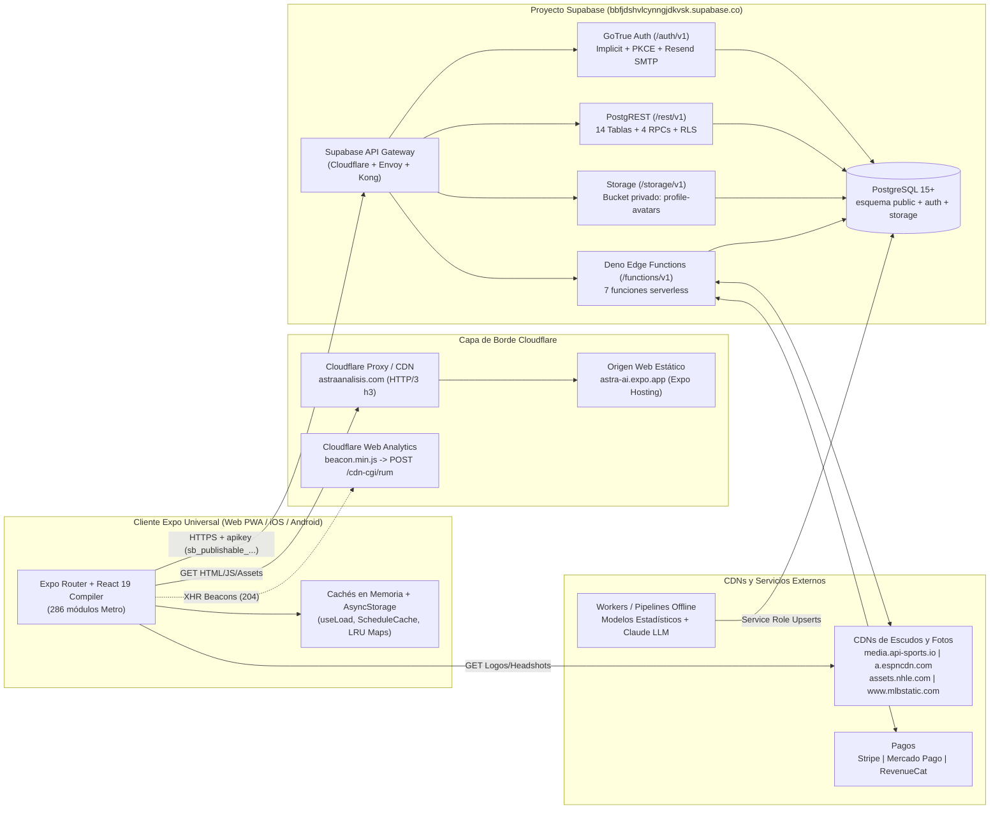

# 03 — Arquitectura Forense de Backend Supabase, Infraestructura Cloud y Esquema PostgreSQL (Astra AI)

> **Alcance y Metodología Forense (Ética y Seguridad)**
> Este documento reconstruye la infraestructura cloud, configuración del SDK de cliente, políticas de Row-Level Security (RLS), almacenamiento de objetos y el esquema relacional PostgreSQL completo de **Astra AI (`https://astraanalisis.com/`)** exclusivamente mediante:
> 1. **Análisis estático** de los 25 chunks JavaScript públicos y 286 módulos Metro extraídos en `Reportes/analisis-astra/app/` y `Reportes/analisis-astra/modules/` (`__common-a2fe500f62154dabe8c8c7eb8fa31525.js`, `entry-2f163e0b9ce05e4953b73986af77f2b7.js` y rutas lazy).
> 2. **Inspección pasiva de capturas legítimas REA**: `01-landing-capture.json` (`ev_65da2d799f8e38fb47969ed42788d109282794ea80635bed7d2772a7977cc222`), `02-authenticated-tour.json` (`ev_42e6c7319eb27372b49758df47887b2764d276a39d760c6d6f0874b7f5d03bc6`) y el bundle de evidencia `rea-evidence-bundle.json` (`ev_87d52f5c34a65dd9f3669f452fc3fd0e3cbb89aa735d2471899965d48008996e`).
>
> **Cumplimiento estricto**: No se invocó ningún endpoint administrativo ni destructivo (`admin_dashboard`, `delete-account`), no se realizaron pruebas activas de evasión de RLS, no se almacenan JWTs de sesión (`access_token` / `refresh_token`) y la clave pública de Supabase se presenta parcialmente redactada.

---

## 1. Infraestructura Cloud, Hosting, CDN y Capa Cloudflare

### 1.1 Topología General de Red y Proveedores Declarados

Astra AI opera una arquitectura **Serverless BaaS (Backend-as-a-Service)** centrada al 100% en **Supabase**, servida en el borde por **Cloudflare** sobre un despliegue web estático/SPA exportado con **Expo Router / Metro Web** y alojado originalmente en **EAS Hosting (`astra-ai.expo.app`)**.

El propio aviso de privacidad del cliente (`mod 766` `privacidad.tsx` y `mod 871`, titular `"Astra Analysis"`, última actualización declarada `"20 de octubre de 2026"`) confirma explícitamente el stack de subprocesadores de infraestructura:
- **Base de datos, autenticación, funciones serverless y almacenamiento**: **Supabase** (`https://bbfjdshvlcynngjdkvsk.supabase.co`).
- **Hosting y despliegue multiplataforma (Web/iOS/Android)**: **Expo / EAS Hosting** (`astra-ai.expo.app` redirigido canónicamente a `https://astraanalisis.com`).
- **Proxy inverso, CDN HTTP/3 y telemetría RUM**: **Cloudflare** (`astraanalisis.com`, `static.cloudflareinsights.com`).
- **Correo transaccional SMTP (confirmación de cuenta y recuperación)**: **Resend** integrado como custom SMTP de Supabase Auth.
- **Pasarelas de pago y monetización**: **Stripe** (tarjeta web), **Mercado Pago** (web México), **Apple App Store / Google Play** orquestados mediante **RevenueCat** (apps nativas).
- ** Inferencia LLM y datos deportivos upstream**: **Anthropic Claude** (declarado en `mod 1011`: *"En la app real el análisis sale del modelo y de Claude"*) alimentado por **API-Sports** (`media.api-sports.io`), **ESPN** (`a.espncdn.com`), **NHL Web API** (`assets.nhle.com`) y **MLB StatsAPI** (`www.mlbstatic.com`).



### 1.2 Cabeceras HTTP Observadas y Configuración de Cloudflare

En las capturas de red `01-landing-capture.json` (`ev_65da2d79...`, proyección REA `environment-manifest` `ev_56aa2d7c5b4019cb1248ab8fa63f39055c7f42f1e0a405b83390c196855bb432`) y `02-authenticated-tour.json` (`ev_42e6c731...`) se observan dos perfiles de cabeceras diferenciados:

#### A. Dominio Principal (`https://astraanalisis.com`)
- **Protocolo negociado**: `h3` (HTTP/3 sobre QUIC, confirmado en `timingsV2.nextHopProtocol: "h3"` de los beacons RUM).
- **Cabeceras de respuesta HTTP (`200 OK` en documentos y chunks `/_expo/static/js/web/*.js`)**:
  `access-control-allow-origin`, `alt-svc`, `cache-control`, `cf-cache-status`, `cf-ray`, `content-encoding`, `content-type`, `date`, `etag` (en assets estáticos), `link` (en documento HTML), `nel` (Network Error Logging de Cloudflare), `priority`, `referrer-policy`, `report-to`, `server`, `server-timing`, `vary`, `x-content-type-options`.
- **Optimización de conexiones tempranas (`app/index.html`)**:
  El HTML raíz inyecta dos directivas `<link rel="preconnect">` antes de descargar el bundle principal (`entry-2f163e0b9ce05e4953b73986af77f2b7.js`, 1.10 MB sin comprimir; `__common-a2fe500f62154dabe8c8c7eb8fa31525.js`, 662 KB):
  ```html
  <!-- Open public-data and crest connections while the app bundle downloads. -->
  <link rel="preconnect" href="https://bbfjdshvlcynngjdkvsk.supabase.co" crossorigin="anonymous" />
  <link rel="preconnect" href="https://media.api-sports.io" />
  ```
  Además, captura tempranamente el evento `beforeinstallprompt` en `window.__astraInstallPrompt` para gestionar la instalación PWA (`manifest.webmanifest` con `lang: "es-MX"`, `display: "standalone"`, `theme_color: "#07080A"`).

#### B. Telemetría Real User Monitoring (Cloudflare Web Analytics)
- **Script inyectado al final de `index.html`**:
  `https://static.cloudflareinsights.com/beacon.min.js/vce701823e78c4301a35b7e07294d87301792088814092`
- **Configuración embebida (`data-cf-beacon`)**:
  - `version`: `"2024.11.0"` (JS runtime reportado: `"2026.10.1"`)
  - `token` (`siteToken`): `"a2e12c4123a6420ca4eb3f4855145537"`
  - `r`: `1`, `spa`: `2` (habilita rastreo automático de History API en Single-Page Applications).
- **Endpoint receptor**: `POST https://astraanalisis.com/cdn-cgi/rum?` (`204 No Content`), recibiendo payloads JSON (`st: 2` XHR / `SendBeacon`) tanto para cargas iniciales (`nt: "navigate"`, incluyendo métricas `memory.usedJSHeapSize`, `firstPaint` y `timingsV2`) como para transiciones internas de Expo Router (`nt: "soft-navigation"`, p. ej. `/cuenta` → `/`). No existe Google Analytics, PostHog, Mixpanel ni Sentry activo en el bundle web.

#### C. Gateway de Supabase (`https://bbfjdshvlcynngjdkvsk.supabase.co`)
- **Ref del proyecto**: `bbfjdshvlcynngjdkvsk`.
- **Cabeceras de solicitud enviadas por el cliente**:
  - PostgREST (`GET/POST /rest/v1/...`): `apikey`, `authorization`, `accept-profile` (en `GET`) / `content-profile` (en `POST`), `x-client-info` (`supabase-js/2.118.0; runtime=web`).
  - GoTrue Auth (`POST /auth/v1/token?grant_type=password`): añade `x-supabase-api-version` (`2024-01-01`) y `x-client-info: gotrue-js/2.118.0`.
- **Cabeceras de respuesta del API Gateway de Supabase (Cloudflare + Envoy)**:
  - Comunes: `cf-cache-status`, `cf-ray`, `sb-gateway-version`, `sb-project-ref`, `sb-request-id`, `strict-transport-security`, `x-content-type-options`, `x-envoy-attempt-count`, `x-envoy-upstream-service-time`, `server-timing`.
  - En respuestas autenticadas con JWT de usuario (`02-authenticated-tour.json`, TX `request-22`, `request-23`, `request-26`..`30`): el gateway inyecta cabeceras de introspección JWT verificadas en el borde: **`sb-jwt-alg`**, **`sb-jwt-iss`** y **`sb-jwt-sub`**, además de `content-profile` y `content-range`.
  - En respuestas de emisión de sesión (`POST /auth/v1/token`): GoTrue expone **`sb-auth-refresh-token-prefix`**, **`sb-auth-session-id`** y **`sb-auth-user-id`**.

---

## 2. Inicialización y Arquitectura del Cliente Supabase (`mod 778` y `mod 936`)

### 2.1 Configuración Exacta en `mod 778`

El módulo central `mod 778` (importado por 18 módulos de negocio y pantallas) instancia un único cliente singleton de `@supabase/supabase-js` **v2.118.0**:

```javascript
// Reconstrucción legible de mod 778 (__common-a2fe500f62154dabe8c8c7eb8fa31525.js)
import AsyncStorage from '@react-native-async-storage/async-storage';
import { createClient } from '@supabase/supabase-js'; // mod 936

export const supabase = createClient(
  'https://bbfjdshvlcynngjdkvsk.supabase.co',
  'sb_publishable_MgTkWL...<REDACTED>...Wdlx', // 46 caracteres, formato Publishable Key
  {
    auth: {
      storage: AsyncStorage,
      persistSession: true,
      autoRefreshToken: true,
      detectSessionInUrl: false,
    },
  }
);

export const DEMO = supabase === null; // false en producción
export const SITE_URL = 'https://astraanalisis.com';
export const REDIRECT_HOSTS = ['astra-ai.expo.app', 'www.astraanalisis.com'];
export const WEB_URL =
  typeof window === 'undefined' || REDIRECT_HOSTS.includes(window.location.hostname)
    ? SITE_URL
    : window.location.origin;
```

### 2.2 Hallazgos Arquitectónicos Clave de `mod 778` + `mod 936`

1. **Uso del nuevo formato `sb_publishable_` (No-JWT)**:
   - Astra AI ya no utiliza la clave clásica `anon` en formato JWT (`eyJ...` firmada con HS256), sino el nuevo esquema de **Supabase Publishable Keys** (`sb_publishable_<22-chars>_<8-chars>`, 46 caracteres en total: `sb_publishable_MgTkWL...<REDACTED>...Wdlx`).
   - **Diferencia crítica en cabeceras hacia Edge Functions (`mod 936` líneas 167–190 y 293–295)**: En `@supabase/supabase-js` v2.118.0, `SupabaseClient` detecta `key.startsWith("sb_publishable_")` y configura `this.functionsFetch` con `{ omitApiKeyAsBearer: true }`. Como resultado:
     - Hacia **PostgREST (`/rest/v1`) y Storage (`/storage/v1`)**, un visitante anónimo envía `apikey: sb_publishable_...` **y** `Authorization: Bearer sb_publishable_...`; al iniciar sesión, `Authorization` cambia a `Bearer <user_access_token>`.
     - Hacia **Edge Functions (`/functions/v1`)**, un visitante anónimo envía **únicamente** `apikey: sb_publishable_...` y **omite por completo** la cabecera `Authorization` (porque el runtime de Edge Functions valida JWTs en `Authorization` y rechazaría una cadena `sb_publishable_...` no-JWT). Cuando el usuario tiene sesión activa, `functionsFetch` adjunta `Authorization: Bearer <user_access_token>`.

2. **Redirección Canónica de Dominio (`mod 754` `_layout.tsx`)**:
   - Al cargar el layout raíz en web, si `window.location.hostname` coincide con `REDIRECT_HOSTS` (`'astra-ai.expo.app'` o `'www.astraanalisis.com'`), ejecuta inmediatamente `window.location.replace(SITE_URL + pathname + search + hash)`. Esto demuestra que el proyecto en EAS Hosting se llama **`astra-ai`** (`astra-ai.expo.app`) y conserva fragmentos `#hash` y `?search` para no romper enlaces de correo de Supabase Auth.

3. **Persistencia de Sesión y Almacenamiento Local**:
   - `storage: AsyncStorage` (`mod 899`) delega en `window.localStorage` en entorno web.
   - `SupabaseClient` (`mod 936` línea 270) deriva la clave exacta de almacenamiento como `` `sb-${hostname.split('.')[0]}-auth-token` `` → **`sb-bbfjdshvlcynngjdkvsk-auth-token`**.
   - Adicionalmente, la aplicación persiste tres claves propias en `AsyncStorage`/`localStorage` (sin sincronización en base de datos):
     - `astra.pinnedLeagues` (`mod 779`): arreglo JSON de `league_id` fijadas por el usuario.
     - `astra.followed-matches.v1` (`mod 835` / `mod 1016`): hasta `FOLLOW_LIMIT = 20` partidos seguidos (`{ sport, id, metrics?: Array<{ key, label }> }`, con máximo `FOLLOW_METRIC_LIMIT = 6` estadísticas seguidas por partido).
     - Cooldown local de reenvío de correo de confirmación (`mod 862`, `CONFIRMATION_COOLDOWN_MS`).

4. **Flujo Híbrido Implicit + PKCE con `detectSessionInUrl: false`**:
   - Al no especificar `flowType` en `mod 778`, el SDK hereda el valor por defecto `flowType: "implicit"` (`mod 936` línea 78), pero desactiva `detectSessionInUrl` para evitar condiciones de carrera con Expo Router y controlar manualmente las pantallas de retorno:
     - **`/confirmado` (`mod 756`)**: inspecciona `window.location.hash` y `window.location.search` en busca de `error`, limpia la URL con `window.history.replaceState(null, '', window.location.pathname)` e instruye al usuario a iniciar sesión.
     - **`/restablecer` (`mod 767`)**: soporta **ambos flujos de GoTrue**:
       1. Si vienen `#access_token` y `#refresh_token` en el fragmento (flujo *Implicit*), ejecuta `supabase.auth.setSession({ access_token, refresh_token })`.
       2. Si viene `?code=...` en el query string (flujo *PKCE*), ejecuta `supabase.auth.exchangeCodeForSession(code)`.
       3. Limpia inmediatamente los tokens de la barra de direcciones (`history.replaceState`), solicita la nueva contraseña (`>= 8` caracteres), invoca `supabase.auth.updateUser({ password })` y cierra la sesión temporal con `supabase.auth.signOut()`.

5. **Validación +18 por Trigger en `auth.users` y Activación Diferida de Prueba Gratis**:
   - En `cuenta.tsx` (`mod 757`), el registro llama a:
     ```javascript
     supabase.auth.signUp({
       email,
       password,
       options: {
         data: { display_name: name.trim(), birth_date: 'YYYY-MM-DD' },
         emailRedirectTo: `${WEB_URL}/confirmado`,
       },
     });
     ```
   - En `mod 834` (`authErrorText`), el patrón `/database error saving new user/i` se traduce explícitamente a **`"Astra AI es solo para mayores de 18 años."`**. Dado que `"Database error saving new user"` es el mensaje estándar de GoTrue cuando un trigger `BEFORE/AFTER INSERT ON auth.users` lanza `RAISE EXCEPTION` en PostgreSQL, esto confirma que **existe un trigger en PostgreSQL que valida la mayoría de edad (`birth_date`) en servidor** e inserta la fila inicial en `public.profiles`.
   - Más aún, la captura autenticada `02-authenticated-tour.json` (`request-22` y `request-23`) revela las marcas de tiempo exactas de la cuenta de prueba:
     - `profiles.created_at`: `"2026-11-14T16:42:22.944028+00:00"`
     - `my_access.trial_ends_at`: `"2026-11-21T16:42:32.434382+00:00"` (exactamente **7 días después de `16:42:32`**, es decir, 9.5 segundos después del `signUp`).
     Esto demuestra que los 7 días de prueba (`trial_days: 7`) se estampan al **confirmarse el correo electrónico (`email_confirmed_at`)** mediante trigger `AFTER UPDATE OF email_confirmed_at ON auth.users`, impidiendo activar pruebas con correos falsos sin confirmar.

6. **Cero Uso de Supabase Realtime (Arquitectura 100% HTTP Polling)**:
   - Aunque el bundle incluye `RealtimeClient` (`mod 944`, conectado a `wss://bbfjdshvlcynngjdkvsk.supabase.co/realtime/v1`), **ningún módulo de la aplicación invoca `.channel(...)`**.
   - Toda actualización "en vivo" se ejecuta mediante el hook `useLoad(key, fetcher, intervalMs)` (`mod 779`), que dispara `setInterval` únicamente cuando `document.visibilityState !== 'hidden'`:
     - Marcadores seguidos y estadísticas seguidas (`mod 835`): cada **60 s** (`6e4` ms) + listener de `visibilitychange`.
     - Lista diaria de partidos del día actual (`mod 749` / deportes): cada **60 s** (`6e4` ms), respaldada por `createScheduleCache` (`mod 1009`, TTL **30 s**, máx. 14 entradas).
     - Ficha de partido `fetchFixture` / `fetchSportGame` (`mod 784` / `mod 867`): cada **60 s** (`6e4` ms).
     - Datos en vivo `fetchLiveMatch` (`mod 784` / `mod 867`): cada **30 s** (`3e4` ms).
     - Estado de suscripción `my_access` (`mod 834`): cada **5 min** (`3e5` ms).
     - Perfil y URL firmada de avatar (`mod 834`): cada **45 min** (`27e5` ms).

---

## 3. Catálogo Exhaustivo de Consultas PostgREST (`.from(...)`) y Storage

En todo el código cliente existen exactamente **16 operaciones PostgREST `.from(...)`** (13 `SELECT` y 3 `UPDATE`, **0 `INSERT`/`UPSERT`/`DELETE` directos desde cliente**) y **3 operaciones sobre Supabase Storage**, distribuidas en 9 módulos:

| # | Módulo | Función | Tabla / Bucket | Operación y `.select(...)` Exacto | Joins FK Embebidos | Filtros, Orden y Límite | Caché / Polling Cliente |
|---|---|---|---|---|---|---|---|
| 1 | `mod 776` | `fetchDay` | `fixtures` | `SELECT id,kickoff,status,elapsed,round,home_goals,away_goals,league:leagues!inner(id,name,country,logo,flag,sort_order),home:teams!fixtures_home_id_fkey(id,name,logo),away:teams!fixtures_away_id_fkey(id,name,logo),forecast_ready,analysis_ready,mark:match_marks(label)` | `leagues!inner`, `teams!fixtures_home_id_fkey`, `teams!fixtures_away_id_fkey`, `match_marks` | `.gte('kickoff', start)` `.lt('kickoff', end)` `.order('kickoff', { ascending: true })` | `ScheduleCache` TTL 30s (máx. 14 días) + `useLoad` 60s si es hoy |
| 2 | `mod 776` | `fetchFixture` | `fixtures` | `SELECT id,season,kickoff,status,elapsed,round,venue,referee,home_goals,away_goals,ft_home,ft_away,forecast_ready,analysis_ready,league:leagues!inner(id,name,country,logo,flag,sort_order),home:teams!fixtures_home_id_fkey(id,name,logo),away:teams!fixtures_away_id_fkey(id,name,logo),prediction:predictions(*),analysis:analyses(sections,created_at)` | `leagues!inner`, `teams` (x2), `predictions(*)`, `analyses` | `.eq('id', fixtureId)` `.maybeSingle()` | `useLoad` clave `fx-${id}-${has_access?1:0}` cada 60s |
| 3 | `mod 776` | `searchTeams` (próximos) | `fixtures` | Mismo `SELECT` de `fetchDay` (`c`) | `leagues!inner`, `teams` (x2), `match_marks` | `.or('home_id.in.(...),away_id.in.(...)')` `.gte('kickoff', now)` `.order('kickoff')` `.limit(60)` | Debounce de input 250 ms (`useDebounced`) |
| 4 | `mod 776` | `searchTeams` (pasados) | `fixtures` | Mismo `SELECT` de `fetchDay` (`c`) | `leagues!inner`, `teams` (x2), `match_marks` | `.or('home_id.in.(...),away_id.in.(...)')` `.lt('kickoff', now)` `.order('kickoff', { ascending: false })` `.limit(60)` | En paralelo (`Promise.all`) con #3 tras RPC `search_teams` |
| 5 | `mod 1010` | `fetchAstraPick` | `astra_picks` | `SELECT pick` | — | `.eq('sport', sport)` `.eq('match_id', matchId)` `.maybeSingle()` | En paralelo (`Promise.all`) dentro de `fetchFixture` y `fetchSportGame` |
| 6 | `mod 1011` | `fetchSportDay` | `games` | `SELECT sport,id,league,start_time,status,detail,home_score,away_score,home:sport_teams!games_home_fkey(id,name,abbrev,logo),away:sport_teams!games_away_fkey(id,name,abbrev,logo),forecast_ready,analysis_ready` | `sport_teams!games_home_fkey`, `sport_teams!games_away_fkey` | `.eq('sport', sport)` `.gte('start_time', start)` `.lt('start_time', end)` `.order('start_time')` | `ScheduleCache` TTL 30s + `useLoad` 60s si es hoy |
| 7 | `mod 1011` | `fetchSportGame` | `games` | `SELECT sport,id,league,start_time,status,detail,home_score,away_score,venue,forecast_ready,analysis_ready,home:sport_teams!games_home_fkey(id,name,abbrev,logo),away:sport_teams!games_away_fkey(id,name,abbrev,logo),prediction:game_predictions(rows,win,generated_at,is_retrospective),analysis:game_analyses(sections,created_at,is_retrospective)` | `sport_teams` (x2), `game_predictions`, `game_analyses` | `.eq('sport', sport)` `.eq('id', gameId)` `.maybeSingle()` | `useLoad` clave `${sport}-${id}-${has_access?1:0}` cada 60s |
| 8 | `mod 1011` | `searchSportTeams` (equipos) | `sport_teams` | `SELECT id,name,abbrev,logo` | — | `.eq('sport', sport)` `.or('name.ilike.%q%,abbrev.ilike.q')` `.limit(10)` (sanitiza `/[%,()]/g`) | Debounce 250 ms (`q.trim().length >= 2`) |
| 9 | `mod 1011` | `searchSportTeams` (juegos) | `games` | Mismo `SELECT` de `fetchSportDay` (`d`) | `sport_teams` (x2) | `.eq('sport', sport)` `.or('home_id.in.(...),away_id.in.(...)')` `.gte('start_time', now - 6h)` `.order('start_time')` `.limit(40)` | Secuencial tras #8 (`216e5` ms = ventana de 6 horas atrás) |
| 10 | `mod 1015` | `fetchLiveMatch` | `match_live` | `SELECT sport,match_id,state,elapsed,updated_at,info,statistics,events,momentum` | — | `.eq('sport', sport)` `.eq('match_id', matchId)` `.maybeSingle()` | `useLoad` clave `live-${sport}-${id}` cada 30s |
| 11 | `mod 1021` | `fetchFootballStandings` (temporada) | `standings` | `SELECT season` | — | `.eq('league_id', leagueId)` `.order('season', { ascending: false })` `.limit(1)` | Solo si `fixture.season == null`; `useLoad` 5 min (`3e5` ms) |
| 12 | `mod 1021` | `fetchFootballStandings` (tabla) | `standings` | `SELECT team_id,group_name,rank,points,played,goal_diff,team:teams(id,name,logo)` | `teams` | `.eq('league_id', leagueId)` `.eq('season', season)` `.order('rank')` | `useLoad` 5 min; si retorna `[]`, hace fallback a Edge Function `league-standings` |
| 13 | `mod 866` | `fetchTeamModel` (paso 1) | `fixtures` o `games` | `SELECT id,home_id` | — | `.eq('forecast_ready', true)` `.or('home_id.eq.${teamId},away_id.eq.${teamId}')` `[.eq('sport', sport)]` `.order('kickoff'\|'start_time', { ascending: false })` `.limit(30)` | `useLoad` clave `team-model:${sport}:${id}:${uid}:${has_access?1:0}` |
| 14 | `mod 866` | `fetchTeamModel` (paso 2) | `predictions` o `game_predictions` | `SELECT fixture_id,context,generated_at` (o `game_id,context,generated_at`) | — | `.in('fixture_id'\|'game_id', ids)` `[.eq('sport', sport)]` `.order('generated_at', { ascending: false })` `.limit(1)` | Extrae ratings del equipo desde el `context` JSONB más reciente |
| 15 | `mod 835` | `FollowedProvider` (`_`) | `fixtures` y `games` | Fútbol: `SELECT id,kickoff,status,elapsed,home_goals,away_goals,home:teams!fixtures_home_id_fkey(name,logo),away:teams!fixtures_away_id_fkey(name,logo)`<br>Otros: `SELECT sport,id,start_time,status,detail,home_score,away_score,home:sport_teams!games_home_fkey(name,logo),away:sport_teams!games_away_fkey(name,logo)` | `teams` (x2) / `sport_teams` (x2) | `.in('id', ids)` `[.eq('sport', r)]` `.limit(20)` | `useLoad` cada 60s + recarga al volver a pestaña (`visibilitychange`) |
| 16 | `mod 835` | `FollowedProvider` (`h`) | `match_live` | `SELECT sport,match_id,updated_at,statistics` | — | `.or('and(sport.eq.X,match_id.eq.Y),...')` `.limit(20)` | `useLoad` cada 60s (solo si algún partido seguido tiene métricas activas) |
| 17 | `mod 834` | `AuthProvider` (`refreshProfile`) | `profiles` | `SELECT id,display_name,created_at,avatar_path` | — | `.eq('id', userId)` `.maybeSingle()` | Al iniciar sesión + `setInterval` cada 45 min (`27e5` ms) |
| 18 | `mod 859` | `saveDisplayName` / `saveProfilePhoto` / `removeProfilePhoto` | `profiles` | `UPDATE { display_name }` / `UPDATE { avatar_path: path }` / `UPDATE { avatar_path: null }` → `.select('id').single()` | — | `.eq('id', userId)` | Mutación bajo demanda en `/cuenta` (`ProfileEditor`) |
| 19 | `mod 834` / `mod 859` | `Storage` | Bucket `profile-avatars` | `.createSignedUrl(avatar_path, 3600)` (`mod 834`)<br>`.upload('<uuid>/avatar.jpg', buffer, { contentType: 'image/jpeg', upsert: true, cacheControl: '60' })` (`mod 859`)<br>`.remove(['<uuid>/avatar.jpg'])` (`mod 859`) | — | Ruta fija `${userId.toLowerCase()}/avatar.jpg` | URL firmada válida por 1h, rotada cada 45 min con `&v=${Date.now()}` |

---

## 4. Ingeniería Inversa del Esquema Relacional PostgreSQL

### 4.1 Diseño Dual del Modelo de Datos: Fútbol vs. Deportes Norteamericanos

Una revelación arquitectónica fundamental del esquema es que **Astra AI fue diseñado inicialmente solo para fútbol** (`leagues`, `teams`, `fixtures`, `predictions`, `analyses`, `standings`, `match_marks`) con IDs provenientes de **API-Football (API-Sports)** (p. ej. `league_id = 262` Liga MX, `140` LaLiga), y posteriormente **se expandió a NHL, NBA, NFL y MLB mediante un conjunto paralelo de tablas multi-deporte con claves primarias compuestas `(sport, ...)`** (`sport_teams`, `games`, `game_predictions`, `game_analyses`), convergiendo únicamente en dos tablas polimórficas nuevas que usan `(sport, match_id)` sin FK rígida hacia una sola tabla padre: **`astra_picks`** y **`match_live`**.

- **IDs externos nativos como PK**:
  - En `games` (`02-authenticated-tour.json`): NHL usa IDs oficiales de NHL API (`2026020310`, `2026020311`, formato `YYYY02XXXX`), y NBA usa `eventId` oficiales de ESPN (`401909296`..`401909302`).
  - En `sport_teams`: NHL usa IDs oficiales NHL (`23` VAN, `3` NYR, `54` VGK, `18` NSH), NBA/NFL usan `teamId` de ESPN (`11` IND, `18` NY, `14` MIA) y MLB usa `teamId` de MLB StatsAPI (`119` LAD, `147` NYY). Al compartir espacio numérico pequeño entre ligas (p. ej. `id = 18` es Nashville Predators en NHL y New York Knicks en NBA), la clave primaria de `sport_teams` es necesariamente compuesta: **`PRIMARY KEY (sport, id)`**, y las llaves foráneas `games_home_fkey` y `games_away_fkey` referencian `(sport, home_id) -> sport_teams(sport, id)` y `(sport, away_id) -> sport_teams(sport, id)`.

### 4.2 Diagrama Entidad-Relación Completo (`Mermaid erDiagram`)

> **Nota sobre relaciones**: PostgREST resuelve un recurso embebido como **objeto único** (y no arreglo) únicamente cuando existe una restricción `PRIMARY KEY` o `UNIQUE` sobre la llave foránea de la tabla hija (relación 1:1). Dado que `fetchFixture` accede directamente a `W.prediction.lambda_home`, `W.analysis.sections` y `mark?.label`, y `fetchSportGame` accede a `z.prediction.rows` y `z.analysis.sections` como objetos singulares, se comprueba que `match_marks(fixture_id)`, `predictions(fixture_id)`, `analyses(fixture_id)`, `game_predictions(sport, game_id)` y `game_analyses(sport, game_id)` tienen relación **1:1** con su partido padre.

```mermaid
erDiagram
  %% ==================== DOMINIO FUTBOL ====================
  leagues {
    int4 id PK "ID API-Sports (ej. 262 Liga MX, 140 LaLiga)"
    text name "Nombre de liga"
    text country "Pais"
    text logo "URL media.api-sports.io"
    text flag "URL bandera"
    int4 sort_order "Prioridad de ordenamiento UI"
  }

  teams {
    int4 id PK "ID equipo API-Sports"
    text name "Nombre del club/seleccion"
    text logo "URL escudo media.api-sports.io"
  }

  fixtures {
    int8 id PK "ID fixture API-Sports"
    int4 league_id FK "-> leagues.id (!inner)"
    int4 season "Temporada (ej. 2026)"
    int4 home_id FK "-> teams.id (fixtures_home_id_fkey)"
    int4 away_id FK "-> teams.id (fixtures_away_id_fkey)"
    timestamptz kickoff "Inicio UTC"
    text status "NS|TBD|1H|HT|2H|ET|BT|P|INT|LIVE|FT|AET|PEN|PST|CANC|ABD|SUSP"
    int4 elapsed "Minuto en curso (nullable)"
    text round "Jornada/Ronda (ej. Apertura - 12)"
    text venue "Estadio (nullable)"
    text referee "Arbitro principal (nullable)"
    int4 home_goals "Goles local (incluye TE)"
    int4 away_goals "Goles visita (incluye TE)"
    int4 ft_home "Goles local en 90 min (usado en AET/PEN)"
    int4 ft_away "Goles visita en 90 min (usado en AET/PEN)"
    bool forecast_ready "Flag publico: existe pronostico"
    bool analysis_ready "Flag publico: existe analisis IA"
  }

  match_marks {
    int8 fixture_id PK_FK "1:1 -> fixtures.id"
    text label "Etiqueta destacada en lista diaria"
  }

  predictions {
    int8 fixture_id PK_FK "1:1 -> fixtures.id (RLS: has_access)"
    text model_mode "Modo del modelo (ej. league_v2)"
    float8 lambda_home "Goles esperados local"
    float8 lambda_away "Goles esperados visita"
    float8 p_home "Probabilidad victoria local (0..1)"
    float8 p_draw "Probabilidad empate (0..1)"
    float8 p_away "Probabilidad victoria visita (0..1)"
    float8 over_05 "Probabilidad mas de 0.5 goles"
    float8 over_15 "Probabilidad mas de 1.5 goles"
    float8 over_25 "Probabilidad mas de 2.5 goles"
    float8 btts "Probabilidad ambos anotan (0..1)"
    float8 corners_home "Corners esperados local (nullable)"
    float8 corners_away "Corners esperados visita (nullable)"
    float8 corners_total "Total corners esperados (nullable)"
    float8 fouls_home "Faltas esperadas local (nullable)"
    float8 fouls_away "Faltas esperadas visita (nullable)"
    float8 fouls_total "Total faltas esperadas (nullable)"
    jsonb context "home_ratings y away_ratings ajustados"
    timestamptz generated_at "Timestamp calculo del modelo"
  }

  analyses {
    int8 fixture_id PK_FK "1:1 -> fixtures.id (RLS: has_access)"
    jsonb sections "{resumen, goles, tiros_de_esquina, faltas, corners_faltas, contexto, a_tener_en_cuenta}"
    timestamptz created_at "Timestamp generacion Claude"
  }

  standings {
    int4 league_id PK_FK "-> leagues.id"
    int4 season PK "Temporada"
    text group_name PK "Grupo / Apertura / Clausura"
    int4 team_id PK_FK "-> teams.id"
    int4 rank "Posicion en tabla"
    int4 played "Partidos jugados (PJ)"
    int4 goal_diff "Diferencia de goles (DG)"
    int4 points "Puntos (PTS)"
  }

  %% ==================== DOMINIO MULTI-DEPORTE ====================
  sport_teams {
    text sport PK "nhl | nba | nfl | mlb"
    int4 id PK "ID nativo proveedor (NHL/ESPN/MLB)"
    text name "Nombre completo franquicia"
    text abbrev "Codigo corto (ej. LAL, VAN, NYR)"
    text logo "URL CDN (espncdn / nhle / mlbstatic)"
  }

  games {
    text sport PK "nhl | nba | nfl | mlb"
    int8 id PK "ID nativo juego (ej. 2026020310, 401909296)"
    text league "Nombre liga (NHL, NBA, NFL, MLB)"
    int4 home_id FK "-> sport_teams(sport,id) (games_home_fkey)"
    int4 away_id FK "-> sport_teams(sport,id) (games_away_fkey)"
    timestamptz start_time "Inicio UTC"
    text status "upcoming | live | final | postponed"
    text detail "Reloj/periodo en vivo (nullable)"
    int4 home_score "Marcador local (nullable)"
    int4 away_score "Marcador visita (nullable)"
    text venue "Arena/Estadio (nullable)"
    bool forecast_ready "Flag publico: existe pronostico"
    bool analysis_ready "Flag publico: existe analisis IA"
  }

  game_predictions {
    text sport PK_FK "-> games(sport, id) (RLS: has_access)"
    int8 game_id PK_FK "1:1 con games"
    jsonb rows "Array<{label, value}> metricas del deporte"
    jsonb win "{title, home, draw: null, away}"
    jsonb context "{digest: ratings / fuerza_por_60_min / bullpen}"
    bool is_retrospective "Generado post-partido con corte pre-inicio"
    timestamptz generated_at "Timestamp calculo"
  }

  game_analyses {
    text sport PK_FK "-> games(sport, id) (RLS: has_access)"
    int8 game_id PK_FK "1:1 con games"
    jsonb sections "Array<{titulo, texto}> generado por Claude"
    bool is_retrospective "Indicador retrospectivo"
    timestamptz created_at "Timestamp generacion"
  }

  %% ==================== TABLAS TRANSVERSALES ====================
  astra_picks {
    text sport PK "futbol | nhl | nba | nfl | mlb"
    int8 match_id PK "ID en fixtures o games (RLS: has_access)"
    text pick "Seleccion curada (ej. Mas de 2.5 goles)"
  }

  match_live {
    text sport PK "futbol | nhl | nba | nfl | mlb"
    int8 match_id PK "ID en fixtures o games (lectura publica)"
    text state "Estado en vivo/final"
    int4 elapsed "Minuto/periodo actual (nullable)"
    timestamptz updated_at "Ultima sincronizacion live"
    jsonb info "{source, venue, city, country, weather, referee, referee_country_code, referee_averages}"
    jsonb statistics "Array<{key, label, home, away}>"
    jsonb events "Array<{minute, extra, side, kind, injury, label}>"
    jsonb momentum "Array<{minute, start, home, away}>"
  }

  %% ==================== USUARIOS, STORAGE E INTERNAS ====================
  auth_users {
    uuid id PK "auth.users (GoTrue)"
    text email "Correo electronico"
    timestamptz email_confirmed_at "Verificacion correo (activa trial 7d)"
    timestamptz created_at "Fecha registro"
    timestamptz last_sign_in_at "Ultimo login"
    jsonb raw_user_meta_data "{display_name, birth_date}"
  }

  profiles {
    uuid id PK_FK "1:1 -> auth.users.id ON DELETE CASCADE"
    text display_name "1..60 chars (validado cliente y DB)"
    text avatar_path "<uuid>/avatar.jpg en profile-avatars (nullable)"
    date birth_date "Inferido de signUp (+18 trigger)"
    timestamptz trial_ends_at "Inferido de my_access / admin_dashboard"
    timestamptz paid_until "Inferido de my_access / payments / admin_dashboard"
    timestamptz created_at "Fecha creacion perfil"
  }

  internal_orders {
    uuid id PK "Inferido de payments + admin_dashboard"
    uuid user_id FK "-> auth.users.id ON DELETE SET NULL (retencion fiscal)"
    text provider "stripe | mercadopago | ios | android / revenuecat"
    text status "created | pending | paid | approved | failed | expired | refunded | cancelled"
    numeric amount_mxn "Importe bruto MXN (nullable en tiendas nativas)"
    bool is_test "Excluido de revenue_mxn si true"
    timestamptz created_at "Creacion de orden"
    timestamptz paid_at "Confirmacion webhook/tienda (nullable)"
  }

  internal_ai_views {
    uuid user_id FK "-> auth.users.id ON DELETE CASCADE"
    text sport "futbol | nhl | nba | nfl | mlb"
    int8 match_id "ID del partido consultado"
    timestamptz viewed_at "Deduplicado por ventana de 30 min"
  }

  leagues ||--o{ fixtures : "fixtures_league_id_fkey"
  teams ||--o{ fixtures : "fixtures_home_id_fkey"
  teams ||--o{ fixtures : "fixtures_away_id_fkey"
  fixtures ||--o| match_marks : "1:1"
  fixtures ||--o| predictions : "1:1 (RLS)"
  fixtures ||--o| analyses : "1:1 (RLS)"
  leagues ||--o{ standings : "league_id"
  teams ||--o{ standings : "team_id"

  sport_teams ||--o{ games : "games_home_fkey"
  sport_teams ||--o{ games : "games_away_fkey"
  games ||--o| game_predictions : "1:1 (RLS)"
  games ||--o| game_analyses : "1:1 (RLS)"

  fixtures ||..o| astra_picks : "sport=futbol, match_id=id"
  games ||..o| astra_picks : "sport, match_id=id"
  fixtures ||..o| match_live : "sport=futbol, match_id=id"
  games ||..o| match_live : "sport, match_id=id"

  auth_users ||--|| profiles : "trigger signup (+18)"
  auth_users ||--o{ internal_orders : "ON DELETE SET NULL"
  auth_users ||--o{ internal_ai_views : "record_ai_view"
```

---

## 5. Diccionario Detallado de Tablas y Contratos JSONB Internos

### 5.1 Dominio Fútbol (`leagues`, `teams`, `fixtures`, `match_marks`, `standings`, `predictions`, `analyses`)

#### 1. `public.leagues`
- **Acceso RLS**: Lectura pública (`anon` y `authenticated`). En `my_access` (`02-authenticated-tour.json`) se reportan actualmente **`48` ligas activas** (`leagues: 48`; el fallback estático en `mod 834` tenía `43`).
- **Columnas observadas (`mod 776`)**:
  - `id` (`integer`, PK): ID de liga de API-Sports (ej. `262` = Liga MX, `140` = LaLiga).
  - `name` (`text`, NOT NULL): Nombre comercial de la competición.
  - `country` (`text`, nullable): País o región.
  - `logo` (`text`, nullable): URL del logotipo en `https://media.api-sports.io/football/leagues/...`.
  - `flag` (`text`, nullable): URL de la bandera del país.
  - `sort_order` (`integer`, NOT NULL): Peso numérico para ordenar ligas en la pantalla principal (`groupByLeague`).

#### 2. `public.teams`
- **Acceso RLS**: Lectura pública (`anon` y `authenticated`). Búsqueda desaccentuada expuesta vía RPC `search_teams`.
- **Columnas observadas (`mod 776`, `mod 1021`)**:
  - `id` (`integer`, PK): ID de equipo en API-Sports.
  - `name` (`text`, NOT NULL): Nombre del equipo.
  - `logo` (`text`, nullable): URL del escudo en `https://media.api-sports.io/football/teams/...`.

#### 3. `public.fixtures`
- **Acceso RLS**: Lectura pública (`anon` y `authenticated`).
- **Llaves foráneas explícitas en PostgREST**:
  - `league_id` → `leagues(id)` (consultada siempre con `leagues!inner`, filtrando automáticamente partidos de ligas no habilitadas).
  - `fixtures_home_id_fkey`: `home_id` → `teams(id)`.
  - `fixtures_away_id_fkey`: `away_id` → `teams(id)`.
- **Columnas observadas (`mod 776`, `mod 784`, `mod 835`, `mod 866`)**:
  - `id` (`bigint`, PK): ID de partido en API-Sports.
  - `season` (`integer`, nullable): Año de temporada (ej. `2026`).
  - `home_id`, `away_id` (`integer`, NOT NULL): IDs de equipos local y visitante (filtrados en `searchTeams` y `fetchTeamModel`).
  - `kickoff` (`timestamptz`, NOT NULL): Fecha/hora UTC de inicio (indexada por rango `gte`/`lt`).
  - `status` (`text`, nullable, default `'NS'`): Códigos exactos de API-Sports manejados en `mod 777` y `mod 1016`:
    - Próximos: `'NS'`, `'TBD'`
    - En vivo: `'1H'`, `'HT'`, `'2H'`, `'ET'`, `'BT'`, `'P'`, `'INT'`, `'LIVE'`
    - Finalizados: `'FT'`, `'AET'`, `'PEN'`
    - Otros: `'PST'` (pospuesto), `'CANC'` (cancelado), `'ABD'` / `'SUSP'` (suspendido).
  - `elapsed` (`integer`, nullable): Minuto actual en juego.
  - `round` (`text`, nullable): Texto de jornada (normalizado en `mod 777` `roundLabel`: `Regular Season - 9` → `Jornada 9`, `Apertura - 12` → `Apertura, Jornada 12`).
  - `venue` (`text`, nullable): Nombre del estadio.
  - `referee` (`text`, nullable): Nombre del árbitro.
  - `home_goals`, `away_goals` (`integer`, nullable): Marcador global del encuentro.
  - `ft_home`, `ft_away` (`integer`, nullable): Marcador al término de los **90 minutos reglamentarios**. En `mod 784` (líneas 71–74), cuando `status` es `'AET'` o `'PEN'`, Astra AI evalúa el acierto del modelo (`resultOutcome`) contra `ft_home` y `ft_away` y cambia el título del `WinBox` a `"Probabilidad de resultado en 90 minutos"`.
  - `forecast_ready` (`boolean`, NOT NULL): Indica públicamente si existe fila en `predictions` (usado para activar el `<Paywall>` cuando el usuario no tiene `has_access`).
  - `analysis_ready` (`boolean`, NOT NULL): Indica públicamente si existe fila en `analyses`.

#### 4. `public.match_marks`
- **Acceso RLS**: Lectura pública (`anon` y `authenticated`).
- **Relación**: `1:1` opcional con `fixtures` (`fixture_id` PK/UNIQUE → `fixtures.id`).
- **Columnas observadas (`mod 776`)**:
  - `fixture_id` (`bigint`, PK, FK): Partido etiquetado.
  - `label` (`text`, NOT NULL): Insignia o marca editorial mostrada en las tarjetas del calendario diario.

#### 5. `public.standings`
- **Acceso RLS**: Lectura pública (`anon` y `authenticated`).
- **Columnas observadas (`mod 1021`)**:
  - `league_id` (`integer`, FK → `leagues.id`), `season` (`integer`), `group_name` (`text`, ej. `'Apertura'`, `'Clausura'`, `'Group A'`), `team_id` (`integer`, FK → `teams.id`).
  - `rank` (`integer`): Posición clasificatoria.
  - `played` (`integer`): Partidos jugados.
  - `goal_diff` (`integer`): Diferencia de goles.
  - `points` (`integer`): Puntos totales.

#### 6. `public.predictions` (Protegida por RLS de Suscripción)
- **Acceso RLS**: Solo retorna filas cuando el JWT del solicitante cumple la condición de acceso activo (`trial_ends_at > now() OR paid_until > now() OR is_admin`). Consultada con `prediction:predictions(*)` en `mod 776` y `.select('fixture_id,context,generated_at')` en `mod 866`.
- **Columnas observadas (`mod 784`, `mod 866`, `mod 1008`, `mod 1025`, `mod 1029`)**:
  - `fixture_id` (`bigint`, PK, FK → `fixtures.id`).
  - `model_mode` (`text`): Identificador de versión del modelo Poisson/bivariado (ej. `'league_v2'` en `mod 1008`).
  - `lambda_home`, `lambda_away` (`double precision`): Tasas de goles esperados ($\lambda$) de local y visitante.
  - `p_home`, `p_draw`, `p_away` (`double precision`): Probabilidades 1X2 en rango `[0, 1]`.
  - `over_05`, `over_15`, `over_25`, `btts` (`double precision`): Probabilidades de líneas de goles y *Both Teams To Score*.
  - `corners_home`, `corners_away`, `corners_total` (`double precision`, nullable): Proyecciones de tiros de esquina (`mod 784`, `mod 1025`).
  - `fouls_home`, `fouls_away`, `fouls_total` (`double precision`, nullable): Proyecciones de faltas (`mod 784`, `mod 1025`).
  - `generated_at` (`timestamptz`): Marca temporal de ejecución del pipeline predictivo.
  - `context` (`jsonb`, nullable): Snapshot de fuerzas ajustadas por rival consumido por `modelTeamSummary` (`mod 1029`):
    ```json
    {
      "home_ratings": {
        "goals_for_vs_avg_opponent": 1.62,
        "goals_against_vs_avg_opponent": 1.05,
        "corners_for_vs_avg": 5.4,
        "corners_against_vs_avg": 4.5,
        "fouls_for_vs_avg": 12.1,
        "fouls_against_vs_avg": 13.0,
        "shots_for_vs_avg": 13.8,
        "shots_on_target_for_vs_avg": 4.9,
        "yellow_cards_for_vs_avg": 2.1,
        "matches_current": 14,
        "matches_previous": 34
      },
      "away_ratings": { "...mismas claves..." }
    }
    ```

#### 7. `public.analyses` (Protegida por RLS de Suscripción)
- **Acceso RLS**: Restringida a usuarios con `has_access = true`.
- **Columnas observadas (`mod 776`, `mod 1025`)**:
  - `fixture_id` (`bigint`, PK, FK → `fixtures.id`).
  - `created_at` (`timestamptz`).
  - `sections` (`jsonb`): Objeto estructurado (¡ojo: en fútbol es un **objeto con claves fijas**, a diferencia de `game_analyses` donde es un arreglo!) leído por `footballAnalysisSections` (`mod 1025`):
    - `resumen` (`string`)
    - `goles` (`string`)
    - `tiros_de_esquina` (`string`, opcional; si falta, el cliente sintetiza un párrafo determinista a partir de `corners_home`/`corners_away`/`corners_total`)
    - `faltas` (`string`, opcional; si falta, el cliente lo sintetiza desde `fouls_home`/`fouls_away`/`fouls_total`)
    - `corners_faltas` (`string`, clave legacy mantenida por retrocompatibilidad si no hay `tiros_de_esquina` ni `faltas`)
    - `contexto` (`string`)
    - `a_tener_en_cuenta` (`string`)

---

### 5.2 Dominio Multi-Deporte (`sport_teams`, `games`, `game_predictions`, `game_analyses`)

#### 8. `public.sport_teams`
- **Acceso RLS**: Lectura pública (`anon` y `authenticated`).
- **Columnas observadas (`mod 1011` y respuestas capturadas en `02-authenticated-tour.json`)**:
  - `sport` (`text`, PK parte 1): `'nhl' | 'nba' | 'nfl' | 'mlb'`.
  - `id` (`integer`, PK parte 2): ID nativo del proveedor upstream.
  - `name` (`text`, NOT NULL): Ej. `"Vancouver Canucks"`, `"Indiana Pacers"`.
  - `abbrev` (`text`, NOT NULL): Ej. `"VAN"`, `"IND"`, `"NY"`.
  - `logo` (`text`, nullable): URL directa de CDN oscura (`..._dark.svg` en NHL, `/500-dark/*.png` en ESPN para NBA/NFL, `mlbstatic.com/team-logos/*.svg` en MLB).

#### 9. `public.games`
- **Acceso RLS**: Lectura pública (`anon` y `authenticated`).
- **Llaves foráneas explícitas en PostgREST**:
  - `games_home_fkey`: `(sport, home_id)` → `sport_teams(sport, id)`.
  - `games_away_fkey`: `(sport, away_id)` → `sport_teams(sport, id)`.
- **Columnas observadas (`mod 1011`, `mod 866`, `mod 835`, `02-authenticated-tour.json`)**:
  - `sport` (`text`, PK parte 1), `id` (`bigint`, PK parte 2).
  - `league` (`text`, NOT NULL): `"NHL"`, `"NBA"`, `"NFL"`, `"MLB"`.
  - `home_id`, `away_id` (`integer`, NOT NULL).
  - `start_time` (`timestamptz`, NOT NULL): Inicio UTC.
  - `status` (`text`, NOT NULL): `'upcoming' | 'live' | 'final' | 'postponed'`.
  - `detail` (`text`, nullable): Estado corto en vivo (ej. `"Q3 04:12"`, `"2nd 11:05"`).
  - `home_score`, `away_score` (`integer`, nullable).
  - `venue` (`text`, nullable): Pabellón o estadio (pedido solo en detalle `fetchSportGame`).
  - `forecast_ready`, `analysis_ready` (`boolean`, NOT NULL).

#### 10. `public.game_predictions` (Protegida por RLS de Suscripción)
- **Acceso RLS**: Restringida a usuarios con `has_access = true`.
- **Columnas observadas (`mod 1011`, `mod 866`, `mod 867`, `mod 1029`)**:
  - `sport` (`text`, PK parte 1), `game_id` (`bigint`, PK parte 2, FK → `games(sport, id)`).
  - `rows` (`jsonb`): `Array<{ label: string, value: string }>` pre-formateado por deporte en el backend para que el frontend sea agnóstico al deporte (ej. NHL: *Goles esperados*, *Más de 5.5 goles*, *Porteros*; MLB: *Carreras esperadas*, *Carreras en 5 entradas*, *Abridores*; NBA/NFL: *Puntos esperados*, *Margen esperado*, *Hándicap*). Si `value` coincide con `/^\s*(\d+(?:\.\d+)?)\s*[–-]\s*(\d+(?:\.\d+)?)\s*$/`, `SportDetail` (`mod 867` línea 153) lo transforma visualmente en `<TeamsValue>` con los escudos de ambos equipos.
  - `win` (`jsonb`): `{ title: string, home: number, draw: null, away: number }`.
  - `is_retrospective` (`boolean`, NOT NULL): Cuando es `true`, la UI muestra el aviso `"Pronóstico retrospectivo: generado después del partido con historial anterior a su inicio. No se incluye en el historial de aciertos."` (`mod 868` línea 281).
  - `generated_at` (`timestamptz`).
  - `context` (`jsonb`, nullable): Contiene el objeto `digest` específico por deporte consumido en `mod 1029`:
    - **NHL**: `context.digest.fuerza_por_60_min.{home|away}.{ev5_xgf60, ev5_xga60, sog_for, sog_against, pp_xgf60, pk_xga60}`.
    - **NBA**: `context.digest.ratings.{home|away}.{off, def, net, elo}`.
    - **NFL**: `context.digest.ratings.{home|away}.{ataque_puntos, defensa_puntos_evitados | defensa_puntos, epa_ataque_por_jugada, epa_evitado_por_jugada | epa_defensa_por_jugada, elo}`.
    - **MLB**: `context.digest.{local|visita}.{wOBA, bullpen: { FIP }}`.

#### 11. `public.game_analyses` (Protegida por RLS de Suscripción)
- **Acceso RLS**: Restringida a usuarios con `has_access = true`.
- **Columnas observadas (`mod 1011`, `mod 867`)**:
  - `sport` (`text`, PK parte 1), `game_id` (`bigint`, PK parte 2, FK → `games(sport, id)`).
  - `sections` (`jsonb`): `Array<{ titulo: string, texto: string }>` (mapeado en `mod 867` línea 158 mediante `e => ({ title: e.titulo, text: e.texto })`).
  - `is_retrospective` (`boolean`, NOT NULL).
  - `created_at` (`timestamptz`).

---

### 5.3 Tablas Transversales (`astra_picks`, `match_live`) y Usuarios (`profiles`, Storage)

#### 12. `public.astra_picks` (Protegida por RLS de Suscripción)
- **Propósito**: Almacena la recomendación o selección destacada (*pick*) de un partido en cualquier deporte (`"Selección personal de Astra"` en fútbol, `"Selección de Astra Analysis"` en los demás deportes).
- **Columnas observadas (`mod 1010`)**:
  - `sport` (`text`, PK parte 1): `'futbol' | 'nhl' | 'nba' | 'nfl' | 'mlb'`.
  - `match_id` (`bigint`, PK parte 2): ID de `fixtures` o `games`.
  - `pick` (`text`, NOT NULL): Texto de la selección. Si RLS bloquea el acceso o no existe fila, `fetchAstraPick` captura silenciosamente cualquier error o vacío y devuelve `null`.

#### 13. `public.match_live`
- **Acceso RLS**: Lectura pública (`anon` y `authenticated`), permitiendo consultar estadísticas en vivo, línea de tiempo de eventos y gráfico de *momentum* sin paywall.
- **Columnas y esquemas JSONB observados (`mod 1015`, `mod 835`, `mod 869`)**:
  - `sport` (`text`, PK parte 1), `match_id` (`bigint`, PK parte 2).
  - `state` (`text`): Código de estado del partido (`1H`, `2H`, `FT`, `live`, `final`, etc.).
  - `elapsed` (`integer`, nullable): Minuto o periodo transcurrido.
  - `updated_at` (`timestamptz`): Última actualización del worker en vivo.
  - `info` (`jsonb`):
    ```json
    {
      "source": "API-Sports | ESPN | NHL | MLB",
      "venue": "Nombre estadio",
      "city": "Ciudad",
      "country": "País",
      "weather": "Descripción clima",
      "referee": "Nombre árbitro",
      "officials": "Oficiales alternativos",
      "referee_country_code": "ENG | MEX | ...",
      "referee_nationality": " País alternativo",
      "referee_averages": { "red": 0.18, "yellow": 4.35, "games": 42 }
    }
    ```
  - `statistics` (`jsonb`): `Array<{ key: string, label: string, home: string | number | null, away: string | number | null }>` (ej. posesión, xG publicado por proveedor, tiros, córners). El usuario puede fijar hasta 6 `key` por partido en `FollowedProvider` (`mod 835`).
  - `events` (`jsonb`): `Array<{ minute: number | null, extra?: number | null, side: 'home' | 'away', kind: 'goal' | 'red' | 'yellow' | 'sub' | 'var' | string, injury?: boolean, label?: string }>`.
  - `momentum` (`jsonb`): `Array<{ minute: number, start?: number | null, home: number, away: number }>`, graficado en SVG (`viewBox="0 0 384 232"`) en `MomentumCard` (`mod 869`).

#### 14. `public.profiles` y Bucket Privado `profile-avatars`
- **Acceso RLS en `profiles`**:
  - `SELECT` y `UPDATE` restringidos estrictamente al propietario (`auth.uid() = id`). Confirmado en `02-authenticated-tour.json` (`request-22`):
    `GET /rest/v1/profiles?select=id,display_name,created_at,avatar_path&id=eq.08c96e3b-087d-4b97-8f34-5405b9be7f64` →
    `[{"id":"08c96e3b-087d-4b97-8f34-5405b9be7f64","display_name":"Juan Pablo","created_at":"2026-11-14T16:42:22.944028+00:00","avatar_path":null}]`.
  - Nota de seguridad: el cliente **solo proyecta** `id, display_name, created_at, avatar_path` y solo actualiza `display_name` y `avatar_path`. Si `trial_ends_at`, `paid_until` o `birth_date` residen en `profiles` (o en una tabla separada `subscriptions`/`user_access`), un trigger o privilegio a nivel columna impide que el usuario edite sus propios derechos de suscripción.
- **Validación y Seguridad de `profile-avatars` (`mod 834`, `mod 859`, `mod 860`)**:
  - **Visibilidad**: Bucket **privado** (no usa `getPublicUrl`; requiere `createSignedUrl(avatar_path, 3600)` con expiración de 3,600 segundos y rotación automática en cliente cada 2,700 segundos / 45 min, añadiendo `&v=${Date.now()}` para invalidar caché de imagen al actualizar foto).
  - **Ruta determinista por RLS de `storage.objects`**: `${userId.toLowerCase()}/avatar.jpg` (el primer segmento de carpeta coincide con `auth.uid()::text`, patrón clásico de política RLS `(storage.foldername(name))[1] = auth.uid()::text`).
  - **Validación binaria estricta antes de subir (`mod 860` `avatarBody`)**:
    1. Verifica formato UUID v4 hexadecimal de `userId`.
    2. Verifica cadena Base64 bien formada de longitud `<= 2,800,000` caracteres (`28e5`).
    3. Decodifica manualmente los bytes y exige tamaño `<= 2,097,152` bytes (**2 MiB exactos**) y **magic bytes JPEG (`0xFF 0xD8 0xFF`)** en las primeras 3 posiciones (`255 === n[0] && 216 === n[1] && 255 === n[2]`).
    4. Sube con `{ contentType: 'image/jpeg', upsert: true, cacheControl: '60' }`.

---

## 6. Arquitectura del Paywall Basado en RLS ("Soft-Null Left Join")

Uno de los aspectos mejor logrados del backend de Astra AI es que **no utiliza un proxy backend para censurar pronósticos**, sino que delega toda la protección de propiedad intelectual directamente a **Row-Level Security (RLS) en PostgreSQL**:

```mermaid
sequenceDiagram
  autonumber
  participant C as Cliente (MatchDetail / SportDetail)
  participant A as AuthProvider (my_access RPC)
  participant P as PostgREST (/rest/v1)
  participant DB as PostgreSQL (RLS Activo)

  par Carga inicial sin acceso (anon o trial vencido)
    C->>A: useAuth().access -> { has_access: false }
    C->>P: GET /fixtures?id=eq.123&select=...,forecast_ready,prediction:predictions(*),analysis:analyses(...)
    P->>DB: SELECT fixtures LEFT JOIN predictions LEFT JOIN analyses (rol anon/authenticated)
    Note over DB: RLS en predictions y analyses evalua:<br/>has_active_access(auth.uid()) == FALSE -> 0 filas visibles
    DB-->>P: fixture { forecast_ready: true, prediction: null, analysis: null }
    P-->>C: 200 OK (sin error 401/403)
  end
  Note over C: Como prediction == null && forecast_ready == true && !access.has_access:<br/>Renderiza componente <Paywall access={V} />

  rect rgb(22, 42, 36)
    Note over C,DB: Transición tras Login con Trial o Pago Confirmado
    A->>P: POST /rpc/my_access -> { has_access: true }
    Note over C: Clave de useLoad cambia:<br/>"fx-123-0" -> "fx-123-1" (invalida cache automaticamente)
    C->>P: GET /fixtures?id=eq.123&select=...,prediction:predictions(*),analysis:analyses(...)
    P->>DB: SELECT con JWT (auth.uid() con acceso vigente)
    DB-->>P: fixture { forecast_ready: true, prediction: {...}, analysis: {...} }
    P-->>C: 200 OK -> Renderiza <StatCard>, <WinBox> y <AnalysisCard>
  end
```



### Implicaciones Forenses de Seguridad de este Diseño
1. **Cero fuga de pronósticos en el cliente para usuarios sin acceso**: A diferencia de competidores que ocultan los datos con CSS `blur()` en el frontend enviando los números reales por red, en Astra AI PostgreSQL filtra las filas de `predictions`, `analyses`, `game_predictions`, `game_analyses` y `astra_picks` antes de serializar el JSON en PostgREST. Un usuario anónimo o con prueba expirada recibe literalmente `prediction: null, analysis: null, pick: null`.
2. **Separación limpia de metadatos públicos**: Las banderas booleanas `forecast_ready` y `analysis_ready` viven en `fixtures` y `games` (tablas públicas), permitiendo a la UI distinguir entre *"El pronóstico se publica antes del comienzo del partido"* (`forecast_ready = false` → `<PendingCard>`) y *"Pronóstico de la IA bloqueado"* (`forecast_ready = true && !has_access` → `<Paywall>`).
3. **Invalidación reactiva sin recargar página**: Todas las vistas que consumen tablas protegidas por RLS incorporan el bit `${access?.has_access ? 1 : 0}` en la llave del hook `useLoad` (`fx-${id}-${has_access?1:0}` en `mod 784`, `${sport}-${id}-${has_access?1:0}` en `mod 867`, y `team-model:${sport}:${id}:${userId ?? 'guest'}:${has_access?1:0}` en `mod 865`), forzando una nueva consulta autenticada en el instante en que `my_access` pasa a `has_access: true`.
