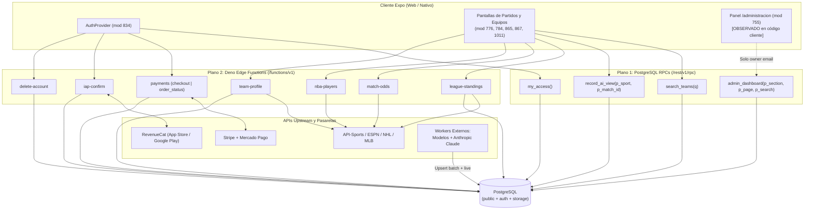

# 04 — Catálogo Forense de Supabase Edge Functions, RPCs PostgreSQL y Operación Interna (Astra AI)

> **Declaración de Evidencia y Ética Forense**
> Todos los contratos de RPCs, Edge Functions, estructuras de caché y hallazgos sobre el panel de administración documentados en este reporte provienen **100% del análisis estático del bundle público del cliente** (`Reportes/analisis-astra/modules/`) y de las capturas pasivas legítimas (`01-landing-capture.json` y `02-authenticated-tour.json`).
> En cumplimiento estricto de las reglas de seguridad, **jamás se invocaron endpoints administrativos ni destructivos** (`admin_dashboard`, `delete-account`), y toda la sección sobre `administracion.tsx` (`mod 755`) y `mod 839` está etiquetada explícitamente como **OBSERVADO en código cliente**.

---

## 1. Arquitectura Funcional del Backend: Separación en 3 Planos de Cómputo

El análisis cruzado de los módulos de datos (`mod 776`, `834`, `839`, `866`, `1010`, `1011`, `1015`, `1017`, `1021`, `1023`, `1027`) demuestra que Astra AI divide su lógica de servidor en **tres planos estrictamente separados**:

1. **Plano 1 — PostgreSQL RPCs (`/rest/v1/rpc/*`, 4 funciones)**: Operaciones transaccionales rápidas y agregaciones cercanas a los datos que requieren cruzar esquemas internos (`public` ↔ `auth.users`) mediante `SECURITY DEFINER`: resolución de entitlements y configuración remota (`my_access`), búsqueda desaccentuada (`search_teams`), ingesta deduplicada de telemetría de lectura (`record_ai_view`) y consola administrativa del fundador (`admin_dashboard`).
2. **Plano 2 — Supabase Edge Functions en Deno (`/functions/v1/*`, 7 funciones)**: Proxies con secretos de terceros que no pueden residir en PostgreSQL ni en el cliente: consultas bajo demanda a proveedores deportivos (`league-standings`, `match-odds`, `nba-players`, `team-profile`), orquestación de cobros y webhooks (`payments`, `iap-confirm`) y borrado administrativo de cuentas (`delete-account`).
3. **Plano 3 — Workers Asíncronos Fuera de Banda (Crons / Pipelines Externos)**: El cliente jamás dispara la generación de pronósticos ni de textos LLM. Un sistema externo con clave `service_role` ingesta calendarios/marcadores, ejecuta los modelos estadísticos por deporte (`league_v2` en fútbol, ratings por 60 min en NHL, Elo/Net/EPA en NBA/NFL, wOBA/FIP en MLB), invoca a **Anthropic Claude** (`mod 1011`) para redactar `analyses` / `game_analyses`, publica `astra_picks` y actualiza `match_live`.



---

## 2. Catálogo Exhaustivo de RPCs PostgreSQL (`.rpc(...)`)

### Resumen de RPCs Identificados

| RPC | Módulo Cliente | Argumentos | Seguridad / Rol | Frecuencia / Caché Cliente | Propósito Principal |
|---|---|---|---|---|---|
| `my_access` | `mod 834` | `{}` (sin parámetros) | `anon` y `authenticated` (`SECURITY DEFINER`) | Al montar, al cambiar `userId`, post-pago y cada **5 min** (`3e5` ms) | Estado de suscripción/trial + configuración remota de precios, ligas e IAP |
| `search_teams` | `mod 776` | `{ q: string }` | `anon` y `authenticated` | Debounce **250 ms**, mínimo 2 caracteres | Búsqueda insensible a acentos sobre clubes/selecciones de fútbol (`teams`) |
| `record_ai_view` | `mod 1017` | `{ p_sport: string, p_match_id: number }` | Solo `authenticated` (`SECURITY DEFINER`) | LRU local (300) deduplicado por ventana de **30 min** (`18e5` ms), timeout **4 s** | Telemetría de consumo de pronósticos/análisis IA por usuario y partido |
| `admin_dashboard` | `mod 839` / `mod 755` | `{ p_section: string, p_page: number, p_search: string }` | Exclusivo `eliasgutierrezhr@gmail.com` (`42501` / `PGRST301`) | Manual al abrir pestaña o pulsar `"Actualizar"` | Backoffice integral de KPIs, cuentas, actividad de IA y órdenes de compra |

---

### 2.1 RPC `my_access` — Entitlements y Feature Flags Remotos (`mod 834`)

- **Endpoint HTTP**: `POST https://bbfjdshvlcynngjdkvsk.supabase.co/rest/v1/rpc/my_access`
- **Cuerpo de solicitud**: `{}` (`2 bytes`, observado en `01-landing-capture.json` `request-26` y `02-authenticated-tour.json` `request-20`, `23`, `115`, `143`, `205`, `252`).
- **Comparativa exacta de payloads reales capturados vs. fallback estático**:

| Campo | Tipo TS | Captura Anónima (`request-20`) | Captura Autenticada con Trial (`request-23`) | Fallback `DEMO` (`mod 834`) | Significado y Uso en Cliente |
|---|---|---|---|---|---|
| `logged_in` | `boolean` | `false` | `true` | `false` | `auth.uid() IS NOT NULL`; decide CTA en `<Paywall>` (`Crear cuenta` vs `<PayButtons>`) |
| `has_access` | `boolean` | `false` | `true` | `true` | `is_admin OR paid_until > now() OR trial_ends_at > now()`; sincronizado con la función RLS de BD |
| `is_admin` | `boolean` | `false` | `false` | *(omitido)* | Si es `true`, `<SubscriptionCard>` (`mod 863` l. 87) muestra *"Cuenta de administrador: acceso ilimitado a todos los pronósticos."* |
| `livemode` | `boolean` | `true` | `true` | `false` | Indica si las pasarelas de pago operan en producción real |
| `price_mxn` | `number` | `199` | `199` | `199` | Precio dinámico renderizado en `<Paywall>` y `<SubscriptionCard>` (`$199` MXN) |
| `period_days` | `number` | `30` | `30` | `30` | Días otorgados por cada pago prepago acumulable |
| `trial_days` | `number` | `7` | `7` | `7` | Duración de la prueba gratuita al verificar correo |
| `trial_ends_at` | `string \| null` | `null` | `"2026-11-21T16:42:32.434382+00:00"` | `null` | Expiración UTC del periodo de prueba del usuario actual |
| `paid_until` | `string \| null` | `null` | `null` | `null` | Expiración UTC del acceso pagado acumulado |
| `leagues` | `number` | `48` | `48` | `43` | Conteo vivo `SELECT count(*) FROM leagues` mostrado en marketing del `<Paywall>` (*"48 ligas de fútbol, más NHL, NBA, NFL y MLB"*) |
| `contact_email` | `string` | `"eliasgutierrezhr@gmail.com"` | `"eliasgutierrezhr@gmail.com"` | *(omitido)* | Correo de soporte renderizado en documentos legales (`useContactLine`, `mod 871`) |
| `iap_product_id` | `string` | `"astra_30_dias"` | `"astra_30_dias"` | *(omitido)* | Identificador del producto consumible/no-renovable de 30 días en tiendas móviles |
| `iap_ios_key` | `string \| null` | `null` | `null` | *(omitido)* | API key pública de RevenueCat para Apple App Store (**actualmente `null` en producción**) |
| `iap_android_key` | `string \| null` | `null` | `null` | *(omitido)* | API key pública de RevenueCat para Google Play (**actualmente `null` en producción**) |

> **Descubrimiento Comercial Importante**: El hecho de que `iap_ios_key` e `iap_android_key` retornen `null` en vivo en `my_access` confirma que, aunque la arquitectura móvil con RevenueCat (`astra_30_dias`, `iap-confirm`) ya está programada de extremo a extremo, **la monetización activa actual ocurre exclusivamente vía Web (`Stripe` y `Mercado Pago`)**.

---

### 2.2 RPC `search_teams` — Búsqueda Desaccentuada de Fútbol (`mod 776`)

- **Invocación**: `supabase.rpc('search_teams', { q: r })` donde `r = query.trim()` y `r.length >= 2`.
- **Contrato de retorno**: `Array<{ id: number, name: string, logo: string | null }>`.
- **Por qué existe un RPC en fútbol pero no en otros deportes**:
  - En el modo offline (`_` en `mod 776` línea 49), el cliente normaliza con `t.toLowerCase().normalize('NFD').replace(/[\u0300-\u036f]/g, '')` para que buscar `"america"`, `"atletico"` o `"queretaro"` encuentre `"América"`, `"Atlético Madrid"` y `"Querétaro"`. En PostgreSQL, PostgREST no puede aplicar `unaccent(name) ILIKE unaccent(...)` en un filtro `.ilike(...)` directo sobre tabla sin columna generada o RPC; por ello crearon `search_teams(q text)` usando `unaccent` en servidor.
  - En contraste, para NHL/NBA/NFL/MLB (nombres en inglés sin tildes salvo `"Montréal Canadiens"`), `searchSportTeams` (`mod 1011` línea 34) prescinde de RPC y consulta directamente `.from('sport_teams').select('id,name,abbrev,logo').eq('sport', sport).or('name.ilike.%q%,abbrev.ilike.q').limit(10)`.
- ** Orquestación posterior en cliente (`mod 776` líneas 31–36)**:
  Con los IDs devueltos, el cliente lanza dos consultas PostgREST en paralelo a `fixtures` (`kickoff >= now` ASC límite 60 y `kickoff < now` DESC límite 60) y empareja cada equipo con su próximo partido programado o, en su defecto, su último partido finalizado: `Array<{ team, fixture }>`.

---

### 2.3 RPC `record_ai_view` — Telemetría de Uso de Modelos con Doble Deduplicación (`mod 1017`)

- **Invocación**:
  ```javascript
  // Reconstrucción de useAiActivity (mod 1017)
  const bucket30m = Math.floor(Date.now() / 1_800_000); // 18e5 ms = 30 min
  const dedupeKey = `${userId}/${sport}/${matchId}/${bucket30m}`;
  // Si no está en el Map LRU (máx. 300 claves), dispara con AbortController de 4,000 ms:
  supabase
    .rpc('record_ai_view', { p_sport: sport, p_match_id: matchId })
    .abortSignal(controller.signal);
  ```
- **Condición exacta de disparo**:
  - En fútbol (`mod 784` línea 28): `tab === 'analysis' && fixture.forecast_ready && Boolean(fixture.prediction || fixture.analysis)`.
  - En otros deportes (`mod 867` línea 28): `tab === 'analysis' && game.forecast_ready && Boolean(game.prediction || game.analysis)`.
  - Dentro de `useAiActivity` (`mod 1017` línea 12): exige además `Boolean(userId)` (sesión iniciada). Un usuario bloqueado por el `<Paywall>` recibe `prediction: null, analysis: null`, por lo que **no dispara `record_ai_view`**.
- **Diseño resiliente**: Usa un timeout agresivo de **4 segundos** (`4e3` ms) y silencia errores de red para que la telemetría jamás bloquee la lectura del usuario. En el servidor, PostgreSQL vuelve a deduplicar por `(user_id, sport, match_id)` en ventanas de 30 minutos.

---

### 2.4 RPC `admin_dashboard` — Ingeniería Inversa Completa del Panel del Fundador (`mod 755` y `mod 839`)

> **ETIQUETA DE PROCEDENCIA: 100% OBSERVADO EN CÓDIGO CLIENTE**
> Todo el análisis de esta subsección proviene exclusivamente de la lectura estática del chunk público `Reportes/analisis-astra/app/_expo/static/js/web/administracion-db0312943212c59d203e733a9a3ecfed.js` (`mod 755`) y del módulo auxiliar `mod 839` en `__common-a2fe500f62154dabe8c8c7eb8fa31525.js`. No se realizó ninguna llamada de red a `admin_dashboard`.

#### A. Control de Acceso en Doble Capa (`mod 839` y `mod 755`)
1. **Puerta en UI Cliente**:
   - `mod 839` define la constante explícita:
     ```javascript
     export const DASHBOARD_OWNER = 'eliasgutierrezhr@gmail.com';
     export const isDashboardOwner = (email) => email?.trim().toLowerCase() === DASHBOARD_OWNER;
     ```
   - En `/cuenta` (`mod 757` línea 195), el botón `"Panel de administración"` → `router.push('/administracion')` solo se renderiza si `isDashboardOwner(email)` es `true`.
   - En `/administracion` (`mod 755` líneas 46–54), si `!userId || !isDashboardOwner(email)`, renderiza `"Acceso restringido — Este panel es exclusivo de la cuenta administradora."` sin invocar el RPC.
2. **Puerta en PostgreSQL (`SECURITY DEFINER`)**:
   - `fetchAdmin` (`mod 839` líneas 18–23) invoca `supabase.rpc('admin_dashboard', { p_section, p_page, p_search })` y maneja específicamente los códigos de error **`'42501'`** (*PostgreSQL `insufficient_privilege`*) y **`'PGRST301'`** (*PostgREST JWT inválido/no autorizado*), confirmando que la función PL/pgSQL valida en el servidor que el JWT pertenezca a la cuenta administradora antes de ejecutar cualquier consulta sobre `auth.users`, compras o telemetría.

#### B. Parámetros de Entrada y Mecánica de Paginación
- **Firma esperada**:
  `admin_dashboard(p_section text, p_page integer, p_search text) RETURNS jsonb`
- **Valores de `p_section`**: `'overview' | 'accounts' | 'activity' | 'purchases'`.
- **Búsqueda y Paginación**:
  - `p_search`: cadena recortada (`trim()`, `maxLength: 100` en UI). En `'accounts'` busca por **correo o `display_name`** (`"Buscar por correo o nombre"`); en `'activity'` y `'purchases'` busca únicamente **por correo** (`"Buscar por correo"`).
  - `p_page`: base `1`. El botón `"Siguiente"` en cliente se deshabilita cuando `page * page_size >= total` o cuando **`page >= 400`** (`mod 755` línea 188, cota dura anti-paginación profunda).
  - Todas las fechas se formatean explícitamente en huso horario **`America/Mexico_City`** (`es-MX`, `dateStyle: 'medium'`, `timeStyle: 'short'`).

#### C. Esquema Exacto de las 4 Secciones Monitoreadas (*OBSERVADO en código cliente*)

##### 1. Sección `'overview'` (`Resumen`)
Retorna un objeto JSON con **9 tarjetas KPI globales**, una serie diaria de 14 días, un desglose de uso de modelos por deporte a 30 días y dos marcas de tiempo:

```typescript
interface AdminOverviewResponse {
  // 9 KPIs principales (renderizados en grilla flexBasis: 200)
  accounts: number;              // "Cuentas registradas" (total en auth.users)
  confirmed: number;             // "Correos verificados" (email_confirmed_at IS NOT NULL)
  new_today: number;             // "Registros hoy" (en horario Ciudad de México)
  signed_in_today: number;       // "Iniciaron sesión hoy" (last_sign_in_at hoy CDMX)
  ai_views_today: number;        // "Consultas de IA hoy" (aperturas deduplicadas 30m hoy)
  ai_users_today: number;        // "Usuarios de IA hoy" (COUNT DISTINCT user_id hoy)
  active_subscriptions: number;  // "Suscripciones activas" (paid_until > now())
  paid_orders: number;           // "Pagos web confirmados" (status='paid' AND NOT is_test)
  revenue_mxn: number;           // "Ingresos web brutos" (SUM(amount_mxn) antes de comisiones, sin pruebas)

  // Serie temporal: "Actividad de los últimos 14 días"
  daily: Array<{
    day: string;                 // Fecha formateada (ej. YYYY-MM-DD)
    registrations: number;       // Nuevos registros ese día
    ai_views: number;            // Consultas de IA ese día
  }>;

  // Desglose por deporte: "Uso de modelos · últimos 30 días"
  ai_by_sport: Array<{
    sport: 'futbol' | 'nhl' | 'nba' | 'nfl' | 'mlb' | string;
    views: number;               // "${views} consultas"
  }>;

  tracking_since: string;        // ISO timestamp desde cuando se activó la telemetría record_ai_view
  generated_at: string;          // ISO timestamp de generación del reporte
}
```

##### 2. Sección `'accounts'` (`Cuentas`)
Cruza `auth.users`, `public.profiles` (o tabla de accesos) y agregados de `ai_views`:

```typescript
interface AdminAccountsResponse {
  total: number;
  page: number;
  page_size: number;
  rows: Array<{
    id: string;                        // UUID del usuario
    display_name: string | null;       // Renderiza 'Sin nombre' si es null/vacío
    email: string;                     // Correo en auth.users
    email_confirmed_at: string | null; // Badge verde 'Correo verificado' vs naranja 'Pendiente de verificar'
    created_at: string | null;         // "Registro"
    last_sign_in_at: string | null;    // "Último inicio de sesión"
    trial_ends_at: string | null;      // "Prueba hasta"
    paid_until: string | null;         // "Acceso pagado hasta"
    ai_views_30d: number;              // "Consultas de IA · 30 días"
    last_ai_view: string | null;       // "Última consulta de IA"
  }>;
}
```

##### 3. Sección `'activity'` (`Uso de IA`)
Muestra la bitácora cronológica de aperturas de la pestaña `"Análisis con IA"`, resolviendo en el propio SQL el nombre legible del partido (`match_name`) mediante `LEFT JOIN` contra `fixtures`/`teams` o `games`/`sport_teams`:

```typescript
interface AdminActivityResponse {
  total: number;
  page: number;
  page_size: number;
  rows: Array<{
    user_id: string;
    email: string;
    sport: 'futbol' | 'nhl' | 'nba' | 'nfl' | 'mlb' | string;
    match_id: number;
    match_name: string | null; // Fallback en UI: `Partido ${match_id}`
    viewed_at: string;         // Clave única React: `${user_id}/${sport}/${match_id}/${viewed_at}`
  }>;
}
```

##### 4. Sección `'purchases'` (`Compras`)
Audita todas las órdenes de pago web y compras de tiendas nativas:

```typescript
interface AdminPurchasesResponse {
  total: number;
  page: number;
  page_size: number;
  rows: Array<{
    id: string;                  // ID de la orden
    email: string | null;        // Si es null, muestra 'Cuenta eliminada' (anonimización fiscal)
    amount_mxn: number | null;   // Si es null (compras iOS/Android sin monto), muestra 'Importe no disponible'
    status: 'paid' | 'pending' | 'created' | 'failed' | 'refunded' | 'cancelled' | 'approved' | string;
    is_test: boolean;            // Añade sufijo ' · PRUEBA'; excluido de revenue_mxn
    provider: 'stripe' | 'mercadopago' | string; // UI mapea stripe->'Pago con tarjeta', mercadopago->'Mercado Pago'
    created_at: string | null;   // "Creado"
    paid_at: string | null;      // "Fecha de pago"
  }>;
}
```

#### D. Puntos Ciegos Operativos Revelados por `administracion.tsx` (*OBSERVADO en código cliente*)
Analizar lo que **NO existe** en `mod 755` es tan revelador para PitchLab como lo que sí existe:
1. **Cero monitoreo de salud de pipelines/crons o frescura de datos**: El panel web **no muestra** el estado de ingestión de partidos, retrasos de `match_live`, ni qué porcentaje de partidos del día tienen `forecast_ready = true` o `analysis_ready = true`.
2. **Cero monitoreo de precisión (*hit rate* / Brier score / ROI) ni costos de LLM**: No hay métricas de acierto en vivo ni consumo de tokens de Claude.
3. **Telemetría de producto de introducción reciente**: La nota literal en `mod 755` línea 157 (*"El historial comienza con esta actualización"*) y el campo `tracking_since` en `'overview'` demuestran que `record_ai_view` fue instrumentado recientemente para medir retención real por deporte (`ai_by_sport`).

---

## 3. Catálogo Exhaustivo de las 7 Supabase Edge Functions (`.functions.invoke(...)`)

### Matriz Resumen de Edge Functions

| # | Edge Function | Módulo(s) | Método | Requiere Sesión JWT | Caché / Deduplicación Cliente | Proveedor Upstream / Rol |
|---|---|---|---|---|---|---|
| 1 | `league-standings` | `mod 1021`, `1020` | `POST` | No (`apikey` pública) | `useLoad` con refresco de **5 min** (`3e5` ms) | Fallback de `standings` (API-Sports) en fútbol; tabla primaria (NHL/ESPN/MLB) en otros 4 deportes |
| 2 | `match-odds` | `mod 1023`, `1022` | `POST` | No (`apikey` pública) | Dedup *in-flight* + `Map` LRU (**300** entradas, TTL **15 min** / `9e5` ms) | Cuotas decimales pre-partido 1X2 (fútbol) y Moneyline 2-vías (NHL/NBA/NFL/MLB) |
| 3 | `nba-players` | `mod 1027`, `1026`, `1028` | `POST` | No (`apikey` pública) | Dedup *in-flight* + `Map` LRU (**100** entradas, TTL dinámico: **60 s** en vivo / **5 min** final) | Proxy directo de boxscore individual de jugadores NBA desde **ESPN** |
| 4 | `team-profile` | `mod 866`, `865`, `760` | `POST` | No (`apikey` pública) | Modo ficha: `Map` LRU (**100** entradas, TTL **2 min** / `12e4` ms). Modo partido histórico: `useLoad` | Ficha de club/franquicia, promedios recientes, historial paginado y detalle de partidos fuera de BD |
| 5 | `payments` | `mod 834`, `863`, `764` | `POST` | **Sí** (`Bearer <jwt>`) | Sin caché; polling de `order_status` cada **3 s** hasta **20 intentos** (60 s) | Creación de sesión de pago único ($199 MXN / 30 días) en **Stripe** o **Mercado Pago** y verificación de orden |
| 6 | `iap-confirm` | `mod 834`, `929` | `POST` | **Sí** (`Bearer <jwt>`) | Bajo demanda tras compra móvil | Conciliación servidor-a-servidor de compras In-App (`astra_30_dias`) vía **RevenueCat** |
| 7 | `delete-account` | `mod 834`, `758` | `POST` | **Sí** (`Bearer <jwt>`) | Acción única irreversible + `signOut()` | Borrado total de PII (`auth.users`, `profiles`, avatar y suscripción) conservando órdenes anonimizadas |

> **Nota sobre manejo de errores HTTP en Edge Functions (`mod 834` líneas 157–167)**: Para las funciones transaccionales (`payments`, `iap-confirm`), Astra AI implementa un extractor asíncrono `w(error, fallbackMessage)` que lee `await error.context.json()` sobre `FunctionsHttpError` y propaga el mensaje exacto del servidor si viene en `{ error: string }`.

---

### 3.1 `league-standings` — Clasificación Híbrida (`mod 1021` y `mod 1020`)

- **Cuándo se invoca**: Únicamente en la pestaña `"Detalles"` de partidos **próximos o pospuestos** (`upcoming` / `PST` / `postponed`).
- **Estrategia híbrida en Fútbol vs. Multi-Deporte**:
  - **Fútbol (`fetchFootballStandings`)**: Primero consulta la tabla PostgreSQL `public.standings` filtrada por `(league_id, season)`. **Solo si la consulta devuelve 0 filas (`!u?.length`)**, invoca la Edge Function `league-standings` como *fallback* bajo demanda. Cuando los datos provienen de PostgreSQL, el cliente filtra grupos por `'apertura'`/`'clausura'` según `fixture.round` y prioriza el grupo que contenga a ambos equipos (`homeId` y `awayId`).
  - **NHL / NBA / NFL / MLB (`fetchSportStandings`)**: No tienen tabla `standings` en PostgreSQL; siempre invocan `league-standings` directamente.
- **Payloads de entrada**:
  ```typescript
  type LeagueStandingsRequest =
    | { sport: 'futbol'; league_id: number; season: number }
    | { sport: 'nhl' | 'nba' | 'nfl' | 'mlb' };
  ```
- **Esquema de respuesta esperado (`mod 1020` líneas 41–61)**:
  ```typescript
  interface LeagueStandingsResponse {
    groups: Array<{
      name: string; // Ej. "Conferencia Este", "Liga Americana · Oeste", "Clasificación"
      rows: Array<{
        id: string;            // team_id como string (resaltado si coincide con homeId/awayId)
        code?: string;         // Abreviatura ej. "BOS", "LAL" (usada también para resaltar en US sports)
        name: string;
        logo: string | null;
        rank: number | null;
        played: number | null; // Columna "PJ"
        // Columnas usadas en Fútbol y NHL ("DG" y "PTS"):
        difference?: number | string | null;
        points?: number | string | null;
        // Columnas usadas en MLB, NBA y NFL ("G-P" y "PCT"):
        record?: string | null;      // Ej. "42-18"
        percentage?: string | null;  // Ej. ".700"
      }>;
    }>;
  }
  ```

---

### 3.2 `match-odds` — Cuotas Pre-Partido con Validación Estricta (`mod 1023` y `mod 1022`)

- **Cuándo se invoca**: En la pestaña `"Detalles"` solo cuando el partido está `upcoming` o `PST`/`postponed`.
- **Payload de entrada**:
  ```json
  { "sport": "futbol | nhl | nba | nfl | mlb", "match_id": 1550951 }
  ```
- **Invariantes de validación en cliente (`mod 1023` líneas 21–22)**:
  Si `data.odds !== null`, el cliente **rechaza y lanza excepción** (`"Cuotas no disponibles."`) si:
  1. En `sport === 'futbol'`: cualquiera de `[home, draw, away]` no es `number` finito **`> 1`**.
  2. En `sport !== 'futbol'`: `[home, away]` no son `number` finitos **`> 1`**, **o bien `odds.draw !== null`** (los deportes norteamericanos son mercados *Moneyline* de 2 vías incluyendo prórroga/entradas extra/shootout).
- **Caché cliente**: Doble estructura `Map` en memoria: `o` deduplica promesas concurrentes en vuelo para la misma clave `${sport}:${match_id}`, y `n` almacena hasta **300 partidos** con TTL de **15 minutos (`900,000` ms)**, acompasado con `useLoad(..., 9e5)`.
- **Esquema de respuesta**:
  ```typescript
  interface MatchOddsResponse {
    odds: {
      home: number;        // Cuota decimal > 1.00 (ej. 2.15)
      draw: number | null; // > 1.00 en 'futbol'; obligatoriamente null en nhl/nba/nfl/mlb
      away: number;        // Cuota decimal > 1.00 (ej. 3.40)
    } | null;
  }
  ```

---

### 3.3 `nba-players` — Boxscore Individual de NBA vía ESPN (`mod 1027`, `1026`, `1028`)

- **Cuándo se invoca**: Exclusivamente cuando `sport === 'nba'` en la pestaña `"Estadísticas"` y el partido está `live` o `final` (`j || v` en `mod 1026` línea 18).
- **Proveedor upstream confirmado**: En `mod 1026` línea 88 el pie de tarjeta está codificado literalmente como **`"ESPN · Actualizado HH:MM"`**, confirmando que `nba-players` consume el endpoint `summary?event=<match_id>` de ESPN Site API usando el mismo `eventId` almacenado en `games.id` (ej. `401909296`).
- **Payload de entrada**: `{ "match_id": 401909296 }`
- **Validación y Caché adaptativo (`mod 1027` líneas 20–23)**:
  - Verifica `data?.match_id === match_id && Array.isArray(data.teams)`.
  - Deduplicación *in-flight* + `Map` LRU de **100 partidos** con **TTL dinámico**: **60 segundos (`6e4` ms)** si el juego sigue en curso, o **5 minutos (`3e5` ms)** si `data.state === 'final'`.
- **Esquema de respuesta exacto**:
  ```typescript
  interface NbaPlayersResponse {
    match_id: number;
    state: 'live' | 'final' | string;
    updated_at: string | null; // ISO timestamp
    teams: Array<{
      id: string | number;
      name: string;
      logo: string | null;
      players: Array<{
        id: string | number;
        name: string;
        photo: string | null;       // Headshot URL de ESPN (fallback a iniciales en UI)
        jersey: string | null;      // Renderizado como "#23"
        position: string | null;    // Ej. "PG", "SF", "C"
        starter: boolean | null;    // true='Titulares', false='Banca', null='Alineación por confirmar'
        did_not_play: boolean;      // DNP
        ejected: boolean;           // Muestra "Expulsado del partido."
        reason: string | null;      // "COACH'S DECISION" se traduce a "Decisión del entrenador"
        stats: {
          minutes: string | number | null;
          points: string | number | null;
          rebounds: string | number | null;
          assists: string | number | null;
          steals: string | number | null;
          blocks: string | number | null;
          turnovers: string | number | null;
          fouls: string | number | null;
          offensiveRebounds: string | number | null;
          defensiveRebounds: string | number | null;
          plusMinus: string | number | null;
          fieldGoals: string | null;    // Formato "anotados/intentos" ej. "8/15" -> calcula % en mod 1028
          threePointers: string | null; // Formato "3/7"
          freeThrows: string | null;    // Formato "4/4"
        };
      }>;
    }>;
  }
  ```

---

### 3.4 `team-profile` — Función Polimórfica de Ficha de Equipo y Partidos Históricos (`mod 866`, `865`, `760`)

Esta Edge Function resuelve **dos casos de uso distintos** según si el cuerpo incluye `page` o `match_id`:

#### Modo A: Ficha del Equipo e Historial Paginado (`fetchTeamProfile`, `mod 866` l. 8–23)
- **Entrada**: `{ sport: 'futbol' | 'nhl' | 'mlb' | 'nba' | 'nfl', team_id: number, page: number }` (`page` inicia en `0`).
- **Caché cliente**: `Map` LRU de **100 entradas** (`${sport}:${team_id}:${page}`) con TTL de **2 minutos (`120,000` ms)**.
- **Respuesta esperada (`mod 865`)**:
  ```typescript
  interface TeamProfileResponse {
    team: { id: number; name: string; logo: string | null };
    summary: {
      games: number; // "Últimos N partidos finalizados disponibles"
      metrics: Array<{
        key: 'scored' | 'conceded' | string; // UI renombra scored/conceded a Goles/Puntos/Carreras
        label: string;
        value: number | null; // Formateado a 3 decimales si key === 'wOBA', 2 en el resto
        n?: number | null;    // Muestra tamaño muestral "${n} partidos"
      }>;
    };
    info: {
      venue: string | null;   // Estadio
      coach: string | null;   // Entrenador
      country: string | null; // País
      city: string | null;    // Ciudad
      founded: string | number | null; // Fundación
    };
    history: Array<{
      id: number;
      kickoff: string;        // ISO timestamp (usado en los 5 deportes)
      league: string;
      home: { id: number; name: string; logo: string | null };
      away: { id: number; name: string; logo: string | null };
      home_score: number | null;
      away_score: number | null;
      stored: boolean;        // TRUE = existe en fixtures/games de Supabase; FALSE = solo en proveedor externo
    }>;
    has_more: boolean;        // Habilita botón "Ver más partidos" (incrementa page + 1)
    partial?: boolean;        // Si true, avisa que el proveedor falló parcialmente y se muestran datos locales
    source: string;           // Fuente upstream mostrada al pie
    updated_at: string;       // ISO timestamp
    error?: string;
  }
  ```

#### Modo B: Detalle de Partido Histórico No Almacenado (`fetchHistoricalMatch`, `mod 866` l. 24–35 y `mod 760`)
- **Navegación inteligente**: En `TeamProfileScreen` (`mod 865` líneas 103–115), al tocar un partido pasado de `history`:
  - Si `item.stored === true`, navega a `/partido/[id]` o `/juego/[sport]/[id]` (leyendo de PostgreSQL con pronóstico IA si existió).
  - Si `item.stored === false` (partido antiguo anterior a la ventana retenida en PostgreSQL), navega a `/historial/[sport]/[teamId]/[matchId]` (`mod 760`), que invoca `team-profile` en **Modo B**.
- **Entrada**: `{ sport, team_id: number, match_id: number }`.
- **Respuesta esperada (`mod 760` líneas 64–135)**:
  ```typescript
  interface HistoricalMatchResponse {
    stored: boolean; // Si mientras tanto pasó a estar en BD, delega a <MatchDetail> / <SportDetail>
    match: {
      id: number;
      kickoff: string;
      league: string;
      venue: string | null;
      home: { id: number; name: string; logo: string | null };
      away: { id: number; name: string; logo: string | null };
      home_score: number | null;
      away_score: number | null;
    };
    live: MatchLiveRow | null; // Mismo contrato { info, statistics, events, momentum } para pintar Detalles y Estadísticas (sin pestaña IA)
    error?: string;
  }
  ```

---

### 3.5 `payments` — Motor de Pagos Prepago Acumulables ($199 MXN / 30 Días) (`mod 834`, `863`, `764`)

Astra AI evita deliberadamente los cobros recurrentes automáticos en web (*"Cada pago te da 30 días de acceso y no se cobra solo"* / *"Si pagas de nuevo, los días se suman"*, `mod 863` líneas 66 y 107), vendiendo pases prepago de 30 días por **$199 MXN** a través de **Stripe** y **Mercado Pago**.

#### Acción 1: `checkout` (`startCheckout`, `mod 834` l. 99–112)
- **Solicitud**:
  ```json
  { "action": "checkout", "provider": "stripe" } // o "mercadopago"
  ```
- **Respuesta**: `{ "url": "https://checkout.stripe.com/..." }` (o URL de Checkout Pro de Mercado Pago). El cliente redirige con `window.location.assign(url)` en web o `Linking.openURL(url)` en nativo. La URL de retorno configurada en el backend apunta a `https://astraanalisis.com/pago/<order_id>`.

#### Acción 2: `order_status` (`orderStatus`, `mod 834` l. 112–123 y `pago/[id].tsx` `mod 764`)
- **Solicitud**:
  ```json
  { "action": "order_status", "order_id": "<id>" }
  ```
- **Respuesta**:
  ```typescript
  interface OrderStatusResponse {
    status: 'paid' | 'pending' | 'created' | 'failed' | 'expired' | 'refunded';
    duplicate?: boolean;      // Si true: "Este pago ya se había registrado antes. Tu suscripción sigue activa."
    paid_until?: string | null; // ISO timestamp del nuevo vencimiento acumulado
    error?: string;
  }
  ```

```mermaid
sequenceDiagram
  autonumber
  participant U as Usuario Autenticado
  participant App as Cliente Expo (/cuenta o Paywall)
  participant Edge as Edge Function: payments
  participant GW as Stripe / Mercado Pago
  participant DB as PostgreSQL (orders + entitlements)

  U->>App: Pulsa "Pago con tarjeta" o "Mercado Pago"
  App->>Edge: POST /functions/v1/payments { action: "checkout", provider }
  Edge->>DB: INSERT INTO orders (status='created', amount_mxn=199, provider)
  Edge->>GW: Crea Checkout Session (success_url: /pago/{order_id})
  Edge-->>App: 200 { url }
  App->>GW: window.location.assign(url)
  U->>GW: Completa pago ($199 MXN)
  par Webhook asíncrono y redirección del navegador
    GW->>Edge: Webhook firmado (payment_intent.succeeded / payment.updated)
    Edge->>DB: Transacción idempotente: status='paid', paid_until = GREATEST(now(), paid_until) + 30 days
  and Retorno a /pago/[id] (mod 764)
    GW-->>App: Redirect GET /pago/{order_id}
    loop Polling cada 3,000 ms (máx. 20 intentos = 60s; aborta tras 3 errores de red)
      App->>Edge: POST /functions/v1/payments { action: "order_status", order_id }
      Edge->>DB: Verifica orden del auth.uid()
      Edge-->>App: { status: "paid", duplicate, paid_until }
    end
    App->>DB: POST /rest/v1/rpc/my_access -> actualiza has_access = true en caliente
  end
```

---

### 3.6 `iap-confirm` — Conciliación de Compras Móviles con RevenueCat (`mod 834`, `mod 929`)

- **Invocación**: `supabase.functions.invoke('iap-confirm', { method: 'POST', body: {} })` (`confirmStorePurchases`, `mod 834` líneas 123–134).
- **Rol arquitectónico**: En el bundle web, `mod 929` (`iap.web.ts`) exporta el stub `IAP_SUPPORTED = false` (`buyStoreProduct` devuelve `"Disponible solo en la app."`). En las compilaciones nativas iOS/Android (`iap.native.ts`), el cliente inicializa el SDK de **RevenueCat** con `access.iap_ios_key` / `access.iap_android_key` asociando el `app_user_id` al `userId` de Supabase, compra el producto `astra_30_dias` y llama a `iap-confirm` para que la Edge Function consulte la API REST v1/v2 de RevenueCat con llave secreta y extienda `paid_until` en PostgreSQL sin esperar latencia de webhook, registrando la orden en `orders` (donde `amount_mxn` puede quedar `null`, tal como contempla `administracion.tsx` línea 171: *"Las compras de tienda sin importe disponible se identifican como tal"*).

---

### 3.7 `delete-account` — Supresión de Datos Personales y Anonimización Fiscal (`mod 834`, `mod 758`)

- **Invocación**: `supabase.functions.invoke('delete-account', { method: 'POST', body: {} })` (`deleteMyAccount`, `mod 834` líneas 86–96).
- **Doble barrera de confirmación en UI (`eliminar-cuenta.tsx`, `mod 758`)**:
  1. Exige sesión iniciada (`userId`); si no, redirige a `/cuenta`.
  2. Exige escribir literalmente **`ELIMINAR`** y aceptar `window.confirm('¿Eliminar tu cuenta? Esta acción no se puede deshacer.')`.
- **Contrato de respuesta**: `{ "ok": true }` (cualquier otro valor lanza `"No se pudo eliminar la cuenta. Intenta de nuevo."`). Tras recibir `{ ok: true }`, el cliente ejecuta `signOut()` (que invoca `iapLogout()` + `supabase.auth.signOut()`).
- **Operaciones ejecutadas en servidor (confirmadas cruzando `mod 758` líneas 81–96 y `mod 755` línea 176)**:
  1. Elimina el objeto `${userId}/avatar.jpg` del bucket `profile-avatars` en Supabase Storage.
  2. Desvincula las órdenes de pago históricas (`user_id = NULL` / `email = NULL` mediante `ON DELETE SET NULL`), de modo que **se conserva el registro contable/fiscal del pago** (por obligación fiscal mexicana declarada en `mod 758` línea 95), apareciendo en `/administracion` → `Compras` como **`"Cuenta eliminada"`** (`mod 755` línea 176).
  3. Elimina la fila de `public.profiles`, los días restantes de suscripción/prueba, el historial de actividad personal y el usuario en `auth.users` vía `auth.admin.deleteUser(uid)`.

---

## 4. Síntesis de Aprendizajes Arquitectónicos para PitchLab

1. **Eficiencia de costos y simplicidad operativa radical**: Astra AI sostiene 5 deportes y 48 ligas de fútbol con un solo proyecto Supabase, **cero servidores siempre encendidos**, **cero conexiones WebSocket Realtime** (evitando cuotas de mensajes concurrentes de Supabase Realtime mediante `useLoad` pausado en pestañas ocultas + cachés LRU en cliente) y **tablas separadas de lectura rápida** (`fixtures`/`games` ligeras para calendarios vs. joins bajo demanda en detalle).
2. **Paywall criptográficamente sólido en base de datos**: Usar RLS sobre `predictions`, `analyses`, `game_predictions`, `game_analyses` y `astra_picks` mientras se dejan públicos los flags `forecast_ready`/`analysis_ready` en la tabla padre evita por completo crear endpoints BFF dedicados para censurar contenido premium.
3. **Oportunidad competitiva directa para PitchLab**: El panel interno de Astra AI (`mod 755`) carece de observabilidad sobre calidad calibrada de modelos, cobertura de partidos faltantes, latencia de pipelines en vivo y auditoría pública verificable de aciertos (incluso marcan pronósticos tardíos con `is_retrospective` para excluirlos). Un sistema de monitoreo de pipelines + evaluación continua de calibración (Brier / Log-Loss) daría a PitchLab una ventaja técnica inmediata.
