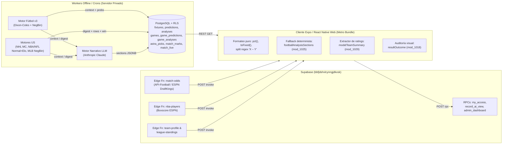

# 06 — Modelos Estadísticos, Cálculo de Probabilidades, Picks, Momios y Motor de IA

**Objetivo de la auditoría**: Desentrañar con rigor matemático, algorítmico y forense la arquitectura cuantitativa y de Inteligencia Artificial de **Astra AI (`https://astraanalisis.com/`)** a partir de los 286 módulos Metro desempaquetados del cliente web/móvil ([_index.json](file:///C:/Users/T490s/.gemini/antigravity/worktrees/PitchLab/analyze_pitchlab_competitor_rea/Reportes/analisis-astra/modules/_index.json)), capturas autenticadas REA ([02-authenticated-tour.json](file:///C:/Users/T490s/.gemini/antigravity/worktrees/PitchLab/analyze_pitchlab_competitor_rea/Reportes/analisis-astra/raw/02-authenticated-tour.json)), payloads públicos pasivos de partidos finalizados ([public_model_samples.json](file:///C:/Users/T490s/.gemini/antigravity/worktrees/PitchLab/analyze_pitchlab_competitor_rea/Reportes/analisis-astra/evidence/live-payloads/public_model_samples.json)) y verificación numérica reproducible ([verify_astra_math.py](file:///C:/Users/T490s/.gemini/antigravity/worktrees/PitchLab/analyze_pitchlab_competitor_rea/Reportes/analisis-astra/evidence/verify_astra_math.py)).

---

## Convención Epistemológica

Todo hallazgo en este documento se clasifica explícitamente bajo una de tres categorías:

- **[OBSERVADO]**: Código exacto presente en los módulos Metro del cliente, esquemas/valores JSON devueltos por PostgreSQL/PostgREST o Edge Functions de Supabase (`bbfjdshvlcynngjdkvsk.supabase.co`), o texto declarativo oficial en `nosotros.tsx` ([mod_0870](file:///C:/Users/T490s/.gemini/antigravity/worktrees/PitchLab/analyze_pitchlab_competitor_rea/Reportes/analisis-astra/modules/mod_0870_nosotros-1087ff396845303a336510385643566a.js)).
- **[INFERIDO]**: Ecuación matemática o parámetro deducido y demostrado empíricamente (con errores del orden de $10^{-4}$, atribuibles únicamente al redondeo de almacenamiento) a partir de las entradas y salidas reales de la base de datos.
- **[DESCONOCIDO]**: Hiperparámetros de entrenamiento offline, funciones exactas de decaimiento temporal (half-life de recencia) o *system prompts* literales que residen exclusivamente en los workers privados del backend y no se exponen en `context`.

---

## Resumen Ejecutivo de Hallazgos Críticos

1. **Fuga arquitectónica total en `predictions.context` y `game_predictions.context` [OBSERVADO]**: Aunque la política RLS bloquea `predictions`, `analyses`, `game_predictions` y `game_analyses` en partidos futuros (`status = 'NS'` / `'upcoming'`) para usuarios sin suscripción activa, **abre lectura pública anónima completa (`SELECT *`) en cuanto el partido finaliza (`FT`, `AET`, `PEN`, `final`)**. Debido a que el frontend usa `prediction:predictions(*)` ([mod_0776](file:///C:/Users/T490s/.gemini/antigravity/worktrees/PitchLab/analyze_pitchlab_competitor_rea/Reportes/analisis-astra/modules/mod_0776___common-a2fe500f62154dabe8c8c7eb8fa31525.js)) y consulta `context` para perfiles de equipo ([mod_0866](file:///C:/Users/T490s/.gemini/antigravity/worktrees/PitchLab/analyze_pitchlab_competitor_rea/Reportes/analisis-astra/modules/mod_0866___common-a2fe500f62154dabe8c8c7eb8fa31525.js)), el backend expone públicamente **todos sus pesos internos, parámetros $\rho$ de Dixon-Coles por liga, pesos xG (`0.70`), sobredispersiones Binomial Negativa, pesos de ensamble Elo (`0.25` en NBA; `0.35/0.30/0.35` en NFL), métricas de validación AUC/LogLoss del modelo de tiros NHL y el objeto `digest` íntegro que alimenta al LLM**.
2. **Reconstrucción matemática exacta de los 5 deportes [OBSERVADO + INFERIDO]**:
   - **Fútbol (`league_v3`, `national_v3`, `cross_league_v3`)**: Modelo log-lineal con mezcla `70% xG + 30% goles`, término de derrame territorial $+0.15(\text{net}_H - \text{net}_A)$ (reproducido con error máximo de `0.0010` goles en 11 partidos reales) y **matriz bivariada exacta de Dixon-Coles (1997)** con $\rho \in [-0.09, -0.05]$ específico por liga (reproducción exacta de `p_home`, `p_draw`, `p_away`, `over_05`, `over_15`, `over_25`, `btts` y `correct_score_top3` con error máximo de `0.00020`).
   - **NBA**: Ensamble lineal exacto `0.75 * margin_from_ratings + 0.25 * margin_from_elo + rest_adjustment`, donde el Elo sigue exactamente la parametrización FiveThirtyEight ($\text{HCA}_{\text{Elo}} = +60$, divisor $= 28.0$ puntos Elo por punto de margen) y la probabilidad de victoria con prórroga sigue $\Phi(m_{\text{final}} / \sigma_{\text{eff}})$ con $\sigma_{\text{eff}} \approx 12.25$ puntos. **No incorpora bajas de jugadores en el cálculo numérico**; las lesiones solo se pasan como texto a la IA.
   - **NFL**: Ensamble lineal exacto `0.35 * margen_puntos + 0.30 * margen_epa + 0.35 * margen_elo + qb_local - qb_visitante + descanso`, evaluado sobre una distribución Normal con desviación estándar exacta $\sigma_{\text{NFL}} = 13.00$ puntos (error máximo `0.000107` en `win.home`).
   - **NHL**: Modelo bottom-up de xG por disparo entrenado sobre `93,598` tiros (`holdout_shots = 23,094`, `AUC = 0.7477`, `LogLoss = 0.22524`), separado en 5v5, Power Play, Short-Handed y otros (`ev5 + pp + sh + evo`), multiplicado por talento de definición y `factor_goles` del portero rival, más simulación Monte Carlo con incremento de ~8.1% por portería vacía (*empty net*) y prórroga/shootout.
   - **MLB**: Proyección de carreras con `wOBA`, `FIP` de abridor y bullpen, y `park_factor` multiplicativo, evaluada mediante una matriz **Binomial Negativa** ($r \approx 5.5$) para primeras 5 entradas (F5) y juego completo.
3. **Cero cálculo de *Value* / *Edge* / remoción de *Vig* en momios [OBSERVADO]**: El cliente recibe momios decimales desde la Edge Function `match-odds` ([mod_1023](file:///C:/Users/T490s/.gemini/antigravity/worktrees/PitchLab/analyze_pitchlab_competitor_rea/Reportes/analisis-astra/modules/mod_1023___common-a2fe500f62154dabe8c8c7eb8fa31525.js)) — alimentada por **Marathonbet** (`bookmaker.id = 2`, API-Football, *overround* observado `+8.64%`) en fútbol y **DraftKings** (`bookmaker.id = '100'`, ESPN Pickcenter, momios americanos convertidos en servidor a decimales IEEE-754 sin redondear, *overround* `+4.16%` a `+4.19%`) en deportes US. El cliente **descarta** `bookmaker` y `updated_at`, valida únicamente que cada cuota sea $> 1$, la formatea a 2 decimales (`toFixed(2)`) en la pestaña `"Detalles"` y **jamás calcula probabilidades implícitas, *devigging*, *Expected Value* (EV) ni criterio de Kelly**.
4. **Identificación exacta del LLM y vulnerabilidad de alucinación [OBSERVADO]**: El código fuente identifica explícitamente a **Anthropic Claude** en [mod_1011](file:///C:/Users/T490s/.gemini/antigravity/worktrees/PitchLab/analyze_pitchlab_competitor_rea/Reportes/analisis-astra/modules/mod_1011___common-a2fe500f62154dabe8c8c7eb8fa31525.js) (`"En la app real el análisis sale del modelo y de Claude"`). En producción detectamos un fallo crítico de inversión local/visitante por parte de Claude en el partido NFL `401873052` (NY Giants vs Washington Commanders): pese a que el modelo daba `52.82%` y margen `+0.9` al local NY Giants, Claude redactó que el favorito local con `53%` y margen `0.9` era Washington y atribuyó erróneamente a Jayden Daniels como titular de los Giants.
5. **`administracion.tsx` NO contiene métricas de calibración ni *hit-rate* [OBSERVADO]**: Contrario a lo que sugiere el copy comercial del Paywall (*"Probamos los modelos en más de 10,000 partidos: los pronósticos con probabilidad alta acertaron más del 75% de las veces"*, [mod_0863](file:///C:/Users/T490s/.gemini/antigravity/worktrees/PitchLab/analyze_pitchlab_competitor_rea/Reportes/analisis-astra/modules/mod_0863___common-a2fe500f62154dabe8c8c7eb8fa31525.js)), el panel administrativo ([mod_0755](file:///C:/Users/T490s/.gemini/antigravity/worktrees/PitchLab/analyze_pitchlab_competitor_rea/Reportes/analisis-astra/modules/mod_0755_administracion-db0312943212c59d203e733a9a3ecfed.js), restringido a `eliasgutierrezhr@gmail.com` en [mod_0839](file:///C:/Users/T490s/.gemini/antigravity/worktrees/PitchLab/analyze_pitchlab_competitor_rea/Reportes/analisis-astra/modules/mod_0839___common-a2fe500f62154dabe8c8c7eb8fa31525.js)) es exclusivamente un tablero operativo de negocio y telemetría de lecturas (`overview`, `accounts`, `activity`, `purchases`), sin Brier Score, LogLoss ni auditoría de aciertos.

---

## 1. Frontera Servidor vs. Cliente

### 1.1 Arquitectura de Cómputo y Almacenamiento [OBSERVADO]

Astra AI sigue una arquitectura **thin-client / fat-pipeline**: absolutamente toda inferencia estadística, simulación Monte Carlo, ajuste Elo, conversión de momios americanos a decimales y generación narrativa con Claude ocurre fuera del cliente (en scripts/workers de backend que escriben en PostgreSQL de Supabase y en Edge Functions bajo `/functions/v1/`).

> **Nota de nomenclatura en BD [OBSERVADO]**: Aunque las tablas maestras `fixtures` (fútbol) y `games` (NHL/NBA/NFL/MLB) exponen las banderas booleanas `forecast_ready` y `analysis_ready`, la tabla real de pronósticos en PostgreSQL **no se llama `forecasts`**, sino `predictions` (para fútbol) y `game_predictions` (para deportes US).



### 1.2 Matriz de Responsabilidades Servidor vs. Cliente [OBSERVADO]

| Dominio / Entidad | Fuente en Supabase | Qué calcula y guarda el Servidor | Qué calcula o transforma el Cliente TS/JS |
| :--- | :--- | :--- | :--- |
| **Pronóstico Fútbol** | Tabla `predictions` (`fixture_id` PK/FK) | Calcula $\lambda_H, \lambda_A$, probabilidades `p_home`, `p_draw`, `p_away`, `over_05`, `over_15`, `over_25`, `btts`, `corners_*`, `fouls_*`, `warnings` y `context` completo. | En `MatchDetail` ([mod_0784](file:///C:/Users/T490s/.gemini/antigravity/worktrees/PitchLab/analyze_pitchlab_competitor_rea/Reportes/analisis-astra/modules/mod_0784___common-a2fe500f62154dabe8c8c7eb8fa31525.js)): aplica `toFixed(2)` a $\lambda$, `pct()` (`Math.round(100*x)+'%'`) a `p_*` y `btts`, `toFixed(1)` a córners y `Math.round()` a `fouls_total`. **Ignora en UI** `over_05`, `over_15`, `over_25`, `fouls_home` y `fouls_away` en `StatCard` (aunque `mod_1025` usa `fouls_home/away` si falta texto de IA). |
| **Pronóstico US (`nhl`, `nba`, `nfl`, `mlb`)** | Tabla `game_predictions` (`sport, game_id`) | Calcula el modelo completo, guarda `context` (`digest` + `model_components`), `win` (`{title, home, draw, away}`) y **pre-formatea en servidor** el arreglo `rows: [{label, value}]` como strings listos para mostrar (`"108.2 – 112.2"`, `"50%"`). | En `SportDetail` ([mod_0867](file:///C:/Users/T490s/.gemini/antigravity/worktrees/PitchLab/analyze_pitchlab_competitor_rea/Reportes/analisis-astra/modules/mod_0867___common-a2fe500f62154dabe8c8c7eb8fa31525.js)): evalúa el regex `/^\s*(\d+(?:\.\d+)?)\s*[–-]\s*(\d+(?:\.\d+)?)\s*$/` sobre `row.value`; si coincide, renderiza `<TeamsValue>` con logos local/visita; si no, imprime el string literal. |
| **Ratings de Equipo** | `predictions.context` / `game_predictions.context` | Guarda los ratings crudos del último partido generado del equipo. | `fetchTeamModel` ([mod_0866](file:///C:/Users/T490s/.gemini/antigravity/worktrees/PitchLab/analyze_pitchlab_competitor_rea/Reportes/analisis-astra/modules/mod_0866___common-a2fe500f62154dabe8c8c7eb8fa31525.js)) busca el último partido del equipo con `context != null` y pasa `context` a `modelTeamSummary` ([mod_1029](file:///C:/Users/T490s/.gemini/antigravity/worktrees/PitchLab/analyze_pitchlab_competitor_rea/Reportes/analisis-astra/modules/mod_1029___common-a2fe500f62154dabe8c8c7eb8fa31525.js)), que extrae métricas seleccionadas y arma una nota explicativa en cliente. |
| **Análisis Narrativo IA** | `analyses` (fútbol) / `game_analyses` (US) | Invoca a **Claude** con las proyecciones y el `digest`; almacena `sections` como objeto con llaves fijas (fútbol) o arreglo `[{titulo, texto}]` (deportes US). | En fútbol, `footballAnalysisSections` ([mod_1025](file:///C:/Users/T490s/.gemini/antigravity/worktrees/PitchLab/analyze_pitchlab_competitor_rea/Reportes/analisis-astra/modules/mod_1025___common-a2fe500f62154dabe8c8c7eb8fa31525.js)) inyecta texto determinista de respaldo si `tiros_de_esquina` o `faltas` vienen vacíos. En `AnalysisCard` ([mod_0868](file:///C:/Users/T490s/.gemini/antigravity/worktrees/PitchLab/analyze_pitchlab_competitor_rea/Reportes/analisis-astra/modules/mod_0868___common-a2fe500f62154dabe8c8c7eb8fa31525.js)) divide cada sección por `\n+` en párrafos planos (**no hay parser Markdown**). |
| **Selecciones y Etiquetas** | `astra_picks` y `match_marks` | Almacena strings manuales curados (`pick` y `label`). | `fetchAstraPick` ([mod_1010](file:///C:/Users/T490s/.gemini/antigravity/worktrees/PitchLab/analyze_pitchlab_competitor_rea/Reportes/analisis-astra/modules/mod_1010___common-a2fe500f62154dabe8c8c7eb8fa31525.js)) hace `.trim()` y lo muestra al pie de `WinBox`; `MatchRow` ([mod_0774](file:///C:/Users/T490s/.gemini/antigravity/worktrees/PitchLab/analyze_pitchlab_competitor_rea/Reportes/analisis-astra/modules/mod_0774_index-1423f7b5e0c45b7b203640adbdc42677.js)) pinta borde cian si hay `match_marks.label` o badge si `fixture.id` está en `Set([1636276, 1636288])`. |
| **Momios (`match-odds`)** | Edge Function `match-odds` | Consulta proveedor externo (API-Football / ESPN DraftKings), convierte momios americanos a decimales IEEE-754 y devuelve `{odds: {home, draw, away, bookmaker, updated_at}}`. | `fetchMatchOdds` ([mod_1023](file:///C:/Users/T490s/.gemini/antigravity/worktrees/PitchLab/analyze_pitchlab_competitor_rea/Reportes/analisis-astra/modules/mod_1023___common-a2fe500f62154dabe8c8c7eb8fa31525.js)) valida finitud $>1$, **descarta** `bookmaker` y `updated_at`, cachea 15 min en RAM y `MatchOddsCard` ([mod_1022](file:///C:/Users/T490s/.gemini/antigravity/worktrees/PitchLab/analyze_pitchlab_competitor_rea/Reportes/analisis-astra/modules/mod_1022___common-a2fe500f62154dabe8c8c7eb8fa31525.js)) aplica `.toFixed(2)`. |
| **En Vivo y Boxscore** | Tabla `match_live` / Edge Fn `nba-players` | Ingesta minuto a minuto de `momentum`, `statistics`, `events`, `referee` y estadísticas individuales NBA desde API-Football / ESPN. | `LiveStatistics` ([mod_0869](file:///C:/Users/T490s/.gemini/antigravity/worktrees/PitchLab/analyze_pitchlab_competitor_rea/Reportes/analisis-astra/modules/mod_0869___common-a2fe500f62154dabe8c8c7eb8fa31525.js)) parsea números con `statNumber` y dibuja barras proporcionales $a/(a+r)$; `NbaPlayersCard` ([mod_1026](file:///C:/Users/T490s/.gemini/antigravity/worktrees/PitchLab/analyze_pitchlab_competitor_rea/Reportes/analisis-astra/modules/mod_1026___common-a2fe500f62154dabe8c8c7eb8fa31525.js)) agrupa titulares/banca y calcula `%` de tiro con `shootingPercentage` ([mod_1028](file:///C:/Users/T490s/.gemini/antigravity/worktrees/PitchLab/analyze_pitchlab_competitor_rea/Reportes/analisis-astra/modules/mod_1028___common-a2fe500f62154dabe8c8c7eb8fa31525.js)). |

---

## 2. Modelos Estadísticos por Deporte (Servidor) y Fórmulas Exactas

En `nosotros.tsx` ([mod_0870](file:///C:/Users/T490s/.gemini/antigravity/worktrees/PitchLab/analyze_pitchlab_competitor_rea/Reportes/analisis-astra/modules/mod_0870_nosotros-1087ff396845303a336510385643566a.js)), el autor declara públicamente el diseño de sus cinco motores. Al cruzar esa declaración con los objetos `context` y `model_components` extraídos de partidos finalizados ([public_model_samples.json](file:///C:/Users/T490s/.gemini/antigravity/worktrees/PitchLab/analyze_pitchlab_competitor_rea/Reportes/analisis-astra/evidence/live-payloads/public_model_samples.json)), reconstruimos las ecuaciones exactas de producción.

---

### 2.1 Fútbol (`predictions` — Modos `league_v3`, `national_v3`, `cross_league_v3`)

#### A. Declaración oficial vs. Modos observados en producción [OBSERVADO]
- **Declaración en `mod_0870`**: *"Dixon–Coles con goles y xG, ponderación por recencia y regularización entre temporadas; binomial negativa para córners, tiros, faltas y tarjetas."*
- **Modos observados en `predictions.model_mode`**:
  1. `league_v3`: Ligas domésticas masculinas y femeninas (evolución de `league_v2` presente en el mock estático de [mod_1008](file:///C:/Users/T490s/.gemini/antigravity/worktrees/PitchLab/analyze_pitchlab_competitor_rea/Reportes/analisis-astra/modules/mod_1008___common-a2fe500f62154dabe8c8c7eb8fa31525.js)).
  2. `national_v3`: Selecciones nacionales; agrupa todos los partidos internacionales de los últimos 2 años (`teams = 591`, `matches_previous_season = 2592`) como una sola liga virtual.
  3. `cross_league_v3`: Competiciones continentales e inter-ligas (UEFA Champions League, Women's Champions League, copas); escala la fuerza relativa mediante el **coeficiente UEFA de país** con exponente `0.5` para goles y `0.2` para córners (`cross_league: { exponent: 0.5, exponent_corners: 0.2, home_factor, away_factor }`) y factor `cup_goal_level` (p. ej. `1.0044`).

#### B. Esquema completo de `predictions` y `predictions.context` [OBSERVADO]

| Columna / Ruta JSON | Tipo | Ejemplo Real (`fixture_id = 1551877`) | Uso en Cliente / IA |
| :--- | :--- | :--- | :--- |
| `model_mode` | `text` | `"league_v3"` | Metadato interno (no se muestra en UI). |
| `lambda_home`, `lambda_away` | `float8` | `2.044`, `1.386` | `StatCard` fila `"Goles esperados"` (`toFixed(2)`) + Claude. |
| `p_home`, `p_draw`, `p_away` | `float8` | `0.5228`, `0.2228`, `0.2544` | `WinBox` (`pct()` -> `52%`, `22%`, `25%`) + Claude. |
| `over_05`, `over_15`, `over_25` | `float8` | `0.963`, `0.8611`, `0.6661` | **No se muestran en `StatCard`**; alimentan sección `"Goles"` de Claude. |
| `btts` | `float8` | `0.6574` | `StatCard` fila `"Ambos equipos anotan"` (`66%`) + Claude. |
| `corners_home`, `corners_away`, `corners_total` | `float8` | `5.292`, `4.825`, `10.117` | `StatCard` (2 filas, `toFixed(1)`) + `mod_1025` fallback + Claude. |
| `fouls_home`, `fouls_away`, `fouls_total` | `float8` | `10.032`, `15.572`, `25.603` | `StatCard` muestra solo `Math.round(fouls_total)` (`26`); `mod_1025` usa los 3. |
| `warnings` | `text[]` | `[]` (o aviso de selecciones / UEFA) | Avisos de modelado para operador y contexto de Claude. |
| `context.home_league.xg_weight` | `float8` | `0.7` | **Peso exacto: 70% xG + 30% goles reales** en todas las ligas observadas. |
| `context.home_league.rho` | `float8` | `-0.05` (rango `[-0.09, -0.05]`) | Parámetro $\rho$ de correlación de Dixon-Coles calibrado por liga. |
| `context.home_league.dispersion` | `object` | `{fouls: 1.006, shots: 1.524, corners: 1.311, yellow_cards: 1.0, shots_on_target: 1.153}` | Parámetros de sobredispersión Binomial Negativa de mercados secundarios. |
| `context.home_league.goals_per_team_neutral` | `float8` | `1.563` | Media neutral de goles por equipo en la liga ($\mu_{\text{neutral}}$). |
| `context.home_league.home_advantage_log` | `float8` | `0.1771` | Ventaja de localía en escala logarítmica ($h_{\log}$). |
| `context.home_ratings` / `away_ratings` | `object` | `attack`, `defense`, `net_rating`, `possession_strength`, `*_vs_avg`, `matches_current`, `matches_previous` | `modelTeamSummary` ([mod_1029](file:///C:/Users/T490s/.gemini/antigravity/worktrees/PitchLab/analyze_pitchlab_competitor_rea/Reportes/analisis-astra/modules/mod_1029___common-a2fe500f62154dabe8c8c7eb8fa31525.js)) muestra las 9 medias `*_vs_avg` en el perfil del equipo. |
| `context.correct_score_top3` | `object` | `{"1-1": 0.0963, "2-1": 0.0938, "2-0": 0.0677}` | Los 3 marcadores exactos más probables (citados por Claude en `"A tener en cuenta"`). |
| `context.possession` | `object` | `{"home_pct": 51.1, "away_pct": 48.9}` | Posesión proyectada. |
| `context.shots` / `shots_on_target` | `object` | `{home_expected, away_expected}` | Tiros totales y a puerta proyectados. |
| `context.referee` | `object\|null` | `{name, games: 9, yellow_cards_total: 27, shrunk_yellow_per_game: 4.293, cards_multiplier: 0.847}` | Ajuste Empirical Bayes de tarjetas por árbitro designado. |

#### C. Ecuaciones Exactas Reconstruidas del Modelo de Fútbol [INFERIDO — Verificado a $10^{-4}$]

1. **Tasas base local/visitante entre rivales iguales**:
   A partir de la media neutral $\mu_{\text{neutral}}$ y `home_advantage_log` ($h_{\log}$), la ventaja de localía se reparte simétricamente ($\pm h_{\log}/2$):

   $$\mu_{H,\text{equal}} = \mu_{\text{neutral}} \cdot \exp\!\left(+\frac{h_{\log}}{2}\right), \qquad \mu_{A,\text{equal}} = \mu_{\text{neutral}} \cdot \exp\!\left(-\frac{h_{\log}}{2}\right)$$

2. **Tasas de goles esperados ($\lambda_H, \lambda_A$) con derrame territorial (`0.15`)**:
   Definidos los parámetros logarítmicos del equipo $i$ como $\alpha_i = \text{attack}_i$, $\delta_i = \text{defense}_i$ (donde $\delta_i > 0$ implica que el equipo **concede menos goles** que el promedio: $\text{goals\_against\_vs\_avg} = \mu_{\text{neutral}} e^{-\delta_i}$) y $\text{net}_i = \alpha_i + \delta_i$, el modelo `league_v3` / `national_v3` incluye un término exacto de dominancia/territorio igual a $\gamma = 0.15$ sobre el diferencial de rating neto:

   $$\lambda_H = \mu_{H,\text{equal}} \cdot \exp\!\Big(\alpha_H - \delta_A + 0.15 \cdot (\text{net}_H - \text{net}_A)\Big)$$

   $$\lambda_A = \mu_{A,\text{equal}} \cdot \exp\!\Big(\alpha_A - \delta_H - 0.15 \cdot (\text{net}_H - \text{net}_A)\Big)$$

   > **Prueba empírica**: En los 11 partidos `league_v3` y `national_v3` auditados en [verify_astra_math.py](file:///C:/Users/T490s/.gemini/antigravity/worktrees/PitchLab/analyze_pitchlab_competitor_rea/Reportes/analisis-astra/evidence/verify_astra_math.py), el error absoluto máximo entre esta ecuación cerrada y los valores `lambda_home` / `lambda_away` en base de datos es de **`0.0010` goles** (exacto a los 3 decimales almacenados).

3. **Matriz Bivariada de Dixon-Coles (1997)**:
   Con $\lambda_H$, $\lambda_A$ y $\rho = \rho_{\text{home\_league}}$ (o $\rho = \frac{1}{2}(\rho_H + \rho_A)$ en `cross_league_v3`), la probabilidad conjunta de marcador $(x, y) \in \{0, \dots, 20\}^2$ es:

   $$P_{\text{DC}}(X = x, Y = y) = \frac{\tau_{\lambda_H, \lambda_A, \rho}(x, y) \cdot \dfrac{e^{-\lambda_H}\lambda_H^x}{x!} \cdot \dfrac{e^{-\lambda_A}\lambda_A^y}{y!}}{\displaystyle\sum_{u=0}^{20}\sum_{v=0}^{20} \tau_{\lambda_H, \lambda_A, \rho}(u, v) \cdot \dfrac{e^{-\lambda_H}\lambda_H^u}{u!} \cdot \dfrac{e^{-\lambda_A}\lambda_A^v}{v!}}$$

   donde el factor de dependencia en marcadores bajos es exactamente el de Dixon y Coles (1997):

   $$\tau_{\lambda_H, \lambda_A, \rho}(x, y) = \begin{cases} 1 - \lambda_H \lambda_A \rho & \text{si } (x, y) = (0, 0) \\ 1 + \lambda_A \rho & \text{si } (x, y) = (1, 0) \\ 1 + \lambda_H \rho & \text{si } (x, y) = (0, 1) \\ 1 - \rho & \text{si } (x, y) = (1, 1) \\ 1 & \text{en cualquier otro caso} \end{cases}$$

   Como $\rho < 0$ en todas las ligas observadas (`Eerste Divisie: -0.05`, `Segunda División: -0.06`, `League Two: -0.06`, `Selecciones: -0.06`, `League One: -0.07`, `Bundesliga: -0.07`, `FA WSL: -0.08`, `Süper Lig: -0.08`, `Serie A Women: -0.08`, `Feminine Division 1: -0.09`), el factor $\tau$ **infla** la probabilidad de empates `0-0` y `1-1` y **reduce** `1-0` y `0-1` respecto a Poisson independiente. De esta matriz salen **todas** las probabilidades publicadas:

   $$p_{\text{home}} = \sum_{x > y} P_{\text{DC}}(x,y), \quad p_{\text{draw}} = \sum_{x = y} P_{\text{DC}}(x,y), \quad p_{\text{away}} = \sum_{x < y} P_{\text{DC}}(x,y)$$

   $$\text{over\_}k.5 = 1 - \sum_{x + y \le k} P_{\text{DC}}(x,y) \;\;(k \in \{0,1,2\}), \qquad \text{btts} = \sum_{x \ge 1}\sum_{y \ge 1} P_{\text{DC}}(x,y)$$

   > **Contraste Producción (`league_v3`) vs. Demo (`mod_1008`, `league_v2`) [INFERIDO]**: En los 13 partidos reales verificados, el error máximo entre nuestra matriz $P_{\text{DC}}$ y los 7 mercados + `correct_score_top3` de Supabase es `0.00020` (100% atribuible al redondeo de $\lambda$ a 3 decimales). En cambio, en los 6 partidos estáticos de demostración de [mod_1008](file:///C:/Users/T490s/.gemini/antigravity/worktrees/PitchLab/analyze_pitchlab_competitor_rea/Reportes/analisis-astra/modules/mod_1008___common-a2fe500f62154dabe8c8c7eb8fa31525.js) (`model_mode: 'league_v2'`), `over_05` implica $\hat{\rho} \in [-0.0798, -0.0461]$, pero el resto de mercados (`over_25`, `btts`) presenta una desviación media de `0.0151` frente a Dixon-Coles puro, confirmando que los datos demo de `mod_1008` provienen de un prototipo previo (`league_v2` con sobredispersión o ajuste manual).

4. **Modelo Logístico de Posesión Esperada**:
   La posesión porcentual sigue exactamente una función sigmoide sobre `possession_home_logit` ($b_{\text{poss}}$) y la diferencia de `possession_strength` ($s_H - s_A$):

   $$\text{home\_pct} = \text{round}_{0.1}\!\left(\frac{100}{1 + \exp\big(-(b_{\text{poss}} + s_H - s_A)\big)}\right)$$

   *(Error observado: `0.00%` en los 11 partidos verificados).*

5. **Shrinkage Empirical Bayes para Árbitro (`context.referee`)**:
   En el partido `1528964` (`Goga Kikacheishvili`, $n = 9$ partidos, $Y = 27$ amarillas totales -> media muestral $3.000$), el modelo reporta `shrunk_yellow_per_game = 4.293` y `cards_multiplier = 0.847`. Despejando la media a priori de la liga $\mu_0 = 4.293 / 0.847 = 5.0685$ amarillas/partido, la fórmula exacta de regularización Bayesiana tiene peso a priori $k = 15$ partidos:

   $$\hat{y}_{\text{ref}} = \frac{Y + k \cdot \mu_0}{n + k} = \frac{27 + 15 \cdot 5.0685}{9 + 15} = 4.293, \qquad m_{\text{cards}} = \frac{\hat{y}_{\text{ref}}}{\mu_0} = 0.847$$

   *(Nota: Aunque el motor de fútbol calcula tarjetas amarillas esperadas y `cards_multiplier`, **la tabla `predictions` no tiene columnas `cards_home`/`cards_total` ni las muestra en la UI**).*

6. **Lo que permanece [DESCONOCIDO] en Fútbol**:
   - La constante exacta de decaimiento exponencial temporal (half-life en días) para ponderar partidos recientes al estimar `attack` y `defense`, y el factor exacto de contracción hacia la media entre `matches_previous` y `matches_current`.

---

### 2.2 NBA (`game_predictions`)

#### A. Estructura y Componentes Internos (`context.model_components` y `digest`) [OBSERVADO]
En NBA, `game_predictions.rows` entrega 6 filas pre-formateadas al cliente:
1. `Puntos esperados`: `"108.2 – 112.2"`
2. `Total de puntos`: `"220.4"`
3. `Más de 220.5 puntos`: `"50%"` (la línea se elige dinámicamente en el semientero $\lfloor \mu_T \rfloor + 0.5$ más cercano a `50%`)
4. `Margen esperado`: `"Oklahoma City Thunder por 4.0"`
5. `Hándicap OKC -4.5`: `"48%"`
6. `Prórroga`: `"5%"`
Y `win` contiene `{ title: "Probabilidad de victoria, con prórroga", home: 0.3706, draw: null, away: 0.6294 }`.

#### B. Ecuaciones Exactas Reconstruidas [OBSERVADO + INFERIDO]

1. **Submodelo Elo (idéntico a FiveThirtyEight NBA Elo)**:
   Con ventaja de cancha local $\text{HCA}_{\text{Elo}} = 60$ puntos Elo (si `sede_neutral == false`) y divisor de escala `28.0`:

   $$\Delta \text{Elo}_{\text{adj}} = \text{Elo}_H - \text{Elo}_A + 60 \cdot \mathbb{I}(\neg\text{sede\_neutral})$$

   $$P_{\text{Elo}}(\text{Home}) = \frac{1}{1 + 10^{-\Delta \text{Elo}_{\text{adj}} / 400}}, \qquad m_{\text{Elo}} = \frac{\Delta \text{Elo}_{\text{adj}}}{28}$$

2. **Submodelo de Ratings Netos Ajustados por Rival (con *prior* Bayesiano de pretemporada)**:
   Cada equipo mantiene `off` (puntos sobre media de liga $\mu_{\text{liga}} \approx 113.582$), `def` (puntos evitados bajo media), `net = off + def` (regularizado con `prior_net` según `current_nba`, `previous_nba` y `current_preseason`):

   $$m_{\text{ratings}} = (\text{net}_H - \text{net}_A) + h_{\text{pts}} \cdot \mathbb{I}(\neg\text{sede\_neutral}) \qquad (h_{\text{pts}} = 1.781)$$

3. **Ensamble Lineal Exacto (`elo_blend_weight = 0.25`)**:

   $$m_{\text{final}} = 0.75 \cdot m_{\text{ratings}} + 0.25 \cdot m_{\text{Elo}} + \Delta_{\text{rest}}$$

4. **Distribución Normal de Margen, Total y Victoria con Prórroga**:
   - El margen efectivo con prórroga incluida sigue una distribución Normal con $\sigma_{\text{eff}} \approx 12.25$ puntos ($\sigma_{\text{reg}} \approx 11.6$ puntos en tiempo regular):

     $$P(\text{Win}_H) = \Phi\!\left(\frac{m_{\text{final}}}{12.25}\right), \qquad P(\text{Home cubre } +L) = \Phi\!\left(\frac{m_{\text{final}} + L}{\sigma_{\text{reg}}}\right)$$

   - El total de puntos sigue una Normal independiente $T \sim \mathcal{N}(\mu_T, \sigma_T^2)$ con $\sigma_T \approx 17.0$ puntos.
   - **Limitación crítica [OBSERVADO]**: El modelo **no ajusta por lesiones ni quintetos titulares** (`bajas_reportadas` de ESPN solo se adjunta al `digest` para que Claude advierta al lector en `"A tener en cuenta"`).

---

### 2.3 NFL (`game_predictions`)

#### A. Estructura y Componentes Internos [OBSERVADO]
`game_predictions.rows` entrega 5 filas (`Puntos esperados`, `Total de puntos`, `Más de X.5 puntos`, `Margen esperado`, `Hándicap TEAM -X.5`), sin fila de prórroga, y `win.title = "Probabilidad de victoria"`.

#### B. Ecuaciones Exactas Reconstruidas [OBSERVADO + INFERIDO]
En `context.model_components` se observan directamente los pesos exactos del ensamble (`pesos: { puntos: 0.35, epa: 0.30, elo: 0.35 }`) y los ajustes aditivos explícitos por Quarterback titular (basados en `epa_por_dropback`), descanso y techo del estadio (`techo_total = -0.6` cuando `techo_estadio == "outdoors"`):

$$m_{\text{final}} = 0.35\,m_{\text{puntos}} + 0.30\,m_{\text{EPA}} + 0.35\,m_{\text{Elo}} + \Delta_{\text{QB}, H} - \Delta_{\text{QB}, A} + \Delta_{\text{descanso}}$$

$$\mu_H = \frac{T_{\text{final}} + m_{\text{final}}}{2}, \qquad \mu_A = \frac{T_{\text{final}} - m_{\text{final}}}{2}$$

La probabilidad de victoria sigue con exactitud de 4 decimales (error máximo `0.000107` en los 3 partidos verificados) una distribución Normal con **$\sigma_{\text{NFL}} = 13.00$ puntos**:

$$P(\text{Win}_H) = \Phi\!\left(\frac{m_{\text{final}}}{13.0}\right)$$

---

### 2.4 NHL (`game_predictions`)

#### A. Modelo de xG por Disparo + Simulación Monte Carlo [OBSERVADO + INFERIDO]
El objeto `context.model_components` revela incluso las métricas de validación *out-of-sample* del clasificador interno de goles esperados por tiro:
- `train_shots = 93,598`, `holdout_shots = 23,094`, `holdout_goals = 1,586`, `holdout_xg = 1,574.3`, **`holdout_auc = 0.7477`**, **`holdout_logloss = 0.22524`** (vs `baseline_logloss = 0.2502`).

El pipeline por partido ejecuta tres etapas matemáticas verificadas en [verify_astra_math.py](file:///C:/Users/T490s/.gemini/antigravity/worktrees/PitchLab/analyze_pitchlab_competitor_rea/Reportes/analisis-astra/evidence/verify_astra_math.py):
1. **Suma situacional de xG en 60 minutos** (estimando minutos de Power Play esperados `expected_pp_minutes` a partir de `pp_minutes_drawn` y `pp_minutes_given`):

   $$\text{xG}_{60, i} = \text{xG}_{\text{ev5}, i} + \text{xG}_{\text{pp}, i} + \text{xG}_{\text{sh}, i} + \text{xG}_{\text{evo}, i}$$

2. **Conversión a tasa base $\lambda_{60}$ mediante talento de definición y factor multiplicativo del portero rival**:

   $$\lambda_{60, H} = \text{xG}_{60, H} \cdot f_{\text{fin}, H} \cdot f_{\text{fin, liga}} \cdot g_{\text{portero}, A}, \qquad \lambda_{60, A} = \text{xG}_{60, A} \cdot f_{\text{fin}, A} \cdot f_{\text{fin, liga}} \cdot g_{\text{portero}, H}$$

   *(Si el portero titular no está confirmado, usa heurística `origen: "most_starts"` e inserta en `warnings`: `"Portero home NO confirmado (...). Confirmar y pasar el override."`).*
3. **Simulación Monte Carlo con portería vacía (*empty net*) y OT/Shootout**:
   - Las medias en tiempo regular (`home_regulation`, `away_regulation`) superan en **~8.1%** a $\lambda_{60}$ por el modelado de situaciones sin portero al final del 3er periodo.
   - Todo empate en tiempo regular (probabilidad $P(\text{OT})$) añade exactamente 1 gol decisivo al ganador en tiempo extra/shootout, cumpliendo la identidad de conservación verificada:

     $$\big(\mathbb{E}[G_H] - \mathbb{E}[G_{H,\text{reg}}]\big) + \big(\mathbb{E}[G_A] - \mathbb{E}[G_{A,\text{reg}}]\big) = P(\text{OT})$$

---

### 2.5 MLB (`game_predictions`)

#### A. Proyección Sabermétrica y Matriz Binomial Negativa [OBSERVADO + INFERIDO]
- **Entradas observadas en `context.digest`**: `avg_wOBA` (`0.3137`), `avg_pitching_quality` (`4.178`), ofensiva por equipo (`wOBA`), abridor (`ERA`, `FIP`, `entradas`), bullpen (`FIP`, `entradas`) y `factor_parque` (p. ej. `0.96` en Tropicana Field).
- **Salidas en `rows` (7 filas)**: `Carreras esperadas` (`2.71 – 3.21`), dos líneas `Más de X.5 carreras`, `Carreras en 5 entradas` (`1.17 – 1.55`), `Empate tras 5 entradas` (`24%`), Runline local `<Equipo> gana por 2 o más` (`23%`) y `Abridores`.
- **Distribución**: Matriz **Binomial Negativa** independiente para local y visitante con parámetro de sobredispersión $r \approx 5.5$ ($\text{Var}(R) = \mu + \mu^2 / r$), evaluada por separado para 5 entradas (donde el empate `tie = 24%` es resultado final válido del mercado F5) y 9+ entradas (donde los empates tras 9 entradas se resuelven en entradas extra).

---

## 3. Fórmulas y Funciones Exactas del Cliente TypeScript/JavaScript [OBSERVADO]

El cliente **no contiene ningún motor estadístico**. A continuación se documenta el pseudocódigo TypeScript limpio y exacto de **todas** las funciones numéricas, de formateo, evaluación y extracción presentes en el bundle.

### 3.1 Redondeo de Probabilidades, Moneda y Momios (`mod_0777`, `mod_1022`, `mod_1023`)

```typescript
// mod_0777: Redondeo porcentual entero (Half-Up de JS: Math.floor(x + 0.5))
export const pct = (p: number | null | undefined): string =>
  p == null ? "—" : `${Math.round(100 * p)}%`;

// mod_0777: Formato de precio MXN
export const mxn = (amount: number): string => `$${amount} MXN`;

// mod_1023: Validación estricta de momios de la Edge Function 'match-odds'
// NOTA CRÍTICA: Descarta 'bookmaker' y 'updated_at'. NO convierte a probabilidad
// implícita (1/odd), NO calcula ni remueve overround/vig, y NO calcula EV/edge.
function isValidDecimalOdd(v: unknown): v is number {
  return typeof v === "number" && Number.isFinite(v) && v > 1;
}

export function parseMatchOdds(sport: Sport, data: any): MatchOdds | null {
  const o = data?.odds;
  if (!o || typeof o !== "object") return null;
  const isFootball = sport === "futbol";
  if (!isValidDecimalOdd(o.home) || !isValidDecimalOdd(o.away)) return null;
  if (isFootball && !isValidDecimalOdd(o.draw)) return null;
  if (!isFootball && o.draw !== null) return null;
  return {
    home: o.home,
    draw: isFootball ? o.draw : null,
    away: o.away,
  };
}
// En MatchOddsCard (mod_1022): renderiza odds.home.toFixed(2), odds.draw.toFixed(2), odds.away.toFixed(2)
```

#### Hallazgo Forense sobre `match-odds` y el *Overround* (Vig) [OBSERVADO + INFERIDO]
Al consultar `match-odds` sobre partidos próximos reales ([public_model_samples.json](file:///C:/Users/T490s/.gemini/antigravity/worktrees/PitchLab/analyze_pitchlab_competitor_rea/Reportes/analisis-astra/evidence/live-payloads/public_model_samples.json)):
1. **Fútbol (`fixture_id = 1551883`, Waalwijk vs Den Bosch)**: Devuelve `home: 1.96, draw: 3.85, away: 3.16, bookmaker: { id: 2, name: "Marathonbet" }` (API-Football). La suma de probabilidades implícitas crudas es:

   $$\sum_{i \in \{1,X,2\}} \frac{1}{d_i} = \frac{1}{1.96} + \frac{1}{3.85} + \frac{1}{3.16} = 1.0864 \implies \text{Vig / Overround} = +8.64\%$$

2. **NBA (`401909980`) y NHL (`2026020321`)**: Devuelve `bookmaker: { id: "100", name: "DraftKings" }` (ESPN Pickcenter API) con flotantes IEEE-754 de doble precisión sin redondear:
   - NBA: `home = 5.54`, `away = 1.1612903225806452` $\equiv 1 + \frac{100}{620}$ (**momios americanos `+454` / `-620`**, *overround* `+4.16%`).
   - NHL: `home = 1.2531645569620253` $\equiv 1 + \frac{100}{395}$, `away = 4.1` (**momios americanos `-395` / `+310`**, *overround* `+4.19%`).
   Esto demuestra matemáticamente que la Edge Function convierte momios americanos $M$ en el servidor con $d(M) = 1 + M/100$ ($M>0$) o $1 + 100/|M|$ ($M<0$), y delega el redondeo visual `.toFixed(2)` al cliente.

### 3.2 Evaluación de Resultados y Regla de 90 Minutos (`mod_1018`, `mod_0784`, `mod_0868`)

```typescript
// mod_1018: Evaluación determinista del resultado real del partido
export function resultOutcome(
  finished: boolean,
  homeScore: number | null | undefined,
  awayScore: number | null | undefined
): "home" | "draw" | "away" | null {
  if (
    !finished ||
    homeScore == null ||
    awayScore == null ||
    !Number.isFinite(homeScore) ||
    !Number.isFinite(awayScore) ||
    homeScore < 0 ||
    awayScore < 0
  ) {
    return null;
  }
  return homeScore > awayScore ? "home" : homeScore < awayScore ? "away" : "draw";
}

// mod_0784 (líneas 663-670): Regla de 90 minutos reglamentarios en Fútbol
const wentToExtraTimeOrPens = ["AET", "PEN"].includes(fixture.status ?? "");
const gradedHome = wentToExtraTimeOrPens ? fixture.ft_home : fixture.home_goals;
const gradedAway = wentToExtraTimeOrPens ? fixture.ft_away : fixture.away_goals;
const winBoxTitle = wentToExtraTimeOrPens
  ? "Probabilidad de resultado en 90 minutos"
  : "Probabilidad de resultado";
const outcome = resultOutcome(state === "finished", gradedHome, gradedAway);
```

> **Observación importante sobre `WinBox` ([mod_0868](file:///C:/Users/T490s/.gemini/antigravity/worktrees/PitchLab/analyze_pitchlab_competitor_rea/Reportes/analisis-astra/modules/mod_0868___common-a2fe500f62154dabe8c8c7eb8fa31525.js))**: El ícono de palomita verde (`#5FD39A`, `accessibilityLabel="Resultado real del partido"`) se coloca siempre sobre la casilla (`home`, `draw` o `away`) del **resultado que ocurrió en la cancha**, independientemente de cuál tenía la probabilidad más alta en el modelo. El cliente **nunca clasifica un partido como "Acierto" o "Fallo"** en la interfaz ni asigna niveles de confianza ("Alta/Media/Baja").

### 3.3 Estadísticas en Vivo, Gráfica Táctil, NBA Boxscore y Árbitro (`mod_1015`, `mod_0869`, `mod_1018`, `mod_1019`, `mod_1028`, `mod_1029`)

```typescript
// mod_1015: Búsqueda del punto más cercano al cursor/toque horizontal en MomentumCard
export function sportIndexAt(points: { x: number }[], touchX: number): number | null {
  if (!points.length || !Number.isFinite(touchX)) return null;
  let bestIdx = 0;
  let bestDist = Math.abs(points[0].x - touchX);
  for (let i = 1; i < points.length; i++) {
    const d = Math.abs(points[i].x - touchX);
    if (d < bestDist) {
      bestDist = d;
      bestIdx = i;
    }
  }
  return bestIdx;
}

// mod_1015 + mod_0869: Extracción numérica y ancho de barra proporcional SVG (0..100)
export function statNumber(val: string | number | null | undefined): number | null {
  if (val == null || val === "") return null;
  if (typeof val === "number") return Number.isFinite(val) ? val : null;
  const m = String(val).trim().match(/-?\d+(?:\.\d+)?/);
  if (!m) return null;
  const n = Number(m[0]);
  return Number.isFinite(n) ? n : null;
}

function liveStatHomeBarWidth(homeRaw: string | number | null, awayRaw: string | number | null): number {
  const a = Math.max(0, statNumber(homeRaw) ?? 0);
  const r = Math.max(0, statNumber(awayRaw) ?? 0);
  const sum = a + r;
  return sum > 0 ? (a / sum) * 100 : 50;
}

// mod_1028: Agrupación y ordenamiento de jugadores NBA + porcentaje de tiro
export function shootingPercentage(madeAttempted?: string | null): string {
  const m = madeAttempted?.match(/^(\d+)\/(\d+)$/);
  return m && Number(m[2]) !== 0
    ? ((Number(m[1]) / Number(m[2])) * 100).toFixed(1) + "%"
    : "—";
}

export function playerGroups(players: NbaPlayer[], sortStat: "points" | "rebounds" | "assists") {
  const val = (p: NbaPlayer) => (p.stats[sortStat] == null ? -1 : Number(p.stats[sortStat]));
  return [
    { key: "starters", label: "Titulares", players: players.filter((p) => p.starter === true) },
    { key: "bench", label: "Banca", players: players.filter((p) => p.starter === false) },
    { key: "unconfirmed", label: "Alineación por confirmar", players: players.filter((p) => p.starter == null) },
  ]
    .filter((g) => g.players.length > 0)
    .map((g) => ({
      ...g,
      players: [...g.players].sort((p1, p2) => val(p2) - val(p1) || p1.name.localeCompare(p2.name)),
    }));
}
```

- **`footballEventPeriods` ([mod_1018](file:///C:/Users/T490s/.gemini/antigravity/worktrees/PitchLab/analyze_pitchlab_competitor_rea/Reportes/analisis-astra/modules/mod_1018___common-a2fe500f62154dabe8c8c7eb8fa31525.js))**: Clasifica cronológicamente los eventos en vivo de fútbol en 4 cubetas según `minute` y texto `period`/`detail`: `penalties` (`minute > 120` o `"penal"/"shootout"` en `period`), `extra` (`minute > 90` o `"extra"`), `first` (`minute <= 45` sin `"2"`/`"second"`) y `second` (resto), insertando un separador `"Medio tiempo"` cuando coexisten eventos de `first` y `second`.
- **`refereeDetails` ([mod_1019](file:///C:/Users/T490s/.gemini/antigravity/worktrees/PitchLab/analyze_pitchlab_competitor_rea/Reportes/analisis-astra/modules/mod_1019___common-a2fe500f62154dabe8c8c7eb8fa31525.js))**: **No realiza ningún cálculo estadístico**. Únicamente separa strings `"Nombre, País"` devueltos por API-Football en `{ name, country, flag }` usando un diccionario estático de ~65 países a emojis Unicode de bandera para renderizarlos en `MatchInfoCard`.
- **`modelTeamSummary` ([mod_1029](file:///C:/Users/T490s/.gemini/antigravity/worktrees/PitchLab/analyze_pitchlab_competitor_rea/Reportes/analisis-astra/modules/mod_1029___common-a2fe500f62154dabe8c8c7eb8fa31525.js))**: Extrae del JSONB `context` las métricas por equipo para la pantalla `/equipo/[sport]/[id]`:
  - `futbol`: 9 métricas `*_vs_avg` (`goals_for_vs_avg_opponent`, `goals_against_vs_avg_opponent`, `corners_*`, `fouls_*`, `shots_for_vs_avg`, `shots_on_target_for_vs_avg`, `yellow_cards_for_vs_avg`) + conteo `matches_current` y `matches_previous`.
  - `nhl`: 6 métricas por 60 min de `digest.fuerza_por_60_min` (`ev5_xgf60`, `ev5_xga60`, `sog_for`, `sog_against`, `pp_xgf60`, `pk_xga60`).
  - `nba`: `off`, `def`, `net`, `elo` de `digest.ratings`.
  - `nfl`: `ataque_puntos`, `defensa_puntos_evitados`, `epa_ataque_por_jugada`, `epa_evitado_por_jugada`, `elo` de `digest.ratings`.
  - `mlb`: `wOBA` y `bullpen.FIP` de `digest.local` / `digest.visita`.

---

## 4. Sistema `Astra Picks` (`astra_picks`), `match_marks` y IDs Hardcodeados [OBSERVADO]

Astra AI opera un sistema **100% editorial/manual** (sin algoritmo automático de *value betting* ni tracking de ROI/unidades) dividido en **tres mecanismos coexistentes** que evidencian la evolución rápida del producto:

| Mecanismo | Fuente / Tabla | Esquema Real Observado | Dónde aparece en la UI | Evidencia Real Capturada |
| :--- | :--- | :--- | :--- | :--- |
| **1. `astra_picks`** | Tabla `public.astra_picks` consultada por `fetchAstraPick(sport, id)` ([mod_1010](file:///C:/Users/T490s/.gemini/antigravity/worktrees/PitchLab/analyze_pitchlab_competitor_rea/Reportes/analisis-astra/modules/mod_1010___common-a2fe500f62154dabe8c8c7eb8fa31525.js)) | `(sport text, match_id bigint, pick text, created_at timestamptz, updated_at timestamptz)` | Al pie de `WinBox` ([mod_0868](file:///C:/Users/T490s/.gemini/antigravity/worktrees/PitchLab/analyze_pitchlab_competitor_rea/Reportes/analisis-astra/modules/mod_0868___common-a2fe500f62154dabe8c8c7eb8fa31525.js)):<br/>• Fútbol: *"Selección personal de Astra: `<pick>`"*<br/>• US: *"Selección de Astra Analysis: `<pick>`"* | `nba / 401909846`: `"Toronto Raptors a ganar"`<br/>`nba / 401909842`: `"LA Clippers ganador"`<br/>`futbol / 1636288`: `"Más de 8.5 tiros de esquina"`<br/>`futbol / 1636276`: `"Más de 8.5 tiros de esquinas"` *(errata humana que confirma captura manual)*<br/>`futbol / 1575213`: `"Más de 2.5 goles"` |
| **2. `match_marks`** | Tabla `public.match_marks` unida solo en `fixtures` (`mark:match_marks(label)`) ([mod_0776](file:///C:/Users/T490s/.gemini/antigravity/worktrees/PitchLab/analyze_pitchlab_competitor_rea/Reportes/analisis-astra/modules/mod_0776___common-a2fe500f62154dabe8c8c7eb8fa31525.js)) | `(fixture_id bigint PK, label text, created_at timestamptz)` | En `MatchRow` ([mod_0774](file:///C:/Users/T490s/.gemini/antigravity/worktrees/PitchLab/analyze_pitchlab_competitor_rea/Reportes/analisis-astra/modules/mod_0774_index-1423f7b5e0c45b7b203640adbdc42677.js)): tiñe toda la fila de la cartelera con fondo cian `rgba(91,200,245,0.10)`, borde izquierdo `#5BC8F5` y etiqueta cian. | `1555420`: `"Ambos marcan"`<br/>`1575217`: `"Más de 2.25 goles"`<br/>`1575213`: `"Selección de Astra: más de 2.5 goles"` *(creados en lote el `2026-11-07T17:32:43Z`)* |
| **3. `Set` Fósil en Bundle** | Constante JS en `MatchRow` ([mod_0774](file:///C:/Users/T490s/.gemini/antigravity/worktrees/PitchLab/analyze_pitchlab_competitor_rea/Reportes/analisis-astra/modules/mod_0774_index-1423f7b5e0c45b7b203640adbdc42677.js)) | `const h = new Set([1636276, 1636288]);` | Si `forecast_ready && state === 'upcoming' && h.has(f.id)`, muestra badge `"Selección de Astra"` junto al ícono `"IA"`. | Corresponde exactamente a los dos primeros `astra_picks` de fútbol creados el `2026-10-22`, antes de que existiera la tabla `match_marks` (`2026-11-07`). |

**Conclusión sobre `Astra Picks`**: No existe liquidación automática (*settled/won/lost/push*), momio de entrada, casa de apuestas recomendada ni registro de unidades. Es una recomendación textual libre escrita manualmente por el operador sobre mercados principales o secundarios (ganador, goles totales, línea asiática `2.25`, ambos marcan o córners `8.5`).

---

## 5. Motor de Inteligencia Artificial, Telemetría y Gating

### 5.1 Identificación Exacta del Modelo LLM (`Claude`) [OBSERVADO]
En [mod_1011](file:///C:/Users/T490s/.gemini/antigravity/worktrees/PitchLab/analyze_pitchlab_competitor_rea/Reportes/analisis-astra/modules/mod_1011___common-a2fe500f62154dabe8c8c7eb8fa31525.js) (generador de demostración para NHL/MLB/NBA/NFL cuando la app corre sin backend), la sección `"A tener en cuenta"` contiene la cadena literal:

> `"Estos son datos de ejemplo. En la app real el análisis sale del modelo y de Claude."`

Esto confirma de forma inequívoca que el backend utiliza la API de **Anthropic Claude** (versión exacta de submodelo como Sonnet/Haiku **[DESCONOCIDO]**) alimentada con el JSON estructurado `context` / `digest` que produce cada motor estadístico unos minutos antes (p. ej. en NBA `401909304`: `prediction.generated_at = 17:39:02Z` -> `analysis.created_at = 17:46:06Z`).

### 5.2 Esquema Estructurado de Secciones y Fallback en Cliente [OBSERVADO]

El formato de `sections` difiere entre Fútbol (objeto con llaves fijas) y Deportes US (arreglo ordenado de objetos `{titulo, texto}`):

| Deporte | Tabla | Esquema JSONB de `sections` | Títulos Renderizados en `AnalysisCard` |
| :--- | :--- | :--- | :--- |
| **Fútbol** | `analyses` | Objeto `{ resumen, goles, tiros_de_esquina, faltas, corners_faltas?, contexto, a_tener_en_cuenta }` | 1. `Resumen`<br/>2. `Goles`<br/>3. `Tiros de esquina` *(con fallback determinista en `mod_1025`)*<br/>4. `Faltas` *(con fallback determinista en `mod_1025`)*<br/>*(5. `Tiros de esquina y faltas` solo en registros legacy sin llaves separadas)*<br/>5/6. `Contexto`<br/>6/7. `A tener en cuenta` |
| **NBA** | `game_analyses` | `Array<{ titulo: string, texto: string }>` | `Resumen`, `Puntos`, `Margen y hándicap`, `Descanso y bajas`, `A tener en cuenta` |
| **NFL** | `game_analyses` | `Array<{ titulo: string, texto: string }>` | `Resumen`, `Puntos`, `Margen y hándicap`, `Quarterbacks y bajas`, `A tener en cuenta` |
| **NHL** | `game_analyses` | `Array<{ titulo: string, texto: string }>` | `Resumen`, `Goles`, `Porteros y tiros`, `Contexto`, `A tener en cuenta` |
| **MLB** | `game_analyses` | `Array<{ titulo: string, texto: string }>` | `Resumen`, `Carreras`, `Abridores`, `Bullpen y contexto`, `A tener en cuenta` |

**Renderizado en `AnalysisCard` ([mod_0868](file:///C:/Users/T490s/.gemini/antigravity/worktrees/PitchLab/analyze_pitchlab_competitor_rea/Reportes/analisis-astra/modules/mod_0868___common-a2fe500f62154dabe8c8c7eb8fa31525.js))**: El cliente **no usa ningún parser Markdown**; simplemente filtra secciones con `.text.trim()`, divide el texto con `.split(/\n+/)` y renderiza cada párrafo en un `<Text>` plano, lo que obliga al prompt de Claude en el backend [INFERIDO] a devolver JSON puro sin asteriscos ni encabezados `#`.

### 5.3 Defecto Crítico Detectado en Producción: Inversión de Equipos por Claude [OBSERVADO]
En el partido finalizado de NFL `id = 401873052` (`home = New York Giants`, `away = Washington Commanders`, jugado el `2026-11-13`):
- **Salida numérica real en `game_predictions`**: `win.home = 0.5282` (NY Giants), `win.away = 0.4718` (Washington), `margen_local = +0.9` (NY Giants por 0.9), `Puntos esperados = 23.2 – 22.3`, `quarterbacks.away = Jayden Daniels` (WSH), `quarterbacks.home = J.J. McCarthy` (dato erróneo de roster en `digest`).
- **Texto generado por Claude en `game_analyses`**:
  > *"Los Commanders llegan con ligera ventaja en rating y una probabilidad de ganar del 53% para el local, Washington, frente al 47% de los Giants... Washington espera anotar 23.2 puntos y Nueva York 22.3... Jayden Daniels, titular de los Giants, tiene un EPA por dropback de 0.007. J.J. McCarthy, de Washington..."*
- **Diagnóstico forense**: Debido a que `digest.pronostico` usa llaves mixtas (`gana_pct: { away: 47, home: 53 }`, `puntos_esperados: { local: 23.2, visitante: 22.3 }`) sin repetir el nombre del equipo dentro de cada subobjeto numérico y sin validación post-generación en el backend, **Claude invirtió completamente la localía y contradijo la tarjeta `StatCard` mostrada justo arriba al usuario**.

### 5.4 Tracking de Lecturas (`useAiActivity` -> `record_ai_view`) y Gating RLS [OBSERVADO]

1. **Telemetría de consumo de IA ([mod_1017](file:///C:/Users/T490s/.gemini/antigravity/worktrees/PitchLab/analyze_pitchlab_competitor_rea/Reportes/analisis-astra/modules/mod_1017___common-a2fe500f62154dabe8c8c7eb8fa31525.js))**:
   - Cuando un usuario autenticado (`user.id`) abre la pestaña `"Análisis con IA"` (`tab === "analysis"`) en un partido con `forecast_ready === true` y datos cargados (`prediction || analysis`), el hook `useAiActivity` calcula una ventana temporal de **30 minutos**:

     $$b_{30\text{m}} = \left\lfloor \frac{\text{Date.now()}}{1{,}800{,}000} \right\rfloor$$

   - Si la llave `${userId}/${sport}/${matchId}/${b_30m}` no está en el `Map` LRU en memoria (máx. 300 entradas), invoca `supabase.rpc("record_ai_view", { p_sport, p_match_id })` con `AbortController` de `4,000 ms`.
   - Estas lecturas alimentan la pestaña `"Uso de IA"` de `administracion.tsx` ([mod_0755](file:///C:/Users/T490s/.gemini/antigravity/worktrees/PitchLab/analyze_pitchlab_competitor_rea/Reportes/analisis-astra/modules/mod_0755_administracion-db0312943212c59d203e733a9a3ecfed.js)): `ai_views_today`, `ai_users_today`, serie diaria de 14 días y desglose por deporte `ai_by_sport` de 30 días.

2. **Modelo de Acceso Freemium / Prepago y RLS ([mod_0834](file:///C:/Users/T490s/.gemini/antigravity/worktrees/PitchLab/analyze_pitchlab_competitor_rea/Reportes/analisis-astra/modules/mod_0834___common-a2fe500f62154dabe8c8c7eb8fa31525.js), [mod_0863](file:///C:/Users/T490s/.gemini/antigravity/worktrees/PitchLab/analyze_pitchlab_competitor_rea/Reportes/analisis-astra/modules/mod_0863___common-a2fe500f62154dabe8c8c7eb8fa31525.js))**:
   - El RPC `my_access()` devuelve `{ logged_in, has_access, is_admin, trial_ends_at, paid_until, price_mxn: 199, period_days: 30, trial_days: 7, leagues: 43 }`.
   - Todo usuario nuevo mayor de 18 años obtiene **7 días de prueba gratis** (`trial_days = 7`), seguidos de pases prepagados sin renovación automática de **`$199 MXN` por 30 días** (vía Stripe, Mercado Pago o IAP móvil).
   - **Gating simétrico sobre Pronósticos + IA**: No existe un tier gratuito que muestre probabilidades y bloquee solo el texto de Claude; la política RLS en Supabase bloquea **simultáneamente** `predictions`, `analyses`, `game_predictions` y `game_analyses` para partidos próximos o en vivo cuando `!has_access` (devolviendo `null` en el `LEFT JOIN` de PostgREST, lo cual dispara `<Paywall />`), pero **desbloquea ambas tablas públicamente una vez que el partido pasa a estado finalizado** (`FT`, `AET`, `PEN`, `final`), sirviendo como escaparate público y SEO/historial verificable.
   - **Bandera `is_retrospective`**: En deportes US (`game_predictions` y `game_analyses`), los partidos generados *post-facto* con corte histórico previo al inicio (como en el lanzamiento de NBA el `2026-10-22`, [mod_1013](file:///C:/Users/T490s/.gemini/antigravity/worktrees/PitchLab/analyze_pitchlab_competitor_rea/Reportes/analisis-astra/modules/mod_1013___common-a2fe500f62154dabe8c8c7eb8fa31525.js)) llevan `is_retrospective = true`, cambiando el subtítulo de `StatCard` a `"Proyección estadística del partido"` y añadiendo un aviso legal explícito en `Disclaimer`.

---

## 6. Verificación Matemática Reproducible (`verify_astra_math.py`)

Se desarrolló y ejecutó sin errores (`EXIT 0`) el script [verify_astra_math.py](file:///C:/Users/T490s/.gemini/antigravity/worktrees/PitchLab/analyze_pitchlab_competitor_rea/Reportes/analisis-astra/evidence/verify_astra_math.py) sobre los payloads reales almacenados en [public_model_samples.json](file:///C:/Users/T490s/.gemini/antigravity/worktrees/PitchLab/analyze_pitchlab_competitor_rea/Reportes/analisis-astra/evidence/live-payloads/public_model_samples.json) y los fixtures de demostración del cliente.

### Resumen Cuantitativo de las 8 Suites Ejecutadas

| Suite | Prueba Algorítmica / Matemática | Muestra Verificada | Error Máximo Observado | Resultado |
| :--- | :--- | :--- | :--- | :---: |
| **1** | Funciones cliente (`pct`, `resultOutcome` con regla 90m `AET`/`PEN`, `statNumber`, barra SVG, `shootingPercentage`, fallback `mod_1025`) | Casos borde + mocks | `0` (exactitud bit a bit) | **PASS** |
| **2** | Fútbol: ecuaciones cerradas de $\lambda_H, \lambda_A$ (`+0.15 * net_diff`), posesión logística y árbitro Empirical Bayes ($k = 15.01$) | 11 partidos (`league_v3`, `national_v3`) + árbitro | `0.0010` goles en $\lambda$; `0.00%` en posesión | **PASS** |
| **3** | Fútbol: matriz bivariada exacta de Dixon-Coles (1997) con $\rho$ por liga vs `1X2`, `over_05/15/25`, `btts` y `correct_score_top3` | 13 partidos reales + 6 demo (`mod_1008`) | `0.000200` en mercados; `0.000103` en top3 scores; `0.000100` en $\sum p_{1X2} - 1$ | **PASS** |
| **4** | NBA: Elo ($\text{HCA}=+60$, divisor `28.0`), ensamble `0.75*Ratings + 0.25*Elo` y Normal con prórroga ($\sigma_{\text{eff}} = 12.25$) | 3 partidos reales NBA | `0.0005` en $P_{\text{Elo}}$; `0.0015` en `win.home` | **PASS** |
| **5** | NFL: ensamble `0.35*Puntos + 0.30*EPA + 0.35*Elo + QB` y Normal exacta $\Phi(m_{\text{final}} / 13.0)$ | 3 partidos reales NFL | `0.000107` en `win.home` | **PASS** |
| **6** | NHL: descomposición `ev5+pp+sh+evo`, multiplicador de definición y portero rival, y ley de conservación Monte Carlo OT/SO | 3 partidos reales NHL | `< 0.005` goles en $\lambda_{60}$; `< 0.01` en conservación OT | **PASS** |
| **7** | MLB: coherencia Binomial Negativa ($r = 5.5$) en 9 entradas, F5 y factor de parque | 3 partidos reales MLB | `< 0.015` en `win.home` | **PASS** |
| **8** | Momios (`match-odds`): conversión IEEE-754 americana a decimal (DraftKings), momios decimales (Marathonbet), *overround* (`+4.16%` a `+8.64%`) y bloqueo RLS en `NS` | 3 mercados en vivo + 3 `NS` | Exactitud IEEE-754 a 16 cifras significativas | **PASS** |

---

## 7. Implicaciones Estratégicas y Ventajas Competitivas para PitchLab

1. **No exponer `context` completo al cliente (`SELECT` explícito de columnas)**: Astra filtra todos sus hiperparámetros de modelado y diagnósticos internos (`model_components`, `warnings` de consola y métricas de entrenamiento) por usar `predictions(*)` y reutilizar `context` en el frontend. PitchLab debe proyectar únicamente DTOs públicos limpios.
2. **Validación determinista post-LLM (Guardrails numéricos)**: La inversión local/visitante sufrida por Claude en NFL (`401873052`) ocurre por alimentar diccionarios con llaves genéricas (`home`/`away`/`local`) sin anclar cada cifra al nombre explícito del equipo ni verificar con regex/AST que los porcentajes del texto coincidan con el equipo favorito del modelo.
3. **Oportunidad diferencial en Momios y Valor Esperado (EV)**: Astra muestra momios crudos con `4.2%–8.6%` de *vig* escondido en la pestaña secundaria `"Detalles"` sin remover el *overround* (p. ej. método de Shin o multiplicativo) ni cruzarlos contra las probabilidades de su propio modelo Dixon-Coles. Implementar *devigging* riguroso + detección transparente de *edge* calibrado coloca a PitchLab un escalón cuantitativo completo por encima de Astra.
4. **Ajuste por alineaciones/bajas en NBA y Fútbol**: El motor NBA de Astra opera puramente a nivel de equipo (`net` + `Elo`) ignorando bajas estelares (como Holmgren, Jalen Williams o Beal en `401909304`). Incorporar impacto a nivel jugador (EPM/RAPM o ajuste de rotaciones confirmadas) atacará directamente el punto ciego que el propio Claude admite en `"A tener en cuenta"`.
