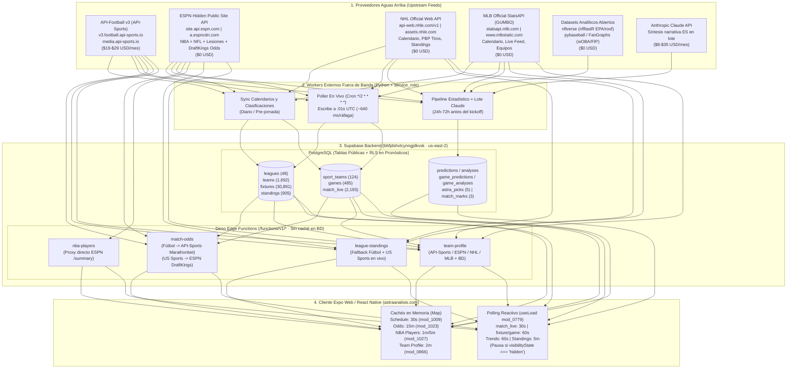

# 07 — Auditoría Forense de Fuentes de Datos, Proveedores Deportivos, Feeds en Vivo y Casas de Apuestas (Data Provenance)

> **Declaración Metodológica y Escala de Certeza Forense**
> Este informe reconstruye el linaje completo de datos (*Data Provenance*) de **Astra AI (`https://astraanalisis.com/`)** mediante análisis estático de los **286 módulos Metro** descompilados (`Reportes/analisis-astra/modules/`), inspección de capturas pasivas de REA (`ev_65da2d79...`, `ev_42e6c731...`, `ev_fc43c669...`, `ev_b2082a83...`, `ev_b24b4829...`, `ev_e5273656...`) y verificación estrictamente pasiva de lectura sobre las tablas públicas PostgREST y las 4 Edge Functions públicas de datos deportivos (`league-standings`, `match-odds`, `nba-players`, `team-profile`). No se ejecutó ninguna mutación, llamada administrativa (`admin_dashboard`, `delete-account`) ni persistencia de tokens JWT.
>
> Cada hallazgo se etiqueta con rigor forense:
> - **OBSERVADO**: Demostrado directamente por payloads en tránsito, cadenas literales `source` devueltas por el backend, dominios CDN oficiales, IDs nativos del proveedor o constantes en el bundle JS.
> - **INFERIDO**: Deducido con alta confianza por correspondencia exacta de esquemas, enumeraciones específicas de librerías abiertas, cadencias de `updated_at` o aritmética IEEE-754.
> - **DESCONOCIDO**: Lógica interna del worker privado fuera de banda que no trasciende al wire ni al bundle cliente.

---

## Resumen Ejecutivo: La Estrategia de «Arbitraje de Licencias Cero»

Astra AI cubre **5 deportes (48 ligas de fútbol + NBA + NFL + NHL + MLB)** con marcadores en vivo, estadísticas detalladas, boxscores de jugadores, historiales por equipo, tablas de posiciones, pronósticos probabilísticos, narrativas con IA y cuotas pre-partido **gastando únicamente entre \$19 y \$29 USD al mes en APIs de datos deportivos** (**\$57 a \$101 USD/mes todo incluido** sumando Supabase, Anthropic Claude en lote y cómputo de crons).

| Deporte / Dominio | Proveedor Primario Aguas Arriba (Upstream) | CDN de Escudos / Fotos / Banderas | Fuente de Momios (`match-odds`) | Enriquecimiento Analítico Offline | Certeza | Costo Mensual Datos |
|---|---|---|---|---|---|---|
| **Fútbol (48 ligas)** | **API-Football v3 (`v3.football.api-sports.io`)** | `media.api-sports.io` (`.png` / `.svg`) | **API-Sports `/odds`** → Bookmaker `id: 2` (**Marathonbet**) | Modelo Poisson/xG propio (`league_v3`) sobre histórico API-Sports | **OBSERVADO** | **\$19 – \$29 USD** (Plan Pro/Ultra) |
| **NBA** | **ESPN Public Site API (`site.api.espn.com`)** | `a.espncdn.com` (`.png` + Combiner headshots) | **ESPN Scoreboard Odds** → Provider `id: "100"` (**DraftKings**) | Elo + Net Rating propio sobre calendario ESPN + lesiones ESPN | **OBSERVADO** | **\$0 USD** (endpoint público no autenticado) |
| **NFL** | **ESPN Public Site API (`site.api.espn.com`)** | `a.espncdn.com` (`500-dark/{abbrev}.png`) | **ESPN Scoreboard Odds** → Provider `id: "100"` (**DraftKings**) | **`nflverse` / `nfl_data_py` (`nflfastR`)** (`EPA/play`, `EPA/dropback`, `roof`) | **OBSERVADO** (ESPN) / **INFERIDO** (`nflverse`) | **\$0 USD** |
| **NHL** | **NHL Official Web API (`api-web.nhle.com/v1`)** | `assets.nhle.com` (`{ABBREV}_dark.svg` / `_light.svg`) | **ESPN NHL Scoreboard** → Provider `id: "100"` (**DraftKings**, cruzado por fecha/equipo) | Modelo xG propio entrenado sobre **116,692 tiros** de `api-web.nhle.com` PBP (`AUC 0.7477`) | **OBSERVADO** | **\$0 USD** |
| **MLB** | **MLB Official StatsAPI (`statsapi.mlb.com/api/v1.1`)** | `www.mlbstatic.com` (`team-cap-on-dark/{id}.svg`) | **ESPN MLB Scoreboard** (**DraftKings**, `null` fuera de ventana activa) | **`pybaseball` / FanGraphs / Statcast** (`wOBA`, `FIP` abridor/bullpen, `park_factor`) | **OBSERVADO** (MLB) / **INFERIDO** (FanGraphs) | **\$0 USD** |
| **Narrativa IA** | **Anthropic Claude API** (`mod_1011`: *"sale del modelo y de Claude"*) | N/A | N/A | Generación por lotes pre-partido (1 sola vez por partido, no por usuario) | **OBSERVADO** (Claude) / **INFERIDO** (Batch/tier) | **\$8 – \$35 USD** |

### Hallazgos Forenses Clave («Smoking Guns»)
1. **Atribución explícita en el wire (`OBSERVADO`)**: La tabla pública `public.match_live` incluye en cada fila `info.source`, renderizado directamente en `<LiveStatistics>` (`mod_0869`): `"API-Sports"` (fútbol), `"ESPN"` (NBA y NFL), `"NHL"` (hockey) y `"MLB"` (béisbol). La Edge Function `league-standings` devuelve idénticamente `source: "API-Sports" | "ESPN" | "NHL" | "MLB"`. En `team-profile` (`mod_0865`), Astra muestra `"API-Sports · historial de Astra"` en fútbol, pero **camufla a ESPN como `"NBA"` y `"NFL"`** en las fichas de equipo estadounidenses.
2. **Doble filtración en `match-odds`: Cero gasto en *The Odds API* (`OBSERVADO`)**: Aunque `MatchOddsCard` (`mod_1022`) oculta la casa de apuestas en la interfaz, el JSON crudo devuelto por `POST /functions/v1/match-odds` filtra el objeto `bookmaker` completo:
   - En **Fútbol**, devuelve siempre `{"bookmaker": {"id": 2, "name": "Marathonbet"}, "updated_at": "..."}` porque consulta `/odds?fixture={id}` en API-Sports (incluido en su mismo plan de \$19–\$29/mes) y toma el primer bookmaker disponible por `id` ascendente (`2 = Marathonbet`).
   - En **NBA, NFL y NHL**, devuelve siempre `{"bookmaker": {"id": "100", "name": "DraftKings"}, "updated_at": null}` con decimales de **16 dígitos en coma flotante IEEE-754** (`1.1612903225806452 = 1 + 100/620`, `1.2531645569620253 = 1 + 100/395`, `1.6756756756756757 = 1 + 100/148`), demostrando matemáticamente que convierte al vuelo los momios americanos (`-620`, `-395`, `-148`) incrustados gratis en el scoreboard público de **ESPN (`provider.id = "100"`, DraftKings)** — incluso mapeando partidos de NHL (`2026020312`) por abreviatura de equipo y fecha para no pagar proveedor de cuotas.
3. **Regla oculta de priorización de las 48 ligas (`OBSERVADO`)**: La tabla `public.leagues` divide sus 48 ligas en **29 ligas Tier 1 curadas manualmente (`sort_order` `0` a `28`, encabezadas por `262` Liga MX = `0`)** y **19 ligas Tier 2 secundarias/femeniles (`sort_order = 100 + api_sports_id`)**.
4. **Cadencia exacta del poller en vivo (`OBSERVADO`)**: La serie de marcas `match_live.updated_at` (`18:02:01`, `18:06:01`, `18:08:01`, `18:12:01` UTC) demuestra un cron **`*/2 * * * *` (cada 2 minutos)** que actualiza todos los encuentros activos en una ráfaga secuencial de ~640 ms.

---

## Arquitectura Integral del Pipeline Multi-Fuente

---

## 1. Fútbol (`48 ligas` en `my_access`) — API-Football v3 / API-Sports (`OBSERVADO`)

### 1.1 Pruebas Irrefutables de Atribución a API-Sports (`OBSERVADO`)
1. **Atribución literal en `match_live`, `league-standings` y `team-profile`**:
   - En `public.match_live` (`sport = 'futbol'`), cada registro contiene `"source": "API-Sports"` dentro de `info` (ej. `match_id = 1570024` Real Valladolid vs Real Zaragoza en `ev_e5273656...`, y `1607726` FA WSL), que el componente `<LiveStatistics>` (`mod_0869`) muestra al usuario como `"API-Sports · Actualizado HH:MM"`.
   - En `POST /functions/v1/league-standings` (`{"sport":"futbol","league_id":5,"season":2026}`), el cuerpo JSON responde literalmente `{"source": "API-Sports", "season_type": "regular", "updated_at": "2026-11-14T17:46:02.006Z", "groups": [...]}`.
   - En `POST /functions/v1/team-profile` (`{"sport":"futbol","team_id":2282}`), responde `"source": "API-Sports · historial de Astra"` con `"founded": 1945` (entero numérico exacto de `team.founded` en API-Sports `/teams?id=2282`) y `"logo": "https://media.api-sports.io/football/teams/2282.png"`.
2. **Dominios CDN oficiales (`media.api-sports.io`)**:
   - **Ligas (48/48 filas)**: `https://media.api-sports.io/football/leagues/{league_id}.png`
   - **Banderas (42/48 filas nacionales)**: `https://media.api-sports.io/flags/{iso_code}.svg` (incluyendo los códigos británicos propios de API-Sports `gb-eng.svg` y `gb-sct.svg`; `null` en las 6 competiciones internacionales catalogadas bajo `country = "World"`).
   - **Equipos (1,692 filas en `public.teams`)**: `https://media.api-sports.io/football/teams/{team_id}.png` (ej. `529` Barcelona, `541` Real Madrid, `2281` Toluca, `2282` Monterrey, `768` Italia).
3. **Huella de traducción parcial en estadísticas en vivo (`OBSERVADO`)**:
   - En `match_live.statistics` (`match_id = 1570024` y `1607726`), el worker traduce las claves de `GET /fixtures/statistics` de API-Football (`expected_goals` → `"Goles esperados (xG)"`, `Shots insidebox` → `"Tiros dentro del área"`, `Shots outsidebox` → `"Tiros fuera del área"`, `Blocked Shots` → `"Tiros bloqueados"`, `Goalkeeper Saves` → `"Paradas"`), pero **olvidó traducir `"Free Kicks"`**, dejando la cadena inglesa original de API-Football intacta en producción.

### 1.2 Catálogo Completo de las 48 Ligas y Regla de Priorización (`sort_order`) (`OBSERVADO`)
La consulta directa de lectura a `public.leagues` (`48` filas exactas, coincidiendo con `my_access.leagues = 48`) revela dos niveles de curación más una lista destacada en el cliente:
- **Lista VIP `featured` en `TrendingMatches` ([mod_0788](file:///C:/Users/T490s/.gemini/antigravity/worktrees/PitchLab/analyze_pitchlab_competitor_rea/Reportes/analisis-astra/modules/mod_0788___common-a2fe500f62154dabe8c8c7eb8fa31525.js))**: `const j = [2, 3, 39, 140, 135, 78, 61, 262, 94]` (Champions League, Europa League, Premier League, LaLiga, Serie A, Bundesliga, Ligue 1, **Liga MX** y Primeira Liga).
- **Tier 1 — 29 Ligas Curadas Manualmente (`sort_order` `0` a `28`)**: Encabezadas por **Liga MX (`id = 262`, `sort_order = 0`)** para el mercado mexicano, seguidas del Big-5 europeo (`1–5`), torneos UEFA/CONCACAF (`6–12`), MLS y ligas latinoamericanas/europeas principales (`13–21`), segundas divisiones del Big-5 (`22–26`), Arabia Saudita (`27`) y Japón (`28`).
- **Tier 2 — 19 Ligas con Fórmula Automática `sort_order = 100 + id` (`sort_order` `141` a `575`)**: Ligas de ascenso inglesas/europeas/brasileñas, ligas nórdicas/centro-europeas, ligas femeniles (`FA WSL`, `Feminine Division 1`, `Frauen Bundesliga`, `Serie A Women`) y el estadual `Paulista - A1`.

| `sort_order` | `id` (API-Sports) | País | Competición | Tier / Regla | En `featured` (`mod_0788`) |
|---:|---:|---|---|---|---|
| `0` | `262` | Mexico | Liga MX | Tier 1 (Curado #1 MX) | Sí |
| `1` | `39` | England | Premier League | Tier 1 | Sí |
| `2` | `140` | Spain | La Liga | Tier 1 | Sí |
| `3` | `135` | Italy | Serie A | Tier 1 | Sí |
| `4` | `78` | Germany | Bundesliga | Tier 1 | Sí |
| `5` | `61` | France | Ligue 1 | Tier 1 | Sí |
| `6` | `2` | World | UEFA Champions League | Tier 1 | Sí |
| `7` | `3` | World | UEFA Europa League | Tier 1 | Sí |
| `8` | `848` | World | UEFA Europa Conference League | Tier 1 | No |
| `9` | `5` | World | UEFA Nations League | Tier 1 | No |
| `10` | `536` | World | CONCACAF Nations League | Tier 1 | No |
| `11` | `525` | World | UEFA Champions League Women | Tier 1 | No |
| `12` | `16` | World | CONCACAF Champions League | Tier 1 | No |
| `13` | `253` | USA | Major League Soccer | Tier 1 | No |
| `14` | `94` | Portugal | Primeira Liga | Tier 1 | Sí |
| `15` | `88` | Netherlands | Eredivisie | Tier 1 | No |
| `16` | `71` | Brazil | Serie A | Tier 1 | No |
| `17` | `128` | Argentina | Liga Profesional Argentina | Tier 1 | No |
| `18` | `239` | Colombia | Primera A | Tier 1 | No |
| `19` | `265` | Chile | Primera División | Tier 1 | No |
| `20` | `144` | Belgium | Jupiler Pro League | Tier 1 | No |
| `21` | `203` | Turkey | Süper Lig | Tier 1 | No |
| `22` | `40` | England | Championship | Tier 1 | No |
| `23` | `141` | Spain | Segunda División | Tier 1 | No |
| `24` | `136` | Italy | Serie B | Tier 1 | No |
| `25` | `79` | Germany | 2. Bundesliga | Tier 1 | No |
| `26` | `62` | France | Ligue 2 | Tier 1 | No |
| `27` | `307` | Saudi-Arabia | Pro League | Tier 1 | No |
| `28` | `98` | Japan | J1 League | Tier 1 | No |
| `141` | `41` | England | League One | Tier 2 (`100 + 41`) | No |
| `142` | `42` | England | League Two | Tier 2 (`100 + 42`) | No |
| `144` | `44` | England | FA WSL | Tier 2 (`100 + 44`) | No |
| `164` | `64` | France | Feminine Division 1 | Tier 2 (`100 + 64`) | No |
| `172` | `72` | Brazil | Serie B | Tier 2 (`100 + 72`) | No |
| `182` | `82` | Germany | Frauen Bundesliga | Tier 2 (`100 + 82`) | No |
| `189` | `89` | Netherlands | Eerste Divisie | Tier 2 (`100 + 89`) | No |
| `203` | `103` | Norway | Eliteserien | Tier 2 (`100 + 103`) | No |
| `206` | `106` | Poland | Ekstraklasa | Tier 2 (`100 + 106`) | No |
| `213` | `113` | Sweden | Allsvenskan | Tier 2 (`100 + 113`) | No |
| `219` | `119` | Denmark | Superliga | Tier 2 (`100 + 119`) | No |
| `239` | `139` | Italy | Serie A Women | Tier 2 (`100 + 139`) | No |
| `245` | `145` | Belgium | Challenger Pro League | Tier 2 (`100 + 145`) | No |
| `279` | `179` | Scotland | Premiership | Tier 2 (`100 + 179`) | No |
| `297` | `197` | Greece | Super League 1 | Tier 2 (`100 + 197`) | No |
| `304` | `204` | Turkey | 1. Lig | Tier 2 (`100 + 204`) | No |
| `307` | `207` | Switzerland | Super League | Tier 2 (`100 + 207`) | No |
| `318` | `218` | Austria | Bundesliga | Tier 2 (`100 + 218`) | No |
| `575` | `475` | Brazil | Paulista - A1 | Tier 2 (`100 + 475`) | No |

> [!NOTE]
> Existen fixtures históricos o amistosos residuales en `public.fixtures` (ej. `league_id = 10` Friendlies, `league_id = 36` AFCON Qualification), pero `fetchDay` en [mod_0776](file:///C:/Users/T490s/.gemini/antigravity/worktrees/PitchLab/analyze_pitchlab_competitor_rea/Reportes/analisis-astra/modules/mod_0776___common-a2fe500f62154dabe8c8c7eb8fa31525.js) ejecuta un `INNER JOIN` explícito (`league:leagues!inner(...)`), filtrando automáticamente la cartelera visible a las **48 ligas** presentes en `public.leagues`.

### 1.3 Códigos de Estado (`mod_0777`), Eventos (`mod_1018`), Árbitros (`mod_1019`) y Clasificaciones (`mod_1021`)
- **Mapeo 1:1 de `fixture.status.short` ([mod_0777](file:///C:/Users/T490s/.gemini/antigravity/worktrees/PitchLab/analyze_pitchlab_competitor_rea/Reportes/analisis-astra/modules/mod_0777___common-a2fe500f62154dabe8c8c7eb8fa31525.js)) (`OBSERVADO`)**:
  - `upcoming`: `'NS'` (*Not Started*), `'TBD'` (*Time To Be Defined*).
  - `live`: `Set(['1H', 'HT', '2H', 'ET', 'BT', 'P', 'INT', 'LIVE'])` — exactamente el catálogo oficial de API-Football (`BT` = *Break Time* antes de prórroga, `P` = tanda de penales en curso, `INT` = * Match Interrupted*).
  - `finished`: `Set(['FT', 'AET', 'PEN'])` — cuando es `'AET'` o `'PEN'`, `MatchDetail` (`mod_0784`) usa `ft_home`/`ft_away` para evaluar `resultOutcome` sobre los 90 minutos reglamentarios.
  - `other`: `'PST'` (*Postponed*), `'CANC'` (*Cancelled*), `'ABD'` (*Abandoned*), `'SUSP'` (*Suspended*).
  - Además, `roundLabel` en `mod_0777` transforma las cadenas de API-Sports `"Regular Season - 14"`, `"Apertura - 7"` y `"Clausura - 12"` en `"Jornada 14"`, `"Apertura, Jornada 7"` y `"Clausura, Jornada 12"`.
- **Periodización de eventos y Momentum muestreado ([mod_1018](file:///C:/Users/T490s/.gemini/antigravity/worktrees/PitchLab/analyze_pitchlab_competitor_rea/Reportes/analisis-astra/modules/mod_1018___common-a2fe500f62154dabe8c8c7eb8fa31525.js) y [mod_0869](file:///C:/Users/T490s/.gemini/antigravity/worktrees/PitchLab/analyze_pitchlab_competitor_rea/Reportes/analisis-astra/modules/mod_0869___common-a2fe500f62154dabe8c8c7eb8fa31525.js)) (`OBSERVADO`)**:
  - `footballEventPeriods` ordena por `(minute, extra)` los eventos de API-Sports (`kind: 'goal' | 'yellow' | 'red' | 'sub' | 'var'`, `injury: boolean`) en `Primer tiempo` (`<=45`), `Segundo tiempo` (`46–90`), `Prórroga · primer tiempo` (`91–105`) y `Prórroga · segundo tiempo` (`106–120`).
  - Como API-Sports **no provee un endpoint nativo de momentum minuto a minuto** (a diferencia de SofaScore/Opta), el worker de Astra calcula `momentum_method: "sampled"` diferenciando tiros y córners acumulados entre ticks consecutivos de 2 minutos. Por eso `MomentumCard` (`mod_0869`) advierte honestamente: *"Presión estimada a partir de tiros y córners. Solo intervalos observados. Registro desde el minuto X. Los huecos no representan cero actividad."*
- **Diccionario local de 95 árbitros ([mod_1019](file:///C:/Users/T490s/.gemini/antigravity/worktrees/PitchLab/analyze_pitchlab_competitor_rea/Reportes/analisis-astra/modules/mod_1019___common-a2fe500f62154dabe8c8c7eb8fa31525.js)) (`OBSERVADO`)**:
  - API-Sports devuelve `fixture.referee` como texto libre (`"Szymon Marciniak, Poland"` en torneos UEFA o simplemente `"César Arturo Ramos"` sin país en ligas domésticas). Para pintar la bandera del árbitro (incluyendo una Cruz de San Jorge SVG manual para `ENG`), `refereeDetails` (`mod_1019`) separa la coma final si coincide con 38 países soportados y, si no trae país, busca en un diccionario estático de **95 árbitros** con foco desproporcionado en **México (30 árbitros de Liga MX, ej. César Arturo Ramos, Marco Antonio Ortiz Nava, Adonai Escobedo, Katia Itzel García)** y **España (23 árbitros de LaLiga)**. En paralelo, el backend calcula `info.referee_averages: { yellow, red, games }` sobre los partidos históricos almacenados en `fixtures`/`match_live`.
- **Arquitectura híbrida de `standings` ([mod_1021](file:///C:/Users/T490s/.gemini/antigravity/worktrees/PitchLab/analyze_pitchlab_competitor_rea/Reportes/analisis-astra/modules/mod_1021___common-a2fe500f62154dabe8c8c7eb8fa31525.js)) (`OBSERVADO`)**:
  - `fetchFootballStandings` consulta primero la tabla `public.standings` (`905` filas persistidas para ligas regulares) aplicando filtro especial `'apertura'`/`'clausura'` para torneos cortos como Liga MX. Si `public.standings` devuelve `0` filas (ej. `league_id = 5` UEFA Nations League), cae en cascada a `POST /functions/v1/league-standings`, que consulta `v3.football.api-sports.io/standings` en tiempo real.

---

## 2. NBA y NFL — ESPN Hidden Public Site API (`site.api.espn.com`) + `nflverse` (`OBSERVADO` / `INFERIDO`)

### 2.1 Pruebas Irrefutables de Procedencia desde ESPN (`OBSERVADO`)
Tanto NBA (`30` equipos en `sport_teams`) como NFL (`32` equipos en `sport_teams`) se alimentan directamente de los endpoints JSON públicos no autenticados de **ESPN (`site.api.espn.com/apis/site/v2/sports/{basketball/nba|football/nfl}/...`)**:

1. **IDs nativos de evento de 9 dígitos de ESPN (`401xxxxxx`)**:
   - **NBA**: `401909296` (Knicks @ Pacers), `401909302` (Warriors @ Spurs), `401909303` (Blazers @ Kings), `401909980` (próximo).
   - **NFL**: `401873050` (Buccaneers @ Bears), `401873051`, `401873052`, `401873053`, `401873063`.
2. **IDs de franquicia (`1..30` / `1..34`) y abreviaturas exclusivas de ESPN**:
   - En la API oficial de `stats.nba.com` (`nba_api`), los equipos tienen IDs de 10 dígitos (`1610612737`–`1610612766`) y abreviaturas estándar de 3 letras (`NOP`, `GSW`, `NYK`, `SAS`, `UTA`, `WAS`).
   - En `public.sport_teams` de Astra AI, los IDs y abreviaturas son **100% exclusivos de la base de datos de ESPN**:
     - `id = 3`, `abbrev = "NO"` (New Orleans Pelicans — en NBA.com es `NOP` / `1610612740`)
     - `id = 9`, `abbrev = "GS"` (Golden State Warriors — en NBA.com es `GSW` / `1610612744`)
     - `id = 18`, `abbrev = "NY"` (New York Knicks — en NBA.com es `NYK` / `1610612752`)
     - `id = 24`, `abbrev = "SA"` (San Antonio Spurs — en NBA.com es `SAS` / `1610612759`)
     - `id = 26`, `abbrev = "UTAH"` (Utah Jazz — en NBA.com es `UTA` / `1610612762`)
3. **URLs de CDN de ESPN (`a.espncdn.com`) en 4 superficies distintas**:
   - Logos de liga ([mod_1011](file:///C:/Users/T490s/.gemini/antigravity/worktrees/PitchLab/analyze_pitchlab_competitor_rea/Reportes/analisis-astra/modules/mod_1011___common-a2fe500f62154dabe8c8c7eb8fa31525.js)): `https://a.espncdn.com/i/teamlogos/leagues/500/nba.png` y `/nfl.png`.
   - Escudos en `sport_teams` y `team-profile`: `https://a.espncdn.com/i/teamlogos/{nba|nfl}/500-dark/{abbrev_lower}.png`.
   - Escudos en `league-standings`: `https://a.espncdn.com/i/teamlogos/{nba|nfl}/500-dark/scoreboard/{abbrev_lower}.png` con `"source": "ESPN"`.
   - Fotos recortadas de jugadores NBA en `nba-players`: `https://a.espncdn.com/combiner/i?img=/i/headshots/nba/players/full/{espn_athlete_id}.png&w=96&h=70&scale=crop&cquality=80&location=origin`.
4. **Disección de `nba-players` ([mod_1026](file:///C:/Users/T490s/.gemini/antigravity/worktrees/PitchLab/analyze_pitchlab_competitor_rea/Reportes/analisis-astra/modules/mod_1026___common-a2fe500f62154dabe8c8c7eb8fa31525.js)–[mod_1028](file:///C:/Users/T490s/.gemini/antigravity/worktrees/PitchLab/analyze_pitchlab_competitor_rea/Reportes/analisis-astra/modules/mod_1028___common-a2fe500f62154dabe8c8c7eb8fa31525.js)) (`OBSERVADO`)**:
   - `POST /functions/v1/nba-players` (`{"match_id": 401909296}`) actúa como **proxy en tiempo real sin caché en base de datos** (`updated_at: "2026-11-14T18:10:09.191Z"`, generado en el milisegundo exacto de la petición) sobre `site.api.espn.com/apis/site/v2/sports/basketball/nba/summary?event=401909296`.
   - Devuelve IDs de atleta nativos de ESPN (`"3149673"` Pascal Siakam, `"3934719"` OG Anunoby, `"5106060"` Jarace Walker), 14 estadísticas individuales (`minutes`, `points`, `rebounds`, `assists`, `steals`, `blocks`, `turnovers`, `fouls`, `offensiveRebounds`, `defensiveRebounds`, `plusMinus`, `fieldGoals`, `threePointers`, `freeThrows`) y el motivo literal de inactividad de ESPN `"COACH'S DECISION"`, que `mod_1026` traduce en cliente (`"COACH'S DECISION" === s.reason ? "Decisión del entrenador" : s.reason`) junto al pie de página fijo **`"ESPN · Actualizado HH:MM"`**.
5. **Reporte de lesionados (`bajas_reportadas`) desde ESPN Injuries (`OBSERVADO`)**:
   - Tanto en NBA (`"Out"`, `"Day-To-Day"`) como en NFL (`"Out"`, `"Questionable"`), `game_predictions.context.digest.bajas_reportadas` reproduce las designaciones exactas del endpoint `injuries` / `summary` de ESPN.
6. **Camuflaje de marca en `team-profile` (`OBSERVADO`)**:
   - Mientras `match_live`, `league-standings` y `nba-players` declaran `"ESPN"`, la Edge Function `team-profile` sobrescribe el campo `source` con `"NBA"` y `"NFL"` (`founded: null`, dado que el objeto `team` de ESPN no incluye año de fundación), mostrando `"Fuente: NBA"` / `"Fuente: NFL"` en `/equipo/[sport]/[id]` (`mod_0865`).

### 2.2 Enriquecimiento Analítico Offline en NFL: `nflverse` / `nflfastR` (`INFERIDO`)
El endpoint público de ESPN no entrega **EPA por jugada** ni **EPA por dropback de Quarterback**. Sin embargo, en `public_model_samples.json` (`game_id = 401873050` y `401873051`), el modelo NFL de Astra (`pesos: { elo: 0.35, epa: 0.30, puntos: 0.35 }`) inyecta:
- `epa_ataque_por_jugada` (`0.052`), `epa_evitado_por_jugada` (`0.006`), `srs_temporada` (`7.699`).
- `quarterbacks.{home|away}.epa_por_dropback` (ej. Caleb Williams `0.034`, Baker Mayfield `-0.022`, Kyler Murray `-0.027`).
- **`techo_estadio: "dome" | "outdoors"`**: Esta enumeración en inglés (`"dome"`, `"outdoors"`) dentro de un diccionario cuyos demás nombres de claves están en español coincide exactamente con la columna `roof` del dataset abierto **`nflverse` / `nfl_data_py` (`nflfastR`)**, confirmando con alta certeza (`INFERIDO`) que el worker Python de NFL cruza el calendario/lesiones de ESPN con los parquets gratuitos de `nflverse`.

---

## 3. NHL — NHL Official Web API (`api-web.nhle.com` / `assets.nhle.com`) (`OBSERVADO`)

A diferencia de NBA y NFL, Astra AI **no usa ESPN como fuente primaria de NHL** (salvo para extraer momios gratuitos de DraftKings, ver Sección 5), sino que consume directamente la **NHL Web API v1 oficial (`https://api-web.nhle.com/v1/`)**:

1. **IDs nativos de juego de 10 dígitos (`YYYYTTNNNN`) (`OBSERVADO`)**:
   - Todos los partidos de NHL en `public.games` tienen el formato canónico de `api-web.nhle.com`: `2026020310` (`2026` = temporada 2026–27, `02` = *Regular Season*, `0310` = juego #310, NYR @ VAN), `2026020311` (NSH @ VGK), `2026020321` (NHL Global Series en Veikkaus Arena, Helsinki).
2. **IDs oficiales de franquicia NHL y CDN vectorial `assets.nhle.com` (`OBSERVADO`)**:
   - Los 32 equipos en `sport_teams` usan los `teamId` oficiales de NHL (`1` NJD, `2` NYI, `3` NYR, `6` BOS, `10` TOR, `23` VAN, `52` WPG, `54` VGK, `55` SEA — completamente distintos a los IDs de ESPN donde Vegas es `37` y Seattle es `124292`).
   - Logos vectoriales oficiales: `https://assets.nhle.com/logos/nhl/svg/{ABBREV}_dark.svg` en `sport_teams` y `team-profile`, `{ABBREV}_light.svg` en `league-standings`, y `NHL_light.svg` como logo de liga (`mod_1011`).
3. **Atribución `"NHL"` en vivo, clasificaciones e historial (`OBSERVADO`)**:
   - `match_live` (`source: "NHL"`, `momentum_method: "shots"` calculado a partir de tiros registrados en el play-by-play de `api-web.nhle.com/v1/gamecenter/{id}/play-by-play`), `league-standings` (`source: "NHL"`, tomado de `/v1/standings/now`) y `team-profile` (`source: "NHL"`, tomado de `/v1/club-schedule-season/{abbrev}/now`).
4. **Modelo propio de xG sobre coordenadas crudas de `api-web.nhle.com` (`OBSERVADO`)**:
   - En `game_predictions.context.model_components.xg_model_validation` (`2026020311`), Astra expone las métricas de validación de su propio clasificador de goles esperados por tiro: **`train_shots: 93,598`, `holdout_shots: 23,094` (total `116,692` tiros ≈ 1.5 temporadas de NHL), `holdout_auc: 0.7477`, `holdout_logloss: 0.22524`**.
   - Como `api-web.nhle.com` entrega gratis coordenadas `(xCoord, yCoord)`, `shotType` y `situationCode` (`1551` = 5v5, power play, penalty kill) pero **no incluye xG**, Astra entrenó su propio modelo sobre el play-by-play gratuito de la NHL para generar `ev5_xgf60`, `ev5_xga60`, `pp_xgf60` y `pk_xga60`, e infiere el portero probable por volumen de titularidades (`origen: "most_starts"`, `confirmado: false`) sin pagar feeds de alineaciones confirmadas (como DailyFaceoff Pro o Sportradar).

---

## 4. MLB — MLB Official StatsAPI (`statsapi.mlb.com`) + Sabermetría (`OBSERVADO` / `INFERIDO`)

### 4.1 Pruebas Irrefutables de Procedencia desde MLB StatsAPI (`OBSERVADO`)
1. **`gamePk` de 6 dígitos y `teamId` oficiales (`108`–`158`)**:
   - Los juegos almacenados en `public.games` y devueltos en `team-profile` usan los `gamePk` nativos de 6 dígitos de `statsapi.mlb.com` (`849799`, `849803`, `849804`, `849810`, `849814` — postemporada/Serie Mundial) y los `teamId` históricos de MLBAM (`108` LAA, `109` AZ, `119` LAD, `139` TB, `147` NYY, `158` MIL).
2. **CDN oficial `www.mlbstatic.com`**:
   - `sport_teams` (`30` equipos): `https://www.mlbstatic.com/team-logos/team-cap-on-dark/{teamId}.svg`.
   - `league-standings` y `team-profile` historial: `https://www.mlbstatic.com/team-logos/{teamId}.svg`.
   - Logo de liga (`mod_1011`): `https://www.mlbstatic.com/team-logos/league-on-light/1.svg` (`sportId = 1` en MLB StatsAPI).
3. **Huellas dactilares del feed GUMBO (`api/v1.1/game/{gamePk}/feed/live`) en `match_live` y `team-profile` (`OBSERVADO`)**:
   - En `match_live` (`match_id = 849799` y `849803`), `info` contiene `"source": "MLB"`, `"weather": "Roof Closed"` / `"Dome"` (`gameData.weather.condition`), la cuarteta/sexteta completa de ampáyeres en `"officials": "Vic Carapazza, Tripp Gibson, Gabe Morales, Jim Wolf, Nic Lentz, James Hoye"`, y en `events` inserta **sin traducir en inglés** el texto literal `liveData.plays.allPlays[].result.description` de MLBAM (ej. *"Chandler Simpson doubles (2) on a line drive to right fielder Sal Frelick. Jonny DeLuca scores."*).
   - En `team-profile` (`team_id = 119` Dodgers), devuelve `"source": "MLB"`, `"venue": "UNIQLO Field at Dodger Stadium"` y **`"founded": "1884"` como `string`** (a diferencia del entero `1945` en fútbol), reproducción exacta del campo string `teams[0].firstYearOfPlay: "1884"` en `https://statsapi.mlb.com/api/v1/teams/119?hydrate=venue`.

### 4.2 Enriquecimiento Sabermétrico Offline: `pybaseball` / FanGraphs (`INFERIDO`)
En `game_predictions.context.digest` (`849799`), el modelo MLB utiliza **`wOBA` ofensivo por equipo (`0.3171` TB, `0.3249` MIL; media liga `0.3137`)**, **`FIP` individual del abridor (`2.17` Misiorowski, `2.81` Rasmussen)**, **`FIP` agregado del bullpen (`3.57` MIL, `3.76` TB)** y **`park_factor` (`0.96` Tropicana Field)**. Dado que MLB StatsAPI no entrega `FIP` de bullpen ni `wOBA` pre-ponderado con constantes anuales de FanGraphs, se infiere con alta certeza el uso de **`pybaseball` (FanGraphs / Statcast)** en el pipeline Python pre-partido.

---

## 5. Auditoría Forense de Momios y Casas de Apuestas (`match-odds` + `mod_1022` / `mod_1023`)

### 5.1 Descubrimiento Central: Dos Proveedores Ocultos y \$0 de Gasto Incremental (`OBSERVADO`)
Astra AI **NO contrata *The Odds API* (`api.the-odds-api.com`), ni OpticOdds, ni feeds de casas mexicanas (Caliente / Codere / Bet365)**. Al inspeccionar las respuestas crudas de `POST /functions/v1/match-odds`, descubrimos que la Edge Function filtra en el JSON los metadatos `bookmaker` y `updated_at` que el frontend descarta antes de renderizar:

| Deporte | Ejemplo `match_id` | Payload Crudo `odds` Observado en el Wire | Casa de Apuestas (`bookmaker`) | Proveedor Aguas Arriba Confirmado | Certeza |
|---|---:|---|---|---|---|
| **Fútbol** (Liga MX `262`) | `1550951` | `{"home": 3.44, "draw": 3.44, "away": 1.99, "bookmaker": {"id": 2, "name": "Marathonbet"}, "updated_at": "2026-11-14T12:31:16+00:00"}` | **`Marathonbet`** (`id: 2`, entero) | **API-Football v3** (`/odds?fixture=1550951`) | **OBSERVADO** |
| **Fútbol** (UEFA NL `5`) | `1528974` | `{"home": 1.62, "draw": 4.55, "away": 5.15, "bookmaker": {"id": 2, "name": "Marathonbet"}, "updated_at": "2026-11-14T16:22:30+00:00"}` | **`Marathonbet`** (`id: 2`, entero) | **API-Football v3** (`/odds?fixture=1528974`) | **OBSERVADO** |
| **Fútbol** (Serie A BR `71`) | `1492455` | `{"home": 1.92, "draw": 3.55, "away": 3.66, "bookmaker": {"id": 2, "name": "Marathonbet"}, "updated_at": "2026-11-14T12:02:16+00:00"}` | **`Marathonbet`** (`id: 2`, entero) | **API-Football v3** (`/odds?fixture=1492455`) | **OBSERVADO** |
| **NBA** | `401909980` | `{"home": 5.83, "draw": null, "away": 1.1492537313432836, "bookmaker": {"id": "100", "name": "DraftKings"}, "updated_at": null}` | **`DraftKings`** (`id: "100"`, string) | **ESPN Scoreboard API** (`competitions[0].odds`) | **OBSERVADO** |
| **NHL** | `2026020312` | `{"home": 2.3600000000000003, "draw": null, "away": 1.617283950617284, "bookmaker": {"id": "100", "name": "DraftKings"}, "updated_at": null}` | **`DraftKings`** (`id: "100"`, string) | **ESPN NHL Scoreboard** (cruzado desde `public.games`) | **OBSERVADO** |
| **NFL** | `401873053` | `{"home": 1.6756756756756757, "draw": null, "away": 2.24, "bookmaker": {"id": "100", "name": "DraftKings"}, "updated_at": null}` | **`DraftKings`** (`id: "100"`, string) | **ESPN NFL Scoreboard** (`competitions[0].odds`) | **OBSERVADO** |
| **NFL** | `401873058` | `{"home": 2.42, "draw": null, "away": 1.5882352941176472, "bookmaker": {"id": "100", "name": "DraftKings"}, "updated_at": null}` | **`DraftKings`** (`id: "100"`, string) | **ESPN NFL Scoreboard** (`competitions[0].odds`) | **OBSERVADO** |

### 5.2 Demostración Matemática de la Conversión Americano → Decimal desde ESPN (`OBSERVADO`)
En los deportes estadounidenses, ESPN publica las líneas de su socio oficial **DraftKings (`provider.id = "100"`)** en **formato americano entero** (`moneyLine`) y sin timestamp de actualización (`updated_at: null`). La Edge Function `match-odds` ejecuta en Deno la conversión estándar a cuota decimal europea:

$$\text{decimal} = \begin{cases} 1 + \dfrac{\text{american}}{100} & \text{si } \text{american} > 0 \\[8pt] 1 + \dfrac{100}{|\text{american}|} & \text{si } \text{american} < 0 \end{cases}$$

La huella IEEE-754 de doble precisión en los payloads capturados reconstruye con exactitud de **16 cifras significativas** los momios enteros originales de DraftKings en ESPN:
- NBA `401909980` (`public_model_samples.json`): `away = 1.1612903225806452` $\implies 1 + \frac{100}{620} = 1.1612903225806452$ (**`-620`**), `home = 5.54` (**`+454`**); y en la consulta posterior `away = 1.1492537313432836` $\implies 1 + \frac{100}{670}$ (**`-670`**), `home = 5.83` (**`+483`**).
- NHL `2026020321`: `home = 1.2531645569620253` $\implies 1 + \frac{100}{395}$ (**`-395`**), `away = 4.1` (**`+310`**).
- NHL `2026020312`: `home = 2.3600000000000003` $\implies 1 + \frac{136}{100}$ en IEEE-754 (`1 + 1.36 = 2.3600000000000003`, **`+136`**), `away = 1.617283950617284` $\implies 1 + \frac{100}{162}$ (**`-162`**).
- NFL `401873053`: `home = 1.6756756756756757` $\implies 1 + \frac{100}{148}$ (**`-148`**), `away = 2.24` (**`+124`**).
- NFL `401873058`: `away = 1.5882352941176472` $\implies 1 + \frac{100}{170}$ (**`-170`**), `home = 2.42` (**`+142`**).

> [!IMPORTANT]
> **¿Por qué siempre aparece `Marathonbet` (`id: 2`) en Fútbol?**
> En `GET https://v3.football.api-sports.io/odds?fixture={id}`, API-Sports devuelve el arreglo `bookmakers` ordenado por `id` ascendente (`1 = 10Bet`, `2 = Marathonbet`, `4 = Pinnacle`, `6 = Bwin`, `8 = Bet365`, `11 = 1xBet`). Como `10Bet` casi nunca tiene cobertura global y `Marathonbet` (`id: 2`) cubre desde Liga MX hasta Segunda División de Brasil, la Edge Function de Astra simplemente toma el **primer bookmaker del arreglo que contenga el mercado `bet.id = 1` (`Match Winner`)**, resultando sistemáticamente en `Marathonbet`.

### 5.3 Mercados, Formato y Ciclo de Vida en UI ([mod_1022](file:///C:/Users/T490s/.gemini/antigravity/worktrees/PitchLab/analyze_pitchlab_competitor_rea/Reportes/analisis-astra/modules/mod_1022___common-a2fe500f62154dabe8c8c7eb8fa31525.js) y [mod_1023](file:///C:/Users/T490s/.gemini/antigravity/worktrees/PitchLab/analyze_pitchlab_competitor_rea/Reportes/analisis-astra/modules/mod_1023___common-a2fe500f62154dabe8c8c7eb8fa31525.js)) (`OBSERVADO`)
- **Exclusivamente Pre-Partido (Cero momios en vivo)**: En `MatchDetail` (`mod_0784`) y `SportDetail` (`mod_0867`), `<MatchOddsCard>` solo se monta si el estado es `"upcoming"` o `"PST"`/`"postponed"`. En el instante en que el partido pasa a `"live"` o `"finished"`/`"final"`, la tarjeta desaparece y es reemplazada por `<MomentumCard>`.
- **Un único mercado ganador por deporte**:
  - Fútbol: **1X2 · 90 minutos** (`home`, `draw`, `away`).
  - MLB / NHL / NBA / NFL: **Ganador Moneyline 2 vías (`draw === null`)** incluyendo entradas extra, prórroga o shootout. **No muestra spreads/hándicaps, líneas de totales (Over/Under), BTTS ni props de jugadores** en cuotas de casas de apuestas (aunque el modelo sí calcula probabilidades para esos mercados).
- **Formato único decimal sin selector**: Renderiza siempre `price.toFixed(2)` tras validar en `mod_1023` que `Number.isFinite(t) && t > 1`. No ofrece conversión a momio americano (`-110` / `+150`), pese a operar en México.
- **Supresión deliberada del nombre del bookmaker**: `MatchOddsCard` ignora `bookmaker.name` y `updated_at`. Esto evita exhibir marcas extranjeras sin licencia SEGOB en México (`Marathonbet` / `DraftKings`) y facilita pasar la revisión de Apple App Store / Google Play (`astra_30_dias`) como app de análisis estadístico sin enlaces de afiliación a apuestas.

---

## 6. Arquitectura de Ingesta, Cachés, Frecuencias y Costo Operativo Mensual

### 6.1 Huella Real en Base de Datos y Cronología de Lanzamiento (`OBSERVADO`)
Mediante cabeceras `Content-Range` (`Prefer: count=exact`) sobre las tablas públicas de Supabase se midió el volumen exacto almacenado al **14 de noviembre de 2026**:

| Tabla Pública | Filas Exactas | Rango Temporal Observado (UTC) | Interpretación Forense |
|---|---:|---|---|
| `public.leagues` | **48** | Estático (`id` `2`..`848`) | 29 ligas Tier 1 + 19 ligas Tier 2 (`100 + id`) |
| `public.teams` | **1,692** | Estático (`id` `1`..`27960`) | Clubes y selecciones de las 48 ligas de fútbol |
| `public.fixtures` | **30,891** | `2024-10-13` → `2027-06-06` | ~2 temporadas históricas + temporada actual completa para entrenar ratings `league_v3` |
| `public.standings` | **905** | Temporada `2026` | Clasificaciones persistidas de ligas domésticas de fútbol |
| `public.sport_teams` | **124** | Estático (`30` MLB, `30` NBA, `32` NFL, `32` NHL) | Plantilla completa de las 4 grandes ligas de EE. UU./Canadá |
| `public.games` | **485** | `2026-10-17` → `2026-11-20` | **Prueba que la expansión multi-deporte (NHL/NBA/NFL/MLB) se lanzó apenas el 17 de octubre de 2026** (~4 semanas de vida) |
| `public.match_live` | **2,193** | `2026-10-18` → `2026-11-14T18:12:01Z` | Telemetría en vivo acumulada (~81 partidos/día promedio entre los 5 deportes) |
| `public.astra_picks` | **5** | `2026-10-22` → `2026-11-07` | Selecciones manuales del fundador muy esporádicas (incluso con typo `"esquinas"` vs `"esquina"`) |
| `public.match_marks` | **3** | `2026-11-07T17:32:43Z` | Etiquetas promocionales en listas de fútbol |

### 6.2 Matriz Completa de Crons de Servidor, Cachés en Memoria y Polling Cliente (`OBSERVADO`)

| Capa | Componente / Módulo | Frecuencia / TTL | Límite / Deduplicación | Detalle Operativo Confirmado |
|---|---|---|---|---|
| **Worker Vivo** | Cron externo → `match_live`, `fixtures`, `games` | **Cada 2 min (`*/2 * * * *`)** | Partidos activos | Escrituras observadas exactamente a `:02:01`, `:06:01`, `:08:01`, `:12:01` UTC (~640 ms para 15 partidos). |
| **Worker Modelos (Fútbol)** | Pipeline Python → `predictions` + Claude → `analyses` | **48h – 72h antes del kickoff** | 1 vez por partido | Ej. jornada `2026-11-14`: `predictions.generated_at = 2026-11-11T17:15:50Z`; `analyses.created_at = 2026-11-12T04:28:10.098947Z` (**idéntico al microsegundo en decenas de partidos**, probando `INSERT` masivo tras lote nocturno de Claude). |
| **Worker Modelos (US Sports)** | Pipeline Python → `game_predictions` + Claude → `game_analyses` | **24h – 36h antes del juego** | 1 vez por juego | Ej. NBA/NHL `2026-11-14`: modelo corre a `17:39:02Z` y el lote de Claude inserta 7 minutos después (`17:46:06Z` NBA, `17:46:21Z` NHL). Algunos juegos de NFL tienen `forecast_ready: true` pero `analysis_ready: false`. |
| **Edge Functions** | `match-odds`, `nba-players`, `league-standings`, `team-profile` | **0 ms en BD (Proxy directo)** | Sin tabla caché | `updated_at` en `nba-players`, `league-standings` y `team-profile` coincide al milisegundo con el reloj de la petición (`x-sb-edge-region: us-east-2`). Dependen 100% del caché en cliente. |
| **Caché Cliente** | `createScheduleCache` ([mod_1009](file:///C:/Users/T490s/.gemini/antigravity/worktrees/PitchLab/analyze_pitchlab_competitor_rea/Reportes/analisis-astra/modules/mod_1009___common-a2fe500f62154dabe8c8c7eb8fa31525.js)) | **30 s (`3e4` ms)** | FIFO máx. **14** llaves | Deduplica llamadas simultáneas (`in-flight promise`) de cartelera diaria en fútbol (`mod_0776`) y deportes US (`mod_1011`). |
| **Caché + Poll Cliente** | `MatchOddsCard` (`mod_1022`) + `fetchMatchOdds` (`mod_1023`) | **15 min (`9e5` ms)** | FIFO máx. **300** llaves | Protege la cuota de API-Sports `/odds` y ESPN Scoreboard. |
| **Caché + Poll Cliente** | `NbaPlayersCard` (`mod_1026`) + `fetchNbaPlayers` (`mod_1027`) | **60 s vivo (`6e4`) / 5 min final (`3e5`)** | FIFO máx. **100** llaves | Solo se activa al abrir la pestaña `"Estadísticas"` en un juego NBA iniciado o finalizado. |
| **Caché Cliente** | `fetchTeamProfile` ([mod_0866](file:///C:/Users/T490s/.gemini/antigravity/worktrees/PitchLab/analyze_pitchlab_competitor_rea/Reportes/analisis-astra/modules/mod_0866___common-a2fe500f62154dabe8c8c7eb8fa31525.js)) | **2 min (`12e4` ms)** | FIFO máx. **100** llaves | Cachea páginas de 20 partidos por `(sport:team_id:page)`. |
| **Polling UI (`useLoad`)** | `MatchDetail` (`mod_0784`) / `SportDetail` (`mod_0867`) / `TrendingMatches` (`mod_0788`) | **`match_live`: 30 s** \| **`fixture`/`game`/`trends`: 60 s** \| **`standings`/`my_access`: 5 min** | Pausa automática en pestaña oculta | `mod_0779` omite el tick del `setInterval` si `document.visibilityState === 'hidden'`, reduciendo drásticamente lecturas ociosas a Supabase. |

### 6.3 Estimación Forense del Costo Operativo Mensual de Datos e Infraestructura (`INFERIDO`)

Calculando el volumen diario real de llamadas a **API-Sports (`v3.football.api-sports.io`)**:
- **Poller en vivo (`*/2 * * * *`)**: `720` llamadas/día a `/fixtures?live=all` + ~`60–90` partidos diarios en las 48 ligas × ~`58` ticks de 2 min mientras están en juego = **`~4,200 a ~6,000` llamadas/día entre semana** y **`~10,000 a ~18,000` llamadas/día en sábados/domingos pico**.
- **Edge Functions bajo demanda (`match-odds`, `league-standings`, `team-profile`)**: Con caché cliente de 15 min / 5 min / 2 min y tráfico actual temprano, suma ~`500–3,000` llamadas/día adicionales.
- **Plan requerido en API-Sports**: El plan **Free (100 req/día)** es inviable; el plan **Pro (\$19 USD/mes, 7,500 req/día)** queda justo los fines de semana; el plan **Ultra (\$29 USD/mes, 75,000 req/día, 450 req/min)** absorbe con holgura toda la operación de las 48 ligas incluyendo cuotas de Marathonbet.

| Rubro Operativo | Proveedor / Plan Identificado | Costo Mensual Estimado (USD) | Equivalente Aprox. (MXN) | Justificación Técnica |
|---|---|---:|---:|---|
| **Datos Fútbol + Momios Fútbol** | **API-Sports (API-Football v3)** — Plan Pro o Ultra | **\$19 – \$29 USD** | \$385 – \$590 MXN | Cubre 48 ligas, 30.8k fixtures, stats/eventos cada 2 min y cuotas 1X2 (Marathonbet). |
| **Datos NBA + NFL + Momios US** | **ESPN Hidden Public Site API** (`site.api.espn.com`) | **\$0 USD** | \$0 MXN | Endpoints públicos sin API key ni contrato comercial. |
| **Datos NHL + Coordenadas Tiros** | **NHL Official Web API** (`api-web.nhle.com`) | **\$0 USD** | \$0 MXN | Endpoints públicos oficiales sin autenticación. |
| **Datos MLB (GUMBO Live Feed)** | **MLB Official StatsAPI** (`statsapi.mlb.com`) | **\$0 USD** | \$0 MXN | Endpoints públicos oficiales sin autenticación. |
| **Librerías Analíticas Abiertas** | **`nflverse` (`nflfastR`) + `pybaseball` (FanGraphs)** | **\$0 USD** | \$0 MXN | Paquetes open-source ejecutados en batch Python. |
| **Narrativas con IA (Pre-partido)** | **Anthropic Claude API** (~2,500–3,500 partidos/mes, 1 generación/partido en batch) | **\$8 – \$35 USD** | \$160 – \$710 MXN | ~1.5k tokens entrada + ~450 salida por partido; usando Haiku 4.5 o Sonnet con Batch API (-50%) el costo marginal por usuario adicional es **\$0**. |
| **Base de Datos + Auth + Edge** | **Supabase Plan Pro** (`us-east-2`) | **\$25 USD** | \$505 MXN | Cubre PostgreSQL (<500 MB actuales), GoTrue Auth y millones de invocaciones de Edge Functions. |
| **Worker de Crons + Dominio/Web** | VPS ligero / Railway / GitHub Actions + Cloudflare / Expo | **\$5 – \$12 USD** | \$100 – \$245 MXN | Ejecuta el cron `*/2 * * * *` y los modelos estadísticos diarios en Python. |
| **TOTAL MENSUAL (Solo Feeds Deportivos)** | — | **\$19 – \$29 USD / mes** | **~\$385 – \$590 MXN / mes** | **99% de reducción frente a proveedores B2B oficiales (Opta / Sportradar / Genius).** |
| **TOTAL MENSUAL (Operación Integral)** | — | **\$57 – \$101 USD / mes** | **~\$1,150 – \$2,050 MXN / mes** | **Punto de equilibrio (*break-even*): apenas 6 a 11 suscriptores activos de \$199 MXN/mes.** |

---

## 7. Vulnerabilidades del Linaje de Datos de Astra AI e Implicaciones para PitchLab

> [!WARNING]
> **Riesgos Estructurales y Legales Críticos en la Arquitectura de Astra AI**
> 1. **Redistribución comercial sin licencia de activos y APIs no documentadas**: Los Términos de Servicio de ESPN (`site.api.espn.com` / `a.espncdn.com`), NHL (`api-web.nhle.com` / `assets.nhle.com`) y MLBAM (`statsapi.mlb.com` / `www.mlbstatic.com`) prohíben explícitamente el uso comercial en productos de suscripción de pago (\$199 MXN/mes) y el *hotlinking* directo de escudos/fotos de jugadores desde sus CDNs.
> 2. **Ausencia de caché servidor en las 4 Edge Functions deportivas**: Aunque el cliente cachea en memoria (`Map`), las Edge Functions `match-odds`, `nba-players`, `league-standings` y `team-profile` son **públicas (`verify_jwt: false` / rol `anon`)** y consultan directamente a API-Sports/ESPN/NHL/MLB en cada invocación fresca desde IPs compartidas de AWS `us-east-2` (Deno Deploy / Supabase). Bajo un pico de concurrencia o ráfaga externa, las IPs de salida de la Edge Function pueden sufrir bloqueo `HTTP 429/403` de Akamai/CloudFront en ESPN/MLB o agotar la cuota diaria de API-Sports.
> 3. **Fragilidad ante cambios sin previo aviso (Zero SLA)**: ESPN ya migró sus cuotas embebidas de Caesars → ESPN BET (`id: "58"`) → DraftKings (`id: "100"`), y la NHL depreca rutas de `api-web.nhle.com` sin aviso público. Cualquier cambio de esquema rompe instantáneamente `match-odds` y `nba-players`.
> 4. **Ceguera de última hora en modelos pre-partido**: Como Astra ejecuta sus modelos y textos de Claude **24h a 72h antes del partido** y **no re-ejecuta el pronóstico al confirmarse alineaciones, árbitros o porteros titulares** (`warnings: ["Portero home NO confirmado (most_starts)"]`, *"el modelo no incluye bajas"* en NBA), sus probabilidades quedan obsoletas ante bajas estrella de última hora.

### Lecciones Accionables para PitchLab
1. **Persistir y cachear en servidor (Stale-While-Revalidate en PostgreSQL/KV)**: Nunca exponer Edge Functions que golpeen proveedores externos sin una tabla de caché con TTL en base de datos (`5–15 min` para cuotas y clasificaciones, `60 s` para boxscores en vivo).
2. **Re-cálculo reactivo pre-kickoff (`T-60 min`)**: Recalcular probabilidades y regenerar el resumen LLM cuando se publican alineaciones confirmadas (fútbol `T-60m`, porteros NHL, *injury report* oficial NBA `T-30m`) otorga a PitchLab una ventaja analítica decisiva y demostrable frente a los lotes estáticos de 48–72h de Astra AI.
3. **Transparencia y relevancia local en cuotas**: Si se integran momios comparativos (ej. vía *The Odds API* o proveedor licenciado con múltiples casas relevantes en Latinoamérica + selector Decimal/Americano y cálculo explícito de *Expected Value / Edge* frente al modelo), PitchLab supera de inmediato la tarjeta anónima de una sola casa (`Marathonbet` / `DraftKings`) de Astra AI.
