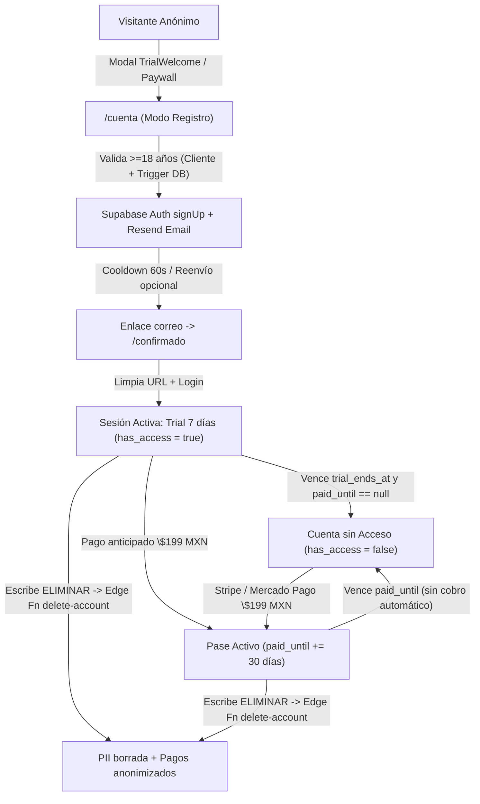
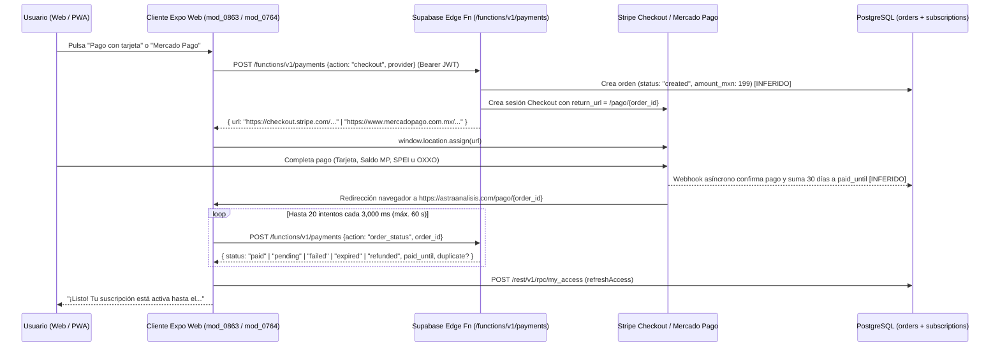

# 08 — Autenticación, Control de Acceso (RLS), Pagos, Modelo de Negocio, Huella Legal y Postura de Seguridad de Astra AI

**Objetivo:** Documentar exhaustivamente la arquitectura de cuentas, el embudo *freemium* / prueba gratuita de 7 días / *paywall*, la verificación de seguridad por fila (RLS) en Supabase, la infraestructura tri-canal de pagos (Stripe, Mercado Pago y RevenueCat IAP), el marco legal mexicano y la postura pasiva de seguridad/telemetría de **Astra AI** (`https://astraanalisis.com/`).  
**Método:** Ingeniería inversa estática de los módulos Metro extraídos (`Reportes/analisis-astra/modules/mod_0745`–`mod_1029`), inspección del documento raíz (`Reportes/analisis-astra/app/index.html`) y contraste empírico de las capturas pasivas REA anónima (`raw/01-landing-capture.json`) y autenticada (`raw/02-authenticated-tour.json`). Ningún cobro, mutación destructiva ni invocación a `admin_dashboard` fue ejecutada.

> **Convención epistémica rigurosa:**
> - **`[OBSERVADO]`**: Verificado directamente en el código JavaScript/HTML extraído o en las capturas de red/DOM de REA.
> - **`[INFERIDO]`**: Deducción técnica de alta confianza derivada del contrato cliente-servidor, códigos de error SQL/PostgREST o comportamiento del runtime.
> - **`[DESCONOCIDO]`**: Lógica residente exclusivamente en el backend privado (código SQL interno de funciones RPC, Edge Functions de Deno o consolas de Stripe/Mercado Pago/Supabase) no verificable de forma pasiva.

---

## 1. Mapa de Artefactos y Módulos Auditados (`[OBSERVADO]`)

| Dominio | Módulos / Archivos | Rol Exacto en Astra AI |
|---|---|---|
| **Cliente Supabase y Entorno** | `mod_0778` (`__common`) · `app/index.html` | Inicialización de `@supabase/supabase-js` contra `https://bbfjdshvlcynngjdkvsk.supabase.co`, llave pública `sb_publishable_...`, `SITE_URL` y hosts de redirección. |
| **Estado de Sesión, Acceso y API de Pagos** | `mod_0834` (`__common`) | `AuthProvider`, `useAuth`, polling de `rpc('my_access')` (5 min), refresco de perfil/avatar (45 min), `deleteMyAccount`, `authErrorText`, `startCheckout`, `orderStatus`, `confirmStorePurchases`. |
| **Flujos de Cuenta y Edad (`+18`)** | `mod_0757` (`cuenta`) · `mod_0861` (`cuenta`) · `mod_0862` (`__common`) | Pantalla `/cuenta`: login (`signInWithPassword`), registro (`signUp` con `birth_date` y validación `>= 18` años), reenvío de verificación con *cooldown* de 60 s (`ConfirmationResend`), disparo de recuperación y vista autenticada. |
| **Confirmación, Recuperación y Baja** | `mod_0756` (`confirmado`) · `mod_0767` (`restablecer`) · `mod_0758` (`eliminar-cuenta`) | Pantallas `/confirmado` (limpieza de URL post-confirmación), `/restablecer` (soporte dual *Implicit* `#access_token` y *PKCE* `?code=`) y `/eliminar-cuenta` (confirmación `'ELIMINAR'` -> Edge Function `delete-account`). |
| **Perfil y Storage Privado** | `mod_0840` (`cuenta`) · `mod_0859` (`cuenta`) · `mod_0860` (`cuenta`) | `ProfileEditor`, validación de nombre (`1..60` *codepoints*), compresión cliente a `512 px` JPEG `q=0.8`, validación binaria de *magic bytes* `FF D8 FF` y subida al bucket privado `profile-avatars`. |
| **Paywall, Checkout y Polling** | `mod_0863` (`__common`) · `mod_0764` (`pago/[id]`) · `mod_0929` (`__common`) | `<Paywall />`, `<SubscriptionCard />`, `<PayButtons />` (Stripe + Mercado Pago), pantalla `/pago/[id]` (máquina de estados de 20 sondeos × 3 s) y *stub* web de RevenueCat IAP (`IAP_SUPPORTED = false`). |
| **Embudo Trial, PWA y Gating de Partidos** | `mod_0833` (`_layout`) · `mod_0761` (`instalar`) · `mod_0784` (`MatchDetail`) · `mod_0867` (`SportDetail`) · `mod_0865`/`0866` (`equipo`) · `mod_0776`/`1010`/`1011` | Modal `TrialWelcome`, flujo de instalación PWA (`/instalar`), consultas PostgREST y invalidación de caché por `${has_access ? 1 : 0}`. |
| **Legal, Nosotros y Canales** | `mod_0763`/`0870` (`nosotros`) · `mod_0766` (`privacidad`) · `mod_0769` (`terminos`) · `mod_0871` (`__common`) | `/nosotros` (FAQ metodológico + Telegram/Instagram), `/privacidad` (LFPDPPP / ARCO / subencargados), `/terminos` (`$199 MXN / 30 días`, no renovación automática, `+18`, anti-scraping). |
| **Telemetría y Panel Admin** | `mod_1017` (`__common`) · `mod_0755` (`administracion`) · `mod_0839` (`__common`) | Hook `useAiActivity` -> `rpc('record_ai_view')` con cubeta de 30 min; UI completa de `/administracion` y guardia `DASHBOARD_OWNER = 'eliasgutierrezhr@gmail.com'`. |

---

## 2. Autenticación y Ciclo de Vida de Cuenta

### 2.1 Configuración de Supabase Auth y Persistencia de Sesión
- **Instancia y credenciales públicas (`[OBSERVADO]`, `mod_0778`):** El cliente se conecta al proyecto Supabase `bbfjdshvlcynngjdkvsk` (`https://bbfjdshvlcynngjdkvsk.supabase.co`) usando el nuevo formato de llave publicable de Supabase (`sb_publishable_MgTkWLXloEx5YPNdVKBepw_HsayWdlx`).
- **Opciones de GoTrue (`[OBSERVADO]`, `mod_0778`):**
  - `persistSession: true` y `autoRefreshToken: true`.
  - `detectSessionInUrl: false`: Desactivado globalmente a propósito para que las rutas de aterrizaje (`/confirmado` y `/restablecer`) procesen y limpien manualmente los parámetros sensibles de la barra de direcciones.
  - En Web, la sesión se almacena exclusivamente en `window.localStorage` bajo la clave `sb-bbfjdshvlcynngjdkvsk-auth-token`, con **`0` cookies HTTP** en el dominio de la aplicación (`[OBSERVADO]` en `02-authenticated-tour.json`, paso 13 `storage`).
- **Métodos de autenticación soportados (`[OBSERVADO]`, `mod_0757`):** Únicamente **correo electrónico + contraseña** (`signInWithPassword` y `signUp`). No existen botones ni flujos OAuth sociales (Google, Apple, Facebook) ni *magic links* sin contraseña.

### 2.2 Registro con Validación Dual (`Cliente + Servidor`) de Mayoría de Edad (`>= 18 años`)
El formulario de registro en `/cuenta` (`mod_0757`) solicita cuatro campos: **Nombre** (`display_name`), **Fecha de nacimiento** (`DD/MM/AAAA`), **Correo** y **Contraseña** (`>= 8` caracteres) + confirmación.

1. **Validación en cliente (`[OBSERVADO]`, `mod_0757`):**
   - Formatea la entrada numérica como `DD/MM/AAAA`, valida calendario real en UTC (`Date.UTC(y, m - 1, d)`), exige año `>= 1900` y fecha no futura, y calcula la edad exacta al día actual.
   - Si `edad < 18`, bloquea el envío con `'Astra AI es solo para mayores de 18 años.'`.
   - Si pasa, invoca `supabase.auth.signUp({ email, password, options: { emailRedirectTo: 'https://astraanalisis.com/confirmado', data: { display_name, birth_date: 'YYYY-MM-DD' } } })`.
2. **Validación en servidor (`[OBSERVADO]` en manejo de error + `[INFERIDO]` en mecanismo SQL, `mod_0834`):**
   - En `authErrorText` (`mod_0834`), Astra AI traduce explícitamente el error interno de GoTrue `/database error saving new user/i` al mensaje `'Astra AI es solo para mayores de 18 años.'`.
   - **`[INFERIDO]`:** En Supabase, `'Database error saving new user'` se dispara cuando un *trigger* `AFTER INSERT ON auth.users` falla con `RAISE EXCEPTION`. Esto evidencia que la base de datos PostgreSQL valida `raw_user_meta_data->>'birth_date'` antes de crear la fila en `public.profiles` (y otorgar los 7 días de prueba), impidiendo que un menor de edad o un script evada la restricción llamando directamente al endpoint REST `/auth/v1/signup`.
3. **Detección de correo duplicado y enumeración (`[OBSERVADO]`, `mod_0757`):**
   - Si `signUp` retorna `!session && user?.identities?.length === 0` (comportamiento estándar de Supabase cuando *Confirm email* está activo y el correo ya existe), la UI muestra `'Ese correo ya tiene cuenta. Inicia sesión con tu contraseña o recupérala.'` y cambia automáticamente a la pestaña `login`. Esto mejora la UX pero permite confirmar pasivamente si un correo ya está registrado.

### 2.3 Verificación de Correo, *Cooldown* Anti-Abuso y Proveedor Transaccional
- **Proveedor de correo (`[OBSERVADO]`, `mod_0766`):** `privacidad.tsx` declara a **Resend** como el encargado del envío de correos transaccionales de cuenta.
- **Reenvío con *cooldown* (`[OBSERVADO]`, `mod_0861` y `mod_0862`):**
  - El componente `ConfirmationResend` (`mod_0861`) aparece tanto tras registrarse sin sesión inmediata como en la pestaña de inicio de sesión.
  - `mod_0862` implementa un mapa LRU en memoria (`MAX_TRACKED = 100` correos normalizados en minúsculas) con ventana **`CONFIRMATION_COOLDOWN_MS = 60000` (60 segundos)** por dirección de correo antes de permitir otra llamada a `supabase.auth.resend({ type: 'signup', email, options: { emailRedirectTo: WEB_URL + '/confirmado' } })`.
  - Además, `emailSendLimited` (`mod_0862`) intercepta respuestas HTTP `429`, código `'over_email_send_rate_limit'` o mensajes `email rate limit exceeded` del servidor GoTrue/Resend.
- **Aterrizaje en `/confirmado` (`[OBSERVADO]`, `mod_0756`):**
  - Inspecciona `window.location.hash` y `window.location.search` buscando `error` o `error_description`.
  - Ejecuta inmediatamente `window.history.replaceState(null, '', window.location.pathname)` para purgar tokens o fragmentos de la URL e historial del navegador.
  - Nota importante (`[OBSERVADO]`): Como `detectSessionInUrl` es `false` y `/confirmado` no intercambia el token, el usuario ve *"¡Correo confirmado! Tu cuenta ya está verificada. Inicia sesión con tu correo y contraseña para empezar tu prueba gratis"* y pulsa `Iniciar sesión` hacia `/cuenta`.
- **Dominios autorizados de redirección (`[OBSERVADO]`, `mod_0778`):** `SITE_URL = 'https://astraanalisis.com'` y `REDIRECT_HOSTS = ['astra-ai.expo.app', 'www.astraanalisis.com']` (revela el dominio previo de desarrollo en Expo Hosting: `astra-ai.expo.app`).

### 2.4 Inicio de Sesión y Recuperación de Contraseña (`/restablecer`)
- **Login (`[OBSERVADO]`, `mod_0757`):** Ejecuta `supabase.auth.signInWithPassword({ email, password })`. Si el correo aún no fue confirmado (`email_not_confirmed`), `authErrorText` (`mod_0834`) instruye revisar la bandeja de entrada o *spam*.
- **Solicitud de recuperación (`[OBSERVADO]`, `mod_0757`):** En modo `'reset'`, llama a `supabase.auth.resetPasswordForEmail(email, { redirectTo: 'https://astraanalisis.com/restablecer' })` y responde con mensaje genérico no enumerativo (*"Si ese correo tiene cuenta, te enviamos un enlace..."*).
- **Ejecución del cambio en `/restablecer` (`[OBSERVADO]`, `mod_0767`):**
  - Soporta **ambos flujos de GoTrue**:
    1. *Implicit Flow* (`#access_token=...&refresh_token=...` en `location.hash`) -> `supabase.auth.setSession({ access_token, refresh_token })`.
    2. *PKCE Flow* (`?code=...` en `location.search`) -> `supabase.auth.exchangeCodeForSession(code)`.
  - Limpia la URL con `window.history.replaceState` antes de mostrar el formulario.
  - Exige contraseña nueva de al menos `8` caracteres y coincidencia exacta; ejecuta `supabase.auth.updateUser({ password })` y acto seguido llama a **`supabase.auth.signOut()`**, obligando a iniciar sesión limpia en `/cuenta`.

### 2.5 Perfil de Usuario y Bucket Privado de Avatares (`profile-avatars`)
- **Esquema expuesto de `public.profiles` (`[OBSERVADO]`, `mod_0834` y captura REA):** `AuthProvider` ejecuta `SELECT id, display_name, created_at, avatar_path FROM profiles WHERE id = <userId>`. Notablemente, **`birth_date` NO se selecciona ni se reexpone en `profiles`** tras el registro (minimización de PII en lecturas cotidianas).
- **Edición de nombre (`[OBSERVADO]`, `mod_0860`):** Normaliza espacios múltiples, rechaza caracteres de control (`[\u0000-\u001F\u007F]`), exige entre `1` y `60` *codepoints* Unicode y actualiza `profiles.display_name` (con `upsert` de respaldo si no existiera fila).
- **Pipeline endurecido de foto de perfil (`[OBSERVADO]`, `mod_0859`, `mod_0860`, `mod_0834`):**
  1. Selector web (`<input type="file" accept="image/*">`) rechaza archivos de entrada `> 15 MB` (`15728640` bytes).
  2. Decodifica la imagen en cliente, calcula escala proporcional a un lado máximo de **`512 px`** y la re-renderiza en un `<canvas>` exportándola a **JPEG con calidad `0.8`** (lo que además elimina metadatos EXIF de geolocalización/cámara).
  3. Valida que el Base64 resultante no exceda `2.8e6` caracteres, que el binario decodificado pese `<= 2 MB` (`2097152` bytes) y verifica explícitamente los **magic bytes JPEG (`b[0] === 255 && b[1] === 216 && b[2] === 255`, es decir `0xFF 0xD8 0xFF`)**.
  4. Sube el binario a Supabase Storage en el bucket privado **`profile-avatars`**, ruta fija `${userId}/avatar.jpg`, con `contentType: 'image/jpeg'`, `cacheControl: '60'` y `upsert: true`.
  5. Para renderizarla, `AuthProvider` (`mod_0834`) solicita una URL firmada temporal `createSignedUrl(avatar_path, 3600)` (**1 hora** de validez) anexando `&v=${Date.now()}` para romper caché local, y ejecuta un `setInterval` de refresco cada **45 minutos (`27e5 ms`)** para renovar la firma antes de que caduque.

### 2.6 Eliminación de Cuenta y Retención Fiscal Anonimizada (`delete-account`)
- **Flujo UX (`[OBSERVADO]`, `mod_0758`):** En `/eliminar-cuenta`, el usuario debe tener sesión activa, escribir literalmente **`ELIMINAR`** (insensible a mayúsculas/espacios laterales) para habilitar el botón y confirmar un diálogo adicional (`window.confirm`).
- **Ejecución backend (`[OBSERVADO]`, `mod_0834`, `mod_0758`, `mod_0755`):**
  - Invoca `POST https://bbfjdshvlcynngjdkvsk.supabase.co/functions/v1/delete-account` con cuerpo `{}` y el JWT del usuario; requiere `{ ok: true }`, tras lo cual ejecuta `signOut()` local y redirige a `/`.
  - Según `mod_0758` y `mod_0766` (`[OBSERVADO]`), el borrado elimina de inmediato correo, contraseña, nombre, fecha de nacimiento, foto de perfil y cualquier periodo de prueba o días pagados restantes (sin reembolso automático), mientras **conserva desvinculados/anonimizados los registros de pagos previos** por obligación fiscal mexicana — confirmado en `administracion.tsx` (`mod_0755`), cuya pestaña *Compras* renderiza `e.email || 'Cuenta eliminada'`.



---

## 3. Control de Acceso (Freemium / Trial / Paywall) y Verificación de RLS en Supabase

### 3.1 El Contrato Central `rpc('my_access')`
`AuthProvider` (`mod_0834`) consulta `POST /rest/v1/rpc/my_access` al iniciar la app, en cada cambio de usuario (`userId`) y mediante *polling* cada **5 minutos (`3e5 ms`)**.

- **Fallback estático compilado en el cliente (`[OBSERVADO]`, `mod_0834`):**
  `{ logged_in: false, has_access: true, trial_ends_at: null, paid_until: null, price_mxn: 199, period_days: 30, trial_days: 7, livemode: false, leagues: 43 }` (usado únicamente si el cliente Supabase no estuviera inicializado; mientras carga, `access` es `null` y la UI muestra `<AccessLoading />`).
- **Respuesta real observada en producción con cuenta recién creada (`[OBSERVADO]`, sesión autenticada REA):**
  ```json
  {
    "leagues": 48,
    "is_admin": false,
    "livemode": true,
    "logged_in": true,
    "price_mxn": 199,
    "has_access": true,
    "paid_until": null,
    "trial_days": 7,
    "iap_ios_key": null,
    "period_days": 30,
    "contact_email": "eliasgutierrezhr@gmail.com",
    "trial_ends_at": "2026-11-21T16:42:32.434382+00:00",
    "iap_product_id": "astra_30_dias",
    "iap_android_key": null
  }
  ```
- **Hallazgos clave del payload vivo (`[OBSERVADO]`):**
  1. Las ligas activas en base de datos subieron de `43` (constante vieja del bundle) a **`48` ligas de fútbol**.
  2. `livemode: true` confirma cobros reales activos en producción.
  3. El trial dura exactamente **`7` días calendario (`168 horas`)** desde el `created_at` del usuario (`2026-11-14T16:42:32Z` -> `2026-11-21T16:42:32Z`), **sin exigir tarjeta bancaria**.

### 3.2 Verificación Crítica: ¿El Paywall es Visual en Cliente o Existe RLS Real en Supabase?
**Conclusión contundente (`[OBSERVADO]` en módulos de datos + cabeceras de gateway en `02-authenticated-tour.json`): El control de acceso es REAL en el servidor mediante Row-Level Security (RLS) en PostgreSQL, NO un simple ocultamiento visual en el cliente.**

Tres pruebas técnicas convergentes en el código y las trazas de red lo demuestran:

1. **Idéntica consulta PostgREST con `LEFT JOIN` implícito sin filtro cliente (`[OBSERVADO]`, `mod_0776` y `mod_1011`):**
   - En fútbol (`fetchFixture`, `mod_0776`), la app ejecuta siempre la misma petición contra Supabase sea visitante anónimo, usuario vencido o suscriptor activo:
     `GET /rest/v1/fixtures?select=...,prediction:predictions(*),analysis:analyses(*)&id=eq.<id>`
   - En deportes US (`fetchSportGame`, `mod_1011`), ejecuta igualmente:
     `GET /rest/v1/games?select=...,prediction:game_predictions(*),analysis:game_analyses(*)&sport=eq.<sport>&id=eq.<id>`
   - Y en ambos llama en paralelo a `fetchAstraPick` (`mod_1010`):
     `GET /rest/v1/astra_picks?select=pick&sport=eq.<sport>&match_id=eq.<id>`
   - El cliente **jamás** oculta `W.prediction` ni `W.analysis` cuando existen: en `MatchDetail` (`mod_0784`) y `SportDetail` (`mod_0867`), la condición de renderizado es:
     ```js
     ie /* W.prediction */
       ? <StatCard ...><WinBox ... /></StatCard>
       : finished
         ? <PendingCard finished={true} />
         : (W.forecast_ready && !access?.has_access)
           ? <Paywall access={access} />
           : <PendingCard />
     ```
   - Esto prueba que cuando `has_access` es `false` (anónimo o trial/pago vencido), **es PostgreSQL (vía políticas RLS sobre `predictions`, `analyses`, `game_predictions`, `game_analyses` y `astra_picks`) quien devuelve `null` / `0 filas`**, mientras la columna booleana pública `forecast_ready = true` en `fixtures`/`games` le indica al frontend que sí existe un pronóstico bloqueado en el servidor y debe pintar `<Paywall />`.
2. **Invalidación explícita de caché local ligada a `has_access` (`[OBSERVADO]`, `mod_0784`, `mod_0867`, `mod_0865`):**
   - `MatchDetail` usa la llave `fx-${id}-${V?.has_access ? 1 : 0}`; `SportDetail` usa `${I}-${D}-${T?.has_access ? 1 : 0}`; y `TeamProfileScreen` (`mod_0865`) usa `${userId ?? 'guest'}:${access?.has_access ? 1 : 0}` al consultar `fetchTeamModel` (`mod_0866`, que lee `context` de `predictions` / `game_predictions`).
   - La única razón arquitectónica para incluir `has_access` en la llave de caché de red es que **la respuesta HTTP del servidor cambia de vacía (`null`) a poblada en el instante en que el JWT del usuario adquiere acceso**.
3. **Inspección de JWT en el API Gateway de Supabase (`[OBSERVADO]`, `02-authenticated-tour.json`):**
   - Antes del login (paso 1), la respuesta de `rpc/my_access` trae únicamente cabeceras `sb-gateway-version`, `sb-project-ref`, `sb-request-id` (rol `anon`).
   - Tras `POST /auth/v1/token?grant_type=password` (paso 5), todas las respuestas de `rest/v1/fixtures`, `rest/v1/games`, `rest/v1/profiles` y `rpc/my_access` incluyen `sb-jwt-alg`, `sb-jwt-iss` y **`sb-jwt-sub`**, confirmando que PostgREST evalúa `auth.uid()` en cada `SELECT`.

### 3.3 Matriz Completa de Gating por Superficie y Tipo de Usuario (`[OBSERVADO]` / `[INFERIDO]`)

| Recurso / Tabla / Función | Visitante Anónimo (`!logged_in`) | Cuenta con Trial Vencido / Sin Pago (`logged_in && !has_access`) | Trial 7 Días o Suscriptor Pagado (`has_access = true`) | Cuenta Admin (`is_admin = true`) | Mecanismo de Protección |
|---|---|---|---|---|---|
| **Calendarios, marcadores y badge `IA` (`fixtures`, `games`, `leagues`, `teams`, `sport_teams`)** | Lectura completa | Lectura completa | Lectura completa | Lectura completa | Público (`SELECT` abierto a `anon`, `[OBSERVADO]`) |
| **Búsqueda de equipos (`rpc/search_teams`) y Seguidos (`localStorage`)** | Lectura completa | Lectura completa | Lectura completa | Lectura completa | Público + `localStorage` (`mod_0835`, `[OBSERVADO]`) |
| **Cuotas 1X2 / ML (`functions/v1/match-odds`)** | Lectura completa | Lectura completa | Lectura completa | Lectura completa | Edge Function pública con caché cliente 15 min (`mod_1023`, `[OBSERVADO]`) |
| **Clasificaciones (`standings`, `functions/v1/league-standings`)** | Lectura completa | Lectura completa | Lectura completa | Lectura completa | Público (`mod_1021`, `[OBSERVADO]`) |
| **Estadísticas en vivo, eventos y momentum (`match_live`) + Boxscore NBA (`functions/v1/nba-players`)** | Lectura completa | Lectura completa | Lectura completa | Lectura completa | Público (`mod_1015`, `mod_1027`, `[OBSERVADO]`) |
| **Historial reciente de equipo (`functions/v1/team-profile`)** | Lectura completa | Lectura completa | Lectura completa | Lectura completa | Edge Function pública (`mod_0866`, `[OBSERVADO]`) |
| **Pronósticos numéricos (`predictions`, `game_predictions`)** | **Bloqueado (`null` -> `<Paywall />`)** | **Bloqueado (`null` -> `<Paywall />`)** | **Lectura completa** (xG, probabilidades, córners, faltas, líneas) | **Lectura completa** | **RLS en PostgreSQL** validando acceso activo (`[OBSERVADO]`/`[INFERIDO]`) |
| **Narrativa redactada por IA (`analyses`, `game_analyses`)** | **Bloqueado (`null`)** | **Bloqueado (`null`)** | **Lectura completa** (secciones de análisis) | **Lectura completa** | **RLS en PostgreSQL** (`[OBSERVADO]`/`[INFERIDO]`) |
| **Pick discrecional (`astra_picks`)** | **Bloqueado (`null`)** | **Bloqueado (`null`)** | **Lectura completa** (*"Selección personal de Astra"*) | **Lectura completa** | **RLS en PostgreSQL** (`[OBSERVADO]`/`[INFERIDO]`) |
| **Evaluación de equipo del modelo (`/equipo/[sport]/[id]`)** | Bloqueado (*"Todavía no hay una evaluación... para tu acceso"*) | Bloqueado | **Lectura completa** (resumen de parámetros del equipo) | **Lectura completa** | Lee `context` de `predictions`/`game_predictions` bajo **RLS** (`mod_0866`, `[OBSERVADO]`) |
| **Perfil propio y avatar (`profiles`, bucket `profile-avatars`)** | Sin acceso | Solo su propia fila y `${uid}/avatar.jpg` | Solo su propia fila y `${uid}/avatar.jpg` | Propia fila | **RLS `id = auth.uid()`** + Storage privado con URL firmada 1h (`[OBSERVADO]`) |
| **Panel `/administracion` (`rpc/admin_dashboard`)** | Bloqueado en UI y DB | Bloqueado en UI y DB (`42501`) | Bloqueado en UI y DB (`42501`) | **Lectura global** (métricas, cuentas, uso IA, compras) | UI filtra `eliasgutierrezhr@gmail.com` + DB lanza `42501` / `PGRST301` (`mod_0839`, `[OBSERVADO]`) |

> **Matiz en partidos finalizados (`[OBSERVADO]`, `mod_0784` y `mod_0867`):** Si un usuario sin acceso abre un partido ya terminado (`status = 'FT'` / `'final'`) y RLS devuelve `prediction = null`, la interfaz evalúa `ne ? <PendingCard finished={true} />` **antes** que `W.forecast_ready && !V?.has_access ? <Paywall />`. En consecuencia, en partidos pasados un visitante sin acceso ve *"No hay un pronóstico previo disponible para este partido"* en lugar del `<Paywall />` (a menos que la política RLS de Supabase permita leer filas de partidos finalizados como muestra pública, extremo `[DESCONOCIDO]` porque en las capturas no se abrió el detalle de un partido finalizado sin sesión).

---

## 4. Arquitectura de Pagos, Precios y Monetización

### 4.1 Modelo de Negocio: Pase Prepagado Acumulable de `$199 MXN / 30 Días` (Sin Renovación Automática)
A diferencia del SaaS estadounidense tradicional de cobro recurrente con tarjeta retenida, Astra AI implementa un **modelo de pase prepagado de tiempo fijo (`30 días`) por `$199 MXN`** con acceso total (*all-access*) a los 5 deportes (48 ligas de fútbol + NHL, NBA, NFL y MLB):

- **Cero cargos recurrentes automáticos (`[OBSERVADO]`, `mod_0863`, `mod_0769`, `mod_0833`):**
  - En `<Paywall />`: *"Cada pago te da 30 días de acceso y no se cobra solo."*
  - En `/terminos`: *"El pago no se renueva solo. Si pagas antes de que termine tu acceso, los días se suman."*
  - En modal `TrialWelcome`: *"Sin tarjeta y sin cobros automáticos."*
- **Acumulación aditiva de vigencia (`[OBSERVADO]`, `mod_0863`):** Si `paid_until > Date.now()`, `<SubscriptionCard />` muestra *"Suscripción activa hasta el `<fecha>`. \$199 por 30 días de pronósticos y análisis de IA. Si pagas de nuevo, los días se suman."* y cambia el texto de acción de `"Suscribirme"` a **`"Agregar 30 días"`**.
- **Racional estratégico para México (`[INFERIDO]`):** En el mercado mexicano de consumidores deportivos, la desconfianza hacia cargos domiciliados ("olvido cancelar y me cobran") y el alto rechazo bancario en cargos recurrentes son los dos principales frenos de conversión. El pase prepagado de `$199 MXN` elimina esa fricción psicológica y, además, permite habilitar métodos asíncronos o de pago único en efectivo/transferencia vía Mercado Pago.

### 4.2 Flujo Completo de Checkout Web: `Stripe` + `Mercado Pago` -> `/pago/[id]`
En Web/PWA (`IAP_SUPPORTED === false`), el componente `<PayButtons />` (`mod_0863`) presenta dos opciones apiladas:
1. **`"Pago con tarjeta"`** (`provider: "stripe"`, botón primario sólido).
2. **`"Mercado Pago"`** (`provider: "mercadopago"`, botón secundario estilo `ghost`).



- **Máquina de estados en `/pago/[id]` (`[OBSERVADO]`, `mod_0764`):**
  - **Sin sesión (`!userId`):** Estado `'login'` -> *"Entra con la cuenta con la que pagaste para ver el estado de tu pago."*
  - **Intento 1 (`t === 1`):** Estado `'checking'` (*"Revisando tu pago"* + spinner).
  - **Confirmado (`e.status === 'paid'`):** Pasa a `'paid'`, dispara `refreshAccess()` en segundo plano y muestra `paid_until`. Si `e.duplicate === true` (reapertura de URL o doble webhook controlado idempotentemente), muestra: *"Este pago ya se había registrado antes. Tu suscripción sigue activa."*
  - **En espera (`t > 1` sin fallo definitivo, hasta `t = 20` / `60 s`):** Estado `'pending'` -> *"Tu pago está en proceso. Aún no recibimos la confirmación. En cuanto llegue, tu suscripción se activa sola. Puedes revisar en Mi cuenta."* Esto soporta de forma nativa **pagos asíncronos de Mercado Pago en México** (SPEI en revisión, depósito en efectivo OXXO/PayCash o validación antifraude 3DS demorada, `[INFERIDO]`).
  - **Rechazado (`'failed' | 'expired' | 'refunded'`):** Estado `'failed'` -> *"El pago no se completó"* con botón hacia `/cuenta`.
  - **Error de red (`>= 3` excepciones en `orderStatus`):** Estado `'error'` -> *"No pudimos revisar tu pago. Revisa tu conexión. Si ya pagaste, tu suscripción se activa sola en unos minutos."*
- **Estados internos del libro mayor de órdenes revelados por `administracion.tsx` (`[OBSERVADO]`, `mod_0755`):** El mapeador de la pestaña *Compras* contempla exactamente `7` estados: `'paid'` (*Pagado*), `'pending'` (*Pendiente*), `'created'` (*Creado*), `'failed'` (*Fallido*), `'refunded'` (*Reembolsado*), `'cancelled'` (*Cancelado*) y `'approved'` (*Aprobado*, nomenclatura típica de Mercado Pago), además de la bandera booleana `is_test` (*`PRUEBA`*, excluida del cálculo de `revenue_mxn`).

### 4.3 Integración Móvil Nativa: `RevenueCat` + In-App Purchases (`iap-confirm`)
Aunque el artefacto inspeccionado es el *build* web de Expo Router, el código y las políticas revelan toda la arquitectura IAP para iOS y Android:
- ** Evidencia directa (`[OBSERVADO]`):**
  1. `mod_0929` es el *stub* web del módulo multiplataforma de compras (`IAP.web.ts`), que exporta `IAP_SUPPORTED = false`, `iapReady(iosKey, androidKey)`, `getStoreProduct(productId)`, `buyStoreProduct(productId)` y `iapLogout()`.
  2. `mod_0834` exporta `confirmStorePurchases()` -> `POST /functions/v1/iap-confirm` y ejecuta `await iapLogout()` al cerrar sesión para desvincular el `appUserID` de RevenueCat.
  3. `my_access` entrega dinámicamente al cliente: `iap_product_id: "astra_30_dias"`, `iap_ios_key: null` e `iap_android_key: null` (`[OBSERVADO]`).
  4. `privacidad.tsx` (`mod_0766`) nombra explícitamente a **`Google, Apple y RevenueCat`** como procesadores de pago, y `administracion.tsx` (`mod_0755`) advierte: *"Las compras de tienda sin importe disponible se identifican como tal"* (`null == e.amount_mxn ? 'Importe no disponible'`).
- **Estado operativo actual (`[INFERIDO]`):** El hecho de que `iap_ios_key` e `iap_android_key` sean `null` en `my_access` (junto con el banner del `2026-10-21` que empuja a instalar la **PWA** desde `astraanalisis.com/instalar`, `mod_1012` y `mod_0761`) indica que **las apps nativas aún no están publicadas o monetizando en App Store / Play Store**, sino que Astra AI dejó lista la integración de un producto consumible/no renovable de 30 días (`astra_30_dias`) vía RevenueCat mientras captura el **100% de sus ingresos actuales vía Web/PWA sin pagar el 15%–30% de comisión de Apple/Google**.

### 4.4 Economía Unitaria Estimada del Cobro en México (`[INFERIDO]`)
Tomando el precio público de `$199.00 MXN` y las tarifas estándar publicadas en México para cuentas comerciales:

| Canal de Cobro | Comisión Estándar en México | Retención / Costo Transaccional Aprox. | Ingreso Neto Antes de ISR/IVA Propio | Margen sobre Precio Bruto |
|---|---|---:|---:|---:|
| **Stripe México (Tarjeta)** | `3.6% + $3.00 MXN` (+ 16% IVA sobre comisión) | `~$11.79 MXN` | **`~$187.21 MXN`** | **~94.1%** |
| **Mercado Pago Checkout Pro** | `3.49% + $4.00 MXN` (+ 16% IVA sobre comisión; acreditación inmediata) | `~$12.70 MXN` | **`~$186.30 MXN`** | **~93.6%** |
| **App Store / Play Store (Programa PyME 15%)** *(futuro)* | `15.0%` sobre precio tienda | `~$29.85 MXN` | **`~$169.15 MXN`** | **~85.0%** |
| **App Store / Play Store (Estándar 30%)** *(futuro)* | `30.0%` sobre precio tienda | `~$59.70 MXN` | **`~$139.30 MXN`** | **~70.0%** |

---

## 5. Huella Legal, Operador, Cumplimiento (LFPDPPP), Telemetría y Seguridad Pasiva

### 5.1 Identidad del Operador, Jurisdicción y Canales Oficiales (`[OBSERVADO]`)
- **Denominación declarada (`mod_0871`):** `LEGAL_OWNER = 'Astra Analysis'`, con fecha `LEGAL_UPDATED = 'Última actualización: 20 de octubre de 2026'`.
- **Correo del operador y administrador único (`mod_0839` + `my_access`):** **`eliasgutierrezhr@gmail.com`** — aparece tanto dinámicamente en `my_access.contact_email` (mostrado en `/privacidad` y `/terminos` mediante `useContactLine`, `mod_0871`) como *hardcodeado* en `DASHBOARD_OWNER = 'eliasgutierrezhr@gmail.com'` (`mod_0839`).
- **Jurisdicción aplicable (`mod_0769`):** Leyes de los Estados Unidos Mexicanos (*"Estos términos se rigen por las leyes de México"*), con horarios administrativos fijos en `America/Mexico_City` (`mod_0755`).
- **Canales sociales oficiales (`mod_0870`):**
  - **Telegram:** `https://t.me/+9jzp7DYLucM4MDYx` (enlace de invitación privado; revela el origen del proyecto como canal de *tipsters* / pronósticos en Telegram: *"el mismo que hizo que Astra Analysis llegara a ser uno de los mejores canales de pronósticos del año"*).
  - **Instagram:** `https://www.instagram.com/astra_analysis/`.

### 5.2 Auditoría de Cumplimiento de Privacidad (LFPDPPP — México)
El Aviso de Privacidad en `/privacidad` (`mod_0766`) está redactado en español claro y cubre varios pilares de la **Ley Federal de Protección de Datos Personales en Posesión de los Particulares (LFPDPPP)**:
- **Aciertos de cumplimiento (`[OBSERVADO]`):**
  1. Desglosa datos recabados (*nombre, correo, contraseña cifrada, fecha de nacimiento para mayoría de edad, foto opcional, historial de pagos, logs técnicos y aperturas de análisis de IA con sesión*).
  2. Declara explícitamente qué **no** recolecta (*sin ubicación, contactos ni cámara*) y que los datos personales nunca alimentan al LLM (*"El análisis de inteligencia artificial se hace solo con datos de los partidos, nunca con tus datos"*).
  3. Reconoce los **derechos ARCO** (acceso, rectificación, cancelación, oposición y revocación) con el plazo legal exacto de México (**máximo 20 días hábiles**, Art. 32 LFPDPPP) más **autoservicio inmediato de cancelación** en `/eliminar-cuenta`.
  4. Informa transferencias internacionales a encargados de pago, nube y correo (*Stripe, Mercado Pago, Google, Apple, RevenueCat, Supabase, Expo, Resend*).
- **Brechas formales detectadas (`[OBSERVADO]`):**
  1. **Omisión de identidad jurídica completa y domicilio físico del responsable:** El Art. 16 fracción I de la LFPDPPP exige señalar la **identidad (nombre completo de la persona física o razón social de la persona moral) y el domicilio** del responsable. `"Astra Analysis"` es una marca comercial (sin `S.A. de C.V.` ni `S.A.P.I. de C.V.`) acompañada únicamente de un correo `@gmail.com`, sin domicilio convencional en México (`[INFERIDO]`: operado por persona física bajo actividad empresarial/RESICO).
  2. **Subencargados técnicos omitidos en la lista explícita:** No menciona a **Cloudflare** (CDN, proxy inverso y analítica RUM `beacon.min.js`) ni al proveedor de LLM (**Anthropic / Claude**, citado en el texto de ejemplo de `mod_1011`: *"el análisis sale del modelo y de Claude"*, aunque mitigado porque no recibe PII).

### 5.3 Descargos sobre Apuestas vs Afirmaciones Comerciales (`[OBSERVADO]`)
- **Blindaje en Términos (`/terminos`, `mod_0769`) y Tarjetas (`mod_0868`):**
  - *"Es información con fines informativos y de entretenimiento. No es asesoría financiera ni de apuestas, y no garantiza ningún resultado. Resultados pasados no garantizan resultados futuros."*
  - *"Astra AI no recibe apuestas, no maneja dinero de apuestas y no está afiliada a ninguna casa de apuestas."* (Confirmado en código: **cero enlaces de afiliado, cero banners de casinos y cero captura de *betslips***).
  - En partidos evaluados después de su inicio (`is_retrospective === true` en `SportDetail`, `mod_0867`/`0868`), muestra una advertencia honesta: *"Pronóstico retrospectivo: generado después del partido con historial anterior a su inicio. No se incluye en el historial de aciertos."*
- **Fricción regulatoria/publicitaria (`[OBSERVADO]`):**
  - Pese al descargo informativo, `/nosotros` (`mod_0870`) afirma: *"Los pronósticos de la IA son los mismos que utiliza Astra Analysis para sus propias apuestas, especialmente los de probabilidad alta"*.
  - Y `<Paywall />` (`mod_0863`) promociona como gancho de venta: ***"Acierto superior al 75% en pronósticos de alta confianza — Probamos los modelos en más de 10,000 partidos: los pronósticos con probabilidad alta acertaron más del 75% de las veces."*** No existe dentro de la aplicación ningún *ledger* público, desglose por liga, curva de calibración ni definición auditable del umbral de "probabilidad alta" (en términos de PROFECO —Art. 32 LFPC sobre información veraz y comprobable—, una afirmación cuantitativa de rendimiento comercial debería poder acreditarse documentalmente si fuera requerida).

### 5.4 Telemetría, Medición de Uso y Protección Anti-Scraping
Astra AI evita SDKs invasivos de *ad-tech* (no hay Meta Pixel, Google Tag Manager, Amplitude ni Braze) y opera únicamente **dos mecanismos ligeros de telemetría**:

1. **Cloudflare Web Analytics RUM (`[OBSERVADO]`, `app/index.html` L36 y capturas REA):**
   - Carga `https://static.cloudflareinsights.com/beacon.min.js/vce701823e78c4301a35b7e07294d87301792088814092` con token `a2e12c4123a6420ca4eb3f4855145537` (`spa: 2`) que reporta métricas de rendimiento y navegación a `POST https://astraanalisis.com/cdn-cgi/rum` (HTTP `204`, sin cookies).
2. **Telemetría autenticada de aperturas de IA (`useAiActivity` -> `record_ai_view`, `[OBSERVADO]`, `mod_1017` y `mod_0755`):**
   - Cuando un usuario **con sesión iniciada** abre la pestaña `analysis` de un partido con `forecast_ready === true` y datos cargados (`prediction || analysis`), `mod_1017` calcula una cubeta temporal de **30 minutos** (`Math.floor(Date.now() / 18e5)`), construye la llave `${userId}/${sport}/${matchId}/${bucket}` en un `Map` LRU local de `300` entradas, e invoca `supabase.rpc('record_ai_view', { p_sport, p_match_id })` con `AbortController` de `4,000 ms`.
   - En `/administracion` (`mod_0755`), la pestaña *Cuentas* expone **`ai_views_30d`** (*"Consultas de IA · 30 días"*) y **`last_ai_view`** por usuario, además del feed cronológico en *Uso de IA*.
   - **Diagnóstico anti-scraping (`[OBSERVADO]` + `[INFERIDO]`):**
     - No existe *rate-limiting* duro en el cliente ni CAPTCHA (Cloudflare Turnstile / reCAPTCHA) en login, registro o lectura de partidos.
     - La defensa contra *scrapers* autenticados que compren un pase de `$199 MXN` para extraer las 48 ligas consiste en: (a) RLS que exige cuenta activa (`has_access`), (b) prohibición contractual expresa en `/terminos` (*"No está permitido revenderlos, publicarlos de forma masiva ni copiarlos con programas automáticos"*), y (c) **detección humana/administrativa mediante `ai_views_30d`**, aunque un *scraper* que lea directamente `GET /rest/v1/fixtures?select=...,predictions(*),analyses(*)` con el JWT de sesión **sin llamar al RPC `record_ai_view`** pasaría inadvertido ante ese contador (`[INFERIDO]`, salvo que el operador revise logs crudos de PostgREST en Supabase).

### 5.5 Auditoría Pasiva de Postura de Seguridad

| Vector / Capa | Estado Observado | Nivel de Riesgo y Evidencia |
|---|---|---|
| **Separación de datos premium (RLS)** | **Sólido (`[OBSERVADO]`)** | Tablas `predictions`, `analyses`, `game_predictions`, `game_analyses` y `astra_picks` protegidas en PostgreSQL; `profiles` restringida al propietario. |
| **Autorización de `/administracion`** | **Sólido en DB, expuesto en UI (`[OBSERVADO]`)** | Aunque el chunk `administracion-db0312...js` (`mod_0755`, `mod_0839`) expone el correo `eliasgutierrezhr@gmail.com` y todo el esquema JSON de métricas/ingresos al público, el RPC `admin_dashboard` valida permisos en PostgreSQL (códigos `42501` *insufficient_privilege* / `PGRST301`). |
| **Bucket de avatares (`profile-avatars`)** | **Sólido (`[OBSERVADO]`)** | Privado con URLs firmadas de `3,600 s`, redimensionado forzado en canvas (`512 px`) que limpia EXIF, tope `2 MB` y verificación de *magic bytes* `FF D8 FF`. |
| **Cabeceras HTTP de seguridad en `astraanalisis.com/`** | **Deficiente (`[OBSERVADO]`)** | En `01-landing-capture.json` (`GET https://astraanalisis.com/`), el servidor Cloudflare devuelve `x-content-type-options`, `referrer-policy`, `access-control-allow-origin`, pero **NO envía `content-security-policy` (CSP), `strict-transport-security` (HSTS) ni `x-frame-options`** (mientras que `*.supabase.co` sí incluye `strict-transport-security`). |
| **Subresource Integrity (SRI) y `localStorage` JWT** | **Mixto (`[OBSERVADO]`)** | `app/index.html` incluye `integrity="sha512-..."` en el script externo de Cloudflare (`beacon.min.js`), pero carece de SRI en los 3 scripts propios `/_expo/static/js/web/*.js` y, al no tener CSP y guardar el JWT de Supabase en `localStorage`, cualquier XSS permitiría exfiltrar el token de sesión. |
| **Higiene de tokens en URL** | **Sólido (`[OBSERVADO]`)** | Tanto `/confirmado` (`mod_0756`) como `/restablecer` (`mod_0767`) purgan inmediatamente `hash` y `search` mediante `window.history.replaceState` y `/restablecer` fuerza `signOut()` tras cambiar la contraseña. |
