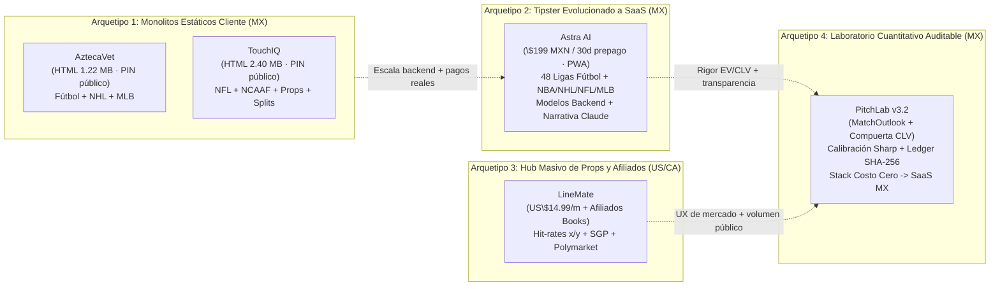

# 09 — Comparativa Estratégica Profunda: Astra AI vs PitchLab (y vs AztecaVet, TouchIQ y LineMate)

**Objetivo:** Contrastar cara a cara a **Astra AI (`astraanalisis.com`)** frente a **PitchLab (`pitchlab.mx`, arquitectura `v3.2.0`)** y frente a los tres competidores previamente auditados con REA en este repositorio (**AztecaVet**, **TouchIQ** y **LineMate**), identificando con precisión matemática y de producto qué hace fuerte a Astra AI en México, dónde están sus vulnerabilidades estructurales y qué decisiones concretas debe ejecutar PitchLab para superarla en rigor, conversión y retención.

> **Fuentes cruzadas del repositorio (`[OBSERVADO]`):**
> - **Astra AI:** `Reportes/analisis-astra/08-autenticacion-pagos-monetizacion-y-legal.md`, módulos Metro `mod_0745`–`mod_1029` y capturas `raw/01-landing-capture.json` / `raw/02-authenticated-tour.json`.
> - **PitchLab (`v3.2.0`):** `docs/execution/PROJECT_STATE.md`, `docs/predicciones/MODEL_CARD.md`, `docs/predicciones/19_HOJA_DE_RUTA_MOTORES_Y_PICKS_V4.md` y `docs/architecture/STACK_COSTO_CERO.md`.
> - **AztecaVet:** `Reportes/20-REPORTE-COMPLETO-AZTECAVET.md`.
> - **TouchIQ:** `Reportes/00-REPORTE-COMPLETO.md` y `Reportes/CLONE-BLUEPRINT.md`.
> - **LineMate:** `Reportes/analisis-linemate/README.md` y `Reportes/analisis-linemate/FINDINGS.md`.

---

## 1. Posicionamiento en el Mapa Competitivo

Las cinco plataformas representan cuatro arquetipos claramente diferenciados dentro del mercado de analítica deportiva en Norteamérica y Latinoamérica:

- **Astra AI (`[OBSERVADO]`)** es el **competidor directo más relevante en México hoy**: nace de una comunidad hispanohablante de Telegram/Instagram (`@astra_analysis`) y logró empaquetar un producto real en producción con **48 ligas de fútbol + 4 ligas estadounidenses**, diseño oscuro moderno en Expo Web PWA, prueba gratuita de 7 días sin tarjeta y cobro adaptado a la realidad bancaria mexicana (`$199 MXN` por 30 días sin renovación forzosa vía Stripe y Mercado Pago).
- Sin embargo, bajo el capó cuantitativo, **Astra AI se queda a mitad de camino entre un centro de estadísticas y un canal de *tipster***: calcula proyecciones deportivas razonables ($\lambda$, córners, faltas, puntos) y redacta buenos resúmenes con IA, pero **ignora la matemática del precio de mercado** (no desmargina cuotas, no publica `fairOdds = 1/p`, no mide `EV` ni `CLV%` y promociona *"75% de acierto"* sin registro verificable).

---

## 2. Matriz Comparativa Maestra (`PitchLab v3.2` vs Competidores)

| Dimensión | **PitchLab (`v3.2.0`)** | **Astra AI (`astraanalisis.com`)** | **AztecaVet (`aztecavet.com`)** | **TouchIQ (`touchiq.com.mx`)** | **LineMate (`linemate.io`)** |
|---|---|---|---|---|---|
| **1. Stack Frontend y Móvil** | Next.js 15 + React + TS + Tailwind/shadcn (`apps/web`, `packages/ui`) (`[OBSERVADO]`) | Expo Router (React Native Web PWA + base nativa iOS/Android) (`[OBSERVADO]`) | HTML único `1.22 MB` + JS vanilla + iframes `srcdoc` base64 (`[OBSERVADO]`) | HTML único `2.40 MB` + JS vanilla + iframes `srcdoc` base64 (`[OBSERVADO]`) | React SPA (`CRA` `3.36 MB`) + PWA + Apps nativas iOS/Android (`[OBSERVADO]`) |
| **2. Backend, DB y Seguridad de Datos** | Neon Postgres (Drizzle) + Cloudflare R2 (Parquet) + Upstash Redis (`[OBSERVADO]`) | Supabase (`Postgres` + **RLS real** + Edge Functions + Storage privado) (`[OBSERVADO]`) | **Cero backend** (`0` requests en runtime; todo público en HTML) (`[OBSERVADO]`) | **Cero backend** (`0` requests en runtime; PIN `'7779'` en texto plano) (`[OBSERVADO]`) | REST `api.linemate.io` + Firebase Auth (`Bearer` ID token) (`[OBSERVADO]`) |
| **3. Deportes y Ligas Cubiertas** | Fútbol (`23` divisiones en `Motor A`, `84` partidos vivos) + NFL (`46` juegos vivos); roadmap MLB/NHL/NBA/NCAAF (`[OBSERVADO]`) | **5 deportes:** Fútbol (**`48` ligas**, incl. Liga MX y femenil), **NHL, NBA, NFL, MLB** (`[OBSERVADO]`) | Fútbol (`5` torneos: MX, ES, EN, UCL, UEL), NHL, MLB (`[OBSERVADO]`) | NFL y NCAAF (`[OBSERVADO]`) | **45 ligas:** NFL, NBA, MLB, NHL, NCAAF/B, WNBA + ~35 ligas fútbol (`[OBSERVADO]`) |
| **4. Familia de Modelos Estadísticos** | Logit multinomial regularizado (`Tachyon` 136 vars / `Minkowski` 29–41 vars EPA) + matriz única **Dixon-Coles** + **mezcla logit con apertura sharp desmarginada** (`power`/`shin`/`prop`) (`[OBSERVADO]`) | Declarado en `/nosotros`: **Dixon-Coles (goles+xG) + Binomial Negativa** (córners/tiros/faltas/tarjetas); **Monte Carlo** (NHL); **Ratings + Elo MoV + Normal** (NBA/NFL con EPA y QB); **wOBA/FIP/xFIP/SIERA + Bin. Neg.** (MLB) (`[OBSERVADO]` texto / `[DESCONOCIDO]` pesos reales) | Shrink bayesiano + Pitágoras + Log5 + bisección + **Poisson Dixon-Coles** (fútbol), Poisson (NHL), Normal + `ERA_reg` (MLB) (`[OBSERVADO]`) | Baseline 2025/2026 (`K=6`) + lesiones manuales + Pitágoras (`E=2.37`) + Log5 + colas normales (`[OBSERVADO]`) | **Sin modelo generativo visible:** frecuencias históricas (*hit-rates* `x/y` en últimos `N` juegos, H2H, splits) (`[OBSERVADO]`) |
| **5. Mercados por Partido y *Props*** | Fútbol: **11 mercados** (`1x2`, `DC`, `O/U 1.5/2.5/3.5`, `BTTS`, `DNB`, `AH ±0.5/±1.0`) + `topScorelines[3]`; NFL: `ML`, `spread`, `totals`. `0` *props* hasta tener cierre sharp (`[OBSERVADO]`) | Fútbol: `1X2`, $\lambda$ goles, `BTTS %`, córners y faltas esperadas; US: `ML`, margen/spread, totales, F5 entradas (MLB). Sin *player props* predictivos (solo boxscore NBA en vivo) (`[OBSERVADO]`) | Fútbol: `18` mercados; NHL: `15`; MLB: `6` (sin *player props*) (`[OBSERVADO]`) | NFL/NCAAF: `15` mercados + **motor de *player props* NFL** (Normal yardas, Poisson TD/recep) (`[OBSERVADO]`) | Enfoque masivo en ***player props***, *alt lines*, 1Q/1H y *Same-Game Parlays* (SGP) (`[OBSERVADO]`) |
| **6. Integración de Cuotas, *De-Vig* y `EV`** | **Núcleo del sistema:** `fairOdds = 1/p`, `0` cuotas sintéticas, *de-vig* `power`/`shin`/`proportional`, detector de líneas rezagadas Doble Confirmación y umbrales $\tau_{\text{EV}}$ por Bayes empírico (`[OBSERVADO]`) | **Desconectado:** `MatchOddsCard` muestra cuotas `1X2`/`ML` sin casa ni hora, **sin *de-vig*, sin `fairOdds` y sin cruzar con las probabilidades del modelo (`0` cálculo de `EV`)** (`[OBSERVADO]`) | Usuario escribe su cuota (decimal/americana); calcula `noVig`, `fairOdds = 1/p` y `EV >= +4%` (`[OBSERVADO]`) | Usuario escribe su cuota; calcula `noVig`, break-even `1/p`, `EV = p·d - 1` y score `80/20` (`[OBSERVADO]`) | Agrega cuotas multi-casa (DK, FanDuel, BetMGM, PrizePicks, Polymarket, Kalshi), pero prioriza *hit-rate* sobre `EV` real (`[OBSERVADO]`) |
| **7. Gestión de Banca / *Sizing*** | Público (`MatchOutlook`): **`0` stakes/Kelly** por diseño regulatorio. Interno (`picks.ts`): **Kelly ¼ contraído con $\sigma_p$** y 4 topes duros (`2u/2u/3u/5u`) (`[OBSERVADO]`) | **Inexistente:** sin calculadora de banca, sin boleto, sin *sizing*, más un campo textual discrecional (`"Selección personal de Astra"`, `astra_picks`) (`[OBSERVADO]`) | Boleto/parlay con alerta de correlación + *sizing* binario `5%/10%` en `localStorage` (`[OBSERVADO]`) | Boleto/parlay seguro y arriesgado + *sizing* `0/5%/10%` en `localStorage` (`[OBSERVADO]`) | *Betslip* que construye parlays y lanza *deep-link* directo a la casa de apuestas (`[OBSERVADO]`) |
| **8. Validación *Walk-Forward*, Calibración y `CLV%`** | **Estándar institucional:** `56,649` juegos `walk_forward_dev` + `14,163` `holdout_sealed` (`"holdout consumido"`), IC 95% bootstrap `mulberry32`, curvas `ECE` de 10 cubetas, `PickLedger` `SHA-256` y compuerta estricta `CLV% > 0` (`[OBSERVADO]`) | **Opaca:** afirma en paywall *">75% acierto en +10,000 partidos"* sin *ledger*, sin `Log-Loss`/`Brier`/`ECE` publicados y sin medición de `CLV%`. Sí marca con honestidad `is_retrospective` si corre post-partido (`[OBSERVADO]`) | Mini-auditorías embebidas sin lesiones (`8/9` MX, `8/11` NHL Brier `0.236`, `9/17` MLB Brier `0.252`) + tab de calibración personal (`[OBSERVADO]`) | Mini-auditoría de 1 semana (`1-0` NFL, `4-1` NCAAF sensible al snapshot) (`[OBSERVADO]`) | Muestra *hit-rate* pasado (`8/10`), sin backtest *walk-forward* ni calibración probabilística (`[OBSERVADO]`) |
| **9. Capa de IA / LLM y Costo Marginal** | **DeepSeek V4.1 Flash 1017** vía OpenRouter (`~US$0.0003` por lectura; casi gratis si se cachea por partido) (`[OBSERVADO]`) | **Claude (Anthropic)** pre-generado en backend por partido y guardado en `analyses`/`game_analyses` -> **costo marginal por usuario = `$0`** (`[OBSERVADO]`/`[INFERIDO]`) | Puente opcional `window.claude` en streaming o fallback local regex determinista (`[OBSERVADO]`) | Igual que AztecaVet (`window.claude` o modo local sobre DOM) (`[OBSERVADO]`) | Endpoint `POST /api/imageAnalysis/v1` (visión sobre capturas de *betslips*) (`[OBSERVADO]`) |
| **10. Datos en Vivo y Contexto Matchday** | Pre-partido (`live_matchday_v3_snapshot.json`); planificado volumen de Polymarket/Kalshi y XI en `T-60m` (`[OBSERVADO]`) | **Muy completo:** marcadores cada `30 s`, eventos, *momentum* minuto a minuto, tablas de posiciones, historial por equipo y boxscore NBA (`[OBSERVADO]`) | **Congelado:** requiere reeditar arrays JS a mano y redesplegar HTML (`[OBSERVADO]`) | **Congelado:** cosecha manual semanal de PFR/CBS/DK (`[OBSERVADO]`) | En vivo / diario vía **Sportradar** + proyecciones Sleeper + clima + alineaciones (`[OBSERVADO]`) |
| **11. Precio, Prueba y Pagos en México** | Beta gratuita (`STACK_COSTO_CERO.md`); monetización comercial por definir (`[OBSERVADO]`) | **7 días gratis sin tarjeta** -> **`$199 MXN / 30 días` prepago** (sin cobro automático) vía **Stripe + Mercado Pago**; IAP RevenueCat pre-armado pero apagado (`[OBSERVADO]`) | Sin pasarela integrada (código de 4 dígitos compartido por fuera) (`[OBSERVADO]`) | Sin pasarela integrada (PIN `'7779'` compartido por fuera) (`[OBSERVADO]`) | `US$14.99/mes` (`~$300 MXN`) o `US$59.99/año` con cobro recurrente en Stripe / App Store / Play Store (`[OBSERVADO]`) |
| **12. Afiliación con Casas de Apuestas** | **Prohibida / Descartada** (enfoque analítico independiente, `MatchOutlook` sin invitación a apostar) (`[OBSERVADO]`) | **Cero afiliación** (declarado en `/terminos` y verificado en código) (`[OBSERVADO]`) | Cero afiliación (`[OBSERVADO]`) | Cero afiliación (`[OBSERVADO]`) | **Motor central de ingresos:** CPA/RevShare con sportsbooks + Polymarket/Kalshi (`[OBSERVADO]`) |

---

## 3. Análisis Crítico: El Contraste Cuantitativo entre Astra AI y PitchLab

### 3.1 La Paradoja de `match-odds` y la Trampa del "75% de Acierto" en Astra AI
El hallazgo estratégico más revelador del código de Astra AI está en la combinación de tres módulos: `MatchOddsCard` (`mod_1022`/`1023`), `WinBox` (`mod_0868`) y `Paywall` (`mod_0863`):

1. **Astra AI ya paga o consume una fuente de cuotas, pero la desperdicia (`[OBSERVADO]`):**
   - Cuando el usuario abre un partido próximo, `mod_1023` llama a la Edge Function `match-odds` y pinta las cuotas decimales de local, empate y visitante (`S.home.toFixed(2)`, `S.draw.toFixed(2)`, `S.away.toFixed(2)`).
   - Sin embargo, esa tarjeta vive aislada en la pestaña *Resumen*, no indica casa ni timestamp, **no elimina el margen de la casa (*overround*)** y jamás se conecta con la pestaña *Análisis* donde vive `WinBox` (`p_home`, `p_draw`, `p_away`).
2. **Por qué vender *"Acierto superior al 75% en pronósticos de alta confianza"* (`mod_0863`) es cuantitativamente engañoso:**
   - Como documenta PitchLab en `19_HOJA_DE_RUTA_MOTORES_Y_PICKS_V4.md` (*Corrección Estructural #1*), si un modelo asigna $p = 76\%$ a un favorito pesado como Real Madrid o Celtics en casa y el mercado ofrece cuota `1.22` (probabilidad implícita bruta $81.97\%$), el usuario acertará ~76 de cada 100 veces, pero **perderá dinero de forma sistemática**:
     $$\text{EV} = 0.76 \times 1.22 - 1 = -7.28\% \quad \text{por apuesta}$$
   - Mientras Astra AI utiliza esa tasa de acierto cruda como argumento de conversión y añade una *"Selección personal de Astra"* (`astra_picks`, `mod_1010`) sin precio objetivo, **PitchLab `v3.2`** resuelve el problema con rigor absoluto: publica en `MatchOutlook` tanto la probabilidad calibrada (`market_sharp_novig` / `blend_v3_1` / `model`) como su **cuota justa teórica sin margen (`fairOdds = 1 / p`)** en **11 mercados de fútbol y 3 de NFL**, permitiendo a cualquier analista comparar instantáneamente si el precio disponible está por encima o por debajo del valor justo sin emitir recomendaciones engañosas.

### 3.2 Amplitud de Dominio vs Honestidad Empírica de los Modelos
Es importante no subestimar la ingeniería de dominio de Astra AI (`[OBSERVADO]` en `mod_0870` y en los campos devueltos por `predictions` / `game_predictions`):
- En fútbol, además de `p_home`, `p_draw`, `p_away`, $\lambda_{\text{home}}$, $\lambda_{\text{away}}$ y `btts`, Astra AI publica **tiros de esquina esperados por equipo y totales** (`corners_home`, `corners_away`, `corners_total`) y **faltas totales** (`fouls_total`) usando Binomial Negativa — variables derivadas muy demandadas por el usuario recreativo mexicano para armar *crear apuesta* (*Bet Builder*), que PitchLab hoy no proyecta en `MatchOutlook`.
- En deportes estadounidenses, Astra AI ya opera **NHL, NBA, NFL y MLB** en producción (incluyendo 5 primeras entradas `F5` en MLB), mientras PitchLab tiene activos en `v3.2` Fútbol y NFL (con el candidato causal EPA `model_nfl_v3_2_candidate.json` al `83.83%` de cobertura viva esperando `>= 64` cierres sharp liquidados, y MLB/NHL/NBA aún en `TODO` cuantitativo).
- **La ventaja decisiva de PitchLab:** En PitchLab sabemos con exactitud criptográfica (`SHA-256`, `56,649` juegos OOS) cuánto gana o pierde cada modelo frente al cierre de Pinnacle (`ECE = 0.0025` con ancla sharp en fútbol `1x2`, `ECE = 0.0062` solo con `Tachyon v3.0`) y exponemos `featureCoverage` + `dataQualityFlag` cuando faltan datos en vivo. En Astra AI, el usuario compra a ciegas una caja negra sin curvas de calibración ni auditoría histórica pública.

---

## 4. Economía Unitaria Comparada: Astra AI vs PitchLab en México

### 4.1 Estructura de Costos de Astra AI (`[OBSERVADO]` + `[INFERIDO]`)
Astra AI diseñó una estructura de costos unitarios notablemente esbelta para un operador individual:
1. **Costo de IA desacoplado del número de usuarios (`[OBSERVADO]`):** El LLM (Claude) **no** conversa en un chat abierto con los usuarios (evitando abuso de tokens). Se ejecuta una sola vez en backend por partido para llenar `analyses` / `game_analyses`. Incluso generando `~200` análisis diarios (~`6,000`/mes) con un modelo de rango medio/rápido de Anthropic, el gasto fijo mensual de LLM ronda **`US$15–US$60/mes`**, con **costo marginal `$0.00` si el partido lo leen 10 o 10,000 suscriptores**.
2. **Infraestructura base (`[INFERIDO]`):** Supabase Pro (`US$25/mes`) + API-Sports / feeds deportivos (`US$30–US$100/mes` según plan) + Resend (`US$0–US$20/mes`) + Cloudflare (`US$0` plan Free/Pro) $\approx$ **`US$55–US$165 USD/mes` (`~$1,100–$3,300 MXN/mes`)** de punto de equilibrio fijo (**se paga completo con apenas `6` a `18` suscriptores de `$199 MXN`!**).
3. **Bypass del 15%–30% de Apple/Google (`[OBSERVADO]`):** Al dirigir el tráfico móvil a instalar la PWA (`astraanalisis.com/instalar`) y cobrar vía Stripe/Mercado Pago, retiene **~93.6%–94.1%** de cada pago (`~$186.75 MXN` netos promedio antes de impuestos).

### 4.2 Simulación Comparativa de Margen Operativo Mensual (`MXN`, Tipo de Cambio Ref. `$20.00 MXN/USD`)

| Escala de Suscriptores Pagados (`$199 MXN / 30d`) | Ingreso Bruto Mensual | Neto Post-Pasarela (~93.8% Web/PWA) | Costo Infra + Datos + LLM **Astra AI** (`[INFERIDO]`) | Costo Infra + Datos + LLM **PitchLab** (`Vercel Pro + Neon + R2 + Resend + DeepSeek V4.1 Flash + The Odds API / API-Football`, `[INFERIDO]`) | Margen Bruto Operativo **PitchLab** |
|---:|---:|---:|---:|---:|---:|
| **50 usuarios** | `$9,950 MXN` | `~$9,333 MXN` | `~$2,200 MXN` | `~$1,800 MXN` (`~US$90/mes`) | **`~$7,533 MXN` (~75.7%)** |
| **250 usuarios** | `$49,750 MXN` | `~$46,666 MXN` | `~$2,600 MXN` | `~$2,200 MXN` (`~US$110/mes`) | **`~$44,466 MXN` (~89.4%)** |
| **1,000 usuarios** | `$199,000 MXN` | `~$186,662 MXN` | `~$3,500 MXN` | `~$3,200 MXN` (`~US$160/mes`) | **`~$183,462 MXN` (~92.2%)** |
| **3,000 usuarios** | `$597,000 MXN` | `~$559,986 MXN` | `~$5,500 MXN` | `~$5,000 MXN` (`~US$250/mes`) | **`~$554,986 MXN` (~93.0%)** |

> **Ventaja de costo de IA en PitchLab (`STACK_COSTO_CERO.md`, `[OBSERVADO]`):** Usando **DeepSeek V4.1 Flash 1017** vía OpenRouter (`~US$0.0003` por lectura generada) y adoptando el mismo patrón de **pre-cálculo por partido en backend** de Astra AI (`6,000` análisis mensuales $\times$ `US$0.0003` $\approx$ **`US$1.80 USD/mes` = `$36 MXN/mes`**), PitchLab puede ofrecer explicaciones narrativas en todos sus partidos por una fracción despreciable del costo de Anthropic Claude.

---

## 5. Balance Estratégico de Astra AI

### 5.1 Cinco Fortalezas Reales de Astra AI (Qué Está Haciendo Muy Bien)
1. **Psicología de precios y pagos perfectamente calibrada para México (`[OBSERVADO]`):**
   - `7 días gratis sin pedir tarjeta` maximiza el registro en tráfico frío proveniente de Instagram/Telegram/TikTok.
   - `$199 MXN por 30 días` (**debajo de la barrera psicológica de `$200 MXN`**) como **pase prepagado sin renovación automática** elimina el temor mexicano a cargos sorpresa y habilita **Mercado Pago** junto a tarjeta directa (Stripe).
   - El botón `"Agregar 30 días"` con acumulación exacta sobre `paid_until` incentiva la recompra anticipada antes de grandes jornadas (Liguilla Liga MX, Champions, Playoffs NFL/NBA).
2. **Distribución *PWA-First* pulida que evita el peaje del 30% de las tiendas (`[OBSERVADO]`):**
   - Captura `beforeinstallprompt` en `index.html` antes de hidratar React (`window.__astraInstallPrompt`) y ofrece una pantalla dedicada `/instalar` (`mod_0761`) con detección automática de Safari iOS vs Chrome iOS vs Android/Escritorio, logrando presencia en pantalla de inicio con notificaciones/hábito diario sin depender de revisión de Apple sobre apps vinculadas a pronósticos deportivos.
3. **Hábito diario ("Match Center" gratuito + análisis bloqueado) (`[OBSERVADO]`):**
   - Al dejar **100% libres y sin login** los calendarios, marcadores en vivo (`30 s`), barras de *momentum*, tablas de posiciones, cuotas `1X2` y perfiles de equipo en 48 ligas de fútbol + 4 ligas US, el usuario usa Astra AI como su app de resultados diarios (estilo Sofascore ligero) y choca orgánicamente una y otra vez contra la pestaña *Análisis* (`<Paywall />`).
4. **Traducción narrativa "Con los números del modelo" (`[OBSERVADO]`):**
   - No arroja solo probabilidades secas: divide la lectura en tarjetas temáticas claras (*Resumen, Goles/Puntos, Contexto, Qué tener en cuenta*) alimentadas estrictamente por los parámetros calculados por el modelo.
5. **Seguridad de datos bien resuelta en Supabase (`[OBSERVADO]`):**
   - A diferencia de AztecaVet/TouchIQ (donde todo viaja desnudo en el HTML), Astra AI protege sus tablas de valor con RLS real en Postgres, valida mayoría de edad `+18` en cliente y *trigger* de base de datos, limpia EXIF de avatares en cliente y ofrece borrado autoservicio inmediato con retención contable anonimizada.

### 5.2 Seis Debilidades Estructurales de Astra AI (Dónde Puede Superarla PitchLab)
1. **Desconexión total entre probabilidades y precio de mercado (`0` `fairOdds`, `0` `de-vig`, `0` `EV`):** Pinta cuotas `1X2` en una pestaña y probabilidades en otra, obligando al usuario a dividir mentalmente $1/p$ sin saber cuánto margen lleva la cuota mostrada.
2. **Opacidad metodológica y marketing vulnerable (*">75% de acierto"* sin pruebas):** Carece de curvas de calibración públicas, carece de registro inmutable pre-partido y en partidos finalizados muestra *"No hay un pronóstico previo disponible"* a visitantes anónimos en lugar de exhibir con transparencia su precisión histórica real (`Log-Loss`, `Brier`, `ECE`).
3. **Contaminación editorial por `"Selección personal de Astra"` (`astra_picks`):** Mezcla la salida objetiva de un modelo estadístico con un *pick* manual/discrecional estilo *tipster*, sin línea mínima de valor ni gestión de riesgo.
4. **Ausencia de señal de sentimiento / volumen de mercado ("¿Dónde está el dinero?"):** No distingue entre dinero público recreativo y precio *sharp*/mercados de predicción (diferenciador ya diseñado en `STACK_COSTO_CERO.md` de PitchLab vía Polymarket/Kalshi y probado como imán de atención en la pestaña `💰 DINERO` de TouchIQ).
5. **Fricción evitable en el registro web:** Carece de **Google OAuth en 1 clic** (obliga a teclear contraseña dos veces, salir al correo, abrir enlace de confirmación en `/confirmado` y volver a escribir correo y contraseña en `/cuenta` porque `detectSessionInUrl: false` no inicia sesión automáticamente al confirmar).
6. **Brechas de endurecimiento web y legal:** Sin cabeceras `CSP`, `HSTS` ni `X-Frame-Options` en `astraanalisis.com/`, código completo de `/administracion` expuesto en el bundle público y aviso de privacidad sin razón social ni domicilio físico conforme al Art. 16 de la LFPDPPP.

---

## 6. Hoja de Ruta Accionable para PitchLab: Cómo Ganar el Mercado Mexicano

Para capturar y superar el segmento que hoy monetiza Astra AI **sin comprometer ninguna de las 5 Reglas Rectoras cuantitativas de PitchLab `v3.2`**, se recomiendan **7 acciones concretas por prioridad**:

### Prioridad `P0` — Producto y Conversión Comercial en México (Adoptar y Mejorar)
1. **Adoptar el esquema híbrido `Pase Prepago $199 MXN / 30 días (Mercado Pago + Stripe)` + `Plan Recurrente con Descuento`:**
   - Ofrecer exactamente la opción sin fricción que validó Astra AI en México (**Pase de 30 días acumulable sin cobro automático con tarjeta, SPEI y OXXO vía Mercado Pago / Stripe**), complementada con un plan mensual/anual domiciliado más económico (p. ej. `$169 MXN/mes` o `$1,490 MXN/año`) para retener a usuarios bancarizados de largo plazo (`LTV` superior al de Astra AI).
   - Incluir la máquina de estados asíncrona de `/pago/[id]` (con *webhooks* idempotentes + sondeo corto) para absorber demoras de SPEI/OXXO sin tickets de soporte.
2. **Replicar el embudo `Match Center Abierto + Trial de 7 Días sin Tarjeta`, pero con Login en 1 Clic (`Better Auth + Google OAuth`):**
   - Mantener abiertos al visitante anónimo el calendario, resultados, *momentum*/contexto básico y una **muestra auditada de partidos pasados ya liquidados** (corrigiendo el error de Astra AI de ocultar partidos finalizados tras `<PendingCard />`, para que el visitante compruebe la calibración real antes de registrarse).
   - Con **Google OAuth** (`STACK_COSTO_CERO.md`) + modal de fecha de nacimiento `+18` en el primer ingreso (validado también en servidor en Neon Postgres), PitchLab eliminará los 4 pasos de fricción del registro por correo de Astra AI (`registro -> bandeja spam -> /confirmado -> re-login`).
3. **Desplegar `pitchlab.mx` como PWA de Primera Clase desde el Día 1:**
   - Incorporar captura temprana de `beforeinstallprompt` y guía visual para iOS Safari ("Agregar a pantalla de inicio"), evitando el 15%–30% de comisión de App Store / Play Store durante toda la etapa de tracción inicial en México.

### Prioridad `P1` — Diferenciación Cuantitativa Visible (Donde Astra AI No Puede Competir)
4. **Convertir `MatchOutlook` (`fairOdds = 1/p` + Ancla Sharp + Termómetro de Cobertura) en el Arma Visual contra el *"75% de Acierto"*:**
   - Donde Astra AI muestra una cuota decorativa en una pestaña y un porcentaje aislado en otra, PitchLab debe mostrar lado a lado en los **11 mercados de fútbol y 3 de NFL**:
     - **Probabilidad calibrada PitchLab (`p`)** + **Cuota Justa sin Margen (`fairOdds = 1/p`)** + **Fuente causal transparente (`Ancla Mercado Sharp` / `Mezcla v3.1` / `Modelo Deportivo`)**.
     - Una **Calculadora Educativa Interactiva de Margen (*De-Vig*)**: el usuario ingresa cualquier par/trío de cuotas y PitchLab le revela instantáneamente el *overround* ("Esta línea tiene `6.8%` de comisión implícita; un 75% de acierto a cuota `1.25` pierde `-6.25%` a largo plazo"), educando al mercado y desmontando con elegancia matemática las promesas de *tipsters*.
5. **Pre-computar Narrativas por Partido con `DeepSeek V4.1 Flash` Ancladas al JSON de `MatchOutlook`:**
   - Adoptar el patrón arquitectónico de Astra AI (**1 generación en backend por partido guardada en Postgres/R2, jamás por usuario**), alimentando al LLM exclusivamente con el objeto verificado de `MatchOutlook` (`probabilities`, `fairOdds`, `topScorelines`, `featureCoverage`) y prohibiendo en el *prompt* cualquier lenguaje de apuesta o invención de lesiones no presentes en el *snapshot*. Costo estimado: **`< $50 MXN/mes` para miles de usuarios**.
6. **Lanzar el Módulo `¿Dónde está la atención del mercado?` (Polymarket / Kalshi) + Transparencia `Model Card` en Vivo:**
   - Integrar el volumen e historial de probabilidad implícita de **Polymarket / Kalshi** (previa revisión de términos de `FD-20` en `STACK_COSTO_CERO.md`) junto con una página pública **`/calibracion`** que renderice en vivo las curvas de confiabilidad (`ECE`) de `outlook_calibration_v3_2.json` y el estado criptográfico `SHA-256` del `PickLedger` prospectivo. Ningún competidor en México (ni Astra AI, ni AztecaVet, ni TouchIQ) posee un activo de confianza comparable.

### Prioridad `P2` — Expansión de Cobertura y Blindaje Técnico/Legal
7. **Cerrar Brechas de Cobertura Percibida y Blindar Seguridad/LFPDPPP desde el Inicio:**
   - **Cobertura:** Desbloquear las credenciales oficiales (`THE_ODDS_API_KEY`, `API_FOOTBALL_KEY`) para encender la captura multi-tick (`T-60m <= 3.69 min`), completar los `>= 64` cierres sharp de NFL para promover `model_nfl_v3_2_candidate.json` (`83.83%` cobertura EPA) y priorizar métricas secundarias informativas de fútbol (tiros de esquina / disciplina con Binomial Negativa evaluada primero en `walk_forward_dev`) más calendarios `NBA`/`MLB`/`NHL` vía `BALLDONTLIE`.
   - **Seguridad y Legal:** Configurar en `pitchlab.mx` desde el primer despliegue las cabeceras que Astra AI omitió (`Strict-Transport-Security`, `Content-Security-Policy` estricta, `X-Frame-Options: DENY`), mantener las rutas administrativas fuera del bundle cliente mediante React Server Components / *middleware* en Next.js 15, usar cookies `HttpOnly + Secure + SameSite=Lax` en Better Auth (en lugar de JWT crudo en `localStorage`), e incluir identidad jurídica y domicilio completos en el Aviso de Privacidad conforme al Art. 16 de la LFPDPPP.
