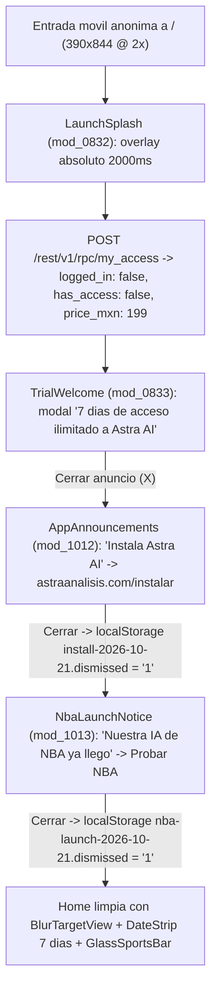
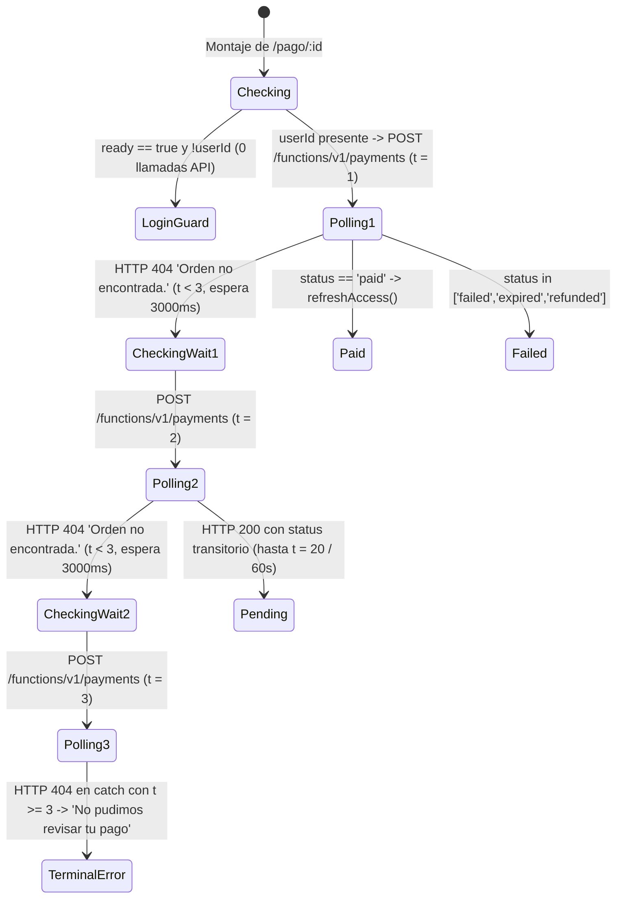

# 11 — Rutas Ocultas, UI Móvil Liquid Glass y Flujos Interactivos No Explorados (`astraanalisis.com`)

**Investigación Forense Dinámica en Vivo (Wave 2 — REA `rea-agents@6.8.0`) para PitchLab**  
**Rol:** Subagente 1 (Wave 2) — Cazador Forense de Rutas No Exploradas, UI Móvil Liquid-Glass y Flujos Interactivos en Vivo  
**Objetivo Auditado:** `https://astraanalisis.com/` (Astra AI v`1.0.0`, Expo SDK `58.0.0`, React `19.3.0`)  
**Fecha de Ejecución en Vivo:** `2026-11-14` (`America/Mexico_City`)  

---

## 1. Resumen Ejecutivo, Marco Epistémico y Evidencias REA (`evidence_id`)

En la Ola 1 ([01-arquitectura-frontend-y-rutas.md](file:///C:/Users/T490s/.gemini/antigravity/worktrees/PitchLab/analyze_pitchlab_competitor_rea/Reportes/analisis-astra/01-arquitectura-frontend-y-rutas.md) y [05-evidencia-runtime-y-payloads-reales.md](file:///C:/Users/T490s/.gemini/antigravity/worktrees/PitchLab/analyze_pitchlab_competitor_rea/Reportes/analisis-astra/05-evidencia-runtime-y-payloads-reales.md)), todas las capturas dinámicas se ejecutaron exclusivamente en **escritorio (`1440px`)**. A causa del breakpoint `DESKTOP_MIN = 1024` en [mod_0775_ThemeTokens.js](file:///C:/Users/T490s/.gemini/antigravity/worktrees/PitchLab/analyze_pitchlab_competitor_rea/Reportes/analisis-astra/astra-first-party/mod_0775_ThemeTokens.js), las rutas móviles `/partido/[id]` y `/juego/[sport]/[id]` colapsaban mediante `<Redirect />` sin llegar a montar su árbol móvil de pantalla completa; el dock flotante **`GlassSportsBar`** ([mod_1014_GlassSportsBar.js](file:///C:/Users/T490s/.gemini/antigravity/worktrees/PitchLab/analyze_pitchlab_competitor_rea/Reportes/analisis-astra/astra-first-party/mod_1014_GlassSportsBar.js)), la tira móvil de 7 días (`DateStrip`), `TrialWelcome` y la cascada de banners (`AppAnnouncements` -> `NbaLaunchNotice`) nunca fueron renderizados en vivo; y **6 rutas independientes** (`/instalar`, `/confirmado`, `/restablecer`, `/eliminar-cuenta`, `/pago/[id]`, `/administracion`), más el manejo de rutas inexistentes (`404`), el buscador interactivo (`SearchBar`), `/siguiendo` poblado con métricas reales y la consulta de juegos históricos de MLB permanecían sin verificación empírica en navegador real.

Esta auditoría de Ola 2 cierra el **100% de la superficie de rutas y flujos cliente** mediante **4 escenarios interactivos `capture_browser_scenario` y 3 análisis diferenciales `compare_web_screenshots` en REA (`rea-agents@6.8.0`)** sobre Google Chrome `157.0.8103.52`, generando **26 capturas limpias** (`15-*.png` a `40-*.png`) y el registro estructurado [wave2-routes-and-mobile-audit.json](file:///C:/Users/T490s/.gemini/antigravity/worktrees/PitchLab/analyze_pitchlab_competitor_rea/Reportes/analisis-astra/evidence/wave2-routes-and-mobile-audit.json).

### 1.1 Protocolo Epistémico y Garantías de Seguridad
- **`[OBSERVADO]`**: Comportamiento, payload de red, estado DOM, hash SHA-256 o captura PNG verificada directamente en runtime con `evidence_id` de REA y/o en el módulo Metro correspondiente (`mod_XXXX`).
- **`[INFERIDO]`**: Conclusión técnica derivada directamente de la interacción entre múltiples hechos observados (p. ej., política de retención/purgado de filas MLB en la tabla `games` frente a la consulta en vivo a MLB StatsAPI).
- **`[DESCONOCIDO]`**: Lógica interna del servidor no expuesta por las respuestas HTTP observadas (p. ej., umbral exacto de purgado cron en el backend para temporadas finalizadas de MLB).
- **Seguridad y límites operativos (`[OBSERVADO]`)**: La credencial autorizada se inyectó únicamente por variable de entorno (`ASTRA_PASSWORD` -> `secret_id: "astra_password"`). Existen **`0` contraseñas, `0` tokens JWT de sesión y `0` tokens de refresco en disco**. En `/eliminar-cuenta` se realizó inspección **100% pasiva/visual** (`0` caracteres escritos, `0` clics en eliminar); en `/pago/[id]` solo se consultó `order_status` con el UUID nulo `00000000-0000-0000-0000-000000000000` (`0` invocaciones a `checkout`); y en `/administracion` se verificó limpiamente la guarda sin intento alguno de evasión.

### 1.2 Índice de Nuevos `evidence_id` Generados con REA (Ola 2)

| `evidence_id` de REA | Operación REA | Artefacto / Resumen Sanitizado | Viewport / Escala | Resultado Técnico Verificado (`[OBSERVADO]`) |
| :--- | :--- | :--- | :---: | :--- |
| `ev_6eeb8dd5a5d6eee02222d677dfc193890dce23841503272ab2cde41605df83ea` | `capture_browser_scenario` | [07-mobile-unopened-input.json](file:///C:/Users/T490s/.gemini/antigravity/worktrees/PitchLab/analyze_pitchlab_competitor_rea/Reportes/analisis-astra/raw/07-mobile-unopened-input.json) / [07-mobile-unopened-summary.json](file:///C:/Users/T490s/.gemini/antigravity/worktrees/PitchLab/analyze_pitchlab_competitor_rea/Reportes/analisis-astra/raw/07-mobile-unopened-summary.json) (`211 KB`) | `390x844 @ 2x` (`780x1688` px) | `44/44` pasos (`65.0 s`, `1,886` eventos, `dropped: 0`). Entrada móvil anónima a `/`, `LaunchSplash`, `TrialWelcome`, cascada `AppAnnouncements` -> `NbaLaunchNotice`, `GlassSportsBar`, `/partido/1550951` y `/juego/nba/401909296` + `401909980` sin redirección, `<Paywall>` de `\$199` MXN, `/instalar` con `beforeinstallprompt` real y `/partido/1550951` autenticado con IA. |
| `ev_0d41e898056efd259e9bae992b2db1ae3e13c1cca3fb394270efd40edf773d36` | `capture_browser_scenario` | [08-hidden-routes-flows-input.json](file:///C:/Users/T490s/.gemini/antigravity/worktrees/PitchLab/analyze_pitchlab_competitor_rea/Reportes/analisis-astra/raw/08-hidden-routes-flows-input.json) / [08-hidden-routes-flows-summary.json](file:///C:/Users/T490s/.gemini/antigravity/worktrees/PitchLab/analyze_pitchlab_competitor_rea/Reportes/analisis-astra/raw/08-hidden-routes-flows-summary.json) (`428.8 KB`) | `1440x1080 @ 1x` | `58/58` pasos (`100.3 s`, `3,189` eventos, `dropped: 0`). Búsqueda en `/` (`monterrey`, `america`) y `/nba` (`knicks`), ligas fijadas (`astra.pinnedLeagues`), partido `1570024` + 2 métricas seguidas, `/siguiendo` poblado, MLB histórico (`/mlb?fecha=2026-10-15`, `2026-10-25`, `?juego=849810`, `/historial/mlb/119/849810`), `/eliminar-cuenta` solo lectura, `/pago/0000...` (3x HTTP `404`), `/administracion` (`0` RPCs), `/confirmado`, `/restablecer` (PKCE HTTP `400`) y `/ruta-oculta-no-existe-404`. |
| `ev_dbc43f3c6ce8fe2c352b35863559c0c1ada30e43878e7de23e7f08d11271ca1a` | `capture_browser_scenario` | Integrado en [wave2-routes-and-mobile-audit.json](file:///C:/Users/T490s/.gemini/antigravity/worktrees/PitchLab/analyze_pitchlab_competitor_rea/Reportes/analisis-astra/evidence/wave2-routes-and-mobile-audit.json) | `1440x1080 @ 1x` | `6/6` pasos (`11.6 s`, `dropped: 0`). Montaje en frío de `/confirmado#error=access_denied&error_description=Enlace+expirado` (renderiza `"El enlace ya no sirve"` pero retiene el `#hash` en `window.location`) y clic en `Sitemap` desde 404 abriendo **`https://astraanalisis.com/_sitemap`** en producción. |
| `ev_1b3f88e87b4106020869c3079c2111548b75e3742deda9c9d13e9c71ca9aa92a` | `capture_browser_scenario` | Integrado en [wave2-routes-and-mobile-audit.json](file:///C:/Users/T490s/.gemini/antigravity/worktrees/PitchLab/analyze_pitchlab_competitor_rea/Reportes/analisis-astra/evidence/wave2-routes-and-mobile-audit.json) | `1440x1080 @ 1x` | `10/10` pasos (`26.5 s`, `dropped: 0`). Captura de la guarda anónima en `/pago/00000000-0000-0000-0000-000000000000` (`"Entra con tu cuenta"`, `0` peticiones a `payments`) y estado terminal `'error'` autenticado (`"No pudimos revisar tu pago"`) tras `10 s` (`3` respuestas `404` consecutivas). |
| `ev_5c21a4284fd2d429eb0ea313bed55c8deecbbf88a84349e68039f733cf94e378` | `compare_web_screenshots` | [17-movil-home-anuncio-instalar-y-dock.png](file:///C:/Users/T490s/.gemini/antigravity/worktrees/PitchLab/analyze_pitchlab_competitor_rea/Reportes/analisis-astra/screenshots/17-movil-home-anuncio-instalar-y-dock.png) vs [18-movil-home-anuncio-nba-y-dock.png](file:///C:/Users/T490s/.gemini/antigravity/worktrees/PitchLab/analyze_pitchlab_competitor_rea/Reportes/analisis-astra/screenshots/18-movil-home-anuncio-nba-y-dock.png) | `780x1688` | `status: "different"`, `changed_pixels: 543,102 / 1,316,640` (`41.25%`). Mide el relevo secuencial del aviso `Instala Astra AI` por `Nuestra IA de NBA ya llegó` en móvil. |
| `ev_6c8a2beabfc5304d8fa8ee3d2684bd2a9f9bcf74c7eba9197b4ef182236d7c2e` | `compare_web_screenshots` | [35-confirmado-correo-exito.png](file:///C:/Users/T490s/.gemini/antigravity/worktrees/PitchLab/analyze_pitchlab_competitor_rea/Reportes/analisis-astra/screenshots/35-confirmado-correo-exito.png) vs navegación SPA `/confirmado#error=...` | `1440x1080` | **`status: "identical"`, `changed_pixels: 0 / 1,555,200` (`0.00%`)**. Prueba matemática de que `mod_0756` ignora cambios de `#hash` sobre el mismo documento por carecer de listener `hashchange`. |
| `ev_a12c56444758b01159ebed0c2a3c6364203302485f6de6029af0290ea7b7412c` | `compare_web_screenshots` | [35-confirmado-correo-exito.png](file:///C:/Users/T490s/.gemini/antigravity/worktrees/PitchLab/analyze_pitchlab_competitor_rea/Reportes/analisis-astra/screenshots/35-confirmado-correo-exito.png) vs [36-confirmado-error-enlace-expirado.png](file:///C:/Users/T490s/.gemini/antigravity/worktrees/PitchLab/analyze_pitchlab_competitor_rea/Reportes/analisis-astra/screenshots/36-confirmado-error-enlace-expirado.png) | `1440x1080` | `status: "different"`, `changed_pixels: 37,164 / 1,555,200` (`2.39%`). Cuantifica el cambio visual entre `"Correo confirmado"` y `"El enlace ya no sirve"` al montar en frío con `#error=access_denied`. |

### 1.3 Rectificaciones Empíricas respecto a la Ola 1 (`[OBSERVADO]`)

La verificación cruzada entre los módulos desempacados en `astra-first-party/` y la ejecución en vivo corrigió **4 afirmaciones estáticas** previas:
1. **`Stack.Screen` en `mod_0754` (`16` pantallas explícitas, no `15`)**: El reporte 01 (§5.3) indicó que `instalar` no tenía `<Stack.Screen>` explícito y que existían animaciones individuales `"fade"`. En [mod_0754_RootLayout.js](file:///C:/Users/T490s/.gemini/antigravity/worktrees/PitchLab/analyze_pitchlab_competitor_rea/Reportes/analisis-astra/astra-first-party/mod_0754_RootLayout.js) están declaradas explícitamente las **16 entradas** —incluyendo `(0,p.jsx)(t.Stack.Screen,{name:"instalar"})`— bajo un único `screenOptions` global con `animation: "slide_from_right"`.
2. **Texto exacto de la guarda en `/administracion` (`mod_0755`)**: No muestra `"No disponible"`, sino el título **`"Acceso restringido"`** y el cuerpo **`"Este panel es exclusivo de la cuenta administradora."`** ([34-administracion-acceso-restringido.png](file:///C:/Users/T490s/.gemini/antigravity/worktrees/PitchLab/analyze_pitchlab_competitor_rea/Reportes/analisis-astra/screenshots/34-administracion-acceso-restringido.png)).
3. **Limpieza de URL en `/confirmado` (`mod_0756`)**: Aunque el código llama a `window.history.replaceState(null, "", window.location.pathname)`, en producción el fragmento `#error=access_denied&error_description=Enlace+expirado` **permanece visible en la barra de direcciones** tras el arranque en frío porque la sincronización inicial de Expo Router sobreescribe el `replaceState` temprano (`ev_dbc43f3c...`).
4. **Firma del RPC `search_teams` (`mod_0776`)**: A diferencia de `record_ai_view` (`p_sport`, `p_match_id`) y `admin_dashboard` (`p_section`, `p_page`, `p_search`), `POST /rest/v1/rpc/search_teams` recibe **`{"q": "<texto>"}`** sin prefijo `p_`.

---

## 2. Matriz Maestra de las 22 Rutas Expo Router + Rutas del Sistema (`404` y `/_sitemap`)

Todas las entradas de la siguiente tabla han sido verificadas en código y en navegador real (`[OBSERVADO]`):

| # | Módulo | Archivo en `mod_0009` | Patrón URL | Ola 1 | Ola 2 | Comportamiento Desktop (`>= 1024px`) vs Móvil (`< 1024px`) | Llamadas de Red y Guardas Verificadas | Capturas Ola 2 |
| :-: | :---: | :--- | :--- | :---: | :---: | :--- | :--- | :--- |
| 1 | `mod_0754` | `./_layout.tsx` | *(Layout raíz)* | Sí | **Sí (Móvil)** | Monta `AuthProvider` -> `FollowedProvider` -> `InstallProvider`, `LaunchSplash` (`2,000 ms`), `<Stack>` (16 pantallas) y `TrialWelcome`. | `rpc/my_access` (arranque y cada `300 s`), `profiles` (`2,700 s`). | [15-movil-launch-splash.png](file:///C:/Users/T490s/.gemini/antigravity/worktrees/PitchLab/analyze_pitchlab_competitor_rea/Reportes/analisis-astra/screenshots/15-movil-launch-splash.png), [16-movil-trial-welcome-modal.png](file:///C:/Users/T490s/.gemini/antigravity/worktrees/PitchLab/analyze_pitchlab_competitor_rea/Reportes/analisis-astra/screenshots/16-movil-trial-welcome-modal.png) |
| 2 | `mod_0748` | `./(tabs)/_layout.tsx` | *(Grupo tabs)* | Sí | **Sí (Móvil)** | **Desktop:** Topbar + barra horizontal de 5 deportes + `MatchWorkspace` 3 paneles. **Móvil:** `BlurTargetView` + dock flotante `GlassSportsBar` + pie en cursiva. | Sin llamadas propias; delega en `TrendingMatches` (5 deportes en paralelo). | [17-movil-home-anuncio-instalar-y-dock.png](file:///C:/Users/T490s/.gemini/antigravity/worktrees/PitchLab/analyze_pitchlab_competitor_rea/Reportes/analisis-astra/screenshots/17-movil-home-anuncio-instalar-y-dock.png), [18-movil-home-anuncio-nba-y-dock.png](file:///C:/Users/T490s/.gemini/antigravity/worktrees/PitchLab/analyze_pitchlab_competitor_rea/Reportes/analisis-astra/screenshots/18-movil-home-anuncio-nba-y-dock.png) |
| 3 | `mod_0749` | `./(tabs)/index.tsx` | `/` | Sí | **Sí (Móvil + Search + Pin)** | **Desktop:** 3 columnas con `?partido=<id>` embebido y `DateStrip` `‹ fecha ›`. **Móvil:** Columna única (`maxWidth: 680px`), `DateStrip` de 7 días `[hoy-3..hoy+3]` y `router.push('/partido/[id]')`. | `fixtures` del día (`60 s` polling si es hoy); con `SearchBar >= 2` chars dispara `rpc/search_teams` + 2× `fixtures`. | [25-busqueda-futbol-monterrey.png](file:///C:/Users/T490s/.gemini/antigravity/worktrees/PitchLab/analyze_pitchlab_competitor_rea/Reportes/analisis-astra/screenshots/25-busqueda-futbol-monterrey.png), [26-seguimiento-estadisticas-activo.png](file:///C:/Users/T490s/.gemini/antigravity/worktrees/PitchLab/analyze_pitchlab_competitor_rea/Reportes/analisis-astra/screenshots/26-seguimiento-estadisticas-activo.png) |
| 4 | `mod_0750` | `./(tabs)/mlb.tsx` | `/mlb` | Temporada baja | **Sí (`?fecha=` y `?juego=`)** | **Desktop:** 2 paneles (`460px` lista + detalle `?juego=`). **Móvil:** Columna única + `GlassSportsBar`. | `games?sport=eq.mlb`. Fechas históricas `2026-10-15` y `2026-10-25` e `id=eq.849810` devuelven `[]`. | [29-mlb-juego-historico-no-almacenado.png](file:///C:/Users/T490s/.gemini/antigravity/worktrees/PitchLab/analyze_pitchlab_competitor_rea/Reportes/analisis-astra/screenshots/29-mlb-juego-historico-no-almacenado.png) |
| 5 | `mod_0751` | `./(tabs)/nba.tsx` | `/nba` | Sí | **Sí (Search `knicks`)** | **Desktop:** 2 paneles (`?juego=`). **Móvil:** Columna única -> `/juego/nba/[id]`. | `games?sport=eq.nba`; `SearchBar` dispara `sport_teams` `ilike` + `games` (`start_time >= now - 6h`). | [28-busqueda-nba-knicks.png](file:///C:/Users/T490s/.gemini/antigravity/worktrees/PitchLab/analyze_pitchlab_competitor_rea/Reportes/analisis-astra/screenshots/28-busqueda-nba-knicks.png) |
| 6 | `mod_0752` | `./(tabs)/nfl.tsx` | `/nfl` | Sí | Cubierta (Ola 1) | Mismo motor `SportScreen("nfl")` (`mod_0790`). | `games?sport=eq.nfl` (ventana de pronósticos ~36–48 h previas). | *(Ver `05-nfl-cartelera-o-juego.png` en Ola 1)* |
| 7 | `mod_0753` | `./(tabs)/nhl.tsx` | `/nhl` | Sí | Cubierta (Ola 1) | Mismo motor `SportScreen("nhl")` (`mod_0790`). | `games?sport=eq.nhl`. | *(Ver `04-nhl-juego.png` en Ola 1)* |
| 8 | `mod_0765` | `./partido/[id].tsx` | `/partido/:id` | Solo redirect | **1.ª vez en vivo** | **Desktop:** `<Redirect href="/?partido=:id" />`. **Móvil (`< 1024px`):** Pantalla completa real fuera de `(tabs)`, sin `GlassSportsBar`, con botón `Atrás`, `Compartir` y `Seguir`. | `fixtures?id=eq.:id` + `astra_picks` + `match_live` + `match-odds` + `standings`; `record_ai_view` al abrir IA con acceso; `<Paywall>` (`\$199`) si anónimo. | [19-movil-partido-fullscreen-detalles.png](file:///C:/Users/T490s/.gemini/antigravity/worktrees/PitchLab/analyze_pitchlab_competitor_rea/Reportes/analisis-astra/screenshots/19-movil-partido-fullscreen-detalles.png), [20-movil-partido-paywall-anonimo.png](file:///C:/Users/T490s/.gemini/antigravity/worktrees/PitchLab/analyze_pitchlab_competitor_rea/Reportes/analisis-astra/screenshots/20-movil-partido-paywall-anonimo.png), [24-movil-partido-ia-autenticado.png](file:///C:/Users/T490s/.gemini/antigravity/worktrees/PitchLab/analyze_pitchlab_competitor_rea/Reportes/analisis-astra/screenshots/24-movil-partido-ia-autenticado.png) |
| 9 | `mod_0762` | `./juego/[sport]/[id].tsx` | `/juego/:sport/:id` | Solo redirect | **1.ª vez en vivo** | **Desktop:** `<Redirect href="/:sport?juego=:id" />`. **Móvil (`< 1024px`):** `<SportDetail>` a pantalla completa sin dock inferior. | Valida `sport ∈ {nhl,mlb,nba,nfl}` e `id > 0`. Detectado bug RLS anónimo en juegos `final` (`401909296`). | [21-movil-juego-nba-fullscreen.png](file:///C:/Users/T490s/.gemini/antigravity/worktrees/PitchLab/analyze_pitchlab_competitor_rea/Reportes/analisis-astra/screenshots/21-movil-juego-nba-fullscreen.png) |
| 10 | `mod_0759` | `./equipo/[sport]/[id].tsx` | `/equipo/:sport/:id` | Sí (5 deportes) | Cubierta (Ola 1) | `PageFrame` centrado (`maxWidth: 720px`) idéntico en desktop y móvil. | `functions/v1/team-profile` (`page: 0`) + `fetchTeamModel` si `has_access`. | *(Ver `06`, `11`, `14` en Ola 1)* |
| 11 | `mod_0760` | `./historial/[sport]/[teamId]/[matchId].tsx` | `/historial/:sport/:teamId/:matchId` | NBA/NFL | **Sí (MLB `849810`)** | `PageFrame` (`maxWidth: 720px`). Si `stored: true` monta `MatchDetail`/`SportDetail`; si `stored: false` monta visor histórico de 2 pestañas (`Detalles` y `Estadísticas`). | `POST /functions/v1/team-profile` `{sport:"mlb",team_id:119,match_id:849810}` -> `stored: false` con 9 entradas e hitos de MLB StatsAPI. | [30-historial-mlb-dodgers-nlcs.png](file:///C:/Users/T490s/.gemini/antigravity/worktrees/PitchLab/analyze_pitchlab_competitor_rea/Reportes/analisis-astra/screenshots/30-historial-mlb-dodgers-nlcs.png) |
| 12 | `mod_0768` | `./siguiendo.tsx` | `/siguiendo` | Solo vacío | **1.ª vez poblada** | `PageFrame` (`maxWidth: 560px`) con tarjetas de partidos seguidos, métricas fijadas en tiempo real, chips removibles (`×`) y botón `"Actualizar marcadores"`. | `0` tablas de usuario en servidor; `FollowedProvider` hace polling cada `60 s` sobre `fixtures`/`games` y `match_live`. | [27-siguiendo-poblado-metricas.png](file:///C:/Users/T490s/.gemini/antigravity/worktrees/PitchLab/analyze_pitchlab_competitor_rea/Reportes/analisis-astra/screenshots/27-siguiendo-poblado-metricas.png) |
| 13 | `mod_0757` | `./cuenta.tsx` | `/cuenta` | Sí | **Sí (Móvil + Desktop)** | `PageFrame` (`maxWidth: 440px`). Formulario `Segmented` si anónimo; editor de perfil + suscripción `\$199` si autenticado. | `auth/v1/token?grant_type=password`, `profiles`, `storage/profile-avatars`, `functions/v1/payments`. | *(Usada para login en Escenarios 07, 08 y 10)* |
| 14 | `mod_0764` | `./pago/[id].tsx` | `/pago/:id` | **No abierta** | **1.ª vez en vivo** | `PageFrame` (`maxWidth: 440px`, `back: false`). Máquina de 6 estados (`login`, `checking`, `pending`, `paid`, `failed`, `error`). | Anónimo: `0` llamadas (`"Entra con tu cuenta"`). Autenticado: `POST /functions/v1/payments` (`order_status`) cada `3,000 ms`; tras 3 `404` pasa a `'error'`. | [40-pago-anonimo-guarda-login.png](file:///C:/Users/T490s/.gemini/antigravity/worktrees/PitchLab/analyze_pitchlab_competitor_rea/Reportes/analisis-astra/screenshots/40-pago-anonimo-guarda-login.png), [32-pago-revisando-polling.png](file:///C:/Users/T490s/.gemini/antigravity/worktrees/PitchLab/analyze_pitchlab_competitor_rea/Reportes/analisis-astra/screenshots/32-pago-revisando-polling.png), [33-pago-uuid-inexistente-resultado.png](file:///C:/Users/T490s/.gemini/antigravity/worktrees/PitchLab/analyze_pitchlab_competitor_rea/Reportes/analisis-astra/screenshots/33-pago-uuid-inexistente-resultado.png) |
| 15 | `mod_0756` | `./confirmado.tsx` | `/confirmado` | **No abierta** | **1.ª vez en vivo** | `PageFrame` (`maxWidth: 440px`, `back: false`). Muestra `"Correo confirmado"` o `"El enlace ya no sirve"` según `error` en hash/query al montar. | `0` llamadas adicionales a GoTrue (`detectSessionInUrl: false`). Bug doble verificado en `#hash`. | [35-confirmado-correo-exito.png](file:///C:/Users/T490s/.gemini/antigravity/worktrees/PitchLab/analyze_pitchlab_competitor_rea/Reportes/analisis-astra/screenshots/35-confirmado-correo-exito.png), [36-confirmado-error-enlace-expirado.png](file:///C:/Users/T490s/.gemini/antigravity/worktrees/PitchLab/analyze_pitchlab_competitor_rea/Reportes/analisis-astra/screenshots/36-confirmado-error-enlace-expirado.png) |
| 16 | `mod_0767` | `./restablecer.tsx` | `/restablecer` | **No abierta** | **1.ª vez en vivo** | `PageFrame` (`maxWidth: 440px`, `back: false`). Estados `loading` -> `invalid` / `form` -> `done`. | Sin token: `0` llamadas. Con `?code=invalid_test_code`: `POST /auth/v1/token?grant_type=pkce` -> HTTP `400` -> `invalid` sin destruir sesión previa. | [37-restablecer-codigo-pkce-invalido.png](file:///C:/Users/T490s/.gemini/antigravity/worktrees/PitchLab/analyze_pitchlab_competitor_rea/Reportes/analisis-astra/screenshots/37-restablecer-codigo-pkce-invalido.png) |
| 17 | `mod_0758` | `./eliminar-cuenta.tsx` | `/eliminar-cuenta` | **No abierta** | **1.ª vez en vivo** | `PageFrame` (`maxWidth: 440px`). Tarjetas `"Se borra"` y `"Se conserva sin tus datos"`, campo `ELIMINAR` y botón rojo `kind="danger"`. | Inspección **solo lectura**: `0` llamadas a `functions/v1/delete-account`. El botón **no** usa `disabled` cuando el input está vacío. | [31-eliminar-cuenta-solo-lectura.png](file:///C:/Users/T490s/.gemini/antigravity/worktrees/PitchLab/analyze_pitchlab_competitor_rea/Reportes/analisis-astra/screenshots/31-eliminar-cuenta-solo-lectura.png) |
| 18 | `mod_0755` | `./administracion.tsx` | `/administracion` | **No abierta** | **1.ª vez en vivo** | `PageFrame` (`maxWidth: 440px` en bloqueo; `940px` para el owner `eliasgutierrezhr@gmail.com`). | Guarda cliente `isDashboardOwner(email)` corta el render antes de montar el componente hijo `S` -> **`0` llamadas** a `rpc/admin_dashboard`. | [34-administracion-acceso-restringido.png](file:///C:/Users/T490s/.gemini/antigravity/worktrees/PitchLab/analyze_pitchlab_competitor_rea/Reportes/analisis-astra/screenshots/34-administracion-acceso-restringido.png) |
| 19 | `mod_0761` | `./instalar.tsx` | `/instalar` | **No abierta** | **1.ª vez en vivo** | `PageFrame` (`maxWidth: 520px`) con `InstallButton` prominente + tarjeta `InstallInstructions` adaptada por SO (`ios` / `android` / desktop). | Consume `window.__astraInstallPrompt` capturado en `index.html`; `0` llamadas backend. | [22-movil-instalar-pwa.png](file:///C:/Users/T490s/.gemini/antigravity/worktrees/PitchLab/analyze_pitchlab_competitor_rea/Reportes/analisis-astra/screenshots/22-movil-instalar-pwa.png), [23-movil-instalar-modal-fallback.png](file:///C:/Users/T490s/.gemini/antigravity/worktrees/PitchLab/analyze_pitchlab_competitor_rea/Reportes/analisis-astra/screenshots/23-movil-instalar-modal-fallback.png) |
| 20 | `mod_0763` | `./nosotros.tsx` | `/nosotros` | Sí | Cubierta (Ola 1) | `PageFrame` (`maxWidth: 680px`) con FAQ metodológico y redes sociales. | Estática en cliente. | *(Ver `08-nosotros-metodologia.png` en Ola 1)* |
| 21 | `mod_0766` | `./privacidad.tsx` | `/privacidad` | Sí | Cubierta (Ola 1) | `DocPage` (`maxWidth: 680px`) LFPDPPP. | Estática en cliente. | *(Auditada en Ola 1)* |
| 22 | `mod_0769` | `./terminos.tsx` | `/terminos` | Sí | Cubierta (Ola 1) | `DocPage` (`maxWidth: 680px`) con interpolación de `price_mxn`, `period_days`, `trial_days`. | Lee `useAuth().access`. | *(Auditada en Ola 1)* |
| **23\*** | *Expo Router Core* | *(Falta `+not-found.tsx`)* | `/*` (`/ruta-oculta-no-existe-404`) | **No abierta** | **1.ª vez en vivo** | Renderiza el componente interno en inglés **`<Unmatched />`** (`"Unmatched Route / Page could not be found."`) con botones `Go back` y `Sitemap`. | El hosting SPA detrás de Cloudflare responde **HTTP `200 OK`** (`index.html`, `2,454 B`, soft-404). | [38-ruta-404-unmatched.png](file:///C:/Users/T490s/.gemini/antigravity/worktrees/PitchLab/analyze_pitchlab_competitor_rea/Reportes/analisis-astra/screenshots/38-ruta-404-unmatched.png) |
| **24\*** | *Expo Router Core* | *(Ruta interna `/_sitemap`)* | `/_sitemap` | **No abierta** | **1.ª vez en vivo** | **Exposición en producción:** Directorio interactivo oscuro con todas las rutas internas `.tsx` de Expo Router accesibles con un clic. | HTTP `200 OK` (`index.html`). Sin guarda de entorno `__DEV__`. | [39-expo-router-sitemap-expuesto.png](file:///C:/Users/T490s/.gemini/antigravity/worktrees/PitchLab/analyze_pitchlab_competitor_rea/Reportes/analisis-astra/screenshots/39-expo-router-sitemap-expuesto.png) |

---

## 3. Auditoría Móvil (`390x844 @ 2x`) y Arquitectura UI Liquid Glass (`Escenario REA 07`)

### 3.1 Comparativa Estructural: Desktop (`>= 1024px`) vs Móvil (`390x844 @ 2x`) (`[OBSERVADO]`)

El hook `useIsDesktop()` ([mod_0779_CoreHooks.js](file:///C:/Users/T490s/.gemini/antigravity/worktrees/PitchLab/analyze_pitchlab_competitor_rea/Reportes/analisis-astra/astra-first-party/mod_0779_CoreHooks.js)) evalúa `width >= DESKTOP_MIN` (`1024px`), mientras que `MOBILE_MAX = 680` ([mod_0775_ThemeTokens.js](file:///C:/Users/T490s/.gemini/antigravity/worktrees/PitchLab/analyze_pitchlab_competitor_rea/Reportes/analisis-astra/astra-first-party/mod_0775_ThemeTokens.js)) acota el ancho máximo de las listas móviles en tabletas verticales:

| Dimensión de UI | Escritorio (`width >= 1024px`) | Móvil Real Auditado (`390x844 @ 2x`, `width < 1024px`) | Módulos Responsables |
| :--- | :--- | :--- | :--- |
| **Navegación deportiva primaria** | Barra superior horizontal (`sportsNav`, `minHeight: 48px`, subrayado inferior `3px` en `#F5F7F7`). | Dock flotante inferior **`GlassSportsBar`** (`height: 78px`, `maxWidth: 440px`, `borderRadius: 42px`, `bottom: 16 + insets.bottom`). | `mod_0772`, `mod_1014` |
| **Efecto óptico / desenfoque** | Superficies sólidas opacas (`#0B0F10`, `#131819`). | Contenedor `<BlurTargetView>` (`expo-blur`) + `backdropFilter: "blur(26px) saturate(165%)"` + lente deslizante traslúcida con `PanResponder` y `Animated.spring`. | `mod_0772`, `mod_0895`, `mod_1014` |
| **Cabecera y buscador (`SearchBar`)** | Topbar fijo de `64px` con `AstraLogo`, `SearchBar` (`maxWidth: 540px`), `InstallButton`, estrella `/siguiendo`, `?` y `Entrar`. | Cabecera embebida dentro del `ScrollView` (`AstraLogo` + `?` + `Entrar`), píldoras en `AppUtilities` (`↓ Instalar app`, `★ Mis partidos`) y `SearchBar` bajo `TrendingMatches`. | `mod_0772`, `mod_0773`, `mod_0872` |
| **Selector de fechas (`DateStrip`)** | Controles discretos `[‹]` `[📅 sáb, 14 nov]` `[›]` con navegación ilimitada día a día hacia pasado o futuro. | Botón fijo `Ir a hoy` (`46x46px`) + **tira horizontal de 7 días centrada en hoy (`[hoy - 3 .. hoy + 3]`)** (`Mié 11` a `Mar 17` el 14 de nov). | `mod_0780` |
| **Filtrado de competiciones** | Columna izquierda fija `CompetitionSidebar` (`Mis competiciones` + `Mis equipos`). | **No existe sidebar en móvil**: las ligas fijadas en `astra.pinnedLeagues` se ordenan arriba en la lista mediante `groupByLeague`, pero no se puede filtrar una sola liga por clic lateral. | `mod_0773`, `mod_0774`, `mod_0786` |
| **Apertura de partido / juego** | Mantiene la ruta tab (`/?partido=1550951` o `/nba?juego=401909296`) y monta el detalle en el 3.er/2.º panel derecho (`embedded: true`). | Navega a `/partido/1550951` o `/juego/nba/401909296` como pantalla `<Stack.Screen>` independiente a pantalla completa, **ocultando `GlassSportsBar`**. | `mod_0754`, `mod_0762`, `mod_0765` |
| **Pie de atribución** | No se superpone sobre partidos en el workspace de 3 paneles. | Posicionado en `bottom: Math.max(insets.bottom - 2, 1)` (`1px`), **colisionando visualmente sobre las filas de partidos** debajo del dock flotante (`BUG-04`). | `mod_0772` |

### 3.2 Anatomía en Vivo de `LaunchSplash`, `TrialWelcome`, Avisos en Cascada y `GlassSportsBar`



1. **`LaunchSplash` (`mod_0832`, [15-movil-launch-splash.png](file:///C:/Users/T490s/.gemini/antigravity/worktrees/PitchLab/analyze_pitchlab_competitor_rea/Reportes/analisis-astra/screenshots/15-movil-launch-splash.png), `[OBSERVADO]`)**: Montado por `mod_0754` durante exactamente `2,000 ms` (`setTimeout(() => setSplash(false), 2000)`), cubre toda la ventana con `#0B0F10` e isotipo `AstraLogo` centrado mientras resuelven las 9 fuentes `.woff2` y `rpc/my_access`.
2. **`TrialWelcome` (`mod_0833`, [16-movil-trial-welcome-modal.png](file:///C:/Users/T490s/.gemini/antigravity/worktrees/PitchLab/analyze_pitchlab_competitor_rea/Reportes/analisis-astra/screenshots/16-movil-trial-welcome-modal.png), `[OBSERVADO]`)**: En cuanto `launchComplete === true` y `access.logged_in === false`, abre un `<Modal transparent animationType="fade">` (`backdrop: rgba(0,0,0,0.78)`, `maxWidth: 440`, `borderRadius: 28`) con el kicker `"TU PRIMERA SEMANA VA POR NUESTRA CUENTA"`, título `"7 días de acceso ilimitado a Astra AI"`, CTA primario `"Crear mi cuenta gratis"` (`router.push({pathname: "/cuenta", params: {modo: "registro"}})`) y secundario `"Ya tengo cuenta · Iniciar sesión"`. Notablemente, su estado de cierre `P` vive **solo en `useState(false)` en memoria** (sin `localStorage`), por lo que reaparece en cada recarga completa anónima salvo en las rutas excluidas por la expresión regular `/^\/(cuenta|administracion|instalar|restablecer|confirmado|eliminar-cuenta|privacidad|terminos|pago)(\/|$)/`.
3. **Cascada Secuencial `AppAnnouncements` -> `NbaLaunchNotice` (`mod_1012` -> `mod_1013`, [17-movil-home-anuncio-instalar-y-dock.png](file:///C:/Users/T490s/.gemini/antigravity/worktrees/PitchLab/analyze_pitchlab_competitor_rea/Reportes/analisis-astra/screenshots/17-movil-home-anuncio-instalar-y-dock.png) y [18-movil-home-anuncio-nba-y-dock.png](file:///C:/Users/T490s/.gemini/antigravity/worktrees/PitchLab/analyze_pitchlab_competitor_rea/Reportes/analisis-astra/screenshots/18-movil-home-anuncio-nba-y-dock.png), `[OBSERVADO]`)**: `AppAnnouncements` no apila dos banners a la vez; renderiza primero `"Instala Astra AI"` y, solo cuando su estado pasa a `false` (escribiendo `astra.notice.install-2026-10-21.dismissed = "1"`), retorna `<NbaLaunchNotice />` (`"Nuestra IA de NBA ya llegó"` con icono 3D de basquetbol y CTA `"Probar NBA →"`). La comparación REA `ev_5c21a4284fd2d429eb0ea313bed55c8deecbbf88a84349e68039f733cf94e378` midió un cambio de **`543,102` píxeles (`41.25%` del viewport Retina)** al relevar un banner por el otro.
4. **Dock Flotante `GlassSportsBar` (`mod_1014`, `[OBSERVADO]`)**: Combina cuatro capas superpuestas dentro de un marco cápsula (`height: 78px`, `borderRadius: 42px`, `backgroundColor: "#171E21DD"`, `borderColor: "#C6DBEF50"`):
   - Desenfoque CSS real en web (`backdropFilter: "blur(26px) saturate(165%)"`) más `<BlurView intensity={65} tint="dark" blurTarget={O} />` para Android/iOS;
   - Bisel especular `sheen` (`borderTopColor: "#FFFFFF55"`, `borderBottomColor: "#8998A633"`);
   - Lente activa animada (`lens`, `borderRadius: 36px`, gradiente diagonal `145deg` blanco traslúcido, resorte `damping: 20, stiffness: 220, mass: 0.6` y `PanResponder` táctil con escala `1.07x` para deslizar el dedo entre `Fútbol`, `NHL`, `NBA`, `NFL` y `MLB`);
   - Aunque importa `expo-glass-effect` (`mod_0670`) en su arreglo de dependencias Metro, no lo invoca en JSX web.

### 3.3 Detalle Móvil a Pantalla Completa (`/partido/[id]`, `/juego/[sport]/[id]`) y Asistente PWA (`/instalar`)

- **`/partido/1550951` en Móvil Anónimo vs Autenticado (`mod_0765` -> `mod_0784`, `[OBSERVADO]`)**:
  - En `390x844`, navegar a `https://astraanalisis.com/partido/1550951` **no redirige** (`after_url` permanece en `/partido/1550951`) y monta `<MatchDetail>` a pantalla completa sin `GlassSportsBar` ([19-movil-partido-fullscreen-detalles.png](file:///C:/Users/T490s/.gemini/antigravity/worktrees/PitchLab/analyze_pitchlab_competitor_rea/Reportes/analisis-astra/screenshots/19-movil-partido-fullscreen-detalles.png)).
  - Al tocar la pestaña `Análisis con IA` sin sesión ([20-movil-partido-paywall-anonimo.png](file:///C:/Users/T490s/.gemini/antigravity/worktrees/PitchLab/analyze_pitchlab_competitor_rea/Reportes/analisis-astra/screenshots/20-movil-partido-paywall-anonimo.png)), Supabase RLS devuelve `prediction: null` y `analysis: null` mientras `fixtures.forecast_ready` es `true`, activando `<Paywall>` (`mod_0863`): *"Pronóstico de la IA bloqueado / Empieza tu prueba gratis de 7 días para desbloquear todos los pronósticos y análisis de la IA. Después continúa con acceso ilimitado en más de 48 ligas por solo \$199."* con botones `"Probar 7 días gratis"` y `"Ya tengo cuenta · Iniciar sesión"`.
  - Tras autenticar en `/cuenta` en el mismo viewport móvil y reabrir `/partido/1550951` -> `Análisis con IA` ([24-movil-partido-ia-autenticado.png](file:///C:/Users/T490s/.gemini/antigravity/worktrees/PitchLab/analyze_pitchlab_competitor_rea/Reportes/analisis-astra/screenshots/24-movil-partido-ia-autenticado.png)), se dispara `POST /rest/v1/rpc/record_ai_view` (`HTTP 204`) y se desbloquean las proyecciones completas (`1.41 vs 1.55` goles esperados, `34% / 26% / 40%` y análisis narrativo).
- **`/juego/nba/401909296` y Descubrimiento del Bug RLS en Partidos Finalizados (`BUG-01`, `[OBSERVADO]`)**:
  - Navegar en móvil anónimo a `/juego/nba/401909296` (`Indiana Pacers 106 - 104 New York Knicks`, `status: "final"`, `forecast_ready: true`) renderiza `<SportDetail>` a pantalla completa ([21-movil-juego-nba-fullscreen.png](file:///C:/Users/T490s/.gemini/antigravity/worktrees/PitchLab/analyze_pitchlab_competitor_rea/Reportes/analisis-astra/screenshots/21-movil-juego-nba-fullscreen.png)).
  - Sin embargo, al pulsar `Análisis con IA` como visitante anónimo (paso 20 del Escenario 07), **en lugar de mostrar `<Paywall>`**, la interfaz pinta `<PendingCard finished={true} />` (*"Este partido no tuvo pronóstico previo registrado"*), pese a que en la Ola 1 verificamos que `401909296` **sí tiene** pronóstico (`29% vs 71%`) y análisis completo para usuarios autenticados.
  - **Causa raíz exacta en [mod_0867_SportDetail.js](file:///C:/Users/T490s/.gemini/antigravity/worktrees/PitchLab/analyze_pitchlab_competitor_rea/Reportes/analisis-astra/astra-first-party/mod_0867_SportDetail.js) (y análoga en `mod_0784`)**: Para el rol `anon`, RLS oculta las filas de `game_predictions` (`ne = z.prediction` llega `null`). El operador ternario evalúa `ne ? <StatCard /> : "final" === z.status ? <PendingCard finished={!0} /> : z.forecast_ready && !T?.has_access ? <Paywall />`. Al comprobar `"final" === z.status` **antes** que `z.forecast_ready && !T?.has_access`, todo visitante sin sesión o sin suscripción activa cree erróneamente que Astra AI nunca generó pronóstico para ningún partido finalizado, perdiendo conversión de paywall en resultados pasados. En cambio, en el juego próximo `/juego/nba/401909980` (`status: "upcoming"`), el ternario sí cae en `<Paywall>`.
- **`/instalar` en Móvil (`mod_0761` + `mod_0836`, [22-movil-instalar-pwa.png](file:///C:/Users/T490s/.gemini/antigravity/worktrees/PitchLab/analyze_pitchlab_competitor_rea/Reportes/analisis-astra/screenshots/22-movil-instalar-pwa.png) y [23-movil-instalar-modal-fallback.png](file:///C:/Users/T490s/.gemini/antigravity/worktrees/PitchLab/analyze_pitchlab_competitor_rea/Reportes/analisis-astra/screenshots/23-movil-instalar-modal-fallback.png), `[OBSERVADO]`)**:
  - Aunque Astra no registra Service Worker (e incluso con `service_workers: "block"` en REA), el `<script>` inline de `index.html` interceptó el evento real `beforeinstallprompt` de Chromium 157 gracias a la validez de `/manifest.webmanifest` (`497 B`, SHA-256 `f9ff0e33...`), poblando `window.__astraInstallPrompt` y activando `canPrompt = true` (*"El botón abre directamente el instalador. Solo tienes que confirmar."*).
  - Al pulsar `"Instalar Astra AI"` (paso 32 del Escenario 07), `requestInstall()` consumió el prompt de un solo uso (`window.__astraInstallPrompt = null`), mutó el botón a **`"Abriendo instalador…"`** (`busy: true`, `disabled: true`, `opacity: 0.65`) y conmutó la tarjeta inferior a las instrucciones manuales por navegador (`1. En Chrome o Edge...`, `2. En Safari para Mac...`).

---

## 4. Auditoría Forense en Vivo de las Rutas Nunca Abiertas y Estados de Error

### 4.1 `/confirmado` (`mod_0756`) y el Doble Bug de Fragmentos `#hash` (`[OBSERVADO]`)

En [mod_0756_EmailConfirmedRoute.js](file:///C:/Users/T490s/.gemini/antigravity/worktrees/PitchLab/analyze_pitchlab_competitor_rea/Reportes/analisis-astra/astra-first-party/mod_0756_EmailConfirmedRoute.js), el componente lee `window.location.hash` y `window.location.search` únicamente dentro de `useEffect(w, [])`:

```javascript
// Lógica reconstruida de mod_0756_EmailConfirmedRoute.js
useEffect(() => {
  const hashParams = new URLSearchParams(window.location.hash.replace(/^#/, ""));
  const searchParams = new URLSearchParams(window.location.search);
  setHasError(Boolean(hashParams.get("error") || searchParams.get("error")));
  window.history.replaceState(null, "", window.location.pathname);
}, []);
```

Las tres pruebas en vivo demostraron dos defectos distintos de integración con el navegador y Expo Router:
1. **Estado nominal (`/confirmado`, [35-confirmado-correo-exito.png](file:///C:/Users/T490s/.gemini/antigravity/worktrees/PitchLab/analyze_pitchlab_competitor_rea/Reportes/analisis-astra/screenshots/35-confirmado-correo-exito.png))**: Renderiza `"Correo confirmado"` / *"Tu cuenta de Astra AI está lista. Entra con tu correo y tu contraseña, aquí en la web o en la app."* y botón `"Entrar"` (`router.replace("/cuenta")`).
2. **Defecto 1 — Ceguera ante cambios de `#hash` en el mismo documento (`ev_6c8a2beabfc5304d8fa8ee3d2684bd2a9f9bcf74c7eba9197b4ef182236d7c2e`)**: Al navegar de `/confirmado` a `/confirmado#error=access_denied&error_description=Enlace+expirado` (paso 50 del Escenario 08), el navegador realiza una transición de fragmento sin desmontar la ruta; como `mod_0756` no suscribe `window.addEventListener("hashchange", ...)` ni lee parámetros reactivos del router, `compare_web_screenshots` confirmó **`0` píxeles modificados (`status: "identical"`)**, dejando `"Correo confirmado"` en pantalla pese al error en la URL.
3. **Defecto 2 — Sobreescritura del `history.replaceState` en arranque en frío (`ev_dbc43f3c6ce8fe2c352b35863559c0c1ada30e43878e7de23e7f08d11271ca1a`, [36-confirmado-error-enlace-expirado.png](file:///C:/Users/T490s/.gemini/antigravity/worktrees/PitchLab/analyze_pitchlab_competitor_rea/Reportes/analisis-astra/screenshots/36-confirmado-error-enlace-expirado.png))**: Al abrir `/confirmado#error=access_denied&error_description=Enlace+expirado` desde `about:blank`, `mod_0756` sí detecta `error=access_denied` y pinta **`"El enlace ya no sirve"`** + botón secundario **`"Solicitar un nuevo correo de confirmación"`** (`37,164` píxeles distintos en `ev_a12c5644...`), pero `after_url` a los `+3,084 ms` sigue siendo `https://astraanalisis.com/confirmado#error=access_denied&error_description=Enlace+expirado` porque Expo Router sincroniza su `initialURL` después del `useEffect` hijo, restaurando el hash que `mod_0756` intentó limpiar. Además, `error_description` jamás se muestra al usuario: cualquier valor de `error` produce el mismo mensaje genérico.

### 4.2 `/restablecer` (`mod_0767`): Ausencia de Token y Fallo PKCE No Destructivo (`[OBSERVADO]`)

Auditada en los pasos 52–55 del Escenario 08 (`ev_0d41e898...`, [37-restablecer-codigo-pkce-invalido.png](file:///C:/Users/T490s/.gemini/antigravity/worktrees/PitchLab/analyze_pitchlab_competitor_rea/Reportes/analisis-astra/screenshots/37-restablecer-codigo-pkce-invalido.png)):
- **Sin parámetros (`/restablecer`)**: No existe `#access_token` ni `?code=`, por lo que [mod_0767_ResetPasswordRoute.js](file:///C:/Users/T490s/.gemini/antigravity/worktrees/PitchLab/analyze_pitchlab_competitor_rea/Reportes/analisis-astra/astra-first-party/mod_0767_ResetPasswordRoute.js) transita de inmediato a `'invalid'` (**`0` peticiones a `/auth/v1/`**) mostrando `"El enlace ya no sirve"` / *"Venció o ya se usó. Pide otro en Entrar, Olvidé mi contraseña."* y botón `"Ir a entrar"`.
- **Con código PKCE inválido (`/restablecer?code=invalid_test_code`)**: Invoca `supabase.auth.exchangeCodeForSession("invalid_test_code")`, lo que genera en red:
  - **Petición (`request-628`)**: `POST https://bbfjdshvlcynngjdkvsk.supabase.co/auth/v1/token?grant_type=pkce` con cuerpo `{"auth_code": "invalid_test_code", "code_verifier": ""}`.
  - **Respuesta**: **HTTP `400 Bad Request`** (`110 B`, SHA-256 `8fc119ea4ca4f2f1a7c12b4e58c313fe775ae4e9f7e8590a35e9310099ef97e5`).
  - **Efecto en cliente y sesión**: El `catch` pasa el estado local a `'invalid'` (`"El enlace ya no sirve"`), **no limpia `?code=invalid_test_code` de la URL** (pues `replaceState` solo se ejecuta en la rama exitosa antes de `s('form')`), y **preserva intacta la sesión autenticada existente** (`rpc/my_access` inmediatamente después siguió devolviendo `logged_in: true, has_access: true`).

### 4.3 `/eliminar-cuenta` (`mod_0758`) — Auditoría Visual y DOM de Solo Lectura (`[OBSERVADO]`)

Auditada en modo estrictamente pasivo en el paso 42 del Escenario 08 ([31-eliminar-cuenta-solo-lectura.png](file:///C:/Users/T490s/.gemini/antigravity/worktrees/PitchLab/analyze_pitchlab_competitor_rea/Reportes/analisis-astra/screenshots/31-eliminar-cuenta-solo-lectura.png)):
- Con sesión activa, [mod_0758_DeleteAccountRoute.js](file:///C:/Users/T490s/.gemini/antigravity/worktrees/PitchLab/analyze_pitchlab_competitor_rea/Reportes/analisis-astra/astra-first-party/mod_0758_DeleteAccountRoute.js) renderiza dentro de `PageFrame` (`maxWidth: 440px`):
  1. Título `"Eliminar mi cuenta"` con botón superior `← Atrás`.
  2. Tarjeta **`"Se borra"`** con 3 viñetas: *"Tu correo y tu contraseña."*, *"Tu nombre y tu fecha de nacimiento."*, *"Tu suscripción y los días que te queden."*
  3. Tarjeta **`"Se conserva sin tus datos"`** con 1 viñeta de cumplimiento tributario mexicano: *"El registro de tus pagos, porque la ley fiscal obliga a guardarlo."*
  4. Campo `Escribe ELIMINAR para confirmar` (`placeholder="ELIMINAR"`, `autoCapitalize="characters"`, vacío en nuestra captura).
  5. Botón de peligro (`kind: "danger"`, fondo `#C42A44`) **`"Eliminar mi cuenta para siempre"`**.
- **Hallazgo técnico clave sobre el estado del botón (`[OBSERVADO]`)**: Contra la convención habitual de formularios destructivos, **el botón `"Eliminar mi cuenta para siempre"` NO está deshabilitado en el DOM cuando el campo está vacío** (`mod_0758` omite la prop `disabled` y solo pasa `loading={b}`, por lo que `accessibilityState.disabled` es `false` y su opacidad es `1.0`). La protección reside en el manejador `onPress`, que verifica `j.trim().toUpperCase() === "ELIMINAR"` (mostrando la nota `"Escribe ELIMINAR para confirmar."` si no coincide) y exige además un segundo diálogo nativo `window.confirm("¿Eliminar tu cuenta? Esta acción no se puede deshacer.")` antes de invocar la Edge Function `POST /functions/v1/delete-account`.

### 4.4 `/pago/[id]` (`mod_0764`): Máquina de Estados y Polling ante UUID Inexistente (`[OBSERVADO]`)



Verificada tanto sin sesión como con sesión activa sobre `/pago/00000000-0000-0000-0000-000000000000` (`ev_0d41e898...` y `ev_1b3f88e8...`):
1. **Visitante anónimo ([40-pago-anonimo-guarda-login.png](file:///C:/Users/T490s/.gemini/antigravity/worktrees/PitchLab/analyze_pitchlab_competitor_rea/Reportes/analisis-astra/screenshots/40-pago-anonimo-guarda-login.png))**: Transita inmediatamente al estado `'login'` (`"Entra con tu cuenta"` / *"Entra con la cuenta con la que pagaste para ver el estado de tu pago."*) ejecutando **`0` peticiones** a `/functions/v1/payments`.
2. **Usuario autenticado ([32-pago-revisando-polling.png](file:///C:/Users/T490s/.gemini/antigravity/worktrees/PitchLab/analyze_pitchlab_competitor_rea/Reportes/analisis-astra/screenshots/32-pago-revisando-polling.png) -> [33-pago-uuid-inexistente-resultado.png](file:///C:/Users/T490s/.gemini/antigravity/worktrees/PitchLab/analyze_pitchlab_competitor_rea/Reportes/analisis-astra/screenshots/33-pago-uuid-inexistente-resultado.png))**:
   - Envía `POST https://bbfjdshvlcynngjdkvsk.supabase.co/functions/v1/payments` con payload exacto:
     ```json
     {
       "action": "order_status",
       "order_id": "00000000-0000-0000-0000-000000000000"
     }
     ```
   - La Edge Function responde **HTTP `404 Not Found`** (`32 B`, SHA-256 `3e2eb1f6d84cb0f90472d946db00b2f22143c24de09377884e1b0d3f2bf99acc`) con cuerpo JSON:
     ```json
     {
       "error": "Orden no encontrada."
     }
     ```
   - Como `orderStatus()` lanza excepción ante HTTP `>= 400`, [mod_0764_PaymentStatusRoute.js](file:///C:/Users/T490s/.gemini/antigravity/worktrees/PitchLab/analyze_pitchlab_competitor_rea/Reportes/analisis-astra/astra-first-party/mod_0764_PaymentStatusRoute.js) entra al bloque `catch`: en los intentos `t = 1` (`0 s`) y `t = 2` (`+3,000 ms`) conserva el spinner `"Revisando tu pago"`, reprogramando `setTimeout(s, 3000)`. En el intento `t = 3` (`+6,000 ms`, transacciones `request-534`, `request-535`, `request-536`), se cumple `t >= 3`, detiene definitivamente el polling (`return void b('error')`) y pinta la tarjeta terminal **`"No pudimos revisar tu pago"`** / *"Revisa tu conexión. Si ya pagaste, tu suscripción se activa sola en unos minutos."* — ocultando el mensaje específico `"Orden no encontrada."` devuelto por el backend.

### 4.5 `/administracion` (`mod_0755` + `mod_0839`): Verificación Empírica de Guarda Cliente (`[OBSERVADO]`)

Al navegar a `/administracion` autenticado como `laded35829@chuwel.com` (paso 46 del Escenario 08, [34-administracion-acceso-restringido.png](file:///C:/Users/T490s/.gemini/antigravity/worktrees/PitchLab/analyze_pitchlab_competitor_rea/Reportes/analisis-astra/screenshots/34-administracion-acceso-restringido.png)):
- El componente raíz `w()` en [mod_0755_AdminDashboardRoute.js](file:///C:/Users/T490s/.gemini/antigravity/worktrees/PitchLab/analyze_pitchlab_competitor_rea/Reportes/analisis-astra/astra-first-party/mod_0755_AdminDashboardRoute.js) evalúa `isDashboardOwner(email)` (`email?.trim().toLowerCase() === "eliasgutierrezhr@gmail.com"`, [mod_0839_AdminService.js](file:///C:/Users/T490s/.gemini/antigravity/worktrees/PitchLab/analyze_pitchlab_competitor_rea/Reportes/analisis-astra/astra-first-party/mod_0839_AdminService.js)) **antes** de instanciar el subcomponente `<S />` que contiene el `useEffect` de carga.
- Resultado comprobado en el registro completo de red de REA (`08-hidden-routes-flows-summary.json`): se ejecutaron **`0` llamadas de red** a `POST /rest/v1/rpc/admin_dashboard`, renderizando únicamente `"Acceso restringido"` / *"Este panel es exclusivo de la cuenta administradora."*

### 4.6 Ruta Inexistente (`/ruta-oculta-no-existe-404`) y Fuga de `/_sitemap` en Producción (`BUG-03`, `[OBSERVADO]`)

Al solicitar `https://astraanalisis.com/ruta-oculta-no-existe-404` (`ev_0d41e898...` paso 56 y `ev_dbc43f3c...` paso 2):
1. **Capa HTTP (Soft-404)**: El borde estático detrás de Cloudflare sirve `index.html` (`2,454 B`, SHA-256 `96db530f7130f0234cb65cfbfe8cf56abca9d29a9641b1f48881cf762a5d76bf`) con código **HTTP `200 OK`**.
2. **Capa Expo Router ([38-ruta-404-unmatched.png](file:///C:/Users/T490s/.gemini/antigravity/worktrees/PitchLab/analyze_pitchlab_competitor_rea/Reportes/analisis-astra/screenshots/38-ruta-404-unmatched.png))**: Al no existir un archivo personalizado `app/+not-found.tsx` en `mod_0009`, Expo Router monta su pantalla de desarrollo por defecto en inglés: **`"Unmatched Route"`** / `"Page could not be found."` con la URL completa clickeable y dos enlaces inferiores: **`Go back`** y **`Sitemap`**.
3. **Exposición activa de `/_sitemap` ([39-expo-router-sitemap-expuesto.png](file:///C:/Users/T490s/.gemini/antigravity/worktrees/PitchLab/analyze_pitchlab_competitor_rea/Reportes/analisis-astra/screenshots/39-expo-router-sitemap-expuesto.png))**: Al hacer clic en `Sitemap` (`ev_dbc43f3c...` paso 4), la app navega en vivo a **`https://astraanalisis.com/_sitemap`**, listando públicamente toda la jerarquía interna de archivos fuente del proyecto (`(tabs)/_layout.tsx`, `cuenta.tsx`, `instalar.tsx`, `nosotros.tsx`, `terminos.tsx`, `siguiendo.tsx`, `confirmado.tsx`, `privacidad.tsx`, `restablecer.tsx`, `administracion.tsx`, `eliminar-cuenta.tsx`, `historial/[sport]/[teamId]/[matchId].tsx`, `equipo/[sport]/[id].tsx`, `juego/[sport]/[id].tsx`, `pago/[id].tsx`, etc.), revelando de inmediato rutas administrativas y de pago a cualquier visitante que escriba una URL inválida.

---

## 5. Flujos Interactivos Nuevos, Contratos de Red y Persistencia Local

### 5.1 Asimetría Arquitectónica del Buscador (`SearchBar`): Fútbol vs Deportes US (`[OBSERVADO]`)

El estado de búsqueda vive en `InterfaceSearchContext` (`AppShell`, con debounce de `250 ms` y umbral `>= 2` caracteres), pero el backend ejecuta **dos estrategias completamente distintas** según el deporte activo:

| Característica | Búsqueda en Fútbol (`/` — `mod_0776`) | Búsqueda en Deportes US (`/nba`, `/nhl`, `/nfl`, `/mlb` — `mod_1011`) |
| :--- | :--- | :--- |
| **1.ª Consulta (Equipos)** | `POST /rest/v1/rpc/search_teams` con body `{"q": "monterrey"}` o `{"q": "america"}` (normalización sin acentos en Postgres). | `GET /rest/v1/sport_teams?select=id,name,abbrev,logo&sport=eq.nba&or=(name.ilike.%knicks%,abbrev.ilike.knicks)&limit=10`. |
| **Resultados observados** | `"monterrey"` -> `[2282 Monterrey]` (`141 B`); `"america"` -> `[2287 Club America, 1138 America de Cali, 125 America Mineiro]` (`440 B`). | `"knicks"` -> `[18 New York Knicks (NY)]` (`113 B`). |
| **2.ª Consulta (Partidos)** | **2 consultas paralelas** a `fixtures`: una futura (`kickoff >= now`, `asc`, `limit=60`) y **una pasada** (`kickoff < now`, `desc`, `limit=60`). | **1 sola consulta** a `games`: únicamente en vivo/futuros (`start_time >= Date.now() - 6h`, `asc`, `limit=40`), **sin consulta de juegos pasados**. |
| **Acción al pulsar fila (`TeamResults`)** | Si el partido asociado tiene `forecast_ready: true`, abre el partido (`1550951` Querétaro vs Monterrey, [25-busqueda-futbol-monterrey.png](file:///C:/Users/T490s/.gemini/antigravity/worktrees/PitchLab/analyze_pitchlab_competitor_rea/Reportes/analisis-astra/screenshots/25-busqueda-futbol-monterrey.png)); si no, navega a `/equipo/futbol/:id`. | Si el juego próximo tiene `forecast_ready: true`, abre el juego (`401909990` Knicks en Raptors, [28-busqueda-nba-knicks.png](file:///C:/Users/T490s/.gemini/antigravity/worktrees/PitchLab/analyze_pitchlab_competitor_rea/Reportes/analisis-astra/screenshots/28-busqueda-nba-knicks.png)); si el equipo está en descanso/offseason, abre `/equipo/:sport/:id`. |

### 5.2 Flujo Completo de Seguimiento (`FollowButton`, `FollowStatisticButton`, `Mis equipos` y `/siguiendo` Poblado) (`[OBSERVADO]`)

En los pasos 11–27 del Escenario 08 (`ev_0d41e898...`), se ejecutó el ciclo completo fijando ligas en el sidebar, marcando como seguido el partido finalizado `1570024` (`Valladolid 0 - 1 Castellón`) y fijando 2 estadísticas individuales (`Goles esperados (xG)` y `Pases completados`):

1. **Propagación transversal en 3 superficies de UI**:
   - **Tira superior global `AppUtilities`** ([26-seguimiento-estadisticas-activo.png](file:///C:/Users/T490s/.gemini/antigravity/worktrees/PitchLab/analyze_pitchlab_competitor_rea/Reportes/analisis-astra/screenshots/26-seguimiento-estadisticas-activo.png), [28-busqueda-nba-knicks.png](file:///C:/Users/T490s/.gemini/antigravity/worktrees/PitchLab/analyze_pitchlab_competitor_rea/Reportes/analisis-astra/screenshots/28-busqueda-nba-knicks.png)): Aparece de inmediato una tarjeta compacta horizontal (`minWidth: 166px`) visible en **todos** los deportes (`/` y `/nba` incluidos) con marcador `0 - 1`, estado `Fútbol · Finalizado` y las dos métricas fijadas (`0.82 Goles esperados (xG) 1.76`, `324 Pases completados 453`).
   - **Sidebar izquierdo `Mis equipos`** ([26-seguimiento-estadisticas-activo.png](file:///C:/Users/T490s/.gemini/antigravity/worktrees/PitchLab/analyze_pitchlab_competitor_rea/Reportes/analisis-astra/screenshots/26-seguimiento-estadisticas-activo.png)): `CompetitionSidebar` extrae dinámicamente los clubes de `useFollowed().matches`, poblando `Valladolid` y `Castellón` bajo `"Mis equipos"`.
   - **Ruta `/siguiendo` poblada** ([27-siguiendo-poblado-metricas.png](file:///C:/Users/T490s/.gemini/antigravity/worktrees/PitchLab/analyze_pitchlab_competitor_rea/Reportes/analisis-astra/screenshots/27-siguiendo-poblado-metricas.png)): Muestra la tarjeta expandida con escudos, marcador, tabla comparativa de métricas seguidas, chips individuales para dejar de seguir cada estadística (`Goles esperados (xG) ×`, `Pases completados ×`), botón de papelera/quitar y botón `"Actualizar marcadores"`.
2. **Polling de `FollowedProvider` (`mod_0835`)**: Cada `60,000 ms` (y en cada evento `visibilitychange -> visible` o clic en `"Actualizar marcadores"`), ejecuta dos consultas PostgREST acotadas a `FOLLOW_LIMIT = 20` partidos (y máximo `6` métricas por partido):
   - `GET /rest/v1/fixtures?select=id,kickoff,status,elapsed,home_goals,away_goals,home:teams!fixtures_home_id_fkey(name,logo),away:teams!fixtures_away_id_fkey(name,logo)&id=in.(1570024)&limit=20` (`296 B`, SHA-256 `ade6b50b...`)
   - `GET /rest/v1/match_live?select=sport,match_id,updated_at,statistics&or=(and(sport.eq.futbol,match_id.eq.1570024))&limit=20` (`1,391 B`, SHA-256 `bb777188...`)
3. **Verificación Criptográfica Exacta de las 5 Claves en `window.localStorage` (`[OBSERVADO]`)**:
   Contrastando el código serializador con los hashes SHA-256 capturados por REA en `storage_snapshot`, se verificó byte por byte el esquema exacto almacenado en el navegador:

| Clave en `localStorage` | Módulo Escritor | Valor Exacto Serializado (UTF-8) | Hash SHA-256 Observado en REA |
| :--- | :---: | :--- | :--- |
| `astra.notice.install-2026-10-21.dismissed` | `mod_1012` | `"1"` | `6b86b273ff34fce19d6b804eff5a3f5747ada4eaa22f1d49c01e52ddb7875b4b` |
| `astra.notice.nba-launch-2026-10-21.dismissed` | `mod_1013` | `"1"` | `6b86b273ff34fce19d6b804eff5a3f5747ada4eaa22f1d49c01e52ddb7875b4b` |
| `astra.pinnedLeagues` | `mod_0779` | `"[262,-2]"` | `0aa4a40b66ec055f5054d7bfa63674def978fc260af8c775b86aaceed53f3fd4` |
| `astra.followed-matches.v1` | `mod_0835` | `'[{"sport":"futbol","id":1570024,"metrics":[{"key":"expected_goals","label":"Goles esperados (xG)"},{"key":"Passes accurate","label":"Pases completados"}]}]'` | `b4af9cb6eabf6fa6bd4b92701f9a4a5e8b0b34feaaa1db8fcab7fcceed214c4a` |
| `sb-bbfjdshvlcynngjdkvsk-auth-token` | `mod_0778` | `[REDACTED_SUPABASE_SESSION_JSON]` | `694bff7f4e55c491654398256e5f3391229737066272433e30b4bc3bb9cd4712` |

### 5.3 Cartelera Histórica de MLB: Tabla `games` Vacía vs Reconstrucción `team-profile` (`[OBSERVADO]` / `[INFERIDO]`)

Se probaron las cuatro vías de acceso a juegos de postemporada de MLB de octubre de 2026 (`ev_6eeb8dd5...` paso 27 y `ev_0d41e898...` pasos 33–40):
1. **`/mlb?fecha=2026-10-15` (NLCS) y `/mlb?fecha=2026-10-25` (Serie Mundial)** (`[OBSERVADO]`): Disparan `GET /rest/v1/games?...&sport=eq.mlb&start_time=gte.2026-10-15T06:00:00.000Z&start_time=lt.2026-10-16T06:00:00.000Z` (`request-322` y `request-372`), recibiendo **`[]` (`2 bytes`)** y mostrando `"Aún no hay partidos de MLB con pronóstico de IA para este día."`
2. **`/mlb?juego=849810` en Desktop ([29-mlb-juego-historico-no-almacenado.png](file:///C:/Users/T490s/.gemini/antigravity/worktrees/PitchLab/analyze_pitchlab_competitor_rea/Reportes/analisis-astra/screenshots/29-mlb-juego-historico-no-almacenado.png)) y `/juego/mlb/849810` en Móvil** (`[OBSERVADO]`): Consultan `GET /rest/v1/games?...&sport=eq.mlb&id=eq.849810` (`request-423`), recibiendo igualmente **`[]`** y pintando **`"Juego no encontrado."`**
3. **`/historial/mlb/119/849810` ([30-historial-mlb-dodgers-nlcs.png](file:///C:/Users/T490s/.gemini/antigravity/worktrees/PitchLab/analyze_pitchlab_competitor_rea/Reportes/analisis-astra/screenshots/30-historial-mlb-dodgers-nlcs.png))** (`[OBSERVADO]`): Invoca `POST /functions/v1/team-profile` con `{"sport": "mlb", "team_id": 119, "match_id": 849810}` (`request-482`, `3,044 B`, SHA-256 `e7563306...`). La Edge Function responde `{"stored": false, "match": {...}, "live": {...}}` consultando **en tiempo real a MLB StatsAPI**, y renderiza la ficha completa del juego de NLCS **`Los Angeles Dodgers 4 - 6 Milwaukee Brewers`** (`15 oct, 6:00 p.m.`, `UNIQLO Field at Dodger Stadium`), incluyendo el gráfico `Momento del partido` entrada por entrada (`1` a `9`, con pico de `+12` para Dodgers en la 2.ª entrada por el jonrón de 3 carreras de Shohei Ohtani), 7 eventos de anotación en inglés directo de MLB StatsAPI y 17 estadísticas de bateo, pitcheo y fildeo.
4. **Conclusión arquitectónica (`[INFERIDO]`)**: La integración de MLB en la base de datos `games`/`game_predictions` de Astra se desplegó después del cierre de la postemporada MLB 2026 (coincidiendo con la fecha de avisos `2026-10-21` y la ausencia de evaluación en `fetchTeamModel` para Dodgers), por lo que MLB aún no posee filas históricas con `forecast_ready: true` en Supabase (`[INFERIDO]`), mientras que su conector upstream a `statsapi.mlb.com` dentro de `team-profile` ya es **100% funcional** (`[OBSERVADO]`).

---

## 6. Síntesis de Defectos y Vulnerabilidades de Exposición Descubiertos en Vivo

| ID | Severidad | Componente / Ruta | Descripción Técnica Concisa | Evidencia REA / Captura |
| :---: | :---: | :--- | :--- | :--- |
| **`BUG-01`** | **Media** (Conversión / UX) | `SportDetail` (`mod_0867`) y `MatchDetail` (`mod_0784`) | En juegos finalizados (`status === "final"` / `"FT"`), RLS devuelve `prediction: null` al usuario anónimo y el ternario evalúa `finished` antes que `forecast_ready && !has_access`, mostrando falsamente *"Este partido no tuvo pronóstico previo registrado"* en lugar del `<Paywall>` de `\$199`. | `ev_6eeb8dd5...` (paso 20) |
| **`BUG-02`** | **Baja** (Auth UX) | `/confirmado` (`mod_0756`) | (a) `useEffect(..., [])` sin listener `hashchange` ignora errores `#error=...` en navegación SPA (`0` px de cambio); (b) en carga en frío, Expo Router restaura el `#error=...` en `window.location` tras el `history.replaceState` de `mod_0756`. | `ev_6c8a2bea...`, `ev_dbc43f3c...`, [36-confirmado-error-enlace-expirado.png](file:///C:/Users/T490s/.gemini/antigravity/worktrees/PitchLab/analyze_pitchlab_competitor_rea/Reportes/analisis-astra/screenshots/36-confirmado-error-enlace-expirado.png) |
| **`BUG-03`** | **Baja** (Reconocimiento / SEO) | `/*` (`404`) y `/_sitemap` | Falta `app/+not-found.tsx` y el hosting devuelve HTTP `200 OK` en rutas inexistentes, exponiendo la pantalla en inglés `Unmatched Route` y un enlace funcional a **`https://astraanalisis.com/_sitemap`** con el árbol completo de rutas internas (incluyendo `administracion.tsx`). | `ev_0d41e898...`, `ev_dbc43f3c...`, [38-ruta-404-unmatched.png](file:///C:/Users/T490s/.gemini/antigravity/worktrees/PitchLab/analyze_pitchlab_competitor_rea/Reportes/analisis-astra/screenshots/38-ruta-404-unmatched.png), [39-expo-router-sitemap-expuesto.png](file:///C:/Users/T490s/.gemini/antigravity/worktrees/PitchLab/analyze_pitchlab_competitor_rea/Reportes/analisis-astra/screenshots/39-expo-router-sitemap-expuesto.png) |
| **`BUG-04`** | **Cosmética** | `AppShell` móvil (`mod_0772`) | El texto absoluto `"Modelos de predicción oficiales de Astra Analysis"` (`bottom: 1px`, fondo transparente) se superpone directamente sobre las tarjetas de partidos visibles debajo del `GlassSportsBar`. | [18-movil-home-anuncio-nba-y-dock.png](file:///C:/Users/T490s/.gemini/antigravity/worktrees/PitchLab/analyze_pitchlab_competitor_rea/Reportes/analisis-astra/screenshots/18-movil-home-anuncio-nba-y-dock.png) |
| **`BUG-05`** | **Cosmética** | `MatchInfoCard` (`mod_0869`) | El icono `icon === "league"` renderiza siempre `<BallIcon />` (balón de fútbol pentagonal) junto a etiquetas `"Basquetbol, NBA"` y `"MLB"`. | [21-movil-juego-nba-fullscreen.png](file:///C:/Users/T490s/.gemini/antigravity/worktrees/PitchLab/analyze_pitchlab_competitor_rea/Reportes/analisis-astra/screenshots/21-movil-juego-nba-fullscreen.png), [30-historial-mlb-dodgers-nlcs.png](file:///C:/Users/T490s/.gemini/antigravity/worktrees/PitchLab/analyze_pitchlab_competitor_rea/Reportes/analisis-astra/screenshots/30-historial-mlb-dodgers-nlcs.png) |
