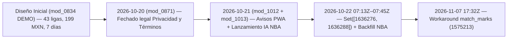

# 12 — Auditoría Forense de Secretos en Código Fuente y Análisis AST Completo de los 100 Módulos Propios con REA

> **Alcance y Metodología Forense (Wave 2 — Subagente 2):** Inspección exhaustiva **línea por línea** de los **100 módulos propios y de configuración generada de Astra AI** aislados en [astra-first-party](file:///C:/Users/T490s/.gemini/antigravity/worktrees/PitchLab/analyze_pitchlab_competitor_rea/Reportes/analisis-astra/astra-first-party) (`345,913` bytes de texto, SHA-256 raíz `a75a10b23cf3e976df10993e1d0b351ab79c533938aa744758fafe4b141bf357`), cruzada con los módulos de borde/vendor en [modules](file:///C:/Users/T490s/.gemini/antigravity/worktrees/PitchLab/analyze_pitchlab_competitor_rea/Reportes/analisis-astra/modules), los `25` chunks JavaScript y [index.html](file:///C:/Users/T490s/.gemini/antigravity/worktrees/PitchLab/analyze_pitchlab_competitor_rea/Reportes/analisis-astra/app/index.html) en [app](file:///C:/Users/T490s/.gemini/antigravity/worktrees/PitchLab/analyze_pitchlab_competitor_rea/Reportes/analisis-astra/app), los payloads reales capturados en [public_model_samples.json](file:///C:/Users/T490s/.gemini/antigravity/worktrees/PitchLab/analyze_pitchlab_competitor_rea/Reportes/analisis-astra/evidence/live-payloads/public_model_samples.json) y el grafo estático/semántico completo retenido en **REA MCP** (`ev_56684417ff30a6b644d1dd65c9c9dee1f9c59d7434fbbcaab9fc81a0fc232493` + `16` proyecciones y trazas derivadas). Catálogo estructurado máquina-legible disponible en [code-secrets-and-anomalies.json](file:///C:/Users/T490s/.gemini/antigravity/worktrees/PitchLab/analyze_pitchlab_competitor_rea/Reportes/analisis-astra/evidence/code-secrets-and-anomalies.json).

---

## Resumen Ejecutivo de Descubrimientos Inéditos (Wave 2)

1. **Explicación forense exacta de `new Set([1636276, 1636288])` ([mod_0774_FootballLeagueList.js](file:///C:/Users/T490s/.gemini/antigravity/worktrees/PitchLab/analyze_pitchlab_competitor_rea/Reportes/analisis-astra/astra-first-party/mod_0774_FootballLeagueList.js)) y el *workaround* posterior en base de datos (`[OBSERVADO]` + `[DERIVADO]`):** La consulta de lista diaria `fetchDay` ([mod_0776_FootballRepository.js](file:///C:/Users/T490s/.gemini/antigravity/worktrees/PitchLab/analyze_pitchlab_competitor_rea/Reportes/analisis-astra/astra-first-party/mod_0776_FootballRepository.js)) hace *join* con `match_marks(label)`, pero **nunca consulta `astra_picks`**. Cuando el operador cargó manualmente los dos primeros picks de fútbol en `astra_picks` el `2026-10-22T07:13:00.123889+00:00` (`1636288`: `"Más de 8.5 tiros de esquina"` y `1636276` Europa League Juventus vs Rennes: `"Más de 8.5 tiros de esquinas"`, con errata humana incluida), cableó literalmente ambos IDs en el código JS para mostrar la insignia `"Selección de Astra"` en la lista. Dos semanas después (`2026-11-07T17:32:43.155992+00:00`), al no poder modificar `Set([1636276, 1636288])` sin recompilar y redesplegar el frontend, tuvo que insertar en el **mismo microsegundo** el pick del partido `1575213` tanto en `astra_picks` (`"Más de 2.5 goles"`) como en `match_marks` (`"Selección de Astra: más de 2.5 goles"`).
2. **Sesgo cognitivo de "acierto visual permanente" en `resultOutcome` ([mod_1018_MatchOutcomeAndPeriods.js](file:///C:/Users/T490s/.gemini/antigravity/worktrees/PitchLab/analyze_pitchlab_competitor_rea/Reportes/analisis-astra/astra-first-party/mod_1018_MatchOutcomeAndPeriods.js)) y `WinBox` ([mod_0868_MatchDetailCards.js](file:///C:/Users/T490s/.gemini/antigravity/worktrees/PitchLab/analyze_pitchlab_competitor_rea/Reportes/analisis-astra/astra-first-party/mod_0868_MatchDetailCards.js)) (`[OBSERVADO]`):** Astra AI **jamás evalúa si su modelo acertó o falló**. No existe umbral mínimo de probabilidad, no existe icono rojo de fallo ni liquidación de `astra_picks`, córners, faltas, totales o hándicaps. Cuando un partido termina, `WinBox` coloca un *check* verde neón (`#5FD39A`) debajo de la casilla (`1`, `X` o `2`) que ocurrió en la realidad (`"Resultado real del partido"`), incluso si Astra AI le asignó `14%` de probabilidad. Visualmente, el **100% de los partidos finalizados** exhiben un *check* verde dentro del bloque `"Pronóstico de Astra AI"`.
3. **Confesiones internas del desarrollador y modo `DEMO` completo filtrados en producción (`[OBSERVADO]`):** Aunque `DEMO = (supabase === null)` en [mod_0778_SupabaseClientConfig.js](file:///C:/Users/T490s/.gemini/antigravity/worktrees/PitchLab/analyze_pitchlab_competitor_rea/Reportes/analisis-astra/astra-first-party/mod_0778_SupabaseClientConfig.js) vale siempre `false` porque Metro incrustó la URL y llave pública de Supabase, el *tree-shaking* no eliminó los módulos ni ramas demo, filtrando:
   - `6` partidos demo de fútbol (`9001..9006`) en [mod_1008_FootballDemoFixtures.js](file:///C:/Users/T490s/.gemini/antigravity/worktrees/PitchLab/analyze_pitchlab_competitor_rea/Reportes/analisis-astra/astra-first-party/mod_1008_FootballDemoFixtures.js) y `5` juegos demo de ligas estadounidenses (`2` NHL, `1` MLB, `1` NBA, `1` NFL) en [mod_1011_SportsRepository.js](file:///C:/Users/T490s/.gemini/antigravity/worktrees/PitchLab/analyze_pitchlab_competitor_rea/Reportes/analisis-astra/astra-first-party/mod_1011_SportsRepository.js).
   - La confesión literal en [mod_1011_SportsRepository.js](file:///C:/Users/T490s/.gemini/antigravity/worktrees/PitchLab/analyze_pitchlab_competitor_rea/Reportes/analisis-astra/astra-first-party/mod_1011_SportsRepository.js): `"Estos son datos de ejemplo. En la app real el análisis sale del modelo y de Claude."`
   - El recordatorio interno sin borrar en [mod_1008_FootballDemoFixtures.js](file:///C:/Users/T490s/.gemini/antigravity/worktrees/PitchLab/analyze_pitchlab_competitor_rea/Reportes/analisis-astra/astra-first-party/mod_1008_FootballDemoFixtures.js): `"Aquí van la tabla, la forma reciente, los días de descanso y las bajas de cada equipo, cuando el sistema los tenga."`
   - El objeto de acceso demo en [mod_0834_AuthProvider.js](file:///C:/Users/T490s/.gemini/antigravity/worktrees/PitchLab/analyze_pitchlab_competitor_rea/Reportes/analisis-astra/astra-first-party/mod_0834_AuthProvider.js) con `leagues: 43` (`price_mxn: 199`, `trial_days: 7`), que prueba que Astra AI nació con `43` ligas antes de ampliarse a `48`.
4. **Resolución con evidencia carácter por carácter de dos discrepancias de la Ola 1 (`[OBSERVADO]`):**
   - **URLs sociales y FAQ ([mod_0870_AboutContentAndSocials.js](file:///C:/Users/T490s/.gemini/antigravity/worktrees/PitchLab/analyze_pitchlab_competitor_rea/Reportes/analisis-astra/astra-first-party/mod_0870_AboutContentAndSocials.js)):** `ABOUT_FAQ` contiene exactamente **3 preguntas** (no 6 como indicó por error la línea 224 de [01-arquitectura-frontend-y-rutas.md](file:///C:/Users/T490s/.gemini/antigravity/worktrees/PitchLab/analyze_pitchlab_competitor_rea/Reportes/analisis-astra/01-arquitectura-frontend-y-rutas.md#L224)), y `ASTRA_SOCIALS` define literalmente `telegram: 'https://t.me/+9jzp7DYLucM4MDYx'` e `instagram: 'https://www.instagram.com/astra_analysis/'` (confirmando los Caps. 05 y 08 y descartando `t.me/astraanalysis` y `astra.analysis`).
   - **Árbitros ([mod_1019_RefereeNationalityLookup.js](file:///C:/Users/T490s/.gemini/antigravity/worktrees/PitchLab/analyze_pitchlab_competitor_rea/Reportes/analisis-astra/astra-first-party/mod_1019_RefereeNationalityLookup.js)):** Donde la Ola 1 estimó *"95 árbitros en 38 países"*, el conteo AST exacto demuestra **38 países** en el arreglo `o` (incluyendo Egipto `'EG'`, que tiene **0** árbitros listados en `t`), **37 países** con lista en `t`, exactamente **114 cadenas separadas por `|`** y **102 árbitros únicos** tras deduplicar `12` alias ortográficos/abreviados.
5. **Reconstrucción forense del pipeline React Compiler 19.3.0 → Metro Web Constant-Folding y hallazgo de 7 familias de bugs reales y 17 exports muertos (`[OBSERVADO]` + `[DERIVADO]`):** Desde slots huérfanos `s[0], s[1]` en `useMemoCache` y `require` residuales en [mod_0863_PaywallAndSubscription.js](file:///C:/Users/T490s/.gemini/antigravity/worktrees/PitchLab/analyze_pitchlab_competitor_rea/Reportes/analisis-astra/astra-first-party/mod_0863_PaywallAndSubscription.js) y [mod_1014_GlassSportsBar.js](file:///C:/Users/T490s/.gemini/antigravity/worktrees/PitchLab/analyze_pitchlab_competitor_rea/Reportes/analisis-astra/astra-first-party/mod_1014_GlassSportsBar.js), hasta bugs en producción de particionado por medianoche del navegador, salto de partidos de fútbol **en vivo** en el buscador, coerción `NaN`/`'nhl'` en rutas dinámicas, condición de carrera en `usePinnedLeagues`, `TrendingMatches` con `featured ?? true` invertido y bloqueo infinito en `"Cargando…"` si falla la llamada inicial a `my_access`.

---

## 1. Ejecución de Análisis Estático y Trazado Semántico con REA MCP

### 1.1 Registro Completo de Evidencias REA (`rea` MCP)

La auditoría se apoya en el registro padre completo sin truncamiento (`retention: "complete-record"`, `truncated: false`, `omitted_nodes: 0`, `omitted_relations: 0`) generado por `analyze_javascript_application` sobre [astra-first-party](file:///C:/Users/T490s/.gemini/antigravity/worktrees/PitchLab/analyze_pitchlab_competitor_rea/Reportes/analisis-astra/astra-first-party) y en `16` vistas/trazas hijas ejecutadas sobre el mismo grafo autenticado:

| # | `evidence_id` | Herramienta REA MCP | Parámetros / Semilla | Resultado Técnico Verificado (`[OBSERVADO]`) |
| :--- | :--- | :--- | :--- | :--- |
| 1 | `ev_56684417ff30a6b644d1dd65c9c9dee1f9c59d7434fbbcaab9fc81a0fc232493` | `analyze_javascript_application` | `astra-first-party`, `max_semantic_nodes: 300000` | `100` archivos JS parseados (`0` errores), `345,913` B, `114,883` nodos AST, `427` nodos y `482` aristas de aplicación, `72,018` nodos semánticos, `114,650` relaciones, `28,666` incógnitas explícitas y `282` hallazgos (`findings`). |
| 2 | `ev_b09a16ba6f4b0343221fcc53af3b053ac9cc8cba87cd39988f67bfb7eca26214` | `inspect_analysis_view` | `view: {kind: "summary"}` | Desglose canónico de cobertura (`93` completos, `7` limitados por `alias-selections`) y de las `12` familias semánticas (`boundary: 63`, `timer: 18`, `promise-ownership: 138`, `call-flow: 1150`, `closure: 5257`, `data-flow: 94664`, `object-flow: 13360`). |
| 3 | `ev_9a570cd610d0b6c5b5f0a4f482ec5986c9018cfab52f5dfd7717a1ee1ae22cb8` | `inspect_analysis_view` | `view: {kind: "javascript-facts"}` | `483` observaciones exactas: `1` contenedor + `100` `javascript-asset` + `100` `source-module` + `275` `unresolved-reference` + `7` candidatos `endpoint` (`275 + 7 = 282 findings`). |
| 4 | `ev_f91a76d9ab9404aaad2ca9ce997cdc8e99bfabe995d308fd9bc6713c6bdd6095` | `inspect_analysis_view` | `view: {kind: "javascript-routes", collection: "routes"}` | `6` rutas estáticas literales (`/` x2, `/instalar` x2, `/mlb`, `/nba`, `/nfl`, `/nhl`) en `mod_0772`, `mod_1012` y `mod_1014`. |
| 5 | `ev_3a751cc14748855d21603394b47e49dfcce01cf5a51186013e888fe45eedc17c` | `trace_application_feature` | `seed: {kind: "string", value: "my_access"}` | `0` nodos de aplicación: demuestra que `supabase.rpc('my_access')` (`mod_0834`) fluye por un receptor dinámico importado vía `r(d[11])` (`mod_0778`) y no por `fetch` literal. |
| 6 | `ev_c4ae614568eea4187b57ac1de27977f46f55e97903829c340e371bc3c4216773` | `trace_application_feature` | `seed: {kind: "string", value: "admin_dashboard"}` | `0` nodos de aplicación: confirma invocación exclusiva mediante `supabase.rpc('admin_dashboard', {p_limit, p_offset})` en `mod_0839`. |
| 7 | `ev_7efc300325fca8439dfe6d591c94147428856ee990deea7597861a023d69fa41` | `trace_application_feature` | `seed: {kind: "string", value: "astra_picks"}` | `0` nodos de aplicación: confirma consumo vía `supabase.from('astra_picks')` en `mod_1010` sin URL REST literal en cliente. |
| 8 | `ev_35b1b248153a80021505881b0dd1604d6efe8ad593cacdbe54739b9ece77303d` | `trace_application_feature` | `seed: {kind: "string", value: "resultOutcome"}` | `0` nodos en grafo de aplicación (es un slot de propiedad en el grafo semántico, trazado en `#13` y `#14`). |
| 9 | `ev_f1219184e190e9c73b5fc75b9b45e31d555962647a741360f96e317591aa74df` | `trace_application_feature` | `seed: {kind: "string", value: "DEMO"}` | Empareja `2` semillas raíz (`mod_1008_FootballDemoFixtures.js` y nodo `DEMO`) y proyecta el grafo estático conectado. |
| 10 | `ev_c7ab0ddf68a56e9119b8ec57de9f17bf154520aa83a0de89cc97ba72551032d1` | `trace_application_feature` | `seed: {kind: "string", value: "localStorage"}` | Confirma **0 referencias directas** a `localStorage` en los `100` módulos propios; toda persistencia pasa por `AsyncStorage` (`mod_0899..0904`) y `@supabase/auth-js` (`mod_0966..0972`). |
| 11 | `ev_b88bf00335551935ead6872e00d865edf0fe1f1a067989973ae777e6e9b1e65f` | `trace_javascript_semantics` | `seed: {kind: "literal", value: "my_access"}` | Verifica que `'my_access'` no forma parte de los `240` literales de configuración/frontera estática retenidos. |
| 12 | `ev_4eeb11a34ac4ea21cbc3673c8a508474079b8fde6e148182df54a755256cdd5c` | `trace_javascript_semantics` | `seed: {kind: "property", name: "localStorage"}` | Prueba estática de `0` accesos `.localStorage` en código propio de Astra AI. |
| 13 | `ev_e94886e8e3aad4fbb18ea6fc2dcb0b6ed957b53bb2ccdec32a8179a0716903cb` | `trace_javascript_semantics` | `semantic-node` `write:/resultOutcome` (`mod_1018`, col `93..108`) | Aislando aristas estrictas (`include_ambiguous_dynamic_edges: false`), localiza la exportación `e.resultOutcome` y demuestra por qué el wrapper `__d` de Metro corta el flujo inter-módulo estático. |
| 14 | `ev_642943aae80ac19a593dcde0c0cf1d907bc43a206781ca063f1fcfbde570b22a` | `trace_javascript_semantics` | `semantic-node` `read:/resultOutcome` (`mod_0784`, col `2679..2694`), `ambiguous: true` | Recorre **`10` nodos semánticos y `13` relaciones** (`defines`, `writes`, `reads`, `writes-property`, `reads-property`, `aliases`) a través del slot de caché `T[36]` de React Compiler y el binding `me` entregado como prop `outcome` a `WinBox`. |
| 15 | `ev_7fa74f6c8278bdf8cd46740a2f8161d53fa415683794e53c6f45e3b5f2e7d026` | `trace_javascript_semantics` | `semantic-node` `read:/DEMO` (`mod_0773`, col `2611..2617`) | Traza *backward-provenance* exacta de `y.DEMO` hasta el parámetro de importación Metro. |
| 16 | `ev_7e937483016aa30a74594ac0330f21dea44206c059b0812b04e4fad63c87f9cd` | `trace_javascript_semantics` | `seed: {kind: "literal", value: "admin_dashboard"}` | Confirma despacho dinámico de RPC sobre `supabase.rpc`. |
| 17 | `ev_c0c0d7f0281d0bf5c18f1960f63a759b52b887834bfbd61c8f1a5bed48ff348b` | `trace_javascript_semantics` | `seed: {kind: "literal", value: "astra_picks"}` | Confirma consulta dinámica PostgREST sobre `supabase.from`. |

### 1.2 Reconciliación Matemática Exacta de Nodos, Relaciones y los `282 Findings` de REA

El grafo semántico de `ev_56684417ff30a6b644d1dd65c9c9dee1f9c59d7434fbbcaab9fc81a0fc232493` contiene exactamente **`72,018` nodos** (`expression: 53,088`, `property-slot: 6,947`, `call-site: 4,794`, `binding: 3,534`, `parameter: 1,289`, `function: 971`, `return-site: 877`, `literal: 240`, `module: 100`, `boundary: 63`, `task: 62`, `promise: 45`, `timer: 8`) y **`114,650` relaciones** distribuidas en `22` predicados exactos (`aliases: 51,552`, `reads: 22,004`, `defines: 18,976`, `reads-property: 10,014`, `captures: 5,257`, `writes-property: 2,981`, `writes: 2,132`, `argument-to-parameter: 423`, `calls: 377`, `returns-to-call: 350`, `destructures: 324`, `awaits: 72`, `coerces: 59`, `creates-promise: 45`, `spreads: 41`, `cancels-timer: 10`, `chains: 10`, `schedules-timer: 8`, `detaches-task: 6`, `parses: 4`, `owns: 3`, `returns-task: 2`).

**¿De dónde salen exactamente los `282 findings` y las `483` filas de `javascript-facts` (`ev_9a570cd6...`)?**
- `1` nodo `artifact` contenedor + `100` nodos `javascript-asset` + `100` nodos `javascript-module` (`source-module`) = `201` hechos estructurales base.
- **`275` observaciones `unresolved-reference` (en `221` nodos `require:...` únicos, aristas `imports: 275`):** Metro envuelve cada módulo con `__d(function(g, r, i, a, m, e, d) { ... })`, donde `r` es la función `require` de Metro. Además de las llamadas dinámicas `r(d[k])` sobre el vector de dependencias `d`, cuando funciones anidadas minificadas por Terser/Hermes re-declaran variables locales de una letra o invocan *setters* locales (`R(!0)`, `S(e => e + 1)`, `k('No hay conexión...')`), el extractor conservador de referencias estáticas de REA los registra como candidatos `unresolved-reference` de confianza `low` (`[DERIVADO]`).
- **`7` observaciones de candidatos `endpoint` (en `5` nodos `endpoint` únicos, aristas `calls: 7`):**
  1. [mod_0767_ResetPasswordRoute.js](file:///C:/Users/T490s/.gemini/antigravity/worktrees/PitchLab/analyze_pitchlab_competitor_rea/Reportes/analisis-astra/astra-first-party/mod_0767_ResetPasswordRoute.js) col `813..827`: `e.get('error')` sobre `new URLSearchParams(hash)`.
  2. [mod_0767_ResetPasswordRoute.js](file:///C:/Users/T490s/.gemini/antigravity/worktrees/PitchLab/analyze_pitchlab_competitor_rea/Reportes/analisis-astra/astra-first-party/mod_0767_ResetPasswordRoute.js) col `829..843`: `t.get('error')` sobre `new URLSearchParams(search)`.
  3. [mod_0767_ResetPasswordRoute.js](file:///C:/Users/T490s/.gemini/antigravity/worktrees/PitchLab/analyze_pitchlab_competitor_rea/Reportes/analisis-astra/astra-first-party/mod_0767_ResetPasswordRoute.js) col `877..898`: `e.get('access_token')` (flujo implícito de recuperación Supabase en el fragmento `#access_token=...`).
  4. [mod_0767_ResetPasswordRoute.js](file:///C:/Users/T490s/.gemini/antigravity/worktrees/PitchLab/analyze_pitchlab_competitor_rea/Reportes/analisis-astra/astra-first-party/mod_0767_ResetPasswordRoute.js) col `901..923`: `e.get('refresh_token')`.
  5. [mod_0767_ResetPasswordRoute.js](file:///C:/Users/T490s/.gemini/antigravity/worktrees/PitchLab/analyze_pitchlab_competitor_rea/Reportes/analisis-astra/astra-first-party/mod_0767_ResetPasswordRoute.js) col `926..939`: `t.get('code')` (flujo PKCE `?code=...` vía `exchangeCodeForSession`).
  6. [mod_0756_EmailConfirmedRoute.js](file:///C:/Users/T490s/.gemini/antigravity/worktrees/PitchLab/analyze_pitchlab_competitor_rea/Reportes/analisis-astra/astra-first-party/mod_0756_EmailConfirmedRoute.js) col `619..633`: `n.get('error')` sobre `URLSearchParams(hash)`.
  7. [mod_0756_EmailConfirmedRoute.js](file:///C:/Users/T490s/.gemini/antigravity/worktrees/PitchLab/analyze_pitchlab_competitor_rea/Reportes/analisis-astra/astra-first-party/mod_0756_EmailConfirmedRoute.js) col `636..650`: `t.get('error')` sobre `URLSearchParams(search)`.
- **Suma exacta:** `275 + 7 = 282 findings`, y `201 + 282 = 483` filas totales en `javascript-facts`.

### 1.3 Auditoría Completa de Fronteras (`boundary`), Temporizadores (`timer`) y Promesas (`promise-ownership`)

#### A. Las `63` fronteras semánticas (`59 coerces` + `4 parses`)
- **`4` sitios `parses` (`[OBSERVADO]`):**
  1. [mod_0779_CoreHooks.js](file:///C:/Users/T490s/.gemini/antigravity/worktrees/PitchLab/analyze_pitchlab_competitor_rea/Reportes/analisis-astra/astra-first-party/mod_0779_CoreHooks.js) (col `1386`): `JSON.parse(e)` en `usePinnedLeagues` al leer `'astra.pinnedLeagues'`. **Anomalía detectada:** pasa el resultado directo a `setState` **sin verificar `Array.isArray`** (si hay `"null"` o `"{}"` en `localStorage`, rompe `Y.includes(...)` al renderizar).
  2. [mod_1016_FollowDomainLogic.js](file:///C:/Users/T490s/.gemini/antigravity/worktrees/PitchLab/analyze_pitchlab_competitor_rea/Reportes/analisis-astra/astra-first-party/mod_1016_FollowDomainLogic.js) (col `434`): `JSON.parse(n)` en `parseFollows` al leer `'astra.followed-matches.v1'`. Aquí sí valida `if (!Array.isArray(e)) return []` y sanea cada elemento.
  3. [mod_0788_TrendingMatches.js](file:///C:/Users/T490s/.gemini/antigravity/worktrees/PitchLab/analyze_pitchlab_competitor_rea/Reportes/analisis-astra/astra-first-party/mod_0788_TrendingMatches.js) (col `5370`, `2` relaciones): `Date.parse(e.kickoff) - Date.parse(t.kickoff)` en el comparador `D`.
- **`59` sitios `coerces` (`Number(...)`, `String(...)`, `Boolean`):** Distribuidos en `23` módulos, destacando `mod_0788` (`8` coerciones, incluyendo el bug `Number(t.featured ?? !0)`), `mod_0784` (`6`), `mod_0777` (`5`), `mod_1028` (`4`) y las coerciones de parámetros de ruta en `mod_0759`, `mod_0760`, `mod_0762` y `mod_0765` (donde `mod_0762` y `mod_0765` omiten `Number.isSafeInteger`).

#### B. Los `8` nodos `timer` (`8 schedules-timer` y `10 cancels-timer`)

| Módulo | Método | Delay (`ms`) | Sitios `clear*` | Propósito Exacto y Hallazgo Forense |
| :--- | :--- | :--- | :---: | :--- |
| [mod_0754_RootLayout.js](file:///C:/Users/T490s/.gemini/antigravity/worktrees/PitchLab/analyze_pitchlab_competitor_rea/Reportes/analisis-astra/astra-first-party/mod_0754_RootLayout.js) (col `979`) | `setTimeout` | `2000` | `1` | Retiene artificialmente `LaunchSplash` durante `2` segundos fijos antes de montar `AppAnnouncements` y `TrialWelcome`. |
| [mod_0764_PaymentStatusRoute.js](file:///C:/Users/T490s/.gemini/antigravity/worktrees/PitchLab/analyze_pitchlab_competitor_rea/Reportes/analisis-astra/astra-first-party/mod_0764_PaymentStatusRoute.js) (col `915`) | `setTimeout` | `3000` | `1` | *Polling* recursivo cada `3` s (tope `f < 10` = `30` s) sobre `orderStatus(order_id)` mientras `status === 'pending'`. |
| [mod_0779_CoreHooks.js](file:///C:/Users/T490s/.gemini/antigravity/worktrees/PitchLab/analyze_pitchlab_competitor_rea/Reportes/analisis-astra/astra-first-party/mod_0779_CoreHooks.js) (col `449`) | `setInterval` | Dinámico (`60e3` / `300e3` / `900e3`) | `1` | *Polling* de datos en `useLoad`. **Bug:** salta ticks si `visibilityState === 'hidden'`, pero **no escucha `visibilitychange`** al regresar el usuario. |
| [mod_0779_CoreHooks.js](file:///C:/Users/T490s/.gemini/antigravity/worktrees/PitchLab/analyze_pitchlab_competitor_rea/Reportes/analisis-astra/astra-first-party/mod_0779_CoreHooks.js) (col `1860`) | `setTimeout` | Dinámico (def. `180`) | `1` | Debounce de texto en `useDebounced(value, delay)`. |
| [mod_0834_AuthProvider.js](file:///C:/Users/T490s/.gemini/antigravity/worktrees/PitchLab/analyze_pitchlab_competitor_rea/Reportes/analisis-astra/astra-first-party/mod_0834_AuthProvider.js) (col `1225`) | `setInterval` | `2700000` (`45` min) | `1` | `supabase.auth.refreshSession()` periódico en segundo plano. |
| [mod_0834_AuthProvider.js](file:///C:/Users/T490s/.gemini/antigravity/worktrees/PitchLab/analyze_pitchlab_competitor_rea/Reportes/analisis-astra/astra-first-party/mod_0834_AuthProvider.js) (col `1614`) | `setInterval` | `300000` (`5` min) | `1` | Refresco periódico del RPC `my_access` (`k(t)`). |
| [mod_0861_ConfirmationResend.js](file:///C:/Users/T490s/.gemini/antigravity/worktrees/PitchLab/analyze_pitchlab_competitor_rea/Reportes/analisis-astra/astra-first-party/mod_0861_ConfirmationResend.js) (col `658`) | `setInterval` | `1000` (`1` s) | `1` | Reloj regresivo de `60` s tras reenviar correo de verificación. |
| [mod_1017_AiActivityTracker.js](file:///C:/Users/T490s/.gemini/antigravity/worktrees/PitchLab/analyze_pitchlab_competitor_rea/Reportes/analisis-astra/astra-first-party/mod_1017_AiActivityTracker.js) (col `417`) | `setTimeout` | `4000` (`4` s) | **`3`** | Exige `4,000` ms de permanencia visible antes de llamar `supabase.rpc('record_ai_view', {p_sport, p_match_id})`; explica los `3` `clearTimeout` (`n()` al iniciar, al pasar `document.visibilityState === 'hidden'` y en el cleanup del `useEffect`). |

#### C. Las `138` relaciones `promise-ownership` (`72 awaits`, `45 creates-promise`, `10 chains`, `6 detaches-task`, `3 owns`, `2 returns-task`)
- Los `3` sitios `owns` corresponden a las colas/mapas de deduplicación de promesas en vuelo: `P` en [mod_0835_FollowedProvider.js](file:///C:/Users/T490s/.gemini/antigravity/worktrees/PitchLab/analyze_pitchlab_competitor_rea/Reportes/analisis-astra/astra-first-party/mod_0835_FollowedProvider.js) (cola secuencial `AsyncStorage.setItem`), `w` en [mod_1023_MatchOddsService.js](file:///C:/Users/T490s/.gemini/antigravity/worktrees/PitchLab/analyze_pitchlab_competitor_rea/Reportes/analisis-astra/astra-first-party/mod_1023_MatchOddsService.js) y `l` en [mod_1027_NbaPlayersService.js](file:///C:/Users/T490s/.gemini/antigravity/worktrees/PitchLab/analyze_pitchlab_competitor_rea/Reportes/analisis-astra/astra-first-party/mod_1027_NbaPlayersService.js) (mapas `inFlight` limpiados en `.finally()`).
- Entre las **`6` tareas desacopladas (`detaches-task`)**, REA aisló una única cadena sin `.catch()` en todo el código propio: `n.default.isReduceMotionEnabled().then(D)` en [mod_1014_GlassSportsBar.js](file:///C:/Users/T490s/.gemini/antigravity/worktrees/PitchLab/analyze_pitchlab_competitor_rea/Reportes/analisis-astra/astra-first-party/mod_1014_GlassSportsBar.js) (col `718`), que además carece de guarda de desmontaje.

---

## 2. Cacería de Secretos, IDs Mágicos, Constantes Ocultas y Resolución de Contradicciones

### 2.1 El Misterio Resuelto de `new Set([1636276, 1636288])` en `mod_0774`

En [mod_0774_FootballLeagueList.js](file:///C:/Users/T490s/.gemini/antigravity/worktrees/PitchLab/analyze_pitchlab_competitor_rea/Reportes/analisis-astra/astra-first-party/mod_0774_FootballLeagueList.js) (col `161..195`), el componente de lista de partidos de fútbol define a nivel de módulo:

```javascript
// Reconstrucción exacta de mod_0774_FootballLeagueList.js
const ASTRA_HARDCODED_SELECTION_IDS = new Set([1636276, 1636288]);
const MARK_CYAN = '#5BC8F5';

// Dentro de MatchRow({ fixture, selected, onPress }):
// 1) Si fixture.mark existe (join de match_marks en mod_0776), pinta texto en #5BC8F5.
// 2) Si fixture.forecast_ready && state === 'upcoming':
//    - Muestra el badge verde con SparkIcon + "IA"
//    - Y ADEMÁS comprueba el Set cableado:
const isHardcodedAstraSelection = ASTRA_HARDCODED_SELECTION_IDS.has(fixture.id);
// Si es true, renderiza <Text style={styles.astraSelection}>Selección de Astra</Text>
```

**Reconstrucción forense del porqué (`[OBSERVADO]` en código + [public_model_samples.json](file:///C:/Users/T490s/.gemini/antigravity/worktrees/PitchLab/analyze_pitchlab_competitor_rea/Reportes/analisis-astra/evidence/live-payloads/public_model_samples.json)):**
1. En [mod_0776_FootballRepository.js](file:///C:/Users/T490s/.gemini/antigravity/worktrees/PitchLab/analyze_pitchlab_competitor_rea/Reportes/analisis-astra/astra-first-party/mod_0776_FootballRepository.js), la proyección `SELECT` de la lista diaria (`const c = '...mark:match_marks(label)'`) une `match_marks`, **pero no une `astra_picks`**. La tabla `astra_picks` solo se consulta individualmente al abrir el detalle de un partido ([mod_1010_AstraPickService.js](file:///C:/Users/T490s/.gemini/antigravity/worktrees/PitchLab/analyze_pitchlab_competitor_rea/Reportes/analisis-astra/astra-first-party/mod_1010_AstraPickService.js)).
2. El **`2026-10-22T07:13:00.123889+00:00`**, el operador insertó manualmente en `public.astra_picks` los dos primeros picks de fútbol de la plataforma (ambos partidos de UEFA Europa League, como `1636276` Juventus vs Rennes):
   - `match_id: 1636288` → `"Más de 8.5 tiros de esquina"` (`2026-10-22T07:13:00.123889+00:00`)
   - `match_id: 1636276` → `"Más de 8.5 tiros de esquinas"` (`2026-10-22T07:13:00.123889+00:00`, con plural erróneo escrito a mano)
3. Como `fetchDay` no traía `astra_picks`, el desarrollador tomó el atajo de **hardcodear `new Set([1636276, 1636288])` en el cliente** antes de compilar el bundle web de producción. Una vez que ambos partidos iniciaron (`state !== "upcoming"`), ese `Set` quedó completamente inerte en producción.
4. **La prueba definitiva del parche operativo posterior:** El **`2026-11-07T17:32:43.155992+00:00`**, cuando quiso destacar el partido `1575213` como `"Selección de Astra"` en la lista principal **sin recompilar el frontend**, insertó en la misma transacción (`17:32:43.155992+00:00`):
   - En `astra_picks`: `{ "sport": "futbol", "match_id": 1575213, "pick": "Más de 2.5 goles" }`.
   - En `match_marks`: `{ "fixture_id": 1575213, "label": "Selección de Astra: más de 2.5 goles" }`, reutilizando el canal cian `#5BC8F5` de `match_marks` para sortear su propio `Set` congelado en `mod_0774`.

### 2.2 Catálogo Completo de IDs, Correos, Ligas y Constantes Cableadas

| Módulo | Constante / Símbolo | Valor Literal Exacto | Impacto y Anomalías Detectadas |
| :--- | :--- | :--- | :--- |
| [mod_0774_FootballLeagueList.js](file:///C:/Users/T490s/.gemini/antigravity/worktrees/PitchLab/analyze_pitchlab_competitor_rea/Reportes/analisis-astra/astra-first-party/mod_0774_FootballLeagueList.js) | `h` (`Set`) | `new Set([1636276, 1636288])` | Pinta `"Selección de Astra"` solo en esos dos `fixture_id` de Europa League mientras están `upcoming`; hoy es reliquia muerta. |
| [mod_0788_TrendingMatches.js](file:///C:/Users/T490s/.gemini/antigravity/worktrees/PitchLab/analyze_pitchlab_competitor_rea/Reportes/analisis-astra/astra-first-party/mod_0788_TrendingMatches.js) | `j` (`number[]`) | `[2, 3, 39, 140, 135, 78, 61, 262, 94]` | IDs API-Football de ligas destacadas: UCL (`2`), UEL (`3`), Premier League (`39`), LaLiga (`140`), Serie A (`135`), Bundesliga (`78`), Ligue 1 (`61`), Liga MX (`262`) y Primeira Liga (`94`). |
| [mod_0839_AdminService.js](file:///C:/Users/T490s/.gemini/antigravity/worktrees/PitchLab/analyze_pitchlab_competitor_rea/Reportes/analisis-astra/astra-first-party/mod_0839_AdminService.js) | `DASHBOARD_OWNER` (`o`) | `'eliasgutierrezhr@gmail.com'` | Correo personal del fundador/operador expuesto en texto plano; habilita el enlace a `/administracion` en `/cuenta` y la vista cliente de `mod_0755` (con tope duro de paginación `w >= 400` usuarios). |
| [mod_0778_SupabaseClientConfig.js](file:///C:/Users/T490s/.gemini/antigravity/worktrees/PitchLab/analyze_pitchlab_competitor_rea/Reportes/analisis-astra/astra-first-party/mod_0778_SupabaseClientConfig.js) | `u`, `c` | `'https://bbfjdshvlcynngjdkvsk.supabase.co'`, `'sb_publishable_MgTkWLXloEx5YPNdVKBepw_HsayWdlx'` | Inyectadas en build por Metro; hacen que `DEMO = (null === o)` sea permanentemente `false`. |
| [mod_0870_AboutContentAndSocials.js](file:///C:/Users/T490s/.gemini/antigravity/worktrees/PitchLab/analyze_pitchlab_competitor_rea/Reportes/analisis-astra/astra-first-party/mod_0870_AboutContentAndSocials.js) | `ASTRA_SOCIALS` | `telegram: 'https://t.me/+9jzp7DYLucM4MDYx'`<br>`instagram: 'https://www.instagram.com/astra_analysis/'` | Enlace privado de invitación a canal de Telegram + cuenta de Instagram con guion bajo. |
| [mod_0871_LegalDocumentLayout.js](file:///C:/Users/T490s/.gemini/antigravity/worktrees/PitchLab/analyze_pitchlab_competitor_rea/Reportes/analisis-astra/astra-first-party/mod_0871_LegalDocumentLayout.js) | `LEGAL_OWNER`, `LEGAL_UPDATED`, `s` | `'Astra Analysis'`, `'Última actualización: 20 de octubre de 2026'`, `s = ''.trim()` | `EXPO_PUBLIC_CONTACT_EMAIL` quedó vacío (`""`) al compilar la web, activando un texto de respaldo pensado para tiendas móviles nativas (*"ficha de Astra AI en la tienda desde la que descargaste la aplicación"*). |
| [mod_1011_SportsRepository.js](file:///C:/Users/T490s/.gemini/antigravity/worktrees/PitchLab/analyze_pitchlab_competitor_rea/Reportes/analisis-astra/astra-first-party/mod_1011_SportsRepository.js) | `LEAGUE_LOGO` | URLs CDN de ESPN (`a.espncdn.com/i/teamlogos/leagues/500/{nhl,nba,nfl,mlb}.png`) | Logos oficiales de las 4 ligas estadounidenses servidos directamente desde el CDN público de ESPN. |
| [mod_0860_ProfileValidation.js](file:///C:/Users/T490s/.gemini/antigravity/worktrees/PitchLab/analyze_pitchlab_competitor_rea/Reportes/analisis-astra/astra-first-party/mod_0860_ProfileValidation.js) | `avatarBody` | Magic bytes `FF D8 FF`, máx `2,097,152` B (`2` MB) | Fuerza formato JPEG validando los 3 primeros bytes binarios antes de subir a `supabase.storage.from('avatars')` (`{userId}/avatar.jpg`). |

### 2.3 Resolución Definitiva de Contradicciones de la Ola 1 (`mod_0870` y `mod_0393` / `index.html`)

1. **Contradicción de URLs sociales y número de preguntas en `/nosotros` ([mod_0870_AboutContentAndSocials.js](file:///C:/Users/T490s/.gemini/antigravity/worktrees/PitchLab/analyze_pitchlab_competitor_rea/Reportes/analisis-astra/astra-first-party/mod_0870_AboutContentAndSocials.js)):**
   - En la Ola 1, [01-arquitectura-frontend-y-rutas.md](file:///C:/Users/T490s/.gemini/antigravity/worktrees/PitchLab/analyze_pitchlab_competitor_rea/Reportes/analisis-astra/01-arquitectura-frontend-y-rutas.md#L224) afirmó en la fila de `mod_0763` (`/nosotros`): *"Acordeón de 6 preguntas `ABOUT_FAQ` (`mod_0870`) y botones circulares hacia `https://t.me/astraanalysis` y `https://www.instagram.com/astra.analysis`"*, mientras que [05-evidencia-runtime-y-payloads-reales.md](file:///C:/Users/T490s/.gemini/antigravity/worktrees/PitchLab/analyze_pitchlab_competitor_rea/Reportes/analisis-astra/05-evidencia-runtime-y-payloads-reales.md#L130) y [08-autenticacion-pagos-monetizacion-y-legal.md](file:///C:/Users/T490s/.gemini/antigravity/worktrees/PitchLab/analyze_pitchlab_competitor_rea/Reportes/analisis-astra/08-autenticacion-pagos-monetizacion-y-legal.md#L267-L268) reportaron `https://t.me/+9jzp7DYLucM4MDYx` y `https://www.instagram.com/astra_analysis/`.
   - **Veredicto forense (`[OBSERVADO]` literal en `mod_0870`):** La línea 224 del Cap. 01 contenía dos errores. El código fuente literal de [mod_0870_AboutContentAndSocials.js](file:///C:/Users/T490s/.gemini/antigravity/worktrees/PitchLab/analyze_pitchlab_competitor_rea/Reportes/analisis-astra/astra-first-party/mod_0870_AboutContentAndSocials.js) declara exactamente **3 objetos** en `ABOUT_FAQ` (`"¿Cómo funciona la IA?"`, `"¿Los pronósticos son confiables?"` y `"¿Quiénes somos?"`, que suman `9` párrafos en total) y el objeto literal exacto:
     ```javascript
     export const ASTRA_SOCIALS = {
       telegram: 'https://t.me/+9jzp7DYLucM4MDYx',
       instagram: 'https://www.instagram.com/astra_analysis/',
     };
     ```

2. **Auditoría del manifiesto `app.json` embebido ([mod_0393_ExpoConstantsWebManifest.js](file:///C:/Users/T490s/.gemini/antigravity/worktrees/PitchLab/analyze_pitchlab_competitor_rea/Reportes/analisis-astra/astra-first-party/mod_0393_ExpoConstantsWebManifest.js)) e [index.html](file:///C:/Users/T490s/.gemini/antigravity/worktrees/PitchLab/analyze_pitchlab_competitor_rea/Reportes/analisis-astra/app/index.html):**
   - **Propiedades presentes en `mod_0393`:** `name: "Astra AI"`, `slug: "astra-ai"`, `version: "1.0.0"`, `orientation: "portrait"`, `scheme: "astraai"`, `userInterfaceStyle: "dark"`, `backgroundColor: "#07080A"`, `owner: "astraanalysisorg"`, `sdkVersion: "58.0.0"`, `platforms: ["ios", "android", "web"]`, `experiments: { typedRoutes: false, reactCompiler: true }`, `extra.router.asyncRoutes.web: true`, `extra.eas.projectId: "f7056bae-387a-4cb8-856d-8504d0735629"`.
   - **Propiedades ausentes relevantes:** No existen `ios.bundleIdentifier`, `android.package`, `updates` (EAS Update), ni configuración de `plugins` de telemetría/errores (cero Sentry, PostHog, Amplitude, Mixpanel o Firebase Analytics en todo el árbol de `1,030` módulos).
   - **Anomalías en [index.html](file:///C:/Users/T490s/.gemini/antigravity/worktrees/PitchLab/analyze_pitchlab_competitor_rea/Reportes/analisis-astra/app/index.html):**
     - En la línea `30`, `<meta name="description" content="Pronósticos y seguimiento de fútbol, NBA, NHL y MLB con modelos estadísticos y análisis de IA.">` **olvidó mencionar a la NFL**, pese a que `/nfl` es una de las 5 pestañas principales.
     - Incluye dos etiquetas `<meta name="theme-color" content="#07080A">` duplicadas (líneas `9` y `29`), mientras los tokens del sistema de diseño en [mod_0775_ThemeTokens.js](file:///C:/Users/T490s/.gemini/antigravity/worktrees/PitchLab/analyze_pitchlab_competitor_rea/Reportes/analisis-astra/astra-first-party/mod_0775_ThemeTokens.js) usan `C.bg = '#0B0F10'` y el splash inicial [mod_0832_LaunchSplash.js](file:///C:/Users/T490s/.gemini/antigravity/worktrees/PitchLab/analyze_pitchlab_competitor_rea/Reportes/analisis-astra/astra-first-party/mod_0832_LaunchSplash.js) pinta `#000000` puro (`3` fondos oscuros distintos durante el arranque).

---

## 3. Disección Completa del Modo `DEMO` (`mod_0778`, `mod_0834`, `mod_1008`, `mod_1011`)

### 3.1 Por Qué `DEMO` Está Incluido Íntegramente pero Nunca Puede Activarse en Producción

En [mod_0778_SupabaseClientConfig.js](file:///C:/Users/T490s/.gemini/antigravity/worktrees/PitchLab/analyze_pitchlab_competitor_rea/Reportes/analisis-astra/astra-first-party/mod_0778_SupabaseClientConfig.js), el código fuente compilado evalúa:

```javascript
const url = 'https://bbfjdshvlcynngjdkvsk.supabase.co';
const key = 'sb_publishable_MgTkWLXloEx5YPNdVKBepw_HsayWdlx';
export const supabase = url && key ? createClient(url, key, { auth: { ... } }) : null;
export const DEMO = supabase === null; // Siempre false en producción, pero NO plegado entre módulos por Metro
```

Como Metro no realiza *constant propagation* inter-modular sobre `e.DEMO`, los módulos `mod_0773`, `mod_0776`, `mod_0790`, `mod_0834`, `mod_1008` y `mod_1011` conservan intactos todos los datos simulados y mensajes internos de desarrollo:

- **Fósil histórico en `AuthProvider` ([mod_0834_AuthProvider.js](file:///C:/Users/T490s/.gemini/antigravity/worktrees/PitchLab/analyze_pitchlab_competitor_rea/Reportes/analisis-astra/astra-first-party/mod_0834_AuthProvider.js)):** Define `const l = { logged_in: !1, has_access: !0, trial_ends_at: null, paid_until: null, price_mxn: 199, period_days: 30, trial_days: 7, livemode: !1, leagues: 43 }`. Confirma que el precio de **\$199 MXN / 30 días** y la prueba de **7 días** están fijados desde el diseño original, cuando el catálogo cubría **`43` ligas** (frente a las `48` actuales en producción).
- **Las 3 notas internas / textos de desarrollo hallados en los 100 módulos:**
  1. [mod_1011_SportsRepository.js](file:///C:/Users/T490s/.gemini/antigravity/worktrees/PitchLab/analyze_pitchlab_competitor_rea/Reportes/analisis-astra/astra-first-party/mod_1011_SportsRepository.js) (función `_(a, t)`): `{ titulo: 'A tener en cuenta', texto: 'Estos son datos de ejemplo. En la app real el análisis sale del modelo y de Claude.' }` — prueba directa e irrefutable de que el motor LLM detrás de los análisis narrativos de Astra AI es **Anthropic Claude**.
  2. [mod_1008_FootballDemoFixtures.js](file:///C:/Users/T490s/.gemini/antigravity/worktrees/PitchLab/analyze_pitchlab_competitor_rea/Reportes/analisis-astra/astra-first-party/mod_1008_FootballDemoFixtures.js) (función `c(o)`): `contexto: 'Aquí van la tabla, la forma reciente, los días de descanso y las bajas de cada equipo, cuando el sistema los tenga.'` — nota de *placeholder* escrita antes de construir el pipeline de contexto deportivo, acompañada de la llave legada `corners_faltas`.
  3. [mod_0773_FootballScreen.js](file:///C:/Users/T490s/.gemini/antigravity/worktrees/PitchLab/analyze_pitchlab_competitor_rea/Reportes/analisis-astra/astra-first-party/mod_0773_FootballScreen.js): `"Vista de demostración · Conecta Supabase en .env para cargar partidos reales"` (curiosamente, este banner sí fue programado en `FootballScreen` cuando `DEMO === true`, pero olvidaron añadirlo en `SportScreen` [mod_0790_SportScreen.js](file:///C:/Users/T490s/.gemini/antigravity/worktrees/PitchLab/analyze_pitchlab_competitor_rea/Reportes/analisis-astra/astra-first-party/mod_0790_SportScreen.js)).

### 3.2 Los 6 Partidos Demo de Fútbol en `mod_1008` (`demoFixtures`)

Todos se anclan dinámicamente a la fecha local de hoy (`dayOffset: 0`) con IDs de equipo negativos (`-1..-12`) y `model_mode: 'league_v2'`. El vector `p` codifica `[lambda_home, lambda_away, p_home, p_draw, p_away, over_1_5, over_2_5, over_3_5, btts]`:

| ID | Liga (`id`) y Jornada | Partido (IDs equipo) | Hora Local / Estado | $\lambda_H$ / $\lambda_A$ | `1` / `X` / `2` | Over `1.5` / `2.5` / `3.5` | BTTS | Córners (`H / A / Tot`) | Faltas (`H / A / Tot`) |
| :---: | :--- | :--- | :---: | :---: | :---: | :---: | :---: | :---: | :---: |
| `9001` | Liga MX (`262`) · Apertura - 12 | Santos (`-1`) vs Querétaro (`-2`) | `17:00` (`NS`) | `1.52` / `1.08` | `46.43%` / `27.59%` / `25.98%` | `91.60%` / `74.24%` / `48.16%` | `52.57%` | `5.7 / 4.2 / 9.9` | `12.3 / 12.8 / 25.1` |
| `9002` | Liga MX (`262`) · Apertura - 12 | Guadalajara (`-3`) vs Tigres (`-4`) | `17:07` (`NS`) | `1.21` / `1.29` | `33.58%` / `29.03%` / `37.39%` | `90.77%` / `72.30%` / `45.62%` | `51.89%` | `5.1 / 5.3 / 10.4` | `12.6 / 11.6 / 24.2` |
| `9003` | Liga MX (`262`) · Apertura - 12 | Toluca (`-5`) vs San Luis (`-6`) | `19:00` (`NS`) | `1.94` / `0.86` | `61.89%` / `22.95%` / `15.16%` | `93.11%` / `77.70%` / `53.05%` | `50.21%` | `6.4 / 4.4 / 10.8` | `11.4 / 12.2 / 23.6` |
| `9004` | Liga MX (`262`) · Apertura - 12 | León (`-7`) vs América (`-8`) | `19:00` (`NS`) | `1.18` / `1.47` | `29.42%` / `27.74%` / `42.84%` | `91.95%` / `75.19%` / `49.40%` | `54.33%` | `4.6 / 5.0 / 9.6` | `13.4 / 12.9 / 26.3` |
| `9005` | Liga MX (`262`) · Apertura - 12 | Cruz Azul (`-9`) vs Juárez (`-10`) | `21:10` (`NS`) | `1.86` / `0.79` | `61.90%` / `23.60%` / `14.50%` | `92.10%` / `75.04%` / `49.40%` | `46.94%` | `6.6 / 4.3 / 10.9` | `11.9 / 12.9 / 24.8` |
| `9006` | LaLiga (`140`) · Regular Season - 9 | Espanyol (`-11`) vs Atlético Madrid (`-12`) | `06:00` (`FT` `0-1`) | `0.88` / `1.46` | `21.70%` / `28.58%` / `49.72%` | `89.38%` / `68.82%` / `41.45%` | `45.92%` | `4.1 / 5.1 / 9.2` | `13.6 / 12.1 / 25.7` |

*(Anomalía matemática en los propios mocks de `mod_1008`: con $\lambda_H + \lambda_A = 2.60$ en `9001`, una suma Poisson independiente da $P(\text{Over } 2.5) = 1 - e^{-2.6}(1 + 2.6 + 2.6^2/2) \approx 48.16\%$, pero el desarrollador desplazó una columna al escribir a mano el arreglo `p`, colocando `91.6%` en `over_1_5`, `74.24%` en `over_2_5` —que en realidad es $P(\text{Over } 1.5)$— y `48.16%` en `over_3_5` —que en realidad es $P(\text{Over } 2.5)$—).*

### 3.3 Los 5 Juegos Demo de Deportes US en `mod_1011` (`NHL`, `MLB`, `NBA`, `NFL`)

Sí existen mocks equivalentes para las **4 ligas estadounidenses** dentro del objeto `h` de [mod_1011_SportsRepository.js](file:///C:/Users/T490s/.gemini/antigravity/worktrees/PitchLab/analyze_pitchlab_competitor_rea/Reportes/analisis-astra/astra-first-party/mod_1011_SportsRepository.js):

| Deporte | ID | Local vs Visitante (IDs / Logos ESPN) | Hora / Sede | Victoria (`Local` / `Visita`) | Abridores / Porteros (`starters`) | Filas `rows` proyectadas |
| :--- | :---: | :--- | :--- | :---: | :--- | :--- |
| **NHL** | `1` | Tampa Bay Lightning (`14`) vs Philadelphia Flyers (`4`) | `18:00` · Benchmark International Arena | `58%` / `42%` | Porteros: `Vasilevskiy – Vladar` | Goles esp. `3.42 – 2.71`, Total `6.13`, Over 5.5 `61%`, TE `23%` |
| **NHL** | `2` | Toronto Maple Leafs (`10`) vs Montréal Canadiens (`8`) | `19:30` · Scotiabank Arena | `57%` / `43%` | Porteros: `Woll – Montembeault` | Goles esp. `3.36 – 2.78`, Total `6.14`, Over 5.5 `61%`, TE `22%` |
| **MLB** | `1` | Los Angeles Dodgers (`119`) vs New York Yankees (`147`) | `18:08` · Dodger Stadium | `56%` / `44%` | Abridores: `Abridor local – Abridor visitante` | Carreras esp. `4.62 – 4.08`, Total `8.70`, Over 8.5 `52%`, F5 `2.58 – 2.24` |
| **NBA** | `1` | Los Angeles Lakers (`13`, `lal`) vs Golden State Warriors (`9`, `gs`) | `20:00` · Crypto.com Arena | `59%` / `41%` | `null` | Puntos esp. `116.4 – 112.8`, Total `229.2`, Margen `+3.6` |
| **NFL** | `1` | Detroit Lions (`8`, `det`) vs Green Bay Packers (`9`, `gb`) | `18:25` · Ford Field | `58%` / `42%` | `null` | Puntos esp. `26.4 – 23.1`, Total `49.5`, Margen `-3.3` |

---

## 4. Evaluación Post-Partido (`resultOutcome`) y el Sesgo Visual de `WinBox`

### 4.1 Reconstrucción Exacta de `resultOutcome` (`mod_1018`) y Trazado REA (`ev_642943aa...`)

En [mod_1018_MatchOutcomeAndPeriods.js](file:///C:/Users/T490s/.gemini/antigravity/worktrees/PitchLab/analyze_pitchlab_competitor_rea/Reportes/analisis-astra/astra-first-party/mod_1018_MatchOutcomeAndPeriods.js) (trazado por REA en `ev_e94886e8...` y `ev_642943aa...`):

```javascript
export function resultOutcome(finished, homeScore, awayScore) {
  if (
    !finished ||
    typeof homeScore !== 'number' || !Number.isFinite(homeScore) || homeScore < 0 ||
    typeof awayScore !== 'number' || !Number.isFinite(awayScore) || awayScore < 0
  ) {
    return null;
  }
  return homeScore > awayScore ? 'home' : homeScore < awayScore ? 'away' : 'draw';
}
```

Cómo alimentan `outcome` las dos pantallas de detalle:
1. **Fútbol ([mod_0784_FootballMatchDetail.js](file:///C:/Users/T490s/.gemini/antigravity/worktrees/PitchLab/analyze_pitchlab_competitor_rea/Reportes/analisis-astra/astra-first-party/mod_0784_FootballMatchDetail.js), cols `2595..2765`):**
   - Detecta prórroga/penales mediante `const isExtraTime = ['AET', 'PEN'].includes(fixture.status ?? '')`.
   - Si `isExtraTime === true`, pasa `fixture.ft_home` y `fixture.ft_away` (goles en los `90` minutos reglamentarios) a `resultOutcome(state === 'finished', scoreHome, scoreAway)` y cambia el título de `WinBox` de `"Probabilidad de resultado"` a `"Probabilidad de resultado en 90 minutos"`.
   - **Bug de borde:** Si un partido termina `"AET"` o `"PEN"` pero el proveedor dejó `ft_home`/`ft_away` en `null`, **no hay fallback** y `resultOutcome` retorna `null`.
2. **Deportes US ([mod_0867_SportDetail.js](file:///C:/Users/T490s/.gemini/antigravity/worktrees/PitchLab/analyze_pitchlab_competitor_rea/Reportes/analisis-astra/astra-first-party/mod_0867_SportDetail.js), cols `6035..6085`):**
   - Llama `resultOutcome(game.status === 'final', game.home_score, game.away_score)`.
   - **Bug de empate en NFL:** En temporada regular de la NFL un juego puede finalizar empatado tras tiempo extra (`resultOutcome` devuelve `'draw'`). Sin embargo, en `WinBox` ([mod_0868_MatchDetailCards.js](file:///C:/Users/T490s/.gemini/antigravity/worktrees/PitchLab/analyze_pitchlab_competitor_rea/Reportes/analisis-astra/astra-first-party/mod_0868_MatchDetailCards.js)) la columna central solo se construye si `draw != null` (`...(draw == null ? [] : [{ id: 'draw', ... }])`). Como `win.draw` es `null` en NFL, **ninguna columna muestra el icono**, pero el pie `outcome ? <View><CheckIcon />Resultado real del partido</View> : null` **sí se renderiza huérfano** debajo de las dos columnas.

### 4.2 Ilusión Cognitiva de "Check Verde Universal" y Pronósticos Retrospectivos (`is_retrospective`)

> [!IMPORTANT]
> **Hallazgo de Diseño Persuasivo (`[OBSERVADO]` en [mod_0868_MatchDetailCards.js](file:///C:/Users/T490s/.gemini/antigravity/worktrees/PitchLab/analyze_pitchlab_competitor_rea/Reportes/analisis-astra/astra-first-party/mod_0868_MatchDetailCards.js)):**
> - **Cero umbral de probabilidad y cero registro visual de fallos:** `WinBox` evalúa únicamente `const isWinnerCol = outcome === col.id`. Nunca compara `outcome` contra `argmax(p_home, p_draw, p_away)` ni exige un umbral (ej. `> 50%`). Si Astra AI asignó `68%` al Local y `12%` al Visitante, y ganó el Visitante, `WinBox` dibuja igualmente un **`<CheckIcon color="#5FD39A" />` verde brillante** bajo la columna del `12%`.
> - **Cero liquidación de `astra_picks` y mercados secundarios:** `PickedCard` (`"Nuestra IA recomienda"`), córners, faltas, ambos anotan, totales y hándicaps carecen por completo de evaluación post-partido.
> - **Backfilling post-partido (`is_retrospective`):** En [mod_1011_SportsRepository.js](file:///C:/Users/T490s/.gemini/antigravity/worktrees/PitchLab/analyze_pitchlab_competitor_rea/Reportes/analisis-astra/astra-first-party/mod_1011_SportsRepository.js), `game_predictions` y `game_analyses` incluyen la bandera booleana `is_retrospective` (observada activa en producción el `2026-10-22T07:45:09Z` para poblar juegos NBA ya terminados de la noche inaugural). Cuando vale `true`, `mod_0867` cambia el encabezado de `"Pronóstico de Astra AI"` a `"Proyección estadística del partido"` y agrega en el descargo inferior: *"Pronóstico retrospectivo: generado después del partido con historial anterior a su inicio. No se incluye en el historial de aciertos."* —pese a que en toda la aplicación no existe ninguna pantalla ni tabla pública de historial de aciertos.

---

## 5. Historial Oculto de Lanzamientos y Persistencia Cliente (`AsyncStorage` / `localStorage`)



| Componente / Llave de Storage | Módulo | Persistencia | Condición de Visibilidad y Defectos Detectados |
| :--- | :--- | :--- | :--- |
| `astra.notice.install-2026-10-21.dismissed` | [mod_1012_AppAnnouncements.js](file:///C:/Users/T490s/.gemini/antigravity/worktrees/PitchLab/analyze_pitchlab_competitor_rea/Reportes/analisis-astra/astra-first-party/mod_1012_AppAnnouncements.js) | `'1'` en `AsyncStorage` | Se muestra tras los `2,000` ms del splash fuera de rutas legales/cuenta/instalar. **Defecto:** **jamás consulta `useInstall().installed`**, por lo que invita a *"Instalar Astra AI"* incluso a usuarios que ya abrieron la PWA instalada, y **bloquea la renderización de `NbaLaunchNotice`** hasta que el usuario cierre primero este banner (`!1 === c`). |
| `astra.notice.nba-launch-2026-10-21.dismissed` | [mod_1013_NbaLaunchNotice.js](file:///C:/Users/T490s/.gemini/antigravity/worktrees/PitchLab/analyze_pitchlab_competitor_rea/Reportes/analisis-astra/astra-first-party/mod_1013_NbaLaunchNotice.js) | `'1'` en `AsyncStorage` | Solo se monta cuando `install-2026-10-21` ya fue descartado; lleva a `/nba` (`"Nuestra IA de NBA ya llegó"`). |
| `TrialWelcome` *(sin llave)* | [mod_0833_TrialWelcomeModal.js](file:///C:/Users/T490s/.gemini/antigravity/worktrees/PitchLab/analyze_pitchlab_competitor_rea/Reportes/analisis-astra/astra-first-party/mod_0833_TrialWelcomeModal.js) | **Ninguna** (`useState(false)`) | **Defecto UX severo:** No guarda descarte en `AsyncStorage`/`sessionStorage`. Cada recarga de navegador por un usuario anónimo vuelve a abrir el modal a pantalla completa tras `2` s, incluso si entró por enlace directo a `/nosotros`, `/siguiendo`, `/partido/[id]`, `/juego/[sport]/[id]` o `/equipo/[sport]/[id]` (no excluidas en la regex `l`). |
| `astra.pinnedLeagues` | [mod_0779_CoreHooks.js](file:///C:/Users/T490s/.gemini/antigravity/worktrees/PitchLab/analyze_pitchlab_competitor_rea/Reportes/analisis-astra/astra-first-party/mod_0779_CoreHooks.js) | `JSON` (`number[]`) | Ligas fijadas arriba en fútbol (`localStorage` vía `mod_0900`). Sufre condición de carrera en arranque y carece de chequeo `Array.isArray`. |
| `astra.followed-matches.v1` | [mod_0835_FollowedProvider.js](file:///C:/Users/T490s/.gemini/antigravity/worktrees/PitchLab/analyze_pitchlab_competitor_rea/Reportes/analisis-astra/astra-first-party/mod_0835_FollowedProvider.js) / [mod_1016_FollowDomainLogic.js](file:///C:/Users/T490s/.gemini/antigravity/worktrees/PitchLab/analyze_pitchlab_competitor_rea/Reportes/analisis-astra/astra-first-party/mod_1016_FollowDomainLogic.js) | `JSON` (`FollowItem[]`) | Tope `FOLLOW_LIMIT = 20` partidos y `FOLLOW_METRIC_LIMIT = 6` estadísticas por partido; puramente local (no sincroniza entre dispositivos). |
| `sb-bbfjdshvlcynngjdkvsk-auth-token` | [mod_0778_SupabaseClientConfig.js](file:///C:/Users/T490s/.gemini/antigravity/worktrees/PitchLab/analyze_pitchlab_competitor_rea/Reportes/analisis-astra/astra-first-party/mod_0778_SupabaseClientConfig.js) + `mod_0900` | `JSON` (`Session`) | Adaptador web `@react-native-async-storage/async-storage` (`mod_0899..0904`) que delega directamente en `window.localStorage`. |

---

## 6. Diccionario de Árbitros (`mod_1019`) y Esquemas JSON de los 5 Deportes (`mod_1025` y `mod_1029`)

### 6.1 Auditoría Completa de `mod_1019` (`refereeDetails`) y Banderas Manuales (`mod_0869`)

- **Algoritmo de resolución `refereeDetails(rawReferee, explicitCountry)` ([mod_1019_RefereeNationalityLookup.js](file:///C:/Users/T490s/.gemini/antigravity/worktrees/PitchLab/analyze_pitchlab_competitor_rea/Reportes/analisis-astra/astra-first-party/mod_1019_RefereeNationalityLookup.js)):**
  1. Normaliza cadenas con `NFD` (elimina diacríticos `[\u0300-\u036f]`), minúsculas y colapso alfanumérico.
  2. Parte `rawReferee` por comas (formato API-Sports en torneos internacionales, ej. `"Szymon Marciniak, Poland"`): si el último segmento tras la coma coincide con algún código, nombre en español o alias en inglés/FIFA del mapa `s` (**`38` países/asociaciones** en `o`), recorta el sufijo del nombre visible y extrae ese país (`A`).
  3. Prioridad final de país: `explicitCountry` → sufijo tras coma `A` → búsqueda del nombre limpio en el diccionario cableado `u` (`t`).
- **Caso especial Inglaterra (`'ENG'`):** Como ISO 3166-1 alpha-2 no tiene código de dos letras para Inglaterra que produzca bandera Unicode Regional Indicator (`127462 + charCodeAt - 65`), `mod_1019` asigna `flag: ''` a `'ENG'`, y [mod_0869_MatchLiveVisualizations.js](file:///C:/Users/T490s/.gemini/antigravity/worktrees/PitchLab/analyze_pitchlab_competitor_rea/Reportes/analisis-astra/astra-first-party/mod_0869_MatchLiveVisualizations.js) (función `Y`) intercepta `'ENG' === e.code` para dibujar un `<Svg width={15} height={11} viewBox="0 0 20 14">` con fondo `#FFFFFF` y la Cruz de San Jorge en rojo `#CE1124`.
- **Desglose exacto (`38` países en `o`, `37` con árbitros en `t`, `114` entradas separadas por `|`, `102` árbitros únicos):**
  - **México (`MX`, Liga MX):** `30` cadenas → **`25` árbitros únicos** (incluye variantes para *César Arturo Ramos Palazuelos* x3, *Fernando Hernández Gómez* x2, *Katia Itzel García Mendoza* x2 y *Luis Enrique Santander Aguirre* x2; incluye árbitras Liga MX como Karen Hernández Andrade y Katia Itzel García).
  - **España (`ES`, LaLiga):** `23` cadenas → **`18` árbitros únicos** (variantes para *Alejandro José Hernández Hernández* x3, *Jon Ander González Esteban* x2, *Ricardo de Burgos Bengoechea/Bengoetxea* x2 e *Isidro Díaz de Mera Escuderos* x2).
  - **Alemania (`DE`, Bundesliga):** `10` cadenas → **`10` únicos** (*Jablonski, Siebert, Stieler, Zwayer, Dankert, Dingert, Osmers, Schlager, Schröder, Stegemann*).
  - **Francia (`FR`, Ligue 1):** `4` (*Turpin, Letexier, Delajod, Brisard*). **EE. UU. (`US`, MLS):** `4` (*Elfath, Tori Penso, Dickerson, Villarreal*). **Brasil (`BR`):** `4` cadenas → **`3` únicos** (*Claus, Sampaio, Ramon Abatti / Ramon Abatti Abel*).
  - **Argentina (`AR`):** `3` (*Tello, Herrera, Falcón Pérez*).
  - **Con `2` entradas:** Inglaterra (`ENG`: *Oliver, Taylor*), Australia (`AU`: *Gillett, Faghani*), Italia (`IT`: *Mariani, Di Bello*), Países Bajos (`NL`: *Makkelie, Higler*), Polonia (`PL`: *Marciniak, Kwiatkowski*) y Honduras (`HN`: `2` cadenas → **`1` único**, *Héctor Said Martínez / Said Martínez*).
  - **Con `1` árbitro internacional FIFA/confederación (`24` países):** `PT` (*João Pinheiro*), `RO` (*István Kovács*), `SI` (*Slavko Vinčić*), `CH` (*Sandro Schärer*), `SE` (*Glenn Nyberg*), `NO` (*Espen Eskås*), `UY` (*Gustavo Tejera*), `CO` (*Andrés Rojas*), `VE` (*Jesús Valenzuela*), `PE` (*Kevin Ortega*), `CL` (*Cristian Garay*), `CA` (*Drew Fischer*), `CR` (*Juan Calderón*), `SV` (*Iván Barton*), `BE` (*Bram Van Driessche*), `JP` (*Yusuke Araki*), `QA` (*Abdulrahman Al Jassim*), `SA` (*Khalid Al Turais*), `AE` (*Omar Al Ali*), `UZ` (*Ilgiz Tantashev*), `MA` (*Jalal Jayed*), `DZ` (*Mustapha Ghorbal*), `ZA` (*Abongile Tom*) y `NZ` (*Campbell Kirk Kawana Waugh*).
  - **País en `o` con `0` árbitros en `t`:** **Egipto (`EG`)** — registrado en `o` (`['EG','Egipto','Egypt|EGY']`) únicamente para resolver sufijos `", Egypt"`, sin nombres propios en `t`.

### 6.2 Esquema Completo de `footballAnalysisSections` (`mod_1025`) y `modelTeamSummary` (`mod_1029`)

En [mod_1025_FootballAnalysisSectionsBuilder.js](file:///C:/Users/T490s/.gemini/antigravity/worktrees/PitchLab/analyze_pitchlab_competitor_rea/Reportes/analisis-astra/astra-first-party/mod_1025_FootballAnalysisSectionsBuilder.js), el constructor lee de `prediction` los campos `corners_home`, `corners_away`, `corners_total` (con fallback `corners_home + corners_away`), `fouls_home`, `fouls_away` y `fouls_total` (con fallback `fouls_home + fouls_away`), y ensambla `analysis.sections` en este orden exacto:
1. `resumen` → `"Resumen"`
2. `goles` → `"Goles"`
3. `tiros_de_esquina` → `"Tiros de esquina"` (inyectando `highlights` numéricos del modelo)
4. `faltas` → `"Faltas"` (inyectando `highlights` numéricos del modelo)
5. `corners_faltas` → `"Tiros de esquina y faltas"` *(fallback legado activado únicamente si tanto `tiros_de_esquina` como `faltas` quedaron sin texto ni métricas)*
6. `contexto` → `"Contexto"`
7. `a_tener_en_cuenta` → `"A tener en cuenta"`

Por su parte, [mod_1029_ModelTeamSummaryExtractor.js](file:///C:/Users/T490s/.gemini/antigravity/worktrees/PitchLab/analyze_pitchlab_competitor_rea/Reportes/analisis-astra/astra-first-party/mod_1029_ModelTeamSummaryExtractor.js) revela **exactamente qué métricas internas serializa el backend en `predictions.context` / `game_predictions.context` para los 5 deportes** al alimentar la pantalla `/equipo/[sport]/[id]` ([mod_0865_TeamProfileScreen.js](file:///C:/Users/T490s/.gemini/antigravity/worktrees/PitchLab/analyze_pitchlab_competitor_rea/Reportes/analisis-astra/astra-first-party/mod_0865_TeamProfileScreen.js)):

| Deporte | Ruta JSON dentro de `context` | Llaves Exactas Leídas en Backend (`mod_1029`) | Etiqueta UI (`label`) y Precisión (`mod_0865`) |
| :--- | :--- | :--- | :--- |
| **`futbol`** | `context.home_ratings` / `context.away_ratings` | `matches_current`, `matches_previous` *(muestra)*<br>`goals_for_vs_avg_opponent`<br>`goals_against_vs_avg_opponent`<br>`corners_for_vs_avg`<br>`corners_against_vs_avg`<br>`fouls_for_vs_avg`<br>`fouls_against_vs_avg`<br>`shots_for_vs_avg`<br>`shots_on_target_for_vs_avg`<br>`yellow_cards_for_vs_avg` | *Muestra temporada actual/anterior*<br>Goles a favor ajustados (`2` dec.)<br>Goles recibidos ajustados (`2` dec.)<br>Tiros de esquina a favor (`2` dec.)<br>Tiros de esquina en contra (`2` dec.)<br>Faltas cometidas (`2` dec.)<br>Faltas concedidas (`2` dec.)<br>Tiros por partido (`2` dec.)<br>Tiros a puerta (`2` dec.)<br>Tarjetas amarillas (`2` dec.) |
| **`nhl`** | `context.digest.fuerza_por_60_min.home` / `.away` | `ev5_xgf60`<br>`ev5_xga60`<br>`sog_for`<br>`sog_against`<br>`pp_xgf60`<br>`pk_xga60` | Goles esperados a favor 5v5 / 60 (`2` dec.)<br>Goles esperados en contra 5v5 / 60 (`2` dec.)<br>Tiros a puerta a favor (`2` dec.)<br>Tiros a puerta permitidos (`2` dec.)<br>Power play xGF / 60 (`2` dec.)<br>Penalty kill xGA / 60 (`2` dec.) |
| **`nba`** | `context.digest.ratings.home` / `.away` | `off`<br>`def`<br>`net`<br>`elo` | Ataque ajustado (`2` dec.)<br>Defensa ajustada (`2` dec.)<br>Balance neto (`2` dec.)<br>Fuerza Elo (`2` dec.) |
| **`nfl`** | `context.digest.ratings.home` / `.away` | `ataque_puntos`<br>`defensa_puntos_evitados` *(fallback `defensa_puntos`)*<br>`epa_ataque_por_jugada`<br>`epa_evitado_por_jugada` *(fallback `epa_defensa_por_jugada`)*<br>`elo` | Ataque ajustado (pts) (`2` dec.)<br>Puntos evitados en defensa (`2` dec.)<br>EPA ofensivo por jugada (`2` dec.)<br>EPA evitado en defensa (`2` dec.)<br>Fuerza Elo (`2` dec.) |
| **`mlb`** | `context.digest.local` / `context.digest.visita` | `wOBA`<br>`bullpen.FIP` | **Bateo ponderado (wOBA)** (**`3` dec.** vía `"wOBA"===e.key?3:2`)<br>**FIP del bullpen** (`2` dec.) |

> [!NOTE]
> **Hallazgo Sabermétrico de MLB (`[OBSERVADO]`):** Aunque la copia comercial de `ABOUT_FAQ` (`mod_0870`) menciona *"wOBA, FIP/xFIP/SIERA, abridor, bullpen y factor de parque"*, `mod_1029` demuestra dos hechos técnicos clave del worker de MLB (inactivo durante la *offseason* de noviembre): (1) a diferencia de NHL/NBA/NFL que usan `.home`/`.away`, el worker de MLB serializa `context.digest.local` y `context.digest.visita` en español; y (2) a nivel de resumen de equipo expone únicamente `wOBA` en la raíz del lado y un subobjeto `bullpen: { FIP }`.

---

## 7. Auditoría de Bugs Reales, Condiciones de Carrera, Compilador React y Código Muerto

### 7.1 Bugs Funcionales y Condiciones de Carrera en el Cliente

1. **Particionado diario por medianoche del navegador vs `America/Mexico_City` (`BUG-01`):**
   - Únicamente [mod_0755_AdminDashboardRoute.js](file:///C:/Users/T490s/.gemini/antigravity/worktrees/PitchLab/analyze_pitchlab_competitor_rea/Reportes/analisis-astra/astra-first-party/mod_0755_AdminDashboardRoute.js) fija `timeZone: 'America/Mexico_City'`. En el resto de la app, `startOfDay(d)` ([mod_0777_FormattersAndDates.js](file:///C:/Users/T490s/.gemini/antigravity/worktrees/PitchLab/analyze_pitchlab_competitor_rea/Reportes/analisis-astra/astra-first-party/mod_0777_FormattersAndDates.js)) usa `new Date(d.getFullYear(), d.getMonth(), d.getDate())` (medianoche local del dispositivo) y `fetchDay`/`fetchSportDay` consultan `[start.toISOString(), end.toISOString())`. Además, ni `DateStrip` ([mod_0780_DateStrip.js](file:///C:/Users/T490s/.gemini/antigravity/worktrees/PitchLab/analyze_pitchlab_competitor_rea/Reportes/analisis-astra/astra-first-party/mod_0780_DateStrip.js)) ni la guarda `isToday` de `useLoad` tienen temporizador de cruce de medianoche.
2. **El buscador de fútbol ignora partidos EN VIVO y salta a la próxima jornada (`BUG-02`):**
   - En deportes US ([mod_1011_SportsRepository.js](file:///C:/Users/T490s/.gemini/antigravity/worktrees/PitchLab/analyze_pitchlab_competitor_rea/Reportes/analisis-astra/astra-first-party/mod_1011_SportsRepository.js)), `searchSportTeams` consulta `.gte('start_time', new Date(Date.now() - 216e5).toISOString())` (`6` horas hacia atrás) para capturar juegos en vivo. En fútbol ([mod_0776_FootballRepository.js](file:///C:/Users/T490s/.gemini/antigravity/worktrees/PitchLab/analyze_pitchlab_competitor_rea/Reportes/analisis-astra/astra-first-party/mod_0776_FootballRepository.js)), `searchTeams` parte estrictamente `.gte('kickoff', now)` (`k`) y `.lt('kickoff', now)` (`h`), devolviendo `w(k.data, t.id) ?? w(h.data, t.id)`. Si un club inició su partido hace `25` minutos (en vivo) y ya tiene cargada la jornada de la próxima semana en `fixtures`, tocar el equipo en el buscador **abre el partido de la semana siguiente en lugar del partido en vivo**.
3. **Inconsistencia `'futbol'` vs `'football'` y rutas sin validación de enteros (`BUG-03`):**
   - `teamSport` ([mod_0866_TeamProfileService.js](file:///C:/Users/T490s/.gemini/antigravity/worktrees/PitchLab/analyze_pitchlab_competitor_rea/Reportes/analisis-astra/astra-first-party/mod_0866_TeamProfileService.js)) solo acepta `'futbol'|'nhl'|'nba'|'nfl'|'mlb'`; `/equipo/football/2282` falla con `"Equipo no encontrado."`.
   - Mientras [mod_0759_TeamProfileRoute.js](file:///C:/Users/T490s/.gemini/antigravity/worktrees/PitchLab/analyze_pitchlab_competitor_rea/Reportes/analisis-astra/astra-first-party/mod_0759_TeamProfileRoute.js) y [mod_0760_HistoricalMatchRoute.js](file:///C:/Users/T490s/.gemini/antigravity/worktrees/PitchLab/analyze_pitchlab_competitor_rea/Reportes/analisis-astra/astra-first-party/mod_0760_HistoricalMatchRoute.js) validan `Number.isSafeInteger(i) && i > 0`, [mod_0765_FootballMatchDetailRoute.js](file:///C:/Users/T490s/.gemini/antigravity/worktrees/PitchLab/analyze_pitchlab_competitor_rea/Reportes/analisis-astra/astra-first-party/mod_0765_FootballMatchDetailRoute.js) (`/partido/[id]`) y [mod_0762_SportGameDetailRoute.js](file:///C:/Users/T490s/.gemini/antigravity/worktrees/PitchLab/analyze_pitchlab_competitor_rea/Reportes/analisis-astra/astra-first-party/mod_0762_SportGameDetailRoute.js) (`/juego/[sport]/[id]`) omiten esa validación: `/partido/abc` redirige en escritorio a `/?partido=NaN` o consulta `.eq('id', NaN)` a Supabase, y `/juego/invalido/abc` fuerza silenciosamente `sport = 'nhl'` e `id = NaN`.
4. **Condición de carrera en `usePinnedLeagues` y congelamiento post-background en `useLoad` (`BUG-04`, [mod_0779_CoreHooks.js](file:///C:/Users/T490s/.gemini/antigravity/worktrees/PitchLab/analyze_pitchlab_competitor_rea/Reportes/analisis-astra/astra-first-party/mod_0779_CoreHooks.js)):**
   - Si el usuario fija una liga antes de que resuelva `AsyncStorage.getItem('astra.pinnedLeagues')`, `toggle` escribe `[id]` borrando las ligas guardadas previamente o `getItem.then` sobrescribe el clic recién hecho.
   - `useLoad` detiene las recargas cuando `document.visibilityState === 'hidden'`, pero a diferencia de `FollowedProvider` (`mod_0835`), **no registra un listener `visibilitychange`** para refrescar al volver la pestaña a `'visible'`.
5. **Silenciamiento de errores en `AuthProvider` que bloquea pronósticos en `"Cargando…"` (`BUG-05`, [mod_0834_AuthProvider.js](file:///C:/Users/T490s/.gemini/antigravity/worktrees/PitchLab/analyze_pitchlab_competitor_rea/Reportes/analisis-astra/astra-first-party/mod_0834_AuthProvider.js)):**
   - Contiene `5` manejadores `.catch` vacíos (`p, h, y, v, b`). Si la invocación inicial `supabase.rpc('my_access')` falla por red transitoria, `ready` pasa a `true` pero `access` queda en `null` durante `5` minutos (`300,000` ms). Como `mod_0784` y `mod_0867` evalúan `access ? ... : <AccessLoading />`, el usuario queda atrapado viendo `"Cargando…"` sin botón de reintento.
6. **Bug de precedencia en `TrendingMatches`: `Number(t.featured ?? !0)` (`BUG-06`, [mod_0788_TrendingMatches.js](file:///C:/Users/T490s/.gemini/antigravity/worktrees/PitchLab/analyze_pitchlab_competitor_rea/Reportes/analisis-astra/astra-first-party/mod_0788_TrendingMatches.js)):**
   - Los partidos de fútbol calculan `featured: j.includes(e.league.id)` (`true` para las `9` ligas top, `false` para las otras `39`), pero los ítems de NHL/NBA/MLB/NFL **no incluyen la propiedad `featured`** (`undefined`). Al ordenar con `Number(t.featured ?? !0) - Number(e.featured ?? !0)`, `undefined ?? true` evalúa a `true` (`1`), haciendo que **cualquier partido de NHL/NBA/MLB/NFL supere en prioridad a las `39` ligas no-top de fútbol** (Copa Libertadores, MLS, Liga Argentina, etc.).
7. **Falsas cachés LRU (en realidad FIFO) (`BUG-07`):**
   - Solo `createScheduleCache` ([mod_1009_SchedulePromiseCache.js](file:///C:/Users/T490s/.gemini/antigravity/worktrees/PitchLab/analyze_pitchlab_competitor_rea/Reportes/analisis-astra/astra-first-party/mod_1009_SchedulePromiseCache.js), cap `14`, TTL `30` s) re-inserta la llave al acertar (`n.delete(o), n.set(o, l)`). Los otros `5` mapas acotados (`mod_0862` cap `100`, `mod_0866` cap `100`, `mod_1017` cap `300`, `mod_1023` cap `300`, `mod_1027` cap `100`) desalojan `map.keys().next().value` sin refrescar orden en lecturas, operando como colas **FIFO**.

### 7.2 Forense del Pipeline de Compilación, los `17` Exports Muertos y el Peso Muerto Vendor

La inspección de slots de `useMemoCache` (`t.c(N)`) de **React Compiler 19.3.0** combinada con los arreglos de dependencias `d` de Metro reveló dos artefactos notables de compilación cruzada nativo/web:

1. **`PayButtons` en [mod_0863_PaywallAndSubscription.js](file:///C:/Users/T490s/.gemini/antigravity/worktrees/PitchLab/analyze_pitchlab_competitor_rea/Reportes/analisis-astra/astra-first-party/mod_0863_PaywallAndSubscription.js):** Reserva `const s = (0, t.c)(18)` y desestructura `{ label: o } = e`, pero **jamás lee `s[0]` ni `s[1]`** (empieza en `s[2]`) **ni usa `o`** (mostrando siempre `"Pago con tarjeta"` y `"Mercado Pago"` aunque `SubscriptionCard` le pase `label="Agregar 30 días"` o `"Suscribirme"`), mientras conserva tres `require` huérfanos sin asignar: `r(d[2])` (`AppState`), `r(d[4])` (`Platform`) y `r(d[11])` (`mod_0929` IAP). Esto prueba que React Compiler compiló primero una rama condicional nativa `if (IAP_SUPPORTED)` (que usaba `s[0..1]`, `label`, `AppState` y `confirmStorePurchases`), y después Metro plegó `Platform.OS !== 'web'` / `IAP_SUPPORTED` en el bundle web.
2. **`GlassSportsBar` en [mod_1014_GlassSportsBar.js](file:///C:/Users/T490s/.gemini/antigravity/worktrees/PitchLab/analyze_pitchlab_competitor_rea/Reportes/analisis-astra/astra-first-party/mod_1014_GlassSportsBar.js):** Conserva los `require` muertos `r(d[4])` (`Platform`) y `r(d[9])` (`mod_0670` `expo-glass-effect`), asigna `const W = c.default` (`View`) tras plegarse `Platform.OS === 'ios'` y monta en cada pantalla móvil un `<View style={StyleSheet.absoluteFill} pointerEvents="none" />` vacío justo debajo de `<BlurView>`, arrastrando `mod_0670..0674` al chunk inicial `entry-*.js`.

#### Catálogo Exacto de los `17` Símbolos Exportados Muertos (`0` Consumidores en los `1,030` Módulos)

| Módulo | Símbolo(s) Exportado(s) sin Consumidor | Causa Forense Verificada |
| :--- | :--- | :--- |
| [mod_0774_FootballLeagueList.js](file:///C:/Users/T490s/.gemini/antigravity/worktrees/PitchLab/analyze_pitchlab_competitor_rea/Reportes/analisis-astra/astra-first-party/mod_0774_FootballLeagueList.js) | `MatchRow` | Solo se invoca internamente como `b`; `mod_0773` importa únicamente `LeagueSection`, `TeamResults` y `groupByLeague`. |
| [mod_0782_AccountNavigationButtons.js](file:///C:/Users/T490s/.gemini/antigravity/worktrees/PitchLab/analyze_pitchlab_competitor_rea/Reportes/analisis-astra/astra-first-party/mod_0782_AccountNavigationButtons.js) | `AccountRailItem` | **Componente muerto completo (`28` slots React Compiler):** vestigio de una barra lateral vertical de escritorio descartada cuando `AppShell` (`mod_0772`) adoptó cabecera superior con `AccountButton`. |
| [mod_0789_VectorIcons2D.js](file:///C:/Users/T490s/.gemini/antigravity/worktrees/PitchLab/analyze_pitchlab_competitor_rea/Reportes/analisis-astra/astra-first-party/mod_0789_VectorIcons2D.js) | `AmericanFootballIcon`, `BaseballIcon`, `BasketballIcon` | **3 iconos SVG 2D muertos:** quedaron obsoletos al migrar la barra inferior a iconos 3D (`mod_1007`); solo `BallIcon` y `HockeyIcon` sobreviven como iconos de gol en `EventsCard` (`mod_0869`). |
| [mod_0834_AuthProvider.js](file:///C:/Users/T490s/.gemini/antigravity/worktrees/PitchLab/analyze_pitchlab_competitor_rea/Reportes/analisis-astra/astra-first-party/mod_0834_AuthProvider.js) | `confirmStorePurchases` | Función async hacia la Edge Function `'iap-confirm'`, huérfana en web tras plegarse la rama IAP en `mod_0863`. |
| [mod_0839_AdminService.js](file:///C:/Users/T490s/.gemini/antigravity/worktrees/PitchLab/analyze_pitchlab_competitor_rea/Reportes/analisis-astra/astra-first-party/mod_0839_AdminService.js) | `DASHBOARD_OWNER` | Exportado vía `Object.defineProperty`, leído solo internamente por `isDashboardOwner`. |
| [mod_0862_ConfirmationCooldown.js](file:///C:/Users/T490s/.gemini/antigravity/worktrees/PitchLab/analyze_pitchlab_competitor_rea/Reportes/analisis-astra/astra-first-party/mod_0862_ConfirmationCooldown.js) | `CONFIRMATION_COOLDOWN_MS` | Constante `60000` exportada sin consumidores externos. |
| [mod_0863_PaywallAndSubscription.js](file:///C:/Users/T490s/.gemini/antigravity/worktrees/PitchLab/analyze_pitchlab_competitor_rea/Reportes/analisis-astra/astra-first-party/mod_0863_PaywallAndSubscription.js) | `PayButtons` | Exportado en `_e.PayButtons`, pero solo instanciado internamente por `Paywall` y `SubscriptionCard`. |
| [mod_0867_SportDetail.js](file:///C:/Users/T490s/.gemini/antigravity/worktrees/PitchLab/analyze_pitchlab_competitor_rea/Reportes/analisis-astra/astra-first-party/mod_0867_SportDetail.js) | `gameStatusText` | Helper exportado que solo se invoca dentro del propio `mod_0867`. |
| [mod_0871_LegalDocumentLayout.js](file:///C:/Users/T490s/.gemini/antigravity/worktrees/PitchLab/analyze_pitchlab_competitor_rea/Reportes/analisis-astra/astra-first-party/mod_0871_LegalDocumentLayout.js) | `LEGAL_UPDATED` | Exportado pero solo renderizado internamente por `DocPage`. |
| [mod_0872_FollowingComponents.js](file:///C:/Users/T490s/.gemini/antigravity/worktrees/PitchLab/analyze_pitchlab_competitor_rea/Reportes/analisis-astra/astra-first-party/mod_0872_FollowingComponents.js) | `MatchShortcut` | Componente exportado consumido únicamente dentro de `AppUtilities` en el mismo archivo. |
| [mod_0929_WebInAppPurchasesStub.js](file:///C:/Users/T490s/.gemini/antigravity/worktrees/PitchLab/analyze_pitchlab_competitor_rea/Reportes/analisis-astra/astra-first-party/mod_0929_WebInAppPurchasesStub.js) | `IAP_SUPPORTED`, `buyStoreProduct`, `getStoreProduct`, `iapReady` | `4` de `5` exports sin llamadas en web; solo `iapLogout` es invocado por `mod_0834` al cerrar sesión o borrar cuenta. |
| [mod_1016_FollowDomainLogic.js](file:///C:/Users/T490s/.gemini/antigravity/worktrees/PitchLab/analyze_pitchlab_competitor_rea/Reportes/analisis-astra/astra-first-party/mod_1016_FollowDomainLogic.js) | `FOLLOW_METRIC_LIMIT` | Constante `6` exportada sin lectores externos. |

*(Nota metodológica sobre [module-map.json](file:///C:/Users/T490s/.gemini/antigravity/worktrees/PitchLab/analyze_pitchlab_competitor_rea/Reportes/analisis-astra/evidence/module-map.json) de la Ola 1: nuestro verificador AST de parámetros de exportación detectó también que `module-map.json` había listado falsos exports por sombreado del identificador `e` en callbacks internos —como `status` en `mod_0790`, `sport` en `mod_0835`, `value` en `mod_0838` y `key` en `mod_0872`—, los cuales fueron depurados para reportar únicamente los `17` exports reales de módulo).*

Finalmente, a nivel vendor en [__common-a2fe500f62154dabe8c8c7eb8fa31525.js](file:///C:/Users/T490s/.gemini/antigravity/worktrees/PitchLab/analyze_pitchlab_competitor_rea/Reportes/analisis-astra/app/__common-a2fe500f62154dabe8c8c7eb8fa31525.js) y [entry-2f163e0b9ce05e4953b73986af77f2b7.js](file:///C:/Users/T490s/.gemini/antigravity/worktrees/PitchLab/analyze_pitchlab_competitor_rea/Reportes/analisis-astra/app/entry-2f163e0b9ce05e4953b73986af77f2b7.js), el bundle arrastra sin ejecutar jamás:
- **`@supabase/realtime-js` `2.118.0`** (`mod_0936`, `mod_0944..0958`): empaquetado por `createClient` de `@supabase/supabase-js` pese a que Astra AI realiza **cero** suscripciones WebSocket/Realtime.
- **`blurhash` (`mod_0994..0998`) y `thumbhash` (`mod_0993`, `mod_0999` de `3,985` B):** arrastrados por `expo-image` sin que ningún `<Image>` de Astra utilice hashes de previsualización.
- **`expo-glass-effect` (`mod_0670..0674`):** arrastrado al *entry chunk* por el `r(d[9])` residual de `mod_1014` y el stack navigator de `expo-router` (`mod_0669`).
