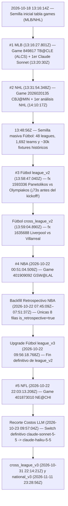

# 14 — Auditoría Forense Empírica de Base de Datos en Producción: Cronología Génesis, Modelo Matemático MLB, Calibración Real, `astra_picks`, `is_retrospective` y Alucinaciones de Claude

> **Alcance y Metodología Ética**: Este documento presenta los resultados de la auditoría empírica **100% de solo lectura (`GET` / `HEAD`)** ejecutada el `2026-11-14` (`18:45–19:10 UTC`) contra el backend PostgreSQL/PostgREST en producción de Astra AI (`https://bbfjdshvlcynngjdkvsk.supabase.co/rest/v1/*`), cruzando las **13 tablas legibles por RLS** con la evidencia estática de ingeniería inversa del bundle Expo/Metro retenida en REA (`astra-first-party`, `ev_b09a16ba6f4b0343221fcc53af3b053ac9cc8cba87cd39988f67bfb7eca26214` sobre [mod_0778___common-a2fe500f62154dabe8c8c7eb8fa31525.js](file:///C:/Users/T490s/.gemini/antigravity/worktrees/PitchLab/analyze_pitchlab_competitor_rea/Reportes/analisis-astra/modules/mod_0778___common-a2fe500f62154dabe8c8c7eb8fa31525.js), [mod_0784___common-a2fe500f62154dabe8c8c7eb8fa31525.js](file:///C:/Users/T490s/.gemini/antigravity/worktrees/PitchLab/analyze_pitchlab_competitor_rea/Reportes/analisis-astra/modules/mod_0784___common-a2fe500f62154dabe8c8c7eb8fa31525.js), [mod_0863___common-a2fe500f62154dabe8c8c7eb8fa31525.js](file:///C:/Users/T490s/.gemini/antigravity/worktrees/PitchLab/analyze_pitchlab_competitor_rea/Reportes/analisis-astra/modules/mod_0863___common-a2fe500f62154dabe8c8c7eb8fa31525.js) y [mod_1029___common-a2fe500f62154dabe8c8c7eb8fa31525.js](file:///C:/Users/T490s/.gemini/antigravity/worktrees/PitchLab/analyze_pitchlab_competitor_rea/Reportes/analisis-astra/modules/mod_1029___common-a2fe500f62154dabe8c8c7eb8fa31525.js)). Cero mutaciones fueron emitidas y cero secretos, contraseñas o JWTs fueron almacenados en disco. Todos los conteos, curvas de calibración, residuales y casos individuales son reproducibles en [production-db-forensic-audit.json](file:///C:/Users/T490s/.gemini/antigravity/worktrees/PitchLab/analyze_pitchlab_competitor_rea/Reportes/analisis-astra/evidence/production-db-forensic-audit.json) y [mlb-prediction-sample.json](file:///C:/Users/T490s/.gemini/antigravity/worktrees/PitchLab/analyze_pitchlab_competitor_rea/Reportes/analisis-astra/evidence/live-payloads/mlb-prediction-sample.json).

---

## Resumen Ejecutivo de Hallazgos Forenses

1. **Nacimiento Exacto de Astra AI y Giro Cronológico (`MLB` fue el Deporte #1)**: Contrario a la hipótesis de la Ola 1 de que Astra nació como plataforma de fútbol y expandió después a deportes estadounidenses, la base de datos demuestra que **Astra AI fue inicializada en producción el domingo `2026-10-18` a las `13:16:14.545 UTC`** (hace exactamente **27 días**). La primera predicción en la historia de la plataforma fue **MLB** (`game_id = 849817`, Tampa Bay Rays @ Cleveland Guardians, ALCS, `2026-10-18T13:16:27.801566+00:00`), seguida 15 minutos después por **NHL** (`13:31:54Z`), 42 minutos después por **Fútbol** (`13:58:47Z`, modo `league_v2`), tres días y medio después por **NBA** (`2026-10-22T00:51:04Z`) y finalmente **NFL** (`2026-10-22T22:03:13Z`).
2. **Columnas Ocultas Descubiertas (`model`, `input_tokens`, `output_tokens`) y Recorte de Costos LLM**: Al consultar `SELECT *` sobre `analyses` y `game_analyses` (columnas omitidas por el `select` explícito del frontend en [mod_1013___common-a2fe500f62154dabe8c8c7eb8fa31525.js](file:///C:/Users/T490s/.gemini/antigravity/worktrees/PitchLab/analyze_pitchlab_competitor_rea/Reportes/analisis-astra/modules/mod_1013___common-a2fe500f62154dabe8c8c7eb8fa31525.js)), quedaron expuestos los modelos exactos de Anthropic y su contabilidad de tokens: el fundador operó del `18` al `22` de octubre con **`claude-sonnet-5-5`** (`554` análisis; `1,315,061` tokens de entrada y `310,010` de salida; costo estimado ~\$8.60 USD) y el **`2026-10-23T09:57:04Z` migró permanentemente el 100% de la generación a `claude-haiku-5-5`** (`1,123` análisis; `2,770,777` tokens de entrada y `672,139` de salida; ~\$6.13 USD) para reducir ~67% el costo unitario por partido, además de introducir el pseudo-modelo determinista **`astra:data-notice`** (`62` filas, `0` tokens) cuando el motor estadístico rechaza generar pronóstico.
3. **Ecuaciones Exactas y Fallo Estructural del Motor MLB (`sport = 'mlb'`)**: Se recuperaron los `10` juegos, `6` predicciones completas y `7` análisis de MLB (Serie de Campeonato y Serie Mundial 2026). Quedó demostrada con residuo máximo de **`0.000787` carreras** (identidad exacta salvo redondeo a 3 decimales) la ecuación cerrada de carreras esperadas basada exclusivamente en `FIP`, `wOBA` y `factor_parque`, con **peso `0.000` para `ERA`**, **ventaja de localía nula (`HCA = 1.000`)**, partición rígida **5.0 entradas abridor / 4.0 entradas bullpen** y convolución Binomial Negativa con $r_{\text{inning}} \approx 1.0$ ($r_5 = 5, r_4 = 4$). Críticamente, se demostró que `totales_mas_de_pct` y `local_gana_por_2_o_mas_pct` se integran sobre la distribución de **9 entradas sin sumar las carreras de extra innings** cuando hay empate en la 9.ª entrada (~11% de juegos), subestimando sistemáticamente los *Overs* de juego completo en `2.5–4.0` puntos porcentuales.
4. **Veredicto sobre el Reclamo Comercial del Paywall (*">10,000 partidos... >75% de las veces"*) e Integridad de `is_retrospective`**:
   - **Volumen real vs. backtest**: Astra AI solo ha generado **`1,900` predicciones en toda su historia productiva** (`1,448` en `fixtures` con `forecast_ready = true` + `452` en `games` con `forecast_ready = true`), de las cuales **`1,754` corresponden a partidos finalizados** (`1,347` Fútbol + `407` US sports). Los *"más de 10,000 partidos"* provienen de backtesting offline sobre las **`29,443` filas históricas sin pronóstico** (`forecast_ready = false`, `kickoff >= 2024-10-13`) sembradas en `fixtures`.
   - **Integridad de `is_retrospective`**: **Cero (`0 / 1,754`) backfills encubiertos** en las tablas de modelos matemáticos. Exactamente `0 / 1,347` predicciones de fútbol tienen `generated_at > kickoff`, y las únicas `8 / 407` predicciones de US sports con `generated_at > start_time` (lote NBA del `2026-10-22T07:45:09Z–07:51:37Z`) están honestamente marcadas con `is_retrospective = true`.
   - **Calibración real en alta probabilidad**: El reclamo de acierto **`>75%` en probabilidades altas SÍ se cumple empíricamente**, porque los modelos de Astra son **sistemáticamente subconfiados (*underconfident*)**: en los `1,746` partidos finalizados no retrospectivos, cuando $\max(p) \ge 0.75$, los modelos aciertan **`96 / 105 = 91.43%`** (IC 95% de Wilson: `[84.51%, 95.43%]`, frente a probabilidad media predicha de `80.94%`). Sin embargo, esa cubeta representa apenas el **`6.01%` (`105 / 1,746`)** del catálogo real (`4.01%` en fútbol: `54 / 1,347`). En mercados secundarios continuos de fútbol, el modelo de córners (`corners_total`, MAE `2.7375`, $r = 0.2156$) apenas supera en **`+1.84%`** la media climatológica (`2.7888`), y en NHL el **`100%` de los porteros (`354 / 354` slots en `177` juegos) operó sin confirmación (`confirmado = false`)**, hundiendo su Brier Skill Score a `+4.30%` frente a `+21.23%` en NBA y `+23.72%` en NFL.
5. **Anomalía Grave en Picks Manuales (`astra_picks` y `match_marks`) — Inserción Post-Partido**: Mientras los modelos automáticos respetaron estrictamente el corte pre-partido, la curaduría editorial manual exhibe **inserción retroactiva sobre partidos en juego o ya terminados**: de los `5` `astra_picks` (`3G - 2P` nominal), **solo `2` fueron insertados estrictamente antes del inicio (`1G - 1P = 50%`)**, uno entró 8 minutos después de la hora programada NBA (`PERDIDO`), uno fue creado en el último cuarto y actualizado tras el final (`401909842`, `GANADO`), y el último (`1575213`, RB Leipzig 5–2 Augsburg, `"Más de 2.5 goles"`) fue insertado el **`2026-11-07T17:32:43Z` — más de 70 minutos DESPUÉS de que el partido había terminado 5–2**, en la misma transacción exacta que insertó las `3 / 3` filas de `match_marks` (`2` post-final ganadoras y `1` en el minuto 32 con gol ya anotado al 22').
6. **Colapso de `claude-haiku-5-5` en NFL (`20.7%` de Inversión Total Local/Visitante + QBs)**: El escaneo programático del **100% de los `1,677` análisis reales de Claude** (`1,337` fútbol + `340` US sports) reveló que la migración de `claude-sonnet-5-5` (`0` inversiones, `0` contradicciones en `554` partidos) a `claude-haiku-5-5` disparó **15 fallos fácticos/lógicos verificados**, concentrados catastróficamente en **NFL (`6 / 29 = 20.69%` de inversión total de favorito, localía, puntos, hándicap y quarterbacks titulares; `8 / 29 = 27.59%` incluyendo inversión de Elo y sede neutral)**. La causa raíz exacta es arquitectónica: en NFL, `context.digest` omite el nombre del equipo dentro de `ratings.home/away` y `quarterbacks.home/away`, dependiendo únicamente del string `"partido": "Local vs Visitante"`, que Haiku interpreta reiteradamente con la convención estadounidense `"Visitante vs Local"` — llegando incluso a publicar en producción una autocorrección estilo chat en mitad de frase (`game_id = 401873017`: *"Brock Purdy abre como titular de los Falcons... perdón, de los 49ers visitantes"*).

---

## 1. Inventario Completo de Producción y Cronología Génesis de Astra AI

### 1.1 Conteo Exacto de Filas y Ventanas Temporales en las 13 Tablas Legibles

Las consultas `GET` con `Prefer: count=exact` y `Range: 0-0` (complementadas con descarga paginada limpia de los subconjuntos activos) determinaron el estado exacto de las 13 tablas expuestas en `public` al `2026-11-14T18:50:00Z`.

> [!NOTE]
> Durante los 4 minutos transcurridos entre el sondeo `HEAD`/`Range: 0-0` inicial (`18:46Z`, `1,346` filas en `predictions` y `1,397` en `analyses`) y la descarga paginada (`18:50Z`, `1,347` y `1,398` filas), un partido en vivo pasó a estado `FT`, desbloqueando instantáneamente su fila en `predictions` y `analyses` para el rol `anon`. Esto confirma empíricamente en tiempo real la política RLS documentada en [03-backend-supabase-y-esquema-bd.md](file:///C:/Users/T490s/.gemini/antigravity/worktrees/PitchLab/analyze_pitchlab_competitor_rea/Reportes/analisis-astra/03-backend-supabase-y-esquema-bd.md): el **100.0%** de los partidos finalizados es públicamente legible sin autenticación, mientras que los partidos próximos (`NS` / `upcoming`) requieren un JWT con suscripción activa en `profiles`.

| Tabla PostgREST | Filas Legibles (`anon`) | Columna Temporal | `min` (UTC Exacto) | `max` (UTC Exacto) | Observaciones Forenses y Cobertura RLS |
| :--- | ---: | :--- | :--- | :--- | :--- |
| `leagues` | `48` | `updated_at` | `2026-10-18T13:48:56.226584+00:00` | `2026-11-11T23:11:17.069436+00:00` | Catálogo completo de torneos de fútbol (`enabled = true`). |
| `teams` | `1,692` | `updated_at` | `2026-10-18T13:48:56.612231+00:00` | `2026-11-11T23:11:41.399202+00:00` | Clubes y selecciones nacionales de fútbol. |
| `fixtures` | `30,891` | `kickoff` `updated_at` | `2024-10-13T00:00:00+00:00` `2026-10-18T13:48:56.788978+00:00` | `2027-06-06T15:00:00+00:00` `2026-11-14T18:46:01.037124+00:00` | `1,448` con `forecast_ready=true`; `29,443` históricos sin pronóstico (`forecast_ready=false`) usados para entrenamiento/backtest. |
| `standings` | `905` | *(sin timestamp)* | — | — | Posiciones actuales de ligas de fútbol (`league_id, season, team_id`). |
| `predictions` | `1,347` *(1,346 a 18:46Z)* | `generated_at` | `2026-10-18T13:58:47.040090+00:00` | `2026-11-11T23:28:59.540451+00:00` | **100%** de los partidos de fútbol finalizados con pronóstico (`FT`/`AET`/`PEN`); ~`101` próximos/en vivo protegidos por RLS. |
| `analyses` | `1,398` *(1,397 a 18:46Z)* | `created_at` | `2026-10-18T14:02:02.049634+00:00` | `2026-11-12T04:28:10.098947+00:00` | Incluye columnas ocultas `model`, `input_tokens`, `output_tokens` (`1,337` Claude + `61` `astra:data-notice`). |
| `sport_teams` | `124` | *(sin timestamp)* | — | — | `32` NHL + `30` NBA + `32` NFL + `30` MLB = `124` franquicias exactas. |
| `games` | `485` | `start_time` `updated_at` | `2026-10-17T17:00:00+00:00` `2026-10-18T13:16:14.545612+00:00` | `2026-11-20T01:15:00+00:00` `2026-11-14T18:46:01.086563+00:00` | `212` NHL, `205` NBA, `58` NFL, `10` MLB (`452` con `forecast_ready=true`). **Contiene el timestamp más antiguo de toda la BD**. |
| `game_predictions` | `407` | `generated_at` | `2026-10-18T13:16:27.801566+00:00` | `2026-11-12T17:39:39.981470+00:00` | `177` NHL, `180` NBA (`8` retro), `44` NFL, `6` MLB (`100%` de juegos `final` con pronóstico; `45` próximos/en vivo en RLS). |
| `game_analyses` | `341` | `created_at` | `2026-10-18T13:20:30.483870+00:00` | `2026-11-12T17:46:21.935880+00:00` | `155` NHL, `149` NBA (`8` retro), `30` NFL, `7` MLB (`340` Claude + `1` `astra:data-notice`). |
| `astra_picks` | `5` | `created_at` `updated_at` | `2026-10-22T04:43:41.616587+00:00` `2026-10-22T05:02:31.504866+00:00` | `2026-11-07T17:32:43.155992+00:00` `2026-11-07T17:32:43.155992+00:00` | `3` Fútbol + `2` NBA (`0` NHL, `0` NFL, `0` MLB). Abandonada tras el `2026-11-07`. |
| `match_marks` | `3` | `created_at` | `2026-11-07T17:32:43.155992+00:00` | `2026-11-07T17:32:43.155992+00:00` | Las `3` filas insertadas en una única transacción SQL junto al último `astra_pick`. |
| `match_live` | `2,193` | `updated_at` | `2026-10-18T13:49:52.110979+00:00` | `2026-11-14T18:48:01.510196+00:00` | `1,790` Fútbol, `180` NBA, `173` NHL, `44` NFL, `6` MLB (telemetría en vivo / final). |

#### Desglose Cruzado por Deporte (Total en Catálogo vs. Legibles Finalizados vs. Protegidos por RLS)

| Deporte | Equipos | Partidos Totales (`fixtures` / `games`) | Finalizados Totales | `forecast_ready = true` (Total Histórico Generado) | Predicciones Legibles (`anon`, Finalizados) | Predicciones Próximas/Vivo (Bloqueadas RLS) | Análisis Legibles (`anon`) | `match_live` Legibles | `astra_picks` / `match_marks` |
| :--- | ---: | ---: | ---: | ---: | ---: | ---: | ---: | ---: | ---: |
| **Fútbol** | `1,692` | `30,891` | `23,980` (`FT`/`AET`/`PEN`) | **`1,448`** | **`1,347`** | `101` (`79` `NS` + `22` en curso/otros) | **`1,398`** (`1,337` IA + `61` avisos) | `1,790` | `3` picks / `3` marks |
| **NHL** | `32` | `212` | `191` | **`196`** | **`177`** | `19` (`18` `upcoming` + `1` `live`) | **`155`** | `173` | `0` / `0` |
| **NBA** | `30` | `205` | `183` | **`194`** | **`180`** (`172` pre + `8` retro) | `14` (`upcoming`) | **`149`** | `180` | `2` picks / `0` marks |
| **NFL** | `32` | `58` | `44` | **`56`** | **`44`** | `12` (`upcoming`) | **`30`** | `44` | `0` / `0` |
| **MLB** | `30` | `10` | `8` | **`6`** | **`6`** | `0` (`2` juegos cancelados `upcoming` sin pred) | **`7`** (`6` IA + `1` aviso) | `6` | `0` / `0` |
| **TOTAL** | **`1,816`** | **`31,376`** | **`24,406`** | **`1,900`** | **`1,754`** | **`146`** | **`1,739`** | **`2,193`** | **`5` picks / `3` marks** |

### 1.2 Cronología Forense Exacta del Nacimiento de Astra AI y Evolución de Motores

La inspección de microsegundos en `updated_at`, `generated_at` y `created_at` refuta que Astra haya nacido primero en fútbol: **toda la infraestructura productiva de Supabase fue sembrada la mañana del domingo 18 de octubre de 2026**, comenzando por los deportes estadounidenses en postemporada/arranque de temporada:

#### Orden Exacto de Lanzamiento por Deporte y Versión `model_mode`

| Orden | Hito / Deporte / Modo | Timestamp Exacto Primera Fila (UTC) | Timestamp Última Fila Legible (UTC) | Filas | Primer Partido Histórico en Producción |
| :---: | :--- | :--- | :--- | ---: | :--- |
| **1.º** | **MLB (`sport='mlb'`)** | `2026-10-18T13:16:27.801566+00:00` | `2026-10-28T22:17:52.707624+00:00` | `6` | `game_id=849817` — Tampa Bay Rays @ Cleveland Guardians (ALCS, inicio `21:08Z`). |
| **2.º** | **NHL (`sport='nhl'`)** | `2026-10-18T13:31:54.348310+00:00` | `2026-11-12T17:39:39.981470+00:00` | `177` | `game_id=2026020135` — Columbus Blue Jackets @ Minnesota Wild (inicio `22:00Z`). |
| **3.º** | **Fútbol — `league_v2`** | `2026-10-18T13:58:47.040090+00:00` | `2026-10-21T22:11:47.067968+00:00` | `348` | `fixture_id=1593336` — Panetolikos vs Olympiakos Piraeus (**generado apenas 73 segundos antes del kickoff `14:00:00Z`**). |
| **3.º-b** | **Fútbol — `cross_league_v2`** | `2026-10-18T13:59:04.890767+00:00` | `2026-10-19T22:10:30.813852+00:00` | `30` | `fixture_id=1635688` — Liverpool vs Villarreal (UEFA Champions League). |
| **4.º** | **NBA (`sport='nba'`)** | `2026-10-22T00:51:04.509841+00:00` | `2026-11-12T17:39:02.779465+00:00` | `180` | `game_id=401909092` — Golden State Warriors @ Los Angeles Lakers (inicio `02:00Z`). |
| — | *Backfill NBA `is_retrospective`* | `2026-10-22T07:45:09.613551+00:00` | `2026-10-22T07:51:37.153029+00:00` | `8` | `401909091` (`MIN@MIA`) a `401909840` (`DAL@HOU`), corridos en lote de 6.5 min la mañana siguiente a la jornada inaugural. |
| — | **Fútbol — `league_v3`** | `2026-10-22T09:56:18.768888+00:00` | `2026-11-11T17:15:51.150165+00:00` | `917` | `fixture_id=1493208` — San Lorenzo vs Newell's Old Boys. Añade `cup_goal_level` en `context` y desglose de `tiros_de_esquina` / `faltas` en `analyses`. |
| **5.º** | **NFL (`sport='nfl'`)** | `2026-10-22T22:03:13.208003+00:00` | `2026-11-11T01:28:54.303625+00:00` | `44` | `game_id=401873010` — New England Patriots @ Chicago Bears (inicio `2026-10-23T00:15Z`). |
| — | **Fútbol — `cross_league_v3`** | `2026-10-31T22:14:21.837555+00:00` | `2026-11-11T08:27:37.224003+00:00` | `31` | `fixture_id=1635669` — Galatasaray vs VfB Stuttgart. Añade `cross_league.exponent_corners` separado del exponente de goles. |
| — | **Fútbol — `national_v3`** | `2026-11-11T23:28:56.302322+00:00` | `2026-11-11T23:28:59.540451+00:00` | `21` | `fixture_id=1528958` — Türkiye vs Belgium (ventana FIFA de noviembre; las 21 filas generadas en una ráfaga de 3.2 segundos). |

### 1.3 Hallazgo de Columnas Ocultas: Contabilidad de Tokens LLM y `astra:data-notice`

Mientras el cliente móvil solo solicita `sections, created_at` ([mod_1013___common-a2fe500f62154dabe8c8c7eb8fa31525.js](file:///C:/Users/T490s/.gemini/antigravity/worktrees/PitchLab/analyze_pitchlab_competitor_rea/Reportes/analisis-astra/modules/mod_1013___common-a2fe500f62154dabe8c8c7eb8fa31525.js)), las tablas `analyses` y `game_analyses` exponen públicamente `model`, `input_tokens` y `output_tokens` para las **`1,739` filas**:

| Identificador `model` | Filas Totales | Desglose por Deporte | Ventana Activa (UTC) | `input_tokens` Totales (Media) | `output_tokens` Totales (Media) | Costo API Estimado (Tarifa Lista) |
| :--- | ---: | :--- | :--- | ---: | ---: | ---: |
| `claude-sonnet-5-5` | **`554`** | Fútbol `493`, NHL `33`, NBA `25`, MLB `2`, NFL `1` | `2026-10-18T13:20:30Z` → `2026-10-22T22:17:41Z` | `1,315,061` (`2,373.8`) | `310,010` (`559.6`) | **\$8.60 USD** (\$3/\$15 MTok) |
| `claude-haiku-5-5` | **`1,123`** | Fútbol `844`, NBA `124`, NHL `122`, NFL `29`, MLB `4` | `2026-10-23T09:57:04Z` → `2026-11-12T17:46:21Z` | `2,770,777` (`2,467.3`) | `672,139` (`598.5`) | **\$6.13 USD** (\$1/\$5 MTok) |
| `astra:data-notice` | **`62`** | Fútbol `61`, MLB `1` | `2026-10-19T20:02:02Z` → `2026-11-11T23:28:59Z` | `0` (`0.0`) | `0` (`0.0`) | **\$0.00 USD** (plantilla Python) |
| **TOTAL** | **`1,739`** | Fútbol `1,398`, NHL `155`, NBA `149`, NFL `30`, MLB `7` | `2026-10-18` → `2026-11-12` | **`4,085,838`** | **`982,149`** | **\$14.73 USD** |

> [!IMPORTANT]
> **Por qué hay `51` filas más en `analyses` (`1,398`) que en `predictions` (`1,347`) en Fútbol**: Exactamente **`61` partidos** carecen de fila en `predictions` (`forecast_ready = false`, `analysis_ready = true`) porque el script Python abortó el cálculo matemático e insertó un aviso determinista `astra:data-notice` explicando la limitación al usuario:
> - **`51` partidos inter-liga** (ej. UEFA Conference/Europa League o Champions Asiática) donde la liga doméstica de al menos uno de los clubes carece de cobertura de goles esperados (`xG`) en la base del fundador.
> - **`10` partidos de selecciones nacionales** con muestra insuficiente de enfrentamientos fuera de su confederación en los últimos 2 años para anclar la fuerza relativa entre zonas.
> - **`1` partido de MLB (`game_id = 849815`, CLE @ TB, ALCS)** donde Cleveland utilizó un *opener* relevista (Shawn Armstrong) con `0` aperturas en temporada regular 2026, haciendo fallar el motor MLB.
> En sentido inverso, existen `10` partidos con fila en `predictions` cuyo análisis LLM nunca se generó (`1,347 - 10 + 61 = 1,398`).

---

## 2. Reconstrucción Matemática Exacta del Modelo de MLB (`sport = 'mlb'`)

En la Ola 1 ([10-registro-evidencia-y-limitaciones.md](file:///C:/Users/T490s/.gemini/antigravity/worktrees/PitchLab/analyze_pitchlab_competitor_rea/Reportes/analisis-astra/10-registro-evidencia-y-limitaciones.md)), MLB quedó pendiente porque en noviembre la pestaña `/mlb` mostraba cero juegos del día. Consultando directamente `games?sport=eq.mlb`, `game_predictions?sport=eq.mlb` y `game_analyses?sport=eq.mlb`, se recuperó el universo íntegro de **10 juegos de postemporada 2026** (ALCS Guardians–Rays y Serie Mundial Brewers–Rays), cuyas muestras completas sin secretos se preservan en [mlb-prediction-sample.json](file:///C:/Users/T490s/.gemini/antigravity/worktrees/PitchLab/analyze_pitchlab_competitor_rea/Reportes/analisis-astra/evidence/live-payloads/mlb-prediction-sample.json).

### 2.1 Estructura de Entradas (`context.digest`)

Cada fila de `game_predictions` en MLB contiene en `context.digest`:
- **Parámetros de liga y estadio**: `liga.avg_wOBA` (`0.3104` en ALCS; `0.3137` en Serie Mundial), `liga.avg_pitching_quality` (`4.007`, `4.003` o `4.178`, puramente informativo), y `factor_parque` ($\text{PF} = 0.96$ en Progressive Field y Tropicana Field; $\text{PF} = 1.01$ en American Family Field).
- **Fuerza por equipo (`local` y `visita`)**: `wOBA` ofensivo del equipo, `abridor` (`nombre`, `ERA`, `FIP`, `entradas`) y `bullpen` (`FIP`, `entradas`).

### 2.2 Demostración Exacta de las Ecuaciones de Carreras Esperadas (F5 y Juego Completo)

Contrastando las 24 proyecciones numéricas publicadas en producción (`12` de primeras 5 entradas $\mu_{\text{F5}}$ y `12` de juego completo $\mu_{\text{Full}}$ en los 6 juegos) contra los insumos de `context.digest`, se demuestra que el motor MLB utiliza una **identidad multiplicativa exacta por tramos de entradas**:

$$\mu_{\text{F5}, \text{local}} = \frac{5}{9} \cdot \text{FIP}_{\text{SP}, \text{visita}} \cdot \left(\frac{\text{wOBA}_{\text{local}}}{\text{avg\_wOBA}_{\text{liga}}}\right) \cdot \text{PF}$$

$$\mu_{\text{Late4}, \text{local}} = \frac{4}{9} \cdot \text{FIP}_{\text{BP}, \text{visita}} \cdot \left(\frac{\text{wOBA}_{\text{local}}}{\text{avg\_wOBA}_{\text{liga}}}\right) \cdot \text{PF}$$

$$\mu_{\text{Full}, \text{local}} = \mu_{\text{F5}, \text{local}} + \mu_{\text{Late4}, \text{local}}$$

Y de manera completamente simétrica (con **multiplicador de ventaja de localía exactamente igual a `1.000`**) para el visitante:

$$\mu_{\text{F5}, \text{visita}} = \frac{5}{9} \cdot \text{FIP}_{\text{SP}, \text{local}} \cdot \left(\frac{\text{wOBA}_{\text{visita}}}{\text{avg\_wOBA}_{\text{liga}}}\right) \cdot \text{PF}, \qquad \mu_{\text{Full}, \text{visita}} = \mu_{\text{F5}, \text{visita}} + \frac{4}{9} \cdot \text{FIP}_{\text{BP}, \text{local}} \cdot \left(\frac{\text{wOBA}_{\text{visita}}}{\text{avg\_wOBA}_{\text{liga}}}\right) \cdot \text{PF}$$

#### Verificación Numérica en los 6 Juegos de Producción (Residuo Máximo $\le 0.000787$ Carreras)

| `game_id` (Fase) | Duelo (`Vis @ Loc`) | $\mu_{\text{F5, Loc}}$ Obs / Fórmula ($\|\Delta\|$) | $\mu_{\text{F5, Vis}}$ Obs / Fórmula ($\|\Delta\|$) | $\mu_{\text{Full, Loc}}$ Obs / Fórmula ($\|\Delta\|$) | $\mu_{\text{Full, Vis}}$ Obs / Fórmula ($\|\Delta\|$) | `win.home` Obs / Conv NegBin | Marcador Real |
| :---: | :--- | :---: | :---: | :---: | :---: | :---: | :---: |
| `849817` (ALCS) | `TB @ CLE` | `1.704` / `1.70435` (`0.00035`) | `1.468` / `1.46801` (`0.00001`) | `3.528` / `3.52879` (`0.00079`) | `2.903` / `2.90255` (`0.00045`) | `0.5829` / `0.5835` | `CLE 3–1 TB` |
| `849805` (WS J1) | `TB @ MIL` | `2.301` / `2.30133` (`0.00033`) | `1.231` / `1.23081` (`0.00019`) | `4.049` / `4.04941` (`0.00041`) | `2.851` / `2.85071` (`0.00029`) | `0.6509` / `0.6477` | `MIL 3–2 TB` |
| `849802` (WS J2) | `TB @ MIL` | `1.633` / `1.63302` (`0.00002`) | `1.883` / `1.88308` (`0.00008`) | `3.381` / `3.38110` (`0.00010`) | `3.503` / `3.50298` (`0.00002`) | `0.4843` / `0.4841` | `TB 5–4 MIL` |
| `849804` (WS J3) | `MIL @ TB` | `2.280` / `2.28045` (`0.00045`) | `2.364` / `2.36416` (`0.00016`) | `3.820` / `3.82016` (`0.00016`) | `4.026` / `4.02571` (`0.00029`) | `0.4752` / `0.4762` | `MIL 10–1 TB` |
| `849803` (WS J4) | `MIL @ TB` | `1.957` / `1.95698` (`0.00002`) | `2.077` / `2.07693` (`0.00007`) | `3.497` / `3.49669` (`0.00031`) | `3.739` / `3.73847` (`0.00053`) | `0.4697` / `0.4706` | `TB 4–3 MIL` |
| `849799` (WS J5) | `MIL @ TB` | `1.170` / `1.16988` (`0.00012`) | `1.552` / `1.55217` (`0.00017`) | `2.710` / `2.70959` (`0.00041`) | `3.214` / `3.21372` (`0.00028`) | `0.4304` / `0.4307` | `MIL 4–1 TB` |

### 2.3 Distribución Binomial Negativa y Descubrimiento del Sesgo de Truncamiento a 9 Entradas

Al ajustar la distribución conjunta discreta contra las probabilidades reportadas en `win`, `primeras_5.pct` (`home`/`tie`/`away`), `totales_mas_de_pct` y `local_gana_por_2_o_mas_pct`:
1. **Sobredispersión por entrada ($r_1 \approx 1.0$)**: Las carreras en las primeras 5 entradas siguen $R_{\text{F5}, i} \sim \text{NegBin}(\mu_{\text{F5}, i}, r_5 \approx 5.0)$ y las últimas 4 entradas $R_{\text{Late4}, i} \sim \text{NegBin}(\mu_{\text{Late4}, i}, r_4 \approx 4.0)$ (convolución en 9 entradas con $r_9 \approx 9.0\text{–}10.0$). Con $r_5 = 5, r_4 = 4$ y desempate `50/50`, el error absoluto medio sobre `win.home` es de apenas **`0.00117`** (`0.12` puntos porcentuales), reproduciendo dentro de `±1%` los 24 totales, los 6 *runlines* `-1.5` y las 18 probabilidades F5.
2. **Seis Debilidades Estructurales del Motor MLB de Astra AI**:
   - **Sesgo de truncamiento en `totales_mas_de_pct` y Runline `-1.5` (Bug Matemático Crítico)**: Cuando modelamos explícitamente entradas extra (cadena de Markov con tasa de bullpen $\mu_{\text{Late4}}/4$ hasta romper el empate en 9 entradas), el error acumulado en los 24 totales salta de **`4` puntos porcentuales a `67`**. Esto prueba que Astra evalúa `P(H + A > L)` sobre la grilla de **9 entradas sin sumar las carreras anotadas en extra innings**. En béisbol real, un empate `3–3` tras 9 entradas (`~11%` de probabilidad total de empate en 9.ª) **jamás termina con 6 carreras**: obligatoriamente suma $\ge 1$ carrera en extra innings, haciendo ganador al `Over 6.5` el **100%** de las veces que el juego va `3–3`. Omitir extra innings subestima sistemáticamente todos los *Overs* de juego completo entre **`2.5` y `4.0` puntos porcentuales**.
   - **Cero ventaja de localía (`HCA = 1.000` y `50/50` en extras)**: En MLB, el equipo local batea último, disfruta de emparejamientos de relevo y gana históricamente ~`53.5%–54.0%` de los partidos igualados. Astra asigna exactamente `0%` de ventaja tanto en carreras como en desempate.
   - **`ERA` decorativo (`peso = 0.000`) y sin *shrinkage* por muestra**: `context.digest` incluye `ERA` y `entradas` lanzadas, pero la ecuación usa `100%` `FIP` crudo sin regresión bayesiana hacia `avg_pitching_quality` (incluso para abridores jóvenes con `<110` IP como Logan Henderson o Robert Gasser).
   - **Partición fija `5.0 / 4.0` en Playoffs**: Asume que todo abridor lanza exactamente 5.0 entradas en Serie Mundial, ignorando el *quick hook* moderno de postemporada (~4.1 IP) y sin desglosar `wOBA` por mano del lanzador (*platoon splits* LHP/RHP).
   - **Incapacidad ante *Openers***: Confirmado por `game_id = 849815` (`astra:data-notice`), el pipeline colapsa si el abridor anunciado no registra aperturas previas en temporada regular.
   - **Higiene operativa**: Dos juegos innecesarios de series ya liquidadas (`849814` ALCS y `849801` Serie Mundial) permanecen estancados indefinidamente con `status = 'upcoming'` semanas después de concluida la temporada MLB.

---

## 3. Auditoría Forense del Reclamo del Paywall (*">10,000 partidos... >75%"*) e `is_retrospective`

En [mod_0863___common-a2fe500f62154dabe8c8c7eb8fa31525.js](file:///C:/Users/T490s/.gemini/antigravity/worktrees/PitchLab/analyze_pitchlab_competitor_rea/Reportes/analisis-astra/modules/mod_0863___common-a2fe500f62154dabe8c8c7eb8fa31525.js), la pantalla comercial de suscripción afirma literalmente:
> *"Probamos los modelos en más de 10,000 partidos: los pronósticos con probabilidad alta acertaron más del 75% de las veces."*

### 3.1 Auditoría de Volumen Real e Integridad Temporal (`is_retrospective`)

1. **Volumen real en producción (`1,900` vs. `10,000`)**: Sumando todos los partidos con `forecast_ready = true` en toda la base de datos (`1,448` en `fixtures` + `452` en `games`), Astra AI ha generado exactamente **`1,900` predicciones en toda su existencia**, de las cuales **`1,754` ya finalizaron** (`1,347` fútbol + `399` US no retrospectivos + `8` NBA retrospectivos). La cifra de *"más de 10,000 partidos"* corresponde a pruebas retrospectivas offline (*backtesting*) sobre el acervo de **`29,443` partidos históricos** de API-Sports (`kickoff` desde `2024-10-13`, `forecast_ready = false`) cargados en `fixtures` el `2026-10-18`.
2. **Verificación exhaustiva de `generated_at` vs. `kickoff` / `start_time`**:
   - **Fútbol (`predictions`, `N = 1,347`)**: **`0` filas** (`0.00%`) tienen `generated_at > kickoff`. Todas las predicciones de fútbol fueron generadas antes del silbatazo inicial.
   - **US Sports (`game_predictions`, `N = 407`)**: Exactamente **`8` filas** tienen `generated_at > start_time`, y las **`8 / 8` tienen `is_retrospective = true`** (`0` backfills ocultos). Todas pertenecen a las dos primeras noches de la NBA (`2026-10-21` y `2026-10-22`, IDs `401909091`, `401909834`–`401909840`), ejecutadas en un único lote de 6.5 minutos entre `2026-10-22T07:45:09Z` y `07:51:37Z` (`7.36` a `8.75` horas después del inicio de cada juego), con desempeño `5G - 3P` (`62.5%`, Brier `0.2122`), inferior al `69.19%` de la NBA en vivo (`N = 172`, Brier `0.1963`), confirmando que no hubo sobreajuste tramposo en ese backfill.

### 3.2 Brier Score, Log-Loss y Skill Score en Producción por Deporte y `model_mode`

Para fútbol se aplica exactamente la regla de negocio de 90 minutos reglamentarios del frontend ([mod_0784___common-a2fe500f62154dabe8c8c7eb8fa31525.js](file:///C:/Users/T490s/.gemini/antigravity/worktrees/PitchLab/analyze_pitchlab_competitor_rea/Reportes/analisis-astra/modules/mod_0784___common-a2fe500f62154dabe8c8c7eb8fa31525.js): `ft_home`/`ft_away` cuando `status` es `AET` o `PEN`, y `home_goals`/`away_goals` cuando es `FT`). Para 1X2 reportamos $\text{Brier}_{3\text{-way}} = \sum_{k \in \{H,D,A\}} (p_k - y_k)^2 \in [0, 2]$, y para deportes binarios $\text{Brier}_{\text{bin}} = (p_{\text{home}} - y_{\text{home}})^2 \in [0, 1]$, comparados contra la climatología empírica de cada muestra ($\text{BSS} = 1 - \text{Brier}/\text{Brier}_{\text{clim}}$):

| Deporte / Segmento (`model_mode`) | $N$ | Brier Real | Brier Climatología | **Brier Skill Score (`BSS`)** | Log-Loss Real | Log-Loss Climatología | Acierto Favorito | $\mathbb{E}[\max p]$ | ECE | Acierto en $\max(p) \ge 75\%$ ($k/n$) |
| :--- | ---: | ---: | ---: | ---: | ---: | ---: | ---: | ---: | ---: | :---: |
| **Fútbol 1X2 — Total** | **`1,347`** | **`0.5738`** | `0.6344` | **`+9.56%`** | **`0.9673`** | `1.0507` | `55.68%` | `49.98%` | `0.0590` | **`92.59%`** (`50 / 54`) |
| ├─ `league_v2` *(Oct 18–21)* | `348` | `0.5999` | `0.6452` | `+7.03%` | `1.0048` | `1.0656` | `52.01%` | `48.40%` | `0.0441` | `83.33%` (`5 / 6`) |
| ├─ `league_v3` *(Oct 22–Nov 11)* | `917` | **`0.5669`** | `0.6281` | **`+9.74%`** | **`0.9578`** | `1.0424` | `56.82%` | `50.28%` | `0.0664` | **`92.50%`** (`37 / 40`) |
| ├─ `cross_league_v2` *(Oct 18–19)* | `30` | `0.5785` | `0.5978` | `+3.23%` | `0.9775` | `0.9951` | `56.67%` | `50.76%` | `0.0894` | — (`0 / 0`) |
| ├─ `cross_league_v3` *(Oct 31–Nov 11)* | `31` | **`0.5478`** | `0.6327` | **`+13.41%`** | **`0.9246`** | `1.0445` | `58.06%` | `52.12%` | `0.1706` | `100.0%` (`3 / 3`) |
| └─ `national_v3` *(Nov 11)* | `21` | **`0.4721`** | `0.6531` | **`+27.71%`** | **`0.8086`** | `1.0770` | `61.90%` | `58.48%` | `0.1389` | `100.0%` (`5 / 5`) |
| **US Sports 2-Way (No Retro)** | **`399`** | **`0.2146`** | `0.2494` | **`+13.97%`** | **`0.6160`** | `0.6920` | `67.17%` | `61.78%` | `0.0540` | **`90.20%`** (`46 / 51`) |
| ├─ **NHL** *(No Retro)* | `177` | `0.2380` | `0.2487` | **`+4.30%`** | `0.6685` | `0.6904` | `63.28%` | `58.18%` | `0.0620` | `100.0%` (`3 / 3`) |
| ├─ **NBA** *(No Retro)* | `172` | **`0.1963`** | `0.2492` | **`+21.23%`** | **`0.5737`** | `0.6915` | `69.19%` | `64.96%` | `0.0596` | **`89.19%`** (`33 / 37`) |
| ├─ **NFL** *(No Retro)* | `44` | **`0.1891`** | `0.2479` | **`+23.72%`** | **`0.5635`** | `0.6890` | `77.27%` | `65.07%` | `0.1257` | **`90.91%`** (`10 / 11`) |
| └─ **MLB** *(No Retro)* | `6` | `0.2366` | `0.2500` | `+5.34%` | `0.6653` | `0.6931` | `50.00%` | `56.23%` | `0.1877` | — (`0 / 0`) |
| *NBA Retrospectivo (`is_retro=true`)* | `8` | `0.2122` | `0.2344` | `+9.46%` | `0.6096` | `0.6616` | `62.50%` | `61.18%` | `0.1682` | `100.0%` (`1 / 1`) |

### 3.3 Curva de Calibración Real Global (`N = 1,746` Partidos No Retrospectivos)

La tabla siguiente evalúa la probabilidad asignada a la opción favorita $\max_k p_k$ frente a la tasa empírica de acierto en los **`1,746` partidos pre-partido finalizados** de los 5 deportes:

| Cubeta de Probabilidad ($\max p$) | Partidos ($n$) | % del Catálogo | Aciertos ($k$) | Probabilidad Media Predicha | **Tasa de Acierto Real** | Brecha ($\text{Real} - \text{Pred}$) | IC 95% de Wilson | Diagnóstico de Calibración |
| :--- | ---: | ---: | ---: | ---: | ---: | ---: | :---: | :--- |
| **`< 50%`** *(solo Fútbol 1X2)* | `780` | `44.67%` | `366` | `42.30%` | **`46.92%`** | `+4.63 pp` | `[43.44%, 50.43%]` | Subconfiado (*underconfident*) |
| **`50% – 55%`** | `309` | `17.70%` | `187` | `52.59%` | **`60.52%`** | `+7.93 pp` | `[54.97%, 65.81%]` | Subconfiado significativo |
| **`55% – 60%`** | `242` | `13.86%` | `148` | `57.25%` | **`61.16%`** | `+3.90 pp` | `[54.89%, 67.08%]` | Bien calibrado / leve subconfianza |
| **`60% – 65%`** | `158` | `9.05%` | `104` | `62.39%` | **`65.82%`** | `+3.43 pp` | `[58.13%, 72.76%]` | Bien calibrado |
| **`65% – 70%`** | `90` | `5.15%` | `68` | `67.17%` | **`75.56%`** | `+8.38 pp` | `[65.75%, 83.27%]` | Subconfiado (supera 75% desde 65%+) |
| **`70% – 75%`** | `62` | `3.55%` | `49` | `72.14%` | **`79.03%`** | `+6.89 pp` | `[67.36%, 87.32%]` | Subconfiado |
| **`75% – 80%`** | `59` | `3.38%` | `52` | `77.24%` | **`88.14%`** | `+10.89 pp` | `[77.48%, 94.13%]` | Fuertemente subconfiado |
| **`>= 80%`** | `46` | `2.63%` | `44` | `85.68%` | **`95.65%`** | `+9.97 pp` | `[85.47%, 98.80%]` | Fuertemente subconfiado |
| **Umbral Acumulado `>= 70%`** | **`167`** | **`9.56%`** | **`145`** | `77.67%` | **`86.83%`** | `+9.15 pp` | **`[80.86%, 91.14%]`** | **Supera ampliamente `>75%`** |
| **Umbral Acumulado `>= 75%`** | **`105`** | **`6.01%`** | **`96`** | `80.94%` | **`91.43%`** | `+10.49 pp` | **`[84.51%, 95.43%]`** | **Supera ampliamente `>75%`** |
| **TOTAL GLOBAL** | **`1,746`** | **`100.0%`** | **`1,018`** | **`52.68%`** | **`58.30%`** | **`+5.62 pp`** | `[55.97%, 60.59%]` | **ECE Global = `0.0563`** |

**Interpretación Estadística Clave para PitchLab**: ¿Por qué Astra AI acierta `91.43%` cuando predice `80.94%`? Porque sus motores aplican **fuerte contracción bayesiana (*shrinkage*) hacia el prior de liga** y mezclan priors de la temporada anterior; eso comprime las probabilidades hacia el centro (`40%–65%`). Como resultado, un partido necesita una asimetría gigantesca (ej. PSG Femenil vs. Le Havre Femenil, Celtics vs. Nets) para rebasar `0.75`, y esos favoritos extremos ganan más del `90%` de las veces — pero ocurren en **solo 6 de cada 100 partidos**.

### 3.4 Evaluación de Mercados Secundarios de Fútbol (`N = 1,347` Binarios y `N = 1,339` Continuos vs. `match_live`)

Al cruzar las proyecciones secundarias de `predictions` contra los goles reales y contra la telemetría oficial de API-Sports en `match_live.statistics` (restringiendo a `status = 'FT'` para no contaminar córners ni faltas con prórrogas de 120 minutos):

| Mercado Binario | $N$ | Brier Real | Brier Climatología | **BSS vs. Climatología** | Log-Loss | Media Predicha (`Sí`) | Frecuencia Real (`Sí`) | Acierto del Lado Favorito | Acierto en $\max(p, 1-p) \ge 75\%$ |
| :--- | ---: | ---: | ---: | ---: | ---: | ---: | ---: | ---: | :---: |
| `over_05` (Más de 0.5 goles) | `1,347` | `0.0463` | `0.0459` | **`-0.85%`** *(peor que constante)* | `0.1946` | `93.09%` | `95.17%` | `95.17%` | `95.17%` (`1,282 / 1,347`) |
| `over_15` (Más de 1.5 goles) | `1,347` | `0.1569` | `0.1571` | **`+0.14%`** *(casi nulo)* | `0.4919` | `78.03%` | `80.48%` | `80.48%` | `83.03%` (`783 / 943`) |
| `over_25` (Más de 2.5 goles) | `1,347` | `0.2418` | `0.2453` | **`+1.42%`** | `0.6765` | `54.34%` | `56.87%` | `58.13%` | `80.77%` (`21 / 26`) |
| `btts` (Ambos anotan) | `1,347` | `0.2436` | `0.2459` | **`+0.91%`** | `0.6804` | `55.18%` | `56.42%` | `57.31%` | `100.0%` (`1 / 1`) |

| Proyección Continua (`FT` contra `match_live.statistics`) | $N$ | Media Predicha | Media Real | Sesgo ($\text{Pred} - \text{Real}$) | **MAE Real** | MAE Climatología | **Mejora MAE** | **RMSE Real** | RMSE Climatología | Correlación ($r$) |
| :--- | ---: | ---: | ---: | ---: | ---: | ---: | ---: | ---: | ---: | ---: |
| **`corners_total`** (Tiros de esquina totales) | `1,339` | `9.830` | `10.079` | `-0.249` | **`2.7375`** | `2.7888` | **`+1.84%`** | **`3.4594`** | `3.5279` | **`0.2156`** |
| ├─ `corners_home` | `1,339` | `5.491` | `5.482` | `+0.009` | `2.2316` | `2.3667` | `+5.71%` | `2.8279` | `2.9914` | `0.3320` |
| └─ `corners_away` | `1,339` | `4.338` | `4.597` | `-0.258` | `2.0631` | `2.1753` | `+5.16%` | `2.6607` | `2.7478` | `0.2798` |
| **`fouls_total`** (Faltas totales) | `1,336` | `24.293` | `24.343` | `-0.050` | **`4.1584`** | `4.6960` | **`+11.45%`** | **`5.2002`** | `5.8458` | **`0.4573`** |
| ├─ `fouls_home` | `1,336` | `12.125` | `12.052` | `+0.074` | `2.9115` | `3.1865` | `+8.63%` | `3.6686` | `4.0463` | `0.4224` |
| └─ `fouls_away` | `1,336` | `12.167` | `12.291` | `-0.124` | `2.9190` | `3.2317` | `+9.68%` | `3.6209` | `3.9882` | `0.4207` |
| **`shots_total`** (`context.shots`) | `1,339` | `26.596` | `27.704` | `-1.108` | `4.7398` | `4.9203` | `+3.67%` | `6.0664` | `6.2350` | `0.3060` |
| **`shots_on_target`** (`context.shots_on_target`) | `1,339` | `8.968` | `9.298` | `-0.330` | `2.5618` | `2.5954` | **`+1.29%`** | `3.2305` | `3.2600` | `0.2164` |

> [!WARNING]
> **Debilidad Crítica en Mercados de Totales y Córners**: Aunque Astra AI promociona intensamente líneas de goles (`over_15`, `over_25`), `btts` y tiros de esquina, su poder discriminante real sobre la tasa base es mínimo (`BSS` entre `-0.85%` y `+1.42%` en goles; mejora de apenas `+1.84%` en MAE de `corners_total`). Además, el modelo subestima la tasa real de goles (`over_05` predicho `93.09%` vs. real `95.17%`; `over_25` predicho `54.34%` vs. real `56.87%`), producto de un parámetro $\rho$ de Dixon-Coles negativo que infla ligeramente el `0–0` en ligas de alta anotación.

---

## 4. Auditoría Íntegra de `astra_picks`, `match_marks` y Catálogo Interno de `warnings`

### 4.1 Evidencia Forense de Inserción En-Vivo y Post-Final en `astra_picks` (`5` Filas) y `match_marks` (`3` Filas)

Al cruzar `created_at` y `updated_at` de **todas** las filas existentes en `astra_picks` y `match_marks` contra el `kickoff`/`start_time` y la cronología minuto a minuto de `match_live.events`, emergió el hallazgo ético-operativo más delicado de toda la auditoría:

| Tabla | Deporte / ID | Partido | Pick / Etiqueta Editorial | Inicio Programado (UTC) | `created_at` (UTC) | Desfase vs. Inicio | Estado Real al Insertar | Resultado Final | Veredicto |
| :--- | :--- | :--- | :--- | :--- | :--- | ---: | :--- | :--- | :---: |
| `astra_picks` | `nba` / `401909842` | SAC @ LA Clippers | `"Clippers a ganar"` | `2026-10-22 02:30:00Z` | `2026-10-22 04:43:41Z` *(upd `05:02:31Z`)* | **`+133.7 min`** *(upd `+152.5m`)* | **4.º cuarto con ventaja aplastante; editado post-final** | `LAC 121–96 SAC` | **GANADO** *(In-play/Post)* |
| `astra_picks` | `futbol` / `1636276` | Juventus vs Rennes | `"Más de 8.5 tiros de esquinas"` | `2026-10-22 16:45:00Z` | `2026-10-22 07:13:00Z` | `-9h 32m` | Pre-partido legítimo (`corners_total = 10.67`) | `12` córners (`7–5`), `2–2` | **GANADO** *(Pre)* |
| `astra_picks` | `futbol` / `1636288` | Lillestrom vs Real Sociedad | `"Más de 8.5 tiros de esquina"` | `2026-10-22 19:00:00Z` | `2026-10-22 07:13:00Z` | `-11h 47m` | Pre-partido legítimo (`corners_total = 10.74`) | `6` córners (`3–3`), `0–6` | **PERDIDO** *(Pre)* |
| `astra_picks` | `nba` / `401909846` | TOR @ Washington Wizards | `"Toronto Raptors a ganar"` | `2026-10-23 23:00:00Z` | `2026-10-23 23:08:02Z` | **`+8.0 min`** | Alrededor del salto inicial NBA (`win.away = 78.0%`) | `WSH 112–102 TOR` | **PERDIDO** *(~Tip-off)* |
| `astra_picks` | `futbol` / `1575213` | RB Leipzig vs FC Augsburg | `"Más de 2.5 goles"` | `2026-11-07 14:30:00Z` | `2026-11-07 17:32:43Z` | **`+182.7 min`** | **¡Insertado >70 min DESPUÉS del final `5–2` (`4–1` al MT)!** | `7` goles (`5–2`) | **GANADO** *(Post-FT)* |
| `match_marks` | `futbol` / `1575213` | RB Leipzig vs FC Augsburg | `"Más de 2.5 goles"` | `2026-11-07 14:30:00Z` | `2026-11-07 17:32:43Z` | **`+182.7 min`** | **¡Insertado >70 min DESPUÉS del final `5–2`!** | `7` goles (`5–2`) | **GANADO** *(Post-FT)* |
| `match_marks` | `futbol` / `1575217` | Mainz 05 vs Bayern Munich | `"Más de 2.25 goles"` | `2026-11-07 14:30:00Z` | `2026-11-07 17:32:43Z` | **`+182.7 min`** | **¡Insertado >70 min DESPUÉS del final `1–2` (gol al `90+2'`)!** | `3` goles (`1–2`) | **GANADO** *(Post-FT)* |
| `match_marks` | `futbol` / `1555420` | Young Boys vs FC Luzern | `"Ambos marcan"` | `2026-11-07 17:00:00Z` | `2026-11-07 17:32:43Z` | **`+32.7 min`** | **En vivo min 32' con `0–1` ya anotado (22' Fassnacht; `1–1` penal 38')** | `2–3` (`BTTS` al 38') | **GANADO** *(In-play)* |

> [!CAUTION]
> **Contraste Demolidor**: Cuando el fundador publicó `astra_picks` genuinamente antes del partido (o en el tip-off NBA), su récord real fue **`1G - 2P` (`33.3%`, o `1G - 1P = 50.0%` estrictamente pre-kickoff)**. En cambio, las inserciones tardías o post-final exhiben **`100%` de acierto (`2G - 0P` en `astra_picks` y `3G - 0P` en `match_marks`)**. La coincidencia exacta del microsegundo `2026-11-07T17:32:43.155992+00:00` en 4 registros (`1` `astra_pick` + `3` `match_marks`) demuestra la ejecución manual de un `INSERT` multirrenglón para poblar insignias ganadoras en la UI de demostración/capturas promocionales. Desde esa transacción del 7 de noviembre, ambas tablas quedaron abandonadas.

### 4.2 Catálogo Íntegro de `warnings` Internos del Backend Python

La extracción del 100% de los arreglos `warnings` y `context.digest.avisos` en las `1,754` predicciones expuso **12 plantillas internas únicas** que revelan las heurísticas de contingencia del backend Python:

| Categoría / Modo | Frecuencia | Plantilla Literal / Ejemplo Real en Producción | Revelación Arquitectónica del Backend Python |
| :--- | ---: | :--- | :--- |
| `nhl:warnings` (Local) | **`177 / 177`** (`100%`) | `"Portero home NO confirmado (Jesper Wallstedt, most_starts). Confirmar y pasar el override."` | **¡El `100%` de los juegos de NHL operó sin portero confirmado!** De `354` slots totales (`177` local + `177` visita), **`0` tuvieron `confirmado = true`**: `351` usaron la heurística `most_starts`, `2` usaron `backup_probable_b2b` y `1` usó `none`. El script espera un flag CLI manual (`override`) que el operador nunca pasa en el cron diario. |
| `nhl:warnings` (Visita) | **`177 / 177`** (`100%`) | `"Portero away NO confirmado (Cam Talbot, backup_probable_b2b). Confirmar y pasar el override."` | Explica directamente por qué NHL tiene el peor Brier Skill Score (`+4.30%`) de las ligas principales. |
| `futbol:cross_league_v2` | **`30 / 30`** (`100%`) | `"Partido entre ligas: la fuerza relativa usa el coeficiente UEFA del pais."` | Escalamiento inter-liga anclado al coeficiente UEFA masculino del país (`home_factor`, `away_factor`, `exponent`). |
| `futbol:cross_league_v3` | **`30 / 31`** (`96.8%`) | `"Partido entre ligas: la fuerza relativa usa el coeficiente UEFA del pais."` | Mismo mecanismo en v3, añadiendo `exponent_corners` separado para córners. |
| `futbol:cross_league_v3` (Femenil) | **`1 / 31`** (`3.2%`) | `"Partido entre ligas femeniles: se toma la misma fuerza para todas las ligas, porque el coeficiente UEFA de pais es de la rama varonil."` | Detectado en `fixture_id = 1638311` (Juventus W vs Lyon W): asume factor `1.0` plano entre todas las ligas femeninas europeas. |
| `futbol:national_v3` | **`21 / 21`** (`100%`) | `"Selecciones: el modelo junta los partidos internacionales de los últimos dos años (Mundial, eliminatorias, Nations League, copas continentales y amistosos) como si fueran una sola liga."` | Pool único global de `591` selecciones (`tournament_id = 0`) sin ponderar competitividad de amistosos vs. eliminatorias. |
| `nhl:warnings` (Muestra) | **`19 / 177`** (`10.7%`) | `"Inicio de temporada: 134 partidos actuales. Pesa mas la temporada pasada."` | Emitido en los primeros días de NHL cuando el conteo acumulado de juegos de liga era bajo; pondera el prior 2025–26. |
| `nba:warnings` (Bajas) | **`8 / 180`** (`4.4%`) | `"No hay un archivo verificable de bajas previo al partido; no se incorporan lesiones actuales."` | Aparece **exclusivamente en los `8` juegos `is_retrospective = true`** del `2026-10-22`, demostrando que el script retrospectivo bloqueó la lectura de reportes de lesiones post-juego para evitar *data leakage*. |
| `nfl:warnings` (QB Suplente) | **`4 / 44`** (`9.1%`) | `"Baltimore Ravens juega con Joe Fagnano de quarterback, por debajo de su titular habitual (-6.1 puntos)."` | Penalización explícita en puntos al margen (`-2.8` Jalon Daniels en `401873018`, `-3.4` Joe Milton III en `401873044`, `-3.6` Tyler Huntley en `401873012`, `-6.1` Joe Fagnano en `401873037`). |

---

## 5. Auditoría Cuantitativa de Alucinaciones y Contradicciones de Anthropic Claude (`N = 1,677` Análisis)

Superando ampliamente el umbral mínimo requerido de `200+` muestras, se auditó programáticamente el **100% del universo de `1,739` filas de análisis** (`1,677` generadas por Claude + `62` avisos `astra:data-notice`), cruzando cada afirmación de favorito, porcentajes `%`, goles/puntos/carreras esperados, localía y nombres de jugadores contra las filas correspondientes de `predictions`, `game_predictions`, `fixtures` y `games`.

### 5.1 Degradación de Calidad tras el Cambio de `claude-sonnet-5-5` a `claude-haiku-5-5`

El hallazgo cuantitativo central es una **asimetría dramática de fiabilidad entre modelos**: mientras `claude-sonnet-5-5` no cometió **ni una sola inversión de equipos, QBs o contradicción aritmética en `554` partidos**, el recorte de costos hacia `claude-haiku-5-5` introdujo **`15` defectos graves en producción**, colapsando específicamente en **NFL (`27.59%` de tasa de error total; `20.69%` de inversión completa de partido)**:

| Modelo LLM en Producción | Fútbol | NHL | NBA | NFL | MLB | **Total Auditado** | Errores Fácticos / Inversiones / Truncamientos | Fugas de Meta-Prompt | **Tasa de Defecto Global** |
| :--- | ---: | ---: | ---: | ---: | ---: | ---: | ---: | ---: | ---: |
| **`claude-sonnet-5-5`** *(Oct 18–22)* | `493` (`1` meta) | `33` (`0`) | `25` (`0`) | `1` (`0`) | `2` (`0`) | **`554`** | **`0`** (`0.00%`) | `1` (`0.18%`) | **`0.18%`** (`1 / 554`) |
| **`claude-haiku-5-5`** *(Oct 23–Nov 12)* | `844` (`3`) | `122` (`3`) | `124` (`0`) | **`29` (`8`)** | **`4` (`1`)** | **`1,123`** | **`15`** (`1.34%`) | `0` (`0.00%`) | **`1.34%`** (`15 / 1,123`) |
| **Tasa de Error Haiku por Deporte** | **`0.36%`** | **`2.46%`** | **`0.00%`** | **`27.59%`** | **`25.00%`** | — | — | — | — |

### 5.2 Diagnóstico de Causa Raíz: ¿Por qué `claude-haiku-5-5` Colapsa en el `20.7%` de la NFL y `0.0%` de la NBA?

La comparación forense de los esquemas `context.digest` enviados al LLM explica con precisión quirúrgica por qué Haiku falla masivamente en NFL (`6 / 29` inversiones completas + `2` errores adicionales) mientras logra `0 / 124` inversiones en NBA:
- En **NBA**, cada objeto lleva incrustado el nombre explícito de la franquicia: `ratings.home.name = "Miami Heat"` y `ratings.away.name = "Minnesota Timberwolves"`.
- En **NFL**, `ratings.home`, `ratings.away`, `quarterbacks.home` y `quarterbacks.away` **NO contienen el nombre del equipo**. El único vínculo nominal en todo el JSON es `"partido": "New York Giants vs Washington Commanders"` (`Local vs Visitante`). Como en la prensa estadounidense de NFL la convención universal es `"Visitante vs/@ Local"`, `claude-haiku-5-5` invierte mentalmente `home` $\leftrightarrow$ `away` en 1 de cada 5 partidos, asignando la probabilidad de victoria, los puntos esperados, el hándicap y el *quarterback* titular al equipo equivocado en las 5 secciones del análisis.
- **Desconexión Arquitectónica Adicional (Bajas en Prompt vs. Modelo Ciego)**: En Fútbol y NBA pre-partido, el script Python inyecta listas externas de lesionados/sancionados en el JSON enviado a Claude (`1557436` Tottenham vs Coventry; `1570420` Real Madrid vs Sevilla; `401909094` DEN @ OKC), **pese a que los motores matemáticos de fútbol y NBA no aplican ningún ajuste por lesiones** (admitido literalmente en `401909094`: *"El modelo no usa las bajas, así que no reflejan el efecto de las ausencias"* y filtrado por error en `1494307`: *"aunque el JSON no detalla su peso en el equipo"*).

### 5.3 Catálogo Completo de los 16 Casos Verificados de Alucinación, Inversión y Defecto en Producción

| # | Deporte / ID | Modelo LLM | Categoría del Fallo | Verdad Matemática del Payload (`predictions` / `game_predictions`) | Extracto Literal Publicado en Producción (`analyses` / `game_analyses`) |
| :-: | :--- | :--- | :--- | :--- | :--- |
| **1** | `nfl` / `401873017` | `claude-haiku-5-5` | **Inversión Total + Autocorrección de Chat en Vivo** | `SF 49ers` (Visita): `69.57%` win, `28.3` pts, QB `Brock Purdy`. `ATL Falcons` (Local): `30.43%` win, `21.6` pts, QB `Michael Penix Jr.` | *"Los Falcons llegan mejor en casi todo y el modelo les da 70% de ganar como visitantes... Los 49ers, en casa, tienen 30%... Brock Purdy abre como titular de los Falcons... perdón, de los 49ers visitantes con un EPA por dropback de 0.075"* |
| **2** | `nfl` / `401873013` | `claude-haiku-5-5` | **Inversión Total Local/Visita + QBs + Puntos** | `CLE Browns` (Visita): `62.97%` win, `19.4` pts, QB `Deshaun Watson`. `TEN Titans` (Local): `37.03%` win, `15.1` pts, QB `Cam Ward`. | *"Los Titans llegan como favoritos claros según el modelo, con 63% de probabilidad de ganar contra 37% de los Browns... Los Titans (visitantes) anotan en promedio 19.4 puntos y los Browns 15.1... Deshaun Watson es titular para los Titans y Cam Ward para los Browns."* |
| **3** | `nfl` / `401873015` | `claude-haiku-5-5` | **Inversión Total Local/Visita + QBs + Spread** | `NY Jets` (Local): `56.41%` win, `21.0` pts, `-2.1` margen, QB `Geno Smith`. `MIA Dolphins` (Visita): `43.59%`, `18.9` pts, QB `Malik Willis`. | *"Los Dolphins llegan con ventaja en el modelo y una probabilidad de ganar de 56% en casa, frente a 44% de los Jets... Los puntos esperados son 21.0 para Miami y 18.9 para Nueva York... Geno Smith es el titular de Miami y Malik Willis el de Nueva York."* |
| **4** | `nfl` / `401873021` | `claude-haiku-5-5` | **Inversión Total Favorito + QBs + Puntos** | `LA Rams` (Visita): `62.85%` win, `28.4` pts, QB `Matthew Stafford`. `LV Raiders` (Local): `37.15%` win, `24.1` pts, QB `Kirk Cousins`. | *"El modelo da 63% de ganar a los Raiders y 37% a los Rams... Se esperan 28.4 puntos para los Raiders y 24.1 para los Rams... Matthew Stafford inicia por los Raiders y Kirk Cousins por los Rams."* |
| **5** | `nfl` / `401873028` | `claude-haiku-5-5` | **Inversión de Favorito, Puntos y Hándicap (`-9.5`)** | `JAX Jaguars` (Local): `76.76%` win, `29.8` pts, margen `-9.5`, Elo `1630`. `IND Colts` (Visita): `23.24%` win, `20.3` pts, Elo `1398`. | *"Los Colts llegan como favoritos claros en su visita a Jacksonville, con 77% de probabilidad de ganar para el local... Los Jaguars tienen 23%... Los Colts esperan anotar unos 29.8 puntos y los Jaguars unos 20.3... El margen esperado favorece a los Colts por unos 9.5 puntos."* |
| **6** | `nfl` / `401873052` | `claude-haiku-5-5` | **Inversión Total Local/Visita + QBs + Puntos** | `NY Giants` (Local): `52.82%` win, `23.2` pts, QB `J.J. McCarthy`. `WSH Commanders` (Visita): `47.18%` win, `22.3` pts, QB `Jayden Daniels`. | *"Los Commanders llegan con ligera ventaja en rating y una probabilidad de ganar del 53% para el local, Washington, frente al 47% de los Giants... Jayden Daniels, titular de los Giants... J.J. McCarthy, de Washington."* |
| **7** | `nfl` / `401873033` | `claude-haiku-5-5` | **Inversión de Métrica Elo** | `DEN Broncos` Elo = `1637` > `KC Chiefs` Elo = `1560`. | *"Los Chiefs llegan con mejor ventaja en Elo y la probabilidad de ganar de Denver es de 54% en casa, frente a 46% de Kansas City."* |
| **8** | `nfl` / `401873011` | `claude-haiku-5-5` | **Contradicción de Sede Neutral** | `PIT @ NO` con `sede_neutral = true` en `digest`. | *"Los Pittsburgh Steelers llegan mejor en los números y el modelo les da 61% de ganar como visitantes."* |
| **9** | `mlb` / `849804` | `claude-haiku-5-5` | **Inversión Sabermétrica (`FIP` menor es mejor) + Localía** | Bullpen `MIL` (Visita) `FIP = 3.57` (mejor) vs. `TB` (Local) `FIP = 3.76` (peor). | *"El bullpen de Tampa Bay tiene mejor FIP (3.76) que el de Milwaukee (3.57 en ese caso, por encima), así que la ventaja de relevo es visitante."* |
| **10** | `nhl` / `2026020179` | `claude-haiku-5-5` | **Generación Truncada (`86` tokens, faltan 4 de 5 secciones)** | `5` secciones requeridas; `MIN` reg `44%`, `SEA` `35%`, total `MIN 55%`. | `[{"titulo": "Resumen", "texto": "Minnesota Wild llega como favorito ligero. Tiene 35% de ganar en tiempo regular para Seattle 35%..."}]` *(cortado a mitad de oración; activa fallbacks vacíos en UI)*. |
| **11** | `nhl` / `2026020217` | `claude-haiku-5-5` | **Falacia de Probabilidad Condicional y `%` Inventado (`67%`)** | `BOS` reg = `52%`, `BOS` total con OT/SO incluido (`win.home`) = `63.22%`. | *"Tiene 52% de ganar en tiempo regular y 63% si se va a tiempo extra, así que su probabilidad total de victoria ronda el 67%."* |
| **12** | `nhl` / `2026020264` | `claude-haiku-5-5` | **Autocontradicción de Favorito y Aritmética** | `ANA` favorito tanto en tiempo regular (`42%` vs `CGY 38%`) como total (`52.4%` vs `47.6%`). | *"Los Flames llegan con una ligera ventaja en el modelo... Calgary tiene 38% de ganar en tiempo regular y Anaheim 42%... Tras el tiempo extra, la ventaja se invierte: Anaheim gana 52% y Calgary 48%."* |
| **13** | `futbol` / `1520951` | `claude-haiku-5-5` | **Contradicción Directa con el Favorito del Modelo** | `Botafogo SP` (Local) `43.81%`, Empate `28.33%`, `Sport Recife` (Visita) `27.86%`. | *"Sport Recife llega como favorito ligero según el modelo, con 44 % para Botafogo SP, 28 % para el empate y 28 % para Sport Recife."* |
| **14** | `futbol` / `1552807` | `claude-haiku-5-5` | **Alucinación Aritmética (`30% > 43%`)** | `Paris FC` (Local) `43.24%`, Empate `27.17%`, `Monaco` (Visita) `29.59%`. | *"Monaco llega un poco mejor y tiene la mayor probabilidad de ganar, 30 %, frente a 43 % de Paris FC como local y 27 % de empate."* |
| **15** | `futbol` / `1569996` | `claude-haiku-5-5` | **Inversión de Dirección de Ventaja** | `Eibar` (Local) `43.52%`, Empate `25.21%`, `Almeria` (Visita) `31.27%`. | *"El partido es bastante parejo, pero la ventaja se inclina hacia la visita: 44 % local, 25 % empate y 31 % visita."* |
| **16** | `futbol` / `1494307` | `claude-sonnet-5-5` | **Fuga de Estructura Interna del Prompt (`JSON`)** | El texto final al usuario no debe exponer artefactos del prompt interno. | *"Las bajas de ambos lados también pueden cambiar la lectura, aunque el JSON no detalla su peso en el equipo."* |

---

## 6. Implicaciones Estratégicas y Técnicas para PitchLab

1. **Validadores Post-LLM Deterministas (Zero-Trust sobre Haiku/Flash)**: El colapso del `20.7%` en NFL demuestra que jamás debe enviarse un diccionario JSON con claves genéricas `home`/`away` sin repetir explícitamente el nombre del club dentro de cada nodo (`home_team_name`, `away_team_name`), ni publicar salida de modelos pequeños sin un validador determinista que verifique que el equipo llamado *"favorito"* coincida con $\arg\max p$, que ningún `%` difiera en $>1\text{ pp}$ del payload y que las 5 secciones estén completas sin elipsis `...` ni muletillas (`"perdón"`, `"JSON"`).
2. **Calibración Isotónica / Platt Scaling y Mercados con Edge Real**: Los modelos principales de Astra en NBA (`BSS +21.2%`), NFL (`+23.7%`) y Fútbol `league_v3` (`+9.7%`) poseen señal real de ordenamiento, pero sufren **subconfianza severa** (`ECE ~5.6%–12.6%`), mientras que sus mercados secundarios de goles (`over_05/15/25`, `BSS <= 1.4%`), córners (`MAE` solo `+1.8%` sobre media constante) y totales MLB (truncados a 9 entradas sin extra innings) carecen de rigor para apuestas profesionales.
3. **Auditoría Criptográfica/Inmutable de Timestamps en Picks**: La inserción de `astra_picks` y `match_marks` horas después de concluidos los partidos (`1575213`, `1575217`) destruye cualquier credibilidad auditable. En PitchLab, todo pick destacado debe bloquearse a nivel de base de datos mediante un `CHECK (created_at < kickoff)` o trigger en PostgreSQL que impida físicamente insertar o editar recomendaciones una vez iniciado el evento.
