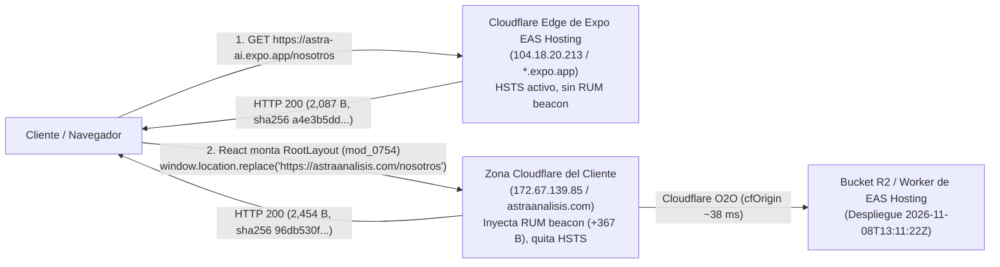

# 15 — Infraestructura, Host Alterno (`astra-ai.expo.app`), Protocolo Expo EAS Update, DNS/TLS/CT y Huella Externa OSINT

**Objetivo auditado:** `https://astraanalisis.com/`, `https://www.astraanalisis.com/`, `https://astra-ai.expo.app/` y `https://u.expo.dev/f7056bae-387a-4cb8-856d-8504d0735629`  
**Fecha de auditoría:** `2026-11-14` (`18:49:16Z` – `19:05:50Z`)  
**Motor de ingeniería inversa:** `rea-agents@6.8.0` (`capture-browser-scenario` en `Chromium@157.0.8103.52`) + sondas pasivas HTTP/1.1, DoH/DNS, TLSv1.3 X.509, Certificate Transparency (`CertSpotter`), RDAP (`Verisign` / `PIR`) y protocolo `Expo-Protocol-Version: 1`  
**Evidencia estructurada asociada:** [infra-eas-osint-audit.json](file:///C:/Users/T490s/.gemini/antigravity/worktrees/PitchLab/analyze_pitchlab_competitor_rea/Reportes/analisis-astra/evidence/infra-eas-osint-audit.json), [09-expo-host-redirect-input.json](file:///C:/Users/T490s/.gemini/antigravity/worktrees/PitchLab/analyze_pitchlab_competitor_rea/Reportes/analisis-astra/raw/09-expo-host-redirect-input.json) y [09-expo-host-redirect-summary.json](file:///C:/Users/T490s/.gemini/antigravity/worktrees/PitchLab/analyze_pitchlab_competitor_rea/Reportes/analisis-astra/raw/09-expo-host-redirect-summary.json)

---

## 1. Resumen Ejecutivo y Nueva Evidencia REA

En la Ola 1 ([10-registro-evidencia-y-limitaciones.md](file:///C:/Users/T490s/.gemini/antigravity/worktrees/PitchLab/analyze_pitchlab_competitor_rea/Reportes/analisis-astra/10-registro-evidencia-y-limitaciones.md#L56)), la relación entre `astraanalisis.com` y `astra-ai.expo.app` permanecía parcialmente en grado `INFERIDO` porque sólo se conocía el arreglo cliente `REDIRECT_HOSTS` en [mod_0778___common-a2fe500f62154dabe8c8c7eb8fa31525.js](file:///C:/Users/T490s/.gemini/antigravity/worktrees/PitchLab/analyze_pitchlab_competitor_rea/Reportes/analisis-astra/modules/mod_0778___common-a2fe500f62154dabe8c8c7eb8fa31525.js#L1). Esta auditoría pasiva de Ola 2 eleva la topología completa a **`OBSERVADO`** y descubre la cronología exacta del proyecto, su postura de seguridad/correo y un producto hermano operado bajo la misma organización de Expo y la misma cuenta de Cloudflare:

| Hallazgo Clave | Nivel Epistémico | Prueba Primaria |
|---|---|---|
| **`astra-ai.expo.app` es el origen vivo en Expo EAS Hosting (Workers + R2)** detrás de `astraanalisis.com` mediante **Cloudflare O2O (Orange-to-Orange)** + **Cloudflare for SaaS**; ambos sirven exactamente la misma compilación de JS (paridad SHA-256 byte a byte en todos los bundles). | **OBSERVADO** | SHA-256 idéntico en `entry-*.js` (`4a2898b1...`), `__common-*.js` (`c4a4cead...`), `_layout-*.js` (`ba86c397...`) y `nosotros-*.js` (`e8f00c5b...`); certificados CT `WE1`/`WR1` del `2026-11-08T11:55Z`. |
| **Cero redirección HTTP `301`/`302` entre dominios en HTTPS**: tanto `https://astra-ai.expo.app/` como `https://www.astraanalisis.com/` devuelven `HTTP 200 OK`. La redirección ocurre **100% en JavaScript cliente** al evaluar en top-level [mod_0754__layout-b3da769553b5a6bcc3093bb023a44b7f.js](file:///C:/Users/T490s/.gemini/antigravity/worktrees/PitchLab/analyze_pitchlab_competitor_rea/Reportes/analisis-astra/modules/mod_0754__layout-b3da769553b5a6bcc3093bb023a44b7f.js#L1), ejecutando `window.location.replace(j.SITE_URL + e + n + t)` y preservando `pathname + search + hash`. | **OBSERVADO** | Escenario REA **`ev_e5979de3b375a2cd17627ca77e33a08055b441229eeab930953399b1aa82ef28`** (`6/6` pasos completados, `452` eventos retenidos, `dropped: 0`) + sondas HTTP directas sin JS. |
| **Divergencia de `367` bytes en `index.html` explicada**: el origen EAS sirve `2,087` bytes (`sha256: a4e3b5dd...`); la zona Cloudflare del cliente reescribe respuestas con `Accept: text/html` inyectando el script de Cloudflare Web Analytics (`token: a2e12c4123a6420ca4eb3f4855145537`), produciendo `2,454` bytes (`sha256: 96db530f...`), pero **suprime `Strict-Transport-Security` (HSTS)** y `Last-Modified` presentes en `astra-ai.expo.app`. | **OBSERVADO** | Comparativa `Accept: */*` vs `Accept: text/html` y eventos `network-content` (`request-1` vs `request-8`) en `ev_e5979de3...`. |
| **Cero apps nativas iOS/Android y cero canales OTA en EAS Update**: `u.expo.dev/f7056bae-387a-4cb8-856d-8504d0735629` confirma que el UUID del proyecto **sí existe en Expo** (un UUID inexistente devuelve `HTTP 400 There is no app with ID ...`), pero responde `HTTP 404 There is no channel named <canal> for the app with ID: f7056bae-...` en `production`, `preview`, `main` y `default`. No existen Universal Links (`apple-app-site-association`), App Links (`assetlinks.json`), `bundleIdentifier`, `android.package` ni fichas en App Store o Google Play. | **OBSERVADO** | Matriz de `30+` consultas pasivas `Expo-Protocol-Version: 1` + ausencia de `.well-known` + `search_web`. |
| **Dominio `astraanalisis.com` recién registrado hace 6 días (`2026-11-08T11:02:28Z`)**, tras 3 semanas de desarrollo oculto en `astra-ai.expo.app` iniciado el **`2026-10-18T00:48:31Z`**. | **OBSERVADO** | RDAP de Verisign (`Cloudflare, Inc.`, IANA `1910`) + cabeceras `Last-Modified` del bucket R2 de EAS Hosting en 38 artefactos + logs CT. |
| **Correo transaccional en Resend (`send.astraanalisis.com` -> `send.forge.rmta.net`) con postura débil en raíz**: `astraanalisis.com` carece de `MX` y de `SPF` en raíz, usa DKIM RSA de **1024 bits** (`resend._domainkey`) y `_dmarc` en modo pasivo `v=DMARC1; p=none;` sin buzón `rua`/`ruf`. | **OBSERVADO** | Consultas DoH Cloudflare (`1.1.1.1`) + `Resolve-DnsName` + decodificación ASN.1/SPKI de la llave pública DKIM. |
| **Comunidad pública y plataforma hermana descubierta (`tipsterzone.org` == `astraanalysisorg-astra.expo.app`)**: el canal de Telegram de `mod_0870` (`https://t.me/+9jzp7DYLucM4MDYx`, título `"Astra"`) tiene **`3,463` suscriptores**, enlaza a un Instagram **distinto** al hardcodeado en la web (`astraanalysis` sin guion bajo vs `astra_analysis` con guion bajo en `mod_0870`) y promueve **`tipsterzone.org/t/astra`**, una segunda PWA en Expo EAS Hosting alojada bajo la **misma organización `astraanalysisorg`** y los **mismos nameservers de Cloudflare** (`javon` / `princess`). | **OBSERVADO** | HTML público de `t.me/+9jzp7DYLucM4MDYx`, `t.me/AstraAnalysis`, `tipsterzone.org/t/astra`, `astraanalysisorg-astra.expo.app` y RDAP PIR. |

### Registro de Evidencia REA Generada en esta Ola

| `evidence_id` | Operación REA | Autoridad / Confianza | Entorno | Artefactos de Entrada y Salida |
|---|---|---|---|---|
| `ev_e5979de3b375a2cd17627ca77e33a08055b441229eeab930953399b1aa82ef28` | `capture_browser_scenario` | `controlled-replay` / `observed` | `Chromium@157.0.8103.52` (`1440x1200`, `es-MX`, `America/Mexico_City`) | Entrada: [09-expo-host-redirect-input.json](file:///C:/Users/T490s/.gemini/antigravity/worktrees/PitchLab/analyze_pitchlab_competitor_rea/Reportes/analisis-astra/raw/09-expo-host-redirect-input.json) (`scenario_sha256: 693bbb4a29c1790deff056b09d4422f9f8cb1b60843d8dffa73cf6674b72fc5c`)<br>Resumen limpio: [09-expo-host-redirect-summary.json](file:///C:/Users/T490s/.gemini/antigravity/worktrees/PitchLab/analyze_pitchlab_competitor_rea/Reportes/analisis-astra/raw/09-expo-host-redirect-summary.json) |

---

## 2. Inspección Directa de `astra-ai.expo.app` vs `www.astraanalisis.com` vs `astraanalisis.com`

### 2.1 Arquitectura de Doble Capa Cloudflare (O2O) y Ausencia de Redirects HTTP en HTTPS

Al realizar peticiones HTTP directas sin ejecutar JavaScript sobre los 3 hosts tanto en puerto `80` (`http://`) como en puerto `443` (`https://`), se observa el siguiente comportamiento exacto:

1. **En `http://` (puerto 80):** cada host responde `HTTP 301 Moved Permanently` **únicamente hacia su propio equivalente `https://`**, nunca hacia el dominio canónico `https://astraanalisis.com/`:
   - `http://astra-ai.expo.app/` -> `301` `Location: https://astra-ai.expo.app/` (`Server: cloudflare`, `167` bytes).
   - `http://www.astraanalisis.com/` -> `301` `Location: https://www.astraanalisis.com/` (`Server: cloudflare`).
   - `http://astraanalisis.com/` -> `301` `Location: https://astraanalisis.com/` (`Server: cloudflare`).
2. **En `https://` (puerto 443):** los tres orígenes (`https://astra-ai.expo.app/`, `https://www.astraanalisis.com/` y `https://astraanalisis.com/`) responden **`HTTP 200 OK`** directamente en cualquier ruta SPA (ej. `/` o `/nosotros`). **No existe ninguna regla de redirección `301`/`302`/`308` en el servidor ni en Cloudflare Bulk/Single Redirects** entre `astra-ai.expo.app` o `www.astraanalisis.com` y `astraanalisis.com`.
3. **Topología Orange-to-Orange (O2O):**
   - `astra-ai.expo.app` resuelve a `104.18.20.213` / `104.18.21.213` (rango enterprise de Cloudflare usado por Expo EAS Hosting / Cloudflare Workers + R2).
   - `astraanalisis.com` y `www.astraanalisis.com` resuelven a `172.67.139.85` / `104.21.38.220` (zona Cloudflare estándar del cliente en `javon.ns.cloudflare.com` / `princess.ns.cloudflare.com`) con proxy naranja activo (`cfEdge;dur=27,cfOrigin;dur=38`), enrutando internamente hacia el Custom Hostname de Cloudflare for SaaS aprovisionado por EAS Hosting.



### 2.2 Comparativa Exacta de Cabeceras HTTP (`astra-ai.expo.app` vs `astraanalisis.com` / `www`)

| Cabecera HTTP | `https://astra-ai.expo.app/` (Origen directo EAS Hosting) | `https://astraanalisis.com/` y `https://www.astraanalisis.com/` (Proxy Cloudflare cliente) | Impacto Técnico / Seguridad |
|---|---|---|---|
| `HTTP Status` | `200 OK` | `200 OK` | Ningún host ejecuta redirect `3xx` en servidor sobre HTTPS. |
| `server` | `cloudflare` | `cloudflare` | Ambos operan sobre Cloudflare, en distintas zonas/cuentas. |
| `eas-*` | *(ausente)* | *(ausente)* | EAS Hosting en producción no expone cabeceras `eas-*` públicas. |
| `cf-cache-status` | *(ausente en `/`)* | `DYNAMIC` (en HTML) / `REVALIDATED` o `HIT` (en JS/iconos) | La zona del cliente aplica su propia capa de caché delante de EAS. |
| `server-timing` | `cfExtPri` (en HTTP/2) | `cfCacheStatus;desc="DYNAMIC"`, `cfEdge;dur=3,cfOrigin;dur=46` | Confirma salto `cfOrigin` (~38–54 ms) hacia el upstream de EAS Hosting. |
| `content-type` (HTML) | `text/html` | `text/html; charset=utf-8` | Normalización de `charset` por la zona Cloudflare del cliente. |
| `content-length` / `transfer-encoding` | `Content-Length: 2087` (fijo, sin inyección) | `Transfer-Encoding: chunked` (`2,087` B con `Accept: */*`; **`2,454` B** con `Accept: text/html`) | Streaming `chunked` activado por el HTML Rewriter de Cloudflare RUM. |
| `etag` (HTML `/`) | `"118c8f01537c2861d13f4e65d9a09d92"` (strong MD5) | *(omitido en HTML dinámico)* | El HTML Rewriter de RUM suprime el `ETag` del documento raíz. |
| `etag` (`entry-*.js`) | `"c8ff779f4c384c1a38d580c96fdaf3c8"` (strong MD5) | `W/"c7912e6696aee0b225251ea7f22dfbfe"` (weak ETag) | Cloudflare convierte ETags fuertes de R2 en ETags débiles al recomprimir. |
| `last-modified` | **`Sun, 08 Nov 2026 13:11:22 GMT`** (expuesto en todos los archivos) | *(suprimido en HTML; conservado sólo en assets cacheados)* | `astra-ai.expo.app` expone los timestamps exactos de subida a R2 de los 38 archivos. |
| `cache-control` (HTML) | `must-revalidate, private, max-age=0` | `public, max-age=0, must-revalidate` | Cambio de `private` a `public, max-age=0`. |
| `cache-control` (JS) | `public, max-age=3600` (1 hora) | `public, max-age=14400, must-revalidate` (4 horas) | El Browser Cache TTL de Cloudflare del cliente sobreescribe `max-age` a 4 h. |
| `strict-transport-security` | **`max-age=31536000; includeSubDomains; preload`** | **AUSENTE** | **Regresión de seguridad:** el dominio canónico `astraanalisis.com` pierde HSTS. |
| `x-content-type-options` | *(ausente)* | `nosniff` | Añadido por la zona Cloudflare del cliente. |
| `referrer-policy` | *(ausente)* | `strict-origin-when-cross-origin` | Añadido por la zona Cloudflare del cliente. |
| `access-control-allow-origin` | *(ausente)* | `*` | Apertura CORS comodín global en todos los recursos de `astraanalisis.com`. |
| `link` | *(ausente)* | `<https://media.api-sports.io>; rel="preconnect"` | Cloudflare Early Hints / Link promotion a partir del `<link rel="preconnect">` del HTML. |
| `nel` / `report-to` | *(ausente)* | Grupo `cf-nel` (`max_age: 604800`) | Telemetría NEL activa sólo en la zona Cloudflare del propietario. |
| `content-security-policy` | **AUSENTE** | **AUSENTE** | Ninguno de los orígenes define política `CSP` ni `frame-ancestors` / `X-Frame-Options`. |

### 2.3 Paridad Criptográfica SHA-256 de `index.html` y Bundles JS

La prueba controlada variando la cabecera `Accept` demostró por qué `index.html` parecía diferir entre capturas de navegador y descargas directas:

- **Con `Accept: */*` (sin `text/html`):** `https://astraanalisis.com/`, `https://www.astraanalisis.com/` y `https://astra-ai.expo.app/` devuelven **exactamente los mismos `2,087` bytes** con SHA-256 `a4e3b5dd2515946d3585cb9c65848c95d77ac9e1eac94b27cf191693bca3972b`.
- **Con `Accept: text/html` (petición real de Chromium):**
  - `https://astra-ai.expo.app/` sigue devolviendo los **`2,087` bytes** intactos (`a4e3b5dd...`, `has_cf_beacon: false`).
  - `https://astraanalisis.com/` y `https://www.astraanalisis.com/` devuelven **`2,454` bytes** (`sha256: 96db530f7130f0234cb65cfbfe8cf56abca9d29a9641b1f48881cf762a5d76bf`), cuya única diferencia byte a byte es la inserción antes de `</body>` de `367` bytes correspondientes al beacon de Cloudflare Web Analytics (`token: "a2e12c4123a6420ca4eb3f4855145537"`, `spa: 2`). *(Nota: la copia local en el repositorio [app/index.html](file:///C:/Users/T490s/.gemini/antigravity/worktrees/PitchLab/analyze_pitchlab_competitor_rea/Reportes/analisis-astra/app/index.html) ocupa `2,492` bytes con `sha256: 01944914...` únicamente por la conversión de `38` saltos de línea `LF` a `CRLF` en Windows).*

Todos los bundles JavaScript inspeccionados son **100% idénticos byte a byte** entre `astra-ai.expo.app` y `astraanalisis.com`, confirmando que `astra-ai.expo.app` **no** sirve una versión vieja ni adelantada, sino el mismo deployment vivo (`2026-11-08T13:11:22Z`):

| Artefacto JS | Bytes | SHA-256 (`astraanalisis.com` == `astra-ai.expo.app`) | `ETag` en `astra-ai.expo.app` (R2 MD5) | `Last-Modified` en `astra-ai.expo.app` |
|---|---:|---|---|---|
| `/_expo/static/js/web/entry-2f163e0b9ce05e4953b73986af77f2b7.js` | `1,109,576` | `4a2898b1d46769bde7a43cd2a5f91bd89d39c203df11222ccd70a2ba22a4d98d` | `"c8ff779f4c384c1a38d580c96fdaf3c8"` | `Sun, 08 Nov 2026 13:11:24 GMT` |
| `/_expo/static/js/web/__common-a2fe500f62154dabe8c8c7eb8fa31525.js` | `662,415` | `c4a4cead00034bc5492bc041e4fdafa13bb057d5f9e58b9ac75e0c356c017492` | `"a2fe500f62154dabe8c8c7eb8fa31525"` | `Sun, 08 Nov 2026 13:11:24 GMT` |
| `/_expo/static/js/web/__expo-metro-runtime-8c088df87a31e4e6accd81c554ec290d.js` | `3,751` | `80e3ab02b3bac22608cdf29a2e3cc1270616a695bbe479f7f500941e8d2bbe41` | `"8c088df87a31e4e6accd81c554ec290d"` | `Sun, 18 Oct 2026 00:48:33 GMT` |
| `/_expo/static/js/web/_layout-b3da769553b5a6bcc3093bb023a44b7f.js` | `38,589` | `ba86c397ba7c6ae85d0472322ccada83eaec70509bdb6890386e7292c7177c43` | `"b3da769553b5a6bcc3093bb023a44b7f"` | `Sun, 08 Nov 2026 13:11:24 GMT` |
| `/_expo/static/js/web/nosotros-1087ff396845303a336510385643566a.js` | `5,419` | `e8f00c5b1dc6aac5030683c3f9564d95f4386eb64bf43ede2baf360b332a5ef1` | `"1087ff396845303a336510385643566a"` | `Wed, 28 Oct 2026 20:22:00 GMT` |

### 2.4 Verificación Runtime en Vivo con REA (`ev_e5979de3b375a2cd17627ca77e33a08055b441229eeab930953399b1aa82ef28`)

En el código descompilado, [mod_0778___common-a2fe500f62154dabe8c8c7eb8fa31525.js](file:///C:/Users/T490s/.gemini/antigravity/worktrees/PitchLab/analyze_pitchlab_competitor_rea/Reportes/analisis-astra/modules/mod_0778___common-a2fe500f62154dabe8c8c7eb8fa31525.js#L1) declara `SITE_URL = 'https://astraanalisis.com'` y `REDIRECT_HOSTS = ['astra-ai.expo.app', 'www.astraanalisis.com']`, mientras que [mod_0754__layout-b3da769553b5a6bcc3093bb023a44b7f.js](file:///C:/Users/T490s/.gemini/antigravity/worktrees/PitchLab/analyze_pitchlab_competitor_rea/Reportes/analisis-astra/modules/mod_0754__layout-b3da769553b5a6bcc3093bb023a44b7f.js#L1) ejecuta en el ámbito superior del módulo (*top-level module evaluation*, incluso antes de renderizar `RootLayout`):

```javascript
if (
  c.preventAutoHideAsync().catch(() => {}),
  'undefined' != typeof window && j.REDIRECT_HOSTS.includes(window.location.hostname)
) {
  const { pathname: e, search: n, hash: t } = window.location;
  window.location.replace(j.SITE_URL + e + n + t);
}
```

Para demostrarlo empíricamente en tiempo de ejecución, se ejecutó `rea.cmd capture-browser-scenario` ([09-expo-host-redirect-input.json](file:///C:/Users/T490s/.gemini/antigravity/worktrees/PitchLab/analyze_pitchlab_competitor_rea/Reportes/analisis-astra/raw/09-expo-host-redirect-input.json) -> [09-expo-host-redirect-summary.json](file:///C:/Users/T490s/.gemini/antigravity/worktrees/PitchLab/analyze_pitchlab_competitor_rea/Reportes/analisis-astra/raw/09-expo-host-redirect-summary.json)), generando **`ev_e5979de3b375a2cd17627ca77e33a08055b441229eeab930953399b1aa82ef28`**:

| Paso REA (`step_index` / `step_id`) | URL Inicial (`before_url` / `captured_url`) | URL Final (`after_url`) | Transacciones Documento (`network-content`) | `history.length` | Prueba Runtime Demostrada |
|---|---|---|---|---:|---|
| `0` (`scenario_start`) -> `1` (`wait-initial-expo-redirect`) | `https://astra-ai.expo.app/nosotros` | `https://astraanalisis.com/nosotros` | `request-1`: `200 OK` (`2,087` B, `a4e3b5dd...`, `redirected_from: null`)<br>`request-8`: `200 OK` (`2,454` B, `96db530f...`, `referer: "https://astra-ai.expo.app/"`, `redirected_from: null`) | `2 -> 2` | `astra-ai.expo.app/nosotros` responde `200`, descarga `entry`, `__common` y `_layout`, y el JS reemplaza la entrada del historial (`history.length` permanece en `2`) navegando a `astraanalisis.com/nosotros`. |
| `2` (`goto-expo-query-hash`, `commit`) -> `3` (`wait-expo-query-hash-redirect`) | `https://astra-ai.expo.app/nosotros?origen=rea&utm_medium=audit#contacto` (`dom_bytes: 2226`) | `https://astraanalisis.com/nosotros?origen=rea&utm_medium=audit#contacto` (`dom_bytes: 20033`) | `request-29`: `200 OK` (`2,087` B, `a4e3b5dd...`)<br>`request-36`: `200 OK` (`2,454` B, `96db530f...`, `referer: "https://astra-ai.expo.app/"`) | `3 -> 3` | **Preservación exacta de ruta (`/nosotros`) + query (`?origen=rea&utm_medium=audit`) + hash (`#contacto`)** sin incrementar `history.length` (`3 -> 3`). |
| `4` (`goto-www-redirect`, `commit`) -> `5` (`wait-www-redirect`) | `https://www.astraanalisis.com/nosotros?host=www#terminos` (`dom_bytes: 2496`) | `https://astraanalisis.com/nosotros?host=www#terminos` (`dom_bytes: 20022`) | `request-57`: `200 OK` (`2,454` B, `96db530f...`)<br>`request-67`: `200 OK` (`2,454` B, `96db530f...`, `referer: "https://www.astraanalisis.com/"`) | `4 -> 4` | El subdominio `www` tampoco redirige por HTTP; descarga ~`1.8` MB de JS antes de redirigir en cliente, abortando en vuelo `request-68` (`nosotros-*.js`, `net::ERR_ABORTED`) y `request-69` (`/cdn-cgi/rum?`, `net::ERR_ABORTED`). |

> [!IMPORTANT]
> **Consecuencias prácticas del redirect en JS cliente:** (1) Cualquier cliente sin JS (bots SEO, scrapers de OpenGraph/WhatsApp/Telegram, validadores `.well-known`) recibe `HTTP 200` directamente desde `astra-ai.expo.app` y `www.astraanalisis.com`, exponiendo contenido duplicado indexable en 3 hosts; (2) un usuario que entra por `www.astraanalisis.com` descarga innecesariamente HTML + runtime + `__common` + `entry` + `_layout` (~`1.81` MB sin comprimir) sólo para descartar el documento y repetir la navegación sobre `astraanalisis.com`.

---

## 3. Auditoría de Archivos Web, Manifiestos Expo, `.well-known` y Forense de Assets Binarios

### 3.1 Matriz Completa de Rutas Estándar, Expo y `.well-known` (`19` Rutas en Ambos Orígenes)

En ambos orígenes, EAS Hosting aplica reescritura *catch-all* SPA (`200 OK` devolviendo `index.html` de `2,087` bytes con `Accept: */*`, `sha256: a4e3b5dd2515946d3585cb9c65848c95d77ac9e1eac94b27cf191693bca3972b`) para toda ruta que no coincide con un archivo estático en `dist/`. Sólo **7** de las 19 rutas consultadas existen como archivos reales:

| Ruta Consultada | ¿Archivo Real? | HTTP (`astraanalisis.com` / `astra-ai.expo.app`) | `Content-Type` | Tamaño (Bytes) | SHA-256 (o Fallback SPA) | `Last-Modified` en EAS R2 |
|---|:---:|---|---|---:|---|---|
| `/manifest.webmanifest` | **SÍ** | `200` / `200` | `application/manifest+json` | `497` | `f9ff0e337c53031453fbe3fcc4e0ee2b8608bd7d933b18b99ab060eecdb2ef04` | `2026-10-22 03:21:11Z` |
| `/metadata.json` | **SÍ** | `200` / `200` | `application/json` | `49` | `aa5f19cc84d41c0f8c70ececb2bc82e863227ea1e121632aca879eb616056991` | `2026-10-18 00:48:31Z` |
| `/favicon.ico` | **SÍ** | `200` / `200` | `image/vnd.microsoft.icon` | `14,510` | `816fa3756394f8c33877f3eaecc2ceab18dd1c982554ca4b101204473bc718f6` | `2026-10-18 14:26:42Z` |
| `/icons/apple-touch-icon.png` | **SÍ** | `200` / `200` | `image/png` | `2,724` | `ead33f3ba89b1bd9caab94368b5d381914d6d390dd343270541188374375336b` | `2026-10-22 03:21:12Z` |
| `/icons/astra-192.png` | **SÍ** | `200` / `200` | `image/png` | `2,991` | `d1709d3a5979e441434b2ca2d751a2c975e37422ad56e669bce1bfd44682ef50` | `2026-10-22 03:21:12Z` |
| `/icons/astra-512.png` | **SÍ** | `200` / `200` | `image/png` | `11,598` | `f738589c4e97d99080c8fe1391a8336bb990b769bc106129644e4fb968cb937d` | `2026-10-22 03:21:14Z` |
| `/assets/assets/images/match-background.dbef350c57497aca5fb64c302927b5fc.jpeg` | **SÍ** | `200` / `200` | `image/jpeg` | `126,252` | `56e9243e690ee54c03a53184f16318b4f33c5df95effd1cf9f30d416751793aa` | `2026-10-20 15:02:49Z` |
| `/manifest.json` | No (Fallback SPA) | `200` / `200` | `text/html` | `2,087` | Fallback `index.html` (`a4e3b5dd...`) | `2026-11-08 13:11:22Z` |
| `/robots.txt` | No (Fallback SPA) | `200` / `200` | `text/html` | `2,087` | Fallback `index.html` (`a4e3b5dd...`) | `2026-11-08 13:11:22Z` |
| `/sitemap.xml` | No (Fallback SPA) | `200` / `200` | `text/html` | `2,087` | Fallback `index.html` (`a4e3b5dd...`) | `2026-11-08 13:11:22Z` |
| `/.well-known/apple-app-site-association` | No (Fallback SPA) | `200` / `200` | `text/html` | `2,087` | Fallback `index.html` (`a4e3b5dd...`) | `2026-11-08 13:11:22Z` |
| `/apple-app-site-association` | No (Fallback SPA) | `200` / `200` | `text/html` | `2,087` | Fallback `index.html` (`a4e3b5dd...`) | `2026-11-08 13:11:22Z` |
| `/.well-known/assetlinks.json` | No (Fallback SPA) | `200` / `200` | `text/html` | `2,087` | Fallback `index.html` (`a4e3b5dd...`) | `2026-11-08 13:11:22Z` |
| `/.well-known/security.txt` | No (Fallback SPA) | `200` / `200` | `text/html` | `2,087` | Fallback `index.html` (`a4e3b5dd...`) | `2026-11-08 13:11:22Z` |
| `/security.txt` | No (Fallback SPA) | `200` / `200` | `text/html` | `2,087` | Fallback `index.html` (`a4e3b5dd...`) | `2026-11-08 13:11:22Z` |
| `/_expo/routes.json` | No (Fallback SPA) | `200` / `200` | `text/html` | `2,087` | Fallback `index.html` (`a4e3b5dd...`) | `2026-11-08 13:11:22Z` |
| `/assetmap.json` | No (Fallback SPA) | `200` / `200` | `text/html` | `2,087` | Fallback `index.html` (`a4e3b5dd...`) | `2026-11-08 13:11:22Z` |
| `/expo-service-worker.js` | No (Fallback SPA) | `200` / `200` | `text/html` | `2,087` | Fallback `index.html` (`a4e3b5dd...`) | `2026-11-08 13:11:22Z` |
| `/sw.js` | No (Fallback SPA) | `200` / `200` | `text/html` | `2,087` | Fallback `index.html` (`a4e3b5dd...`) | `2026-11-08 13:11:22Z` |

### 3.2 Inspección de `/manifest.webmanifest`, `/metadata.json` y Forense Binario (PNG / ICO / JPEG)

1. **`/manifest.webmanifest` (`497` B):**
   ```json
   {
     "id": "/",
     "name": "Astra AI",
     "short_name": "Astra AI",
     "description": "Pronósticos y seguimiento de fútbol, NBA, NHL y MLB.",
     "lang": "es-MX",
     "start_url": "/",
     "scope": "/",
     "display": "standalone",
     "background_color": "#07080A",
     "theme_color": "#07080A",
     "icons": [
       { "src": "/icons/astra-192.png", "sizes": "192x192", "type": "image/png", "purpose": "any maskable" },
       { "src": "/icons/astra-512.png", "sizes": "512x512", "type": "image/png", "purpose": "any maskable" }
     ]
   }
   ```
   - **Hallazgos:** (a) La `description` (igual que el `<meta name="description">` de `index.html`) menciona únicamente **fútbol, NBA, NHL y MLB**, omitiendo **NFL** — prueba arqueológica de que NFL se incorporó en el sprint del `2026-10-28` después de redactar el manifiesto el `2026-10-22`; (b) declara `"purpose": "any maskable"` sobre el mismo PNG (anti-patrón recomendado en contra por W3C/Lighthouse porque Android recorta el área exterior fuera del círculo seguro); (c) al devolver `text/html` en `/sw.js` y `/expo-service-worker.js`, la PWA **carece por completo de Service Worker y soporte offline**: es un contenedor `standalone` puramente online gestionado por [mod_0836___common-a2fe500f62154dabe8c8c7eb8fa31525.js](file:///C:/Users/T490s/.gemini/antigravity/worktrees/PitchLab/analyze_pitchlab_competitor_rea/Reportes/analisis-astra/modules/mod_0836___common-a2fe500f62154dabe8c8c7eb8fa31525.js#L1).
2. **`/metadata.json` (`49` B):** `{"version":0,"bundler":"metro","fileMetadata":{}}` — artefacto estándar generado por `npx expo export -p web` (`web.output: "single"` SPA, razón por la cual `/_expo/routes.json` no se publica en `dist/`).
3. **Chunks PNG (`apple-touch-icon.png`, `astra-192.png`, `astra-512.png`):**
   - Los tres iconos son PNG RGBA de 8 bits (`color_type = 6`, no entrelazados) con resoluciones exactas `180x180`, `192x192` y `512x512`.
   - Contienen únicamente `IHDR`, `pHYs` (`2835 x 2835` píxeles/metro = **`72.01` DPI**, firma estándar de exportación en macOS CoreGraphics/Preview/Figma), `IDAT` (`1` o `2` chunks) e `IEND`. **Cero chunks `tEXt`, `zTXt`, `iTXt`, `eXIf` o `tIME`**.
4. **`/favicon.ico` (`14,510` B):** contenedor ICO multi-resolución con **3 entradas `BMP/DIB` sin comprimir de `32 bpp`** (`16x16` de `1,064` B en offset `54`, `32x32` de `4,136` B en offset `1,118`, y `48x48` de `9,256` B en offset `5,254`).
5. **`match-background.dbef350c57497aca5fb64c302927b5fc.jpeg` (`126,252` B, referenciado en [mod_1024___common-a2fe500f62154dabe8c8c7eb8fa31525.js](file:///C:/Users/T490s/.gemini/antigravity/worktrees/PitchLab/analyze_pitchlab_competitor_rea/Reportes/analisis-astra/modules/mod_1024___common-a2fe500f62154dabe8c8c7eb8fa31525.js#L1)):**
   - JPEG Baseline DCT (`0xFFC0`, 8-bit, 3 componentes YCbCr, **`1333 x 1180` px**).
   - Porta 3 segmentos de metadatos: `APP0` (`JFIF`, 16 B), `APP1` (`Exif` en orden **Big-Endian Motorola `MM`**, `Orientation = 1`, `72 x 72` DPI, `ColorSpace = sRGB`, `PixelXDimension = 1333`, `PixelYDimension = 1180`) y `APP13` (`Photoshop 3.0` con recursos `8BIM` `0x0404` IPTC vacío y `0x0425` digest MD5 `d41d8cd98f00b204e9800998ecf8427e`, huella típica de guardado desde macOS ImageIO / Adobe Photoshop sin autor ni GPS).

---

## 4. Protocolo Expo EAS Update (`u.expo.dev`) y Estado Real de Apps Nativas (iOS / Android)

En [mod_0393_entry-2f163e0b9ce05e4953b73986af77f2b7.js](file:///C:/Users/T490s/.gemini/antigravity/worktrees/PitchLab/analyze_pitchlab_competitor_rea/Reportes/analisis-astra/modules/mod_0393_entry-2f163e0b9ce05e4953b73986af77f2b7.js#L1) se exponen `owner: "astraanalysisorg"`, `slug: "astra-ai"`, `version: "1.0.0"`, `sdkVersion: "58.0.0"`, `scheme: "astraai"` y `extra.eas.projectId: "f7056bae-387a-4cb8-856d-8504d0735629"`, pero **faltan `ios.bundleIdentifier` y `android.package`**.

### 4.1 Matriz de Respuestas Reales de `u.expo.dev` (`Expo-Protocol-Version: 1`)

Se ejecutaron `30+` consultas pasivas `GET` contra `https://u.expo.dev/f7056bae-387a-4cb8-856d-8504d0735629` (más un UUID de control inexistente `00000000-0000-4000-8000-000000000000` y los endpoints legados `exp.host` / `expo.dev`):

| Endpoint / UUID | Cabecera `Accept` | `Expo-Platform` | `Expo-Runtime-Version` | `Expo-Channel-Name` | Código HTTP | Cabeceras Expo / Cuerpo Exacto Devuelto |
|---|---|---|---|---|---:|---|
| `u.expo.dev/<projectId>` | `application/expo+json, application/json` *(sin `multipart/mixed`)* | `ios` | `58.0.0` | `production` | **`406 Not Acceptable`** | `"EAS Update clients must accept \"multipart/mixed\" responses"` |
| `u.expo.dev/<projectId>` | `application/expo+json, application/json` | `ios` | `58.0.0` | *(omitido)* | **`400 Bad Request`** | `"\"channel-name\": Required. The headers \"expo-runtime-version\", \"expo-channel-name\", and \"expo-platform\" are required..."` |
| `u.expo.dev/00000000-0000-4000-8000-000000000000` *(control)* | `application/expo+json, application/json, multipart/mixed` | `ios` | `58.0.0` | `production` | **`400 Bad Request`** | **`"There is no app with ID \"00000000-0000-4000-8000-000000000000\""`** |
| `u.expo.dev/f7056bae-387a-4cb8-856d-8504d0735629` | `application/expo+json, application/json, multipart/mixed` | `android` / `ios` / `web` | `58.0.0`, `1.0.0`, `exposdk:58.0.0` | `production` | **`404 Not Found`** *(y `204` intermitente en réplica QRO para `ios`)* | **`"There is no channel named production for the app with ID: f7056bae-387a-4cb8-856d-8504d0735629."`** *(cuando devuelve `204`: `expo-protocol-version: 1`, `expo-reason-code: NO_UPDATE_AVAILABLE`)* |
| `u.expo.dev/f7056bae-387a-4cb8-856d-8504d0735629` | `application/expo+json, application/json, multipart/mixed` | `android` / `ios` | `58.0.0`, `1.0.0` | `preview` | **`404 Not Found`** | **`"There is no channel named preview for the app with ID: f7056bae-387a-4cb8-856d-8504d0735629."`** |
| `u.expo.dev/f7056bae-387a-4cb8-856d-8504d0735629` | `application/expo+json, application/json, multipart/mixed` | `android` / `ios` | `58.0.0`, `1.0.0` | `main` | **`404 Not Found`** | **`"There is no channel named main for the app with ID: f7056bae-387a-4cb8-856d-8504d0735629."`** |
| `u.expo.dev/f7056bae-387a-4cb8-856d-8504d0735629` | `application/expo+json, application/json, multipart/mixed` | `android` / `ios` | `58.0.0`, `1.0.0` | `default` | **`404 Not Found`** | **`"There is no channel named default for the app with ID: f7056bae-387a-4cb8-856d-8504d0735629."`** |
| `u.expo.dev/f7056bae-387a-4cb8-856d-8504d0735629` | `application/expo+json, application/json, multipart/mixed` | `ios` | `58.0.0` | `development` | **`204 No Content`** | `expo-protocol-version: 1`, `expo-reason-code: NO_UPDATE_AVAILABLE` (0 bytes) |
| `https://exp.host/@astraanalysisorg/astra-ai` | `application/expo+json, application/json` | *(n/a)* | *(omitido)* | *(n/a)* | **`400 Bad Request`** | `"The request for this experience was malformed. Include a runtime version or a list of SDK versions in your request."` |
| `https://expo.dev/@astraanalysisorg/astra-ai` | `text/html` | *(n/a)* | *(n/a)* | *(n/a)* | **`404 Not Found`** | Página pública de proyecto inexistente/privada (`89,476` B). |

### 4.2 Diagnóstico Definitivo sobre Apps Nativas Móviles (`OBSERVADO`)

La comparación diferencial entre el UUID de control (`HTTP 400 There is no app with ID ...`) y `f7056bae-387a-4cb8-856d-8504d0735629` (`HTTP 404 There is no channel named ...`) demuestra de manera concluyente que:
1. El proyecto `f7056bae-387a-4cb8-856d-8504d0735629` **está registrado y activo en los servidores de Expo (`via: 1.1 google`)**, creado al ejecutar `eas init` / `eas deploy` para alojar la web en `astra-ai.expo.app`.
2. **Jamás se ha ejecutado `eas update` ni `eas build` con canales OTA** (`0` canales `production`, `preview`, `main` o `default`; `0` bundles Hermes/JS nativos publicados).
3. Seis señales independientes convergen en que **Astra AI es hoy un producto 100% Web/PWA sin binarios publicados en tiendas móviles**:
   - Sin `ios.bundleIdentifier` ni `android.package` en `app.json` (`mod_0393`).
   - Sin `/.well-known/apple-app-site-association` ni `/.well-known/assetlinks.json`.
   - El RPC vivo `my_access` ([my-access-sample.json](file:///C:/Users/T490s/.gemini/antigravity/worktrees/PitchLab/analyze_pitchlab_competitor_rea/Reportes/analisis-astra/evidence/live-payloads/my-access-sample.json)) devuelve `"iap_ios_key": null` e `"iap_android_key": null` (aunque el código prepara integración futura con RevenueCat para cuando compilen nativo).
   - La ruta dedicada `/instalar` ([mod_0761_instalar-0a3225cb4bb3206b7795b8e128e050ca.js](file:///C:/Users/T490s/.gemini/antigravity/worktrees/PitchLab/analyze_pitchlab_competitor_rea/Reportes/analisis-astra/modules/mod_0761_instalar-0a3225cb4bb3206b7795b8e128e050ca.js#L1)) instruye al usuario en iOS a pulsar *"Compartir -> Agregar a inicio"* en Safari y en Android a usar `beforeinstallprompt`, en lugar de enlazar a App Store o Google Play.
   - Búsquedas exhaustivas en `apps.apple.com` y `play.google.com` para `"Astra AI"`, `"Astra Analysis"`, `"astraanalysisorg"` y `"astraanalisis.com"` arrojan **cero aplicaciones propias** (únicamente homónimos no relacionados de astrología/salud).

---

## 5. Auditoría DNS, Correo Transaccional (Resend), TLS, Certificate Transparency y Cronología del Dominio

### 5.1 Registros DNS Públicos y Seguridad de Correo (`SPF` / `DKIM` / `DMARC`)

| Nombre DNS | Tipo | TTL | Valor Exacto Observado | Análisis Técnico |
|---|---|---:|---|---|
| `astraanalisis.com` | `A` | `300` | `172.67.139.85`, `104.21.38.220` | IPs Anycast de Cloudflare Proxy (zona cliente). |
| `astraanalisis.com` | `AAAA` | `300` | `2606:4700:3035::6815:26dc`, `2606:4700:3032::ac43:8b55` | IPv6 Anycast de Cloudflare Proxy. |
| `astraanalisis.com` | `NS` | `86400` | `javon.ns.cloudflare.com.`, `princess.ns.cloudflare.com.` | Mismos NS exactos que `tipsterzone.org`. |
| `astraanalisis.com` | `SOA` | `1800` | `javon.ns.cloudflare.com. dns.cloudflare.com. 2419628116 10000 2400 604800 1800` | Zona autoritativa gestionada en Cloudflare DNS (`DNSSEC: unsigned`). |
| `astraanalisis.com` | `MX` | — | *(vacío — 0 registros)* | **El dominio raíz no puede recibir correo entrante** (`@astraanalisis.com` no existe como buzón; por ello soporte/legal usa `eliasgutierrezhr@gmail.com`). |
| `astraanalisis.com` | `TXT` | — | *(vacío — 0 registros)* | **Falta `v=spf1 -all` en el dominio raíz.** |
| `astraanalisis.com` | `CAA` | — | *(vacío — 0 registros)* | Cualquier CA pública puede emitir certificados para el dominio. |
| `www.astraanalisis.com` | `A` / `AAAA` | `300` | `172.67.139.85`, `104.21.38.220` / `2606:4700:3035::...` | Aplanado por Cloudflare Proxy (sin `CNAME` público visible). |
| `send.astraanalisis.com` | `CNAME` | `300` | `send.forge.rmta.net.` | **Resend** (infraestructura AWS/Forge MTA para correos de Supabase Auth / transaccionales). |
| `send.forge.rmta.net` | `MX` | `300` | `10 feedback.forge.rmta.net.` | Recepción de rebotes (*Return-Path* `send.astraanalisis.com`) en Resend. |
| `send.forge.rmta.net` | `TXT` (SPF) | `300` | `"v=spf1 ip4:52.3.252.119 ip4:44.222.39.36 ip4:199.249.231.0/24 ~all"` | Autoriza IPs de envío de Resend (`~all` *SoftFail*) sólo para el *envelope-from* `@send.astraanalisis.com`. |
| `resend._domainkey.astraanalisis.com` | `TXT` (DKIM) | `300` | `"p=MIGfMA0GCSqGSIb3DQEBAQUAA4GNADCBiQKBgQCoBPMAr976BMxTshCCKW+mr6tUlPGaD0VWtSRBOIixzYR3UWbRh4AA2OLujJiDRGBizJjpBoSvsLt04DxQCAROJRDODegpjDlsEoF9bTreliwVfDhIjUE0uZQ+e/EbRjm8fCHhrb1tXOh539l+YwTvYiVI00uNw3clCwZ6yewtBwIDAQAB"` | Llave pública **RSA de `1024` bits** (`162` bytes SPKI DER, `sha256: e65cd9303741d04e3e2dc4bd927f60c8bafe64a031e09275d3f5fa9cb1738cce`). |
| `_dmarc.astraanalisis.com` | `TXT` (DMARC) | `300` | `"v=DMARC1; p=none;"` | Política `none` (sólo monitoreo) y **sin `rua`/`ruf`**. |
| `astra-ai.expo.app` | `A` / `AAAA` | `300` | `104.18.20.213`, `104.18.21.213` / `2606:4700::6812:14d5`, `...15d5` | Edge de Expo EAS Hosting (`expo.app` usa `brady.ns.cloudflare.com` / `brit.ns.cloudflare.com`). |
| `bbfjdshvlcynngjdkvsk.supabase.co` | `A` | `300` | `104.18.38.10`, `172.64.149.246` | Edge Cloudflare de Supabase para el proyecto backend de Astra AI. |

> [!WARNING]
> **Riesgo de suplantación de correo (Email Spoofing) en `@astraanalisis.com`:** La combinación de **ausencia de SPF en raíz (`astraanalisis.com TXT`)** + **DMARC `p=none` sin `rua`** permite que terceros envíen correos con encabezado `From: soporte@astraanalisis.com` desde servidores ajenos a Resend sin bloqueo DMARC, y con llave DKIM de `1024` bits por debajo del estándar actual de `2048` bits (RFC 8301).

### 5.2 Registro RDAP, Certificados TLSv1.3 en Vivo y Certificate Transparency (CT Logs)

1. **Datos registrales exactos (Verisign RDAP `https://rdap.verisign.com/com/v1/domain/ASTRAANALISIS.COM`):**
   - **Fecha exacta de compra/alta del dominio:** **`2026-11-08T11:02:28Z`** (expiración `2027-11-08T11:02:28Z`; **6 días de antigüedad** al momento de la auditoría).
   - **Registrador:** **Cloudflare, Inc.** (`IANA ID 1910`), estado `client transfer prohibited`, `secureDNS.delegationSigned: false`.
2. **Certificados en Certificate Transparency (`crt.sh` vs `CertSpotter` + TLS en vivo):**
   - `crt.sh` devolvió `HTTP 502 Bad Gateway` en la consulta comodín `%.astraanalisis.com` por saturación de su base PostgreSQL y `[]` en la consulta exacta debido a su rezago de indexado frente a dominios de menos de una semana. Se consultó pasivamente el agregador CT público **CertSpotter v1** (`include_subdomains=true&expand=cert_der`), recuperando **los 6 certificados emitidos en toda la historia del dominio** y verificando la coincidencia exacta de sus huellas SHA-256 contra los handshakes TLSv1.3 en vivo:

| ID CertSpotter | `not_before` (UTC) | `not_after` (UTC) | Emisor (CA) | SANs (`dns_names`) | `cert_sha256` | Estado / Rol en Infraestructura |
|---|---|---|---|---|---|---|
| `18245153568` | `2026-11-08T10:06:04Z`* | `2027-02-06T10:06:03Z` | `Let's Encrypt` (`CN=YE1`) | `*.astraanalisis.com`, `astraanalisis.com` | `3a520fa3be3c9866...9be1490d` | Cloudflare Universal SSL (respaldo automático al crear la zona). |
| `18245169846` | `2026-11-08T10:54:38Z`* | `2027-02-06T11:02:29Z` | `SSL.com` (`Cloudflare TLS Issuing ECC CA 4`) | `*.astraanalisis.com`, `astraanalisis.com` | `837d69d6997ff427...d769b45d` | Cloudflare Universal SSL (segundo par de respaldo al registrar el dominio a las `11:02:28Z`). |
| `18246851911` | `2026-11-08T11:55:02Z` | `2027-02-06T12:52:56Z` | `Google Trust Services` (`CN=WR1`, RSA) | `astraanalisis.com` | `407645dc8be6dd8c...2a83224f` | Certificado RSA emitido por **Cloudflare for SaaS (EAS Hosting Custom Domain)** para el ápice. |
| **`18246852739`** | **`2026-11-08T11:55:10Z`** | `2027-02-06T12:55:08Z` | `Google Trust Services` (`CN=WE1`, ECDSA) | `astraanalisis.com` | **`5b3c35b85c2f99b4...d8b69ebf`** | **EN VIVO en `astraanalisis.com:443`** (`TLSv1.3`, `TLS_AES_256_GCM_SHA384`, serie `E34215B62BEC14BA13E5A6646B289172`). |
| `18246860932` | `2026-11-08T11:55:37Z` | `2027-02-06T12:53:33Z` | `Google Trust Services` (`CN=WR1`, RSA) | `www.astraanalisis.com` | `cb64cd6602b3367b...e64dfdf5` | Certificado RSA emitido por **EAS Hosting Custom Domain** para `www`. |
| **`18246874496`** | **`2026-11-08T11:55:46Z`** | `2027-02-06T12:55:43Z` | `Google Trust Services` (`CN=WE1`, ECDSA) | `www.astraanalisis.com` | **`06926f2dd33c1409...baabe168`** | **EN VIVO en `www.astraanalisis.com:443`** (`TLSv1.3`, serie `FE7E499A47A9CE6013AC10ABA2CB08B2`). |

*\*Nota: Let's Encrypt y SSL.com aplican backdating estándar de ~1 hora en `not_before` para tolerar desfases de reloj; ambos fueron emitidos a las `11:02`–`11:06Z` inmediatamente tras el alta RDAP (`11:02:28Z`).*
- **Subdominios históricos expuestos en CT:** **cero subdominios ocultos** (`api.`, `admin.`, `staging.`, `dev.` no existen en CT); únicamente `astraanalisis.com`, `*.astraanalisis.com` y `www.astraanalisis.com`. En contraste, `astra-ai.expo.app:443` sirve el certificado comodín `*.expo.app` (`Google Trust Services WE1`, serie `FC3E65F97EB00B1C0E8F7FB236424CDE`, `sha256: 465fd337...`), por lo que los subdominios `*.expo.app` no dejan entradas individuales en CT logs.

### 5.3 Reconstrucción Cronológica Completa del Proyecto (`Octubre – Noviembre 2026`)

Cruzando las marcas `Last-Modified` de los 38 objetos en el bucket R2 de `astra-ai.expo.app`, las filas públicas, RDAP y CT logs, se reconstruye con precisión de segundos la historia completa de Astra AI:

| Fecha / Hora (UTC) | Fuente Verificable | Hito Técnico Reconstruido |
|---|---|---|
| `2026-10-07 07:30:47Z` | Tabla `tipsters` en `tipsterzone.org` | Se crea el perfil de tipster `"Astra"` (`slug: "astra"`, `country: "MX"`, pronóstico individual MXN \$99, suscripción MXN \$499) apuntando al canal de Telegram `https://t.me/+9jzp7DYLucM4MDYx`. |
| `2026-10-08 21:29:49Z` | RDAP PIR (`tipsterzone.org`) | El equipo registra el dominio hermano `tipsterzone.org` en Cloudflare (`javon` / `princess`). |
| `2026-10-18 00:48:31Z` | R2 `Last-Modified` (`/metadata.json`, `__expo-metro-runtime`) | **Primer despliegue web de Astra AI** en `https://astra-ai.expo.app` con Expo SDK 58; `favicon.ico` se sube ese mismo día a las `14:26:42Z`. |
| `2026-10-20 15:02:49Z` | R2 `Last-Modified` + `mod_0766` / `mod_0769` | Subida de `match-background.jpeg` (`15:02:49Z`), las 9 fuentes `.woff2` (`Arimo`, `Sora`, `Figtree`, `15:56:32Z`–`34Z`) y redacción del Aviso de Privacidad y Términos fechados `"20 de octubre de 2026"`. |
| `2026-10-22 03:21:11Z` | R2 `Last-Modified` | Subida de `/manifest.webmanifest` e iconos PWA (`apple-touch-icon`, `astra-192`, `astra-512`); esa noche (`22:24:12Z`–`13Z`) se compilan `(tabs)/_layout` y `pago/[id]`. |
| `2026-10-28 20:21:55Z` | R2 `Last-Modified` (`18` chunks de ruta) | Sprint principal de rutas: se compilan `nfl`, `mlb`, `nba`, `nhl`, `administracion`, `cuenta`, `eliminar-cuenta`, `instalar`, `nosotros`, `privacidad`, `terminos`, `siguiendo`, `equipo` e `historial` (sin cambios desde entonces). |
| `2026-11-07 17:47:41Z` | R2 `Last-Modified` (`index-1423f7b5...js`) | Ajuste de la cartelera principal `(tabs)/index`. |
| `2026-11-08 11:02:28Z` | RDAP Verisign + CT Logs | **Compra de `astraanalisis.com`** en Cloudflare Registrar; a las **`11:55:02Z`–`11:55:46Z`** se vinculan `astraanalisis.com` y `www.astraanalisis.com` como Custom Domains en EAS Hosting. |
| `2026-11-08 13:11:22Z` | R2 `Last-Modified` (`index.html`, `entry`, `__common`, `_layout`) | **Último despliegue de producción**: añade `SITE_URL = 'https://astraanalisis.com'` y `REDIRECT_HOSTS` en `mod_0778`/`mod_0754`. |
| `2026-11-13 11:03:27Z` | R2 `Last-Modified` (`astraanalysisorg-astra.expo.app`) | Despliegue activo más reciente del equipo, ejecutado sobre la plataforma hermana `tipsterzone.org`. |

---

## 6. Huella Pública OSINT (Telegram, Instagram y Ecosistema Hermano `TipsterZone`)

### 6.1 Canal y Cuenta Oficial de Telegram (`https://t.me/+9jzp7DYLucM4MDYx` y `@AstraAnalysis`)

La inspección pasiva del HTML público de previsualización de Telegram referenciado en [mod_0870_nosotros-1087ff396845303a336510385643566a.js](file:///C:/Users/T490s/.gemini/antigravity/worktrees/PitchLab/analyze_pitchlab_competitor_rea/Reportes/analisis-astra/modules/mod_0870_nosotros-1087ff396845303a336510385643566a.js#L1) revela métricas reales de tracción previa al lanzamiento web:

| Recurso Público | Título Visible (`tgme_page_title`) | Métrica / Handle (`tgme_page_extra`) | Descripción / Bio Pública Exacta (`tgme_page_description`) |
|---|---|---|---|
| `https://t.me/+9jzp7DYLucM4MDYx` *(enlace de invitación en `mod_0870`)* | **`Astra`** | **`3 463 subscribers`** (**`3,463` suscriptores**) | `Apuestas de Nivel Institucional 🏆 \| 📲 Síguenos en Instagram: https://www.instagram.com/astraanalysis?xtok=dWgzZTk3OHB6MWky&utm_source=qr \| TipsterZone: tipsterzone.org/t/astra \| 📩 Contacto: @AstraAnalysis` |
| `https://t.me/AstraAnalysis` *(cuenta de contacto citada en la bio)* | **`Astra Analysis`** | **`@AstraAnalysis`** | `Canal gratuito 👉 https://t.me/+9jzp7DYLucM4MDYx` |

> [!NOTE]
> **Inconsistencia / posible bug detectado en el enlace de Instagram de la web:** En [mod_0870_nosotros-1087ff396845303a336510385643566a.js](file:///C:/Users/T490s/.gemini/antigravity/worktrees/PitchLab/analyze_pitchlab_competitor_rea/Reportes/analisis-astra/modules/mod_0870_nosotros-1087ff396845303a336510385643566a.js#L1), el botón de Instagram apunta a `https://www.instagram.com/astra_analysis/` (**con guion bajo**), mientras que la biografía oficial del canal de Telegram (generada desde el propio código QR de Instagram con `utm_source=qr`) apunta a `https://www.instagram.com/astraanalysis` (**sin guion bajo**).

### 6.2 Descubrimiento de la Plataforma Hermana: `tipsterzone.org` (`astraanalysisorg-astra.expo.app`)

Al seguir de forma 100% pasiva la referencia pública `tipsterzone.org/t/astra` anunciada en la bio del canal de Telegram, se descubrió que **Tipster Zone no es un directorio externo ajeno, sino una segunda plataforma SaaS construida y operada por la misma organización técnica que Astra AI (`OBSERVADO`)**:

1. **Misma organización en Expo EAS Hosting (`astraanalysisorg`):** el bundle público de `tipsterzone.org` (`/assets/entry-3a7262d3f4d987df1bd5c9ef8455650c.js`, `3,264,794` B) contiene su propio arreglo de redirección cliente hacia el subdominio **`astraanalysisorg-astra.expo.app`** (`HTTP 200 OK`, `5,485` B, `Last-Modified: Fri, 13 Nov 2026 11:03:27 GMT`). El prefijo `astraanalysisorg-` corresponde literalmente al `owner: "astraanalysisorg"` observado en `mod_0393` de Astra AI.
2. **Misma cuenta de Cloudflare y mismo código fuente base:** `tipsterzone.org` (registrado el `2026-10-08T21:29:49Z`) utiliza exactamente el mismo par de nameservers `javon.ns.cloudflare.com` y `princess.ns.cloudflare.com`, y reutiliza la misma plantilla `+html.tsx` (cambiando únicamente `window.__astraInstallPrompt` por `window.__tzInstallPrompt` y el color `#07080A` por `#0b0a0f`).
3. **Backend Supabase independiente (`ucnxbczjueyyjpetqhfi.supabase.co`) e identidad adicional:** mientras Astra AI opera sobre `bbfjdshvlcynngjdkvsk.supabase.co` (con correos `eliasgutierrezhr@gmail.com` en documentos legales/`mod_0839`), el bundle público de `tipsterzone.org` conecta con `https://ucnxbczjueyyjpetqhfi.supabase.co` e incluye el correo `nicolas.charpentier079@gmail.com`.
4. **Posicionamiento comercial cruzado:** en la tabla pública `tipsters` de Tipster Zone, el perfil `slug = "astra"` (`id: 06c7a5f9-03f8-4bd8-938c-e4820795fbc3`, `country: "MX"`, `verified: false`, `sports: ["Fútbol"]`, `single_price_mxn: 99`, `subscription_price_mxn: 499`) enlaza de vuelta al mismo canal de `3,463` suscriptores (`https://t.me/+9jzp7DYLucM4MDYx`). Esto demuestra que **Astra nació primero como un canal de tipster deportivo en Telegram/TipsterZone (MXN \$499/mes en fútbol)** y entre el `18 de octubre` y el `8 de noviembre de 2026` evolucionó hacia su propia aplicación multideporte con modelos cuantitativos e IA (`astraanalisis.com`, MXN \$299/mes).

---

## 7. Síntesis de Brechas de Infraestructura y Superficie Expuesta

| Categoría | Estado Observado en Astra AI | Severidad / Implicación Competitiva |
|---|---|---|
| **Redirección multi-host (`mod_0754`)** | Sólo en JS cliente (`window.location.replace`); `HTTP 200` en `astra-ai.expo.app` y `www.astraanalisis.com`. | Baja-Media: doble descarga (~`1.8` MB JS) al entrar por `www`, indexación triplicada para crawlers sin JS y exposición directa de timestamps R2 en `astra-ai.expo.app`. |
| **Cabeceras HTTP de seguridad** | `astraanalisis.com` **pierde HSTS** (sí presente en `astra-ai.expo.app`), carece de `CSP` y `X-Frame-Options`, y expone `Access-Control-Allow-Origin: *`. | Media: exposición a *SSL stripping* en primera visita HTTP, ausencia de defensa en profundidad frente a XSS/clickjacking. |
| **SEO técnico y `.well-known`** | `/robots.txt`, `/sitemap.xml`, `security.txt`, `apple-app-site-association` y `assetlinks.json` devuelven `200 text/html` (*soft-404* SPA). | Baja-Media: los motores de búsqueda reciben HTML inválido en `/robots.txt` y `/sitemap.xml`; el dominio apenas suma 6 días en línea (`0` indexación orgánica madura). |
| **Autenticación de correo** | Sin `MX` ni `SPF` en raíz, DKIM RSA `1024` bits (`resend._domainkey`) y `_dmarc` en `p=none` sin `rua`. | Media: `@astraanalisis.com` es falsificable en campañas de phishing dirigidas a suscriptores. |
| **Distribución móvil** | `0` canales EAS Update, `0` apps en App Store / Play Store, PWA sin Service Worker offline. | Estratégica: toda la retención móvil depende hoy de accesos directos PWA online-only y del embudo de `3,463` miembros en Telegram. |
