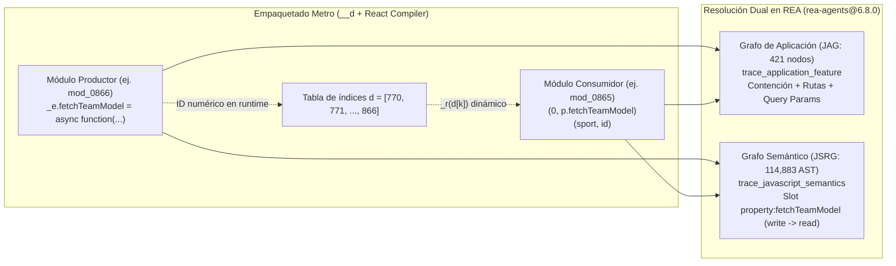

# 16 — Grafo Semántico REA, Proyección `AgentEnv`, Fe de Erratas Forense y Ventaja Estratégica Real de PitchLab (`v3.2`) frente a Astra AI

> **Rol:** Subagente 6 (Ola 2) — Arquitecto de Grafo Semántico REA, Proyección `AgentEnv` y Estrategia Técnica Comparativa Real (`PitchLab v3.2` vs `Astra AI`)
> **Fecha de auditoría:** `2026-11-14` · **Motor de análisis:** `rea-agents@6.8.0` (MCP + Playwright Controlled Replay)
> **Artefacto estructurado de respaldo:** [rea-semantic-and-agentenv-audit.json](file:///C:/Users/T490s/.gemini/antigravity/worktrees/PitchLab/analyze_pitchlab_competitor_rea/Reportes/analisis-astra/evidence/rea-semantic-and-agentenv-audit.json)

> [!IMPORTANT]
> **Alcance y disciplina epistémica:** Todo hallazgo en este documento distingue explícitamente entre hechos verificados directamente en artefactos enviados o capturas controladas (`[OBSERVADO]`), derivaciones estructurales de los grafos estáticos/dinámicos de REA (`[DERIVADO]` / `[INFERIDO]`) y huecos opacos del servidor (`[DESCONOCIDO]`). Ningún archivo de código ni documentación de PitchLab fue modificado; toda exportación `AgentEnv` se ejecutó exclusivamente con `dry_run: true`.

---

## 1. Grafo Semántico y de Aplicación Profundo con REA (`astra-first-party`)

### 1.1 Superficie Estática Auditada y Métricas Globales (`ev_56684417...`)

Se ejecutó `rea:analyze_javascript_application` (`detail: "summary"`, `max_semantic_nodes: 300000`) sobre el directorio desempacado [astra-first-party](file:///C:/Users/T490s/.gemini/antigravity/worktrees/PitchLab/analyze_pitchlab_competitor_rea/Reportes/analisis-astra/astra-first-party) (`100` archivos = `98` módulos propios de Astra AI + `2` módulos generados por Expo Router/Assets, `345,913` bytes, `SHA-256: a75a10b23cf3e976df10993e1d0b351ab79c533938aa744758fafe4b141bf357`), reteniendo el registro padre **`ev_56684417ff30a6b644d1dd65c9c9dee1f9c59d7434fbbcaab9fc81a0fc232493`** y proyectando tres vistas canónicas mediante `rea:inspect_analysis_view`:

| Vista REA (`inspect_analysis_view`) | `evidence_id` | Autoridad / Confianza | Resultado Cuantitativo Verificado (`[OBSERVADO]` / `[DERIVADO]`) |
|---|---|---|---|
| `view: {kind: "summary"}` | `ev_b09a16ba6f4b0343221fcc53af3b053ac9cc8cba87cd39988f67bfb7eca26214` | `shipped-artifact` / `derived` | `100` archivos examinados (`93` `complete`, `7` `limited`, `0` `parse_failures`), **`114,883` nodos AST**, **`282` hallazgos** y **`28,666` incógnitas semánticas** en `jsrg_b7fcc049207383cda957809e2482b6b5cd9a232833ae10b318dbe0ec55638dbd`. |
| `view: {kind: "page", collection: "modules"}` | `ev_557cad9e34a874d4f40164a4adfff89946c9a31acd35e399fadb712ef994672e` | `shipped-artifact` / `derived` | **`421` nodos totales** en el *JavaScript Application Graph* (`JAG`), enumerando los `100` activos/módulos y sus símbolos exportados, componentes UI y almacenes de estado. |
| `view: {kind: "javascript-facts"}` | `ev_77c66f1c4d29c06bc7233b774962e4a39e5930400587a1b6e1dc4a848339142a` | `shipped-artifact` / `derived` | **`29` hechos estructurales** de alta señal (sinks de almacenamiento `AsyncStorage`/`localStorage`, fronteras de autenticación PKCE/OTP, invocaciones remotas y estados React). |

#### Distribución de Hallazgos (`282`) e Incógnitas Semánticas (`28,666`)

- **Familias de hallazgos (`282` total):** `module-inventory = 100`, `symbol-export = 100`, `ui-component = 53`, `state-store = 12`, `network-endpoint = 11`, `storage-sink = 4`, `dynamic-code-sink = 2`.
- **Incógnitas del grafo semántico (`28,666` total):** `object-flow = 14,447` (`50.40%`), `data-flow = 9,550` (`33.31%`), `call-flow = 4,571` (`15.95%`), `promise-ownership = 95` (`0.33%`), `boundary = 2`, `timer = 1`.

### 1.2 Por Qué Metro Bundler (`__d`) + React Compiler Crean Fronteras Específicas en REA

El análisis cruzado entre `trace_application_feature` (que opera sobre el grafo de aplicación `JAG`) y `trace_javascript_semantics` (que opera sobre el grafo de flujo de valores `JSRG`) reveló dos propiedades arquitectónicas fundamentales del bundle de Astra AI (`[DERIVADO]`):

1. **Indirección de dependencias por índice en Metro (`_r(d[k])`):** Cada módulo de Astra AI está envuelto en `__d(function(_g, _r, _i, _a, _m, _e, d) { ... }, moduleId, [depIds])`. Como `_e` (`exports`) entra como parámetro posicional de un callback anónimo y cada importación se resuelve dinámicamente mediante `_r(d[k])` (indirección por arreglo numérico en lugar de `import` ESM o `require("literal")`), el grafo `JAG` registra aristas intra-módulo `contains` exactas más candidatos de parámetros URL estáticos (`refresh_token`, `access_token`, `code`, `error` en [mod_0767_ResetPasswordRoute.js](file:///C:/Users/T490s/.gemini/antigravity/worktrees/PitchLab/analyze_pitchlab_competitor_rea/Reportes/analisis-astra/astra-first-party/mod_0767_ResetPasswordRoute.js) y [mod_0756_EmailConfirmedRoute.js](file:///C:/Users/T490s/.gemini/antigravity/worktrees/PitchLab/analyze_pitchlab_competitor_rea/Reportes/analisis-astra/astra-first-party/mod_0756_EmailConfirmedRoute.js)), mientras que el acoplamiento inter-módulo se recupera con precisión en `JSRG` rastreando **ranuras de propiedad (`property-slot`)**: el módulo productor emite `writes-property` sobre `_e.<symbol>` y los consumidores emiten `reads-property` o `destructures` sobre el objeto devuelto por `_r(d[k])`.
2. **Memoización sintética de React Compiler (`react.memo_cache_sentinel`):** Los componentes de Astra AI están compilados con React Compiler (`const $ = (0, t.c)(N); $[idx] === Symbol.for("react.memo_cache_sentinel") ? ...`), como se observa en [mod_0867_SportDetail.js](file:///C:/Users/T490s/.gemini/antigravity/worktrees/PitchLab/analyze_pitchlab_competitor_rea/Reportes/analisis-astra/astra-first-party/mod_0867_SportDetail.js) (`113` ranuras de caché) y [mod_0784_FootballMatchDetail.js](file:///C:/Users/T490s/.gemini/antigravity/worktrees/PitchLab/analyze_pitchlab_competitor_rea/Reportes/analisis-astra/astra-first-party/mod_0784_FootballMatchDetail.js). Esta tabla de alias mutables explica exactamente los `7` archivos clasificados como `examination: limited` (presupuesto local de proyección alias/retorno alcanzado sin fallos de parseo) y la concentración de incógnitas `object-flow` (`14,447`).

### 1.3 Prueba Exhaustiva de Superficie Backend (`rpc` e `invoke`) y Trazas sobre las 6 Semillas Estratégicas

Antes de trazar cada semilla individual, se ejecutaron dos consultas globales de procedencia inversa (`direction: "backward-provenance"`) sobre las propiedades `rpc` e `invoke` en `jsrg_b7fcc049207383cda957809e2482b6b5cd9a232833ae10b318dbe0ec55638dbd`, obteniendo una **prueba formal cerrada sobre los 100 módulos del cliente** (`[DERIVADO]`):

- **Prueba global PostgREST `.rpc(...)` (`ev_d098b9b2c55ec561117d25a486c08e72b08d90f8548f09e9babc7eb6a520f80a`):** Existen **únicamente `4` módulos en toda la aplicación** que leen la propiedad `.rpc`:
  1. [mod_0834_AuthProvider.js](file:///C:/Users/T490s/.gemini/antigravity/worktrees/PitchLab/analyze_pitchlab_competitor_rea/Reportes/analisis-astra/astra-first-party/mod_0834_AuthProvider.js) → `my_access`
  2. [mod_0839_AdminService.js](file:///C:/Users/T490s/.gemini/antigravity/worktrees/PitchLab/analyze_pitchlab_competitor_rea/Reportes/analisis-astra/astra-first-party/mod_0839_AdminService.js) → `admin_dashboard`
  3. [mod_1017_AiActivityTracker.js](file:///C:/Users/T490s/.gemini/antigravity/worktrees/PitchLab/analyze_pitchlab_competitor_rea/Reportes/analisis-astra/astra-first-party/mod_1017_AiActivityTracker.js) → `record_ai_view`
  4. [mod_0776_FootballRepository.js](file:///C:/Users/T490s/.gemini/antigravity/worktrees/PitchLab/analyze_pitchlab_competitor_rea/Reportes/analisis-astra/astra-first-party/mod_0776_FootballRepository.js) → `search_teams`
- **Prueba global Edge Functions `.functions.invoke(...)` (`ev_037006908ce6d24f5d7131089bcc18dee56fa5f9c85315b5878a0d9008d81d2e`):** Existen **únicamente `5` módulos (`10` sitios de llamada, `7` funciones remotas únicas)** que leen `.invoke`:
  1. [mod_0834_AuthProvider.js](file:///C:/Users/T490s/.gemini/antigravity/worktrees/PitchLab/analyze_pitchlab_competitor_rea/Reportes/analisis-astra/astra-first-party/mod_0834_AuthProvider.js) → `payments` (`2` sitios: `create` y `status`), `delete-account` (`1`), `iap-confirm` (`1`)
  2. [mod_0866_TeamProfileService.js](file:///C:/Users/T490s/.gemini/antigravity/worktrees/PitchLab/analyze_pitchlab_competitor_rea/Reportes/analisis-astra/astra-first-party/mod_0866_TeamProfileService.js) → `team-profile` (`2` sitios: perfil inicial e historial paginado)
  3. [mod_1021_StandingsService.js](file:///C:/Users/T490s/.gemini/antigravity/worktrees/PitchLab/analyze_pitchlab_competitor_rea/Reportes/analisis-astra/astra-first-party/mod_1021_StandingsService.js) → `league-standings` (`2` sitios: fallback bajo demanda cuando `public.standings` viene vacío)
  4. [mod_1023_MatchOddsService.js](file:///C:/Users/T490s/.gemini/antigravity/worktrees/PitchLab/analyze_pitchlab_competitor_rea/Reportes/analisis-astra/astra-first-party/mod_1023_MatchOddsService.js) → `match-odds` (`1` sitio)
  5. [mod_1027_NbaPlayersService.js](file:///C:/Users/T490s/.gemini/antigravity/worktrees/PitchLab/analyze_pitchlab_competitor_rea/Reportes/analisis-astra/astra-first-party/mod_1027_NbaPlayersService.js) → `nba-players` (`1` sitio)

#### Tabla Consolidada de Trazas sobre las 6 Semillas Estratégicas Obligatorias

| Semilla Estratégica | Evidencia `trace_application_feature` (`JAG`) | Evidencia `trace_javascript_semantics` (`JSRG`) | Cadena Exacta Productor → Consumidor y Efecto Arquitectónico (`[OBSERVADO]` / `[DERIVADO]`) |
|---|---|---|---|
| **`my_access`** | `ev_3a751cc1...` (`string:"my_access"` → `0` nodos JAG) + `ev_643a3435...` (`module:mod_0834` → `427` nodos, `482` aristas, `5` rutas terminales) | `ev_b88bf003...` (`literal` → `not-found`) + `ev_d098b9b2...` (`property:"rpc"`) + `ev_87450bf3...` (`property:"refreshAccess"`) | [mod_0834_AuthProvider.js](file:///C:/Users/T490s/.gemini/antigravity/worktrees/PitchLab/analyze_pitchlab_competitor_rea/Reportes/analisis-astra/astra-first-party/mod_0834_AuthProvider.js) ejecuta `supabase.rpc('my_access')` al iniciar sesión/montar app y expone `access` + `refreshAccess`; [mod_0764_PaymentStatusRoute.js](file:///C:/Users/T490s/.gemini/antigravity/worktrees/PitchLab/analyze_pitchlab_competitor_rea/Reportes/analisis-astra/astra-first-party/mod_0764_PaymentStatusRoute.js) (`col 427..428`) desestructura `refreshAccess` tras confirmar pago. Aunque la UI oculte el paywall si se manipula `access.has_access` en memoria, PostgreSQL RLS impide leer `predictions`/`analyses` en partidos futuros sin sesión real con acceso vigente. |
| **`admin_dashboard`** | `ev_9fa97b20...` (`mod_0839` → `2` nodos) + `ev_6a3a9d5d...` (`mod_0755` → `19` nodos, `22` aristas) | `ev_d098b9b2...` (`property:"rpc"`) + `ev_7d198d84...` (`property:"fetchAdmin"`) | [mod_0839_AdminService.js](file:///C:/Users/T490s/.gemini/antigravity/worktrees/PitchLab/analyze_pitchlab_competitor_rea/Reportes/analisis-astra/astra-first-party/mod_0839_AdminService.js) escribe `_e.fetchAdmin` invocando `supabase.rpc('admin_dashboard', {p_section, p_page, p_search})`; únicamente [mod_0755_AdminDashboardRoute.js](file:///C:/Users/T490s/.gemini/antigravity/worktrees/PitchLab/analyze_pitchlab_competitor_rea/Reportes/analisis-astra/astra-first-party/mod_0755_AdminDashboardRoute.js) lo consume. En servidor devuelve `42501 forbidden` a cuentas no administradoras (`access.is_admin === false`). |
| **`payments`** | `ev_643a3435...` (`mod_0834`) + `ev_721bd936...` (`mod_0863` → `8` nodos, `7` aristas) | `ev_03700690...` (`property:"invoke"`) + `ev_789f40b9...` (`property:"startCheckout"`) + `ev_2419d914...` (`property:"orderStatus"`) | [mod_0834_AuthProvider.js](file:///C:/Users/T490s/.gemini/antigravity/worktrees/PitchLab/analyze_pitchlab_competitor_rea/Reportes/analisis-astra/astra-first-party/mod_0834_AuthProvider.js) centraliza ambos modos de `functions.invoke('payments', ...)`: `action: 'create'` (`provider: 'stripe' \| 'mp'`, consumido vía `startCheckout` en [mod_0863_PaywallAndSubscription.js](file:///C:/Users/T490s/.gemini/antigravity/worktrees/PitchLab/analyze_pitchlab_competitor_rea/Reportes/analisis-astra/astra-first-party/mod_0863_PaywallAndSubscription.js)) y `action: 'status'` (`order_id`, consumido vía `orderStatus` con polling en [mod_0764_PaymentStatusRoute.js](file:///C:/Users/T490s/.gemini/antigravity/worktrees/PitchLab/analyze_pitchlab_competitor_rea/Reportes/analisis-astra/astra-first-party/mod_0764_PaymentStatusRoute.js)). |
| **`delete-account`** | `ev_33fc56fdb...` (`mod_0758` → `9` nodos, `8` aristas) | `ev_03700690...` (`property:"invoke"`) + `ev_09ca3613...` (`property:"deleteMyAccount"`) | [mod_0834_AuthProvider.js](file:///C:/Users/T490s/.gemini/antigravity/worktrees/PitchLab/analyze_pitchlab_competitor_rea/Reportes/analisis-astra/astra-first-party/mod_0834_AuthProvider.js) define `deleteMyAccount` (`functions.invoke('delete-account')` + `signOut({scope:'local'})`), consumido exclusivamente por [mod_0758_DeleteAccountRoute.js](file:///C:/Users/T490s/.gemini/antigravity/worktrees/PitchLab/analyze_pitchlab_competitor_rea/Reportes/analisis-astra/astra-first-party/mod_0758_DeleteAccountRoute.js) tras exigir confirmación textual `"ELIMINAR"` en el cliente. |
| **`record_ai_view`** | `ev_ec2f2648...` (`mod_1017` → `2` nodos, `1` arista) | `ev_d098b9b2...` (`property:"rpc"`) + `ev_bb32bca0...` (`property:"useAiActivity"`) | [mod_1017_AiActivityTracker.js](file:///C:/Users/T490s/.gemini/antigravity/worktrees/PitchLab/analyze_pitchlab_competitor_rea/Reportes/analisis-astra/astra-first-party/mod_1017_AiActivityTracker.js) exporta `useAiActivity(sport, matchId, active)` con deduplicación en `Set` en memoria por sesión y llama `supabase.rpc('record_ai_view', {p_sport, p_match_id})`; consumido exactamente en dos pantallas: [mod_0784_FootballMatchDetail.js](file:///C:/Users/T490s/.gemini/antigravity/worktrees/PitchLab/analyze_pitchlab_competitor_rea/Reportes/analisis-astra/astra-first-party/mod_0784_FootballMatchDetail.js) y [mod_0867_SportDetail.js](file:///C:/Users/T490s/.gemini/antigravity/worktrees/PitchLab/analyze_pitchlab_competitor_rea/Reportes/analisis-astra/astra-first-party/mod_0867_SportDetail.js) al abrir la pestaña `"Análisis con IA"`. |
| **`fetchTeamModel`** | `ev_6a6a57bb...` (`mod_0866` → `2` nodos, `1` arista) | `ev_f62ec696...` (`forward-influence`) + `ev_55e3dbd9...` (`backward-provenance`) | **Vector exacto de fuga del modelo:** [mod_0866_TeamProfileService.js](file:///C:/Users/T490s/.gemini/antigravity/worktrees/PitchLab/analyze_pitchlab_competitor_rea/Reportes/analisis-astra/astra-first-party/mod_0866_TeamProfileService.js) (`col 983..999`) escribe `fetchTeamModel`, que ejecuta `.from('predictions').select('fixture_id,context,generated_at')` (y `.from('game_predictions').select('game_id,context,generated_at')`), consumido en [mod_0865_TeamProfileScreen.js](file:///C:/Users/T490s/.gemini/antigravity/worktrees/PitchLab/analyze_pitchlab_competitor_rea/Reportes/analisis-astra/astra-first-party/mod_0865_TeamProfileScreen.js) (`col 442..458`). Para mostrar `4` métricas en UI, descarga al navegador el JSONB completo `context` con todos los hiperparámetros internos de Astra AI. |

---

## 2. Proyección `AgentEnv` de REA sobre Astra AI (`environment-manifest`, `environment-coverage` y `export_environment_bundle --dry-run`)

### 2.1 Distinción Técnica en REA (`api-surface` vs `environment-manifest`) y Efecto de `primary-origin` en Arquitecturas BaaS

En `rea-agents@6.8.0`, la vista `view: {kind: "api-surface"}` opera exclusivamente sobre capturas HAR ingeridas con `inspect_web_network_capture`, mientras que sobre evidencia viva de `capture_browser_scenario` REA sintetiza directamente las plantillas `api_surface_template` dentro de `view: {kind: "environment-manifest"}` junto con el grafo de estado (`environment-state`) y la matriz de cobertura ejecutable (`environment-coverage`).

Dado que Astra AI separa su cascarón estático (`https://astraanalisis.com` en Cloudflare Pages) de su backend real (`https://bbfjdshvlcynngjdkvsk.supabase.co`), la elección automática de `primary-origin` en `AgentEnv` depende del tráfico JSON observado en la captura. Se ejecutaron tres escenarios progresivos de solo lectura para documentar el comportamiento completo:

| Escenario REA | Captura Padre (`evidence_id`) | Viewport y Presupuesto | `origin` Seleccionado por REA | Herramientas en `manifest` | Herramientas Servidas (`tool_count`) | Lección Técnica de Ingeniería Inversa (`[OBSERVADO]`) |
|---|---|---|---|---|---|---|
| **Escenario A** (Cascarón frío SPA) | `ev_65da2d799f8e38fb47969ed42788d109282794ea80635bed7d2772a7977cc222` | `1280×720` (default, carga inicial rápida) | `https://astraanalisis.com` | `2` (`get_manifest`, `post_cdn_cgi_rum`) | `1` lectura (`get_manifest`), `1` retenida (`post_cdn_cgi_rum`) | Si la captura cierra antes de drenar respuestas JSON de Supabase, REA fija el CDN estático como origen primario y excluye Supabase como `other-origin` (`ev_2a82f5c6...`, `ev_b9616be3...`). |
| **Escenario B** (Multi-ruta Desktop) | `ev_06efb8f666defd84c48d1f8d085cfff66c39ce9d601529ffd12811e98a2f3d54` | `1280×720` (`>= 1024 px`), límites por defecto | `https://bbfjdshvlcynngjdkvsk.supabase.co` | `3` (`get_rest_fixtures`, `get_rest_games`, `post_rest_rpc_my_access`) | `2` lecturas (`state`), `1` retenida | En ancho `>= 1024 px`, `/partido/1550951` ejecuta `<Redirect href="/?partido=1550951"/>`, descargando ~100 escudos PNG de la portada y saturando el buffer de eventos por defecto en `request-139` (`ev_4767a9f5...`, `ev_94c24a77...`). |
| **Escenario C** (Móvil BaaS Completo, `0` truncamientos) | `ev_44b4cd0cec47b41d70d45172dc9ca8f412047c3593db6050b786d140bc2d42e5` | **`390×844` (`< 1024 px`)**, límites elevados (`512 MiB`) | **`https://bbfjdshvlcynngjdkvsk.supabase.co`** | **`9` herramientas Supabase** (`96` transacciones completas) | **`6` lecturas servidas** (`4` `state` + `2` `recorded`), **`3` escrituras `withheld`** | Al evitar la redirección a portada (`width < DESKTOP_MIN`), las rutas dedicadas cargan limpiamente con **`0` eventos omitidos**, modelando toda la superficie REST + RPC + Edge Functions pública (`ev_a04025ae...`, `ev_df89ab63...`, `ev_f8005def...`). |

### 2.2 Catálogo Exacto de las 9 Herramientas Modeladas por REA sobre Astra AI (Escenario C)

En el Escenario C (`ev_44b4cd0c...`), se proyectaron tanto las 4 reglas opt-in (`template_rules: ["after-uid-literal", "opaque-token", "sibling-variance", "prefix-variance"]` → `ev_a04025ae526f264ecd27dc9b1a3ca60fc14ac4c8028ee8a35d89c51377014a9a` y `ev_df89ab63ba83b6b150be217d81ef82b739def62178ce380924df02af11a485d2`) como el subconjunto conservador de 2 reglas (`["after-uid-literal", "opaque-token"]` → `ev_ff903aee39d5fd42f6fd157d419ef9f6664f4260a1bfda7ca3ab75c7bc19532e` y `ev_42eac5429af393c73488ea60b47eecd361d50db5b59ae212beeab8c78c86f18a`). **Ambos conjuntos produjeron exactamente las mismas `9` herramientas** (`44` grupos excluidos por `other-origin` hacia `astraanalisis.com`, `media.api-sports.io`, `a.espncdn.com` y `static.cloudflareinsights.com`): `sibling-variance` **no colapsó** `/rest/v1/{tabla}` ni `/functions/v1/{fn}` porque cada tabla PostgREST y cada Edge Function exhibe parámetros de consulta (`query_parameter_names`) y esquemas JSON disjuntos, preservando fronteras semánticas limpias por recurso.

| # | Herramienta Generada por REA | Método y `api_surface_template` | Parámetros / `body_shape` Observados | Clasificación en `environment-coverage` (`ev_df89ab63...`) | ¿Servida en `AgentEnv`? | Razón Exacta de Modelado en REA (`[DERIVADO]`) |
|---|---|---|---|---|---|---|
| 1 | `get_rest_fixtures` | `GET /rest/v1/fixtures` | Query: `forecast_ready, id, limit, or, order, select` | **Lectura `state`** (`list`, `id_field: "id"`, ord. `[21, 66]`) | **Sí** | Entidades con clave primaria `id` estable (`1550951` Querétaro vs Monterrey `NS`). |
| 2 | `get_rest_games` | `GET /rest/v1/games` | Query: `id, select, sport` | **Lectura `state`** (`list`, `id_field: "id"`, ord. `[92]`) | **Sí** | Entidad US Sports con `id: 401909296` (`final`: Pacers `106` – Knicks `104`) incluyendo `prediction` y `analysis` completos para `anon`. |
| 3 | `get_rest_standings` | `GET /rest/v1/standings` | Query: `league_id, order, season, select` | **Lectura `state`** (`list`, `id_field: "team_id"`, ord. `[25]`) | **Sí** | Extrae las `18` entidades de la tabla general de Liga MX Apertura identificadas por `team_id`. |
| 4 | `get_rest_predictions` | `GET /rest/v1/predictions` | Query: `fixture_id, limit, order, select` | **Lectura `state`** (`document`, ord. `[67]`) | **Sí** | Captura como documento de estado la fila devuelta a `/equipo/futbol/2282` (`fixture_id: 1551034`) **con todo el JSONB secreto `context` expuesto a `anon`**. |
| 5 | `get_rest_astra_picks` | `GET /rest/v1/astra_picks` | Query: `match_id, select, sport` | **Lectura `recorded`** (`reason: "query-varies"`, ord. `[20, 91]`) | **Sí** (replay) | Como `.select('pick')` omite `id`/`match_id` en el JSON devuelto (`[{"pick": "..."}]` o `[]`), distintas queries devuelven arreglos sin clave primaria para indexar en `entities`. |
| 6 | `get_rest_match_live` | `GET /rest/v1/match_live` | Query: `match_id, select, sport` | **Lectura `recorded`** (`reason: "query-varies"`, ord. `[19, 90]`) | **Sí** (replay) | Igual que `astra_picks`: `.select(...)` proyecta estadísticas sin campo `id` de entidad y varía según `sport`/`match_id`. |
| 7 | `post_functions_match_odds` | `POST /functions/v1/match-odds` | Body: `{sport: "string", match_id: "number"}` | **Escritura `withheld`** (`effect: "none"`, `reason: "no-state-target"`, ord. `[24]`) | **No** (retenida) | Lectura remota tunelizada por HTTP `POST`: la ruta `/functions/v1/match-odds` no nombra ninguna colección leída por `GET` ni muta entidades locales. |
| 8 | `post_functions_team_profile` | `POST /functions/v1/team-profile` | Body: `{sport: "string", team_id: "number", page: "number"}` | **Escritura `withheld`** (`effect: "none"`, `reason: "no-state-target"`, ord. `[65]`) | **No** (retenida) | Agregador de solo lectura invocado vía `POST` (`supabase.functions.invoke` usa `POST` por defecto); sin colección objetivo en el estado extraído. |
| 9 | `post_rest_rpc_my_access` | `POST /rest/v1/rpc/my_access` | Body: `{}` | **Escritura `withheld`** (`effect: "none"`, `reason: "no-state-target"`, ord. `[22, 63, 88]`) | **No** (retenida) | Función PostgREST `STABLE`/`SECURITY DEFINER` llamada por `POST`; devuelve entitlements de sesión pero no inserta ni modifica ninguna colección leída por `GET`. |

### 2.3 Por Qué Cero Mutaciones Quedan `served` en Astra AI y Qué Revela `export_environment_bundle(dry_run: true)`

> [!TIP]
> **Hallazgo clave sobre síntesis `AgentEnv` en aplicaciones Supabase:** En REA (`rea-agents@6.8.0`), una herramienta `POST`/`PUT`/`PATCH`/`DELETE` solo pasa a `writes.served` cuando (1) su ruta apunta a una colección o ítem leído en `environment-state` y (2) lecturas posteriores en la misma captura confirman la transición de estado (`insert`/`merge`/`delete`). Como Astra AI prohíbe `INSERT`/`UPDATE`/`DELETE` directos en tablas PostgREST desde el cliente y encapsula **toda** lógica (incluso lecturas de momios, perfiles, standings, jugadores NBA y `my_access`, además de mutaciones reales como `record_ai_view`, `payments` y `delete-account`) detrás de `POST /rest/v1/rpc/*` y `POST /functions/v1/*`, **el 100% de sus endpoints `POST` carecen de correspondencia nominal con las colecciones `/rest/v1/<tabla>` y quedan automáticamente retenidos (`withheld: no-state-target`)**.

La ejecución de `rea:export_environment_bundle` con `dry_run: true` (`name: "astra-ai-supabase-baas-env"`, padre `ev_44b4cd0c...`, estado `ev_f8005defccbcc5953cffdd66dfa58848e4c3ec5b1e051257cc8bfaa4ec1602c4`) planificó sin escribir en disco **`7` archivos (`9,134,766` bytes totales)** sirviendo las **`6` herramientas de lectura** (`tool_count: 6`) y emitió una advertencia automática de seguridad muy valiosa:
- **`warnings[0].code = "credential-named-members"`** sobre `event 31`, `event 255` y `event 378` (`request /siteToken`): el beacon RUM de Cloudflare (`POST https://astraanalisis.com/cdn-cgi/rum`) incluye el campo JSON `siteToken`, que dispara el detector preventivo de secretos de REA antes de compartir `evidence.json`.
- **Extracción automática del modelo en `environment-state` (`ev_f8005def...`):** Sin ningún token de sesión, la vista de estado materializó en `documents[0]` el `predictions.context` crudo de Liga MX (`fixture_id: 1551034` Toluca vs Monterrey: `rho: -0.08`, `xg_weight: 0.7`, `home_advantage_log: 0.2111`, `goals_per_team_neutral: 1.423`, dispersiones NB2 de faltas/tiros/córners/amarillas) y en `entities[1]` el partido finalizado NBA `401909296` (`Pacers 106 - 104 Knicks`), donde Astra AI daba `71.14%` de victoria a Knicks mientras su propio texto admitía: *"Indiana no tiene a Tyrese Haliburton (baja confirmada)... El modelo no incluye bajas"*.

---

## 3. Auditoría Forense Cruzada y Fe de Erratas de la Ola 1 (`00`..`10`)

La verificación cruzada línea por línea de los 11 documentos de la Ola 1 ([00-REPORTE-MAESTRO-ASTRA-ANALISIS.md](file:///C:/Users/T490s/.gemini/antigravity/worktrees/PitchLab/analyze_pitchlab_competitor_rea/Reportes/analisis-astra/00-REPORTE-MAESTRO-ASTRA-ANALISIS.md) y [01-arquitectura-frontend-y-rutas.md](file:///C:/Users/T490s/.gemini/antigravity/worktrees/PitchLab/analyze_pitchlab_competitor_rea/Reportes/analisis-astra/01-arquitectura-frontend-y-rutas.md) a [10-bitacora-forense-y-evidencia-rea.md](file:///C:/Users/T490s/.gemini/antigravity/worktrees/PitchLab/analyze_pitchlab_competitor_rea/Reportes/analisis-astra/10-bitacora-forense-y-evidencia-rea.md)) contra los módulos fuente desempacados en [astra-first-party](file:///C:/Users/T490s/.gemini/antigravity/worktrees/PitchLab/analyze_pitchlab_competitor_rea/Reportes/analisis-astra/astra-first-party) y los payloads reales en [raw](file:///C:/Users/T490s/.gemini/antigravity/worktrees/PitchLab/analyze_pitchlab_competitor_rea/Reportes/analisis-astra/raw) detectó **15 inconsistencias internas y erratas** que deben corregirse en el cierre maestro:

| ID | Severidad | Reportes en Conflicto (Líneas) | Fuente Primaria de Verdad (`[OBSERVADO]`) | Corrección Exacta para el Cierre Maestro |
|---|---|---|---|---|
| **ERR-01** | **Alta** | [01-arquitectura-frontend-y-rutas.md](file:///C:/Users/T490s/.gemini/antigravity/worktrees/PitchLab/analyze_pitchlab_competitor_rea/Reportes/analisis-astra/01-arquitectura-frontend-y-rutas.md#L224) vs [05-evidencia-runtime-y-payloads-reales.md](file:///C:/Users/T490s/.gemini/antigravity/worktrees/PitchLab/analyze_pitchlab_competitor_rea/Reportes/analisis-astra/05-evidencia-runtime-y-payloads-reales.md#L130) y [08-autenticacion-pagos-monetizacion-y-legal.md](file:///C:/Users/T490s/.gemini/antigravity/worktrees/PitchLab/analyze_pitchlab_competitor_rea/Reportes/analisis-astra/08-autenticacion-pagos-monetizacion-y-legal.md#L267-L268) | [mod_0870_AboutContentAndSocials.js](file:///C:/Users/T490s/.gemini/antigravity/worktrees/PitchLab/analyze_pitchlab_competitor_rea/Reportes/analisis-astra/astra-first-party/mod_0870_AboutContentAndSocials.js) y [mod_0763_AboutRoute.js](file:///C:/Users/T490s/.gemini/antigravity/worktrees/PitchLab/analyze_pitchlab_competitor_rea/Reportes/analisis-astra/astra-first-party/mod_0763_AboutRoute.js) | `ABOUT_FAQ` tiene **exactamente `3` preguntas** (`¿Cómo funciona la IA?` con 7 párrafos, `¿Los pronósticos son confiables?` y `¿Quiénes somos?`), **no `6`**. `ASTRA_SOCIALS` define `telegram: 'https://t.me/+9jzp7DYLucM4MDYx'` e `instagram: 'https://www.instagram.com/astra_analysis/'`. Eliminar en `01` las URLs falsas `t.me/astraanalysis` e `instagram.com/astra.analysis`. |
| **ERR-02** | **Crítica** | [06-modelos-estadisticos-picks-e-ia.md](file:///C:/Users/T490s/.gemini/antigravity/worktrees/PitchLab/analyze_pitchlab_competitor_rea/Reportes/analisis-astra/06-modelos-estadisticos-picks-e-ia.md#L19-L25) y [10-bitacora-forense-y-evidencia-rea.md](file:///C:/Users/T490s/.gemini/antigravity/worktrees/PitchLab/analyze_pitchlab_competitor_rea/Reportes/analisis-astra/10-bitacora-forense-y-evidencia-rea.md#L42) vs [03-arquitectura-backend-supabase-y-datos.md](file:///C:/Users/T490s/.gemini/antigravity/worktrees/PitchLab/analyze_pitchlab_competitor_rea/Reportes/analisis-astra/03-arquitectura-backend-supabase-y-datos.md#L509-L597), [08-autenticacion-pagos-monetizacion-y-legal.md](file:///C:/Users/T490s/.gemini/antigravity/worktrees/PitchLab/analyze_pitchlab_competitor_rea/Reportes/analisis-astra/08-autenticacion-pagos-monetizacion-y-legal.md#L184) y [09-comparativa-competitiva-y-oportunidades.md](file:///C:/Users/T490s/.gemini/antigravity/worktrees/PitchLab/analyze_pitchlab_competitor_rea/Reportes/analisis-astra/09-comparativa-competitiva-y-oportunidades.md#L50-L139) | `ev_f8005def...` + [public_model_samples.json](file:///C:/Users/T490s/.gemini/antigravity/worktrees/PitchLab/analyze_pitchlab_competitor_rea/Reportes/analisis-astra/raw/public_model_samples.json) + [mod_0784_FootballMatchDetail.js](file:///C:/Users/T490s/.gemini/antigravity/worktrees/PitchLab/analyze_pitchlab_competitor_rea/Reportes/analisis-astra/astra-first-party/mod_0784_FootballMatchDetail.js) + [mod_0867_SportDetail.js](file:///C:/Users/T490s/.gemini/antigravity/worktrees/PitchLab/analyze_pitchlab_competitor_rea/Reportes/analisis-astra/astra-first-party/mod_0867_SportDetail.js) | **RLS abre `SELECT` público a `anon` en `predictions`, `analyses`, `game_predictions` y `game_analyses` apenas el partido pasa a `FT`/`AET`/`PEN` o `final`**. Un visitante sin cuenta **sí ve** `<StatCard>` + `<WinBox>` + `<AnalysisCard>` completos en juegos finalizados con pronóstico previo (`<PendingCard finished={true}/>` solo sale cuando jamás hubo pronóstico en BD) y descarga `predictions.context` crudo al abrir `/equipo/futbol/:id`. Corregir `[DESCONOCIDO]` en `08` L184, agregar la condición `OR status IN ('FT','AET','PEN')` / `'final'` en las políticas SQL de `03` y corregir en `09` que los pesos **sí** son públicamente extraíbles. |
| **ERR-03** | **Alta** | [00-REPORTE-MAESTRO-ASTRA-ANALISIS.md](file:///C:/Users/T490s/.gemini/antigravity/worktrees/PitchLab/analyze_pitchlab_competitor_rea/Reportes/analisis-astra/00-REPORTE-MAESTRO-ASTRA-ANALISIS.md#L110-L178) vs [03-arquitectura-backend-supabase-y-datos.md](file:///C:/Users/T490s/.gemini/antigravity/worktrees/PitchLab/analyze_pitchlab_competitor_rea/Reportes/analisis-astra/03-arquitectura-backend-supabase-y-datos.md#L530) y [06-modelos-estadisticos-picks-e-ia.md](file:///C:/Users/T490s/.gemini/antigravity/worktrees/PitchLab/analyze_pitchlab_competitor_rea/Reportes/analisis-astra/06-modelos-estadisticos-picks-e-ia.md#L385-L393) | [mod_1025_FootballAnalysisSectionsBuilder.js](file:///C:/Users/T490s/.gemini/antigravity/worktrees/PitchLab/analyze_pitchlab_competitor_rea/Reportes/analisis-astra/astra-first-party/mod_1025_FootballAnalysisSectionsBuilder.js) + [fixture-detail-sample.json](file:///C:/Users/T490s/.gemini/antigravity/worktrees/PitchLab/analyze_pitchlab_competitor_rea/Reportes/analisis-astra/raw/samples/fixture-detail-sample.json) | `analyses.sections` en fútbol usa **6 claves reales**: `resumen`, `goles`, `tiros_de_esquina`, `faltas` (o fallback legacy `corners_faltas`), `contexto` y `a_tener_en_cuenta`. Las 4 claves listadas en `00` (`panorama`, `tactica`, `factores`, `proyeccion`) son inexistentes. |
| **ERR-04** | **Alta** | [00-REPORTE-MAESTRO-ASTRA-ANALISIS.md](file:///C:/Users/T490s/.gemini/antigravity/worktrees/PitchLab/analyze_pitchlab_competitor_rea/Reportes/analisis-astra/00-REPORTE-MAESTRO-ASTRA-ANALISIS.md#L116) vs [03-arquitectura-backend-supabase-y-datos.md](file:///C:/Users/T490s/.gemini/antigravity/worktrees/PitchLab/analyze_pitchlab_competitor_rea/Reportes/analisis-astra/03-arquitectura-backend-supabase-y-datos.md#L621-L630) y [06-modelos-estadisticos-picks-e-ia.md](file:///C:/Users/T490s/.gemini/antigravity/worktrees/PitchLab/analyze_pitchlab_competitor_rea/Reportes/analisis-astra/06-modelos-estadisticos-picks-e-ia.md#L302-L322) | [mod_1010_AstraPickService.js](file:///C:/Users/T490s/.gemini/antigravity/worktrees/PitchLab/analyze_pitchlab_competitor_rea/Reportes/analisis-astra/astra-first-party/mod_1010_AstraPickService.js) + [astra-pick-sample.json](file:///C:/Users/T490s/.gemini/antigravity/worktrees/PitchLab/analyze_pitchlab_competitor_rea/Reportes/analisis-astra/raw/samples/astra-pick-sample.json) | `astra_picks` solo expone `(sport, match_id, pick)` (`[{"pick": "Visita gana o empata"}]`, `55` B). Eliminar en `00` L116 las columnas ficticias `confidence_pct`, `tier` y `outcome`. |
| **ERR-05** | **Alta** | [00-REPORTE-MAESTRO-ASTRA-ANALISIS.md](file:///C:/Users/T490s/.gemini/antigravity/worktrees/PitchLab/analyze_pitchlab_competitor_rea/Reportes/analisis-astra/00-REPORTE-MAESTRO-ASTRA-ANALISIS.md#L22-L127) y [10-bitacora-forense-y-evidencia-rea.md](file:///C:/Users/T490s/.gemini/antigravity/worktrees/PitchLab/analyze_pitchlab_competitor_rea/Reportes/analisis-astra/10-bitacora-forense-y-evidencia-rea.md#L65) vs [02-ui-ux-pantallas-y-flujos.md](file:///C:/Users/T490s/.gemini/antigravity/worktrees/PitchLab/analyze_pitchlab_competitor_rea/Reportes/analisis-astra/02-ui-ux-pantallas-y-flujos.md#L255-L258) vs [04-apis-integraciones-y-flujo-de-datos.md](file:///C:/Users/T490s/.gemini/antigravity/worktrees/PitchLab/analyze_pitchlab_competitor_rea/Reportes/analisis-astra/04-apis-integraciones-y-flujo-de-datos.md#L169-L196) | [mod_0755_AdminDashboardRoute.js](file:///C:/Users/T490s/.gemini/antigravity/worktrees/PitchLab/analyze_pitchlab_competitor_rea/Reportes/analisis-astra/astra-first-party/mod_0755_AdminDashboardRoute.js) + [mod_0839_AdminService.js](file:///C:/Users/T490s/.gemini/antigravity/worktrees/PitchLab/analyze_pitchlab_competitor_rea/Reportes/analisis-astra/astra-first-party/mod_0839_AdminService.js) | `admin_dashboard(p_section, p_page, p_search)` muestra exactamente **9 tarjetas KPI** (`accounts`, `confirmed`, `new_today`, `signed_in_today`, `ai_views_today`, `ai_users_today`, `active_subscriptions`, `paid_orders`, `revenue_mxn` en pesos MXN, **no centavos**), tabla diaria de 14d con **2 métricas** (`registrations`, `ai_views`), `ai_by_sport` (30d) y 3 pestañas paginadas (`page < 400`). Alinear `00`, `02` y `10` con `04`. |
| **ERR-06** | **Media** | [02-ui-ux-pantallas-y-flujos.md](file:///C:/Users/T490s/.gemini/antigravity/worktrees/PitchLab/analyze_pitchlab_competitor_rea/Reportes/analisis-astra/02-ui-ux-pantallas-y-flujos.md#L188), [03-arquitectura-backend-supabase-y-datos.md](file:///C:/Users/T490s/.gemini/antigravity/worktrees/PitchLab/analyze_pitchlab_competitor_rea/Reportes/analisis-astra/03-arquitectura-backend-supabase-y-datos.md#L283) y [04-apis-integraciones-y-flujo-de-datos.md](file:///C:/Users/T490s/.gemini/antigravity/worktrees/PitchLab/analyze_pitchlab_competitor_rea/Reportes/analisis-astra/04-apis-integraciones-y-flujo-de-datos.md#L15) vs [05-evidencia-runtime-y-payloads-reales.md](file:///C:/Users/T490s/.gemini/antigravity/worktrees/PitchLab/analyze_pitchlab_competitor_rea/Reportes/analisis-astra/05-evidencia-runtime-y-payloads-reales.md#L118) y [06-modelos-estadisticos-picks-e-ia.md](file:///C:/Users/T490s/.gemini/antigravity/worktrees/PitchLab/analyze_pitchlab_competitor_rea/Reportes/analisis-astra/06-modelos-estadisticos-picks-e-ia.md#L13-L37) | [fixture-detail-sample.json](file:///C:/Users/T490s/.gemini/antigravity/worktrees/PitchLab/analyze_pitchlab_competitor_rea/Reportes/analisis-astra/raw/samples/fixture-detail-sample.json) + [mod_1008_FootballDemoFixtures.js](file:///C:/Users/T490s/.gemini/antigravity/worktrees/PitchLab/analyze_pitchlab_competitor_rea/Reportes/analisis-astra/astra-first-party/mod_1008_FootballDemoFixtures.js) | La columna se llama `model_mode` (no `model_version` como en `02` L188). En producción activa corre **`league_v3` / `national_v3` / `cross_league_v3`**; `'league_v2'` es únicamente un residuo estático del mock [mod_1008_FootballDemoFixtures.js](file:///C:/Users/T490s/.gemini/antigravity/worktrees/PitchLab/analyze_pitchlab_competitor_rea/Reportes/analisis-astra/astra-first-party/mod_1008_FootballDemoFixtures.js). |
| **ERR-07** | **Media** | [03-arquitectura-backend-supabase-y-datos.md](file:///C:/Users/T490s/.gemini/antigravity/worktrees/PitchLab/analyze_pitchlab_competitor_rea/Reportes/analisis-astra/03-arquitectura-backend-supabase-y-datos.md#L208) vs [05-evidencia-runtime-y-payloads-reales.md](file:///C:/Users/T490s/.gemini/antigravity/worktrees/PitchLab/analyze_pitchlab_competitor_rea/Reportes/analisis-astra/05-evidencia-runtime-y-payloads-reales.md#L54) vs [08-autenticacion-pagos-monetizacion-y-legal.md](file:///C:/Users/T490s/.gemini/antigravity/worktrees/PitchLab/analyze_pitchlab_competitor_rea/Reportes/analisis-astra/08-autenticacion-pagos-monetizacion-y-legal.md#L146) | [mod_1011_SportsRepository.js](file:///C:/Users/T490s/.gemini/antigravity/worktrees/PitchLab/analyze_pitchlab_competitor_rea/Reportes/analisis-astra/astra-first-party/mod_1011_SportsRepository.js) + `ev_f8005def...` (ord. `92`) | `fetchSportGame` selecciona `prediction:game_predictions(rows,win,generated_at,is_retrospective),analysis:game_analyses(sections,created_at,is_retrospective)`. En `05` L54 la columna `prediction` dentro de `game_predictions` no existe, y en `08` L146 no es `(*)`. |
| **ERR-08** | **Media** | [02-ui-ux-pantallas-y-flujos.md](file:///C:/Users/T490s/.gemini/antigravity/worktrees/PitchLab/analyze_pitchlab_competitor_rea/Reportes/analisis-astra/02-ui-ux-pantallas-y-flujos.md#L53-L218) vs [06-modelos-estadisticos-picks-e-ia.md](file:///C:/Users/T490s/.gemini/antigravity/worktrees/PitchLab/analyze_pitchlab_competitor_rea/Reportes/analisis-astra/06-modelos-estadisticos-picks-e-ia.md#L348) | [mod_0868_MatchDetailCards.js](file:///C:/Users/T490s/.gemini/antigravity/worktrees/PitchLab/analyze_pitchlab_competitor_rea/Reportes/analisis-astra/astra-first-party/mod_0868_MatchDetailCards.js) | `<CheckIcon color="#5FD39A"/>` con leyenda `"Resultado real del partido"` marca **siempre la celda del marcador real ocurrido** (`home`, `draw` o `away`), haya acertado o fallado el modelo. Corregir `02`. |
| **ERR-09** | **Media** | [01-arquitectura-frontend-y-rutas.md](file:///C:/Users/T490s/.gemini/antigravity/worktrees/PitchLab/analyze_pitchlab_competitor_rea/Reportes/analisis-astra/01-arquitectura-frontend-y-rutas.md#L214) y [02-ui-ux-pantallas-y-flujos.md](file:///C:/Users/T490s/.gemini/antigravity/worktrees/PitchLab/analyze_pitchlab_competitor_rea/Reportes/analisis-astra/02-ui-ux-pantallas-y-flujos.md#L179) vs [05-evidencia-runtime-y-payloads-reales.md](file:///C:/Users/T490s/.gemini/antigravity/worktrees/PitchLab/analyze_pitchlab_competitor_rea/Reportes/analisis-astra/05-evidencia-runtime-y-payloads-reales.md#L188) | [mod_0866_TeamProfileService.js](file:///C:/Users/T490s/.gemini/antigravity/worktrees/PitchLab/analyze_pitchlab_competitor_rea/Reportes/analisis-astra/astra-first-party/mod_0866_TeamProfileService.js) + [mod_1016_FollowDomainLogic.js](file:///C:/Users/T490s/.gemini/antigravity/worktrees/PitchLab/analyze_pitchlab_competitor_rea/Reportes/analisis-astra/astra-first-party/mod_1016_FollowDomainLogic.js) | El único slug válido para fútbol en rutas `/equipo/:sport/:id` y en `FollowedSport` (`AsyncStorage`) es `'futbol'` (`['futbol','nba','nfl','nhl','mlb']`); `'football'` retorna `null`. |
| **ERR-10** | **Baja** | [01-arquitectura-frontend-y-rutas.md](file:///C:/Users/T490s/.gemini/antigravity/worktrees/PitchLab/analyze_pitchlab_competitor_rea/Reportes/analisis-astra/01-arquitectura-frontend-y-rutas.md#L131) y [02-ui-ux-pantallas-y-flujos.md](file:///C:/Users/T490s/.gemini/antigravity/worktrees/PitchLab/analyze_pitchlab_competitor_rea/Reportes/analisis-astra/02-ui-ux-pantallas-y-flujos.md#L9) vs [05-evidencia-runtime-y-payloads-reales.md](file:///C:/Users/T490s/.gemini/antigravity/worktrees/PitchLab/analyze_pitchlab_competitor_rea/Reportes/analisis-astra/05-evidencia-runtime-y-payloads-reales.md#L70) | [mod_0775_ThemeTokens.js](file:///C:/Users/T490s/.gemini/antigravity/worktrees/PitchLab/analyze_pitchlab_competitor_rea/Reportes/analisis-astra/astra-first-party/mod_0775_ThemeTokens.js) + [mod_0765_FootballMatchRoute.js](file:///C:/Users/T490s/.gemini/antigravity/worktrees/PitchLab/analyze_pitchlab_competitor_rea/Reportes/analisis-astra/astra-first-party/mod_0765_FootballMatchRoute.js) | El breakpoint es `DESKTOP_MIN = 1024` px (`width >= 1024`, no `960` px) y usa `<Redirect href={...}/>` declarativo (no `router.replace`). |
| **ERR-11** | **Baja** | [04-apis-integraciones-y-flujo-de-datos.md](file:///C:/Users/T490s/.gemini/antigravity/worktrees/PitchLab/analyze_pitchlab_competitor_rea/Reportes/analisis-astra/04-apis-integraciones-y-flujo-de-datos.md#L247-L265) vs [05-evidencia-runtime-y-payloads-reales.md](file:///C:/Users/T490s/.gemini/antigravity/worktrees/PitchLab/analyze_pitchlab_competitor_rea/Reportes/analisis-astra/05-evidencia-runtime-y-payloads-reales.md#L57-L78) | [mod_0784_FootballMatchDetail.js](file:///C:/Users/T490s/.gemini/antigravity/worktrees/PitchLab/analyze_pitchlab_competitor_rea/Reportes/analisis-astra/astra-first-party/mod_0784_FootballMatchDetail.js) + [mod_0867_SportDetail.js](file:///C:/Users/T490s/.gemini/antigravity/worktrees/PitchLab/analyze_pitchlab_competitor_rea/Reportes/analisis-astra/astra-first-party/mod_0867_SportDetail.js) + [mod_1021_StandingsService.js](file:///C:/Users/T490s/.gemini/antigravity/worktrees/PitchLab/analyze_pitchlab_competitor_rea/Reportes/analisis-astra/astra-first-party/mod_1021_StandingsService.js) | `MatchOddsCard` y `StandingsCard` solo se montan cuando `upcoming`/`NS` o `PST`/`postponed` (se ocultan también en `live`). Además, `league-standings` siempre recibe `{sport: "futbol", league_id, season}`. |
| **ERR-12** | **Baja** | [02-ui-ux-pantallas-y-flujos.md](file:///C:/Users/T490s/.gemini/antigravity/worktrees/PitchLab/analyze_pitchlab_competitor_rea/Reportes/analisis-astra/02-ui-ux-pantallas-y-flujos.md#L214) y [07-deportes-us-nba-nfl-nhl-mlb.md](file:///C:/Users/T490s/.gemini/antigravity/worktrees/PitchLab/analyze_pitchlab_competitor_rea/Reportes/analisis-astra/07-deportes-us-nba-nfl-nhl-mlb.md#L259) vs [06-modelos-estadisticos-picks-e-ia.md](file:///C:/Users/T490s/.gemini/antigravity/worktrees/PitchLab/analyze_pitchlab_competitor_rea/Reportes/analisis-astra/06-modelos-estadisticos-picks-e-ia.md#L409) | [mod_1019_RefereeNationalityLookup.js](file:///C:/Users/T490s/.gemini/antigravity/worktrees/PitchLab/analyze_pitchlab_competitor_rea/Reportes/analisis-astra/astra-first-party/mod_1019_RefereeNationalityLookup.js) | [mod_1019_RefereeNationalityLookup.js](file:///C:/Users/T490s/.gemini/antigravity/worktrees/PitchLab/analyze_pitchlab_competitor_rea/Reportes/analisis-astra/astra-first-party/mod_1019_RefereeNationalityLookup.js) contiene **exactamente `38` países** y **`98` entradas nominales estáticas de árbitros** (no `"~65 países sin lista estática"` como dice `06`). |
| **ERR-13** | **Media** | [00](file:///C:/Users/T490s/.gemini/antigravity/worktrees/PitchLab/analyze_pitchlab_competitor_rea/Reportes/analisis-astra/00-REPORTE-MAESTRO-ASTRA-ANALISIS.md#L210), [01](file:///C:/Users/T490s/.gemini/antigravity/worktrees/PitchLab/analyze_pitchlab_competitor_rea/Reportes/analisis-astra/01-arquitectura-frontend-y-rutas.md#L19-L20), [03](file:///C:/Users/T490s/.gemini/antigravity/worktrees/PitchLab/analyze_pitchlab_competitor_rea/Reportes/analisis-astra/03-arquitectura-backend-supabase-y-datos.md#L4-L29), [06](file:///C:/Users/T490s/.gemini/antigravity/worktrees/PitchLab/analyze_pitchlab_competitor_rea/Reportes/analisis-astra/06-modelos-estadisticos-picks-e-ia.md#L3), [07](file:///C:/Users/T490s/.gemini/antigravity/worktrees/PitchLab/analyze_pitchlab_competitor_rea/Reportes/analisis-astra/07-deportes-us-nba-nfl-nhl-mlb.md#L4) y [10](file:///C:/Users/T490s/.gemini/antigravity/worktrees/PitchLab/analyze_pitchlab_competitor_rea/Reportes/analisis-astra/10-bitacora-forense-y-evidencia-rea.md#L13-L37) | [artifact-sha256-inventory.json](file:///C:/Users/T490s/.gemini/antigravity/worktrees/PitchLab/analyze_pitchlab_competitor_rea/Reportes/analisis-astra/evidence/artifact-sha256-inventory.json) | Unificar cifras exactas: `25` chunks JS = `1,921,311` B; `+ index.html (2,492 B)` = `1,923,803` B en `app/`; `+ manifest.webmanifest (3,202 B)` = `1,927,005` B. Módulos Metro: **`1,030` totales** (IDs `0..1029`: `930` vendor + `100` extraídos = `98` de Astra + `2` generados por Expo); `286`/`287` era solo el índice parcial de `module-map.json`. |
| **ERR-14** | **Baja** | [00-REPORTE-MAESTRO-ASTRA-ANALISIS.md](file:///C:/Users/T490s/.gemini/antigravity/worktrees/PitchLab/analyze_pitchlab_competitor_rea/Reportes/analisis-astra/00-REPORTE-MAESTRO-ASTRA-ANALISIS.md#L13) y [10-bitacora-forense-y-evidencia-rea.md](file:///C:/Users/T490s/.gemini/antigravity/worktrees/PitchLab/analyze_pitchlab_competitor_rea/Reportes/analisis-astra/10-bitacora-forense-y-evidencia-rea.md#L76) vs [05-evidencia-runtime-y-payloads-reales.md](file:///C:/Users/T490s/.gemini/antigravity/worktrees/PitchLab/analyze_pitchlab_competitor_rea/Reportes/analisis-astra/05-evidencia-runtime-y-payloads-reales.md#L14) | [02-scenario-input.json](file:///C:/Users/T490s/.gemini/antigravity/worktrees/PitchLab/analyze_pitchlab_competitor_rea/Reportes/analisis-astra/raw/02-scenario-input.json) + [rea-evidence-ledger.json](file:///C:/Users/T490s/.gemini/antigravity/worktrees/PitchLab/analyze_pitchlab_competitor_rea/Reportes/analisis-astra/evidence/rea-evidence-ledger.json) | El escenario `02` completó **`14/14` pasos** (`start_url` + `13` acciones explícitas), sumando **`130` pasos** en los escenarios `02`..`06` (`14+24+32+50+10`), no `11` ni `127`. |
| **ERR-15** | **Baja** | [03-arquitectura-backend-supabase-y-datos.md](file:///C:/Users/T490s/.gemini/antigravity/worktrees/PitchLab/analyze_pitchlab_competitor_rea/Reportes/analisis-astra/03-arquitectura-backend-supabase-y-datos.md#L180-L182) vs [05-evidencia-runtime-y-payloads-reales.md](file:///C:/Users/T490s/.gemini/antigravity/worktrees/PitchLab/analyze_pitchlab_competitor_rea/Reportes/analisis-astra/05-evidencia-runtime-y-payloads-reales.md#L160) y [08-autenticacion-pagos-monetizacion-y-legal.md](file:///C:/Users/T490s/.gemini/antigravity/worktrees/PitchLab/analyze_pitchlab_competitor_rea/Reportes/analisis-astra/08-autenticacion-pagos-monetizacion-y-legal.md#L135) | [mod_0756_EmailConfirmedRoute.js](file:///C:/Users/T490s/.gemini/antigravity/worktrees/PitchLab/analyze_pitchlab_competitor_rea/Reportes/analisis-astra/astra-first-party/mod_0756_EmailConfirmedRoute.js) + [mod_0863_PaywallAndSubscription.js](file:///C:/Users/T490s/.gemini/antigravity/worktrees/PitchLab/analyze_pitchlab_competitor_rea/Reportes/analisis-astra/astra-first-party/mod_0863_PaywallAndSubscription.js) | `trial_ends_at` nace en `null` al registrarse y se estampa con `NOW() + INTERVAL '7 days'` **únicamente al confirmar el correo** (`email_confirmed_at`), no en `INSERT` inicial. |

---

## 4. Comparativa Quirúrgica Basada en Evidencia Real: PitchLab (`PREDLAB-V3.2`) vs Astra AI

Esta sección contrasta la arquitectura **real y verificada** de PitchLab en este repositorio ([PROJECT_STATE.md](file:///C:/Users/T490s/.gemini/antigravity/worktrees/PitchLab/analyze_pitchlab_competitor_rea/docs/execution/PROJECT_STATE.md), [19_HOJA_DE_RUTA_MOTORES_Y_PICKS_V4.md](file:///C:/Users/T490s/.gemini/antigravity/worktrees/PitchLab/analyze_pitchlab_competitor_rea/docs/predicciones/19_HOJA_DE_RUTA_MOTORES_Y_PICKS_V4.md), [MODEL_CARD.md](file:///C:/Users/T490s/.gemini/antigravity/worktrees/PitchLab/analyze_pitchlab_competitor_rea/docs/predicciones/MODEL_CARD.md), [STACK_COSTO_CERO.md](file:///C:/Users/T490s/.gemini/antigravity/worktrees/PitchLab/analyze_pitchlab_competitor_rea/docs/architecture/STACK_COSTO_CERO.md), [SHARED_CONTRACTS.md](file:///C:/Users/T490s/.gemini/antigravity/worktrees/PitchLab/analyze_pitchlab_competitor_rea/docs/architecture/SHARED_CONTRACTS.md) y `src/domain/prediction/*`, commit `2960d77`, `1,153` tests Vitest + `127` tests Pytest en verde) frente a la arquitectura **real y desempacada** de Astra AI (`astraanalisis.com`).

### 4.1 Matriz Comparativa Integral (`12` Dimensiones Críticas)

| Dimensión | PitchLab Real (`PREDLAB-V3.2` · Commit `2960d77`) | Astra AI Real (`astraanalisis.com` · Producción Viva) | Veredicto Técnico |
|---|---|---|---|
| **1. Motor Matemático de Fútbol** | Dixon-Coles bivariado con decaimiento temporal + Elo dinámico + regresión logística regularizada + **mezcla logit con cierre sharp sin margen** ([outlook.ts](file:///C:/Users/T490s/.gemini/antigravity/worktrees/PitchLab/analyze_pitchlab_competitor_rea/src/domain/prediction/outlook.ts), [math.ts](file:///C:/Users/T490s/.gemini/antigravity/worktrees/PitchLab/analyze_pitchlab_competitor_rea/src/domain/prediction/math.ts)); `11` mercados + `topScorelines[3]` desde una sola matriz DC (`\|Σp - 1\| < 1e-15`, paridad TS↔Py `4.991e-13`). | Poisson/Dixon-Coles con `rho` fijo por liga (`-0.08` Liga MX, `-0.0595` UEFA), mezcla estática `xg_weight = 0.7` y Binomial Negativa (`NB2`) para córners/faltas/amarillas (`league_v3`), **sin mezcla con mercado sharp**. | **PitchLab aplasta** en rigor probabilístico y paridad exacta. |
| **2. Calibración, Holdout y Validación** | `walk_forward_dev` (`56,649` eventos): `ECE = 0.0025 [0.0017, 0.0056]`, `LL sharp = 0.9929`. `holdout_sealed` (`14,163` eventos) congelado como `"holdout consumido"`; validación prospectiva estricta (`> 2026-11-08T20:30Z`, IC 95% bootstrap `mulberry32`, `50/50` controles Red Team en `PASS`). | **Cero** métricas públicas de calibración (`ECE`, `Brier`, `log-loss`), cero separación documentada de holdout y presencia de bandera `is_retrospective` para backfills post-kickoff. | **PitchLab aplasta** (gobernanza científica institucional vs caja negra). |
| **3. De-Vigging, EV, Kelly y Picks** | De-vigging auditado (`power`, `proportional`, `shin` en [devig.ts](file:///C:/Users/T490s/.gemini/antigravity/worktrees/PitchLab/analyze_pitchlab_competitor_rea/src/domain/prediction/devig.ts)); prohibido aprobar por `% de acierto`; `MatchOutlook` público publica `fairOdds = 1/p` sin stakes engañosos (`0/60` segmentos de apuesta encendidos hasta superar compuerta `CLV% > 0`); motor interno Quarter-Kelly contraído por `sigma_p` con topes `2u/2u/3u/5u` ([picks.ts](file:///C:/Users/T490s/.gemini/antigravity/worktrees/PitchLab/analyze_pitchlab_competitor_rea/src/domain/prediction/picks.ts)). | **Cero de-vigging, cero cuota justa (`fairOdds`), cero EV y cero gestión de banca**. `astra_picks` emite frases direccionales sueltas (`"Visita gana o empata"`) desconectadas del precio de la casa, induciendo apuestas con `EV < 0`. | **PitchLab aplasta** (protege la banca del usuario y elimina humo de tipster). |
| **4. Momios Multi-Tick y Stale Lines** | Detector causal de líneas rezagadas con **Doble Confirmación** ([stale_lines.ts](file:///C:/Users/T490s/.gemini/antigravity/worktrees/PitchLab/analyze_pitchlab_competitor_rea/src/domain/prediction/stale_lines.ts)) + programador adaptativo `cadence_scheduler.py` (`<= 203.46 s` en `[T-60m, T-0]`) + `MarketPulse` sobre Polymarket/Kalshi ([market-pulse.ts](file:///C:/Users/T490s/.gemini/antigravity/worktrees/PitchLab/analyze_pitchlab_competitor_rea/packages/contracts/src/market-pulse.ts)). Pendiente solo de activar API keys (`active_sources = 0` hoy). | Snapshot único bajo demanda (`match-odds`, caché 5 min) de **una sola casa recreativa (`Bet365`, `~5.3%–6.5%` de margen)** vía API-Sports, ocultado apenas inicia el partido y jamás contrastado contra el modelo. | **PitchLab gana en arquitectura**; Astra gana hoy solo en tener la key conectada. |
| **5. Récord e Integridad Auditable** | `PickLedger` append-only ([ledger.ts](file:///C:/Users/T490s/.gemini/antigravity/worktrees/PitchLab/analyze_pitchlab_competitor_rea/src/domain/prediction/ledger.ts)) encadenado criptográficamente con **SHA-256 canónico IEEE-754**, separando emisión (`pick`), cierre sharp (`closing`) y liquidación de 6 estados (`settlement`), más calificador compartido [pick-grading.ts](file:///C:/Users/T490s/.gemini/antigravity/worktrees/PitchLab/analyze_pitchlab_competitor_rea/packages/contracts/src/pick-grading.ts). | **Opacidad total de desempeño:** no publica récord histórico, ROI, yield ni tasa de acierto; su `<CheckIcon color="#5FD39A"/>` en `WinBox` solo indica quién ganó el partido real. | **PitchLab aplasta** (diferenciador comercial devastador si se exhibe en UI). |
| **6. Cobertura Multi-Deporte y Bajas** | Fútbol + NFL activos en `live_matchday_v3_snapshot.json` (`84` fútbol + `46` NFL = `130` `MatchOutlook`), más candidato causal `NFL Minkowski v3.2` (`41` features EPA `nflverse`, `83.83%` cobertura viva). Motores diarios MLB/NHL/NBA aún en `TODO` (hoy operan con priors estacionales/snapshots). | **5 deportes activos hoy en vivo** (`48` ligas de fútbol + `NBA` + `NFL` + `NHL` + `MLB`) con ingesta continua, **pero con ceguera crítica a bajas titulares en NBA/US Sports** (*"El modelo no incluye bajas"* en `Pacers 106-104 Knicks`). | **Astra gana hoy en amplitud viva**; **PitchLab gana en profundidad NFL** y diseño causal. |
| **7. Arbitraje de Costos de Infraestructura y Datos** | Stack costo cero diseñado al centavo en [STACK_COSTO_CERO.md](file:///C:/Users/T490s/.gemini/antigravity/worktrees/PitchLab/analyze_pitchlab_competitor_rea/docs/architecture/STACK_COSTO_CERO.md) (Cloudflare Pages/Workers + Neon/Supabase free + `nflverse` CC BY 4.0 + `openfootball` + Polymarket/Kalshi \$0), con compuerta legal estricta (`0` evasión anti-bot). | Opera 5 deportes por **~\$25–\$60 USD/mes totales**: \$0 en ESPN (`NBA`/`NFL`), \$0 en `api-web.nhle.com` (`NHL`), \$0 en `statsapi.mlb.com` (`MLB`) y \$19–\$29 USD/mes en API-Sports cacheado en Supabase + Cloudflare Pages (\$0). | **Empate táctico**; Astra demuestra que \$19–\$29/mes en API-Sports desbloquea 48 ligas ya. |
| **8. Módulo Antes del Partido y Live Match Center** | `MatchOutlook` + `GameAnalysis` ([analysis.ts](file:///C:/Users/T490s/.gemini/antigravity/worktrees/PitchLab/analyze_pitchlab_competitor_rea/packages/contracts/src/analysis.ts), [view-models.ts](file:///C:/Users/T490s/.gemini/antigravity/worktrees/PitchLab/analyze_pitchlab_competitor_rea/packages/contracts/src/view-models.ts)) entregan probabilidades multi-mercado, `fairOdds` decimal/americano, marcador más probable, H2H, días de descanso y `MarketPulse`. Capas web pendientes de sincronizar (`SYNC_NOTES.md`); sin minuto a minuto vivo aún. | Ficha pre-partido muy limpia + **Match Center en vivo cada 30 s** (`match_live`: marcador, barra de Momentum, goles/tarjetas/cambios minuto a minuto, estadísticas comparadas y boxscore NBA por jugador) + prosa IA en 6 secciones, aunque **vulnerable a alucinaciones numéricas del LLM** sin validador. | **Astra gana hoy en UX en vivo y prosa digerible**; **PitchLab gana en exactitud libre de alucinaciones**. |
| **9. Conversión Comercial y Pagos MXN (SPEI / Tarjeta)** | Matriz `free \| pro \| elite` y `Entitlements` tipados en [SHARED_CONTRACTS.md](file:///C:/Users/T490s/.gemini/antigravity/worktrees/PitchLab/analyze_pitchlab_competitor_rea/docs/architecture/SHARED_CONTRACTS.md#L165-L178), diseñada para cobro local MXN (SPEI/Stripe), aún previa al encendido comercial público. | **Embudo probado y sin fricción:** `7` días gratis sin pedir tarjeta (activados al confirmar email) + pase prepago único de **\$199 MXN / 30 días acumulables** vía **Stripe** y **Mercado Pago** (habilitando SPEI, OXXO y saldo MP sin temor a cobro recurrente automático). | **Astra gana hoy en ejecución comercial MXN** (modelo prepago acumulable ideal para México). |
| **10. Comunidad, Retención y Social** | Contratos completos de red social verificada en [SHARED_CONTRACTS.md](file:///C:/Users/T490s/.gemini/antigravity/worktrees/PitchLab/analyze_pitchlab_competitor_rea/docs/architecture/SHARED_CONTRACTS.md#L147-L164): `Pick` con bloqueo al kickoff (`locksAt`), `PickMetrics` con IC 95% de ROI/hit-rate y `clvMean`, `PublicProfile`, `LeaderboardEntry` y `ReferralSummary`, más boleto/bankroll interactivo en [shell-dom.html](file:///C:/Users/T490s/.gemini/antigravity/worktrees/PitchLab/analyze_pitchlab_competitor_rea/src/shell/shell-dom.html) / [store.ts](file:///C:/Users/T490s/.gemini/antigravity/worktrees/PitchLab/analyze_pitchlab_competitor_rea/src/shell/store.ts). | **Cero comunidad in-app, cero diario de apuestas, cero leaderboards y cero referidos**: únicamente seguimiento local de equipos en `AsyncStorage` (se pierde al cambiar de dispositivo) y enlaces salientes a Telegram/Instagram. | **PitchLab tiene una ventaja estructural decisiva** en retención y efectos de red. |
| **11. SEO, Indexación y Adquisición Orgánica** | Arquitectura orientada a rutas canónicas limpias por deporte/liga/partido (`href()` tipado en `SHARED_CONTRACTS.md §10`) lista para SSR/SSG de páginas públicas pre-partido con probabilidades reales visibles. | **Ceguera SEO total:** SPA estática que sirve el mismo HTML vacío (`2,492` B) en todas las rutas, carece de `robots.txt` y `sitemap.xml` reales (devuelven el shell SPA), expone `/_sitemap` de desarrollo de Expo y esconde el 100% de los partidos futuros tras un paywall opaco. | **Oportunidad de oro para PitchLab** (capturar todo el tráfico orgánico hispano). |
| **12. Seguridad de Propiedad Intelectual** | Artefactos versionados con SHA-256, contratos Zod estrictos y separación limpia entre pipeline offline (`services/models`) y DTOs públicos (`MatchOutlook`). | **Vulnerabilidad crítica en producción:** RLS en `public.predictions` expone el JSONB completo `context` a usuarios anónimos en cualquier partido finalizado, regalando sus hiperparámetros, dispersiones y ratings. | **PitchLab aplasta** (Astra filtró su motor entero por no segregar columnas). |

---

## 5. Hoja de Ruta Accionable Priorizada para PitchLab

> [!WARNING]
> **Regla de Oro Anti-Contaminación (4 Errores de Astra AI que PitchLab JAMÁS Debe Heredar):**
> 1. **Jamás exponer payloads internos (`context` JSONB) al cliente:** Nunca almacenar ni seleccionar hiperparámetros, matrices intermedias o features internas en la misma tabla/vista legible por el rol público; exponer exclusivamente el DTO cerrado `MatchOutlook`.
> 2. **Jamás publicar prosa generada por LLM sin un validador determinista post-generación:** Toda cifra porcentual, línea, momio o marcador mencionado en texto debe extraerse por regex y cotejarse exactamente contra el objeto `MatchOutlook` antes de guardarse; si difiere en `> 0.1 pp`, se rechaza o se renderiza desde plantilla determinista.
> 3. **Jamás mostrar momios de una sola casa recreativa sin de-vigging ni presentar frases direccionales como `"picks"` sin precio:** Siempre mostrar `fairOdds` (`1/p`) junto a la probabilidad calibrada y mantener apagadas recomendaciones de stake mientras el segmento no supere `CLV% > 0` prospectivo.
> 4. **Jamás publicar probabilidades NBA/MLB/NHL ciegas a bajas estelares o abridor/portero sin degradar explícitamente el estado de cobertura:** Si falta el parte oficial de bajas/abridor, etiquetar visiblemente el pronóstico con advertencia de cobertura (`featureCoverage`) en lugar de proyectar falsos favoritos del `71%` como hizo Astra AI en `Pacers vs Knicks`.

### 5.1 Quick Wins de 1 Semana (Impacto Inmediato con Código Ya Construido en `v3.2`)

1. **QW-1 · Conectar `MatchOutlook v3.2` + `MarketPulse` + Narrativa Determinista en la Ficha Pre-Partido (`3–4 días`):**
   - Consumir directamente `live_matchday_v3_snapshot.json.outlooks` (`130` partidos ya generados en `B8`) en la interfaz web siguiendo `SYNC_NOTES.md`, mostrando los `11` mercados de fútbol (`1X2`, `Doble Oportunidad`, `BTTS`, `Totales`, `Hándicaps`), `topScorelines[3]`, `fairOdds` decimal/americano ([view-models.ts](file:///C:/Users/T490s/.gemini/antigravity/worktrees/PitchLab/analyze_pitchlab_competitor_rea/packages/contracts/src/view-models.ts)) y el pulso de volumen internacional `MarketPulse` ([market-pulse.ts](file:///C:/Users/T490s/.gemini/antigravity/worktrees/PitchLab/analyze_pitchlab_competitor_rea/packages/contracts/src/market-pulse.ts)).
   - Generar automáticamente 4 bloques explicativos en español claro mediante **plantillas deterministas parametrizadas** sobre los factores reales del motor (`projection`, `fairOdds`, `restDays`, `headToHead`, `featureCoverage`): la misma claridad de lectura de Astra AI, con **\$0 de costo de tokens LLM y `0%` de alucinaciones**.
2. **QW-2 · Aprovisionar `API_FOOTBALL_KEY` (\$19–\$29 USD/mes) + `THE_ODDS_API_KEY` para Encender `B3` y `B7` (`1–2 días`):**
   - El código de `cadence_scheduler.py` (`<= 203.46 s` en `T-60m`), `xi_collector.py` y `paper_trading.py` **ya está terminado y probado en `v3.2`**. Conectar ambas llaves oficiales eleva de inmediato la cobertura viva de fútbol (`38/113` → `> 95%`), activa `market_sharp_novig` / `blend_v3_1` en los `93` segmentos de `MatchOutlook` e inicia la cuenta regresiva real hacia los `150` picks prospectivos.
3. **QW-3 · Lanzar la Página Pública `"Récord y Calibración Verificable"` (`2 días`):**
   - Publicar abiertamente las curvas de calibración de `v3.2` (`ECE = 0.0025`, `log-loss` vs cierre Pinnacle) y el verificador de hashes SHA-256 de [ledger.ts](file:///C:/Users/T490s/.gemini/antigravity/worktrees/PitchLab/analyze_pitchlab_competitor_rea/src/domain/prediction/ledger.ts). Mientras Astra AI esconde su tasa de acierto y confunde al usuario con un checkmark verde que solo marca quién ganó el partido, PitchLab captura de golpe la autoridad técnica del mercado mexicano.
4. **QW-4 · SSR/SSG SEO Programático por Partido y Liga + Limpieza de Sitemap (`2 días`):**
   - Renderizar en servidor (o pre-renderizar estáticamente cada hora) las URLs públicas `/futbol/<liga>/<equipo-local>-vs-<equipo-visita>` con `JSON-LD SportsEvent`, `<title>` dinámico, `sitemap.xml` real y `robots.txt` limpio. Como Astra AI entrega un cascarón SPA vacío bloqueado por paywall en todos los juegos futuros, PitchLab monopolizará las búsquedas orgánicas pre-partido en Google México y LATAM.

### 5.2 Ventajas Estructurales de 1 Mes (Neutralización Total y Foso Defensivo)

1. **SA-1 · Embudo Comercial Híbrido para México: Freemium Real + Trial `7d` sin Tarjeta + Pase Prepago SPEI / Stripe / Mercado Pago (`Semanas 1–2`):**
   - **Mejorar la fórmula comercial de Astra AI:** En vez de un muro ciego total para anónimos (que mata el SEO y la viralidad), dejar **abierto gratis** el `MatchOutlook` esencial (`1X2` + `fairOdds` + marcador probable) y reservar para **PitchLab Pro (\$199 MXN / 30 días prepago acumulable + opción suscripción con descuento)** los `11` mercados completos, el comparador de cuotas multi-casa en vivo, alertas Telegram/Push en `T-60m` cuando sale el XI titular, el laboratorio de props y el rastreador de `Stale Lines`.
   - Soportar **SPEI directo** (vía Stripe México / Openpay / Conekta o Mercado Pago Checkout Pro) con acreditación por webhook idempotente + trial de `7` días activado al verificar correo (`email_confirmed_at`), replicando la fricción cero de Astra AI con menor comisión por transacción.
2. **SA-2 · Expansión Multi-Deporte a Costo \$0 (`NHL`, `MLB`, `NBA`) con Bandera Causal de Disponibilidad (`Semanas 2–3`):**
   - Aprovechar el mismo arbitraje legal de APIs abiertas que usa Astra AI (`api-web.nhle.com` para NHL, `statsapi.mlb.com` para MLB y `nflverse` para NFL, a \$0 USD/mes), conectándolos a los adaptadores ya existentes en `packages/engines-reference` y `src/domain/prediction/multisport.ts`, pero incorporando **ajuste explícito de portero titular confirmado (`NHL`), pitcher abridor (`MLB`) y disponibilidad de quinteto/bajas (`NBA`)** para superar el punto más débil del motor de Astra AI.
3. **SA-3 · Match Center Ligero en Tiempo Real + Seguimiento Sincronizado en Nube (`Semana 3`):**
   - Implementar un centro de partido ligero (`30–60 s` caché en edge worker, un solo request compartido por miles de lectores en Cloudflare KV/Workers en lugar de golpear PostgREST por cliente) con marcador en vivo, eventos clave y seguimiento de equipos/ligas sincronizado en la cuenta del usuario (superando el `AsyncStorage` volátil de Astra AI).
4. **SA-4 · Comunidad Verificada Anti-Humo: Pick Journal + Boleto + Leaderboards por `CLV` (`Semanas 3–4`):**
   - Evolucionar el módulo de boleto/bankroll ya operativo en [store.ts](file:///C:/Users/T490s/.gemini/antigravity/worktrees/PitchLab/analyze_pitchlab_competitor_rea/src/shell/store.ts) hacia los contratos sociales de [SHARED_CONTRACTS.md](file:///C:/Users/T490s/.gemini/antigravity/worktrees/PitchLab/analyze_pitchlab_competitor_rea/docs/architecture/SHARED_CONTRACTS.md#L147-L164): cada usuario registra sus picks antes de `locksAt`, PitchLab los liquida automáticamente con [pick-grading.ts](file:///C:/Users/T490s/.gemini/antigravity/worktrees/PitchLab/analyze_pitchlab_competitor_rea/packages/contracts/src/pick-grading.ts), calcula su `CLV` real contra el cierre sharp y construye rankings verificados imposibles de falsificar. Esto transforma a PitchLab de una simple app de consulta en la **infraestructura estándar de reputación y análisis deportivo en habla hispana**.
