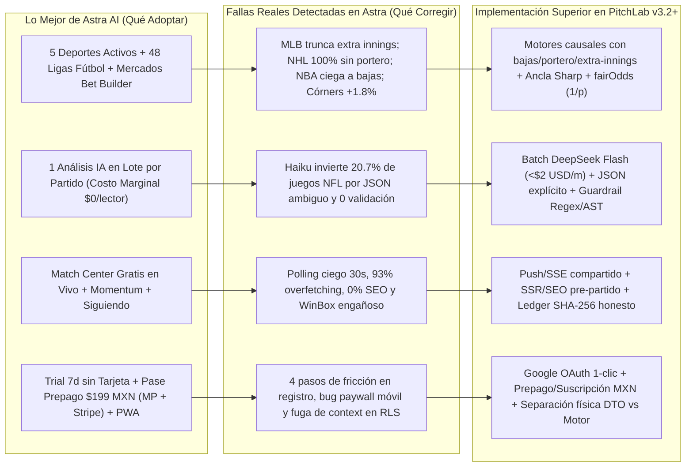

# 17 — Plan Maestro de Mejoras para PitchLab a partir de Astra AI: Motores, IA, Funciones de Producto, UX y Monetización

> **Propósito:** Traducir todos los hallazgos forenses de las Olas 1 y 2 sobre **Astra AI (`astraanalisis.com`)** en una guía concreta de **qué adoptar, qué mejorar y qué errores evitar** dentro de la arquitectura real de **PitchLab (`PREDLAB-V3.2`)**.  
> **Referencias base:** [PROJECT_STATE.md](file:///C:/Users/T490s/.gemini/antigravity/worktrees/PitchLab/analyze_pitchlab_competitor_rea/docs/execution/PROJECT_STATE.md), [00-REPORTE-MAESTRO-ASTRA-ANALISIS.md](file:///C:/Users/T490s/.gemini/antigravity/worktrees/PitchLab/analyze_pitchlab_competitor_rea/Reportes/analisis-astra/00-REPORTE-MAESTRO-ASTRA-ANALISIS.md), [11-rutas-ocultas-movil-y-flujos-no-explorados.md](file:///C:/Users/T490s/.gemini/antigravity/worktrees/PitchLab/analyze_pitchlab_competitor_rea/Reportes/analisis-astra/11-rutas-ocultas-movil-y-flujos-no-explorados.md), [12-secretos-codigo-fuente-y-auditoria-100-modulos.md](file:///C:/Users/T490s/.gemini/antigravity/worktrees/PitchLab/analyze_pitchlab_competitor_rea/Reportes/analisis-astra/12-secretos-codigo-fuente-y-auditoria-100-modulos.md), [13-superficie-oculta-supabase-openapi-auth-y-rls.md](file:///C:/Users/T490s/.gemini/antigravity/worktrees/PitchLab/analyze_pitchlab_competitor_rea/Reportes/analisis-astra/13-superficie-oculta-supabase-openapi-auth-y-rls.md), [14-auditoria-empirica-bd-calibracion-picks-y-alucinaciones.md](file:///C:/Users/T490s/.gemini/antigravity/worktrees/PitchLab/analyze_pitchlab_competitor_rea/Reportes/analisis-astra/14-auditoria-empirica-bd-calibracion-picks-y-alucinaciones.md), [15-infraestructura-expo-eas-dns-y-superficie-externa.md](file:///C:/Users/T490s/.gemini/antigravity/worktrees/PitchLab/analyze_pitchlab_competitor_rea/Reportes/analisis-astra/15-infraestructura-expo-eas-dns-y-superficie-externa.md) y [16-grafo-semantico-rea-agentenv-y-ventaja-pitchlab.md](file:///C:/Users/T490s/.gemini/antigravity/worktrees/PitchLab/analyze_pitchlab_competitor_rea/Reportes/analisis-astra/16-grafo-semantico-rea-agentenv-y-ventaja-pitchlab.md).

---

## 1. Diagnóstico Ejecutivo: Dónde Nos Lleva Ventaja Astra Hoy y Dónde Está Rota

PitchLab (`PREDLAB-V3.2`) ya supera ampliamente a Astra AI en **rigor matemático, calibración probabilística (`ECE = 0.0025` vs `0.0563`), desmarginado de cuotas (*de-vig*), detección de líneas rezagadas ([stale_lines.ts](file:///C:/Users/T490s/.gemini/antigravity/worktrees/PitchLab/analyze_pitchlab_competitor_rea/src/domain/prediction/stale_lines.ts)) e integridad auditable ([ledger.ts](file:///C:/Users/T490s/.gemini/antigravity/worktrees/PitchLab/analyze_pitchlab_competitor_rea/src/domain/prediction/ledger.ts))**.

Sin embargo, Astra AI tiene **aciertos de producto, amplitud de mercados/deportes, narrativa IA pre-generada y monetización en México** que explican su tracción comercial inicial. Al mismo tiempo, la auditoría forense demostró que casi cada pieza de Astra contiene **defectos matemáticos, técnicos o de integridad** que PitchLab puede resolver de raíz al construir su propia versión.

---

## 2. Mejoras en Motores Estadísticos y Cobertura Multi-Deporte

### 2.1 Mercados Secundarios de Fútbol para *Crear Apuesta* (*Bet Builder*)
- **Qué tiene Astra:** Además de `1X2`, `Over/Under` y `BTTS`, proyecta **tiros de esquina (`corners_home`, `corners_away`, `corners_total`)**, **faltas (`fouls_total`)**, **remates a puerta (`shots_on_target`)**, **posesión esperada** y **tarjetas amarillas** con Binomial Negativa + *shrinkage* Empirical Bayes por árbitro ($k = 15$ partidos en `predictions.context`).
- **Defecto comprobado en Astra:** En los `1,339` partidos auditados en [14-auditoria-empirica-bd-calibracion-picks-y-alucinaciones.md](file:///C:/Users/T490s/.gemini/antigravity/worktrees/PitchLab/analyze_pitchlab_competitor_rea/Reportes/analisis-astra/14-auditoria-empirica-bd-calibracion-picks-y-alucinaciones.md), su modelo de córners (`MAE = 2.7375`, $r = 0.2156$) apenas mejora **`+1.84%`** sobre predecir siempre la media climatológica (`9.60`), porque modela los córners como tasas estáticas independientes del marcador esperado.
- **Cómo mejorarlo en PitchLab:**
  1. Modelar córners, tiros y tarjetas **condicionados al diferencial de goles esperado ($\lambda_H - \lambda_A$), probabilidad de ir perdiendo del favorito (*game-state pressure*) y ritmo de liga**.
  2. Mantener el *shrinkage* Empirical Bayes para árbitros ($k \in [12, 20]$ optimizado en `walk_forward_dev`), pero cruzar la distribución Binomial Negativa contra líneas reales (`Over 8.5 / 9.5 / 10.5`) publicando **`fairOdds = 1/p`** únicamente en ligas donde el `Log-Loss` supere la climatología fuera de muestra.

### 2.2 Escalamiento a 48+ Ligas, Torneos Internacionales y Selecciones (`cross_league` / `national`)
- **Qué tiene Astra:** Ajusta enfrentamientos inter-liga (Champions, Europa League, Libertadores) con coeficientes de país elevados a exponentes fijos (`0.50` en goles, `0.25` en córners) y aborta con un aviso `astra:data-notice` (`61` partidos sin pronóstico) cuando falta cobertura de `xG`.
- **Cómo mejorarlo en PitchLab:**
  1. Sustituir exponentes manuales por un **rating Elo/jerárquico inter-liga calibrado en `walk_forward_dev`** y anclado con [blend.ts](file:///C:/Users/T490s/.gemini/antigravity/worktrees/PitchLab/analyze_pitchlab_competitor_rea/src/domain/prediction/blend.ts) a la apertura *sharp* desmarginada cuando exista mercado.
  2. Implementar **degradación elegante por nivel de cobertura (`featureCoverage`)** en lugar de abortar el pronóstico: si una liga secundaria no reporta `xG`, el motor cae limpiamente al sub-modelo calibrado de goles + Elo + mercado, etiquetando la cobertura con total transparencia.

### 2.3 Motor MLB (`F5` + Juego Completo) sin Sesgo de Truncamiento
- **Qué tiene Astra:** Proyección multiplicativa por tramos (`5/9 FIP_SP + 4/9 FIP_BP`) ajustada por `wOBA / avg_wOBA` y `factor_parque` sobre una convolución Binomial Negativa ($r_5 = 5, r_4 = 4$).
- **Cuatro defectos matemáticos probados en Astra:**
  1. **Bug de truncamiento en `totales_mas_de_pct` y Runline `-1.5`:** Evalúa `P(H + A > L)` sobre la grilla de 9 entradas **sin sumar las $\ge 1$ carreras obligatorias de extra innings** cuando el partido llega empatado al final de la 9.ª (~`11%` de probabilidad), subestimando todos los *Overs* de juego completo entre **`2.5` y `4.0` puntos porcentuales**.
  2. **Ventaja de localía nula (`HCA = 1.000` y desempate `50/50`):** Ignora que el local en MLB gana ~`53.5%–54.0%` en duelos parejos y batea al cierre de extra innings con corredor fantasma en 2.ª base (regla Manfred).
  3. **Cero *platoon splits* y cero *shrinkage* de pitcheo:** Usa `100%` `FIP` crudo de temporada sin regresar a la media a lanzadores de muestra corta (`< 100 IP`) e ignora `wOBA` contra zurdos vs derechos (`vs LHP` / `vs RHP`).
  4. **Colapso ante *openers* y corte rígido `5.0 / 4.0`:** Falla cuando anuncia un relevista *opener* (`game_id = 849815`) y asume 5 entradas fijas de abridor incluso en playoffs (~`4.1 IP` reales).
- **Cómo mejorarlo en PitchLab:**
  - Convolución Binomial Negativa por tramo con **distribución explícita de entradas esperadas del abridor ($\mathbb{E}[\text{IP}_{\text{SP}}]$)** —soportando nativamente *openers* con `1.0–1.5 IP`—, **`xFIP`/`SIERA` contraído por tamaño de muestra**, ***platoon splits* LHP/RHP**, **ventaja local calibrada** y **cadena de Markov exacta para extra innings con corredor en 2.ª base** al integrar totales y *runlines*.

### 2.4 Motor NHL con Confirmación Real de Porteros
- **Qué tiene Astra:** Excelente estructura base con modelo propio de `xG` por tiro (`AUC = 0.7477` en `93,598` tiros de `api-web.nhle.com`), desglose por fuerza (`5v5`, `PP`, `SH`), ajuste de definición, efecto de portería vacía (`+8.1%`) y Monte Carlo para OT/SO.
- **Defecto operativo crítico en Astra:** El **`100.0%` de los `354` slots de portero (`177` juegos)** entró con `confirmado = false` (usando por defecto al portero con más aperturas), hundiendo su `Brier Skill Score` a apenas **`+4.30%`** (frente a `+21.23%` en NBA y `+23.72%` en NFL).
- **Cómo mejorarlo en PitchLab:**
  - Conectar un recolector pre-partido de **portero titular confirmado** (`GSAX/60` bayesiano del titular real + penalización explícita de *back-to-back* / viaje por husos horarios), recalculando automáticamente el `MatchOutlook` cuando se confirma el *goalie* en la mañana del juego.

### 2.5 Motores NBA y NFL Sensibles a Bajas Estelares y Ancla de Mercado
- **Qué tiene Astra:** En NBA usa `0.75 * NetRating + 0.25 * Elo + descanso` ($\sigma \approx 12.25$); en NFL usa `0.35 * Puntos + 0.30 * EPA + 0.35 * Elo + QB + clima/domo` ($\sigma = 13.00$).
- **Defecto crítico en Astra:** Su motor NBA **ignora por completo las lesiones** en la ecuación matemática (solo pasa `bajas_reportadas` como texto a Claude), provocando casos reales como `Pacers vs Knicks` (`401909296`) donde proyecta `71.1%` mientras el texto admite que el modelo no descuenta bajas titulares.
- **Cómo mejorarlo en PitchLab:**
  1. **NFL:** Promover nuestro candidato causal ya construido [model_nfl_v3_2_candidate.json](file:///C:/Users/T490s/.gemini/antigravity/worktrees/PitchLab/analyze_pitchlab_competitor_rea/src/data/prediction/model_nfl_v3_2_candidate.json) (`41` features EPA `nflverse`, `83.83%` cobertura viva) en cuanto se completen los `>= 64` cierres *sharp* liquidados, mezclado con consenso/apertura *sharp*.
  2. **NBA:** Incorporar **impacto individual por quinteto proyectado (`BPM` / `EPM` ponderado por minutos reemplazados)** descontado directamente en el margen esperado antes de transformar a probabilidad, más bandera obligatoria de incertidumbre cuando una estrella está `Questionable` (`GTD`).

### 2.6 Recalibración Probabilística Completa (Eliminar la Subconfianza de Astra)
- **Qué ocurre en Astra:** Sus modelos presentan `ECE = 0.0563` por subconfianza fuerte (cuando predicen `80.9%` aciertan `91.4%`, pero solo alcanzan `>= 75%` en el `6.0%` de los juegos).
- **Ventaja de PitchLab:** Conservar en todos los deportes nuestra capa de **calibración isotónica / temperatura + mezcla logit con mercado sin margen** ([outlook.ts](file:///C:/Users/T490s/.gemini/antigravity/worktrees/PitchLab/analyze_pitchlab_competitor_rea/src/domain/prediction/outlook.ts)), asegurando que `70%` signifique exactamente `70%` de frecuencia empírica.

---

## 3. Motor Narrativo de IA: Costo Marginal \$0 con *Guardrails* Deterministas

Astra acertó al **no exponer un chatbot abierto** (que dispara costos por usuario) y en su lugar **pre-generar 1 análisis estructurado por partido en lote**, pero al recortar costos el `23-oct` pasando de `claude-sonnet-5-5` (`0` inversiones en `554` juegos) a `claude-haiku-5-5`, introdujo **`20.69%` (`6/29`) de inversiones completas Local/Visitante + QBs en NFL** y contradicciones aritméticas (`"30% supera ligeramente el 43%"`).

### Arquitectura Superior para PitchLab:
1. **Generación Batch Única por Partido con `DeepSeek V4.1 Flash` (o equivalente rápido):**
   - Costo estimado en [STACK_COSTO_CERO.md](file:///C:/Users/T490s/.gemini/antigravity/worktrees/PitchLab/analyze_pitchlab_competitor_rea/docs/architecture/STACK_COSTO_CERO.md): **`< \$2 USD/mes` (`~\$40 MXN/mes`)** para `6,000` análisis mensuales, con **costo marginal `\$0.00`** por lector y regeneración selectiva únicamente si cambia el XI confirmado / QB / portero titular.
2. **Contrato de Entrada Auto-Descriptivo (Imposible de Invertir):**
   - Prohibido enviar objetos mudos `ratings.home` / `ratings.away` junto a un título ambiguo `"Local vs Visitante"`. Cada nodo del JSON llevará explícitamente `{ team_id, team_name, abbrev, venue_role: "LOCAL_EN_CASA" | "VISITANTE_FUERA" | "SEDE_NEUTRAL", win_prob_pct, fair_odds_decimal, starter_qb_or_goalie }`.
3. **Validador Determinista Post-LLM (*Hard Gate* antes de insertar en BD):**
   - Un validador automático verifica antes de persistir:
     - **Alineación entidad-rol:** ningún jugador/QB/abridor del visitante puede aparecer asociado como titular del local.
     - **Consistencia numérica:** todo porcentaje o cuota citado en el texto debe coincidir dentro de `±0.5 pp` con `MatchOutlook`, y el equipo nombrado como favorito debe ser $\arg\max(p)$.
     - **Higiene léxica:** rechazo inmediato de muletillas de chat o autocorrecciones (`"perdón"`, `"el JSON"`, `"como modelo de IA"`), así como cero consejos de *stake* o incitación a apostar.
   - Si tras `1` reintento falla el validador, el sistema publica automáticamente una **síntesis determinista por plantillas** (`0%` alucinaciones garantizado).

---

## 4. Funciones de Producto y Experiencia de Usuario (UX)

| Área Funcional | Cómo Funciona Hoy en Astra AI | Cómo Construirlo Mejor en PitchLab |
|---|---|---|
| **1. *Match Center* Diario Gratuito (Motor de Adquisición)** | Calendarios, marcadores, eventos minuto a minuto, curva de *Momentum*, clasificaciones y boxscore NBA son públicos y gratuitos para crear hábito diario y empujar al `<Paywall>`. | Mantener el *Match Center* 100% abierto, pero reemplazar el *polling* individual de cada navegador (`30 s` incluso en juegos ya finalizados, Cap. `13`) por **1 worker centralizado que publica deltas vía SSE / WebSockets / caché Edge (`max-age=15, stale-while-revalidate`)**, reduciendo en `>90%` las lecturas a BD. |
| **2. Cruce de Modelo vs Cuotas Reales (`MatchOddsCard` + `WinBox`)** | Pinta momios decimales de una sola casa (Marathonbet o DraftKings ocultando el nombre y la hora) en una pestaña separada, sin *de-vig*, sin `fairOdds` y sin `EV`. | Unificar en la tarjeta principal de [outlook.ts](file:///C:/Users/T490s/.gemini/antigravity/worktrees/PitchLab/analyze_pitchlab_competitor_rea/src/domain/prediction/outlook.ts): **Probabilidad PitchLab (`p`)**, **Cuota Justa sin Margen (`fairOdds = 1/p`)**, **Cuota Referencia + Casa + Timestamp**, **Margen de la casa (`vig %`)** y **Pulso de Mercado** ([market-pulse.ts](file:///C:/Users/T490s/.gemini/antigravity/worktrees/PitchLab/analyze_pitchlab_competitor_rea/packages/contracts/src/market-pulse.ts)), más mini-calculadora interactiva de *de-vig*. |
| **3. Liquidación Visual y Récord Histórico (`WinBox` + `astra_picks`)** | `WinBox` pinta siempre un *check* verde `#5FD39A` en la casilla del resultado real ocurrido aunque Astra le diera `14%` (Cap. `12`), y `astra_picks` tuvo inserciones >70 min después de terminado el partido (Cap. `14`). | **Transparencia radical como arma comercial:** mostrar evaluación honesta de calibración por partido, bloquear criptográficamente cualquier registro al `kickoff` con [ledger.ts](file:///C:/Users/T490s/.gemini/antigravity/worktrees/PitchLab/analyze_pitchlab_competitor_rea/src/domain/prediction/ledger.ts) (`SHA-256`) y abrir una ruta pública **`/calibracion`** con curvas reales `ECE`, `Brier`, `Log-Loss` y `CLV%`. |
| **4. Monitor de Partidos y Métricas en Vivo (`/siguiendo`)** | Permite seguir hasta 20 partidos y hasta 6 estadísticas en vivo por partido (`xG`, tiros, córners, pases), guardado solo en `localStorage` (`astra.followed-matches.v1`). | Sincronizar favoritos y métricas seguidas en la **base de datos de usuario** (multidispositivo), corregir el bug de partidos en vivo ausentes en búsqueda (`BUG-02`, Cap. `12`) y añadir **notificaciones Web Push** (inicio, XI confirmado, cambio brusco de línea o ritmo de métrica). |
| **5. Perfiles de Equipo e Historial Híbrido (`/equipo`, `/historial`)** | Muestra racha, resumen de fuerzas del modelo y reconstruye bajo demanda partidos pasados no guardados (`stored: false` vía ESPN/MLB/NHL). | Persistir en caché R2/Redis las fichas reconstruidas (evitando llamadas frías y los `HTTP 404` vistos en MLB `team_id=19`) y servir el resumen del equipo desde una **vista SQL/DTO proyectada**, sin enviar jamás el `context` crudo al navegador. |
| **6. Estación de Trabajo Desktop (3 Columnas) + UI Móvil Ágil** | En escritorio (`>= 1024px`) usa 3 columnas sin recargar (`Sidebar Ligas + Cartelera + Detalle`) y en móvil un dock flotante *Liquid Glass*. | Adoptar el layout maestro-detalle de 3 paneles en Desktop y navegación inferior limpia en móvil, pero con **SSR / SSG real en Next.js / Edge**, `robots.txt` y `sitemap.xml` dinámicos (capturando todo el SEO orgánico que la SPA vacía de Astra desperdicia) y cero bloqueos de `2,000 ms` como `<LaunchSplash>` (`FCP < 400 ms` real, frente al `FCP = 0 ms` de Astra). |
| **7. Panel de Operaciones (`/administracion`)** | Solo muestra 9 KPIs de cuentas/ventas/lecturas IA; carece de métricas de exactitud de modelos y su código viaja en el bundle público. | Aislarlo 100% en servidor (cero código admin en el bundle cliente) e integrar **telemetría cuantitativa en vivo**: `ECE` rolling 30d, `CLV%`, cobertura de features (`B2`), latencia de scrapers/APIs, tasa de rechazos del validador LLM y costo diario de tokens. |

---

## 5. Monetización en México, Onboarding y Seguridad Arquitectónica

### 5.1 Lo que Debemos Adoptar y Mejorar del Embudo Comercial de Astra
1. **Esquema Híbrido `Pase Prepago Acumulable (\$199 MXN / 30d)` + `Suscripción con Descuento`:**
   - El pase prepago de **\$199 MXN por 30 días sin cobro recurrente automático** vía **Mercado Pago (SPEI, OXXO, saldo MP) + Stripe** elimina la principal objeción del consumidor mexicano (temor a cargos domiciliados difíciles de cancelar) y permite acumular tiempo (`"Agregar 30 días"` antes de Liguilla o Playoffs).
   - Mejora PitchLab: sumar en paralelo un **plan recurrente/anual con descuento** (p. ej. \$159 MXN/mes o \$1,390 MXN/año) para capturar mayor `LTV` en usuarios recurrentes, y mejorar `/pago/[id]` combinando *webhooks* instantáneos con estado en tiempo real.
2. **Trial de 7 Días sin Tarjeta + Registro en 1 Clic (`Google OAuth`):**
   - Astra pierde conversión al obligar a crear contraseña, ir al correo, abrir `/confirmado` (donde `detectSessionInUrl: false` ni siquiera inicia sesión automáticamente y el `#hash` tiene doble bug, Cap. `11`) y volver a iniciar sesión manualmente.
   - Mejora PitchLab: **Google OAuth en 1 clic** + confirmación rápida `+18` años en servidor -> acceso al trial en `< 8` segundos.
3. **Distribución *PWA-First* (`/instalar`) sin Comisión del 30%:**
   - Replicar la captura temprana de `beforeinstallprompt` + guía visual automática para iOS Safari ("Compartir -> Agregar a inicio") y Android, reteniendo **~`94%` del ingreso bruto** en web antes de considerar tiendas nativas.

### 5.2 Cinco Reglas de Blindaje Técnico (Para No Repetir las Fugas de Astra)
1. **Separación física entre tablas internas y vistas públicas:** Prohibido guardar hiperparámetros, pesos o matrices intermedias (`context`) en una tabla legible por clientes en partidos finalizados. El cliente solo lee el DTO cerrado `MatchOutlook`.
2. **Proyecciones SQL estrictas y cero *overfetching*:** Prohibido usar `select(*)` en joins (Astra desperdicia `89.9%` de bytes en `prediction` de fútbol y descarga `48.6 KB` de fútbol al abrir NBA). Cada vista pide exactamente las columnas que pinta.
3. **`AbortController` + detención de refresco en partidos finalizados:** Todo repositorio lleva timeout explícito (`5–8 s`), cancelación al desmontar ruta y `0` intervalos activos cuando `status` es `FT`/`final`.
4. **Higiene de bundle y cabeceras HTTP:** No incluir SDKs muertos (`124 KB` de `realtime-js`, `WebAuthn`, `Iceberg` y `react-native-url-polyfill` en Astra), ocultar rutas internas de framework (como `/_sitemap` expuesto en Astra) y servir desde el día 1 `Strict-Transport-Security`, `Content-Security-Policy` y `X-Frame-Options: DENY`.
5. **Espejo propio de escudos/logos en CDN (`Cloudflare R2`):** Evita depender en caliente de BunnyCDN (`media.api-sports.io`, mediana `734 ms` en Astra) y reduce el tiempo de pintado visual a `< 50 ms`.

---

## 6. Hoja de Ruta Priorizada de Ejecución (`P0` -> `P2`)

| Prioridad | Bloque de Trabajo | Impacto Directo frente a Astra AI |
|---|---|---|
| **`P0` (Semana 1–2)** | 1. Conectar `API_FOOTBALL_KEY` (\$19–\$29 USD/mes) + `THE_ODDS_API_KEY` al programador multi-tick ya construido (`B3`/`B7`). 2. Exponer en UI `MatchOutlook v3.2` (`11` mercados fútbol + NFL) con **`fairOdds = 1/p`** + `MarketPulse`. 3. Activar el generador narrativo en lote (`DeepSeek Flash`) con **validador determinista post-LLM**. 4. Publicar `/calibracion` con curvas `ECE` reales y verificador `SHA-256` de [ledger.ts](file:///C:/Users/T490s/.gemini/antigravity/worktrees/PitchLab/analyze_pitchlab_competitor_rea/src/domain/prediction/ledger.ts). | Supera de inmediato la mayor debilidad de Astra (cuotas desconectadas, alucinaciones en NFL y cero pruebas de calibración) a un costo operativo menor. |
| **`P1` (Semana 3–4)** | 1. Embudo **Google OAuth 1-clic + Trial 7d + Pase Prepago \$199 MXN (Mercado Pago + Stripe)**. 2. Instalador PWA `/instalar` + SSR/SEO pre-partido con `sitemap.xml` real. 3. *Match Center* en vivo eficiente (marcador, eventos, *Momentum* y `/siguiendo` persistido en cuenta + Web Push). | Iguala su mejor motor de adquisición/conversión en México eliminando su fricción de registro, su *polling* ineficiente y su ceguera SEO. |
| **`P2` (Mes 2)** | 1. Mercados secundarios de Fútbol condicionados al guion (`córners`, `tarjetas`, `tiros`) validados en `walk_forward_dev`. 2. Encendido diario de **NBA** (con impacto de bajas `EPM`/`BPM`), **MLB** (con extra innings + *splits* + HCA + *openers*) y **NHL** (con portero confirmado). 3. Panel `/administracion` server-only con salud cuantitativa en vivo. | Cierra la brecha de amplitud multi-deporte y de *Bet Builder* con motores estrictamente superiores a los de Astra en los 5 deportes. |
