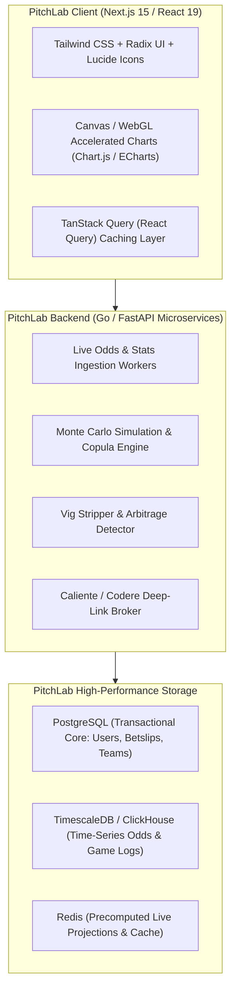

# PitchLab Engineering & Product Handoff Dossier

## 1. Executive Summary & Purpose

This handoff dossier synthesizes the exhaustive reverse engineering investigation of **LineMate** (`https://linemate.io/nfl`) conducted by the Principal Reverse Engineering, Architecture, Data Engineering, and Quantitative Modeling teams.

Its purpose is to provide the PitchLab engineering, data, and product teams with an authoritative, self-contained implementation blueprint to construct an original, superior sports intelligence superapp without needing to repeat the discovery phase.

---

## 2. Product Architecture & Feature Inventory

### 2.1 Complete Feature Inventory:
1. **Home Matchups Dashboard**: Weekly matchup scheduler displaying team marks, codes, kickoff times, betting consensus totals, and game status.
2. **Trending Straight Feeds**: Ranked feeds of individual player and team props hitting at high historical frequencies, categorized by signals (`RECENT_FORM`, `HEAD_TO_HEAD`, `HOME_SPLIT`, `AWAY_SPLIT`, `INJURY_IMPACT`, `OPPONENT_RANK`, `WEATHER`).
3. **100% Club Cheatsheets**: Dedicated carousels isolating props with 100% historical compliance over recent windows (Recent Form, Alternate Lines, 1st Quarter, Home/Away, Unders Only).
4. **Player Props Workstation**:
   - Interactive bar chart (`HitRateChart.jsx`) powered by Nivo with spring animations and dynamic opacity for hits (1.0) vs misses (0.5).
   - Dynamic line scrubber recomputing hit rates, averages, and home/away splits in memory.
   - Granular timeframe filters (`LAST_5`, `LAST_10`, `LAST_20`, `LAST_30`, `SEASON_2026`, `PLAYOFF`, `RANGE_2024_2026`).
   - Situational filters (`withPlayerIds`, `withoutPlayerIds`).
5. **Historical Boxscores (`GamelogDetails`)**: Chronological tabular game logs with sticky opponent columns, color-coded hit badges, and market-specific supporting stats.
6. **Defensive Matchup Rankings (`OpponentDefensiveRank`)**: 32-team ranking sorting opponents by statistical yardage allowed per category.
7. **Same Game Parlays (SGP) & Cross Game Parlays**: Multi-leg bet combinations paired by minimum historical win rate heuristics.
8. **Multi-Sportsbook Price Comparison**: Real-time odds comparison across 19 bookmakers, DFS apps, and prediction exchanges.
9. **OCR Betslip Scanner (`BetslipImportZone`)**: Machine vision image upload extracting legs and analyzing historical trends from user screenshots.
10. **Freemium & Gated Entitlements**: Multi-tiered access (`0 = SUPERUSER, 1 = FREE, 2 = TRIAL, 3 = PAID`) enforced via Firebase Authentication and Stripe Billing.

---

## 3. Data Entities, Schemas & Upstream Provenance

### 3.1 Provenance Proof:
- **Core Statistics**: **Sportradar AG** (Confirmed by `SRID: "sr:player:1692915"`, `sr:competitor:4427`, `sr:match:71516008`).
- **Fantasy Identity**: **Sleeper API** (`sleeperId: "8155"`).
- **Prediction Markets**: **Kalshi Trading API** (`ticker: "KXNFLTD-26NOV08DALIND-INDDJONES17-1"`).
- **Odds Aggregation**: Real-time B2B feeds (Don Best / The Odds API) with deep link selection IDs.

### 3.2 Canonical Data Models:
The canonical TypeScript models and JSON schemas are fully authored and archived in `research/linemate/evidence/data-models/pitchlab_nfl_models.ts`.

---

## 4. Mathematical Engine Specifications

### 4.1 Observable Hit Rate Formula (`buildTrendsData`):
$$\text{Hit Rate} = \text{round}\left( \frac{\text{Hits}}{n} \times 100, 1 \right)$$
$$\text{Average} = \text{round}\left( \frac{\sum_{i=1}^{n} s_i}{n}, 1 \right)$$
- **Pushes**: In LineMate, pushes increment the denominator $n$ but not the numerator, effectively treating pushes as losses in percentage terms.
- **PitchLab Upgrade**: PitchLab computes both Raw Hit Rate and Decisive Hit Rate ($\frac{\text{Hits}}{\text{Hits} + \text{Misses}} \times 100$).

### 4.2 Opponent Ranking Formula (`buildTeamPropRankings`):
- Computes mean stat allowed per game for all 32 teams.
- Sorts ascending (`ASC`) for offensive stats allowed (Rank 1 = stingiest defense; Rank 32 = most generous).
- **PitchLab Upgrade**: Replace raw yards with opponent EPA/play allowed, DVOA, and pace-adjusted efficiency.

---

## 5. Technology Stack & Client Architecture

---

## 6. Comprehensive Feature Comparison & Blueprint Matrix

| Feature | Evidencia | Algoritmo | Datos | Limitación | Mejora PitchLab |
| :--- | :--- | :--- | :--- | :--- | :--- |
| **Player Props Screener** | `Props.jsx`, `/api/nfl/v3/markets/hitRates` | Precomputed hit rate sorting over Last 5, 10, Season | Sportradar game logs + Live odds snapshot | Treats past frequency as future probability | **Probabilistic +EV Screener**: Sort by Model Edge % and Expected Value. |
| **Hit Rate Engine** | `betting-utils.js` (lines 115-173) | `hits / total_games * 100` | Historical game array | Pushes reduce hit rate percentage; no DNP snap threshold | **Dual Metric**: Show Raw Hit Rate, Decisive Hit Rate (push-refunded), and Push Rate. |
| **Workstation Chart** | `HitRateChart.jsx`, `@nivo/bar` | Nivo SVG bar chart with opacity modulation | Chronological game logs | Heavy SVG DOM overhead; no model distribution overlay | **Canvas / WebGL Engine**: 60fps mobile chart with simulated probability density overlay. |
| **Situational Splits** | `TrendsWorkstation.jsx`, `withoutPlayerIds` | SQL array exclusion filter (`where teammate != id`) | 3-year historical game logs | Small sample noise (1-2 games); no causal reallocation model | **Depth Chart Target Reallocation**: Bayesian projection model redistributing vacant targets. |
| **Opponent Rankings** | `OpponentDefensiveRank.jsx`, `util.js:965` | Sort 32 teams by raw stat allowed per game | Team cumulative defensive stats | Ignores Strength of Schedule, defensive scheme, and game pace | **Pace & EPA-Adjusted Matchups**: DVOA / EPA per play allowed by receiver alignment (Slot vs Wide). |
| **Same Game Parlays** | `parlays_sgp_sample.json`, `Trends.jsx` | Match 2-3 straight trends meeting 80%+ frequency | Straight trend objects | Zero covariance calculation; blind to sportsbook parlay vig | **Copula Correlation Engine**: Gaussian copula calculating true joint win probability and fair odds. |
| **Sportsbook Odds** | `player_markets_sample.json`, 19 books | Compare prices and display maximum decimal/american | Live operator odds snapshot | No Mexican sportsbooks; no line movement tracking | **Mexico-First Odds Engine**: Direct integration of Caliente.mx and Codere.mx in $MXN. |
| **Line History & CLV** | API payloads (`opening: null`) | None (Only current snapshot retained) | Transient memory | Zero line history; no closing line value tracking | **Time-Series Odds Tracking**: Track opening, steam moves, and lifetime user CLV in TimescaleDB. |
| **Subscription Paywall**| `Pricing.jsx`, `constants.js:11147` | Integer access levels (`0-3`), Stripe checkout | Firebase Custom Claims | US-centric pricing ($14.99 USD/mo); card-only payment | **Accessible LATAM Pricing**: $149 MXN/mo via OXXO Pay, SPEI, Mercado Pago, and Cards. |
| **Betslip Scanning** | `BetslipImportZone.jsx` | OCR image processing via `/api/betslip/v1/analyzeImage` | User screenshot image | Basic trend mapping | **AI Slip Analyzer**: Real-time slip grading against +EV models with alternative line recommendations. |

---

## 7. Data Vendor Selection Matrix for PitchLab

| Datos requeridos | Fuente candidata | Históricos | Licencia SaaS | Costo conocido | Recomendación PitchLab |
| :--- | :--- | :--- | :--- | :--- | :--- |
| **Calendarios, Equipos y Rosters NFL** | **Sportmonks API** | 10+ años | Sí (Comercial SaaS) | **\$150 – \$300 USD / mes** | **Adopción Inmediata**: Excelente relación costo-beneficio para la capa base. |
| **Estadísticas NFL Play-by-Play y Boxscores** | **Sportradar AG (NFL Official)** | 15+ años | Sí (Enterprise B2B) | **\$3,500 – \$8,000 USD / mes** | **Fase 2 / Escalamiento**: Reservar para cuando la plataforma supere los 1,000 usuarios de pago. |
| **Cuotas y Props Multicasa (US y Global)** | **The Odds API** | 1–3 años | Sí (Comercial SaaS) | **\$150 – \$600 USD / mes** | **Adopción Inmediata para MVP**: Cobertura robusta de DraftKings, FanDuel, Bet365, Caesars. |
| **Cuotas de Casas Mexicanas (Caliente.mx, Codere)**| **Cluster Interno de Extracción (Playwright)**| Tiempo real | N/A (Infraestructura propia) | **\$150 USD / mes** (Proxies residenciales) | **Desarrollo Interno Obligatorio**: Caliente.mx no vende API B2B pública. |
| **Cuotas Sharp de Referencia (Sin Margen)** | **Pinnacle API** | Tiempo real | Sí (B2B Partner) | Gratuito / Bajo volumen con cuenta | **Adopción Inmediata**: Fundamental para calcular la probabilidad real del mercado. |
| **Mercados de Predicción de Eventos** | **Kalshi Trading API** | Tiempo real | Sí (CFTC Public Data) | Gratuito con rate limits estándar | **Adopción Inmediata**: Integración única de contratos de eventos en tiempo real. |

---

## 8. Phased Engineering Roadmap

### Phase 1: MVP Core (Weeks 1–6)
- Setup PostgreSQL + TimescaleDB database schemas based on `pitchlab_nfl_models.ts`.
- Ingest NFL schedules, rosters, and 5-year historical boxscores via Sportmonks.
- Ingest real-time player props and odds via The Odds API.
- Deploy internal scraper for Caliente.mx live prop odds.
- Implement the PitchLab Dual Hit Rate Engine (Raw vs Decisive Push-Adjusted).
- Launch Next.js 15 responsive web application with interactive player workstation, Nivo/Canvas charts, and Home dashboard.
- Launch Stripe Mexico payment integration supporting cards, OXXO Pay, and SPEI.

### Phase 2: Quantitative Modeling & Mexican Parity (Weeks 7–12)
- Deploy the **Negative Binomial / Skew-Normal Ensemble Predictive Model** for NFL player props.
- Implement 10,000-run Monte Carlo game simulations prior to weekly kickoffs.
- Launch the **+EV Screener**, highlighting lines where model probability exceeds sportsbook implied odds.
- Integrate Codere.mx and Betcris into the Mexican odds comparison engine.
- Launch automated OCR betslip scanner (`/scan`).

### Phase 3: Advanced Intelligence & Expansion (Weeks 13–18)
- Launch the **Copula SGP Correlation Engine**, calculating fair joint probabilities for Same Game Parlays.
- Launch **Time-Series Line Movement Charts** and Closing Line Value (CLV) user tracking.
- Integrate the PitchLab AI Natural Language Assistant ("Analista PitchLab") for conversational statistical queries.
- Expand data pipelines to NBA, MLB, and Liga MX soccer.
