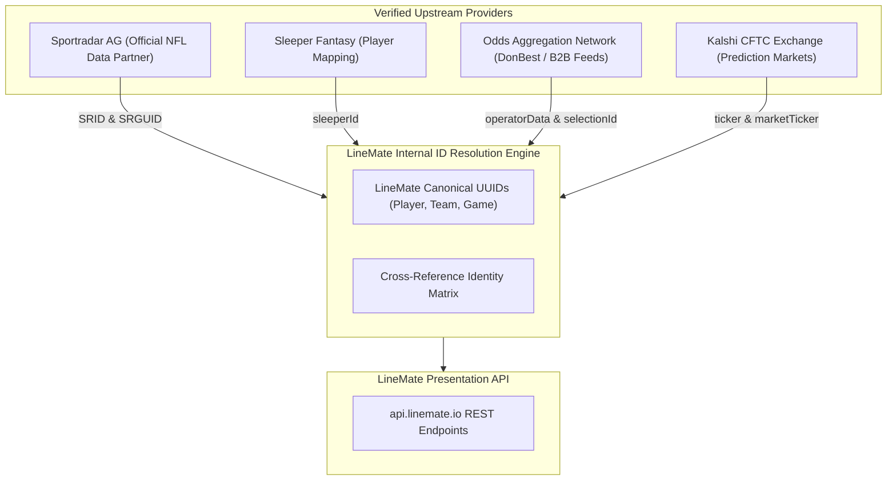

# Data Provenance, Vendor Ecosystem, and ID Resolution

## 1. Upstream Data Source Identification

A critical objective of this reverse engineering effort was to definitively identify the upstream sports data feeds, odds aggregators, and third-party services powering LineMate, based on verifiable forensic evidence rather than speculation.



---

## 2. Forensic Evidence of Primary Data Providers

### 2.1 Sportradar AG — Core Statistics & Game Feeds
Inspection of live API payloads for teams, players, and games (`research/linemate/evidence/network-schemas/`) confirms direct reliance on **Sportradar AG**:

1. **Player Entity Proof**:
   ```json
   {
     "playerId": "b633d550-9ff2-4ae1-9528-4a65680e248d",
     "fullName": "Breece Hall",
     "SRID": "sr:player:1692915",
     "SRGUID": "db1053d7-3343-43a3-9aab-8353f10f1221"
   }
   ```
   - `SRID: "sr:player:1692915"` matches the canonical Sportradar API identifier for Breece Hall across Sportradar's NFL v7 API.
   - `SRGUID` matches Sportradar's Global Unique Identifier.
2. **Team / Competitor Entity Proof**:
   ```json
   {
     "teamId": "2b4a534d-5950-4fff-8c15-5a81f247e652",
     "name": "Jets",
     "code": "NYJ",
     "SRID": "sr:competitor:4427",
     "SRGUID": "5fee86ae-74ab-4bdd-8416-42a9dd9964f3"
   }
   ```
   - `sr:competitor:4427` is Sportradar's official competitor ID for the New York Jets.
3. **Game Entity Proof**:
   ```json
   {
     "id": "20261112-WAS-NYG",
     "srGameId": "5ab9e951-17ea-4e84-9c6c-5ce04ac073ad",
     "providerIds": {
       "opta": null,
       "statsPerform": null,
       "sportradar": "sr:match:71516008",
       "sportradarGlobal": "5ab9e951-17ea-4e84-9c6c-5ce04ac073ad"
     }
   }
   ```
   - Notice the multi-provider structure: `opta` is reserved for soccer, `statsPerform` is reserved for international leagues, and `sportradar` is explicitly populated with the match URN `sr:match:71516008`.

### 2.2 Sleeper Fantasy API
The player objects contain an explicit `sleeperId`:
```json
"sleeperId": "8155"
```
This is the player ID used by the Sleeper Fantasy Football API, enabling LineMate to integrate fantasy league rosters and community sentiment.

### 2.3 Kalshi & Prediction Markets
In player prop markets (`research/linemate/evidence/network-schemas/player_markets_sample.json`), the `kalshi` bookmaker entry contains:
```json
"operatorData": {
  "ticker": "KXNFLTD-26NOV08DALIND-INDDJONES17-1",
  "link": "https://kalshi.com/markets/kxnfltd/kxnfltd/kxnfltd-26nov08dalind?marketTicker=KXNFLTD-26NOV08DALIND-INDDJONES17-1&orderSide=yes",
  "marketId": "KXNFLTD-26NOV08DALIND"
}
```
This confirms direct ingestion of CFTC-regulated event contract order books from the official Kalshi Trading API.

### 2.4 Sportsbook Odds Aggregation
LineMate connects to standard B2B odds feeds (such as Don Best Sports, The Odds API, or an internal scraping/web-socket cluster), evidenced by the `operatorData` metadata containing exact sportsbook outcome IDs:
- **DraftKings**: `"outcomeId": "0QA385163667#2347045612_13L88808Q1-1969802282Q20"`
- **FanDuel**: `"selectionId": "16544531"`, `"marketId": "42.622580976"`
- **Bet365**: `"selectionId": "203634370-365955612~6/1"`
- **Caesars**: `"selectionId": "f3bc7474-ec2e-3bd5-a1ed-3d88f4e41078"`

---

## 3. Player Identity & Cross-Season Consistency

LineMate resolves identity discrepancies through a centralized UUID mapping system:
1. **Internal Primary Key**: A persistent UUID (e.g. `playerId: "b633d550-9ff2-4ae1-9528-4a65680e248d"`).
2. **Team Changes**: When a player transitions to a new team (e.g. Daniel Jones moving from NYG to IND), historical game logs retain the historical `currentTeamId`, while the top-level player profile points to the new active `teamCode`.
3. **Duplicate Names**: Players sharing identical names (e.g. Josh Allen QB vs Josh Allen DE/LB) are isolated by their position code and distinct Sportradar URNs (`sr:player:...`).

---

## 4. Recommendations for PitchLab

1. **Direct Data Licensing for PitchLab**:
   - Rather than reselling or proxying unauthorized feeds, PitchLab should license official NFL data via **Sportradar B2B API** or **SportMonks / TheSportsDB** for baseline stats, and **The Odds API / OddsJam Enterprise** for multi-bookmaker player prop odds.
2. **Mexican Bookmaker Coverage**:
   - Sportradar feeds cover US books. For Mexico, PitchLab must integrate **Caliente.mx** (Playtech sports engine) and **Codere.mx**, which are absent from LineMate.
3. **Canonical Identity Ledger**:
   - PitchLab should implement an identity service mapping:
     `PitchLab_ID <-> Sportradar_ID <-> Sleeper_ID <-> ESPN_ID <-> Caliente_Selection_ID`.
