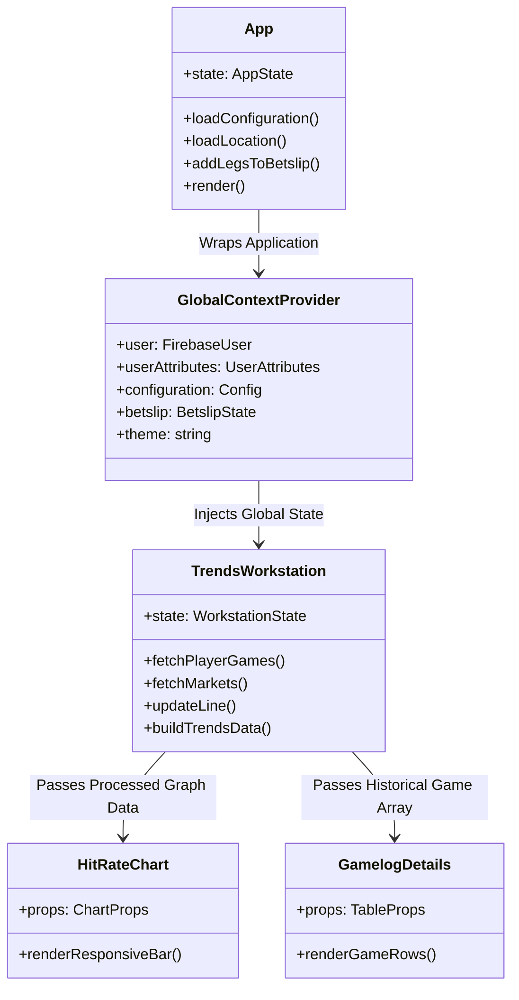

# Frontend Architecture & Client Analysis

## 1. Architectural Blueprint

LineMate's client-side application is structured as a Single Page Application (SPA) built on **React 18**, leveraging Webpack as the module bundler, SASS/SCSS for styling, and React Context for global state distribution.



---

## 2. Component Taxonomy & Responsibilities

Based on inspection of the 377 extracted application files in `research/linemate/evidence/javascript/extracted_src/`, the UI is decomposed into clean, domain-specific modules:

### 2.1 Navigation & Shell
- `NavigationBar.jsx`: Top app header. Houses brand logo, sport switcher dropdown (`NFL`, `NBA`, `MLB`, `NHL`, `Soccer`), primary tabs (`Home`, `Trends`, `Tools ▾`), search button, dark/light theme toggle, and auth CTAs (`Log in`, `Start free trial`).
- `Footer.jsx`: Institutional links, legal disclosures, terms of service, privacy choices dialog trigger, and responsible gambling helpline numbers.
- `HomeSidebar.jsx`: Right-hand desktop rail. Displays native app download prompts, Linemate+ upsell cards, "Most Bet On" vs "Most Searched" trending props, and active games per league.

### 2.2 Workstation Core (`components/TrendsWorkstation.jsx`, 1447 lines)
The central analytical engine of the client:
- Manages local state for:
  - `selectedCard`: Player or team entity.
  - `filters`: Timeframe (`LAST_5`, `LAST_10`, `LAST_20`, `SEASON`), Splits (`ALL`, `HOME`, `AWAY`), Opponent, With/Without teammate.
  - `hitRateLine`: The active numeric threshold line (e.g. `9.5`).
  - `markets`: Full map of sportsbook lines and odds.
- Triggers `getPlayerWorkstationGames(host, league, currentSeason, opponent, filters, playerId)` on any filter mutation.
- Invokes `buildTrendsData()` locally to calculate `hitPercentage`, `missPercentage`, `resultAverage`, and split averages.
- Prepares data for Nivo via `buildGraphData()`.

### 2.3 Data Visualization (`components/HitRateChart.jsx`)
- Built using `@nivo/bar` (`ResponsiveBar`).
- Configuration:
  - Axis: Linear scale for values, band scale for game dates (`indexBy: "key"`).
  - Dynamic Bar Coloring: `colors={({ id, data }) => String(data['color'])}`.
  - Opacity Modulation:
    ```javascript
    setOpacity(teamColor, !line || gameStat > line ? 1.0 : 0.5)
    ```
    Hits render at 100% opacity; misses render at 50% opacity, providing instant visual differentiation.
  - Custom Tooltip: Displays opponent logo, date, exact stat achieved, and line differential.

### 2.4 Tabular Boxscores (`components/GamelogDetails.jsx` & `Table.jsx`)
- Displays chronological game logs.
- Columns:
  1. Date / Opponent (with home/away indicator: `vs` or `@`).
  2. Game Result: Score and Win/Loss badge (`W 24-17`).
  3. Minutes / Participation: Snaps or playing time.
  4. Observed Prop Stat: Highlighted green if hit, red if missed, yellow if push.
  5. Supporting Stats: Dynamically toggled based on the market (e.g. for Rushing Yards: Yards per Carry, Longest Rush, Redzone Carries).

---

## 3. Styling & Design Tokens

LineMate uses CSS custom properties defined in `components/App.scss` and theme classes (`theme-light`, `theme-dark`):

| Token Name | Light Theme Value | Dark Theme Value | Usage |
| :--- | :--- | :--- | :--- |
| `--color-surface-base` | `#FFFFFF` | `#121418` | Main page background |
| `--color-surface-elevated`| `#F7F8FA` | `#1A1D24` | Cards, carousels, workstation containers |
| `--color-fig-default` | `#0A0D14` | `#F4F5F8` | Primary text, titles, active numbers |
| `--color-fig-subtle` | `#636B78` | `#8E95A2` | Captions, secondary labels, disabled tabs |
| `--color-border-default` | `#E1E4EA` | `#282D37` | Table dividers, input borders, chart grids |
| `--color-brand-primary` | `#0066FF` | `#2E82FF` | Primary action buttons, active toggles |
| `--color-hit-success` | `#128754` | `#2ECC71` | Hit badges, 100% indicators, favorable ranks |
| `--color-miss-danger` | `#D92D20` | `#E74C3C` | Miss badges, unfavorable ranks |
| `--color-push-warning` | `#F79009` | `#F1C40F` | Push / tie indicators |

---

## 4. Client-Side Performance & Bundle Analysis

- Total JavaScript Bundle: `main.1f0201a8.js` = **3.35 MB uncompressed** (~780 KB gzip).
- Total CSS Bundle: `main.f806c574.css` = **195 KB uncompressed**.
- Bottlenecks Identified:
  1. Large monolithic bundle without granular route-level code splitting (only `SportsChat.jsx` is lazy-loaded).
  2. Redundant re-fetching: As noted in `StatsProfile.jsx`:
     ```javascript
     // We are fetching it twice, once here and once later in trends workstation but we don't have much of a choice without refactoring some of the generic workstation code
     fetchPlayerRecord(API_HOST, this.context.league, this.props.playerId, false)
     ```
  3. High memory consumption from retained Swiper carousels and Nivo SVG DOM nodes on mobile devices.

---

## 5. Architectural Blueprints for PitchLab

1. **Next.js 15 / React 19 / Server Components**: PitchLab must split the bundle aggressively. Static match schedules and team profiles should be server-rendered (SSR/ISR) for sub-second page loads and superior Google SEO.
2. **TanStack Query (React Query) Caching**: Replace ad-hoc `fetch` calls with typed queries (`staleTime: 60_000`, `cacheTime: 300_000`), completely eliminating duplicate requests.
3. **Canvas / WebGL Accelerated Charts**: For mobile workstations displaying 50+ game bars with multiple split overlays, use lightweight Canvas rendering (e.g. Chart.js or ECharts) rather than heavy Nivo SVG trees, ensuring 60fps scrolling on mid-tier Android devices.
