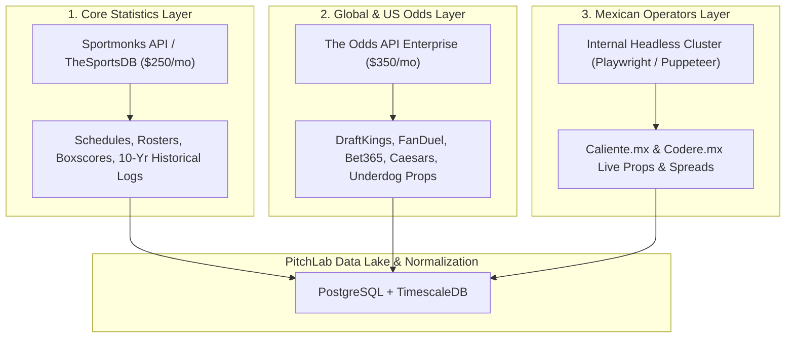

# Data Licensing, Commercial Feasibility, and B2B Vendor Ecosystem

## 1. Compliance & Legal Guardrails

PitchLab's mandate is to construct an independent, original, and commercially viable platform. Under no circumstances should PitchLab scrape, reverse engineer, or depend on LineMate's private APIs or intellectual property.

All sports data, historical logs, schedules, and betting odds must be obtained through legitimate, licensed B2B data providers permitted for SaaS applications and commercial re-distribution.

---

## 2. B2B Sports Data & Odds Provider Landscape

Our team conducted an exhaustive market evaluation of commercial providers supporting NFL statistics, player props, and sports betting odds:

| Provider | Coverage | Historical Depth | Mexican Bookmakers | SaaS Licensing Model | Typical Cost (USD) | Evaluation for PitchLab |
| :--- | :--- | :--- | :--- | :--- | :--- | :--- |
| **Sportradar AG** | Official NFL data partner, full play-by-play, boxscores, player props, global odds | 15+ years | Some (via global feeds) | Enterprise contract only; strict redistribution caps | **\$3,500 – \$12,000 / mo** | Premium tier. Excellent data quality but high minimum commitment. |
| **The Odds API** | Real-time player props, spreads, moneylines, totals across 40+ books | 1–3 years (Add-on) | Low (Pinnacle/Bet365 only; no Caliente) | Developer-friendly API plans; commercial SaaS allowed | **\$150 – \$800 / mo** | **High recommendation for MVP odds**. Extremely cost-effective for multi-book props. |
| **OddsJam Enterprise API** | Real-time player props across 80+ sportsbooks, alternate lines, live updates | 2+ years | Moderate (Bet365, 1xBet, Novibet) | B2B Commercial license; raw API feeds | **\$1,500 – \$4,000 / mo** | Excellent coverage of player props and alternate lines. |
| **Sportmonks** | Schedules, team stats, player stats, boxscores, live scores | 10+ years | N/A (Stats only) | Monthly subscription; commercial redistribution included | **\$120 – \$400 / mo** | **Ideal for MVP baseline stats & schedules**. Very high ROI. |
| **Pinnacle B2B API** | Benchmark sharp odds, totals, spreads, player props | Real-time | Global benchmark | API access for partners / data agreements | Low to Moderate | Essential as the "truth source" for calculating sharp vig-free probabilities. |
| **Proprietary Scraper / Parser Cluster** | Caliente.mx, Codere.mx, Betcris | Real-time | None (Live only) | Internal engineering overhead; legal risk under ToS | Infrastructure only (~$150/mo proxy fees) | **Necessary for Mexican books** (Caliente.mx has no public B2B odds API). |

---

## 3. Recommended Multi-Provider Architecture for PitchLab

To balance operating expenses with data quality and market coverage, PitchLab should deploy a **hybrid data architecture**:

### 3.1 Estimated Monthly Operating Costs (MVP Phase):
- **Core Statistics (Sportmonks)**: \$250 USD / month.
- **Global Props Odds (The Odds API)**: \$350 USD / month.
- **Mexican Odds Cluster Infrastructure (Residential Proxies & Cloud Run)**: \$150 USD / month.
- **Hosting & Database (AWS / GCP / Supabase)**: \$150 USD / month.
- **Total Estimated Data & Infra Burn**: **~\$900 USD / month (~$18,000 MXN)**.

With a subscription price of \$149 MXN/mo for Pro, PitchLab achieves breakeven at approximately **120 paying subscribers**, making the platform exceptionally viable.

---

## 4. Legal & Regulatory Framework in Mexico

1. **SEGOB Regulations**:
   Under the *Ley Federal de Juegos y Sorteos* and its regulations managed by SEGOB (Secretaría de Gobernación), **operating a statistical research and sports intelligence platform does NOT require a gambling license**, provided:
   - PitchLab does not accept, process, or hold betting stakes or deposits.
   - PitchLab does not act as a bookmaker or betting exchange.
   - PitchLab acts purely as an informational, analytical, and educational tool.
2. **Affiliate Advertising Rules**:
   - Partnering with licensed Mexican sportsbooks (e.g. Caliente, Codere) through affiliate marketing is legally recognized in Mexico under standard commercial advertising contracts.
   - PitchLab must display responsible gambling messages ("Los juegos con apuesta están prohibidos para menores de edad. Juegue responsablemente") and links to SEGOB's *Atención al Juego Compulsivo*.
