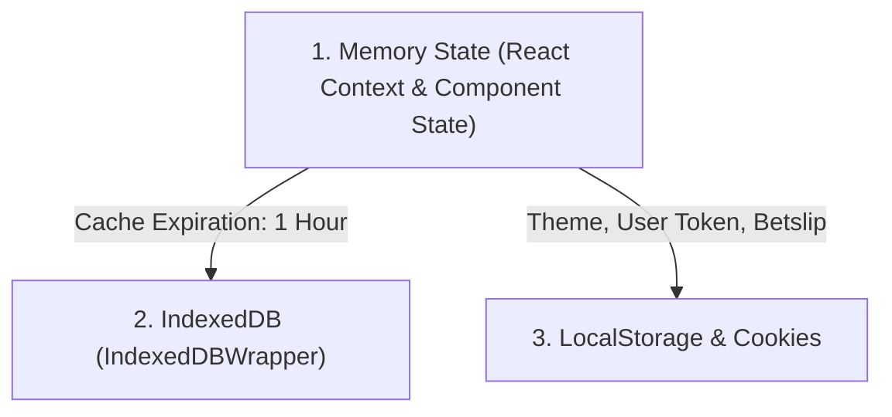

# Navigation, Routing, and URL State Architecture

## 1. Routing Framework

LineMate implements a Single Page Application (SPA) utilizing **React Router DOM v5** (`react-router-dom`), coupled with a custom HTML5 history wrapper (`history.js`).

### Core Router Structure (`components/App.jsx`):
```jsx
<Router history={history}>
  <div style={{ display: 'flex', flexDirection: 'column', minHeight: '100vh' }}>
    <NavigationBar />
    <Switch>
      {/* Dynamic League Routing */}
      <Route exact path="/:league" component={Home} />
      <Route exact path="/:league/trends" component={Trends} />
      <Route exact path="/:league/tools/props" component={Props} />
      <Route exact path="/:league/profile/:teamCode/:playerId" component={ProfileWorkstation} />
      <Route exact path="/:league/summary/:gameID" component={GameSummary} />
      {/* ... auxiliary tools and account routes */}
    </Switch>
    <Footer />
  </div>
</Router>
```

---

## 2. Dynamic League Resolution & Parameter Handling

LineMate treats the league identifier as the top-level route namespace (`/:league`).
- Supported leagues defined in `SUPPORTED_LEAGUES`: `nfl`, `nba`, `mlb`, `nhl`, `ncaaf`, `epl`, `laliga`, `seriea`, `bundesliga`, `ligue1`, `ucl`, `mls`, `liga-mx`.
- If a user accesses `/`, the application evaluates the user's localized configuration and redirects to the default league:
  ```javascript
  const defaultLeague = configuration.localizedDefaultLeague?.[country] || configuration.defaultLeague || 'nfl';
  window.location.replace(`/${defaultLeague}`);
  ```
- If a retired or disabled league is requested (e.g. out of season), `RetiredLeagueRedirect` dynamically redirects the user to the currently active league while preserving URL search parameters.

---

## 3. URL Query Parameter Synchronization

LineMate synchronizes key filtering parameters between the UI state and the browser URL query string. This enables deep linking and reproducible user sessions.

### 3.1 Workstation & Props Screener Parameters:
When navigating to or sharing a workstation link, the following query parameters are recognized by `getBaseWorkstationQueryParams`:

| Parameter | Type | Allowed Values | Default | Effect on State |
| :--- | :--- | :--- | :--- | :--- |
| `timeframe` | string | `LAST_5`, `LAST_10`, `LAST_20`, `LAST_30`, `SEASON_2026`, `PLAYOFF`, `RANGE_2024_2026` | `LAST_10` | Restricts the game sample window in the database query. |
| `split` | string | `ALL`, `HOME`, `AWAY` | `ALL` | Filters games to home or away venues. |
| `opponent` | string | 3-letter code (e.g. `DAL`, `KC`) | `ALL` | Filters games against a specific opponent. |
| `withPlayerIds` | string (UUID) | Teammate Player UUID | `all` | Includes only games where the specified teammate played. |
| `withoutPlayerIds`| string (UUID) | Teammate Player UUID | `none` | Excludes games where the specified teammate played (Injury impact). |
| `marketId` | string | `PASSING_YARDS`, `RUSHING_YARDS`, etc. | Top prop for position | Sets active prop market and loads corresponding sportsbook lines. |
| `line` | float | e.g. `9.5`, `64.5` | Main consensus line | Sets horizontal threshold line on the Nivo chart. |

### 3.2 Trends Feed Parameters:
The Trends page maps URL query parameters directly into the backend `GET /api/:league/v1/trends/straights` request:
- `lineTypes`: `MAIN` or `ALTERNATE`
- `outcomes`: `OVER`, `UNDER`, `YES`, `NO`, `COVER`
- `signals`: `RECENT_FORM`, `HEAD_TO_HEAD`, `HOME_SPLIT`, `AWAY_SPLIT`, `INJURY_IMPACT`, `OPPONENT_RANK`, `WEATHER`
- `trendTypes`: `PLAYER` or `TEAM`
- `sortBySignals`: `RECENT_FORM`, `HEAD_TO_HEAD`
- `parlayType`: `SAME_GAME` or `CROSS_GAME` (for parlay tabs)

---

## 4. State Persistence & Storage Hierarchy

LineMate utilizes a 3-tier storage strategy for client-side state:



1. **In-Memory Context (`GlobalContext.jsx`)**:
   - Active user profile, subscription attributes (`accessLevel`), current geo-location, preferred sportsbook providers, active betslip legs, and cached schedule.
2. **IndexedDB (`database.js` / `IndexedDBWrapper`)**:
   - Heavy data structures that exceed localStorage quotas are stored in IndexedDB with an automated timestamp expiration (1 hour):
     - `configuration_cache`: App feature flags and provider mapping.
     - `betslip`: Active picks and pre-processed operator legs.
     - `teams_cache`: League team rosters and color palettes.
3. **LocalStorage & Cookies**:
   - `theme`: `theme-light` vs `theme-dark`.
   - `preferredFormat`: `american`, `decimal`, or `fractional`.
   - `cookieconsent_status`: GDPR/CCPA cookie banner consent status.
   - `amplitude_device_id`: Analytics session identifier.

---

## 5. Architectural Recommendations for PitchLab

1. **Modern Router Upgrade**: Utilize **Next.js App Router (or TanStack Router)** instead of React Router v5. Server Components allow pre-rendering player SEO profiles with zero client-side waterfall latency.
2. **Bidirectional URL State Serialization**: Adopt `nuqs` (Type-safe search params for React) to synchronize all filters (`?timeframe=L10&split=home&line=64.5&opp=DAL`) seamlessly with browser history, enabling 1-click sharing on social media and Discord.
3. **Session Replay & Historical Travel**: PitchLab should allow users to pass an optional historical timestamp query param `?asOf=2024-11-03T18:00:00Z` to view exactly what lines, hit rates, and odds looked like *before* a past game kicked off. LineMate cannot do this because its endpoints only compute against current live tables.
