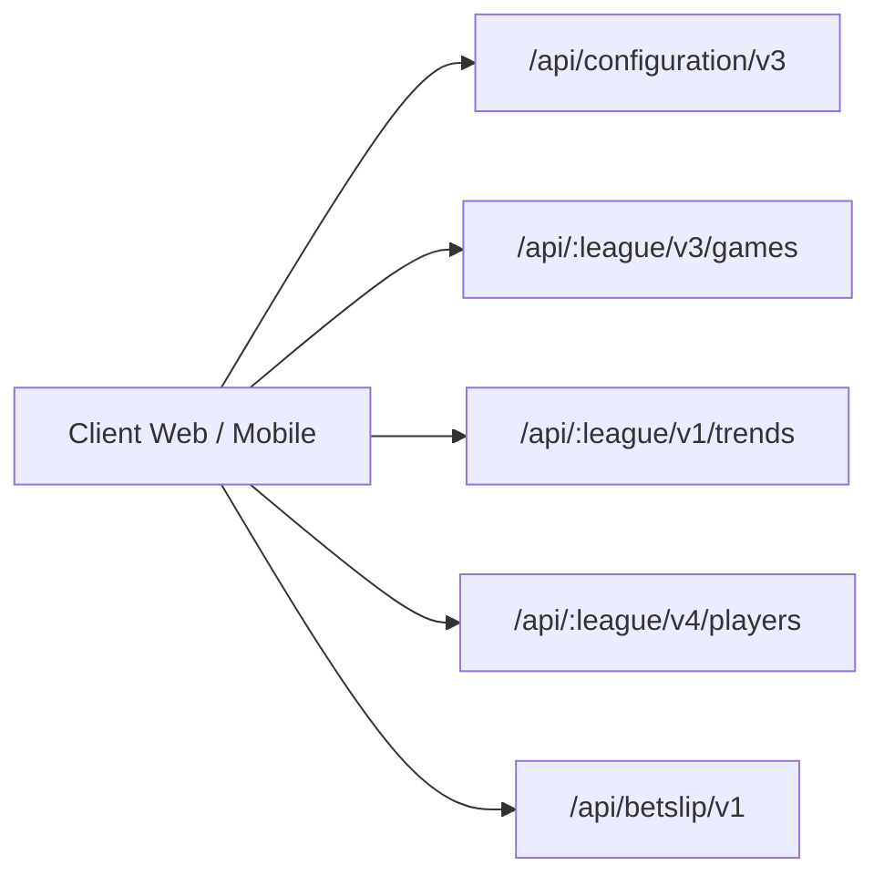

# Network Topology & REST API Catalog

## 1. Network Overview & Host Architecture

LineMate routes all dynamic sports statistics, odds comparisons, trends, and user data through a unified microservices backend:
- **Base Host**: `https://api.linemate.io`
- **Hosting Provider**: Google Cloud Platform (Google Cloud Load Balancing / Cloud Run)
- **Protocol**: HTTP/2 over TLS 1.3
- **Data Exchange Format**: JSON
- **Authentication Header**: `Authorization: Bearer <Firebase_ID_Token>` (required for authenticated and premium calls; omitted for public preview endpoints)

---

## 2. API Endpoint Catalog

Based on empirical network captures during REA scenario execution and codebase verification in `linemate-react-common/src/betting-utils.js`, the active LineMate API catalog is organized into 5 primary domains:



### 2.1 Configuration & Geo-Location
- **`GET /api/configuration/v3?platform=web`**
  - **Purpose**: Global application bootstrap. Returns enabled leagues, localized sportsbook preferences by country/region, and active feature flags.
  - **Response Schema**:
    ```json
    {
      "defaultLeague": "nfl",
      "leagues": {
        "nfl": { "enabled": true, "name": "NFL", "sport": "football" },
        "nba": { "enabled": true, "name": "NBA", "sport": "basketball" }
      },
      "localizedFeatures": {
        "preferredProvidersV2": {
          "US": ["draftkings", "fanduel", "caesars"],
          "CA": ["bet99", "thescore", "prolineplus"],
          "MX": ["caliente", "bet365"]
        }
      }
    }
    ```
- **`GET /api/localization/v1/getCurrentLocation`**
  - **Purpose**: Client IP geo-location to enforce state/country sportsbook legality rules.

### 2.2 Schedule, Games & Teams
- **`GET /api/:league/v3/games/upcoming?recordType=REGULAR&format=daily`**
  - **Purpose**: Lists scheduled matchups for the current week/day.
  - **Response Sample**: `research/linemate/evidence/network-schemas/upcoming_sample.json`.
  - **Key Fields**: `id`, `srGameId`, `season`, `week`, `status`, `homeTeamCode`, `awayTeamCode`, `timestamp`, `venue`, `weather`.
- **`GET /api/:league/v3/games/current?recordType=REGULAR&format=daily`**
  - **Purpose**: Live/in-progress games with real-time scores and quarter status.
- **`GET /api/:league/v3/teams`**
  - **Purpose**: Master list of all 32 NFL teams with division, conference, official team hex colors, and Sportradar IDs (`SRID`, `SRGUID`).
- **`GET /api/:league/v3/teams/:teamCode/roster`**
  - **Purpose**: Full active roster for a team including depth chart position and jersey numbers.
- **`GET /api/:league/v3/teams/:teamCode/injuries`**
  - **Purpose**: Current injury report (Questionable, Doubtful, Out, IR) with injury body part and notes.

### 2.3 Trends & Cheatsheets
- **`GET /api/:league/v1/trends/straights`**
  - **Parameters**:
    - `limit`: number (e.g. `5`, `20`)
    - `preferredProviders`: comma-separated bookmaker slugs
    - `lineTypes`: `MAIN` or `ALTERNATE`
    - `outcomes`: `OVER,YES,COVER` or `UNDER,NO`
    - `signals`: `RECENT_FORM`, `HEAD_TO_HEAD`, `HOME_SPLIT`, `AWAY_SPLIT`, `SPLITS`, `INJURY_IMPACT`, `OPPONENT_RANK`, `WEATHER`
    - `trendTypes`: `PLAYER` or `TEAM`
    - `sortBySignals`: `RECENT_FORM`, etc.
    - `preview`: boolean (set to `true` on landing pages)
  - **Response Sample**: `research/linemate/evidence/network-schemas/trends_straights_sample.json`.
  - **Payload Structure**: Array of trend objects containing `player`, `team`, `opposingTeam`, `market`, `line`, `outcome`, `books`, and `signals` (with `hitRecord` objects: `games`, `hits`, `misses`, `pushes`, `hitRate`, `average`).
- **`GET /api/:league/v1/trends/parlays`**
  - **Parameters**:
    - `parlayType`: `SAME_GAME` or `CROSS_GAME`
    - `limit`: number (e.g. `4`, `20`)
    - `preferredProviders`: string
  - **Response Sample**: `research/linemate/evidence/network-schemas/parlays_sgp_sample.json`.
  - **Payload Structure**: Array of parlay cards, each with an array of `legs` (straight trends) and aggregate `insights` (e.g. "Each leg hit in 3 of last 3 games").

### 2.4 Player Workstation & Markets
- **`GET /api/:league/v4/players/:playerId/games`**
  - **Parameters**:
    - `timeframe`: `LAST_5`, `LAST_10`, `LAST_20`, `LAST_30`, `SEASON_2026`, `RANGE_2024_2026`, `PLAYOFF`
    - `split`: `ALL`, `HOME`, `AWAY`
    - `opponent`: 3-letter team code
    - `withPlayerIds`: teammate UUID
    - `withoutPlayerIds`: teammate UUID (injury filter)
    - `limit`: integer (e.g. `500`)
    - `sortingOrder`: `DESC` or `ASC`
  - **Response Sample**: `research/linemate/evidence/network-schemas/player_games_breece_hall.json`.
  - **Payload Structure**: Array of historical game logs with full `cumulativeStats` object containing 80+ granular statistics per game.
- **`GET /api/:league/v4/players/:playerId/record`**
  - **Purpose**: Aggregated season and career summary statistics, games played, games tracked, and active game info.
- **`GET /api/:league/v4/players/:playerId/markets`**
  - **Purpose**: All live sportsbook betting lines and odds for the player across available markets (`PASSING_YARDS`, `RUSHING_ATTEMPTS`, etc.).
  - **Response Sample**: `research/linemate/evidence/network-schemas/player_markets_sample.json`.
- **`GET /api/:league/v3/markets/hitRates`**
  - **Purpose**: Powers the Props Screener table. Returns precomputed hit rate rankings across players and lines.

### 2.5 Betslip & Affiliate Brokering
- **`POST /api/betslip/v1/operatorLinks`**
  - **Payload**:
    ```json
    {
      "operator": "draftkings",
      "operatorOutcomeData": [{ "outcomeId": "0QA385163667#2347045612_13L88808Q1-1969802282Q20" }],
      "location": { "country": { "code": "US" }, "region": { "code": "NJ" } }
    }
    ```
  - **Response**: `{ "ios": "draftkings://...", "android": "intent://...", "web": "https://sportsbook.draftkings.com/..." }`
- **`POST /api/betslip/v1/details`**
  - **Purpose**: Computes multi-leg parlay odds across selected bookmakers.
- **`POST /api/betslip/v1/analyzeImage`**
  - **Purpose**: OCR vision processing of uploaded betting slip screenshots.

---

## 3. Caching & Request Performance

- **Client Caching**: Responses from `/api/configuration/v3` and `/api/:league/v3/teams` are cached in IndexedDB for 1 hour.
- **Server Cache Headers**:
  - `cache-control: public, max-age=60` on game schedules and static team data.
  - `cache-control: no-store` on active odds and market pricing endpoints.
- **Rate Limiting**: Rate limits observed at ~60 requests per minute per IP on public unauthenticated endpoints before HTTP 429 is returned.
