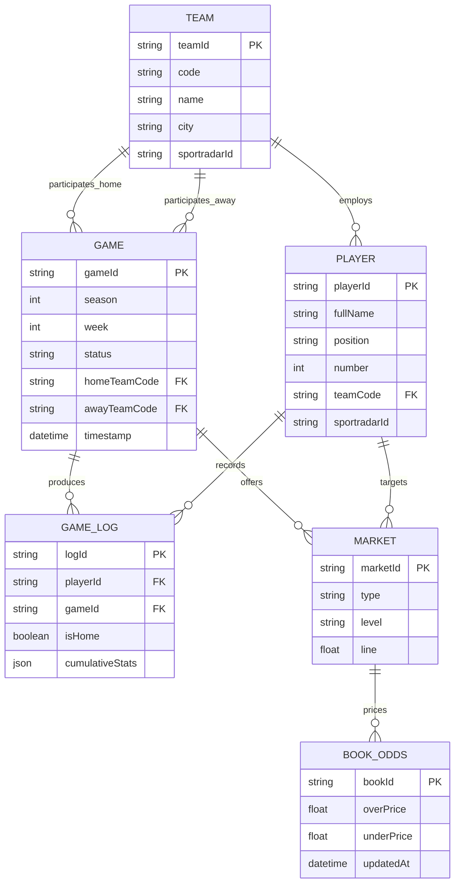

# Canonical NFL Data Model Specification

## 1. Entity-Relationship Architecture

LineMate's domain model organizes NFL football into a structured hierarchy connecting players, teams, matchups, prop markets, sportsbook odds, and cumulative historical stats.



---

## 2. Canonical Entity Definitions

### 2.1 Player Entity (`CanonicalPlayer`)
Extracted from `/api/nfl/v1/trends/straights` and `/api/nfl/v4/players/:id`:
```typescript
interface CanonicalPlayer {
  playerId: string;                  // LineMate internal UUID
  optaId: string | null;
  statsPerformId: string | null;
  sleeperId: string | null;          // Sleeper fantasy ID
  SRID: string;                      // Sportradar URN: "sr:player:1692915"
  SRGUID: string;                    // Sportradar UUID: "db1053d7-3343-43a3-9aab-8353f10f1221"
  firstName: string;
  lastName: string;
  fullName: string;
  position: 'QB' | 'RB' | 'WR' | 'TE' | 'K' | 'DEF';
  number: number;
  age: number | null;
  height: string | null;              // Formatted: "5'11\""
  weight: number | null;              // In lbs: 217
  birthPlace: string | null;          // "Omaha, NE, USA"
  teamCode: string;                   // Current active team: "NYJ"
  teamId: string;                     // Team UUID
}
```

### 2.2 Team Entity (`CanonicalTeam`)
Extracted from `/api/nfl/v3/teams`:
```typescript
interface CanonicalTeam {
  teamId: string;                     // Team UUID: "2b4a534d-5950-4fff-8c15-5a81f247e652"
  name: string;                       // "Jets"
  code: string;                       // "NYJ"
  city: string;                       // "New York"
  SRID: string;                       // "sr:competitor:4427"
  SRGUID: string;                     // "5fee86ae-74ab-4bdd-8416-42a9dd9964f3"
  conference: 'AFC' | 'NFC';
  division: 'East' | 'North' | 'South' | 'West';
  colors: {
    primary: string;                  // e.g. "rgb(18, 87, 64)"
    secondary: string;
  };
}
```

### 2.3 Game Entity (`CanonicalGame`)
Extracted from `/api/nfl/v3/games/upcoming`:
```typescript
interface CanonicalGame {
  id: string;                         // Canonical ID: "20261112-WAS-NYG"
  srGameId: string;                   // Sportradar GUID: "5ab9e951-17ea-4e84-9c6c-5ce04ac073ad"
  season: number;                     // 2026
  week: number;                       // 10
  status: 'SCHEDULED' | 'IN_PROGRESS' | 'CLOSED' | 'POSTPONED';
  homeTeamCode: string;               // "NYG"
  awayTeamCode: string;               // "WAS"
  timestamp: string;                  // ISO-8601: "2026-11-12T19:15:00.000Z"
  venue: {
    id: string | null;
    name: string;                     // "MetLife Stadium"
    city: string;                     // "East Rutherford"
  };
  weather: {
    temperature: number | null;
    condition: string | null;
    windSpeed: number | null;
    windDirection: string | null;
  } | null;
}
```

### 2.4 Cumulative Stats Object (`cumulativeStats`)
The single most exhaustive statistical structure in the platform, tracking 80+ metrics per game log:
- **Passing**: `passingAttempts`, `passingCompletions`, `passingYards`, `passingTouchdowns`, `interceptions`, `sacks`, `sackedYards`, `rating`, `longestCompletion`, `yardsPerAttempt`, `yardsPerCompletion`, `threeHundredYardsPassing`, `redzonePassingAttempts`, `redzonePassingTouchdowns`, `redzoneCompletions`, `throwsOnTarget`.
- **Rushing**: `rushingAttempts`, `rushingYards`, `rushingTouchdowns`, `rushingYardsPerAttempt`, `longestRun`, `rushingFirstDowns`, `hundredYardsRushing`, `redzoneRushingAttempts`, `redzoneRushingTouchdowns`.
- **Receiving**: `targets`, `receptions`, `receivingYards`, `receivingTouchdowns`, `longestReception`, `completionPercentage`, `receivingFirstDowns`, `receivingYardsPerTarget`, `receivingYardsPerReception`, `hundredYardsReceiving`, `redzoneTargets`, `redzoneReceptions`, `redzoneReceivingTouchdowns`, `drops`, `airYards`.
- **Kicking**: `pointsKicked`, `fieldGoalAttempts`, `fieldGoalsMade`, `extraPointAttempts`, `extraPointsMade`, `extraShortRangeFieldGoals`, `shortRangeFieldGoals`, `mediumRangeFieldGoals`, `longRangeFieldGoals`, `extraLongRangeFieldGoals`, `longestFieldGoal`.
- **Quarter Breakdowns**: Granular quarter statistics for Passing, Rushing, and Receiving Yards across Q1, Q2, Q3, and Q4 (e.g. `rushingYards1q`, `passingYards2q`, `receivingTouchdowns4q`).

---

## 3. Recommended PitchLab Schema Enhancements

To build an institutional-grade platform, PitchLab should extend this model with the following essential attributes:
1. **Snap Counts & Participation Tracking**: Track offensive snaps played, percentage of total team snaps, and route participation rates (vital for WR/TE receiving props).
2. **Advanced Metrics**: Integrate Expected Points Added (EPA/play), Completion Percentage Over Expected (CPOE), Target Share %, and Air Yard Share %.
3. **Temporal Odds Versioning**: Store opening lines, line movement timestamps, closing lines (Closing Line Value - CLV), and sportsbook consensus lines.
