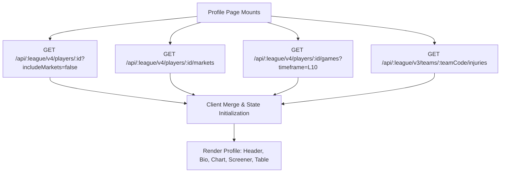

# Player Profiles Architecture & Navigation

## 1. Profile Architecture & Routing Modes

LineMate implements two distinct routing paradigms for player profiles:
1. **Workstation Profile Route**: `/:league/profile/:teamCode/:playerId`
   - Maps to `components/ProfileWorkstation.jsx`.
   - Dedicated to deep-dive betting prop analysis, line scrubbing, and interactive charts.
2. **SEO / Statistical Profile Route**: `/:league/players/:playerId/profile` and `/:league/players/:playerId`
   - Maps to `components/StatsProfile.jsx`.
   - Focuses on high-level seasonal averages, full-season boxscores, and active trending cards.

---

## 2. Profile Data Aggregation

When a player profile mounts, it aggregates three concurrent data payloads:

1. **Player Bio & Physical Attributes**:
   - Jersey number, position, age, height, weight, college/birthplace.
   - Headshot image resolved from LineMate CDN: `https://assets.linemate.io/headshots/nfl/:srid.png`.
2. **Current Injury & Roster Status**:
   - Pulled from `/api/:league/v3/teams/:teamCode/injuries`.
   - If player appears on the injury report, an orange badge renders: `"Questionable - Ankle"`.
3. **Active Matchup Context**:
   - Current week opponent (e.g. `vs DAL`), kickoff time, venue, and weather forecast.
4. **Market Overview Cards**:
   - Pre-computed cards displaying consensus lines and best available sportsbook odds across all relevant categories (e.g. Passing Yards 245.5 at -112 DraftKings; Passing TDs 1.5 at -135 Underdog).

---

## 3. Premium Feature Gating on Profiles

On a player profile, unauthenticated or free users can:
- View the header, bio, current matchup, and standard Last 5 / Last 10 charts.
- View consensus lines.

Locked features include:
- With/Without teammate filter (clicking shows "Unlock Linemate+ to see performance without injured starters").
- Alternate line ladders.
- Exporting data to CSV.

---

## 4. PitchLab Next-Gen Player Profile Blueprint

PitchLab will transform the player profile into a 360-degree intelligence hub:
1. **Matchup Radar**: Radar chart visualizing the player's skillset against the opponent's specific defensive weaknesses (e.g. WR deep threat vs opponent bottom-5 in explosive pass defense allowed).
2. **Simulated Projection Distribution**: Interactive probability density graph showing the expected outcome curve \(P(X = x)\), mode, median, and 90% confidence interval.
3. **Injury Impact Probability Modifier**: When a teammate is declared OUT, PitchLab automatically calculates projected target/usage redistribution based on depth chart shares.
