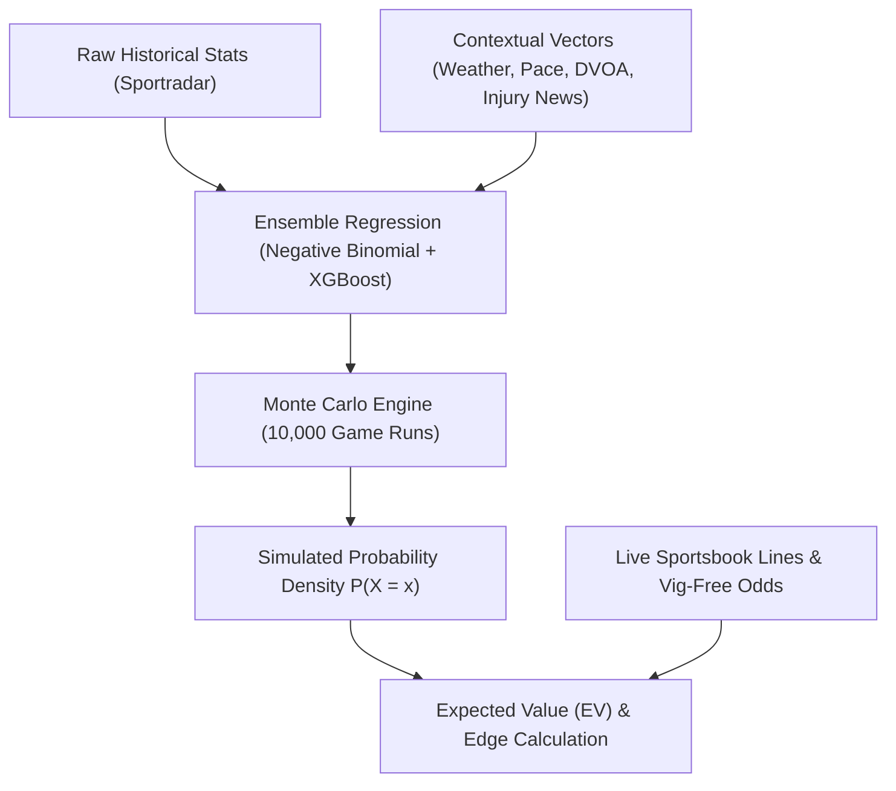

# Rigorous Demarcation: Descriptive Historical Trends vs. Predictive Models

## 1. The Core Scientific Distinction

A central mandate of this reverse engineering prompt is to resolve whether LineMate generates authentic forward-looking predictive forecasts or merely repackages descriptive historical data:

> **"No confundir un sistema de tendencias históricas con un modelo de predicción probabilística. Debes determinar qué funciones son simples cálculos sobre datos históricos y cuáles generan auténticas estimaciones futuras."**

---

## 2. Definitive Forensic Verdict

| Dimension | LineMate Observable Implementation | Authentic Predictive Model |
| :--- | :--- | :--- |
| **Mathematical Nature** | **Descriptive Statistics / Historical Frequency** | **Inferential Statistics & Stochastic Simulation** |
| **Output Type** | Discrete historical counts: `16/16`, `100%`, `Average: 74.2` | Probability distributions: $P(X \ge x)$, Median, Mode, Variance, VaR |
| **Time Horizon** | Retrospective ($t \le \text{today}$) | Prospective ($t > \text{today}$, projected Sunday game) |
| **Model Type** | SQL/Array filtering: `sample.filter(g => g.stat > line)` | Poisson / Negative Binomial regressions, Gradient Boosted Trees, Bayesian shrinkage |
| **Contextual Adjustment** | None (Treats a game in October against a 32nd ranked defense identically to a game in December against a 1st ranked defense) | Context-adjusted (Pace, weather, offensive line injuries, opposing defensive scheme, Vegas implied game script) |
| **Market Edge Evaluation**| None (Does not calculate Expected Value or edge vs sportsbook price) | Explicit Expected Value ($\text{EV} = P \times \text{b} - (1 - P)$) |

### **Verdict**:
**LineMate contains ZERO predictive or machine learning models.**
Every single feature marketed as an "insight", "trend", "cheatsheet", "injury impact", or "matchup signal" is an empirical count computed over an historical sample.

---

## 3. Deconstruction of LineMate's "AI / Signal" Terminology

LineMate uses terminology that sounds algorithmic to casual bettors, but deobfuscation reveals purely arithmetic operations:

### 3.1 "100% Recent Form Club"
- **Marketing Appearance**: An AI-detected hot streak.
- **Underlying Code**: `games.slice(0, N).every(g => g.stat > line)`.
- **Reality**: Pure retrospective filter. It suffers from survivorship bias and regression to the mean.

### 3.2 "Injury Impact"
- **Marketing Appearance**: An AI model projecting teammate target reallocation.
- **Underlying Code**: `GET /games?withoutPlayerIds=:injuredId`.
- **Reality**: A basic database exclusion filter. It takes the remaining games in which that teammate was absent and computes the sample mean. If the sample size is only 2 games, it still proudly reports "Hit in 2 of last 2 games without X (100%)".

### 3.3 "Matchup Edge / Opponent Rank"
- **Marketing Appearance**: A predictive matchup grade.
- **Underlying Code**: Sorting 32 teams by total raw yards allowed and flagging the bottom 5.
- **Reality**: Descriptive ranking without pace adjustment, opponent talent calibration, or home/away normalization.

---

## 4. Why This Creates a Multi-Million Dollar Opportunity for PitchLab

Recreational sports bettors have become increasingly sophisticated. They recognize that blindly betting "100% Hit Rate" trends leads to long-term losses because:
1. Sportsbooks already know the player has been hot and have priced it into the line or juice (-145).
2. Human athletes regress to their true mean talent level.

### PitchLab's Quantitative Modeling Engine:
PitchLab will replace LineMate's simple historical filters with true quantitative predictive models:

1. **Probability Distribution Fitting**:
   - For count statistics (Touchdowns, Receptions, Sacks): Fit a **Negative Binomial distribution** (accounting for overdispersion where variance > mean).
   - For continuous statistics (Passing Yards, Rushing Yards): Fit a **Lognormal or Skew-Normal distribution**.
2. **Monte Carlo Game Simulation**:
   - Run 10,000 simulated games per matchup using offensive/defensive drive-level simulations.
3. **True Expected Value (EV) & Kelly Stake Sizing**:
   - Compare the model's projected win probability $P_{\text{model}}$ against the sportsbook's vig-free implied probability $P_{\text{market}}$.
   - Output clear, actionable advice: *"Model projects 78.4 passing yards (Market: 64.5). True Win Prob: 68.2% vs Implied: 52.4%. Edge: +15.8% (+EV). Recommended Kelly Stake: 2.4 units."*
