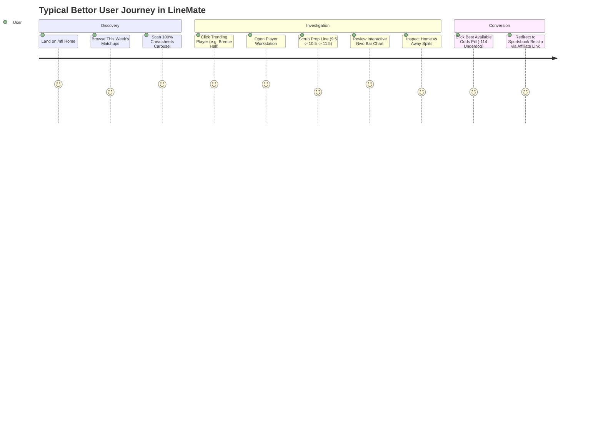

# User Experience (UX), Design System & Visual Analysis

## 1. Design System Overview

LineMate's visual design embraces a clean, modern, data-dense interface inspired by fintech platforms (Robinhood, Linear) and contemporary sports platforms.

### 1.1 Core Design Pillars:
- **High Information Density**: Maximizes visible statistical datapoints per screen without causing cognitive overload.
- **Micro-Color Coding**: Consistent semantic color cues (Green = Hit/Cover/Stingy Defense, Red = Miss/Generous Defense, Yellow = Push, Orange = Injury).
- **Dual-Theme Support**: Flawless switching between `theme-light` and `theme-dark` with zero layout reflow.
- **Typography**: Uses Rasmus Andersson's **Inter** font family (`https://rsms.me/inter/inter.css`) exclusively, leveraging tabular numeric figures (`font-variant-numeric: tabular-nums`) to ensure numbers align vertically across rows.

---

## 2. Information Architecture & Navigation Journey

---

## 3. Detailed Component Breakdown

### 3.1 Matchup Card (`components/NewMatchupCard.jsx`)
- Width: Compact card with subtle background blur effect using team colors.
- Layout: Away team logo & 3-letter code on left, game status/time in center, Home team on right.
- Micro-interactions: Hover elevates card shadow; clicking navigates to `/:league/summary/:gameID`.

### 3.2 Trend Feed Card (`components/TrendContent.jsx`)
- Structure:
  - Header: Team logo badge (circle with official team color background), Player name (bold), Matchup context (`vs CIN`), active line (`Over 0.5 Receptions`), odds pill (`-135 Underdog`).
  - Signal Rows: Up to 5 insight badges stacked vertically:
    - Bolt icon (`/assets/trend-signals/bolt.svg`): "Hit in 8 of last 8 games - 100%".
    - Shield icon (`shield.svg`): "Hit in 2 of last 2 games vs CIN - 100%".
    - Location pin (`location-filled.svg`): "Hit in 5 of last 5 home games - 100%".
    - Injury icon (`injury.svg`): "Hit in 5 of last 5 games without Jack Strand - 100%".
    - Trophy icon (`trophy.svg`): "CIN is a good Receptions matchup - 31st".
  - Action Footer: Quick "Add to Picks" button.

### 3.3 Interactive Scrubber & Nivo Bar Chart (`components/HitRateChart.jsx`)
- Height: 260px fixed desktop height.
- Stepper: Left/Right arrows adjacent to the line value.
- Visual Feedback: Bars transition smoothly using CSS spring animations (`@react-spring/web`).
- Tooltip: Hovering a bar reveals a floating card with the exact game date, opponent, final score, and player stat.

---

## 4. UX Friction Points Identified in LineMate

1. **Information Redundancy in Trend Cards**:
   Many trend cards display 4 or 5 badges that all communicate essentially the same fact in different words (e.g. "Hit in 7 of 7 games", "Hit in 2 of 2 home games", "Hit in 1 of 1 vs opponent"). This creates visual clutter.
2. **Missing Probability Context**:
   Recreational users do not realize that an alternate line of "6+ Rush Attempts in 20/20 games" is priced at -800, which is unprofitable to bet as a straight wager.
3. **No Direct Betslip Stacking**:
   Adding multiple picks stores them in LineMate's internal betslip, but clicking "Bet Now" opens multiple separate browser tabs for each sportsbook rather than a unified slip.

---

## 5. PitchLab UX & Design System Blueprint

PitchLab will elevate the user experience to professional standards:
1. **Design System "Orbit"**: Built using Tailwind CSS, Radix UI primitives, and Lucide icons for maximum performance and design consistency.
2. **Unified Betslip Drawer**: A slide-out right drawer that shows the bettor's selections, calculates the true fair parlay probability vs the sportsbook's offered price, and displays the exact EV.
3. **Clean Visual Hierarchy**: Consolidate multiple repetitive trend badges into a single **Signal Matrix Chip** (e.g. `[100% L10 | Top-5 Matchup | Teammate Out]`).
