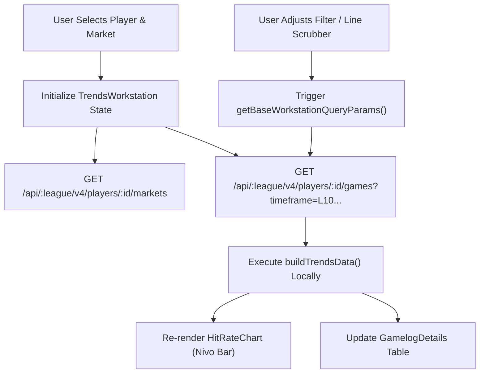

# Player Props Workstation — Architecture & Filter Mechanics

## 1. Workstation Architecture

The Player Props Workstation is LineMate's flagship analytical workspace (`components/ProfileWorkstation.jsx` and `TrendsWorkstation.jsx`). It allows bettors to inspect an individual athlete's historical performance, adjust the prop threshold dynamically, apply granular contextual filters, view an interactive bar chart, and review tabular boxscores.

---

## 2. Controls & Filter Dimensions

Every control in `TrendsWorkstation.jsx` maps directly to either a local state manipulation or a backend query parameter:

### 2.1 Timeframe Filter (`FILTER_KEYS.TIMEFRAME`)
- **Options Available**:
  - `Last 5` (`LAST_5`)
  - `Last 10` (`LAST_10` - Default)
  - `Last 20` (`LAST_20`)
  - `Last 30` (`LAST_30`)
  - `Season` (`SEASON_2026`, passes `limit=500`)
  - `Head to Head` (`RANGE_2024_2026`, filtered to `opponent = OpposingTeamCode`)
  - `Playoffs` (`PLAYOFF`)

### 2.2 Venue Splits (`FILTER_KEYS.SPLITS`)
- **Options**:
  - `Home+Away` (`ALL` - Default)
  - `Home` (`HOME`): Evaluates only games where `game.isHome === true`.
  - `Away` (`AWAY`): Evaluates only games where `game.isHome === false`.

### 2.3 Opponent Filter (`FILTER_KEYS.OPPONENT`)
- Dropdown of all 32 NFL teams. Allows filtering a player's career performances specifically against a single franchise (e.g. Breece Hall vs Buffalo Bills).

### 2.4 Teammate Situational Filters ("With / Without")
- **Control**: `FILTER_KEYS.WITH` and `FILTER_KEYS.WITHOUT`.
- **Access Level**: Gated behind `premium: true` (Linemate+). Free users see a padlock icon.
- **Backend Mechanics**:
  - `withPlayerIds=:teammateUuid`: Ingests teammate roster ID and filters games where the teammate played.
  - `withoutPlayerIds=:teammateUuid`: Filters games where the teammate did not play (e.g. injured starting QB, WR1, or lead RB).
- **Client Execution**:
  When selected, the backend recalculates and returns only the matching game subset. `TrendsWorkstation` recalculates the hit rate over that filtered subset.

### 2.5 Market & Line Selection
- **Market Dropdown**: Dynamically populated based on player position. For an RB: Rushing Yards, Rush Attempts, Receiving Yards, Receptions, Anytime TD.
- **Line Scrubber / Stepper**: Allows the user to click `+` or `-` or select alternate lines from a slider.
- **Dynamic Re-calculation**: Unlike many competitor tools that require a full roundtrip API call to change lines, LineMate recalculates `buildTrendsData` **entirely in memory on the client side** if the game logs are already loaded! This provides instant, zero-latency chart updates as the user scrubs lines.

---

## 3. Data Flow & Performance Analysis

1. **Initial Mount**:
   - `fetchPlayerRecord`: Fetches summary info.
   - `fetchMarkets`: Loads sportsbook lines (DraftKings, FanDuel, Caesars, Kalshi).
   - `fetchPlayerWorkstationGames`: Loads `LAST_10` games by default.
2. **Subsequent Filter Changes**:
   - Modifying Line or Over/Under: Immediate in-memory re-render (0ms network time).
   - Modifying Timeframe or Splits: Network call to `/games?timeframe=...` (100-250ms).
   - Modifying With/Without: Network call to `/games?withoutPlayerIds=...` (requires Linemate+ token).

---

## 4. Workstation Improvements for PitchLab

PitchLab can leapfrog LineMate's workstation experience:
1. **Multi-Prop Matrix**: Allow side-by-side comparison of 2 or 3 props simultaneously (e.g. Rush Yards vs Rush Attempts on dual-axis charts).
2. **True Situational Splits**: Add game script splits (Wins vs Losses, Leading vs Trailing, Target/Snap share splits, Weather condition splits).
3. **Model Overlay**: Render the PitchLab probabilistic simulation distribution directly over the historical bar chart, showing the projected median and 80% confidence interval.
