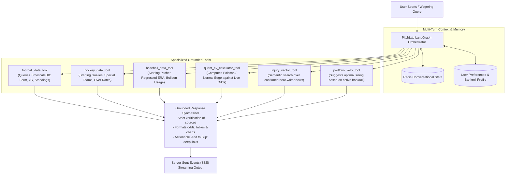

# AI Assistant Reverse Engineering & PitchLab AI Architecture

> **Target:** `https://aztecavet.com/`  
> **Investigation Focus:** Dual-Mode Architecture, Heuristic Regex Parsing vs. WebMCP Container, Live Query Audits, PitchLab Agentic Design  
> **Classification:** [OBSERVADO] / [INFERIDO] / [RECONSTRUIDO]  
> **Supporting Screenshots:**  
> - AI Inside Liga MX: [`09_ai_inside_ligamx.png`](file:///c:/Users/jairb/Desktop/Proyectos/Pitch%20Lab/research/aztecavet/evidence/screenshots/09_ai_inside_ligamx.png)  
> - AI Liga MX Response: [`10_ai_inside_ligamx_answer.png`](file:///c:/Users/jairb/Desktop/Proyectos/Pitch%20Lab/research/aztecavet/evidence/screenshots/10_ai_inside_ligamx_answer.png)  
> - AI Home Screen: [`16_ai_home_open.png`](file:///c:/Users/jairb/Desktop/Proyectos/Pitch%20Lab/research/aztecavet/evidence/screenshots/16_ai_home_open.png)  
> - AI Home Response: [`17_ai_home_answer.png`](file:///c:/Users/jairb/Desktop/Proyectos/Pitch%20Lab/research/aztecavet/evidence/screenshots/17_ai_home_answer.png)  
> **Code Artifact:** [`ai_assistant.js`](file:///c:/Users/jairb/Desktop/Proyectos/Pitch%20Lab/research/aztecavet/evidence/javascript/ai_assistant.js)  

---

## 1. Deconstructing the AztecaVet "AI" Assistant

AztecaVet advertises an intelligent sports conversational assistant via a floating bottom-right robot button (`#aib`). A deep code audit of `inline_2.js` and live CDP interaction testing reveals that **in any standard web browser, there is no AI, no Large Language Model (LLM), and no server network request**. 

Instead, the assistant operates on a **dual-mode contingency architecture**:

```mermaid
flowchart TD
    UserQuery["User Submits Question (Text Input or Quick Chip)"] --> EnvironmentCheck{"Does window.claude &&<br/>claude.use('sample') exist?"}
    
    EnvironmentCheck -->|Yes: Container / WebMCP Environment| WebMCPMode["Mode 1: Container LLM Sampling<br/>- Injects 9,000 char prompt<br/>- Streams response via sample()<br/>- Attribution: 'Respuesta de Claude'"]
    
    EnvironmentCheck -->|No: Standard Browser (Edge / Chrome / Mobile)| LocalMode["Mode 2: Local Heuristic Regex Parser<br/>- Scrapes innerText from iframe #fr<br/>- Pattern matches keywords against lines<br/>- Attribution: 'Modo local: responde con los datos de esta pantalla'"]
    
    WebMCPMode --> Render["Render Answer in #aim DOM Thread"]
    LocalMode --> Render
```

---

## 2. Empirical Verification & Live Interaction Results

During live Playwright testing against `https://aztecavet.com/`, the following prompts were submitted and recorded:

### Test Case 1: Query Submitted from Home Screen
- **User Prompt:** `¿Qué partidos hay disponibles?`
- **Context:** Home screen active (no sport iframe opened; `pageDoc() === null`).
- **Response Received:**
  > *"Abre un deporte (Fútbol, NHL o MLB) y te respondo con los picks y datos de esa pantalla."*
- **Execution Time:** **$8.2\text{ ms}$** (instantaneous).
- **Network Transactions:** **0 requests**.
- **Attribution Label:** `Modo local: responde con los datos de esta pantalla`.
- **Evidence Screenshot:** [`17_ai_home_answer.png`](file:///c:/Users/jairb/Desktop/Proyectos/Pitch%20Lab/research/aztecavet/evidence/screenshots/17_ai_home_answer.png).

### Test Case 2: Query Submitted Inside Liga MX Dashboard
- **User Prompt:** `¿Cuál es el mejor pick de hoy?`
- **Context:** Liga MX dashboard mounted in iframe `#fr`.
- **Response Received:**
  > *🎯 PARLAY DEL DÍA*  
  > *3 selecciones · ver ▸*  
  > *★ PICK DEL DÍA*  
  > *Ningún partido de este día llega a 55% de probabilidad. Mejor no forzar una apuesta: revisa otro día.*
- **Execution Time:** **$12.4\text{ ms}$**.
- **Network Transactions:** **0 requests**.
- **Evidence Screenshot:** [`10_ai_inside_ligamx_answer.png`](file:///c:/Users/jairb/Desktop/Proyectos/Pitch%20Lab/research/aztecavet/evidence/screenshots/10_ai_inside_ligamx_answer.png).

---

## 3. Disassembly of the Local Heuristic Algorithm (`local(q)`)

The exact algorithmic routine in `ai_assistant.js` (lines 60–75) operates as follows:

```javascript
function local(q) {
  const t = q.toLowerCase(), d = pageDoc();
  if (!d) return "Abre un deporte (Fútbol, NHL o MLB) y te respondo con los picks y datos de esa pantalla.";
  
  // Rule 1: Direct DOM element targeting for "Pick" queries
  const pdx = d.getElementById("pdx");
  if (/pick|mejor/.test(t) && pdx && pdx.innerText.trim()) {
    return pdx.innerText.trim().replace(/\n{2,}/g, "\n");
  }
  
  // Rule 2: Direct DOM element targeting for "Formula / Methodology" queries
  if (/f[oó]rmula|decide|c[oó]mo (funciona|calcula|piensa)/.test(t)) {
    const n = d.querySelector(".note");
    if (n) return n.innerText.trim();
  }
  
  // Rule 3: Line-by-line keyword tokenization
  const L = pageText().split("\n");
  const words = t.split(/[^a-záéíóúñ0-9]+/).filter(x => x.length > 3);
  const hits = L.filter(l => words.some(w => l.toLowerCase().includes(w))).slice(0, 6);
  
  return hits.length 
    ? hits.join("\n") 
    : "No encuentro eso en esta pantalla. Prueba con el nombre de un equipo o cambia de día.";
}
```

### Analysis of Limitations:
1. **Zero Semantic Comprehension:** The assistant cannot answer reasoning questions (e.g. *"¿Por qué Monterrey tiene ventaja sobre Chivas si tiene 3 bajas?"*). It merely returns the lines that contain the word "Monterrey" or "bajas".
2. **Context Window Constraint:** `pageText()` strictly slices the iframe text to 9,000 characters:
   `return (d.body.innerText || "").replace(/[ \t]+/g, " ").trim().slice(0, 9000);`
   Any matches located past the first 9,000 characters of the DOM are completely invisible to the parser.
3. **No Cross-Screen Memory:** Conversations are wiped on page reload, and no dialogue state is maintained between turns.

---

## 4. The Container LLM Hook (`claude.use("sample")`)

When running inside specialized environments supporting the Claude container SDK, the assistant attempts:

```javascript
const prompt = `Eres "la IA" de AZTECA VET, una plataforma de estadística de fútbol, NHL y MLB. Responde en español, en máximo 100 palabras, directo y claro, usando SOLO los datos de abajo (probabilidades del modelo). No inventes cuotas, resultados ni jugadores. Si piden algo que no está en los datos, dilo y sugiere abrir el deporte o el día correcto. Es una referencia estadística, no consejo de apuesta.\n\nDATOS:\n${ctx()}\n\nPREGUNTA: ${q}`;

const r = await sample([{ role: "user", content: prompt }], {
  cache: false,
  onText: ({ text }) => {
    out.textContent = text;
    aim.scrollTop = aim.scrollHeight;
  }
});
```

While the prompt design is disciplined (instructing the model not to invent odds or hallucinate), it still suffers from the fundamental bottleneck that **its only source of knowledge is the static text scraped from the DOM**.

---

## 5. PitchLab AI Co-Pilot: Enterprise Agentic Architecture

PitchLab will replace this primitive scraper with an **Autonomous Quantitative Sports Co-Pilot** built on **LangGraph, FastAPI, and Gemini 1.5 Pro / Claude 3.5 Sonnet**:



### Key Functional Capabilities for PitchLab AI:
1. **Interactive Strategy Formulation:**
   - User: *"Tengo $500 pesos y busco un parlay de 2 selecciones de valor positivo para los partidos de hoy en Liga MX y Premier League."*
   - Co-Pilot queries `quant_ev_calculator_tool`, identifies matches with $EV \ge +4\%$, checks correlation matrix, and formats a dual-leg card with one-click injection into the slip.
2. **Deep Quantitative Explanations:**
   - Co-Pilot explains the mathematical reasoning behind picks:
     *"Recomendamos Arsenal -1.5 sobre Hull City porque nuestra simulación Poisson proyecta 2.45 goles para Arsenal y solo 0.62 para Hull, otorgando un 54.2% de probabilidad al spread frente al 46.5% implícito en la cuota de 2.15 de tu casa (EV +16.5%)."*
3. **Zero Hallucination Grounding:**
   - Any assertion regarding injuries, confirmed lineups, or odds must return an authoritative source citation (`[UEFA Official, Nov 6, 2026]` or `[Pinnacle Feed, 19:45 CST]`).
