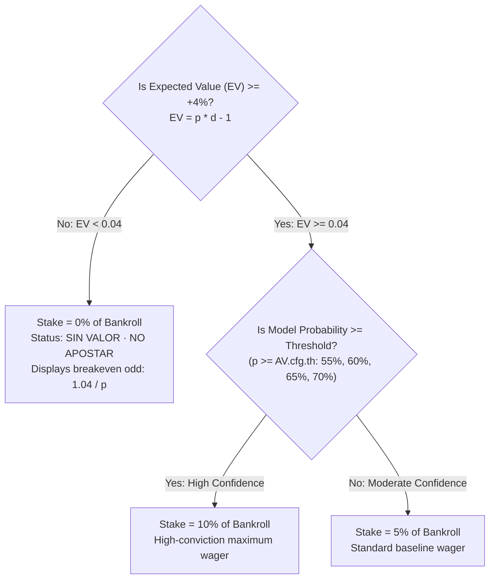
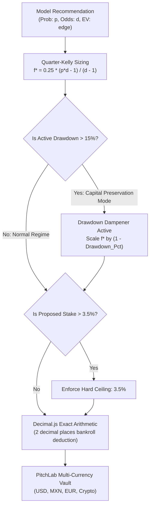

# Bankroll Management & Financial Mathematics — AztecaVet

> **Target:** `https://aztecavet.com/`  
> **Investigation Focus:** Capital Allocation, Binary Unit Sizing, Floating-Point Precision, Risk of Ruin, PitchLab Decimal Engine  
> **Classification:** [OBSERVADO] / [INFERIDO] / [RECONSTRUIDO]  
> **Supporting Screenshot:** [`15_slip_tab_bankroll.png`](<REPO_ROOT>/research/aztecavet/evidence/screenshots/15_slip_tab_bankroll.png)  
> **Code Artifact:** [`shell_app.js`](<REPO_ROOT>/research/aztecavet/evidence/javascript/shell_app.js#L1028-L1050)  

---

## 1. Capital Architecture & Dynamic Balances

AztecaVet's financial model dynamically computes user capital through a non-negative accounting function:

```javascript
// Current Bankroll Evaluation
function curBank() {
  const p = AV.bets.reduce((s, b) => s + profit(b), 0);
  return Math.max(0, AV.cfg.start + p);
}
```

### Key Financial Variables:
1. **Initial Bankroll (`AV.cfg.start`):** Default value is `$1,000` MXN. Configurable by user in Screen 14 (`#cfst`).
2. **Current Bankroll (`curBank()`):** Base capital plus the net sum of all settled wins and losses. Enforces an absolute floor at `$0` to prevent negative capital states.
3. **Floating Capital (Capital en Juego):**
   $$\text{Floating Capital} = \sum_{b \in \text{bets}, \, b.st = \text{"p"}} b.\text{stake}$$
   $$\text{Available Uncommitted Capital} = \max(0, \, \text{curBank} - \text{Floating Capital})$$

---

## 2. Dynamic Stake Sizing Rule

Rather than wagering flat dollar amounts, AztecaVet implements **percentage-of-bankroll compounding**:

$$\text{Wager Stake Amount } (\$) = \text{curBank} \cdot \left(\frac{u}{100}\right)$$

### The Binary Sizing Ladder (`unit(p, d)`):


---

## 3. Mathematical Evaluation & Risk of Ruin Audit

While percentage compounding naturally reduces dollar stakes during downswings, **AztecaVet's binary 5% / 10% rule is mathematically aggressive and presents extreme drawdown risk**:

### 1. Risk of Ruin Simulation:
Consider a user with $AV.\text{cfg.th} = 0.60$ encountering a cluster of 60% probability picks:
- In independent trials with $p = 0.60$, the probability of suffering 5 consecutive losses is:
  $$P(\text{5 consecutive losses}) = (1 - 0.60)^5 = (0.40)^5 = 0.01024 \quad (\approx 1.02\%)$$
  In a 100-bet sequence, experiencing 5 consecutive losses is virtually guaranteed ($P > 65\%$).

### 2. Capital Destruction under 10% Staking:
If a bettor loses 5 consecutive 10% wagers under compounding:
$$\text{Remaining Capital} = \text{start} \cdot (1 - 0.10)^5 = \text{start} \cdot (0.90)^5 \approx 0.59049 \quad (\mathbf{-41.0\% \text{ Drawdown}})$$
After 8 consecutive losses:
$$\text{Remaining Capital} = \text{start} \cdot (0.90)^8 \approx 0.43046 \quad (\mathbf{-57.0\% \text{ Drawdown}})$$

### 3. Asymmetric Recovery Barrier:
To recover from a $-57\%$ drawdown back to the initial bankroll requires a **$+132.3\%$ capital gain**:
$$\text{Required Recovery Gain} = \frac{1}{0.43046} - 1 \approx +132.3\%$$
Under binary 10% staking, achieving this without encountering another losing streak requires an improbable run of positive variance.

---

## 4. Precision & Floating-Point Arithmetic Audit

AztecaVet relies on native JavaScript 64-bit IEEE 754 floating-point numbers:
```javascript
const money = v => (v < 0 ? "-" : "") + "$" + Math.abs(Math.round(v)).toLocaleString("es-MX");
```

### Observed Vulnerabilities:
1. **Floating-Point Imprecision:** Adding multiple decimal increments can accumulate representation artifacts (e.g., $1000.10 + 200.20 = 1200.3000000000002$).
2. **Rounding Drift:** While `Math.round()` mitigates display anomalies, long-term state updates stored in `localStorage` can drift by minor fractional cents over hundreds of bets.

---

## 5. PitchLab Institutional Capital Engine Blueprint

PitchLab will replace AztecaVet's aggressive binary staking with an **Institutional Risk-Budgeted Capital Engine**:



### PitchLab Enterprise Standards:
1. **Exact Decimal Arithmetic:** Powered by `Decimal.js` (34 digits of precision) to prevent financial rounding drift.
2. **Fractional Kelly Default:** Hardcoded default to **$0.25\times$ Quarter-Kelly**, scaling bet size directly with the mathematical edge.
3. **Dynamic Drawdown Dampening:** If user bankroll drops $>15\%$ below its all-time high water mark, the engine automatically contracts the Kelly multiplier proportionally to prevent catastrophic risk of ruin.
4. **Value-at-Risk (VaR) Budgeting:** Calculates 95% and 99% portfolio daily VaR before allowing new multi-leg parlay commitments.
