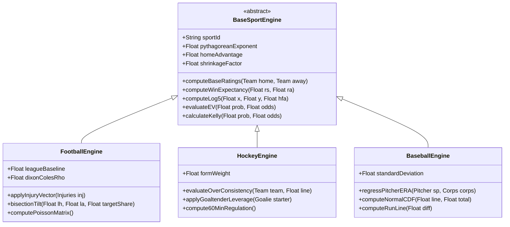

# Comparative Analysis of Sports Engines (Football, NHL, MLB) — AztecaVet

> **Target:** `https://aztecavet.com/`  
> **Investigation Focus:** Algorithmic Commonalities, Sport Divergences, Structural Synthesis, Unified PitchLab Design  
> **Classification:** [OBSERVADO] / [INFERIDO] / [RECONSTRUIDO]  

---

## 1. Cross-Sport Comparison Matrix

| Algorithmic Dimension | Football Engine (`fb.html`) | NHL Engine (`nhl.html`) | MLB Engine (`mlb.html`) |
|---|---|---|---|
| **Underlying Distribution** | **Bivariate Poisson** ($15 \times 15$ grid) + Dixon-Coles | **Bivariate Poisson** ($22 \times 22$ grid) | **Gaussian Normal** ($\Phi(z)$, $SD = 4.2426$) |
| **Pythagorean Exponent ($E$)** | **$1.70$** | **$2.15$** | **$1.83$** |
| **Home Advantage ($HFA$)** | **$0.540$** (54.0%) | **$0.525$** (52.5%) | **$0.540$** (54.0%) |
| **Bayesian Prior Weight ($K$)** | **$K = 6$** (games) | **$K = 15$** (games) | **$80\text{ IP}$** (pitcher regression) |
| **Parity Shrinkage ($SHR$)** | **$0.85$** (85%) | **$0.85$** (85%) | **$0.85$** (85%) |
| **Recent Form Weighting** | None (Current season $3\times$) | **$30\%$ moving average** of last 5 games | None |
| **Player Injury Modeling** | 215 records ($\Delta rs, \Delta ra$) | 88 records (heavy goalie leverage) | 29 pitchers (ERA) + 29 batters |
| **Low-Score Correlation** | **Dixon-Coles $\tau$** ($\rho = -0.14$ / $-0.08$) | None (Overtime redistribution via `cmbOT`) | Not applicable (continuous normal) |
| **Betting Markets Count** | **18 markets** | **15 markets** | **6 markets** |
| **Regulation vs Overtime** | Full 90-min draw modeled | **Separate 60-min regulation 1X2** | Extra innings included in ML |
| **Combos Guardrail** | Favorite $\ge 62\%$, Draw $< 28\%$ | Favorite $\ge 65\%$, **$OVR \ge 50\%$** | Favorite $\ge 65\%$, Total $\ge 8.0$ |
| **Code Implementation** | Independent Base64 script blob | Independent Base64 script blob | Independent Base64 script blob |

---

## 2. Answers to the 10 Core Comparison Questions

### 1. Do they share functions?
**Yes.** All three sub-applications share nearly identical implementations of:
- `dec(s)`: Multi-format odds parser (decimal and American).
- `row(g, o, pk, nv)`: Market table row DOM generator with odds inputs and EV badges.
- `bestOf(g, m)`: Linear scanner finding the market with highest positive EV ($EV \ge 4\%$).
- `PK(g, o, d)`: Slip payload formatter.
- `NV(g)`: No-Vig overround removal utility.
- `STK(g, pk, b)`: Stake sizing badge generator (5% vs 10%).
- `cmbBuild()`: Joint probability generator for Bet Builder combos.

### 2. Do they share normalization?
**Yes.** All three sports transform raw scoring rates into expected win shares using the exact same two-step sequence:
$$\text{Scoring Rates } (rs, ra) \xrightarrow{\text{Pythagoras } E} \text{Ratings } (x, y) \xrightarrow{\text{Log5 } + HFA} \text{Home Win Share } (share)$$

### 3. Do they share confidence scales?
**Yes.** All three engines use the exact same thresholds for value and confidence:
- $EV \ge +4\%$ minimum edge to trigger an active bet recommendation.
- Probability threshold `th` (default $60\%$) separating 5% unit stakes from 10% unit stakes.
- Daily Pick threshold: requires $P \ge 55\%$; otherwise recommends "Mejor no forzar una apuesta".

### 4. Do they share probability calculations?
**Partially.** Football and Hockey share discrete bivariate Poisson distributions. However, **Baseball fundamentally diverges to a continuous Gaussian Normal distribution** because baseball scoring exhibits extreme overdispersion that Poisson fails to capture accurately.

### 5. Do they share value evaluation?
**Yes, 100% identical.** Expected Value is strictly evaluated as:
$$EV = p \cdot d - 1$$
where $p$ is the model's fair probability and $d$ is the bookmaker decimal price entered by the user.

### 6. Do they use distinct variables?
**Yes.** Each sport incorporates variables tailored to its physical reality:
- **Football:** Attacking strength, defensive vulnerability, domestic vs. European tournament baseline scaling (`STR`), Dixon-Coles draw correlation.
- **Hockey:** Goaltender absences (massive $+0.30$ to $+0.40$ defensive penalty), 5-game recent momentum (`FORMW`), historical Over consistency (`OVR`).
- **Baseball:** Starting pitcher ERA regressed against team bullpen ERA over 80 innings, batter run creation absences.

### 7. What differences exist between markets?
- **Football (18 markets):** Includes 3-way 1X2, Double Chance (1X, X2, 12), Both Teams to Score, multiple Over/Under lines (1.5, 2.5, 3.5), and team totals.
- **Hockey (15 markets):** Distinguishes between 60-minute regulation 1X2 and full-game Moneyline (which includes OT/SO).
- **Baseball (6 markets):** Streamlined strictly to Moneyline, Run Line $\pm1.5$, and Total Runs.

### 8. Are they separate services or one unified architecture?
In AztecaVet, they are **three separate monolithic scripts** (`fb.html`, `nhl.html`, `mlb.html`) packed into Base64 strings. There is no shared JavaScript class or module; the shared functions were duplicated by copy-pasting across the files.

### 9. Does a unified architecture exist?
In AztecaVet, **no**. The architectural unity exists purely at the mathematical design level, not in the software engineering implementation.

### 10. What can PitchLab leverage?
PitchLab can take the solid mathematical foundation (Pythagoras $\to$ Log5 $\to$ Bivariate Distribution $\to$ EV $\to$ Sizing) and refactor it into an **enterprise Polymorphic Quantitative Strategy Engine**.

---

## 3. PitchLab Unified Quantitative Architecture

Rather than copy-pasting code across sports, PitchLab will implement a unified object-oriented and functional architecture:

### Architectural Benefits for PitchLab:
1. **DRY (Don't Repeat Yourself):** Eliminates 800+ lines of duplicated code across sports.
2. **Pluggable Distributions:** Easily swap between Poisson, Negative Binomial, Bivariate Poisson with Covariates (BPS), and Monte Carlo simulation engines without modifying market formatting or UI layers.
3. **Cross-Sport Parlay Combiner:** Because all engines implement a unified `Market` interface, PitchLab can seamlessly compute covariance-adjusted cross-sport parlays (e.g. Real Madrid win + Colorado Avalanche ML + Dodgers Over 8.5).
