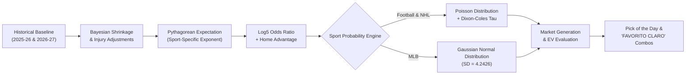

# Executive Summary — Reverse Engineering of AztecaVet

> **Target:** `https://aztecavet.com/`  
> **Investigation Date:** November 8, 2026  
> **Authoring Group:** Senior Engineering & Research Taskforce (Reverse Engineering, Quantitative Research, Systems Architecture)  
> **Classification:** [OBSERVADO] / [INFERIDO] / [RECONSTRUIDO]  

---

## 1. Core Synthesis in One Paragraph

**AZTECA VET is an entirely self-contained, single-file Single Page Application (1.22 MB uncompressed HTML / ~739 KB Brotli) hosted statically on Netlify Edge, with zero dedicated backend infrastructure, zero external API requests, and zero real-time external synchronization.** All application logic, statistical models, datasets (115 soccer clubs, 32 NHL franchises, 8 MLB playoff teams, 332 player injury/news records), audio synthesis routines, and graphics (including a procedural 3D ray-traced soccer ball and Aztec vector glyphs) reside directly within the HTML document. The entry gate (`CODE = "[REDACTED_AUTH_CODE]"`) is a simple client-side JavaScript string equality check without session tokens or persistence. The "AI Assistant" operates in standard web browsers as a purely local regex/keyword parser reading up to 9,000 characters of text from the rendered iframe DOM. Despite visual styling that implies complex live AI infrastructure, AztecaVet is a static offline analytical dashboard with baked datasets dated **November 6, 2026**.

---

## 2. Infrastructure & Delivery Architecture

| Architectural Layer | Empirical Observation | Evidentiary Backing |
|---|---|---|
| **Hosting & Edge Delivery** | **Netlify Edge CDN** (`server: Netlify`, `cache-status: "Netlify Edge"; hit`, HSTS enabled). | HTTP Response Headers (`01M6YBEBABCCEDJY6H0T66HGXJ`) |
| **Payload Composition** | Single HTML document of **1,219,472 bytes**; 2 inline `<script>` blocks (785 KB app logic + 4 KB assistant). Zero external CSS/JS scripts. | Document DOM inspection; AST analysis (12,488 nodes) |
| **Network Traffic** | **0 fetch, 0 XHR, 0 WebSocket, 0 Beacon calls**. The only HTTP transaction is the initial `GET /`. | Playwright & CDP Network Logs (100% idle) |
| **Client Storage & Cookies** | **0 cookies**, 0 session tokens. Local storage key `azteca_av` is only written when registering bets or modifying bankroll settings. | Browser context storage inspection |
| **Sub-Page Architecture** | 3 embedded sub-applications (`fb.html`, `nhl.html`, `mlb.html`) stored as Base64 strings in `PAGES{}`, injected on-demand into an iframe (`#fr`) via `srcdoc`. | `inline_1_readable.js` (`openSport()` at line 936) |

---

## 3. Access Control Reality: The Passcode Gate

1. **Client-Side Comparison:** The gate checks user input against a hardcoded plaintext constant: `const CODE = "[REDACTED_AUTH_CODE]"`.
2. **Two-Stage Workflow:**
   - **Stage 1 (Intro):** Canvas starfield and 3D soccer ball. Clicks or keypresses are ignored for the first 900 ms, after which any interaction transitions to Stage 2 (`goStage2()`).
   - **Stage 2 (Pad):** A 12-button virtual keypad (`0-9`, `⌫`, and an invisible spacing cell) collects digits into an internal string `buf`. Physical keyboard strokes are also accepted via a global `keydown` listener.
3. **Absence of Session Persistence:** Because the validation never sets a cookie, localStorage flag, or JWT, **reloading the browser or reopening a tab immediately returns the user to Stage 1**.
4. **Security Assessment:** The gate provides cosmetic protection only. Any visitor inspecting the publicly downloaded HTML file can view `CODE = "[REDACTED_AUTH_CODE]"` and decode the Base64 sports pages (`atob()`) without ever passing the gate.

---

## 4. Quantitative & Statistical Engines Summary

AztecaVet employs a classic sabermetric/statistical pipeline rather than Machine Learning or Neural Networks:

### Key Parameters by Sport:

1. **Football (5 Tournaments: Liga MX, La Liga, Premier League, Champions League, Europa League):**
   - **Pythagorean Exponent:** `E = 1.7`
   - **Neutral Log5 + Home Advantage:** `HFA = 0.54` (54%), shrinkage factor `SHR = 0.85`.
   - **Bayesian Team Rates:** Prior weight `K = 6`. Current 2026-27 games receive triple weighting (`x3`).
   - **Bivariate Goal Model:** Goals projected as $lh = \frac{H_{rs} \cdot A_{ra}}{LG}$ and $la = \frac{A_{rs} \cdot H_{ra}}{LG}$, adjusted iteratively via bisection (`tilt()`) to match the Log5 win share.
   - **Dixon-Coles Low-Score Adjustment:** $\rho = -0.14$ for Liga MX (higher draw frequency) and $\rho = -0.08$ for European leagues.
   - **Markets:** 18 distinct markets (1X2, Over/Under 1.5, 2.5, 3.5, Double Chance, Both Teams to Score, Team Totals, Spread $\pm1.5$).

2. **NHL (National Hockey League):**
   - **Pythagorean Exponent:** `E = 2.15`
   - **Home Advantage:** `HFA = 0.525` (52.5%), shrinkage `SHR = 0.85`.
   - **Form Weighting (`FORMW`):** If a team has played $\ge 7$ games, its last 5 games receive a 30% weighting (`FORMW = 0.30`).
   - **Goalie Impact:** High penalty for missing starting goaltenders (e.g., Shesterkin $-0.40$ goals/game, Hellebuyck $-0.35$).
   - **Poisson Grid:** Evaluated up to 22 goals (`NG = 22`).

3. **MLB (Major League Baseball):**
   - **Model Divergence:** Replaces Poisson with a **Gaussian Normal Distribution** ($SD = 3\sqrt{2} \approx 4.2426$).
   - **Pythagorean Exponent:** `EX = 1.83`
   - **Starting Pitcher Regression:** $\text{ERA}_{\text{reg}} = \frac{\text{ERA}_{\text{starter}} \cdot \text{IP} + \text{ERA}_{\text{team}} \cdot 80}{\text{IP} + 80}$. Adjusts team Runs Allowed by factor $1 + 0.55 \cdot (\frac{\text{ERA}_{\text{reg}}}{\text{ERA}_{\text{team}}} - 1)$.
   - **Scope:** Restricted exclusively to 2026 Playoff teams (Milwaukee Brewers World Series championship narrative).

---

## 5. Value, Betting Ticket, and Bankroll Mechanics

- **Odds Formats:** Accepts Decimal ($>1.0$) and American ($\pm100$). Converts commas to decimals automatically.
- **Expected Value (EV):** Calculated as $\text{EV} = p \cdot d - 1$.
- **Selection Threshold:** If no market achieves $\text{EV} \ge +0.04$ (+4%), the UI displays **"SIN VALOR · NO APOSTAR"**.
- **Stake Sizing:** A simplified binary stake rule:
  - **10% of Bankroll** if $p \ge \text{threshold}$ (default $\text{threshold} = 0.60$).
  - **5% of Bankroll** if $p < \text{threshold}$ (provided $\text{EV} \ge +4\%$).
- **Parlay Math:** Strictly independent product: $P_{\text{parlay}} = \prod p_i$, $d_{\text{parlay}} = \prod d_i$. Flags an explicit correlation alert if multiple legs belong to the same fixture.
- **Bankroll Tracking:** $\text{Current Bankroll} = \text{Initial Capital} + \sum \text{Net Profit of Settled Bets}$. Includes calibration analysis ($|\Delta| < 4\%$ indicates well-calibrated picks).

---

## 6. The "AI Assistant" Reality

The AI Assistant (`inline_2.js`) operates under a dual architecture:
1. **Container Bridge Mode (`window.claude.use`):** If the application runs inside an environment supporting the Claude agent API (e.g., specific WebMCP execution wrappers), it streams responses from Claude using an embedded system prompt.
2. **Standard Web Mode (Live on Netlify):** In any standard browser (Edge, Chrome, Safari, Firefox), `window.claude` is `undefined`. The assistant falls back to a **synchronous local heuristic parser**:
   - Queries containing "pick" or "mejor" extract text directly from the iframe's `#pdx` element.
   - Queries containing "fórmula", "decide", or "cómo funciona" extract the `.note` explanation block.
   - General queries tokenize the input and perform case-insensitive substring matching against up to 9,000 characters of the active iframe's text.
   - **No external AI server, OpenAI API, Anthropic API, or vector database is contacted.**

---

## 7. Critical Deficiencies of AztecaVet

1. **Zero Data Freshness:** Entirely dependent on manual code redeployment to update scores, injuries, or odds.
2. **Fragile Authentication:** Client-side plaintext passcode trivial to bypass.
3. **Arbitrary Staking:** Binary 5%/10% staking ignores proper fractional Kelly sizing and introduces severe drawdown risk.
4. **No Real AI Co-Pilot:** Keyword scraping cannot reason over novel fixtures or synthesize cross-sport betting strategies.
5. **Restricted Market Coverage:** Ignores modern micro-markets, player props, Asian handicaps, and live in-play betting.

---

## 8. Strategic Value for PitchLab

AztecaVet provides an exceptionally clean, readable benchmark of how to build an intuitive, low-latency sports quantitative interface with solid baseline mathematical mechanics (Pythagoras + Log5 + Poisson/Normal). 

**PitchLab will transform this static concept into an enterprise-grade quantitative platform by implementing:**
1. **Live Data Pipeline:** Real-time integration with Sportradar / API-Football / The-Odds-API.
2. **Server-Side Quant Engines:** Upgraded models including Dixon-Coles maximum likelihood estimation, BPS (Bivariate Poisson with Covariates), Elo ratings, and XGBoost player prop models.
3. **Institutional Bankroll Engine:** Half-Kelly, Quarter-Kelly, Monte Carlo drawdown simulation, and covariance-adjusted multi-leg parlay sizing.
4. **True AI Co-Pilot:** A LangGraph/FastAPI orchestrator powered by Gemini / Claude, equipped with real SQL/TimescaleDB tools, odds calculation tools, and grounded injury search.
