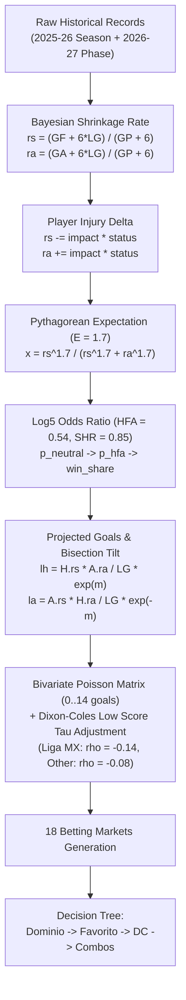

# Football Quantitative Engine (5 Tournaments) — AztecaVet

> **Target:** `https://aztecavet.com/`  
> **Investigation Focus:** Mathematical Formulation, Multi-Tournament Normalization, Dixon-Coles Bivariate Poisson, Bet Builder Combos  
> **Classification:** [OBSERVADO] / [INFERIDO] / [RECONSTRUIDO]  
> **Source Artifact:** [`football_engine.js`](file:///c:/Users/jairb/Desktop/Proyectos/Pitch%20Lab/research/aztecavet/evidence/javascript/football_engine.js)  

---

## 1. Multi-Tournament Scope & Normalization

AztecaVet's soccer module covers five major competitions within a single engine (`fb.html`):

1. **Liga MX** (Mexico · Apertura 2026, Jornada 16)
2. **La Liga** (Spain · 2026-27, Jornada 12)
3. **Premier League** (England · 2026-27, Jornada 10)
4. **UEFA Champions League** (UEFA · League Phase 26/27, Jornada 4 complete)
5. **UEFA Europa League** (UEFA · League Phase 26/27, Jornada 4 complete)

### League Baseline Parameters (`LG0`):
Expected average goals per team per game across domestic leagues:
$$\text{PL: } 1.45, \quad \text{LL: } 1.35, \quad \mathbf{\text{MX: } 1.51}, \quad \text{SA (Serie A): } 1.21, \quad \text{BL (Bundesliga): } 1.62, \quad \text{L1 (Ligue 1): } 1.41, \quad \text{OT: } 1.40$$

### European Cross-League Scaling (`STR` & `LGU`):
In domestic play, teams operate against their native baseline `LG0`. However, in UEFA competitions (Champions League and Europa League), domestic attacking and defensive rates are scaled relative to the Premier League ($1.00$) to reflect differing domestic league difficulty:

$$\text{STR} = \{ \text{PL: } 1.00, \quad \text{LL: } 0.98, \quad \text{BL: } 0.96, \quad \text{SA: } 0.96, \quad \text{L1: } 0.92, \quad \text{MX: } 0.80, \quad \text{OT: } 0.85 \}$$

The normalized rates under UEFA baseline $LGU = 1.45$ are:
$$rs = \frac{rs_{\text{base}}}{LG_{\text{base}}} \cdot \text{STR} \cdot LGU, \quad ra = \frac{ra_{\text{base}}}{LG_{\text{base}} \cdot \text{STR}} \cdot LGU$$

---

## 2. Mathematical Formulation of the Engine

---

### Step 1: Bayesian Scoring Rates (`base`)
To prevent small-sample volatility, scoring rates are smoothed against the league baseline with prior weight $K = 6$. Games from the current 2026-27 campaign are given **triple weight ($3\times$)**:

$$F = GF_{25-26} + 3 \cdot GF_{26-27}, \quad A = GA_{25-26} + 3 \cdot GA_{26-27}, \quad G = GP_{25-26} + 3 \cdot GP_{26-27}$$
$$rs = \frac{F + 6 \cdot LG}{G + 6}, \quad ra = \frac{A + 6 \cdot LG}{G + 6}$$

### Step 2: Injury Adjustments (`inj`)
Injuries adjust team rates linearly based on player position and availability status ($0 = \text{available}, 0.5 = \text{doubtful}, 1.0 = \text{out}$), with an absolute floor of $0.30$:

$$\Delta = \text{impact} \cdot \text{status}$$
$$\text{If attacking (role } gf\text{): } rs = \max(rs - \Delta, 0.30)$$
$$\text{If defensive (role } ga\text{): } ra = \max(ra + \Delta, 0.30)$$

### Step 3: Pythagorean Win Expectancy (`py`)
Scoring rates are converted to win percentages via Bill James' Pythagorean formula with exponent $E = 1.7$:

$$x = \frac{H_{rs}^{1.7}}{H_{rs}^{1.7} + H_{ra}^{1.7}}, \quad y = \frac{A_{rs}^{1.7}}{A_{rs}^{1.7} + A_{ra}^{1.7}}$$

### Step 4: Log5 Head-to-Head & Home Advantage (`share`)
1. **Neutral Matchup (Log5):**
   $$p_n = \frac{x - x \cdot y}{x + y - 2xy}$$
2. **Home Field Advantage Adjustment ($HFA = 0.54$):**
   $$o = \frac{p_n}{1 - p_n} \cdot \frac{0.54}{1 - 0.54}$$
3. **Shrinkage toward parity ($SHR = 0.85$):**
   $$\text{share} = 0.5 + 0.85 \cdot \left( \frac{o}{1 + o} - 0.5 \right)$$

### Step 5: Bisection Tilt (`tilt`)
Raw goals are projected as:
$$\lambda_{h0} = \frac{H_{rs} \cdot A_{ra}}{LG}, \quad \lambda_{a0} = \frac{A_{rs} \cdot H_{ra}}{LG}$$

The engine executes 16 iterations of binary search (bisection) to find multiplier $m \in [-1.5, 1.5]$ such that the conditional non-draw Poisson win share exactly matches the target `share`:

$$\lambda_h = \lambda_{h0} \cdot e^m, \quad \lambda_a = \lambda_{a0} \cdot e^{-m}$$
$$\frac{\sum_{i > j} P(i; \lambda_h) Q(j; \lambda_a)}{\sum_{i \ne j} P(i; \lambda_h) Q(j; \lambda_a)} = \text{share}$$

### Step 6: Bivariate Poisson with Dixon-Coles Tau Adjustment
To correct for Poisson's known tendency to underestimate low-scoring draws and 1-0 results, the bivariate probability matrix $M_{i,j}$ (evaluated for $0 \le i, j < 14$) is adjusted via the Dixon-Coles $\tau(i, j)$ matrix:

$$\tau(i, j) = \begin{cases} 
1 - \lambda_h \lambda_a \rho & \text{if } i=0, j=0 \\ 
1 + \lambda_a \rho & \text{if } i=0, j=1 \\ 
1 + \lambda_h \rho & \text{if } i=1, j=0 \\ 
1 - \rho & \text{if } i=1, j=1 \\ 
1 & \text{otherwise} 
\end{cases}$$

**Empirical Parameter Values:**
- **Liga MX:** $\rho = -0.14$ (Substantially stronger low-scoring dependency, reflecting tactical parity).
- **European Leagues:** $\rho = -0.08$.

---

## 3. The 18 Generated Betting Markets

By summing over $M_{i, j} = P(i; \lambda_h) \cdot Q(j; \lambda_a) \cdot \tau(i, j)$:

1. **Home Win ($h$):** $\sum_{i > j} M_{i,j}$
2. **Draw ($d$):** $\sum_{i = j} M_{i,j}$
3. **Away Win ($a$):** $\sum_{i < j} M_{i,j}$
4. **Over Line ($ov$):** $\sum_{i+j > \text{line}} M_{i,j}$ (line rounded to nearest half goal: $\text{round}(tot \cdot 2)/2 + 0.5$)
5. **Under Line ($un$):** $1 - P(ov)$
6. **Favorite $-1.5$ ($plf$):** $\sum_{i - j \ge 2} M_{i,j}$ (if Home favorite)
7. **Underdog $+1.5$ ($pld$):** $1 - P(plf)$
8. **Double Chance 1X ($dc1x$):** $P(h) + P(d)$
9. **Double Chance X2 ($dcx2$):** $P(d) + P(a)$
10. **Double Chance 12 ($dc12$):** $P(h) + P(a)$
11. **Over 1.5 ($o15$):** $\sum_{i+j > 1.5} M_{i,j}$
12. **Under 3.5 ($u35$):** $\sum_{i+j < 3.5} M_{i,j}$
13. **Over 3.5 ($o35$):** $\sum_{i+j > 3.5} M_{i,j}$
14. **Home Over ($tho$):** $\sum_{i > \text{line}_H} P(i; \lambda_h)$
15. **Home Under ($thu$):** $1 - P(tho)$
16. **Away Over ($tao$):** $\sum_{j > \text{line}_A} Q(j; \lambda_a)$
17. **Away Under ($tau$):** $1 - P(tao)$
18. **Both Teams To Score ($by$):** $(1 - e^{-\lambda_h})(1 - e^{-\lambda_a})$

---

## 4. Pick Selection Hierarchy & "FAVORITO CLARO" Combos

The decision algorithm determines the primary model recommendation through a deterministic priority ladder:

1. **Dominio Total (`dom`):**
   - If a team has strictly superior attack AND defense ($H_{rs} > A_{rs} \land H_{ra} < A_{ra}$) and $P(\text{win}) \ge 42\%$:
     $\implies$ **"GANA · DOMINA EN ATAQUE Y DEFENSA"**.
   - If dominant but $P(\text{win}) < 42\%$:
     $\implies$ **"DOMINA, PERO PARTIDO CERRADO · DOBLE OPORTUNIDAD"**.
2. **Favorito Simple:**
   - If favorite $P \ge 50\%$:
     $\implies$ **"FAVORITO (sin dominio total)"**.
   - Else if Double Chance $P \ge 65\%$:
     $\implies$ **"SIN VENTAJA CLARA · OPCIÓN MÁS SEGURA"**.
   - Else: Under 3.5 $\implies$ **"SIN VENTAJA CLARA · TOTAL MÁS SEGURO"**.
3. **Empate Probable Override ($d \ge 28\%$):**
   - If the draw probability reaches $28\%$ and the pick is a straight win, it is downgraded to Double Chance:
     $\implies$ **"EMPATE PROBABLE · DOBLE OPORTUNIDAD"**.
4. **Combos Rule ("FAVORITO CLARO · GANA + GOLES"):**
   - If favorite $P \ge 62\%$ and Draw $P < 28\%$:
     - Determines Over line: Over 2.5 if projected total $\ge 2.60$ or favorite averages $\ge 3.0$ GF/game; otherwise Over 1.5.
     - Joint probability computed via conditional matrix:
       $$P(\text{Fav wins} \land \text{Over } L) = P(\text{Fav}) \cdot \frac{\sum_{\text{win} \land i+j > L} M_{i,j}}{\sum_{\text{win}} M_{i,j}}$$
     - If joint probability $\ge 35\%$, this Bet Builder combo **replaces the straight pick as the primary recommendation**.
