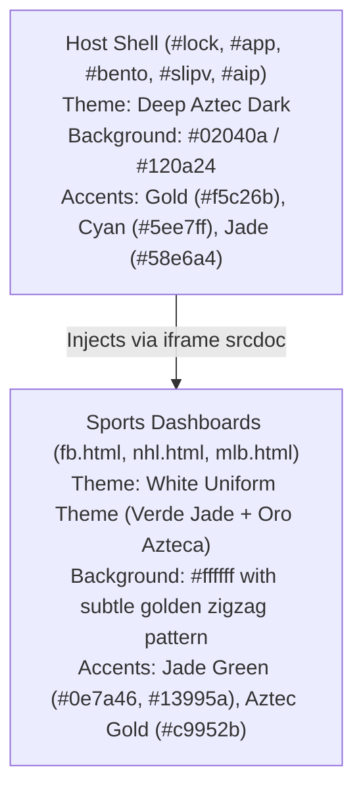

# Frontend Architecture & Client-Side Engineering — AztecaVet

> **Target:** `https://aztecavet.com/`  
> **Investigation Focus:** Bundling, Rendering Engines, Canvas Graphics, Procedural Audio, Responsive Design  
> **Classification:** [OBSERVADO] / [INFERIDO] / [RECONSTRUIDO]  
> **Code Artifacts:** [`shell_app.js`](file:///c:/Users/jairb/Desktop/Proyectos/Pitch%20Lab/research/aztecavet/evidence/javascript/shell_app.js), [`inline_2_readable.js`](file:///c:/Users/jairb/Desktop/Proyectos/Pitch%20Lab/Reportes/analisis-aztecavet/readable/inline_2_readable.js)  

---

## 1. Technology Stack & Framework Audit

A rigorous inspection of the client source code and DOM AST confirms:

- **Framework:** **Vanilla ECMAScript 2022+** (No React, Vue, Angular, Svelte, or Solid).
- **DOM Manipulation:** Lightweight functional helpers (`$ = id => document.getElementById(id)`, template literal string interpolation).
- **Bundler & Packaging:** Custom single-file consolidation script. The original development source was likely organized into separate HTML and JS modules that were combined and minified into a single production HTML document.
- **External Dependencies:** **Zero (0)** third-party NPM runtime dependencies. No external font files (uses system font stacks: `-apple-system, BlinkMacSystemFont, "SF Pro", "Segoe UI", Roboto`), zero external icons (all iconography is inline SVG), and zero analytics or tracking libraries.
- **Payload Footprint:**
  - Uncompressed HTML document: **1,219,472 bytes** (~1.22 MB).
  - Brotli compressed over the wire: **739,330 bytes** (~739 KB).
  - Inline `<script>` Block 1 (Shell + Embedded Sports): **785,916 bytes**.
  - Inline `<script>` Block 2 (AI Assistant Panel): **4,039 bytes**.

---

## 2. Visual Theme & Style Architecture

AztecaVet employs a **bipolar theme architecture**: a deep dark-mode shell that wraps high-contrast light-mode sport dashboards.



### 1. Host Shell Styling (`aztecavet-shell.css` / inline `<style>`):
- **Color Variables:**
  ```css
  :root {
    --bg: #02040a;
    --gold: #f5c26b;
    --tq: #5ee7ff;
    --ok: #58e6a4;
    --bad: #ff6b88;
    --card: rgba(255, 255, 255, 0.055);
    --bd: rgba(120, 170, 255, 0.22);
    color-scheme: dark;
  }
  ```
- **Typography:** Native high-performance system stack: `"SF Pro Display", "SF Pro Text", -apple-system, BlinkMacSystemFont, "Segoe UI Variable Display", "Segoe UI", Roboto, Helvetica, Arial, sans-serif`.

### 2. Embedded Sports Dashboard Styling (`<style id="light">`):
- To improve daylight readability for dense statistics and odds tables, the sports blobs inject an override:
  ```css
  body {
    background: #ffffff;
    color: #1a1a1a;
    --c1: #0e7a46;
    --c2: #13995a;
    --gold: #c9952b;
  }
  ```
- Background features an SVG encoded zigzag pattern reflecting pre-Columbian architectural motifs.

---

## 3. High-Performance Canvas Graphics

AztecaVet incorporates two custom Canvas 2D rendering routines:

### A. Procedural 3D Ray-Traced Soccer Ball
Located in `shell_app.js` (lines 140–221), this algorithm performs **analytical ray-tracing of a truncated icosahedron directly on an HTML5 `<canvas>`**:

1. **Geometry Definition:** Defines 12 vertices ($V$) and 20 face centers ($F$) of an icosahedron in 3D Euclidean space.
2. **Ray-Sphere Intersection:** For each pixel in a $240 \times 240$ buffer, computes normal vector $(nx, ny, nz)$ where $nz = \sqrt{1 - (nx^2 + ny^2)}$.
3. **Face Classification:** Computes dot products against rotated vertices and face vectors to determine whether the pixel falls on a **black pentagon** or a **white hexagon**:
   $$\text{angular distance } sP = \frac{\arccos(dp)}{AP}, \quad sH = \frac{\arccos(dh)}{AH}$$
   $$\text{if } sP < sH \implies \text{Pentagon (Dark RGB: 20, 22, 28)}, \quad \text{else Hexagon (Light RGB: 247, 248, 252)}$$
4. **Shading & Seams:** Computes Lambertian diffuse lighting, Blinn-Phong specular highlight, spherical bulge, and indents seam grooves ($b = |sP - sH| < 0.045$).
5. **Interactive Parallax:** Rotates dynamically with mouse / pointer movement (`PTR.x`, `PTR.y`).

### B. Aztec Sun Stone (Piedra del Sol) Vector Art
- Rather than loading a raster PNG/JPEG (which would increase file size or blur on high-DPI displays), the Sun Stone is generated as a **compact SVG vector graphic**:
  - Central solar face (Tonatiuh) with tongue knife.
  - 16 cardinal and intermediate rays.
  - 104 perimeter ticks representing calendar cycles.
  - 20 concentric day-sign glyph cells rotating continuously.

### C. Starfield & Warp Tunnel
- `stage 1` features 120 orbiting particle stars.
- Upon passing the gate (`CODE = "[REDACTED_AUTH_CODE]"`), `intro.warp = 1` stretches particle coordinates radially outward toward the viewport boundaries, creating a hyperspace warp-speed effect before revealing the Home screen.

---

## 4. WebAudio Procedural Synthesizer

AztecaVet contains an entire **software synthesizer engine** (`shell_app.js`, lines 232–410) that produces custom audio without downloading any `.mp3` or `.wav` files.

### Synthesizer Architecture:
- **AudioContext Master Chain:** AudioContext $\to$ DynamicsCompressor (`threshold: -20dB`, `ratio: 6`) $\to$ Master Gain (`gain: 0.55`) $\to$ Convolver Reverb $\to$ Destination.
- **Impulse Response (Reverb):** Generates an algorithmic synthetic stereo impulse buffer (2.6 seconds decay time) with exponential noise dissipation.
- **Musical Tuning:** Tuned to a 10-note A4 Pentatonic Scale:
  $$\text{PENT} = [440.0, 523.25, 587.33, 659.25, 783.99, 880.0, 1046.5, 1174.66, 1318.5, 1568.0] \text{ Hz}$$

### Procedural Aztec Instruments:
1. **Huehuetl (Ceremonial War Drum):** Sine wave oscillator sweeping rapidly from 135 Hz down to 46 Hz with low-pass filtered noise burst (cutoff 950 Hz).
2. **Caracol (Conch Shell Trumpet):** Triple oscillator array (Sawtooth + Triangle + Sine) passed through a dynamic bandpass filter sweeping from 380 Hz to 1500 Hz with a 5.2 Hz LFO vibrato.
3. **Ocarina (Clay Flute):** Pure sine oscillator with subtle breath noise and pitch vibrato (5.5 Hz).
4. **Ceremonial Bells:** Inharmonic frequency partials ($f \times [1.0, 2.76, 5.4]$) with exponential gain decay.
5. **Keypad Tones:** Pressing any digit on the keypad triggers a bell tone whose pitch index matches the digit (`PENT[digit]`).

---

## 5. Viewport Adaptation & Mobile Performance

The frontend was tested across both desktop (1280x800) and mobile profiles (iPhone 14 / Edge Mobile at 390x844 @2x, `locale: es-MX`):

- **Fluid Bento Grid:** Transitions from a 3-column asymmetric layout on screens $>900\text{px}$ to a single-column stacked layout on screens $<768\text{px}$.
- **Safe Area Insets:** Employs CSS environment variables:
  `padding-top: env(safe-area-inset-top, 0px)`
  `padding-bottom: env(safe-area-inset-bottom, 0px)`
  to prevent UI overlap with mobile notches and home indicator bars.
- **Touch Responsiveness:** Keypad buttons have minimum touch targets of $48 \times 48\text{px}$ with active state scale animations (`transform: scale(0.96)`).
- **Execution Overhead:**
  - Memory footprint: $\approx 42\text{ MB}$ RSS in browser tab.
  - Canvas loop CPU utilization: $< 3\%$ on modern multi-core CPUs.
  - Memory leak verification: Replacing iframe `srcdoc` during sport navigation cleanly releases previous iframe DOM trees and event listeners.
