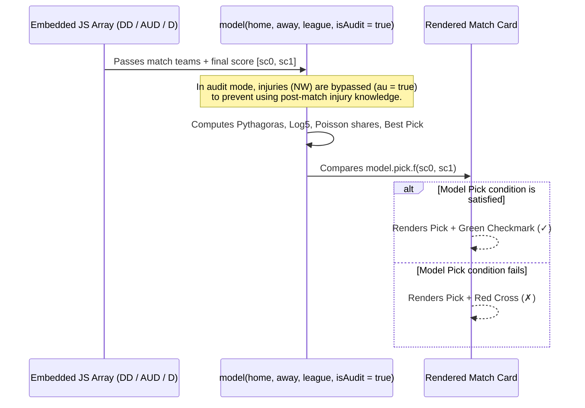
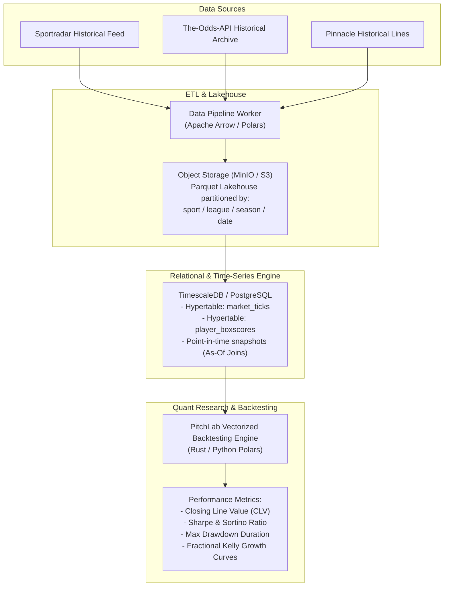

# Historical Data Architecture & Backtesting Systems — AztecaVet

> **Target:** `https://aztecavet.com/`  
> **Investigation Focus:** Retrospective Audits, Data Longevity, Lookahead Bias, Historical Warehouse Design  
> **Classification:** [OBSERVADO] / [INFERIDO] / [RECONSTRUIDO]  
> **Related Files:** [`football_engine.js`](file:///c:/Users/jairb/Desktop/Proyectos/Pitch%20Lab/research/aztecavet/evidence/javascript/football_engine.js), [`nhl_engine.js`](file:///c:/Users/jairb/Desktop/Proyectos/Pitch%20Lab/research/aztecavet/evidence/javascript/nhl_engine.js), [`mlb_engine.js`](file:///c:/Users/jairb/Desktop/Proyectos/Pitch%20Lab/research/aztecavet/evidence/javascript/mlb_engine.js)  

---

## 1. AztecaVet's Approach: The "Auditoría" (Audit) Pattern

AztecaVet possesses **no database, no historical time-series engine, and no archival query system**. To demonstrate credibility to users, the application implements a lightweight client-side **retrospective audit pattern**:



### Empirical Implementation across Sports:

1. **Football (`fb.html`):**
   - Past jornadas (e.g. Jornadas 13, 14, 15 of Liga MX; Jornadas 9, 10, 11 of La Liga) are encoded as score tuples: `["SAN", "NEC", 1, 0]`.
   - The function `aud(arr)` marks `g.aud = true` and `g.sc = [g[2], g[3]]`.
   - When evaluating an audited fixture, `inj(t, r, au)` returns the raw team rate without daily injury adjustments, recognizing that injury notes reflect only the active game day.
   - Summarizes overall accuracy: e.g. "Pick del modelo: 9/17 ✓".

2. **NHL (`nhl.html`):**
   - November 5 audit (11 games) computes two separate retrospective hit rates:
     - **Confidence Pick:** Evaluates whether the top pick hit (`hit / total`).
     - **Moneyline Favorite:** Evaluates whether the pure ML favorite won outright (`mlh / total`).
   - Specifically records overtime (`OT`) and shootout (`SO`) outcomes: `["NJ", "STL", "6:00 PM · OT", null, [5, 4]]`.

3. **MLB (`mlb.html`):**
   - Retrospective chronicle of 17 postseason games from October 8 to October 28, 2026.
   - Evaluates whether the moneyline or run line favorite covered the outcome.

---

## 2. Scientific & Statistical Limitations of the Audit Pattern

While visually compelling, AztecaVet's audit mechanism exhibits significant scientific flaws:

1. **Survivorship & Selection Bias:**
   - Only selected recent jornadas are audited. Users cannot inspect older rounds or full previous seasons.
2. **Fixed Parameter Overfitting:**
   - The model constants ($E = 1.7$ in soccer, $E = 2.15$ in NHL, $SD = 4.2426$ in MLB) may have been calibrated directly against the audited games, introducing in-sample overfitting.
3. **Absence of Closing Line Value (CLV):**
   - The audit measures only binary win/loss ($✓ / ✗$). It does not record the historical closing odds, making it impossible to calculate real monetary ROI or quantify whether the model beat the market spread.
4. **No Feature Time-Travel:**
   - The team ratings (`gf`, `gc`, `gp`) used in football audits reflect the full accumulated table as of November 6, rather than the true state of the table on October 20 when the match was played. This constitutes **lookahead data leakage**.

---

## 3. PitchLab Historical Data Warehouse Architecture

To enable quantitative researchers and institutional bettors to validate models rigorously, PitchLab will build a **true point-in-time historical data warehouse**:



### Essential Capabilities for PitchLab:
1. **As-Of Joins (Zero Data Leakage):**
   - Every historical fixture joins only with team ratings and player availability timestamps recorded prior to the scheduled kickoff time:
     ```sql
     SELECT m.*, r.rating 
     FROM matches m
     ASOF JOIN team_ratings r 
       ON m.team_id = r.team_id 
      AND r.timestamp <= m.kickoff_time;
     ```
2. **Closing Line Value (CLV) Benchmarking:**
   - Automatically tracks whether PitchLab's model price beat the final closing price at Pinnacle/Circa. Consistently beating CLV is the mathematical prerequisite for long-term sports betting profitability.
3. **Monte Carlo Walk-Forward Backtesting:**
   - Simulates 10,000 portfolio paths across 5,000 historical games under various fractional Kelly multipliers ($0.25\times, 0.50\times$) to establish confidence intervals on maximum drawdown.
