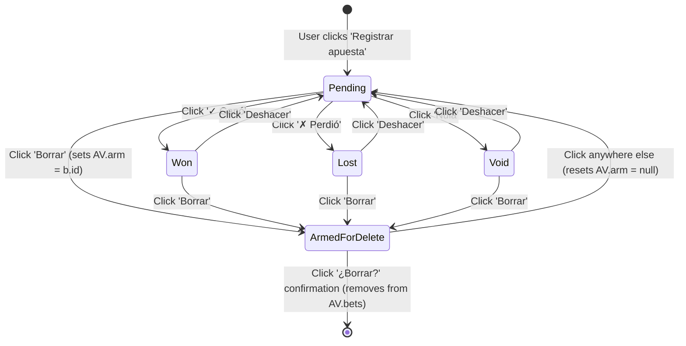
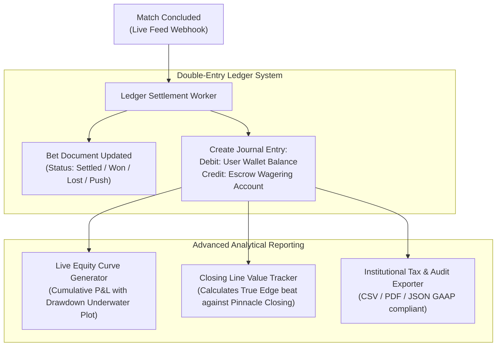

# Bet History, Calibration Analytics & Subgroup Audits — AztecaVet

> **Target:** `https://aztecavet.com/`  
> **Investigation Focus:** Bet Record Schemas, Lifecycle State Machine, Model Calibration Diagnostics, Performance Breakdowns  
> **Classification:** [OBSERVADO] / [INFERIDO] / [RECONSTRUIDO]  
> **Supporting Screenshot:** [`14_slip_tab_historial.png`](<REPO_ROOT>/research/aztecavet/evidence/screenshots/14_slip_tab_historial.png)  
> **Code Artifact:** [`shell_app.js`](<REPO_ROOT>/research/aztecavet/evidence/javascript/shell_app.js#L1065-L1112)  

---

## 1. Bet Record Schema & Lifecycle State Machine

When a user commits an active slip by tapping **"Registrar apuesta"**, AztecaVet serializes the transaction into an immutable bet record appended to `AV.bets`.

### Data Schema of a Bet Record:
```typescript
interface BetRecord {
  id: string;          // Unique ID generated via Base36 timestamp + random string: "b" + Date.now().toString(36) + Math.random().toString(36).slice(2,5)
  ts: number;          // Epoch millisecond timestamp of registration
  legs: SlipLeg[];     // Array of individual market selections
  p: number;           // Combined fair probability (product of legs)
  d: number;           // Effective bookmaker decimal odds
  stake: number;       // Monetary amount wagered in MXN: curBank * (u / 100)
  u: number;           // Percentage unit size (5 or 10)
  st: "p" | "w" | "l" | "v"; // Bet status lifecycle flag
}
```

### Lifecycle State Machine:


---

## 2. Real-Time Performance & Mathematical Metrics

Whenever the user accesses the Historial tab (`Screen 13`), the engine performs a complete recalculation over `AV.bets`:

### 1. Profit Calculation per Bet (`profit(b)`):
$$\text{profit}(b) = \begin{cases} 
\text{stake} \cdot (d - 1) & \text{if } st = \text{"w"} \quad (\text{Won}) \\ 
-\text{stake} & \text{if } st = \text{"l"} \quad (\text{Lost}) \\ 
0 & \text{if } st \in \{\text{"p"}, \text{"v"}\} \quad (\text{Pending or Void}) 
\end{cases}$$

### 2. High-Level Summary Metrics:
- **Bankroll Actual:** $\text{curBank} = \text{start} + \sum_{b \in \text{bets}} \text{profit}(b)$ (enforced floor at $\$0$).
- **Ganancia Neta (Net Profit):** $\sum \text{profit}(b)$.
- **Retorno sobre Inversión (ROI):**
  $$\text{ROI} = \frac{\sum_{\text{settled}} \text{profit}(b)}{\sum_{\text{settled}} \text{stake}(b)}$$
- **Tasa de Acierto (Hit Rate):**
  $$\text{Hit Rate} = \frac{\text{count}(st = \text{"w"})}{\text{count}(st \in \{\text{"w"}, \text{"l"}\})}$$
- **Capital en Juego (Pending Risk):**
  $$\text{Risk In Play} = \sum_{st = \text{"p"}} \text{stake}(b), \quad \text{Risk \%} = \frac{\text{Risk In Play}}{\text{curBank}}$$

---

## 3. Model Calibration Diagnostic Engine

One of the most mathematically sophisticated features of AztecaVet is its built-in **Empirical Calibration Diagnostic**:

```javascript
// Calibration Diagnostic Logic
const S = AV.bets.filter(b => b.st === "w" || b.st === "l");
if (S.length >= 30) {
  const avgModelProb = S.reduce((acc, b) => acc + b.p, 0) / S.length;
  const actualHitRate = S.filter(b => b.st === "w").length / S.length;
  const delta = Math.abs(avgModelProb - actualHitRate);
  
  if (delta < 0.04) {
    calibrationText = "Modelo bien calibrado (acierto real coincide con la probabilidad media).";
  } else if (actualHitRate > avgModelProb) {
    calibrationText = "El modelo está siendo conservador: estás acertando más de lo proyectado.";
  } else {
    calibrationText = "El modelo está sobreestimando: estás acertando menos de lo proyectado.";
  }
} else {
  calibrationText = "Con menos de 30 apuestas resueltas el resultado es principalmente suerte. Revisa esta métrica con 30+ apuestas.";
}
```

### Statistical Value:
- Prevents cognitive biases (e.g. recency bias, hot-hand fallacy).
- Imposes a rigorous threshold of $N \ge 30$ bets before declaring statistical calibration validity ($|\Delta| < 4\%$).

---

## 4. Subgroup Performance Breakdown (`BRK`)

The function `BRK()` aggregates historical performance across two critical dimensions:

### Dimension 1: ROI por Liga (Competition)
Categorizes bets by league descriptor (`b.legs[0].sp` or `"Parlays"` if multi-leg). Displays:
- Games Won - Lost ($G - P$).
- Net ROI percentage (highlighted green if positive, red if negative).

### Dimension 2: ROI por Tipo de Apuesta (Bet Type)
Classifies the tactical style of the wager based on leg descriptions:
- **"Parlay":** `legs.length > 1`
- **"Combinada (gana + over)":** Single leg containing `"gana +"`
- **"Doble oportunidad":** Single leg containing `"o empate"` or `"Empate o"`
- **"Sencilla":** Straight moneyline or totals bet

**Guardrail Alert:**
If a category has fewer than 20 resolved bets, the UI displays a cautionary note:
> *"Con menos de 20 apuestas resueltas el ROI por liga todavía cambia mucho por pura varianza. Revísalo cuando lleves más historial para decidir qué ligas o tipos de apuesta eliminar de tu estrategia."*

---

## 5. PitchLab Institutional Ledger Blueprint

PitchLab will replace AztecaVet's manual status toggling with an **Automated Double-Entry Accounting Ledger**:


