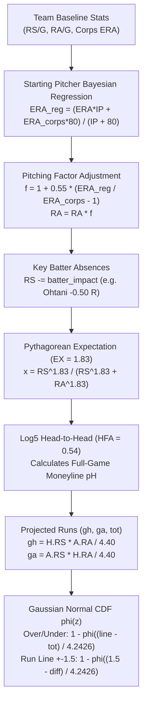

# MLB (Major League Baseball) Quantitative Engine — AztecaVet

> **Target:** `https://aztecavet.com/`  
> **Investigation Focus:** Sabermetric Pitcher Regression, Gaussian Normal Distribution, Run Line Modeling, Postseason Timeline  
> **Classification:** [OBSERVADO] / [INFERIDO] / [RECONSTRUIDO]  
> **Source Artifact:** [`mlb_engine.js`](<REPO_ROOT>/research/aztecavet/evidence/javascript/mlb_engine.js)  

---

## 1. Architectural Divergence: Normal Distribution vs. Poisson

In football and hockey, AztecaVet models scores using a bivariate Poisson distribution. However, **in baseball, the engine abandons Poisson and adopts a Gaussian Normal Distribution**:

$$\Phi(z) = \frac{1}{\sqrt{2\pi}} \int_{-\infty}^z e^{-t^2/2} \, dt$$

### Why does the engine switch to a Normal Distribution for MLB?
1. **Variance-to-Mean Ratio (Overdispersion):** In baseball, scoring is heavily clustered (rallies, multi-run home runs). A Poisson distribution assumes $\text{Mean} = \text{Variance}$, which understates the tail probability of high-scoring innings.
2. **Standard Deviation Parameter:** The engine defines a fixed variance parameter:
   $$SD = 3\sqrt{2} \approx 4.24264$$
   This represents the combined variance of two independent normal distributions with individual standard deviation $\sigma \approx 3.0$ runs:
   $$\sigma_{\text{diff}} = \sqrt{\sigma_H^2 + \sigma_A^2} = \sqrt{3^2 + 3^2} = 3\sqrt{2}$$

---

## 2. Core Mathematical Constants & Starting Pitcher Model

| Parameter | Value | Sabermetric Description |
|---|---|---|
| **`EX`** | **`1.83`** | Pythagorean exponent for baseball run expectancy. |
| **`LG`** | **`4.40`** | Baseline runs per team per game (MLB average). |
| **`HFA`** | **`0.54`** | Home Field Advantage (54% neutral home win expectation). |
| **`SHR`** | **`0.85`** | Regression shrinkage toward 50% parity. |
| **`SD`** | **`4.24264`** | Standard deviation for run differential and total distribution. |



---

### Step 1: Starting Pitcher Empirical Bayes Regression (`eff`)
A starting pitcher's raw Earned Run Average (ERA) in a small innings sample is unreliable. The engine regresses the pitcher's ERA against the team's overall bullpen/pitching corps ERA using an **80-inning empirical Bayes weight**:

$$\text{ERA}_{\text{reg}} = \frac{\text{ERA}_{\text{starter}} \cdot \text{IP} + \text{ERA}_{\text{team}} \cdot 80}{\text{IP} + 80}$$

The team's expected Runs Allowed ($ra$) is then scaled by factor $f$:
$$f = 1 + 0.55 \cdot \left(\frac{\text{ERA}_{\text{reg}}}{\text{ERA}_{\text{team}}} - 1\right)$$
$$ra_{\text{adj}} = ra \cdot f$$

**Impact Analysis:**
- A dominant ace (e.g., Jacob Misiorowski: $\text{ERA } 1.80$, $174.7\text{ IP}$) drives $f \approx 0.72$, reducing the opponent's projected run production by **$28\%$**.
- A vulnerable spot-starter (e.g., Freddy Peralta: $\text{ERA } 4.42$, $169\text{ IP}$) raises $f \approx 1.14$, increasing the opponent's projected runs by **$+14\%$**.

### Step 2: Key Batter Adjustments
29 impact batters are modeled with specific run values per game deducted if absent:
- **Shohei Ohtani (LAD):** $-0.50$ runs/game
- **José Ramírez (CLE):** $-0.35$ runs/game
- **Freddie Freeman (LAD):** $-0.30$ runs/game
- **Junior Caminero (TB):** $-0.30$ runs/game
- **William Contreras (MIL):** $-0.20$ runs/game
- **Jackson Chourio (MIL):** $-0.20$ runs/game

$$rs_{\text{adj}} = rs - \sum \text{impact}_{\text{absent}}$$

---

### Step 3: Win Expectancy & Projected Runs
1. **Pythagorean Expectation ($EX = 1.83$):**
   $$x = \frac{H_{rs}^{1.83}}{H_{rs}^{1.83} + H_{ra}^{1.83}}, \quad y = \frac{A_{rs}^{1.83}}{A_{rs}^{1.83} + A_{ra}^{1.83}}$$
2. **Log5 with Home Field Advantage ($HFA = 0.54$):**
   $$p_n = \frac{x - x \cdot y}{x + y - 2xy}, \quad o = \frac{p_n}{1 - p_n} \cdot \frac{0.54}{1 - 0.54}$$
   $$p_H = 0.5 + 0.85 \cdot \left(\frac{o}{1 + o} - 0.5\right)$$
3. **Projected Runs:**
   $$g_h = \frac{H_{rs} \cdot A_{ra}}{4.40}, \quad g_a = \frac{A_{rs} \cdot H_{ra}}{4.40}, \quad tot = g_h + g_a$$

---

### Step 4: Normal Distribution Approximation (`phi`)
The Gaussian cumulative distribution function $\Phi(x)$ is evaluated via a high-precision 5th-degree rational Chebyshev polynomial:

```javascript
const phi = x => {
  const t = 1 / (1 + 0.2316419 * Math.abs(x));
  const d = 0.3989423 * Math.exp(-x * x / 2); // 1 / sqrt(2*PI)
  const p = d * t * (0.3193815 + t * (-0.3565638 + t * (1.781478 + t * (-1.821256 + t * 1.330274))));
  return x > 0 ? 1 - p : p;
};
```
*Accuracy: Maximum error $< 7.5 \times 10^{-8}$ across all real numbers.*

---

## 3. The 6 Baseball Betting Markets

1. **Home Moneyline (`h`):** $p_H$
2. **Away Moneyline (`a`):** $1 - p_H$
3. **Over Total Runs (`ov`):**
   $$z_{\text{total}} = \frac{\text{line} - tot}{SD} = \frac{\text{line} - (g_h + g_a)}{4.24264}$$
   $$P(\text{Over}) = 1 - \Phi(z_{\text{total}})$$
4. **Under Total Runs (`un`):**
   $$P(\text{Under}) = \Phi(z_{\text{total}})$$
5. **Run Line Favorite $-1.5$ (`plf`):**
   $$\Delta_{\text{fav}} = \begin{cases} g_h - g_a & \text{if Home is Favorite} \\ g_a - g_h & \text{if Away is Favorite} \end{cases}$$
   $$z_{\text{spread}} = \frac{1.5 - \Delta_{\text{fav}}}{SD}$$
   $$P(\text{Fav } -1.5) = 1 - \Phi(z_{\text{spread}})$$
6. **Run Line Underdog $+1.5$ (`pld`):**
   $$P(\text{Dog } +1.5) = 1 - P(\text{Fav } -1.5) = \Phi(z_{\text{spread}})$$

---

## 4. Postseason Database & Audit

The MLB dataset is structured around the **2026 Major League Baseball Postseason**:
- **Teams:** 8 playoff qualifiers.
- **Timeline:** 17 games documented pitch-by-pitch:
  - ALDS: Chicago White Sox vs. Cleveland Guardians (CLE advances in 5).
  - NLCS: Milwaukee Brewers sweep Los Angeles Dodgers 4-0.
  - ALCS: Tampa Bay Rays defeat Cleveland Guardians 4-2.
  - World Series: Milwaukee Brewers defeat Tampa Bay Rays 4-1 (Jacob Misiorowski 103.5 mph fastball record).

### Pick of the Day in Baseball:
Because baseball features fewer betting markets than soccer (6 vs 18), the pick selection is straightforward:
$$\text{Pick} = \arg\max_{o \in O} P(o)$$
The market with the single highest model probability (typically Underdog $+1.5$ or heavy Moneyline favorite) is selected as the primary recommendation.
