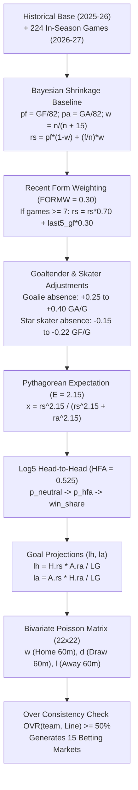

# NHL (National Hockey League) Quantitative Engine — AztecaVet

> **Target:** `https://aztecavet.com/`  
> **Investigation Focus:** Hockey Sabermetrics, Goaltender Leverage, Form Weighting, Over Consistency, 60-Min Regulation Markets  
> **Classification:** [OBSERVADO] / [INFERIDO] / [RECONSTRUIDO]  
> **Source Artifact:** [`nhl_engine.js`](file:///c:/Users/jairb/Desktop/Proyectos/Pitch%20Lab/research/aztecavet/evidence/javascript/nhl_engine.js)  

---

## 1. Architectural Scope & Database Constants

The NHL engine covers all **32 NHL franchises** during the 2026-27 regular season:

- **Historical Base:** Goals For (`GF`) and Goals Against (`GA`) from the full 82-game 2025-26 season. (St. Louis Blues flagged as `0, 0` "SIN DATO", falling back to default $250/82$).
- **In-Season Sample:** **224 regular season games** played in 2026-27 accumulated in array `R`.
- **Calendar Coverage:** 61 games scheduled across 9 calendar days (Nov 6–13, 2026), including the international series fixture between Seattle Kraken and Carolina Hurricanes in **Helsinki, Finland** (Nov 12).
- **Injury / News Feed (`N`):** 88 curated news items with quantitative impact weights.

### Engine Parameters:
| Constant | Value | Description |
|---|---|---|
| **`E`** | **`2.15`** | Pythagorean exponent for hockey (higher than soccer's 1.7 to reflect higher total scoring). |
| **`HFA`** | **`0.525`** | Home Ice Advantage (52.5% neutral win probability for home teams). |
| **`K`** | **`15`** | Bayesian prior weight for regression to league mean. |
| **`SHR`** | **`0.85`** | Parity shrinkage factor toward 50%. |
| **`FORMW`** | **`0.30`** | **Form Weighting:** When a team has played $\ge 7$ games, its last 5 games receive a 30% weighting. |
| **`NG`** | **`22`** | Poisson evaluation grid size ($0 \dots 21$ goals). |
| **`Floor`** | **`1.50`** | Absolute floor for team offensive and defensive rates ($rs, ra \ge 1.50$). |

---

## 2. Mathematical Formulation



---

### Step 1: Base Team Rating with Bayesian Shrinkage
For team $k$ with historical season goals $GF, GA$ and current season record ($n$ games, $f$ goals scored, $a$ goals allowed):

$$w = \frac{n}{n + 15}$$
$$rs = \left(\frac{GF}{82}\right) \cdot (1 - w) + \left(\frac{f}{n}\right) \cdot w, \quad ra = \left(\frac{GA}{82}\right) \cdot (1 - w) + \left(\frac{a}{n}\right) \cdot w$$

### Step 2: Recent Form Weighting (`FORMW = 0.30`)
If the team has played 7 or more games in 2026-27 ($n \ge 7$), the model blends in the moving average of the last 5 games:

$$\bar{f}_5 = \frac{1}{5} \sum_{i=1}^5 \text{GF}_{n-i+1}, \quad \bar{a}_5 = \frac{1}{5} \sum_{i=1}^5 \text{GA}_{n-i+1}$$
$$rs = rs \cdot (1 - 0.30) + \bar{f}_5 \cdot 0.30$$
$$ra = ra \cdot (1 - 0.30) + \bar{a}_5 \cdot 0.30$$

### Step 3: Goaltender Leverage & Injury Vector (`eff`)
Goaltenders represent the single highest variance position in hockey. AztecaVet explicitly models goaltender injuries with large defensive penalties ($\Delta ra$):

- **Igor Shesterkin (NYR):** $+0.40$ goals allowed per game (out for season with knee injury; Dylan Garand starter).
- **Connor Hellebuyck (WPG $\to$ NJ trade):** $+0.35$ goals allowed impact on Winnipeg (Skinner/Stevenson tandem).
- **Linus Ullmark (OTT):** $+0.30$ goals allowed.
- **John Gibson (DET):** $+0.30$ goals allowed.
- **Filip Gustavsson (MIN):** $+0.25$ goals allowed.

Elite forwards adjust attacking output ($\Delta rs$):
- **Aleksander Barkov (FLA):** $-0.22$ goals scored.
- **Mathew Barzal (NYI):** $-0.20$ goals scored.
- **Dylan Larkin (DET):** $-0.15$ goals scored (suspended without pay).
- **Ivan Demidov (MTL):** $-0.15$ goals scored.

Rates are adjusted:
$$rs = \max(rs - \Delta_{\text{offense}}, 1.50), \quad ra = \max(ra + \Delta_{\text{defense}}, 1.50)$$

---

### Step 4: Win Expectancy & Projected Goals
1. **Pythagorean Expectation ($E = 2.15$):**
   $$x = \frac{H_{rs}^{2.15}}{H_{rs}^{2.15} + H_{ra}^{2.15}}, \quad y = \frac{A_{rs}^{2.15}}{A_{rs}^{2.15} + A_{ra}^{2.15}}$$
2. **Log5 with Home Ice Advantage ($HFA = 0.525$):**
   $$p_n = \frac{x - x \cdot y}{x + y - 2xy}, \quad o = \frac{p_n}{1 - p_n} \cdot \frac{0.525}{1 - 0.525}$$
   $$p_H = 0.5 + 0.85 \cdot \left(\frac{o}{1 + o} - 0.5\right)$$
3. **Projected Goals:**
   $$\lambda_h = \frac{H_{rs} \cdot A_{ra}}{LG}, \quad \lambda_a = \frac{A_{rs} \cdot H_{ra}}{LG}, \quad tot = \lambda_h + \lambda_a$$
   *(where league baseline $LG = \frac{1}{32} \sum rs_k$).*

---

### Step 5: Bivariate Poisson & 60-Minute vs. Overtime Modeling
The Poisson grid is evaluated up to 22 goals ($NG = 22$). Crucially, hockey games cannot end in a tie:

1. **60-Minute Regulation Markets:**
   - $w_{\text{reg}} = \sum_{i > j} P(i; \lambda_h) Q(j; \lambda_a)$ (Home 60-min win)
   - $d_{\text{reg}} = \sum_{i = j} P(i; \lambda_h) Q(j; \lambda_a)$ (Regulation Draw $\to$ Overtime/Shootout)
   - $l_{\text{reg}} = \sum_{i < j} P(i; \lambda_h) Q(j; \lambda_a)$ (Away 60-min win)
2. **Full-Game Moneyline (ML):**
   The overall game winner uses the Log5 $p_H$, which intrinsically accounts for overtime and shootout resolution.

---

## 3. The 15 Hockey Betting Markets

1. **Home Win ML (`mlh`):** $p_H$
2. **Away Win ML (`mla`):** $1 - p_H$
3. **Puck Line Favorite $-1.5$ (`plf`):** $\sum_{i - j \ge 2} P(i; \lambda_h) Q(j; \lambda_a)$
4. **Puck Line Underdog $+1.5$ (`pld`):** $1 - P(plf)$
5. **Over Total Line (`ov`):** $\sum_{i+j > line} P(i) Q(j)$
6. **Under Total Line (`un`):** $1 - P(ov)$
7. **Home 60-Minute Win (`rh`):** $w_{\text{reg}}$
8. **Regulation Draw (`rd`):** $d_{\text{reg}}$
9. **Away 60-Minute Win (`ra`):** $l_{\text{reg}}$
10. **Home Over Team Total (`tho`):** $\sum_{i > line_H} P(i; \lambda_h)$
11. **Home Under Team Total (`thu`):** $1 - P(tho)$
12. **Away Over Team Total (`tao`):** $\sum_{j > line_A} Q(j; \lambda_a)$
13. **Away Under Team Total (`tau`):** $1 - P(tao)$
14. **Both Teams To Score (`by`):** $(1 - e^{-\lambda_h})(1 - e^{-\lambda_a})$
15. **Both Teams Not To Score (`bn`):** $1 - P(by)$

---

## 4. Over Consistency Validation & Bet Builder Combos

The NHL engine implements a unique guardrail against misleading goal totals:

### Over Consistency Function (`OVR(team, Line)`):
```javascript
function OVR(t, L) {
  const g = R.concat(AUD).filter(z => z[0] === t || z[1] === t);
  if (g.length < 3) return null;
  return g.filter(z => z[2] + z[3] > L).length / g.length;
}
```
**Mechanism:** Before suggesting a "FAVORITO CLARO · GANA + OVER" combination, the engine verifies whether at least $50\%$ of the favorite team's games this season have actually exceeded total line $L$. If $OVR < 0.50$, **the combination is rejected**, preventing bets on high-scoring combos for teams playing in low-scoring game environments.

### Hockey Combos Rule:
- Favorite must have $P(\text{ML}) \ge 65\%$.
- Total line selection: Over 5.5 if projected total $\ge 5.80$; otherwise Over 4.5.
- Joint probability matrix computed via `cmbOT()` which models overtime redistribution:
  $$M_{i+1, j} += \frac{v}{2}, \quad M_{i, j+1} += \frac{v}{2} \quad (\text{for ties } i = j)$$
- Minimum joint probability threshold: $P \ge 40\%$.
