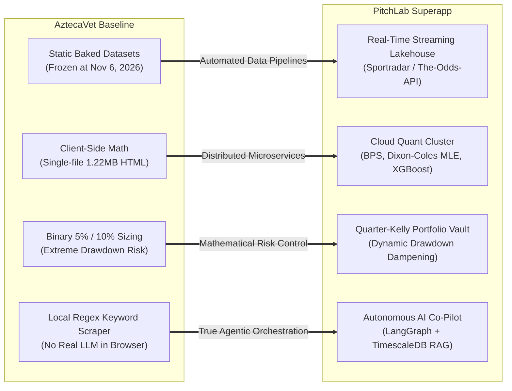

# Strategic Opportunities & Technical Superiority Blueprint for PitchLab

> **Target Application:** `https://aztecavet.com/`  
> **Destination Superapp:** **PitchLab**  
> **Strategic Focus:** Commercial Differentiation, Algorithmic Superiority, Institutional Architecture, Product Roadmap  
> **Classification:** [RECONSTRUIDO]  

---

## 1. Strategic Differentiation: AztecaVet vs. PitchLab

While AztecaVet serves as a proof-of-concept for compact sports analytics, it remains an offline static artifact. **PitchLab will transform its best mathematical principles into an enterprise-grade quantitative sports platform.**

---

## 2. The 5 Core Pillars of PitchLab Superiority

### Pillar 1: Real-Time Streaming & Live Odds Ingestion
- **AztecaVet:** 0 external requests. Users must manually type bookmaker odds into input boxes.
- **PitchLab:** 
  - Sub-second ingestion of live odds across 40+ international bookmakers (Pinnacle, Bet365, Circa, Caliente, DraftKings, FanDuel).
  - Automated Line Shopping: Instantly identifies which bookmaker offers the highest EV for any model selection.
  - Live In-Play Betting: Dynamic recalculation of win probabilities and totals after every goal, penalty, or pitching change.

### Pillar 2: Advanced Quantitative & Machine Learning Models
- **AztecaVet:** Hand-tuned Pythagorean formulas and static bivariate Poisson grids.
- **PitchLab:**
  1. **Bivariate Poisson with Covariates (BPS):** Models goal dependency dynamically as a function of match tempo, possession, and referee card tendencies.
  2. **Statcast Sabermetrics (MLB):** Replaces basic ERA with xwOBA (Expected Weighted On-Base Average), FIP, Barrel%, and park-adjusted weather vectors (temperature, humidity, wind direction).
  3. **High-Danger Scoring Chances (NHL):** Replaces raw GF/GA with Expected Goals Saved Above Expected (xGSA) and 5v5 vs. special teams efficiency.
  4. **Player Prop Engine:** Gradient Boosted Decision Trees (XGBoost) projecting individual player props: shots on target, pass completions, strikeouts, player total bases.

### Pillar 3: Institutional Portfolio & Risk Management
- **AztecaVet:** Reckless 10% flat unit sizing that exposes bankrolls to rapid depletion during inevitable variance downswings.
- **PitchLab:**
  1. **Fractional Kelly Allocator:** Hardcoded default to **$0.25\times$ Quarter-Kelly**, scaling bet size directly with the mathematical edge:
     $$f^* = 0.25 \cdot \frac{EV}{d - 1}$$
  2. **Drawdown Dampening Circuit Breaker:** If current bankroll drops $>15\%$ below its all-time high-water mark, the engine automatically contracts the Kelly multiplier proportionally to prevent catastrophic risk of ruin.
  3. **Correlated Same-Game Parlay (SGP) Copula Engine:** Uses a Gaussian Copula to evaluate true correlated joint distributions across same-game legs, identifying pricing errors in bookmaker Bet Builders.

### Pillar 4: Autonomous Conversational AI Co-Pilot
- **AztecaVet:** Synchronous regex search over 9,000 characters of scraped iframe text.
- **PitchLab:**
  - A production **LangGraph Orchestrator** backed by Gemini 1.5 Pro and Claude 3.5 Sonnet.
  - Armed with specialized tools querying TimescaleDB for historical player metrics, live odds, and injury news.
  - Provides multi-turn conversational reasoning, customized strategy formulation, and zero-hallucination grounded responses with exact provider citations.

### Pillar 5: Scalable Microservices & Modern Web Architecture
- **AztecaVet:** Monolithic 1.22 MB single-file HTML bundle.
- **PitchLab:**
  - Modular TypeScript/Vite frontend with Tailwind CSS and responsive glassmorphism.
  - High-throughput backend built on FastAPI (Python) and Go microservices.
  - Ultra-low latency data storage utilizing TimescaleDB (time-series hyper-tables) and Redis Streams.

---

## 3. Prioritized Implementation Roadmap for PitchLab

| Phase | Milestone | Deliverables | Target Architecture |
|---|---|---|---|
| **Phase 1** | **Core Domain & Math Parity** | Port AztecaVet's verified mathematical engines (Pythagoras, Log5, Dixon-Coles, Normal MLB, EV, unit sizing) into clean TypeScript domain modules. | `src/domain/` with 100% unit test coverage. |
| **Phase 2** | **Live Data & Ingestion Pipeline** | Integrate API-Football and The-Odds-API; deploy Redis queue workers; automate injury scraper. | FastAPI ingestion worker + Redis Streams. |
| **Phase 3** | **Interactive Web UI & Slip Terminal** | Build modern responsive Bento Grid, interactive match probability detail sheets, and reactive betting slip. | Vite + React/Solid + Tailwind CSS. |
| **Phase 4** | **AI Co-Pilot & LangGraph Tools** | Implement LangGraph orchestrator, database tools, and streaming SSE chat interface. | LangGraph + Gemini API + Server-Sent Events. |
| **Phase 5** | **Portfolio & Kelly Risk Engine** | Deploy Quarter-Kelly allocator, drawdown dampening, and multi-leg SGP copula model. | Python / Rust Quant Microservice. |
