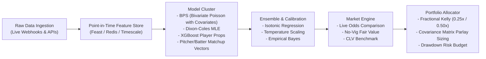

# End-to-End Predictive Pipeline Analysis — AztecaVet

> **Target:** `https://aztecavet.com/`  
> **Investigation Focus:** Mathematical Pipeline Stages, Hypothesis vs Reality, Feature Transformations, PitchLab ML Design  
> **Classification:** [OBSERVADO] / [INFERIDO] / [RECONSTRUIDO]  
> **Source Codes:** [`football_engine.js`](file:///c:/Users/jairb/Desktop/Proyectos/Pitch%20Lab/research/aztecavet/evidence/javascript/football_engine.js), [`nhl_engine.js`](file:///c:/Users/jairb/Desktop/Proyectos/Pitch%20Lab/research/aztecavet/evidence/javascript/nhl_engine.js), [`mlb_engine.js`](file:///c:/Users/jairb/Desktop/Proyectos/Pitch%20Lab/research/aztecavet/evidence/javascript/mlb_engine.js)  

---

## 1. Hypothesis vs. Empirical Reality

In Section 9 of the prompt, a theoretical sports modeling pipeline was hypothesized:

$$\text{Sports Data} \to \text{Validation} \to \text{Normalization} \to \text{Feature Engineering} \to \text{Statistical Engine} \to \text{Calibration} \to \text{Probabilities} \to \text{Market Comparison} \to \text{UI}$$

Our deep reverse engineering verified exactly how each of these 9 stages is instantiated in AztecaVet's client-side code:

```mermaid
flowchart TD
    subgraph AztecaVet Realized Client Pipeline
        S1["1. Embedded Literal Arrays<br/>(TD, DD, NW, T, R, PL, BT)<br/>Status: STATIC [OBSERVADO]"] --> S2["2. Validation & Fallbacks<br/>(est(), flag: e, n, p)<br/>Status: RULE-BASED [OBSERVADO]"]
        S2 --> S3["3. League Normalization<br/>(LG0 baselines, STR scale)<br/>Status: DETERMINISTIC [OBSERVADO]"]
        S3 --> S4["4. Bayesian Shrinkage & Features<br/>((GF + 6*LG)/(GP + 6), Injuries, Form)<br/>Status: ALGORITHMIC [OBSERVADO]"]
        S4 --> S5["5. Statistical Modeling<br/>(Pythagoras -> Log5 -> Bisection Tilt)<br/>Status: QUANTITATIVE [OBSERVADO]"]
        S5 --> S6{"6. Distribution Engine"}
        S6 -->|Football & NHL| D1["Bivariate Poisson Grid<br/>+ Dixon-Coles Tau Adjustment"]
        S6 -->|MLB| D2["Gaussian Normal Distribution<br/>(SD = 4.2426, erf-based phi)"]
        D1 & D2 --> S7["7. Market Probabilities (18 FB, 15 NHL, 6 MLB)<br/>Status: CLOSED-FORM [OBSERVADO]"]
        S7 --> S8["8. Market Comparison (EV = p*d - 1, EV >= 4%)<br/>Status: INTERACTIVE [OBSERVADO]"]
        S8 --> S9["9. Decision Engine & UI<br/>(Pick of the Day, Bet Builder Combos)<br/>Status: HEURISTIC [OBSERVADO]"]
    end
```

---

## 2. Comprehensive Breakdown by Pipeline Stage

### Stage 1: Data Ingestion & Storage
- **Observed:** Datasets are hardcoded JavaScript arrays compiled into the HTML bundle.
- **Transformations:** `TD` (football teams array) is transformed on startup into a hash map `TM[code]`.
- **Limitations:** Data is frozen at Nov 6, 2026. No dynamic ingestion exists.
- **Confidence:** `[OBSERVADO]` 100%.

### Stage 2: Validation & Missing Data Handling
- **Observed:** Teams without recorded goals (e.g. newly promoted teams or teams in European tournaments without domestic league records) carry a flag:
  - `fl = "e"`: Estimated from Goal Difference using `est(gd) = [55 + gd/2, 55 - gd/2]`.
  - `fl = "n"`: No Data; defaults strictly to league baseline ($F = LG, A = LG$).
  - `fl = "p"`: Promoted team; flagged in UI as ASCENDIDO.
- **Confidence:** `[OBSERVADO]` 100%.

### Stage 3: Normalization & Inter-League Strength
- **Observed:**
  - Domestic leagues define baseline goals per game `LG0`: Premier League ($1.45$), La Liga ($1.35$), **Liga MX ($1.51$)**, Serie A ($1.21$), Bundesliga ($1.62$), Ligue 1 ($1.41$), Other ($1.40$).
  - In UEFA competitions (UCL and UEL), domestic rates are rescaled by league strength `STR`:
    $$\text{Premier League } 1.0, \quad \text{La Liga } 0.98, \quad \text{Bundesliga/Serie A } 0.96, \quad \text{Ligue 1 } 0.92, \quad \text{Liga MX } 0.80$$
  - Scaled attacking rate: $rs = \frac{rs_{\text{base}}}{LG_{\text{base}}} \cdot STR \cdot LGU$ (where UEFA baseline $LGU = 1.45$).
- **Confidence:** `[OBSERVADO]` 100%.

### Stage 4: Feature Engineering (Shrinkage & Injuries)
- **Observed:**
  1. **Bayesian Team Rates:**
     $$rs = \frac{GF + K \cdot LG}{GP + K}, \quad ra = \frac{GA + K \cdot LG}{GP + K}$$
     where prior weight $K = 6$ (football) and $K = 15$ (hockey). Current season matches enter with triple weight ($3 \times GF_{cur}$).
  2. **Player Injury Adjustments:**
     215 active injuries adjust offensive / defensive parameters linearly:
     $$\Delta = \text{impact} \cdot \text{status} \quad (\text{status} \in \{0, 0.5, 1\})$$
     If offensive (`gf`): $rs = \max(rs - \Delta, 0.3)$. If defensive (`ga`): $ra = \max(ra + \Delta, 0.3)$.
- **Confidence:** `[OBSERVADO]` 100%.

### Stage 5 & 6: Statistical Engine & Probability Distributions
- **Observed:**
  1. **Pythagorean Win Expectancy:**
     $$x = \frac{rs^E}{rs^E + ra^E}, \quad y = \frac{rs_{\text{opp}}^E}{rs_{\text{opp}}^E + ra_{\text{opp}}^E}$$
     where $E = 1.7$ (Football), $E = 2.15$ (NHL), $E = 1.83$ (MLB).
  2. **Log5 Odds Ratio with Home Advantage:**
     $$p_n = \frac{x - x \cdot y}{x + y - 2xy}, \quad o = \frac{p_n}{1 - p_n} \cdot \frac{HFA}{1 - HFA}, \quad \text{share} = 0.5 + SHR \cdot \left(\frac{o}{1+o} - 0.5\right)$$
     where $HFA = 0.54$ (Football/MLB) and $0.525$ (NHL); shrinkage $SHR = 0.85$.
  3. **Bisection Tilt (`tilt`):**
     Solves for parameter $m$ such that bivariate Poisson win probability equals the Log5 target `share`:
     $$\lambda_h = \lambda_{h0} \cdot e^m, \quad \lambda_a = \lambda_{a0} \cdot e^{-m}$$
  4. **Dixon-Coles Low-Score Correction:**
     Adjusts probabilities for $(0,0), (1,0), (0,1), (1,1)$ using correlation parameter $\rho$:
     $$\tau(0,0) = 1 - \lambda_h \lambda_a \rho, \quad \tau(1,0) = 1 + \lambda_a \rho, \quad \tau(0,1) = 1 + \lambda_h \rho, \quad \tau(1,1) = 1 - \rho$$
     with $\rho = -0.14$ for Liga MX and $\rho = -0.08$ for other leagues.
- **Confidence:** `[OBSERVADO]` 100%.

### Stage 7: Market Generation & Evaluator
- **Observed:** 
  - Iterates over score grids (up to 15x15 goals or 22x22 goals) to sum probabilities for 1X2, Over/Under, Double Chance, Both Teams to Score, and Handicaps.
  - Combos rule: "FAVORITO CLARO · GANA + GOLES" creates a joint probability $P(fav \land Over L) = P(fav) \cdot P(Over L | fav)$.
- **Confidence:** `[OBSERVADO]` 100%.

### Stage 8: Market Comparison & EV
- **Observed:**
  - Evaluates Expected Value: $EV = p \cdot d - 1$.
  - Requires $EV \ge +4\%$ to recommend a bet. Recommends binary stake of 5% or 10% of bankroll.
- **Confidence:** `[OBSERVADO]` 100%.

---

## 3. Architecture for PitchLab's Enterprise Pipeline

PitchLab will elevate this foundation into a distributed, machine-learning-driven pipeline:

