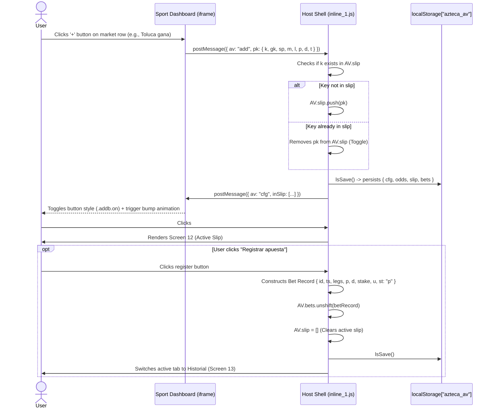
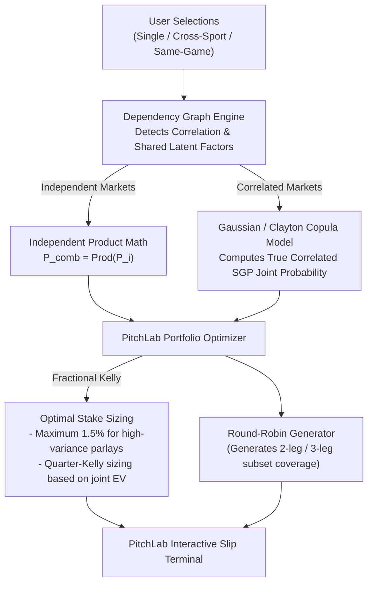

# Betting Slip ("Mi Boleto") Systems Architecture — AztecaVet

> **Target:** `https://aztecavet.com/`  
> **Investigation Focus:** Selection State, Inter-Frame Synchronization, Parlay Construction, Return Mathematics  
> **Classification:** [OBSERVADO] / [INFERIDO] / [RECONSTRUIDO]  
> **Supporting Screenshot:** [`13_slip_tab_boleto.png`](file:///c:/Users/jairb/Desktop/Proyectos/Pitch%20Lab/research/aztecavet/evidence/screenshots/13_slip_tab_boleto.png)  
> **Decompiled Code:** [`shell_app.js`](file:///c:/Users/jairb/Desktop/Proyectos/Pitch%20Lab/research/aztecavet/evidence/javascript/shell_app.js#L1018-L1115)  

---

## 1. Betting Slip Lifecycle & State Flow

The Betting Slip is hosted in the root shell (`#slipv`), functioning as an ambient slide-over drawer accessible from any screen via the persistent bottom bar (`#slipb`).



---

## 2. Payload Schema of a Slip Selection (`pk`)

When a market is added from any of the three sports engines, it conforms to a normalized payload schema:

```typescript
interface SlipSelection {
  k: string;       // Unique market key (e.g., "FB:MX:Vie 6 nov:NEC-TIJ|h")
  gk: string;      // Game key for correlation tracking (e.g., "FB:MX:Vie 6 nov:NEC-TIJ")
  sp: string;      // Sport descriptor (e.g., "Fútbol · Liga MX", "NHL", "MLB")
  m: string;       // Matchup title (e.g., "NEC vs TIJ")
  l: string;       // Market label (e.g., "NEC gana", "Over 2.5", "MIL -1.5")
  p: number;       // Model fair probability (0.0000 to 1.0000, 4 decimal places)
  d: number | null;// User-written bookmaker decimal odds (or null if blank)
  t: string;       // Fixture schedule descriptor (e.g., "Vie 6 nov · 7:00 PM")
}
```

---

## 3. Single Bet vs. Multi-Leg Parlay Execution

The slip rendering engine dynamically adapts based on `AV.slip.length`:

### Scenario A: Single Selection (`AV.slip.length === 1`)
- Rendered as a straight single wager.
- Shows market label, match title, fair odds ($1/p$), and current entered bookmaker odds.
- If $EV \ge +4\%$:
  $$\text{Recommended Stake} = \text{curBank} \cdot \left(\frac{u}{100}\right) \quad (u \in \{5, 10\})$$
  $$\text{Net Profit on Win} = \text{Stake} \cdot (d - 1)$$
- If $EV < +4\%$:
  Renders "SIN VALOR · NO APOSTAR" with minimum breakeven odd $d_{\text{min}} = \frac{1.04}{p}$.

### Scenario B: Parlay Ticket (`AV.slip.length >= 2`)
- Multiplies probabilities and entered decimal odds:
  $$P_{\text{parlay}} = \prod_{i=1}^M p_i, \quad d_{\text{parlay}} = \prod_{i=1}^M d_i$$
- Displays **Fair Parlay Odds (Sin margen)**:
  $$d_{\text{fair}} = \frac{1}{P_{\text{parlay}}}$$
- **Manual Bookmaker Override (`AV.ovr`):** Bookmakers frequently shade multi-leg parlay payouts. AztecaVet provides an override input field:
  If user supplies `AV.ovr`, the engine evaluates:
  $$EV_{\text{parlay}} = P_{\text{parlay}} \cdot d_{\text{override}} - 1$$
- **Correlation Warning Check:**
  ```javascript
  const gameKeys = AV.slip.map(leg => leg.gk);
  const hasCorrelation = new Set(gameKeys).size < gameKeys.length;
  ```
  If true, displays a yellow warning card informing the user that joint probability assumes statistical independence.

---

## 4. Betting Slip Limitations in AztecaVet

1. **Strict Independence Assumption:** The parlay calculation is purely $P_1 \times P_2 \times \dots \times P_M$. It cannot model copula distributions or conditional dependencies for Same-Game Parlays (SGPs) constructed across multiple markets of the same game.
2. **Binary Unit Allocation:** Fixed 5% or 10% unit sizing is applied to parlays just as it is to single bets. Wagering 10% of a bankroll on a 4-leg parlay with $P = 15\%$ represents a reckless capital allocation error.
3. **No System / Round-Robin Bets:** Cannot generate 2-of-3 or Trixie/Yankee combination tickets.
4. **No Cash-Out Tracking:** Tickets are either pending or settled; no dynamic hedging value is modeled.

---

## 5. PitchLab Advanced Slip Engine Blueprint

PitchLab will transform the ticket system into an institutional-grade betting terminal:


