# Update Mechanisms, Real-Time Telemetry & Automation Audit — AztecaVet

> **Target:** `https://aztecavet.com/`  
> **Investigation Focus:** Synchronization Claims, Theatrical Real-Time Effects, Deployment Pipelines, PitchLab Automation  
> **Classification:** [OBSERVADO] / [INFERIDO] / [RECONSTRUIDO]  
> **Source Verification:** [`shell_app.js`](file:///c:/Users/jairb/Desktop/Proyectos/Pitch%20Lab/research/aztecavet/evidence/javascript/shell_app.js), [`football_engine.js`](file:///c:/Users/jairb/Desktop/Proyectos/Pitch%20Lab/research/aztecavet/evidence/javascript/football_engine.js)  

---

## 1. Deconstructing the "Real-Time" Illusion

AztecaVet presents multiple visual indicators suggesting live background processing:
- Badges labeled **"EN LÍNEA"**, **"ACTUALIZADO AL 6 NOV 2026"**.
- A ticking clock in the header displaying current hours and minutes (`#clk`).
- An animated progress overlay titled **"ANALIZANDO EN TIEMPO REAL"** showing a robot with blinking eyes, a radar sweep, and step-by-step logs ("Sincronizando tabla...", "Revisando bajas...", "Escaneando mercados...").

### Empirical Disproof of Real-Time Activity:
1. **Zero Periodic Timers for Network Calls:**
   - Code inspection reveals exactly one active `setInterval` in `shell_app.js` (line 935):
     ```javascript
     function clk() {
       const d = new Date();
       $("clk").textContent = d.toLocaleTimeString("es-MX", { hour: "2-digit", minute: "2-digit" });
     }
     setInterval(clk, 20000); // Only updates header clock string every 20 seconds
     ```
   - There are **no timers calling `fetch` or polling endpoints**.
2. **The "Live Analysis" Animation is Staged Theatricality:**
   - In `fb_readable.js`, `nhl_readable.js`, and `mlb_readable.js`, when a match card is clicked, the function `lines(g)` produces an array of 10 diagnostic strings.
   - A sequential `setTimeout` chain displays one line every 420 ms for a total of $\approx 4.2$ seconds before revealing the card.
   - The statistical model (`model()`) is actually computed **synchronously on line 1 in less than 2 milliseconds**. The 4.2-second delay is purely cosmetic user experience staging. Clicking "SALTAR" (Skip) bypasses the timer and reveals the exact same pre-computed card instantaneously.

---

## 2. Actual Delivery & Update Lifecycle

The true update pipeline for AztecaVet is **completely manual and deployment-dependent**:

```mermaid
flowchart LR
    Dev["Developer / Analyst"] -->|1. Manually scrapes or edits data literals| Files["Source Files<br/>(fb.html, nhl.html, mlb.html)"]
    Files -->|2. Runs local packer script| Packer["Packer Tool<br/>(Base64 encodes sub-pages)"]
    Packer -->|3. Produces single HTML bundle| Bundle["index.html (1.22 MB)"]
    Bundle -->|4. Git Push / Netlify CLI| Netlify["Netlify Edge CDN"]
    Netlify -->|5. Edge Cache Invalidation| Client["End Users (Download new bundle)"]
```



### Consequences of this Lifecycle:
- If a key player suffers a late injury 15 minutes before kickoff, the application **cannot reflect the change** unless the developer manually edits the script, runs the packer, and deploys to Netlify.
- Live in-play scores cannot be updated while matches are in progress.
- Bookmaker odds movements cannot be tracked automatically; users must manually type new odds into the input boxes.

---

## 3. PitchLab Automated Real-Time Architecture

PitchLab will replace manual deployments with a fully automated, cloud-native real-time event pipeline:

```mermaid
flowchart TD
    subgraph External Event Producers
        ProviderOdds["The-Odds-API / Pinnacle Webhook"]
        ProviderMatch["Sportradar / API-Football Webhook"]
        NewsScraper["PitchLab Beat Writer Scraper Worker"]
    end

    subgraph Streaming & Task Orchestration
        ProviderOdds & ProviderMatch & NewsScraper --> IngestAPI["Ingestion Gateway"]
        IngestAPI --> RedisStream["Redis Stream / BullMQ"]
        RedisStream --> WorkerPool["Quant Calculation Workers<br/>(Celery / Temporal)"]
    end

    subgraph Real-Time Recalculation
        WorkerPool -->|Recalculate Poisson & Log5| ModelRegistry[(TimescaleDB / Postgres)]
        WorkerPool -->|Publish Delta (JSON)| PubSub["Redis Pub/Sub"]
    end

    subgraph Client Broadcast
        PubSub --> WSServer["WebSocket / SSE Hub<br/>(Go / Node Cluster)"]
        WSServer -->|Push Delta to Connected Subscribers| WebClient["PitchLab Client UI"]
    end
```

### Automation Workflows for PitchLab:
1. **Lineup Confirmation Trigger (T-60 minutes):**
   - Official lineups announced 60 minutes prior to kickoff trigger an automated webhook.
   - The quant engine checks the confirmed starting XI against expected lineups, updates player impact vectors, and automatically recalibrates goal expectancy within 500 ms.
2. **Real-Time Odds Movement & Line Shopping:**
   - Redis workers continuously compare current bookmaker prices against PitchLab's fair prices.
   - When a bookmaker shifts odds so that $EV \ge +4\%$, an immediate WebSocket push notification is sent to users with the match pinned.
3. **Automated Bet Settlement & Bankroll Rebalancing:**
   - When the final whistle blows, official match scores automatically transition matching slips in `bets` from `pending` to `won` or `lost`, updating user bankroll balances without requiring manual user input.
