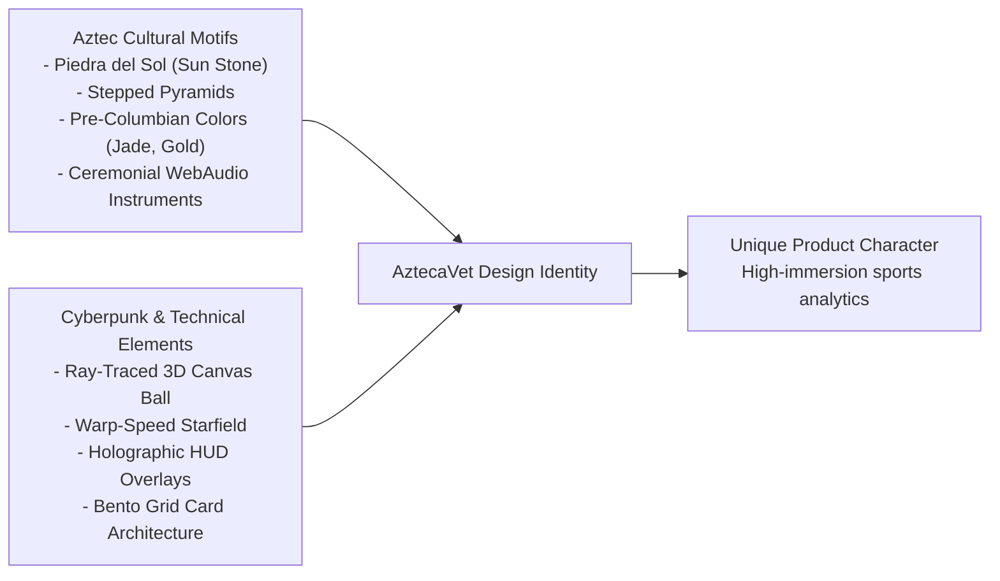
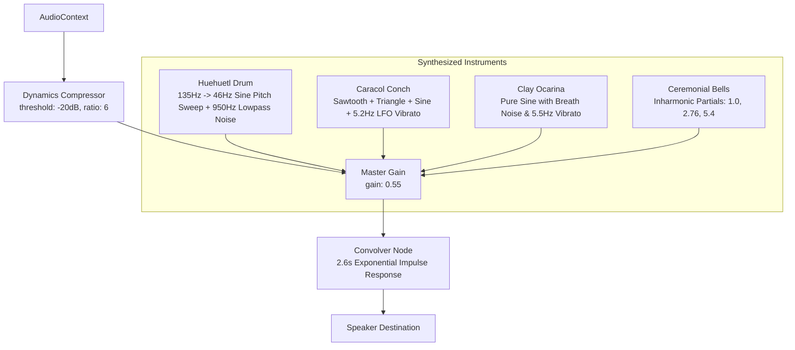

# UX, Visual Identity, Canvas Graphics & Procedural Audio — AztecaVet

> **Target:** `https://aztecavet.com/`  
> **Investigation Focus:** Graphic Design, Procedural Ray-Tracing, WebAudio Synthesis, Theatrical Staging, Design Opportunities  
> **Classification:** [OBSERVADO] / [INFERIDO] / [RECONSTRUIDO]  
> **Visual Evidence:** Screenshots `01_initial_gate.png` through `18_after_reload_gate.png`  
> **Code Artifact:** [`shell_app.js`](<REPO_ROOT>/research/aztecavet/evidence/javascript/shell_app.js#L140-L410)  

---

## 1. Visual Identity & Design Language

AztecaVet blends pre-Columbian Mexican cultural iconography with a sleek neo-cyberpunk aesthetic.



### Color Palette Architecture:
- **Base Canvas:** Deep obsidian black (`#02040a`, `#120a24`).
- **Primary Accents:**
  - Aztec Gold: `#f5c26b` / `#c9952b` (used for key highlights, headers, and parlay cards).
  - Jade Green: `#00d68f` / `#0e7a46` / `#30d158` (used for positive value, win indicators, and soccer theme).
  - Electric Cyan: `#5ee7ff` / `#00e5ff` (used for interactive controls and hockey theme).
  - Crimson Pink: `#ff6b88` / `#ff453a` (used for negative value, loss indicators, and baseball theme).
- **Surface Elevation:** Subtle translucent backdrops: `rgba(255, 255, 255, 0.055)` with 1px border `rgba(120, 170, 255, 0.22)`.

---

## 2. In-Depth Analysis of Graphic Routines

### 2.1 Procedural 3D Ray-Traced Soccer Ball
Unlike standard web applications that load heavy 3D GLTF models using Three.js or Babylon.js (which add 600 KB+ of runtime overhead), AztecaVet implements **pure mathematical ray-tracing inside a 2D Canvas context**:

```javascript
// Mathematical Definition in shell_app.js
const V = [ /* 12 icosahedral vertices */ ];
const F = [ /* 20 icosahedral face centers */ ];

// Normal Vector Calculation per Pixel
const nx = (x + 0.5) / S * 2 - 1;
const ny = 1 - (y + 0.5) / S * 2;
const r2 = nx * nx + ny * ny;
if (r2 <= 1) {
  const nz = Math.sqrt(1 - r2);
  // Evaluates dot products against rotated 3D face normals
  // Determines pentagon vs hexagon boundary
  // Computes Blinn-Phong specular highlight and rim lighting
}
```

**Technical Merit:**
- Zero external libraries (Three.js / WebGL not required).
- Completely resolution-independent.
- Responds fluidly to mouse movement with 3D parallax tilting.

### 2.2 Aztec Sun Stone (Piedra del Sol) Vector Glyphs
The Sun Stone SVG (`sunSVG` in `shell_app.js`) is constructed procedurally:
- 16 directional solar rays projecting outward.
- 104 radial tick marks along the outer calendar ring.
- 20 concentric glyph cells cycling through 5 rotating pre-Columbian iconography glyphs.
- 4 cartouches representing mythological solar creation eras.

---

## 3. WebAudio Procedural Sound Architecture

AztecaVet avoids loading MP3/WAV audio assets. All sound effects and background ambiances are **synthesized mathematically on the WebAudio API graph**:



### Musical Tuning:
All auditory cues are tuned strictly to an **A4 Pentatonic Scale**:
$$PENT = [440.0, 523.25, 587.33, 659.25, 783.99, 880.0, 1046.5, 1174.66, 1318.5, 1568.0] \text{ Hz}$$
- Typing on the passcode keypad plays the note corresponding to the digit index (`keySound(+k)`).
- Passing the gate triggers a 7-bell ascending arpeggio with two sub-bass war drum beats.
- Entering an incorrect code triggers an intentional 220 Hz + 233.1 Hz minor-second dissonant chord.

---

## 4. Theatrical Real-Time Staging Critique

When a match tile is opened, the user is presented with a 4-second loading terminal:
- **Visual Staging:** A custom SVG robot with blinking animated eyes, a circular radar sweep, and step-by-step terminal logs ("Sincronizando...", "Pitágoras 1.7...", "Revisando bajas...", "Escaneando mercados...").
- **Psychological Effect:** This technique (known in UX as *operational transparency* or *theatrical staging*) increases perceived value. Users feel the algorithm is performing intense real-time supercomputing specifically for their query.
- **Underlying Reality:** The calculation finished in under 2 milliseconds. The delay is entirely enforced by a `setTimeout` loop.

---

## 5. PitchLab UX & Design Opportunities

PitchLab can modernize AztecaVet's visual flair into an **ultra-clean, professional quantitative terminal**:

1. **Unified Seamless Theme:**
   - Eliminate the jarring contrast between the dark shell and white sport dashboards.
   - Implement an institutional dark terminal theme (inspired by Bloomberg Terminal / Linear / TradingView) with optional daylight high-contrast mode.
2. **Interactive Probability Curves & Interactive Gauges:**
   - Replace static percentage bars with interactive Gaussian bell curves and Poisson mass functions showing the exact distribution of goals/runs.
3. **Data Density Controls:**
   - Allow users to toggle between **Compact / Trader View** (dense tabular odds grid) and **Analytical View** (detailed cards with player injury breakdowns and visual diagrams).
4. **Accessible WCAG AA Compliance:**
   - Ensure all text-to-background contrast ratios exceed $4.5:1$ (AztecaVet's muted gray text occasionally drops below $3:1$).
5. **Auditory Feedback Customization:**
   - Retain procedural WebAudio cues for bet placements and EV alerts, but provide an explicit audio volume slider and subtle modern haptic sound schemes.
