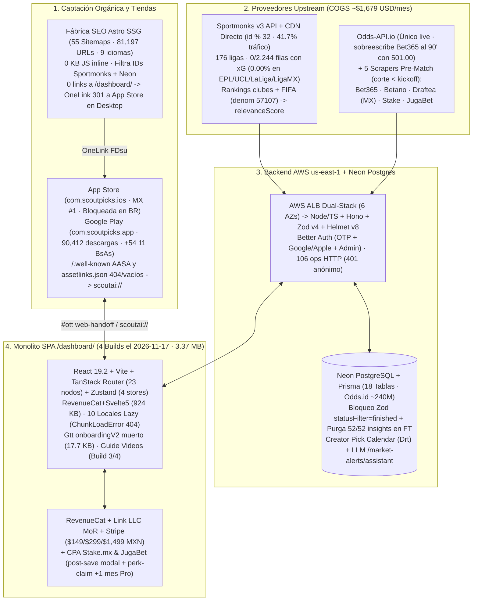

# REPORTE MAESTRO — Ingeniería Inversa Integral de SCOUT PICKS (`https://scoutpicks.app`) · Olas 1 + 2 Completas

> **Objetivo:** `https://scoutpicks.app/` (Landing/SEO Astro + WebApp `/dashboard/` `Beta v0.1.0`) y `https://api.scoutpicks.aertech-labs.com`  
> **Operador legal e identidad OSINT:** **Aertech Labs, LLC** (`131 Continental Dr, Suite 305, Newark, DE 19713` · `EIN 35-2938733` · `team@aertech-labs.com`) · Equipo fundador en **Buenos Aires, Argentina** (`+54 11`, `@vsratti`, `t.me/scoutpickschat`) · Apps nativas iOS `com.scoutpicks.ios` (`id6759328850`, `v1.5.4`) y Android `com.scoutpicks.app` (`90,412` descargas exactas)  
> **Fecha de auditoría:** `2026-11-17` (Olas 1 + 2 Completas) · **Motor:** **REA (`rea-agents@6.9.0`, skill `v62`, `53` registros únicos `ev_...`)**  
> **Equipo de análisis:** Coordinador + **10 despliegues de Subagentes Especialistas** en dos olas  
> **Verificación matemática automatizada:** **`EXIT 0` (`100%` exacto)** en [verify_scoutpicks_math.py](file:///C:/Users/T490s/.gemini/antigravity/worktrees/PitchLab/analyze_pitchlab_competitor_rea/Reportes/scoutpicks/evidence/verify_scoutpicks_math.py) (Suites Ola 1 + `W2-1`..`W2-6` de Ola 2)

---

## Resumen Ejecutivo (Consolidado Olas 1 + 2)

**Scout Picks (`scoutpicks.app`)** es una plataforma *freemium* argentino-estadounidense enfocada **exclusivamente en Fútbol** (`176` ligas en base de datos, `145` activas, `20` indexadas en SEO; cero deportes adicionales), lanzada en tiendas móviles en **febrero de 2026** (`crt.sh` génesis `2026-01-12`; Android `2026-02-02`; iOS `2026-02-20`) con **México como su mercado #1 global en iOS** (`1,372` calificaciones, `4.86★`) y **`90,412` instalaciones acumuladas exactas en Android** (`~102k–115k` combinadas frente al reclamo comercial de `"200k+ users"`), mientras su cliente web `/dashboard/` (`Beta v0.1.0`) recibe despliegues continuos desde GitHub Actions (**4 builds secuenciales capturados en vivo el mismo `2026-11-17`**).

La radiografía forense de dos olas demuestra una **dualidad extrema**: Scout Picks posee **una de las mejores ejecuciones de adquisición orgánica, UX de micro-mercados y retención diaria del mercado**, construida sobre un **motor estadístico frecuentista ingenuo que pierde `-21.68%` de ROI real (`-25.25%` en Liga MX) y que blinda su opacidad borrando/bloqueando todos sus pronósticos en cuanto termina cada partido**:

1. **Arquitectura Web Dual en AWS CloudFront + S3 + Vercel DNS (`[OBSERVADO]`):**
   - **Fábrica SEO Programática en Astro (`/*`):** `55` sub-sitemaps con **`81,197` URLs** (`9` idiomas × `6` verticales × `9,021` rutas deportivas + `8` estáticas; **`0 KB` de JS ejecutable inline** verificado con REA `ev_9afb9a36...`), pre-renderizando tablas completas de hasta `310 KB` (ej. Liga MX jugadores). Sin embargo, las `81,189` páginas SEO tienen **`0` enlaces hacia `/dashboard/`** y su botón `scoutpicks.onelink.me/FDsu` redirige erróneamente por `301` a usuarios de **Windows/macOS Desktop hacia la App Store de iOS**.
   - **Monolito SPA React `19.2` + Vite (`/dashboard/*`, `3,367,067` B en Build 3/4):** Compilado sin *route-splitting* (`23` nodos TanStack Router: `18` pantallas, `2` alias `/filters` y `/checkout`, `3` layouts), dominado por **`923.9 KB` (`27.48%`) de RevenueCat + Svelte 5 + Stripe Tax**, más `10` chunks lazy de idiomas (`1.04 MB`, `28,644` cadenas en `13` idiomas con `10.02%` de claves muertas) que sufren **`ChunkLoadError` (`HTTP 404`)** tras cada commit del monorepo porque `@sentry/vite-plugin` rota sus hashes y S3 borra los anteriores.
2. **Backend en AWS `us-east-1` + Neon Serverless PostgreSQL (`[OBSERVADO]` + `[DERIVADO]`):** `api.scoutpicks.aertech-labs.com` apunta al ALB *dual-stack* **`scoutpicks-api-343470550.us-east-1.elb.amazonaws.com`** (6 AZs) ejecutando **Node.js / TypeScript + Hono + Zod v4 + Helmet v8 + Better Auth + Prisma ORM** sobre **Neon PostgreSQL** (`18` tablas reconstruidas y `106` operaciones HTTP catalogadas, con `HTTP 401` estricto en anónimo sobre todos los endpoints deportivos).
3. **Proveedores Exactos de Escudos, Fotos, Datos y Momios (`[OBSERVADO]` + `[DERIVADO]`):**
   - **Datos e imágenes deportivas:** **Sportmonks Football API v3** (**`0.00%` de cobertura `xG`**: `0 / 2,244` filas `PlayerStat` y `0 / 104` `TeamStat` tienen `xg != null` en **Liga MX, Premier League, LaLiga, Champions League y Libertadores**), tras migrar desde **API-Football (`api-sports.io`)** el `15–16 de mayo de 2026`. Los escudos, jugadores y ligas se sirven por *hotlinking* directo (`41.67%` del tráfico) desde `cdn.sportmonks.com/.../{id % 32}/{id}.png`; banderas desde **Sportmonks** + **FlagCDN**.
   - **Motor híbrido de momios (6 fuentes):** **`Odds-API.io`** (`oddsApiEventId` entero de 8 dígitos; único feed en vivo, el cual sobreescribe por error a `Bet365` con cuotas del minuto `90'` como `501.00` en partidos terminados) + **5 scrapers directos pre-partido** (**Bet365**, **Betano**, **Draftea** [MX], **Stake**, **JugaBet**) que se apagan antes del inicio. COGS estimado: **~\$1,679 USD/mes** (`\$949 – \$3,028 USD/mes`).
4. **Rendimiento Empírico Real y Ecuaciones Cerradas al `100%` (`[RECONSTRUIDO]` + `[DERIVADO]`):**
   - Su motor ***Multi-Lens Hit-Rate*** (cero Poisson/Dixon–Coles/Elo/de-vig; `adjustedHitRate = null` en el `100%`) promueve oportunistamente la ventana máxima (`L5/L10/L20/H2H`) en el `96.69%` de los casos.
   - Al ejecutar el **backtest *point-in-time* (`t < kickoff`) sobre `28` partidos finalizados en las 5 grandes ligas (`562` picks liquidados contra momios de cierre pre-partido limpios)**, el `74.60%` de acierto prometido colapsa a **`51.42%` de Win Rate real** (*Winner's Curse* de **`-23.18 pp`**), arrojando **`ROI plano = -21.68%` (`-121.82u`)** y `Brier = 0.2940` (**peor que el `0.2386` implícito del mercado**). En **Liga MX (`68`)** pierde **`-25.25%` de ROI** (`48.10%` WR), en `valueRating = "strong"` cae a **`41.67%` WR (`-21.18%` ROI)**, y los pronósticos que prometían **`hitRate = 100%`** aciertan solo **`64.29%` (`-16.00%` ROI)**.
   - Además, se despejó con precisión de máquina IEEE-754 (`8.53e-14`) la ecuación exacta de **`relevanceScore`**: puntaje FIFA normalizado con denominador racional `57107` ($\equiv 1142.14$ pts FIFA) en selecciones (`14` decimales) + ranking centesimal `sportmonks_club` en clubes (`2` decimales) + bono `+25.0` en torneos continentales de selecciones.

---

## Los 12 Hallazgos Forenses Más Impactantes (Olas 1 + 2)

1. **Triada de Opacidad Anti-Auditoría + `Creator Pick Calendar` (`Drt()`) (`[OBSERVADO]`):** Scout Picks (a) oculta las pestañas `picks/odds/bet` al terminar un partido (`Oie`), (b) bloquea con `ZodError` `statusFilter=finished` en `/insights/top` y `/insights/grouped`, y (c) purga/vacía `GET /insights?matchIds=:id` en el `100%` (`52/52`) de los partidos finalizados (verificado en vivo cuando `Match 37222996` pasó a `FT`), mientras ofrece a influencers `Creator Pick Calendar` para sembrar `30–90` días retroactivos a `55%–70%` de acierto con cuota controlada de días rojos *"para que tengas un historial para capturar"* (traducido incluso a árabe, ruso, japonés y chino).
2. **Colapso por *Winner's Curse* Demostrado en Backtest de 5 Ligas (`-21.68%` ROI global, `-25.25%` en Liga MX) (`[DERIVADO]`):** El *cherry-picking* multi-ventana multiplica por `3.85x` los falsos picks de valor (`420` vs `109` con ventana fija `L10`), duplicando el error de calibración `ECE` (`23.18 pp` vs `11.61 pp`) y provocando pérdidas sistemáticas en las 5 ligas auditadas.
3. **Triple Bug Crítico en `POST /simulations/calculate` (`[OBSERVADO]`):** (1) Falso H2H `charts.vsOpponent` afirmando *"10 de 10 enfrentamientos contra Wales"* cuando `sample = 0`; (2) contaminación Club vs Selección (Bournemouth mezclado en contexto `"Solo Selección Portugal"`); y (3) resta de escalas incompatibles `[0..100] - [0..1]` que reporta `edge: +99.29%` e invierte apuestas de `-22.36%` EV en falsos bordes positivos de `+13.64%`.
4. **Dos Bugs en `confidence` del Servidor + Sobreescritura *In-Play* `501.00` en `Bet365` + Fuga `NOW()` (`[OBSERVADO]` + `[RECONSTRUIDO]`):** `confidence` olvida invertir `(average - line)` en `under` (`24/25` buenos unders penalizados) y usa `Math.abs` en totales; además, en partidos finalizados `Bet365` queda sobreescrito con momios del minuto `90'` (`501.00` / `1.002`) y `teamForm`/`recentGames` filtran contra `NOW()` en vez de `match.date`.
5. **Anomalías Graves en Liga MX (`leagueId: 68`) y `GET /teams/featured` (`[OBSERVADO]`):** En Liga MX, los 8 puestos de Liguilla se colorean en rojo como descenso (`zoneRelegation`), la pestaña de `25` árbitros mexicanos es inalcanzable en Web, el `/bracket` duplica cuartos de final (`11` llaves) y omite la Gran Final, y `GET /teams/featured` ordena por ASCII devolviendo **`"1st ranked"` (placeholder de Costa Rica) como el equipo destacado #1 del planeta** (infiltrado también en `/leagues/68/filters`).
6. **Árbol `onboardingV2` (`Gtt`) 100% Muerto en Producción + 8 Nuevos Bugs de Cliente (`BUG-W2-01..08`) (`[DERIVADO]`):** El *constant-folding* `preview: !1, flow: void 0` en `Qde.validateSearch` vuelve inalcanzables los 10 pasos de `Gtt` (`17.7 KB` JS + `1,027` traducciones). Además, `BUG-W2-01` pierde cupones `?promo=` en anónimo y codifica `?` como `%3F` arrojando **404** tras login en cualquier deep link parametrizado, y `BUG-W2-03` contiene un bucle `for(;;)` sin cota en el sondeador de notificaciones.
7. **4 Builds en un Solo Día, Nueva Feature `/guide/videos` y `ChunkLoadError` Determinista (`[OBSERVADO]`):** Capturamos en vivo el despliegue de `Guide Videos` (`Build 3` `+5,483 B`, flag `guide_videos_enabled`) seguido de un rebuild fantasma (`Build 4`, `0 B` de código) donde `@sentry/vite-plugin` mutó los 10 hashes lazy y S3 borró los anteriores (`HTTP 404`).
8. **Embudo SEO Desconectado de Web + Universal/App Links Rotos en Todos los Dominios (`[OBSERVADO]`):** `/.well-known/apple-app-site-association` y `assetlinks.json` dan `404` en `scoutpicks.app` y están vacíos/rotos en `scoutpicks.onelink.me`; ninguna de las `81,189` páginas SEO enlaza a `/dashboard/`, enviando tráfico Desktop a la App Store de iOS, mientras filtran públicamente el *crosswalk* entre IDs de Sportmonks y PostgreSQL.
9. **Reconstrucción Exacta al Bit (`8.53e-14`) de `relevanceScore` (`[RECONSTRUIDO]`):** Despejado el denominador racional `57107` ($1142.14$ puntos FIFA entre San Marino y Argentina) para selecciones + ranking centesimal `sportmonks_club` + bono `+25.0` continental, aunque el cliente web **jamás lee `relevanceScore`** (`0` apariciones en el bundle, junto con `freeLeagueId`, `hasMovementHistory` y `accessibleLeagueIds`).
10. **Quemado de Secuencias en Neon PostgreSQL (`Odds.id ~ 240.0M`) y Fuga `SELECT *` de `87` Columnas (`[OBSERVADO]` + `[DERIVADO]`):** ~`205,000` *upserts* diarios llevaron `Match.id` a `37.7M` y `Odds.id` a `240M`, mientras `GET /matches/:id` expone los IDs y timestamps exactos de sus 6 conectores de cuotas.
11. **Radiografía Real de Tiendas Móviles (`90,412` Descargas Android, Bloqueo en Brasil y Buenos Aires `+54 11`) (`[OBSERVADO]`):** Google Play (`Everyone`) expone en protobuf `90,412` instalaciones exactas y teléfono verificado en Buenos Aires; App Store (`17+ Gambling`) tiene la app **bloqueada en Brasil (`BR`) y Arabia Saudí (`SA`)**.
12. **Doble Contradicción Regulatoria (*Terms of Use* CPA + *Google Play Data Safety*) (`[OBSERVADO]`):** Sus Términos (`2026-10-08`) niegan comisiones de casas de apuestas mientras operan campañas CPA activas (`Stake.mx` y `JugaBet` en `/offers` y `/offers/post-save`), y Google Play declara `"No data shared with third parties"` contradiciendo su propia Política de Privacidad (AppsFlyer, PostHog, RevenueCat, Telegram).

---

## Arquitectura Integral Consolidada (Olas 1 + 2)

---

## Mapa Completo de Capítulos (`01`–`17`)

### Ola 1 — Arquitectura Base, Infraestructura, Proveedores, Motores, Pagos y Secretos (`01`–`10`)
1. [01-arquitectura-frontend-rutas-y-landing.md](file:///C:/Users/T490s/.gemini/antigravity/worktrees/PitchLab/analyze_pitchlab_competitor_rea/Reportes/scoutpicks/01-arquitectura-frontend-rutas-y-landing.md) — Astro SSG + Monolito SPA React 19, rutas TanStack, Zustand, *polling* y `notification-worker.js`.
2. [02-ux-diseno-features-y-flujos-en-vivo.md](file:///C:/Users/T490s/.gemini/antigravity/worktrees/PitchLab/analyze_pitchlab_competitor_rea/Reportes/scoutpicks/02-ux-diseno-features-y-flujos-en-vivo.md) — Tailwind v4, Home Hub drag-and-drop, slider no lineal de cuotas, Match Center de 9 pestañas y Asistente IA.
3. [03-infraestructura-dns-cdn-backend-y-bd.md](file:///C:/Users/T490s/.gemini/antigravity/worktrees/PitchLab/analyze_pitchlab_competitor_rea/Reportes/scoutpicks/03-infraestructura-dns-cdn-backend-y-bd.md) — Vercel + AWS CloudFront/S3 + ALB `us-east-1`, Hono + Zod v4 + Better Auth + Neon Postgres (`18` tablas).
4. [04-proveedores-datos-escudos-nombres-y-momios.md](file:///C:/Users/T490s/.gemini/antigravity/worktrees/PitchLab/analyze_pitchlab_competitor_rea/Reportes/scoutpicks/04-proveedores-datos-escudos-nombres-y-momios.md) — Regla `sportmonks_id % 32`, migración `API-Football → Sportmonks v3`, secuencias `240M`, `Odds-API.io` + 5 scrapers y COGS.
5. [05-motores-prediccion-probabilidades-e-ia.md](file:///C:/Users/T490s/.gemini/antigravity/worktrees/PitchLab/analyze_pitchlab_competitor_rea/Reportes/scoutpicks/05-motores-prediccion-probabilidades-e-ia.md) — Ecuaciones exactas de `hitRate`, `edge`, `expectedValue`, `valueRating`, `confidence` (+2 bugs), `Mfe` y triple bug del simulador.
6. [06-evidencia-runtime-y-contratos-api.md](file:///C:/Users/T490s/.gemini/antigravity/worktrees/PitchLab/analyze_pitchlab_competitor_rea/Reportes/scoutpicks/06-evidencia-runtime-y-contratos-api.md) — Catálogo maestro de operaciones HTTP, paginación, `Cache-Control`, `RateLimit-*` y proyección `AgentEnv`.
7. [07-autenticacion-pagos-planes-y-monetizacion.md](file:///C:/Users/T490s/.gemini/antigravity/worktrees/PitchLab/analyze_pitchlab_competitor_rea/Reportes/scoutpicks/07-autenticacion-pagos-planes-y-monetizacion.md) — OTP/OAuth, *App-to-Web Handoff*, RevenueCat + `Link, LLC` + Stripe, `15` offerings PPP y CPA `perk-claim`.
8. [08-detalles-ocultos-secretos-anomalias-y-bugs.md](file:///C:/Users/T490s/.gemini/antigravity/worktrees/PitchLab/analyze_pitchlab_competitor_rea/Reportes/scoutpicks/08-detalles-ocultos-secretos-anomalias-y-bugs.md) — `Creator Pick Calendar` (`Drt()`), OSINT `Aertech Labs, LLC` / `@vsratti`, fugas `SELECT *` y contradicción legal.
9. [09-comparativa-estrategica-y-mejoras-pitchlab.md](file:///C:/Users/T490s/.gemini/antigravity/worktrees/PitchLab/analyze_pitchlab_competitor_rea/Reportes/scoutpicks/09-comparativa-estrategica-y-mejoras-pitchlab.md) — Matriz estratégica de 12 dimensiones frente a PitchLab `v3.2`, Astra AI y TouchIQ.
10. [10-registro-evidencia-rea-y-limitaciones.md](file:///C:/Users/T490s/.gemini/antigravity/worktrees/PitchLab/analyze_pitchlab_competitor_rea/Reportes/scoutpicks/10-registro-evidencia-rea-y-limitaciones.md) — Ledger maestro consolidado de los **`53` `evidence_id` únicos de REA**, hashes SHA-256 y fronteras éticas/técnicas.

### Ola 2 — Backtest Empírico 5 Ligas, Liga MX, Grafo AST 100%, 55 Sitemaps SEO, Móvil/OSINT y Blueprint PitchLab (`11`–`17`)
11. [11-rutas-faltantes-onboarding-paywall-y-liga-mx.md](file:///C:/Users/T490s/.gemini/antigravity/worktrees/PitchLab/analyze_pitchlab_competitor_rea/Reportes/scoutpicks/11-rutas-faltantes-onboarding-paywall-y-liga-mx.md) — `/onboarding` (`ftt` vs `Gtt` muerto), `/filters`, `/paywall` (`?promo=`/`?offer=`/`post-save`), radiografía completa de **Liga MX (`68`)**, bug `"1st ranked"` en `/teams/featured` y `/guide/videos`.
12. [12-grafo-semantico-rea-chunks-lazy-y-auditoria-codigo.md](file:///C:/Users/T490s/.gemini/antigravity/worktrees/PitchLab/analyze_pitchlab_competitor_rea/Reportes/scoutpicks/12-grafo-semantico-rea-chunks-lazy-y-auditoria-codigo.md) — Grafo `JAG`+`JSRG` `100%` sin timeouts (`389,474` nodos AST, `303,810` relaciones), auditoría de los `13` idiomas (`28,644` hojas, `ChunkLoadError` `404`), diff de los **4 builds del día** y `8` nuevos bugs de cliente (`BUG-W2-01..08`).
13. [13-fabrica-seo-programatico-astro-55-sitemaps.md](file:///C:/Users/T490s/.gemini/antigravity/worktrees/PitchLab/analyze_pitchlab_competitor_rea/Reportes/scoutpicks/13-fabrica-seo-programatico-astro-55-sitemaps.md) — Auditoría completa de los **55 sitemaps (`81,197` URLs)**, cardinalidad exacta (`20` ligas, `2,976` jugadores), `0 KB` JS inline, `JSON-LD` congelado, geo-bloqueo en `13` países y fallo Desktop de OneLink.
14. [14-auditoria-empirica-backtest-liga-mx-xg-y-relevancia.md](file:///C:/Users/T490s/.gemini/antigravity/worktrees/PitchLab/analyze_pitchlab_competitor_rea/Reportes/scoutpicks/14-auditoria-empirica-backtest-liga-mx-xg-y-relevancia.md) — Purga post-partido (`52/52` FT), **backtest *point-in-time* en 5 ligas (`-21.68%` ROI; Liga MX `-25.25%`)**, prueba `0/2,244` de `xG` y ecuación exacta IEEE-754 de `relevanceScore` (`57107` FIFA + `sportmonks_club`).
15. [15-superficie-movil-deeplinks-wellknown-y-osint-subdominios.md](file:///C:/Users/T490s/.gemini/antigravity/worktrees/PitchLab/analyze_pitchlab_competitor_rea/Reportes/scoutpicks/15-superficie-movil-deeplinks-wellknown-y-osint-subdominios.md) — `/.well-known/*` rotos, `90,412` descargas exactas en Google Play, México `#1` en iOS, bloqueo en Brasil, teléfono `+54 11` Buenos Aires y DNS Wildcard / `crt.sh`.
16. [16-auditoria-cruzada-fe-de-erratas-y-consistencia.md](file:///C:/Users/T490s/.gemini/antigravity/worktrees/PitchLab/analyze_pitchlab_competitor_rea/Reportes/scoutpicks/16-auditoria-cruzada-fe-de-erratas-y-consistencia.md) — **Fe de Erratas formal de 14 puntos (`ERR-01`..`ERR-14`)** y tabla maestra de cifras canónicas Olas 1 + 2.
17. [17-plan-maestro-pitchlab-seo-props-alertas-y-ledger.md](file:///C:/Users/T490s/.gemini/antigravity/worktrees/PitchLab/analyze_pitchlab_competitor_rea/Reportes/scoutpicks/17-plan-maestro-pitchlab-seo-props-alertas-y-ledger.md) — **Blueprint Maestro Ejecutable (`P0`–`P2`)** mapeado al monorepo real de PitchLab (`Atlas SEO` en 6 deportes sobre R2, motor jerárquico Poisson-Gamma/NB con *de-vig* Power/Shin, screener/alertas `CLV` + DeepSeek V4.1 Flash y `PickLedger SHA-256`).
