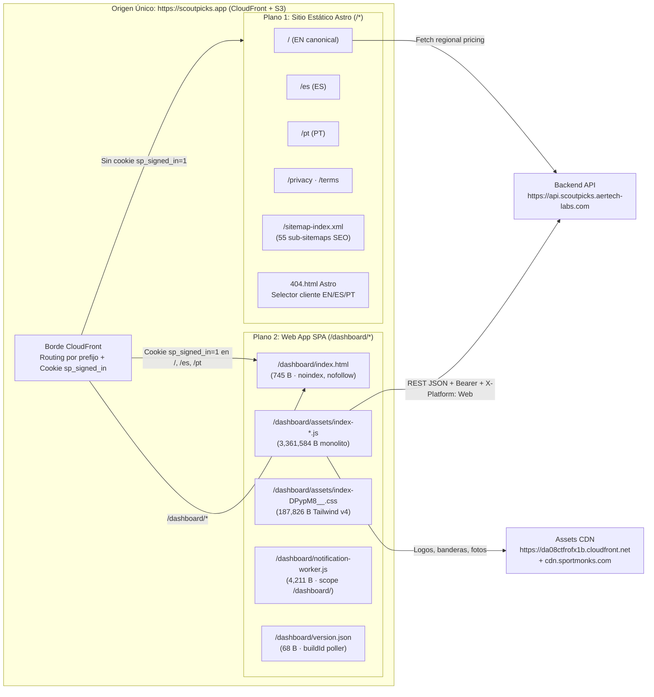
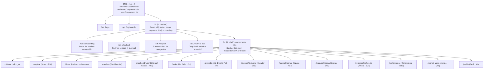
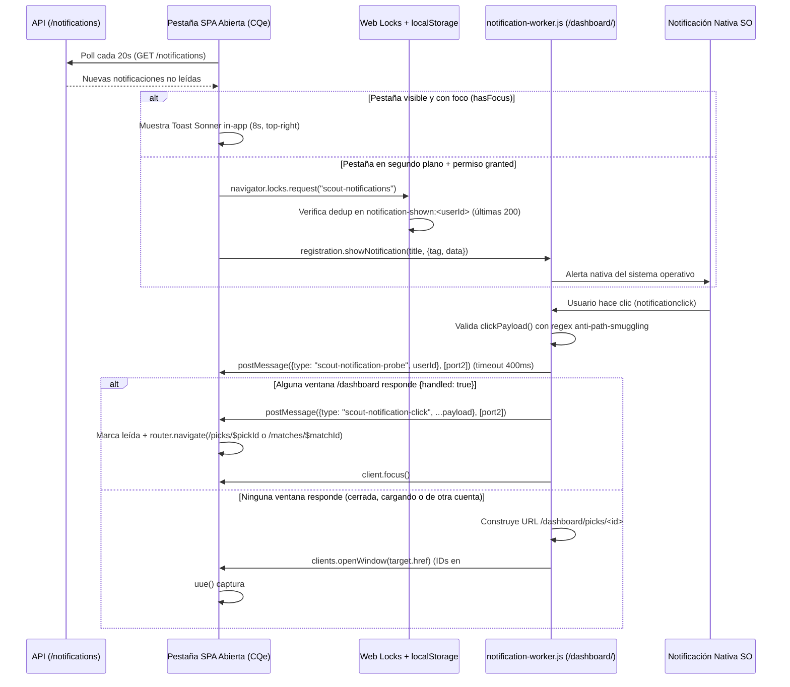

# 01. Arquitectura Frontend, Rutas, Estado y Astro Landing — Scout Picks (`scoutpicks.app`)

> **Alcance forense**: Ingeniería inversa estática y dinámica del plano cliente de **Scout Picks** (`https://scoutpicks.app`), cubriendo la arquitectura dual sobre el mismo origen (sitio público estático en **Astro** en `/` y aplicación web **SPA React 19** en `/dashboard/`, `Beta v0.1.0`), disección por rangos de bytes del bundle monolítico de `3,361,584` bytes, topología completa 1:1 de **TanStack Router**, arquitectura de estado en **Zustand**, matriz de caché y *polling* adaptativo en **TanStack Query**, control de despliegues en caliente (`version.json`) y protocolo de notificaciones vía Service Worker (`notification-worker.js`).
>
> **Clasificación epistemológica**: `[OBSERVADO]` (capturas CDP/HAR/DOM en vivo y bytes exactos servidos), `[DERIVADO]` (reconstrucción determinista desde AST/código minificado y artefactos exportados), `[INFERIDO]` (hipótesis arquitectónica de alta confianza basada en cabeceras, bordes CDN y convenciones de compilación), `[DESCONOCIDO]` (aspectos no verificables desde el plano cliente sin acceso al repositorio privado o consola AWS).
>
> **Higiene forense**: Cero PII y cero credenciales; tokens de sesión, identificadores de cuenta y claves de SDK han sido redactados (`[REDACTED]`).

---

## 1. Arquitectura Dual en el Mismo Dominio (`scoutpicks.app`)

### 1.1 Topología de Coexistencia en Borde (AWS CloudFront + Amazon S3)

`[OBSERVADO]` (`ev_eb381a1446763d94752838fd77caee295d4b64c43f3b7536a70f7c2183578a69`, `ev_8d1fa2225983ff98a4c350ad528895985cc9cdd8f4efab6f7eceda9da4dc30cd`) El dominio único `https://scoutpicks.app` hospeda **dos aplicaciones frontend independientes** detrás de una misma distribución de **AWS CloudFront** (`server: AmazonS3`, `x-amz-server-side-encryption: AES256`, POP observado `DFW56-P1`, `cache-control: no-cache` en documentos HTML y `strict-transport-security: max-age=31536000`):

1. **Plano Público / Adquisición y SEO (`/` y rutas raíz)**: Sitio estático multi-idioma pre-renderizado con **Astro** (`/_astro/*`), orientado a indexación orgánica, conversión hacia tiendas nativas (iOS App Store `id6759328850`, Google Play `com.scoutpicks.app`), consulta dinámica de precios regionales (`/app/pricing`) y cumplimiento legal (`/privacy`, `/terms`).
2. **Plano Aplicativo Autenticado (`/dashboard/*`)**: Single-Page Application (**SPA**) compilada con **Vite + React 19.2.0** (`Beta v0.1.0`), aislada explícitamente de motores de búsqueda mediante `<meta name="robots" content="noindex, nofollow" />` en su `index.html` de `745` bytes y con `basepath: "/dashboard/"` en TanStack Router.

### 1.2 Comparativa Arquitectónica: Astro Landing vs. Dashboard SPA

| Dimensión | Plano Público (`/*` — Astro Landing) | Plano Aplicativo (`/dashboard/*` — Dashboard SPA) | Clasificación y Evidencia |
| :--- | :--- | :--- | :--- |
| **Framework & Renderizado** | **Astro** SSG (HTML estático pre-renderizado + islas JS nativas ESM sin runtime UI) | **React `19.2.0`** CSR puro (`createRoot` en `

`, `StrictMode`) | `[OBSERVADO]` `ev_74b541a57159f5b5975cfbe9c641d44f5355061d23a9f470fa1ff363bc832221`, `ev_abdb3cf1dbd8a7aab2a952ca236449585bd2de775d8200297a3b94e836220fb3` |
| **Bundler / Assets** | Vite/Astro bajo `/_astro/*.js` y `/_astro/Logo.DfIZ1AHK.css` (`50,785` B) | Vite/Rollup bajo `/dashboard/assets/index-*.js` (`3,361,584` B) e `index-DPypM8__.css` (`187,826` B) | `[OBSERVADO]` `ev_8d1fa2225983ff98a4c350ad528895985cc9cdd8f4efab6f7eceda9da4dc30cd` |
| **Directiva SEO** | Indexable (`hreflang` `en`/`es`/`pt`/`x-default`, JSON-LD `@graph`, `sitemap-index.xml`) | Bloqueado (`<meta name="robots" content="noindex, nofollow" />`) | `[OBSERVADO]` `ev_8d1fa2225983ff98a4c350ad528895985cc9cdd8f4efab6f7eceda9da4dc30cd` |
| **Internacionalización** | 3 landings estáticos (`/`, `/es`, `/pt`) + 55 sitemaps programáticos en 9 idiomas | **i18next** + `react-i18next`: 3 idiomas inline (`en`, `es`, `pt`) + 10 chunks lazy (13 locales totales, soporte RTL en `ar`) | `[DERIVADO]` `ev_abdb3cf1dbd8a7aab2a952ca236449585bd2de775d8200297a3b94e836220fb3` |
| **Fallback HTTP / 404** | CloudFront devuelve `404` con documento Astro multi-idioma (`404.astro...BkHHDTiw.js`) para rutas fuera de `/dashboard/*` | CloudFront sirve `200 OK` con `/dashboard/index.html` (`745` B) para cualquier subruta `/dashboard/*`; TanStack Router renderiza `Grt` (`notFoundComponent`) en rutas inválidas | `[OBSERVADO]` `ev_8d1fa2225983ff98a4c350ad528895985cc9cdd8f4efab6f7eceda9da4dc30cd` |
| **Analítica y Telemetría** | PostHog diferido por `requestIdleCallback` (`timeout: 4000` ms) desde `/_astro/module.Dd44YI6l.js` (`234,928` B), `app_namespace: "web-landing"` o `"web-legal"` | PostHog inline (`posthog-js` `1.414.0`, `platform: "Web"`) + **Sentry React SDK** (`10.37.0`, `tracesSampleRate: 0.1`, tracing de TanStack Router) | `[OBSERVADO]` `ev_8d1fa2225983ff98a4c350ad528895985cc9cdd8f4efab6f7eceda9da4dc30cd`, `[DERIVADO]` `ev_abdb3cf1dbd8a7aab2a952ca236449585bd2de775d8200297a3b94e836220fb3` |
| **Monetización** | Fetch directo a `/app/pricing` (timeout `4,000` ms) con fallback estático en USD y deep-link a `/dashboard/login?redirect=/checkout?plan=...` | **RevenueCat Purchases JS** (`@revenuecat/purchases-js`) con UI embebida compilada en **Svelte 5** + pasarelas **Stripe.js `9.7.0`** y **Paddle v2** | `[DERIVADO]` `ev_74b541a57159f5b5975cfbe9c641d44f5355061d23a9f470fa1ff363bc832221`, `ev_abdb3cf1dbd8a7aab2a952ca236449585bd2de775d8200297a3b94e836220fb3` |

---

## 2. Disección Forense del Sitio Público en Astro (`/*`)

### 2.1 Inventario de Rutas Estáticas, Sitemaps Programáticos y Página `404` Dinámica

`[OBSERVADO]` (`ev_8d1fa2225983ff98a4c350ad528895985cc9cdd8f4efab6f7eceda9da4dc30cd`) El plano Astro expone las siguientes rutas verificadas en el origen `https://scoutpicks.app`:

| Ruta Pública | HTTP Status | Tamaño HTML/XML | Propósito y Metadatos Clave |
| :--- | :---: | :---: | :--- |
| `/` | `200` | `66,242` B | Landing principal en inglés (`lang="en"`, `og:locale="en_US"`). `H1`: *"Bet smarter, Improve your odds"*. |
| `/es` | `200` | `67,236` B | Landing localizada en español (`lang="es"`). `H1`: *"Apuesta con cabeza, Mejora tus probabilidades"*. |
| `/pt` | `200` | `67,082` B | Landing localizada en portugués (`lang="pt"`). `H1`: *"Aposte com inteligência, Melhore suas chances"*. |
| `/privacy` | `200` | `26,982` B | Política de Privacidad (CCPA, GDPR, retención, terceros, notificaciones push). |
| `/terms` | `200` | `42,420` B | Términos de Uso (18+, *Not a Sportsbook*, arbitraje, facturación multi-tienda Web vs App Store/Play Store). |
| `/robots.txt` | `200` | `74` B | `User-agent: * / Allow: /` y referencia a `Sitemap: https://scoutpicks.app/sitemap-index.xml`. |
| `/sitemap-index.xml` | `200` | `6,706` B | Índice XML de **55 sitemaps** (9 idiomas × 6 verticales programáticas + `sitemap-pages-0.xml`). |
| Cualquier ruta inexistente (ej. `/sitemap.xml`, `/config.js`) | `404` | `2,959` B (br) | Página `404` estática de Astro con **3 secciones pre-renderizadas en el DOM** (`data-not-found="en"`, `data-not-found="es" hidden`, `data-not-found="pt" hidden`) conmutadas en cliente por `/_astro/404.astro_astro_type_script_index_0_lang.BkHHDTiw.js` (que también actualiza `document.title` usando `data-title`). |

`[OBSERVADO]` **Arquitectura SEO programática en `sitemap-index.xml`**: El archivo declara **54 sitemaps de entidades deportivas** distribuidos en **9 idiomas** (`es` en raíz sin prefijo, `en`, `fr`, `pt`, `id`, `vi`, `th`, `hi`, `ar`) a razón de 6 verticales por idioma (`stats/estadisticas`, `teams/equipos`, `players/jugadores`, `referees/arbitros`, `head-to-head/enfrentamientos`, `matches/partidos`, con `lastmod` diario a las `20:15Z` y `23:00Z`), más `sitemap-pages-0.xml`. Además, `LandingPage.astro` importa utilidades desde `./seo-cta.KzQJazLN.js` y `analytics.DvUUnk4I.js` expone los trackers `seo_cta_visibility` y `seo_cta_clicked` (`[DERIVADO]`, `ev_74b541a57159f5b5975cfbe9c641d44f5355061d23a9f470fa1ff363bc832221`), confirmando que el proyecto Astro comparte infraestructura de componentes CTA con páginas programáticas de aterrizaje SEO.

### 2.2 Redirección Automática de Sesión Activa (`/` → `/dashboard/?from=landing`)

`[OBSERVADO]` (`ev_8d1fa2225983ff98a4c350ad528895985cc9cdd8f4efab6f7eceda9da4dc30cd`) y `[DERIVADO]` (`ev_abdb3cf1dbd8a7aab2a952ca236449585bd2de775d8200297a3b94e836220fb3`) Scout Picks implementa un puente sin fricción entre el landing estático y la SPA mediante una **cookie señalizadora first-party no sensible**:

1. **Escritura de cookie en la SPA (`gue` / `hue`, bytes `5,960..6,350` del bundle)**: El módulo de arranque del dashboard se suscribe a `useAuthStore` (`Ee`). Cuando `isAuthenticated === true` (y `isLoading === false`), escribe `document.cookie = "sp_signed_in=1; Max-Age=15552000; Path=/; SameSite=Lax; Secure"` (vigencia de **180 días**, `Path=/` cubriendo la raíz de Astro). Al cerrar sesión (`signOut`), expira inmediatamente la cookie con `Max-Age=0`.
2. **Intercepción en el borde CDN**: `[INFERIDO]` Dado que el HTML estático de `/` (`https_scoutpicks_app_.txt`) no contiene lógica inline que lea `sp_signed_in`, pero durante la captura en vivo (`ev_8d1fa2225983ff98a4c350ad528895985cc9cdd8f4efab6f7eceda9da4dc30cd`, entrada HAR `#4` y captura `01-public-landing-desktop.png`) la navegación con sesión activa a `https://scoutpicks.app/` aterrizó directamente en `https://scoutpicks.app/dashboard/?from=landing`, una **CloudFront Function** (viewer-request) inspecciona la cookie `sp_signed_in=1` en peticiones a la raíz y emite redirección HTTP hacia `/dashboard/?from=landing`.
3. **Limpieza de URL y atribución en la SPA (`_ue` / `vue`)**: Al iniciar la SPA, `_ue()` verifica si `URLSearchParams(location.search).get("from") === "landing"`. De ser así, elimina el parámetro `from` mediante `history.replaceState` para dejar limpia la barra de direcciones y, tras validar la sesión (`IP.then(...)`), invoca `z.trackLandingRedirectArrived(isAuthenticated)` emitiendo el evento PostHog `web_landing_signed_in_redirect`.

### 2.3 Análisis AST de los Scripts Cliente de Astro (`/_astro/*.js`)

`[DERIVADO]` (`ev_74b541a57159f5b5975cfbe9c641d44f5355061d23a9f470fa1ff363bc832221` y `ev_8d1fa2225983ff98a4c350ad528895985cc9cdd8f4efab6f7eceda9da4dc30cd`) El sitio público evita cargar React o Svelte; hidrata únicamente **5 módulos ES ligeros** más el chunk diferido de PostHog:

| Archivo `/_astro/*` | Tamaño | SHA-256 | Responsabilidad Técnica Exacta |
| :--- | :---: | :--- | :--- |
| `LandingPage.astro_...ByMpcIC5.js` | `4,665` B | `24fb9129...fa832` | 1) Detecta OS móvil (`navigator.userAgent` + heurística iPadOS `macintosh && maxTouchPoints > 1`) y reescribe enlaces `a[data-download]` hacia App Store (`id6759328850`) o Play Store (`com.scoutpicks.app`). 2) Consulta `GET https://api.scoutpicks.aertech-labs.com/app/pricing` con `AbortController` de `4,000` ms (`u = 4e3`), valida esquema `{currency, prices, trialDays}` para `weekly`/`monthly`/`yearly`, calcula porcentaje de ahorro anual `Math.floor((1 - yearly / (monthly * 12)) * 100)`, bloquea temporalmente clics en `a[data-cta="pricing_pro"]` (`aria-busy="true"`) hasta resolver precios (o cae a `data-fallback-prices` en USD), y actualiza el `href` con `?redirect=/checkout?plan=annual|monthly|weekly`. |
| `analytics.DvUUnk4I.js` | `3,055` B | *(en HAR)* | Cola de eventos en memoria (`s = []`) que difiere la descarga e inicialización de PostHog (`./module.Dd44YI6l.js`, `234,928` B) mediante `requestIdleCallback(..., {timeout: 4000})` (o `setTimeout(..., 2000)`). En clics de salida (`web_landing_cta_clicked`, `seo_cta_clicked`), hace `Promise.race` de `1,000` ms y envía con `{transport: "sendBeacon"}` para no perder atribución al navegar hacia `/dashboard/` o tiendas de apps. |
| `FeaturesSection.astro_...BUMniAVt.js` | `2,217` B | `7572b3c5...4c0ab` | Carrusel interactivo accesible de las 4 features clave (`[data-features]`): soporta *hover* en punteros finos (`(hover: hover) and (pointer: fine)`), *scroll-snap* + `IntersectionObserver` (`threshold: 0.6`) en móvil (`max-width: 63.99rem`), gestos táctiles (`touchstart`/`touchend` con umbral horizontal de `40px`), respeto a `prefers-reduced-motion: reduce` y telemetría `web_landing_feature_viewed` (`select`, `dot`, `swipe`, `illustration_swipe`). |
| `ComplianceNote.astro_...ZUL5yTpB.js` | `162` B | `cf227d12...8404fa` | Registra listeners en `[data-footer-link]` (`support_email` → `mailto:team@aertech-labs.com`, `gambling_help` → `gamblingtherapy.org`) para emitir `web_landing_footer_link_clicked`. |
| `LegalPage.astro_...HLHBKixd.js` | `59` B | `257a2e80...e3b3c` | Inicializa la telemetría de página en `/privacy` y `/terms` bajo el namespace `e("web-legal")`. |

### 2.4 Marketing Copy, Promesas de Valor, Datos Estructurados y CTAs

`[OBSERVADO]` (`ev_8d1fa2225983ff98a4c350ad528895985cc9cdd8f4efab6f7eceda9da4dc30cd`) El discurso de producto en `/` (`en`), `/es` y `/pt` está alineado con rigor regulatorio (posicionándose explícitamente como herramienta estadística y **no** como casa de apuestas):

- **Propuesta de valor central**: *"Scout Picks tests every bet against historical data, so you know how often it actually lands before you place it. Start free."* (ES: *"Cada pick, puesto a prueba desde varios ángulos"* — localía, competición y rival).
- **4 pilares funcionales (`FeaturesSection`)**:
  1. *Insights que marcan la diferencia* (validación multi-ángulo contra datos históricos de partidos).
  2. *Filtros a medida de tu estrategia* (constructor personalizado por liga, mercado, cuota y tasa de acierto).
  3. *Actualizaciones en tiempo real* (seguimiento en vivo de estadísticas y alertas).
  4. *Sigue tu rendimiento* (registro de unidades netas, ROI e historial de picks guardados).
- **Comparativa de planes en Landing**:
  - **Free plan** (*Gratis para siempre*): CTA `pricing_free` → `https://scoutpicks.app/dashboard/login`.
  - **Scout Picks Pro** (selector accesible por teclado `ArrowLeft/Right/Up/Down` entre Semanal, Mensual y Anual): desbloquea picks destacados en **200+ ligas**, filtros ilimitados y prueba gratuita según elegibilidad regional; CTA `pricing_pro` → `https://scoutpicks.app/dashboard/login?redirect=%2Fcheckout%3Fplan%3Dannual`.
- **Matriz de CTAs y canales externos (JSON-LD `@graph` + Footer)**:
  - **Web App**: `href="/dashboard/"` (`data-cta="nav"` y `data-cta="hero"`, `data-store="web_app"`).
  - **iOS App Store**: `https://apps.apple.com/app/id6759328850` (`data-store="app_store"`).
  - **Google Play Store**: `https://play.google.com/store/apps/details?id=com.scoutpicks.app` (`data-store="play_store"`).
  - **Comunidad y Soporte**: Telegram grupal (`https://t.me/scoutpickschat`), contacto directo en Telegram (`https://t.me/vsratti`), correo `team@aertech-labs.com`, redes sociales en `sameAs` (`instagram.com/scoutpicksapp`, `x.com/scoutpicksapp`, `tiktok.com/@scoutpicks`) y enlace de juego responsable (`gamblingtherapy.org`).

---

## 3. Anatomía del Bundle Monolítico de la SPA (`/dashboard/`, `3.36 MB`)

### 3.1 Identidad Criptográfica y Diff entre Builds Capturados en Vivo

`[OBSERVADO]` (`ev_abdb3cf1dbd8a7aab2a952ca236449585bd2de775d8200297a3b94e836220fb3`, `ev_d6aea026e24cc7285f592385c27b572003bb7a591dbda6be9d5c2ff8366790be`) Durante la ventana de observación forense se capturaron **dos builds consecutivos en producción** de exactamente el mismo tamaño en bytes y caracteres:

| Artefacto | Filename | Bytes UTF-8 | Caracteres | SHA-256 | `buildId` / Sentry Release Embebido |
| :--- | :--- | :---: | :---: | :--- | :--- |
| **Build 1** | `index-BZ3_gLK3.js` | `3,361,584` | `3,313,154` | `674b3c11a894c8bc508732ad3031a2dcf3932400c252b1ce68a0ccb146d7d903` | `34d7fb96e12d47910688cd31cdcee47352e38c12-44092619889.1` |
| **Build 2** | `index--7dqLkuo.js` | `3,361,584` | `3,313,154` | `15bba82d3bdad2d4a99a9cc696ef6ef61ccdbdbacd05b64fc93cb7024a935f68` | `cb0f6a961495fdbd12ef646d497dc3389a2ca2c7-44112075563.1` |

`[DERIVADO]` La comparación diferencial entre ambos artefactos (`evidence/live-build-diff.json`) demuestra que el código funcional es **100% idéntico** y la única mutación entre ambos despliegues fue la cadena `<git_sha_40>-<ci_run_id>.1` inyectada en `SENTRY_RELEASE`, `zct()` y `_Pe` (`version.json`).

### 3.2 Stack Tecnológico Completo Verificado en el Bundle

`[DERIVADO]` (`ev_abdb3cf1dbd8a7aab2a952ca236449585bd2de775d8200297a3b94e836220fb3`) La SPA bajo `/dashboard/` integra el siguiente stack exacto:
- **Core UI & Bundler**: **React `19.2.0`** (`react`, `react-dom`, `scheduler`, `use-sync-external-store`) empaquetado con **Vite** (`modulepreload` polyfill nativo de Vite).
- **Routing & Data Fetching**: **TanStack Router v1** (`createRootRoute`, `createRoute`, `createRouter`, `RouterProvider` con `basepath: "/dashboard/"` y `scrollRestoration: true`) + **TanStack Query v5** (`QueryClient`, `useQuery`, `useInfiniteQuery`, `useQueries`, `useMutation`).
- **Estado Cliente & Red**: **Zustand** (`create` / `createStore` + `useSyncExternalStoreWithSelector`) + **Axios** (`timeout: 10000` ms, cabeceras `X-Platform: Web` y `Accept-Language`).
- **Sistema UI & Estilos**: **Tailwind CSS v4** (`@layer theme`, tokens CSS nativos, `@container` queries) + **Radix UI Primitives** (`Dialog`, `Popover`, `Tooltip`, `Select`, `Tabs`, `Slot`, `FocusScope`) + **class-variance-authority (CVA)** + **Lucide React `v1.23.0`** + **Ionicons SVGs** + **Embla Carousel** + **Sonner** (3 instancias `Toaster` diferenciadas: general, `notifications` y `app-update`).
- **Internacionalización**: **i18next** + **react-i18next** con sincronización automática de `document.documentElement.lang` y `dir` (`ltr`/`rtl`).
- **Facturación Web Híbrida**: **RevenueCat Purchases JS** (`@revenuecat/purchases-js`) que incrusta su motor completo de Paywall/Checkout compilado en **Svelte 5** (clases `svelte-*`, señales reactivas y errores `svelte.dev/e/*`) junto con **Stripe.js `9.7.0`** (`@stripe/stripe-js`) y soporte **Paddle v2** (`cdn.paddle.com/paddle/v2/paddle.js`).
- **Observabilidad y Experimentación**: **PostHog JS `1.414.0`** (analítica de eventos, *feature flags* y *session replay*) + **Sentry Browser/React SDK `10.37.0`** (`browserTracingIntegration` acoplado a TanStack Router, `sampleRate: 1.0`, `tracesSampleRate: 0.1`).

### 3.3 Mapa Exacto por Rangos de Bytes del Monolito (`0` .. `3,361,584` bytes)

`[DERIVADO]` (`ev_abdb3cf1dbd8a7aab2a952ca236449585bd2de775d8200297a3b94e836220fb3`) La siguiente tabla particiona de forma exhaustiva y contigua el 100% de los `3,361,584` bytes UTF-8 de `index-BZ3_gLK3.js`:

| Rango de Bytes (UTF-8) | Tamaño (KB) | % Total | Capa / Módulo | Contenido Exacto Identificado |
| :--- | :---: | :---: | :--- | :--- |
| `0 .. 2,236` | `2.2` | `0.07%` | Runtime / Sentry | Helpers esbuild (`__publicField`, campos privados WeakMap), inyección `SENTRY_RELEASE` y polyfill `modulepreload` de Vite. |
| `2,237 .. 6,711` | `4.5` | `0.13%` | First-Party Bootstrap | `react-jsx-runtime` (`19.2.0`), deep-link `scoutai://`, parser de handoff móvil (`#ott=`), parser de hash `notificationClick`, cookie `sp_signed_in`, detector `?from=landing` y core de **Zustand** (`Y$`). |
| `6,712 .. 52,723` | `46.0` | `1.37%` | Vendor: React + Axios | `react.production.js` (`19.2.0`), adaptador React de Zustand (`RP`), helper `Lo()` de dynamic imports bajo `/dashboard/` y cliente HTTP **Axios** completo. |
| `52,724 .. 175,198` | `122.5` | `3.64%` | First-Party + i18next | Objeto de configuración `vn` (`apiBaseUrl`, claves públicas de OAuth/RevenueCat/PostHog/Sentry), motor **i18next** + `react-i18next`, catálogos de mercados/posiciones (`GP`, `$W`), score de recomendación (`Mfe`) y validador de bloqueo de picks (`Ife` / `Ed`). |
| `175,199 .. 383,460` | `208.3` | `6.20%` | First-Party: i18n Inline | Diccionarios completos embebidos para **Inglés (`Ohe`, ~100 KB)**, **Español (`ege`, ~78 KB)** y **Portugués (`bge`, ~28 KB)** + mapa `YW` de 10 locales diferidos y detector regional `kfe`. |
| `383,461 .. 405,088` | `21.6` | `0.64%` | First-Party: Auth & API | Wrapper resiliente de `localStorage` con fallback en memoria/tombstone (`dv`/`uv`/`_2`), instancia Axios `kt` con interceptores `Bearer` y `401`, cliente `Il` (`/auth/*`) y telemetría de Market Alerts (`Tge`). |
| `405,089 .. 637,954` | `232.9` | `6.93%` | Vendor: PostHog SDK | SDK completo **`posthog-js` `1.414.0`** (compresión `CompressionStream` gzip, colas OTLP de logs/métricas, rate-limiter, *session replay* y *feature flags*). |
| `637,955 .. 658,671` | `20.7` | `0.62%` | First-Party: Analytics | Catálogos de experimentos de precios regionales (`pricing-tier5-2026q4-v1`, SKUs Android/Web), inicializador PostHog `_ye()` y fachada tipada de eventos `z` (`track*`). |
| `658,672 .. 702,300` | `43.6` | `1.30%` | Vendor: TanStack Query | Core de **`@tanstack/query-core` + `@tanstack/react-query` v5** (`QueryClient` `lg`, `QueryObserver`, `InfiniteQueryObserver`, mutaciones). |
| `702,301 .. 713,527` | `11.2` | `0.33%` | First-Party: Stores | Clientes `/picks/*` (`Hn`), **Saved Picks Store (`gr`)** con concurrencia optimista (`mutationSeq`), **Auth Store (`Ee`)** y **Odds Format Store (`Kl`)**. |
| `713,528 .. 930,577` | `217.0` | `6.46%` | Vendor: ReactDOM 19 | `scheduler.production.js`, `react-dom.production.js` y `react-dom-client.production.js` (`19.2.0`). |
| `930,578 .. 1,010,580` | `80.0` | `2.38%` | Vendor: TanStack Router | **`@tanstack/router-core` + `@tanstack/react-router`** y `use-sync-external-store-shim/with-selector`. |
| `1,010,581 .. 1,223,285` | `212.7` | `6.33%` | Vendor + UI Primitives | Iconografía **Lucide React `v1.23.0`**, **Sonner**, **Embla Carousel**, **Radix UI** (`Slot`, `Popper`, `Popover`, `Dialog`, `Select`, `Tabs`), poller de actualizaciones `_Pe` (`/dashboard/version.json`) y primitiva `Card` (`Fe`). |
| `1,223,286 .. 1,369,824` | `146.5` | `4.36%` | First-Party + Radix | Clientes de árbitros y *bookmaker perks* (`Bte`), tablas compartidas de picks/cuotas, menús de casas de apuestas y primitivas `Tooltip` de Radix UI. |
| `1,369,825 .. 2,293,724` | `923.9` | `27.48%` | Vendor: RevenueCat + Svelte 5 + Stripe | **El mayor bloque individual del bundle (0.92 MB)**: runtime **Svelte 5**, **RevenueCat Web Billing SDK** (incluyendo ~380 KB de traducciones de errores de checkout/Stripe Tax en docenas de idiomas), wrapper **Stripe.js `9.7.0`**, integración Paddle y puente first-party CloudFront/RevenueCat (`2,101,736 .. 2,109,804`). |
| `2,293,725 .. 3,252,084` | `958.4` | `28.51%` | First-Party: App Core | **Código completo de todas las pantallas y dominios del producto**: Árbitros, Ligas y Bracket SVG (`rHe`/`nHe`), Partidos, Alertas de Mercado + Asistente IA (`SVe`/`kVe`/`wVe`), Jugadores, Equipos, Simulaciones, Match Center (9 pestañas), Scout/Explorar + Constructor de Filtros, Service Worker bridge (`CQe`), Buscador Global (`gle`), Shell de navegación (`iXe`/`eXe`), Home Hub (`_et`), Paywall (`uZe`), Rendimiento (`BZe`), Onboarding V2 (`ctt`/`qtt`), Creator Tools (`/creator/pick-calendar`) y Perfil (`Wrt`). |
| `3,252,085 .. 3,351,270` | `99.2` | `2.95%` | Vendor: Sentry SDK | **`@sentry/browser` + `@sentry/react` `10.37.0`** con instrumentación de spans, replay/breadcrumbs e integración `tanstackRouterBrowserTracingIntegration`. |
| `3,351,271 .. 3,361,584` | `10.3` | `0.31%` | First-Party: Router Tree | `AppErrorBoundary` (`Fct`), definición declarativa completa del árbol de rutas `odt` de TanStack Router (`FN`), suscripciones de sesión/flags y montaje en `#root`. |

> **Total verificado**: `3,361,584` bytes (`100.00%`) — compuestos por aproximadamente **`~1.99 MB` (`59.2%`) de librerías vendor/SDKs** y **`~1.37 MB` (`40.8%`) de código e i18n first-party**.

### 3.4 Estrategia de Chunks de Idiomas (`3` Inline + `10` Lazy) y Ausencia de Code-Splitting por Ruta

`[DERIVADO]` (`ev_abdb3cf1dbd8a7aab2a952ca236449585bd2de775d8200297a3b94e836220fb3`, `ev_a394dec94a9e5e5f399bf393e8aea83ab29cb391995908919172dae4bbe2b087`)

1. **Único punto de partición dinámica (`import()`) en todo el proyecto**: El bundle define exclusivamente **10 dynamic imports** en el mapa `YW` para idiomas secundarios:
   - `./it-D64XgvOw.js` (Italiano), `./zh-B9Q4DO47.js` (Chino), `./ar-mU0P8YAR.js` (Árabe, activa `dir="rtl"` vía `jfe`), `./ru-BDw0HTsc.js` (Ruso), `./hi-CXL6oNyA.js` (Hindi), `./ja-fpPYJiRJ.js` (Japonés), `./de-sW_zOHej.js` (Alemán), `./tr-DwxvYBBl.js` (Turco), `./el-CoNXKQu4.js` (Griego) y `./ro-8hYGVb8g.js` (Rumano).
   - Por el contrario, **Inglés (`en`), Español (`es`) y Portugués (`pt`)** están incrustados síncronamente en `sD = { en: Ohe, es: ege, pt: bge }`, sumando **`208.3 KB`** fijos incluso cuando el usuario utiliza un único idioma.
2. **Cero code-splitting por ruta (`lazyRouteComponent` ausente)**: Las **19 rutas** de TanStack Router importan sus componentes de página de manera estática dentro del mismo chunk de entrada. Esto incluye módulos pesados y de baja frecuencia de uso como:
   - El SDK completo de **RevenueCat + Svelte 5 + traducciones globales de Stripe Tax (`923.9 KB`, `27.5%` del bundle)**, que se descarga y parsea en cada arranque aunque el usuario ya sea suscriptor Pro y jamás visite `/paywall`.
   - Flujos exclusivos de primer uso (**Onboarding Quiz & Personalization**), **Creator Tools** (`/creator/pick-calendar`) y el **Asistente IA de Alertas de Mercado** (incluso para cuentas donde `enabled === false`).
3. **Impacto empírico de rendimiento**:
   - **Penalización en Cold Start (FCP / TTI)**: En el arranque (`11_router_tree_and_bootstrap.js`, línea 16), `createRoot(Qde).render(...)` espera la resolución de `Pge.then(...)` tras descargar, descomprimir, parsear y evaluar los `3.36 MB` de JavaScript en el hilo principal antes de pintar el primer frame útil.
   - **Invalidación total de caché en cada despliegue**: Como lo demuestra la transición entre `index-BZ3_gLK3.js` y `index--7dqLkuo.js` (`ev_d6aea026e24cc7285f592385c27b572003bb7a591dbda6be9d5c2ff8366790be`), cambiar únicamente los 56 caracteres del `buildId` invalida el hash del archivo completo de `3.36 MB`, obligando a todos los clientes recurrentes a re-descargar `2 MB` de dependencias vendor inmutables (`React`, `PostHog`, `Sentry`, `RevenueCat`, `Radix`).
   - **Complejidad AST extrema**: El tamaño monolítico del archivo llevó incluso al analizador semántico estático de REA (`ev_a394dec94a9e5e5f399bf393e8aea83ab29cb391995908919172dae4bbe2b087`) a alcanzar su límite de `300,000 ms` por unidad de compilación.

---

## 4. Topología Completa 1:1 de TanStack Router

### 4.1 Jerarquía del Árbol de Rutas (`odt`) y Configuración Global

`[DERIVADO]` (`ev_abdb3cf1dbd8a7aab2a952ca236449585bd2de775d8200297a3b94e836220fb3`, archivo extraído `11_router_tree_and_bootstrap.js`) El enrutador `FN` se instancia con `basepath: "/dashboard/"`, `scrollRestoration: true`, captura global de errores hacia Sentry (`defaultOnCatch: (e, t) => Wde(e, t, "router")`) y `defaultErrorComponent: ldt`. Además, se suscribe reactivamente a dos fuentes externas que disparan `FN.invalidate()` para re-evaluar todos los guards `beforeLoad`:
1. Cambios en `Ee.getState().isAuthenticated` (login/logout en pestaña actual o sincronizado entre pestañas mediante el evento `window.onstorage` sobre `sp.authToken`).
2. Cambios dinámicos en el feature flag de PostHog `onboarding_quiz_enabled` (`cdt()`), si el usuario autenticado aún no completó onboarding (`!hasCompletedOnboarding`).

### 4.2 Tabla Maestra 1:1 de Todas las Rutas, Parámetros, `validateSearch` y Guards `beforeLoad`

`[DERIVADO]` (`ev_abdb3cf1dbd8a7aab2a952ca236449585bd2de775d8200297a3b94e836220fb3`) La siguiente tabla documenta exhaustivamente cada nodo de `createRootRoute` / `createRoute` definido en el bundle:

| ID Interno | Padre | Path Relativo a `/dashboard` | Parámetros Path | Esquema Exacto `validateSearch` | Guard `beforeLoad` / Redirecciones en Componente | Componente |
| :--- | :--- | :--- | :--- | :--- | :--- | :--- |
| `$N` | — | *(Root)* | — | — | Renderiza `<Outlet />` (`wC`) y captura rutas inexistentes bajo `/dashboard/*` con `Grt` (página 404 interna con tracking `Not Found`). | `wC` / `Grt` |
| `Bct` | `$N` | `/login` | — | `{ redirect?: string }` | Si `q$()` (`isAuthenticated`), lanza `redirect({ to: PN(e.redirect) })`. `PN()` previene *open-redirect* exigiendo inicio con `/` y bloqueando `//`, `/\` y `/login*`. | `mQe` |
| `qct` | `$N` | `/login/verify` | — | `{ email: string, redirect?: string }` | 1) Si `q$()`, redirige a `PN(e.redirect)`. 2) Si `!e.email`, redirige a `/login?redirect=...`. | `xQe` |
| `Yv` | `$N` | *(Layout `id: "authed"`)* | — | — | 1) Si `!q$()`, redirige a `/login?redirect=<location.href>`. 2) Si el destino es `/checkout` o `/paywall`, persiste `CN(search.promo)` en `sessionStorage["scoutpicks.webPromo"]` (`sZe`). 3) Si `pathname !== "/onboarding"` y `Kde()` (`!hasCompletedOnboarding && featureFlag("onboarding_quiz_enabled")`), redirige a `/onboarding?preview=false&plan=<plan>`. | `wC` |
| `Yde` | `Yv` | `/onboarding` | — | `{ plan?: "weekly" \| "monthly" \| "annual", preview: false, flow: undefined }` *(nota: el validador fuerza literales `preview:!1, flow:void 0` en prod)* | Si `!e.preview && !Kde()`, redirige a `/`. Si estuviese activo `preview && flow === "personalization"` montaría `qtt`; por defecto monta el quiz `ctt`. | `adt` (`ctt` / `qtt`) |
| `ndt` | `Yv` | `/checkout` | — | `zN`: `{ source?: string, plan?: "weekly" \| "monthly" \| "annual", promo?: string }` (`CN`: `/^[A-Za-z0-9_-]{1,32}$/` en mayúsculas) | Redirección incondicional `replace: true` hacia `/paywall` preservando íntegro el objeto `search` (`source`, `plan`, `promo`). Sirve como alias limpio para los CTAs del landing Astro. | *(Redirect)* |
| `sdt` | `Yv` | `/paywall` | — | `{ source?: string, plan?: "weekly" \| "monthly" \| "annual", promo?: string, preview: false }` | En el render de `uZe`: si web billing está deshabilitado o el usuario ya posee suscripción Pro activa (`tl(s)`), redirige con `replace: true` a `/return-to-app?status=purchased` (si vino de la app nativa `V$()`) o a `/` (`Home Hub`). | `uZe` |
| `idt` | `Yv` | `/return-to-app` | — | `{ status: "purchased" \| "closed" }` (`fle`: cualquier valor distinto de `"purchased"` colapsa a `"closed"`) | En `useEffect`, limpia `sessionStorage["sp.appReturn"]` (`oue()`), emite `trackAppReturnShown(status)` y ejecuta `window.location.href = "scoutai://"` para devolver el foco a la app móvil. | `hQe` |
| `Bs` | `Yv` | *(Layout `id: "shell"`)* | — | — | Monta el proveedor de notificaciones `EQe`, el shell adaptativo `iXe` (Sidebar Desktop `eXe` + Topbar/BottomNav Mobile) y dispara `fetchSavedKeys(userId)` al montar y recuperar foco. | `iXe` |
| `Uct` | `Bs` | `/` | — | — | Renderiza el **Home Hub** personalizable (`_et`). | `_et` |
| `Vct` | `Bs` | `/explore` | — | `{ filters?: true }` (acepta `true` booleano o `"true"` string; cualquier otro valor es `undefined`) | Renderiza el explorador **Scout** (`ZYe`); cuando `filters === true` en móvil abre directamente el constructor de filtros a pantalla completa. | `ZYe` |
| `edt` | `Bs` | `/filters` | — | — | Alias legado: lanza redirección incondicional `replace: true` hacia `/explore`. | *(Redirect)* |
| `Wct` | `Bs` | `/matches` | — | `Xx`: `{ oddsTab?: "gamelines" \| "players" \| "teams" \| "game", oddsPeriod?: "full_match" \| "first_half" \| "second_half", date?: "YYYY-MM-DD", status?: "live" \| "upcoming" \| "finished", countries?: number[], leagues?: number[], match?: number, tab?: <9_match_tabs> }` | Vista maestra de **Partidos** (`Iet`); en Desktop soporta vista maestro-detalle seleccionando `?match=<id>` sin abandonar `/matches`. | `Iet` |
| `Gct` | `Bs` | `/matches/$matchId` | `$matchId` (entero positivo `> 0`) | `{ oddsTab?, oddsPeriod?, alertFamily?: string, alertOddsId?: number, alertBookmakerId?: number, tab?: "picks" \| "odds" \| "bet" \| "statistics" \| "timeline" \| "headToHead" \| "lineups" \| "standings" \| "injuries", insight?: string }` | **Match Center** (`RKe`). Valida que `$matchId` sea entero positivo seguro; soporta deep-linking directo a una cuota alertada (`alertFamily` + `alertOddsId` + `alertBookmakerId`) o a un `insight` específico. | `RKe` |
| `Hct` | `Bs` | `/picks` | — | — | Vista de **Mis Picks** guardados (`Qtt`) con pestañas `pending`/`won`/`lost`/`void`. | `Qtt` |
| `Kct` | `Bs` | `/picks/$pickId` | `$pickId` (CUID alfanumérico) | — | Detalle de Pick (`iYe`). Si el pick corresponde a jugador o métrica soportada de equipo Over/Under, monta la vista analítica interactiva (`Xoe` / `$oe`) con botón `Gestionar pick`; de lo contrario abre el modal de detalle `nR`. | `iYe` |
| `Yct` | `Bs` | `/players/$playerId` | `$playerId` (entero Sportmonks) | `{ insight?: string, tab?: "bet" }` | Perfil analítico de **Jugador** (`sYe`) con pestañas `picks`, `bet` y `matches` (acepta borradores sintéticos `insight=draft:p1113_m54091_...`). | `sYe` |
| `Qct` | `Bs` | `/teams/$teamId` | `$teamId` (entero Sportmonks) | `{ insight?: string, tab?: "bet" \| "picks" \| "matches" \| "standings" \| "squad" }` (`xGe`) | Perfil de **Equipo** (`FGe`) con 5 pestañas validadas contra `Wb`. | `FGe` |
| `Zct` | `Bs` | `/leagues/$leagueId` | `$leagueId` (entero Sportmonks) | `Nie`: `{ seasonId?: number, phaseStageId?: number, tab?: "matches" \| "standings" \| "knockout" }` | Perfil de **Liga / Competición** (`sHe`) con selector de temporada/etapa, clasificación `all/home/away` y cuadro eliminatorio SVG. | `sHe` |
| `Xct` | `Bs` | `/referees/$refereeId` | `$refereeId` (entero Sportmonks) | `{ source?: "search" \| "match_header", tab?: "stats" \| "bet" \| "picks" }` | Perfil de **Árbitro** (`eUe`) con atribución de origen (`search` vs `match_header`). | `eUe` |
| `Jct` | `Bs` | `/performance` | — | — | Panel de **Rendimiento** histórico, ROI, gráfico temporal y calendario mensual en unidades (`BZe`). | `BZe` |
| `tdt` | `Bs` | `/market-alerts` | — | — | Gestor de **Alertas de Mercado** (`VVe`), protegido por flag de catálogo `/market-alerts/catalog` (`enabled`). | `VVe` |
| `rdt` | `Bs` | `/profile` | — | — | Página de **Perfil**, suscripción, preferencias, creador y soporte (`Wrt`). | `Wrt` |

### 4.3 Protocolo de Handoff Móvil → Web (`#ott=` y `?return=app`)

`[DERIVADO]` (`ev_abdb3cf1dbd8a7aab2a952ca236449585bd2de775d8200297a3b94e836220fb3`, bytes `2,852..3,680` y `707,200..708,100`) Para permitir flujos de compra web desde las apps iOS/Android (evitando fricción de re-login):
1. La app nativa abre el navegador en `/dashboard/paywall?return=app#ott=<token_base64url_43_chars>`.
2. Antes de inicializar el router, `iue()` detecta `?return=app`, graba `sessionStorage["sp.appReturn"] = "1"`, extrae `ott` del fragmento `#` validando la expresión regular estricta `/^[A-Za-z0-9_-]{43}$/` (`rue`), y **purga inmediatamente tanto `?return=app` como `#ott=...` mediante `history.replaceState`** para que el token de un solo uso nunca quede en el historial ni viaje en cabeceras `Referer`.
3. El bootstrap ejecuta `Ee.getState().signInWithAppHandoff(W$.token)` → `POST /auth/web-handoff/redeem`. Si existía una sesión web previa de otra cuenta, cierra la sesión anterior, limpia `QueryClient` (`lg.clear()`) y `SavedPicksStore` (`gr.reset()`), e hidrata la nueva sesión.
4. Al concluir o cerrar el `/paywall`, `V$()` detecta `sp.appReturn === "1"` y redirige a `/return-to-app?status=purchased|closed`, que dispara el esquema `scoutai://`.

---

## 5. Arquitectura de Estado Cliente (Zustand) y Persistencia Local

### 5.1 Los 4 Stores de Zustand (`RP`)

`[DERIVADO]` (`ev_abdb3cf1dbd8a7aab2a952ca236449585bd2de775d8200297a3b94e836220fb3`) Scout Picks mantiene el estado de servidor estrictamente en TanStack Query y reserva **Zustand** para **exactamente 4 stores globales en memoria**:

| Store (Símbolo) | Offset (char) | Estado Mantenido | Invariantes de Concurrencia y Ciclo de Vida |
| :--- | :---: | :--- | :--- |
| **1. Auth Store (`Ee` / `useAuthStore`)** | `705,011` | `user`, `isLoading`, `isAuthenticated`, `hasCompletedOnboarding` | • Hidratación instantánea (`hydrateFromCache`) desde `localStorage["sp.authToken"]` + `localStorage["sp.cachedUser"]` (a través de un adaptador `dv`/`uv` con fallback en RAM y *tombstone* si `localStorage` falla en modo privado). • Validación asíncrona deduplicada (`checkSession` vía `GET /auth/get-session`) con **1 reintento tras `1,500 ms` (`dY`)** ante fallos de red transitorios; solo limpia credenciales si recibe HTTP `401`, preservando la sesión cacheada si hay caída temporal de red. • Sincroniza locale (`c6`: descarga chunk lazy `eG(locale)`, cambia `i18next` e invalida `QueryClient`). • En `signOut()`: llama `POST /auth/sign-out`, resetea PostHog (`z.reset()`), borra tokens (`ey()`), vacía `lg.clear()` y `gr.getState().reset()`. |
| **2. Saved Picks Store (`gr`)** | `700,669` | `savedKeys: Set<string>`, `keyToPickId: Map<string, string>`, `keyToOddsId: Map<string, number\|null>`, `pendingKeys: Set<string>`, `mutationSeq: number`, `ownerId`, `isLoading`, `isInitialized`, `error` | **Motor optimista libre de condiciones de carrera** para marcar/desmarcar picks en cualquier tarjeta de la app: • Genera llaves canónicas deterministas con `Ed(params)` (ej. `player_1113_m54091_tackles_over_0.5_full_match`, `match_54091_total_goals_over_2.5`, `match_54091_handicap_goals_home_-1.5`), normalizando alias (`sog`→`shotsOnTarget`, `fouls`→`foulsCommitted`, `dribbles`→`dribbleSuccess`). • Bloquea doble clic por llave mediante `pendingKeys` (`{outcome: "busy"}`). • Aplica mutación optimista inmediata sobre `savedKeys` y `keyToOddsId` antes de `POST /picks`, `DELETE /picks/:id` o `PUT /picks/:id/odds`, incrementando `mutationSeq` al confirmar y haciendo *rollback* exacto si falla. • Si `fetchSavedKeys` (`GET /picks/saved-keys`) estaba en vuelo mientras ocurrió una mutación (`t().mutationSeq !== n`), descarta la respuesta obsoleta y relanza la lectura, superponiendo además cualquier llave aún presente en `pendingKeys`. |
| **3. Odds Format Store (`Kl`)** | `709,283` | `userId?: string`, `format: "decimal" \| "american"` | Sincronizado al iniciar sesión mediante `rbe(userId)` (`GET /users/settings`) y actualizado en `/profile` (`PATCH /users/settings`). El hook `gc()` devuelve el formateador `hI(odds, format)`: en decimal usa `odds.toFixed(2)`; en americano (`tbe`) calcula `+Math.round((odds - 1) * 100)` si `odds >= 2.00` y `Math.round(-100 / (odds - 1))` si `1.00 < odds < 2.00`. |
| **4. Partner Offer Prompt Store (`Jg`)** | `2,234,433` | `offer: Offer \| null`, `userId: string \| null` | Controla el modal promocional post-guardado de casa de apuestas afiliada (con retardo `O9e = 600` ms tras guardar un pick cuya cuota pertenece a un operador elegible en `/bookmakers/offers`), registrando `localStorage["sp.partnerOfferPromptShown:<userId>"]` para mostrarlo una sola vez por cuenta. |

### 5.2 Inventario Completo de Claves en `localStorage`, `sessionStorage` y Cookies

`[OBSERVADO]` (`ev_eb381a1446763d94752838fd77caee295d4b64c43f3b7536a70f7c2183578a69`) y `[DERIVADO]` (`ev_abdb3cf1dbd8a7aab2a952ca236449585bd2de775d8200297a3b94e836220fb3`):

| Almacén | Clave Exacta | Propósito Técnico |
| :--- | :--- | :--- |
| `localStorage` | `sp.authToken` | Token opaco de sesión enviado como `Authorization: Bearer <token>`; escuchado por `window.addEventListener("storage")` para sincronización multi-pestaña. |
| `localStorage` | `sp.cachedUser` | Objeto JSON del perfil (`id`, `email`, `name`, `locale`, `hasCompletedOnboarding`) para arranque sin parpadeo (*instant hydration*). |
| `localStorage` | `webapp.sidebarCollapsed` | Booleano `"true"` / `"false"` del estado colapsado de la barra lateral Desktop (`sXe`). |
| `localStorage` | `home_customize_tooltip_dismissed` | Suprime el tooltip de descubrimiento del botón de personalización del Home Hub. |
| `localStorage` | `notification-alerts:<userId>` | Preferencia local `"on"` / `"off"` de notificaciones nativas del navegador en este dispositivo. |
| `localStorage` | `notification-shown:<userId>` | Ring-buffer JSON de los últimos **200 IDs** de notificaciones ya disparadas al SO (coordinado entre pestañas con `navigator.locks.request("scout-notifications", ...)`). |
| `localStorage` | `notification-prompt-dismissed:<userId>` | Suprime el popover superior de invitación a activar notificaciones del navegador. |
| `localStorage` | `sp.partnerOfferPromptShown:<userId>` | Evita repetir el modal de bono de casa de apuestas tras guardar picks. |
| `localStorage` | `ph_phc_*_posthog` | Persistencia de identidad, cola de eventos y feature flags de PostHog. |
| `sessionStorage` | `sp.appReturn` | Bandera `"1"` activa cuando el flujo web fue abierto desde la app móvil con `?return=app`. |
| `sessionStorage` | `sp.notificationClick` | Payload temporal (TTL `10 min` = `due = 600,000` ms) de clic en notificación nativa mientras el usuario completa el arranque o login. |
| `sessionStorage` | `scoutpicks.webPromo` | Código promocional (`CN`) capturado desde `?promo=` antes de atravesar login/onboarding rumbo al paywall. |
| `Cookie` | `sp_signed_in` | Bandera booleana `1` (`Path=/; Max-Age=15552000; SameSite=Lax; Secure`) leída en el borde para redirigir `/` → `/dashboard/?from=landing`. |

---

## 6. Matriz de Caché y *Polling* Adaptativo en TanStack Query

### 6.1 Configuración Base de `QueryClient` y Algoritmo Adaptativo `$v`

`[DERIVADO]` (`ev_abdb3cf1dbd8a7aab2a952ca236449585bd2de775d8200297a3b94e836220fb3`, offsets `699,295` y `2,587,775`) El cliente global `lg = new QueryClient(...)` establece opciones base conservadoras contra ráfagas innecesarias, pero agresivas para datos en vivo en segundo plano:
- `retry: 1` (con excepción de `/insights/:id` que corta reintentos en `403`, y endpoints de pricing/ofertas con `retry: false`).
- `refetchOnWindowFocus: false` por defecto global (habilitado selectivamente en vistas sensibles como suscripciones, bandeja de notificaciones, alertas de mercado y vistas guardadas en vivo).
- **`refetchIntervalInBackground: true` por defecto global**: decisión de diseño clave para apostadores que mantienen pestañas abiertas de seguimiento mientras consultan casas de apuestas externas.

Para no saturar el backend cuando los partidos aún están lejanos, la función central **`$v(matches, { live, kickoff }, now)`** implementa una **máquina de estados temporal de 4 regímenes** usando las constantes `As = { detailLive: 10_000, listLive: 15_000, list: 60_000, picksLive: 30_000, kickoff: 60_000 }`, `uU = 3 * 3600 * 1000` (3 h) y `BGe = 3600 * 1000` (1 h):

1. **Régimen En Vivo (`Mr(status) === true`)**: Retorna inmediatamente `t.live` (**`10 s`** en cabecera de partido, **`30 s`** en listas/detalles de Mis Picks).
2. **Régimen Ventana de Kickoff (`[kickoff - 3h, kickoff + 3h]` para estados `NS` / `INT` / `SUSP`)**: `HGe` devuelve `0`, y `$v` retorna `t.kickoff` (**`60 s`**) para detectar puntualmente el pitazo inicial o reanudación.
3. **Régimen Pre-Partido Lejano (`now < kickoff - 3h`)**: Calcula el tiempo restante hasta entrar en la ventana de 3 horas (`a = kickoff - 3h - now`) y retorna `Math.min(Math.max(a, 60_000), 3_600_000)`, durmiendo entre **`1 min` y `60 min`** sin hacer peticiones innecesarias.
4. **Régimen Finalizado / Expirado (`FT` o `now > kickoff + 3h` sin estado live)**: Retorna `false`, apagando por completo el temporizador de *polling*.

### 6.2 Matriz Completa de Queries, `staleTime` y `refetchInterval`

| Dominio / Vista | `queryKey` Principal | Endpoint REST | `staleTime` | `refetchInterval` (En Vivo vs. Pre-Partido) | `refetchOnWindowFocus` |
| :--- | :--- | :--- | :---: | :--- | :---: |
| **Match Center: Eventos / Timeline** | `Np.events(matchId, userId)` | `GET /matches/:id/events` | `0` | **`10 s` (`10,000` ms)** si `live === true`; `false` si no | `false` |
| **Match Center: Player Stats** | `Np.playerStats(matchId, userId)` | `GET /matches/:id/players` | `0` | **`10 s` (`10,000` ms)** si `live === true`; `false` si no | `false` |
| **Match Center: Cabecera / Detalle** | `["matches", "detail", uid, id]` | `GET /matches/:id` | `0` (`30 s` en sub-vistas) | **`$v` → `10 s` (`detailLive`)** en vivo / `60 s` en ventana 3h / hasta `1 h` lejano / `false` finalizado | `false` |
| **Match Center: Alineaciones** | `Np.lineups(matchId, userId)` | `GET /matches/:id/lineups` | `0` | **`30 s` (`30,000` ms)** si `live === true`; `false` si no | `false` |
| **Partidos del Día (Overview / País / Filtro)** | `["matches", "dayOverview"\|"country", ...]` | `GET /matches/day/overview` y `/matches/day/grouped` | `0` (`5 min` en *next_day*) | **`HS()` → `15 s` (`listLive`)** si `liveCount > 0` o modo `live`; **`60 s` (`list`)** si pre-partido (y apaga `refetchIntervalInBackground` cuando `liveCount === 0`) | `false` |
| **Liga: Partidos Paginados** | `sg.matches(leagueId, filters, uid)` | `GET /leagues/:id/matches` | `0` | **`15 s`** si algún partido cargado está en vivo; **`60 s`** en caso contrario | `false` |
| **Liga: Bracket Eliminatorio** | `yN.bracket(leagueId, seasonId, stageId, uid)` | `GET /leagues/:id/bracket` | `0` | **`60 s` (`60,000` ms)** constante mientras la pestaña está montada | `false` |
| **Bandeja de Notificaciones** | `["notifications", uid, "latest"]` | `GET /notifications?offset=0&limit=20` | `0` | **`20 s` (`20,000` ms)** continuo (incluso en background) con paginación incremental `kQe` | **`true`** |
| **Home Hub: Grandes Partidos** | `["matches", "dayOverview", uid, day]` | `GET /matches/day/overview` | **`5 min` (`300,000` ms)** | **`30 s` (`30,000` ms)** constante | `false` |
| **Scout / Explorar y Vistas Guardadas** | `["saved-filter-insights", ...]` / `matchGroups` | `GET /insights`, `/insights/grouped` | `0` | **`30 s` (`GYe`)** únicamente cuando `timing === "live"`; `false` en `upcoming` | **`true` si `live`** |
| **Mis Picks / Detalle Pick / Drawer Día** | `["picks", ...]` / `["picks", "home-pending", uid]` | `GET /picks` / `GET /picks/:id` | **`30 s` (`30,000` ms)** | **`$v` → `30 s` (`picksLive`)** en vivo / **`60 s` (`kickoff`)** en ventana 3h / `false` liquidado | `false` |
| **Jugador / Equipo: Serie `performance`** | `wf.performance(...)` | `GET /players/:id/performance` | **`60 s` (`60,000` ms)** | Dinámico (`B(hasLivePoint)`): *polling* rápido cuando `livePoint` está presente en partido en curso | `false` |
| **Jugador / Equipo: Historial de Partidos** | `Poe` (`players`/`teams` matches) | `GET /players/:id/matches`, `/teams/:id/matches` | **`30 s` (`JO`)** | `WWe`: **`30 s`** si hay partido en vivo; o `clamp(nextKickoff - now, 30s, 30min)` (`background: false`) | `false` |
| **Alertas de Mercado (Lista, Catálogo y Cuotas)** | `fk.list`, `fk.catalog`, `["market-alert-current-quotes", ...]` | `GET /market-alerts`, `/market-alerts/catalog`, `/matches/:id/odds/*` | **`30 s`** (`5 min` catálogo global) | **`60 s` (`60,000` ms)** mientras `match.prematch !== false` | **`"always"`** |
| **Suscripción Activa (`_h`)** | `Loe(userId)` | `GET /subscriptions/me` | **`60 s` (`60,000` ms)** | `false` | **`true`** |
| **Pricing Web & Promos (`Lle` / `rZe`)** | `["webPricingTier", promo, offer]` / `["webOfferings", ...]` | Backend Pricing + RevenueCat Offerings | `60 s` con promo / `30 min` sin promo (`5 min` offerings) | **`60 s`** solo si hay código `promo` activo para vigilar expiración; `false` si no | `false` |
| **Buscador Global (`gle`)** | `["header-search", ...]` | `GET /search/suggested`, `/leagues`, `/search` | **`5 min`** sugeridos/ligas; **`30 s`** búsquedas `q` | `false` (debounce de entrada de `300 ms` + `AbortSignal`) | `false` |
| **Logos de Casas de Apuestas (`Bd`)** | `["bookmakers", "logos"]` | `GET /bookmakers` | **`1 hora` (`3,600,000` ms)** | `false` | `false` |

---

## 7. Control de Versiones en Caliente (`version.json`) y Arquitectura de `notification-worker.js`

### 7.1 Detector de Despliegues en Vivo (`/dashboard/version.json` → `_Pe`)

`[OBSERVADO]` (`ev_8d1fa2225983ff98a4c350ad528895985cc9cdd8f4efab6f7eceda9da4dc30cd`, `evidence/static-files-and-worker-probe.json`) y `[DERIVADO]` (`ev_abdb3cf1dbd8a7aab2a952ca236449585bd2de775d8200297a3b94e836220fb3`, offset `1,093,638`):
- El archivo estático `https://scoutpicks.app/dashboard/version.json` (`68` bytes, `cache-control: no-cache`) expone únicamente `{"buildId": "<git_sha_40>-<ci_run_id>.1"}`.
- El componente raíz `ddt` monta de forma permanente `<_Pe />`, el cual compara su `currentBuildId` compilado contra `fetch("/dashboard/version.json", { cache: "no-store" })` bajo dos disparadores ahorradores de ancho de banda:
  1. Un `setInterval` cada **`5 minutos` (`fPe = 300,000` ms)** que solo ejecuta el `fetch` si `document.visibilityState === "visible"`.
  2. Un listener `visibilitychange` al volver a la pestaña, con *throttle* mínimo de **`60 segundos` (`hPe = 60,000` ms)** desde el último chequeo.
- Cuando detecta un `buildId` distinto al compilado (como ocurrió en vivo entre el Build 1 `34d7fb96...` y el Build 2 `cb0f6a96...`), despliega un toast persistente (`duration: Infinity`, `position: "top-center"`, ancho `440px`) en un `Toaster` dedicado (`id="app-update"`) con CTA de recarga (`window.location.reload()`) y telemetría `web_app_update_shown` / `reload_clicked` / `dismissed`.

### 7.2 Arquitectura de `notification-worker.js` (Sin Web Push VAPID, `MessageChannel` Probe y Hash Routing Privado)

`[OBSERVADO]` (`evidence/static-files-and-worker-probe.json`, líneas `78..102`, código servido sin minificar de `4,211` bytes) y `[DERIVADO]` (`CQe` en offset `2,819,230`):

A diferencia de una implementación Web Push tradicional con claves VAPID, el comentario de cabecera del propio archivo declara explícitamente su diseño arquitectónico:
> `// No background push subscription: alerts are requested by the open webapp.`
> `// Registered with the app's path as its scope (browser-notifications.ts), so every URL here resolves against that scope, never the origin's root: the landing serves the rest of the domain.`

Cinco decisiones de ingeniería y seguridad destacan en este subsistema:
1. **Aislamiento estricto de alcance (`scope: "/dashboard/"`)**: `isAppWindow(url)` verifica que las ventanas candidatas pertenezcan a `/dashboard` o `/dashboard/*`, ignorando por completo cualquier pestaña abierta en el landing Astro (`/`).
2. **Coordinación multi-pestaña sin duplicados**: Si el usuario tiene varias pestañas de `/dashboard/` abiertas haciendo *polling* cada `20 s`, `jQe` adquiere el cerrojo exclusivo `navigator.locks.request("scout-notifications", ...)` antes de leer y escribir `localStorage["notification-shown:<userId>"]` y usa `tag: "scout:<userId>:<notificationId>"` a nivel de SO, garantizando entrega *exactly-once*.
3. **Endurecimiento contra *path smuggling* en `clickPayload(data)`**: Antes de construir rutas o reenviar mensajes, el Service Worker valida tipos, longitudes máximas (`<= 128`) y expresiones regulares estrictas: `matchId` (`/^[1-9]\d*$/`), `pickId` (`/^[A-Za-z0-9_-]{1,128}$/`, CUIDs seguros) y `notificationType` (`/^[a-z0-9_]{1,64}$/`).
4. **Sondeo paralelo de dos fases vía `MessageChannel` con timeout de `400 ms` (`requestClient`)**:
   - **Fase 1 (`scout-notification-probe`)**: Sondea en paralelo todas las ventanas de `/dashboard` abiertas. Las páginas públicas (`/login`), en estado de carga, colgadas o **autenticadas con otro `userId` distinto** (`Ee.getState().user?.id !== A.userId`) guardan silencio y expiran a los `400 ms`.
   - **Fase 2 (`scout-notification-click`)**: Envía el clic a la primera ventana válida que respondió `{ handled: true }`, la cual navega internamente sin recargar la SPA y recibe `client.focus()`.
5. **Privacidad en logs de servidor/CDN mediante *Hash Fragment Routing***: Si no hay ninguna ventana lista, el worker abre una ventana nueva hacia `/dashboard/picks/<pickId>` (o `/dashboard/matches/<matchId>`, o `/dashboard/picks`), pero adjunta los metadatos sensibles (`notificationClick=1`, `notificationId`, `notificationUserId`, `notificationMatchId`, `notificationPickId`, `notificationType`) en **`target.hash` (`#...`)** en lugar de *query string*. Como el fragmento `#` jamás se transmite por HTTP, **ningún `userId` ni `notificationId` queda registrado en los logs de acceso de AWS CloudFront/S3**. Al arrancar el bundle, `uue()` extrae el fragmento a `sessionStorage["sp.notificationClick"]` (con caducidad `due = 10 min` y verificación de coincidencia de `userId` tras el login) y borra inmediatamente el hash con `history.replaceState`.

---

## 8. Síntesis Estratégica de Arquitectura Frontend para PitchLab

1. **Separación Astro (SEO/Adquisición) + SPA (Producto) en un mismo dominio**: `[OBSERVADO]` Es una arquitectura pragmática y efectiva para evitar la complejidad operativa de SSR autenticado manteniendo velocidad instantánea en páginas de marketing y 54 sitemaps programáticos en 9 idiomas, unificados por la cookie ligera `sp_signed_in=1` en el borde CDN.
2. **Deuda técnica principal explotable por PitchLab — Bundle monolítico de `3.36 MB`**: `[DERIVADO]` La ausencia total de *route-based code splitting* y el empaquetado síncrono de `924 KB` de RevenueCat/Svelte 5 junto con `208 KB` de tres idiomas inline penaliza severamente el tiempo de arranque inicial y destruye la eficiencia de caché ante cada despliegue menor. En **PitchLab**, particionar por ruta (`lazyRouteComponent`) y aislar pasarelas de pago/administración reducirá el bundle inicial en más de un `75%` (`< 450 KB` sin comprimir).
3. **Patrones de referencia dignos de adopción directa**: `[DERIVADO]` El motor de *polling* adaptativo de 4 regímenes (`$v`), el store optimista con número de secuencia monotónico (`mutationSeq` + `pendingKeys` en `gr`) y el protocolo `MessageChannel` + `#hash` sin fuga de IDs en `notification-worker.js` muestran una ingeniería cliente madura y muy bien pensada para el dominio de apuestas deportivas en tiempo real.
