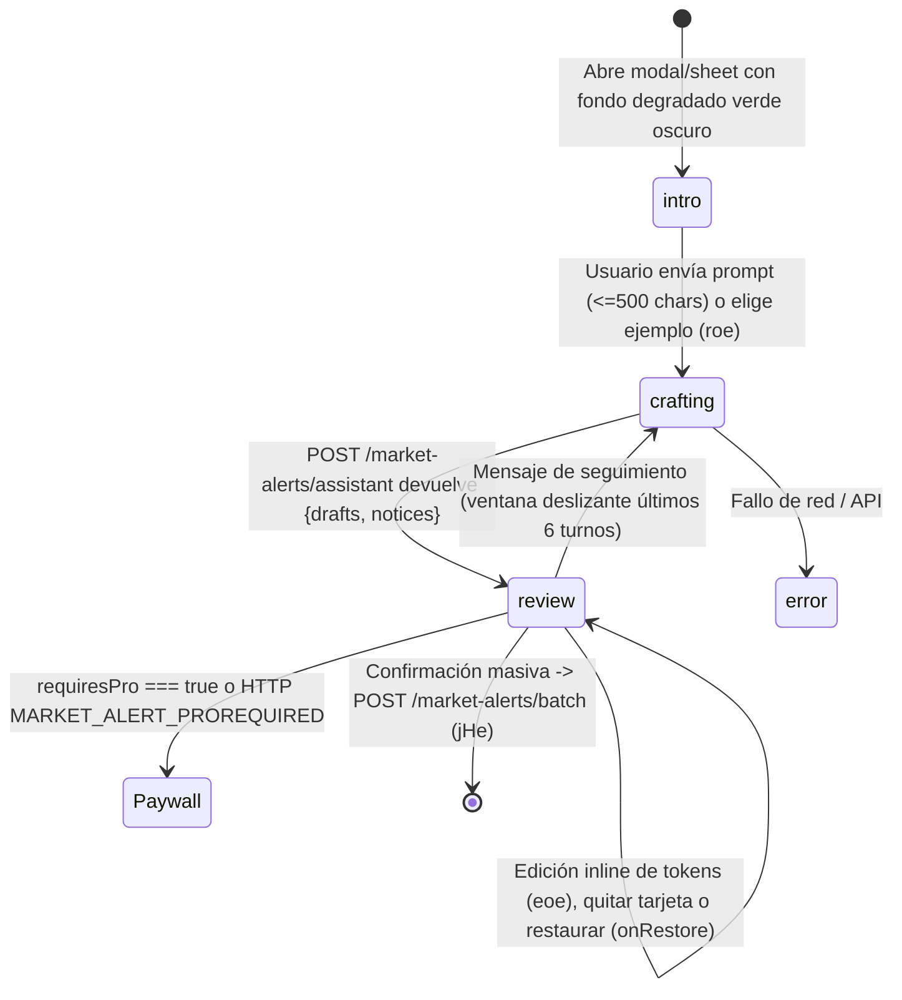

# 02. Sistema de Diseño, UX, Features y Flujos en Vivo — Scout Picks (`scoutpicks.app`)

> **Alcance forense**: Auditoría integral de experiencia de usuario (UX), sistema de diseño en **Tailwind CSS v4**, arquitectura de navegación adaptativa (Desktop `1440×900` vs. Mobile Retina `390×844 @ 2x`) y deconstrucción funcional pantalla por pantalla de **Scout Picks**, cruzando las **35 capturas reales en vivo** con la lógica exacta de componentes extraída del bundle de producción (`index-BZ3_gLK3.js` / `index--7dqLkuo.js`).
>
> **Clasificación epistemológica**: `[OBSERVADO]` (evidencia visual en capturas PNG, DOM/AXTree y tráfico HTTP/HAR), `[DERIVADO]` (lógica de negocio, estados, fórmulas de UI y flujos condicionales verificados en el código compilado), `[INFERIDO]` (criterios de diseño y segmentación comercial deducidos de la implementación), `[DESCONOCIDO]` (lógica interna de modelos en backend no expuesta al cliente).
>
> **Higiene forense**: Cero PII y cero credenciales; cualquier atributo personal de la sesión autenticada ha sido omitido o redactado (`[REDACTED]`).

---

## 1. Sistema de Diseño Visual y Fundamentos UI (`Tailwind CSS v4`)

### 1.1 Tipografía Multi-Rol (`Inter`, `Bebas Neue`, `Scout Roboto`, `Rubik`)

`[OBSERVADO]` (`ev_eb381a1446763d94752838fd77caee295d4b64c43f3b7536a70f7c2183578a69`, `ev_8d1fa2225983ff98a4c350ad528895985cc9cdd8f4efab6f7eceda9da4dc30cd` — hojas de estilo `index-DPypM8__.css` de `187,826` B y `Logo.DfIZ1AHK.css` de `50,785` B) Scout Picks separa deliberadamente las familias tipográficas según la función cognitiva del texto:

| Token CSS | Familia Declarada (`@font-face`) | Superficie | Uso Semántico Exacto |
| :--- | :--- | :--- | :--- |
| `--font-sans` (SPA) / `--font-brand` (Astro) | `"Inter"`, `"Inter Variable"` (`wght 100..900`, 7 subconjuntos Unicode incluyendo cirílico, griego y vietnamita) | SPA `/dashboard/` y marca en Astro | Tipografía primaria de interfaz, navegación, encabezados de paneles, etiquetas de filtros y logomarca (`Scout Picks` con `tracking-[-1px]`). |
| `--font-display` | `"Bebas Neue"`, `Impact`, `"Arial Narrow"` (`400`, precargada con `<link rel="preload">` en Astro) | Astro Landing & `404` | Titulares condensados de alto impacto deportivo y numerales gigantes (ej. código `404` en `text-7xl lg:text-9xl` en color `#c5ff00`). |
| `--font-data` (SPA) / `--font-sans` (Astro) | `"Scout Roboto"` / `"Roboto Variable"` (`wght 100..900`) + `tabular-nums` | SPA (tablas/métricas) y cuerpo Astro | Renderizado denso de cuotas (`1.37`, `+150`), porcentajes de acierto, unidades netas (`0.00u`) y marcadores sin desplazamiento horizontal al actualizarse en vivo. |
| `--font-badge` | `"Rubik"` (`500`) | Astro Landing | Insignias y micro-etiquetas promocionales del sitio de marketing. |
| `Paywall Roboto` | `"Paywall Roboto"`, `"Inter Variable"` |Ruta `/paywall` | Tipografía específica aislada para la vista de conversión y precios de Scout Picks Pro. |

### 1.2 Paleta Dark (`#0e0f12`) y Tokens Semánticos de Color

`[OBSERVADO]` (`ev_8d1fa2225983ff98a4c350ad528895985cc9cdd8f4efab6f7eceda9da4dc30cd`) La aplicación opera exclusivamente en **modo oscuro de alto contraste** (`theme-color: #0e0f12`), diseñado para hacer resaltar las señales cromáticas de valor esperado (`EV+`), cuotas seleccionadas y semáforos de rendimiento:

| Categoría | Token CSS en `@layer theme` | Valor Hex / Definición | Rol Visual en Producto |
| :--- | :--- | :--- | :--- |
| **Lienzo Base** | `--color-background` / `--color-bg-primary` | `#0e0f12` | Fondo global de página tanto en Astro como en toda la SPA `/dashboard/`. |
| **Superficies** | `--color-card` / `--color-card-inset` `--color-card-elevated` `--color-card-hover` `--color-border` | `#141519` / `#161819` / `#1a1b20` `#1a1b20` / `#1c1f21` `#23262a` `#292b31` / `#34393e` | Jerarquía de profundidad en 3 niveles (contenedor de sección → tarjeta elevada → estado hover) sin depender de sombras pesadas salvo en popovers (`shadow-floating`). |
| **Texto** | `--color-foreground` `--color-foreground-subtle` `--color-foreground-disabled` | `#ffffff` (`#fefefe` brand) `#a6a6a6` `#615e5e` (`#565656` Astro) | Contraste máximo blanco sobre carbón para nombres de jugadores/mercados y gris neutro `#a6a6a6` para metadatos secundarios. |
| **Acento Primario** | `--color-primary` | **`#c5ff00`** (Lima eléctrico) | Identidad de marca: ruta activa en sidebar, pestañas seleccionadas, botones CTA primarios (con texto `#000`), chips de picks guardados y bordes de foco (`ring-primary`). |
| ** Estados Semánticos** | `--color-success` / `bg` / `border` `--color-warning` / `bg` `--color-danger` / `bg` / `border` `--color-accent` / `bg` `--color-info` | `#0dbd65` / `#0dbd651a` / `#0dbd6580` `#f7c948` / `#f7c9481a` `#ff6c6c` / `#ff6c6c1a` / `#ff6c6c80` `#ff9500` / `#ff95001f` `#4ba2ff` | • `success`: barras que superan la línea, picks ganados, días rentables (`netUnits > 0`). • `warning`: línea de apuesta punteada, picks `push` o pendientes pre-partido. • `danger`: minutos en vivo (`67'`), fallos de línea, picks perdidos, días negativos. • `accent`: contador social de veces guardado (`2 🔥`, `59 🔥`). • `info`: curva superpuesta de minutos jugados (`0'–90'`). |
| **Escala Hit-Rate** | `--color-hit-rate-great` `--color-hit-rate-good` `--color-hit-rate-fair` `--color-hit-rate-weak` `--color-hit-rate-poor` | `#4ade80` `#0dbd65` `#f7c948` `#f2994a` `#ff6c6c` | Gradiente semántico de 5 niveles dedicado exclusivamente a colorear porcentajes de evidencia histórica (`100%`, `80%`, `65%`, `56%`, `35%`). |
| **Cancha Táctica** | `--pitch-line` / `--pitch-line-strong` `--pitch-accent-soft` | `color-mix(in srgb, #e3ffbb 52%/68%, transparent)` `color-mix(in srgb, #c5ff00 11%, transparent)` | Trazado vectorial de líneas de cal y áreas sobre el césped oscuro en la vista de alineaciones. |

### 1.3 Consultas de Contenedor (`@container`), Micro-Animaciones y Skeletons

`[OBSERVADO]` (`index-DPypM8__.css`) y `[DERIVADO]` (`ev_abdb3cf1dbd8a7aab2a952ca236449585bd2de775d8200297a3b94e836220fb3`):
- **Diseño intrínseco con CSS Container Queries**: La hoja de estilos compila **16 reglas `@container`**, incluyendo dos contenedores con nombre (`@container/lineups` con saltos en `44rem` y `60rem`, y `@container/pitch`) además de umbrales granulares (`96px`, `440px`, `480px`, `640px`, `24rem`, `46rem`, `65rem`, `85rem`, `105rem`). Esto permite que una misma tarjeta de partido o alineación se adapte fluidamente tanto cuando ocupa el ancho completo como cuando vive dentro del panel derecho del split-view `/matches`.
- **Catálogo de `@keyframes` funcionales**: Además de `spin`, `ping` y `pulse`, define transiciones específicas de dominio: `market-alert-step-enter`/`exit` (stepper de alertas), `market-alert-chat-enter`/`exit`/`dot` (asistente conversacional IA), `performance-drawer-enter`/`exit` (cajón lateral del calendario), `onboarding-media-enter`/`rtl` y `progress` (`4500ms linear` para stories/carruseles). Todas respetan `motion-reduce:transition-none`.
- **Arquitectura de Skeletons (`X`, `rn`, `xU`, `HO`, `KO`, `M5`)**: En lugar de bloquear pantallas completas con spinners (reservado solo al arranque de autenticación `ddt`), cada módulo posee esqueletos geométricos exactos: `rn` ofrece variantes dedicadas (`variant="timeline"`, `variant="lineups"`), `xU` replica grupos de partidos o mercados en Scout, `HO` imita filas de partidos y el calendario mensual renderiza píldoras pulsantes dentro de cada celda de día mientras resuelve `/picks/performance` (visible en vivo en [14-match-54091-tab-odds.png](file:///C:/Users/T490s/.gemini/antigravity/worktrees/PitchLab/analyze_pitchlab_competitor_rea/Reportes/scoutpicks/evidence/screenshots/14-match-54091-tab-odds.png)).

---

## 2. Arquitectura de Navegación: Desktop vs. Mobile

`[OBSERVADO]` ([04-dashboard-home-desktop.png](file:///C:/Users/T490s/.gemini/antigravity/worktrees/PitchLab/analyze_pitchlab_competitor_rea/Reportes/scoutpicks/evidence/screenshots/04-dashboard-home-desktop.png), [24-mobile-home.png](file:///C:/Users/T490s/.gemini/antigravity/worktrees/PitchLab/analyze_pitchlab_competitor_rea/Reportes/scoutpicks/evidence/screenshots/24-mobile-home.png), [26-mobile-match-detail.png](file:///C:/Users/T490s/.gemini/antigravity/worktrees/PitchLab/analyze_pitchlab_competitor_rea/Reportes/scoutpicks/evidence/screenshots/26-mobile-match-detail.png)) y `[DERIVADO]` (`iXe` / `eXe` en offsets `2,866,000..2,875,000`):

### 2.1 Desktop (`≥ 768px`): Sidebar Colapsable con Preview Inteligente y Badges Dinámicos

1. **Geometría y persistencia (`eXe` + `sXe`)**: Barra lateral izquierda `sticky top-0 h-dvh` con ancho expandido `w-57.5` (`230px`) y modo compacto de solo iconos `w-17` (`68px`), persistido en `localStorage["webapp.sidebarCollapsed"]`.
2. **Preview temporal en *hover* y *teclado* sin expandir permanentemente**: Cuando la barra está colapsada (`e === true`), pasar el puntero (`onMouseEnter` → `g("hover")`) o enfocar un enlace mediante tabulación de teclado (`onKeyDownCapture` + `onFocusCapture` → `g("focus")`, distinguiendo clics de ratón con la ref `m.current`) superpone temporalmente el `<aside>` expandido a `230px` con sombra flotante (`shadow-floating`) y registra `z.trackSidebarPreviewed("hover" | "focus")`.
3. **Estructura de navegación y badges en tiempo real**:
   - **Bloque primario (`nb`)**: `Panel` (`/`), `Scout` (`/explore`), `Partidos` (`/matches`), `Rendimiento` (`/performance`) y `Perfil` (`/profile`). El ítem activo recibe fondo sólido lima `bg-primary` (`#c5ff00`) con texto oscuro `text-grayscale-800`.
   - **Bloque secundario (`kA` / `l`)**: Separado por divisor horizontal; contiene `Mis picks` (`/picks`) y, si el catálogo de alertas está habilitado para la cuenta (`Rv() === true`), inserta dinámicamente **`Alertas de mercado` (`/market-alerts`) con un badge numérico (`o`)** que contabiliza en vivo cuántas alertas activas se encuentran en estado **`opened`** (`O5(data).find(v => v.key === "opened").data.length`).
   - **Pie de sidebar**: Insignia `Beta` + etiqueta `v0.1.0` (`webNav.version`) y acción `Cerrar sesión` (`hover:text-danger`).
4. **Topbar Desktop contextual (`Ele`)**: Muestra el buscador global `gle` a la izquierda y, a la derecha, el botón degradado `Obtener Scout Pro` (`aXe`, oculto automáticamente si el usuario ya tiene suscripción Pro activa `tl(r)`), la campana de notificaciones (`_le`), el botón de personalización de widgets (`wle`, **renderizado únicamente cuando `pathname === "/"`**) y el avatar circular con iniciales calculadas por `tXe(name, email)`. En `/matches`, `Ele` se suprime (`!r && <Ele />`) para ceder toda la altura vertical al split-view de partidos.

### 2.2 Mobile (`< 768px`): Tab Bar Flotante + Botón Rotatorio `mobile-tools`

1. **Topbar móvil (`mobile-topbar`, `68px`)**: Grilla `grid-cols-[1fr_auto_1fr]` con controles contextuales a la izquierda (`wle` en Home + campana `_le`), isotipo `Scout Picks` centrado y acciones de `Buscar` (`gle` móvil) + `Perfil` a la derecha.
2. **Supresión automática en vistas de detalle profundo (`n`)**: Cuando la ruta coincide con `/^\/(matches|players|teams)\/[^/]+$/` (ej. [26-mobile-match-detail.png](file:///C:/Users/T490s/.gemini/antigravity/worktrees/PitchLab/analyze_pitchlab_competitor_rea/Reportes/scoutpicks/evidence/screenshots/26-mobile-match-detail.png)), **tanto la topbar superior como la navegación inferior se ocultan por completo** para maximizar el área útil de gráficos y tablas deportivas, dejando únicamente un botón circular de retroceso `←` integrado en la cabecera del detalle.
3. **Barra inferior + FAB rotatorio `mobile-tools`**: En las pantallas principales ([24-mobile-home.png](file:///C:/Users/T490s/.gemini/antigravity/worktrees/PitchLab/analyze_pitchlab_competitor_rea/Reportes/scoutpicks/evidence/screenshots/24-mobile-home.png), [25-mobile-explore.png](file:///C:/Users/T490s/.gemini/antigravity/worktrees/PitchLab/analyze_pitchlab_competitor_rea/Reportes/scoutpicks/evidence/screenshots/25-mobile-explore.png)), el borde inferior (`bottom: max(8px, env(safe-area-inset-bottom))`) combina dos superficies redondeadas:
   - Una **píldora principal (`mobile-nav-surface`)** con 4 pestañas fijas (`ZQe`): `Inicio`, `Scout`, `Partidos` y `Rendimiento`.
   - Un **botón de acción flotante circular de `50×50 px`** a la derecha (`aria-controls="mobile-tools"`). Al pulsarlo (`trackMobileToolsToggled`), su icono `+` (`Wg`) gira **`45°` (`rotate-45`)** convirtiéndose en una `×`, mientras emerge verticalmente (`bottom-[58px]`, `scale(0.95) → scale(1)`) una cápsula vertical con accesos directos a **`Filtros`** (`/explore?filters=true`), **`Mis picks`** (`/picks`) y, si `Rv()` está activo, **`Alertas de mercado`** (`/market-alerts`). Se cierra automáticamente al tocar fuera (`pointerdown`) o pulsar `Escape`.

---

## 3. Desglose Funcional Pantalla por Pantalla

### 3.1 Home Hub (`/dashboard/`)

- **Evidencia visual**: [04-dashboard-home-desktop.png](file:///C:/Users/T490s/.gemini/antigravity/worktrees/PitchLab/analyze_pitchlab_competitor_rea/Reportes/scoutpicks/evidence/screenshots/04-dashboard-home-desktop.png) y [24-mobile-home.png](file:///C:/Users/T490s/.gemini/antigravity/worktrees/PitchLab/analyze_pitchlab_competitor_rea/Reportes/scoutpicks/evidence/screenshots/24-mobile-home.png) (`[OBSERVADO]`, `ev_eb381a1446763d94752838fd77caee295d4b64c43f3b7536a70f7c2183578a69`).
- **Motor de personalización de layout (`_et`, `WQe`, `HQe`)** `[DERIVADO]`:
  - Cuando el flag `home_customization_enabled` está activo (`xle()`), lee y persiste `homeWidgetOrder` y `homeHiddenWidgets` mediante `GET / PATCH /users/settings`.
  - El modal de personalización (`WQe`, invocado desde el botón de cuadrícula en la cabecera) permite **mostrar/ocultar secciones** y **reordenarlas mediante drag-and-drop nativo con `Pointer Events` (`setPointerCapture`, altura de fila `Iy = 72px`)** o con teclado accesible (`ArrowUp` / `ArrowDown` con restauración de foco en `useLayoutEffect`).
  - Además de los 5 widgets nativos (`featured-picks`, `market-alerts`, `my-picks`, `performance`, `big-matches`), inyecta dinámicamente entradas **`saved-view:<id>`** por cada vista personalizada de Scout marcada con `showOnHome: true` (`t$()`).
- **Anatomía de los widgets observados en vivo**:
  1. **Picks destacados (`DJe`)**: Carrusel horizontal (`Embla`) de tarjetas de oportunidad estadística. Cada tarjeta muestra avatar/bandera/posición del jugador (ej. *Harry Wilson · Extremo derecho*, *António Silva · Defensa central*), insignia naranja de tracción social (`2 🔥`, `9 🔥`), selector desplegable de casa de apuestas con la mejor cuota (resaltado en lima `#c5ff00` cuando el pick ya está guardado por el usuario, como `1.37` en Harry Wilson), **ventaja estimada `27% EV+ ⓘ` / `29% EV+ ⓘ`**, mercado (`Más de 0.5 faltas cometidas`), evidencia resumida (`10/10 con WAL de local` `100%`), acordeón `Expandir estadísticas` y botón de compartir.
  2. **Fila personal dual (`home-personal`, `xl:grid-cols-2`, alto fijo `360px` en Desktop)**:
     - **Mis picks (`ret`)**: Segmented control `En vivo 0` / `Próximos 1` agrupado por encuentro (`WAL - POR · Hoy 13:45`), mostrando el estado en tiempo real de cada selección guardada. *(En móvil este bloque se omite del modal de personalización `o || (C["my-picks"] = ...)` para priorizar acceso desde el botón `+`)*.
     - **Rendimiento de la última semana (`fet`)**: Tres tarjetas resumen (`Picks` con desglose ganados/perdidos, `Unidades netas` en formato `0.00u` y `ROI` en `%`) sobre un gráfico diario de 7 columnas (`M 11` .. `M 17`) que resalta el día actual.
  3. **Alertas de Mercado (`TJe`)**: Carrusel contextual de aperturas de mercado vigiladas (renderizado únicamente si `Rv() === true`).
  4. **Los grandes partidos de hoy (`MJe`)**: Carrusel de hasta 6 encuentros relevantes para la región del navegador (`nD()` → ej. `region=419` Latinoamérica en HAR), con minuto en vivo en rojo (`Qatar 0 - 1 Korea Republic · 67'`), barras horizontales de forma reciente de 5 partidos por club y botones directos de cuotas `1 / X / 2` con selector de casa de apuestas.

---

### 3.2 Explorar / Scout (`/explore` y `/explore?filters=true`)

- **Evidencia visual**: [05-dashboard-explore-desktop.png](file:///C:/Users/T490s/.gemini/antigravity/worktrees/PitchLab/analyze_pitchlab_competitor_rea/Reportes/scoutpicks/evidence/screenshots/05-dashboard-explore-desktop.png), [06-dashboard-explore-filters-desktop.png](file:///C:/Users/T490s/.gemini/antigravity/worktrees/PitchLab/analyze_pitchlab_competitor_rea/Reportes/scoutpicks/evidence/screenshots/06-dashboard-explore-filters-desktop.png) y [25-mobile-explore.png](file:///C:/Users/T490s/.gemini/antigravity/worktrees/PitchLab/analyze_pitchlab_competitor_rea/Reportes/scoutpicks/evidence/screenshots/25-mobile-explore.png) (`[OBSERVADO]`).
- **Vistas Guardadas (`insight-views`) y Modos de Exploración (`ZYe`)** `[DERIVADO]`:
  - Barra superior `Filtros guardados` respaldada por CRUD completo contra `/insight-views` (`GET`, `POST`, `PATCH /:id`, `DELETE /:id`), incluyendo opción `showOnHome` para fijar el filtro como carrusel propio en el Home Hub.
  - Si la cuenta es gratuita (`SN("explore").locked === true`), bloquea la personalización avanzada (`My = { saved_filter: "all", group: "none", sort: "recommended" }`) y dispara el paywall contextual al intentar filtrar.
  - En cuentas Pro, permite conmutar entre modo **`upcoming`** y **`live`** (activando *polling* cada `30 s`), agrupar por **`Partidos`**, **`Mercados`** o **`Lista plana`**, y ordenar por **`Recomendados`**, **`Mayor EV+` (`highestEV`)**, **`Más guardados` (`mostSaved`)** o **`Partido más próximo` (`closestMatch`)**.
  - En Desktop renderiza tablas acordeón por partido con 4 columnas densas (`Pick`, `Apuesta`, `Evidencia` multi-viñeta coloreada por tramo de acierto y `Cuotas` con `EV+`); en Mobile transforma cada grupo de partido en un carrusel horizontal de tarjetas táctiles.
- **Constructor Avanzado de Filtros (`OYe` / `FYe`)** `[OBSERVADO]` + `[DERIVADO]`:
  - **Dimensiones categóricas**:
    - `propType` (*Tipo de pick*): `player`, `team`, `match` (al cambiar a `team`, limpia automáticamente `playerPositions` mediante `Joe`).
    - `direction` (*Dirección*): `over` (*Más de*), `under` (*Menos de*).
    - `period` (*Periodo*): `full_match`, y cuando `periodInsightsEnabled` está activo en `/insights/filter-options`, habilita `first_half`, `second_half` y `both_halves`.
    - `metrics` (*Mercados*), `leagueIds` (*Competiciones*), `teamIds` (*Equipos*), `countryIds` (*Países*) y `matchIds` (*Partidos*, oculto automáticamente cuando `timing === "live"`): selectores multi-opción con buscador integrado (`searchable: true`).
    - `playerPositions` (*Posiciones*): Soporta los 4 macro-grupos **`GK`**, **`DEF`**, **`MID`**, **`FWD`** y 12 posiciones específicas (`CB`, `RB`, `LB`, `DM`, `CM`, `AM`, `RM`, `LM`, `RW`, `LW`, `CF`, `SS`), relacionados internamente por el mapa `rhe = { GK: ["GK"], DEF: ["CB","RB","LB"], MID: ["DM","CM","AM","RM","LM"], FWD: ["RW","LW","CF","SS"] }`. En la pantalla simplificada móvil se filtran las macro-etiquetas o subposiciones según contexto (`GP.filter(I => !fP.includes(I))`).
  - **Slider no lineal de cuotas (`1.00 – 20.00+`, arreglo `mP` en offset `2,717,483`)**: En lugar de un slider lineal (donde el rango más usado `1.20–2.50` quedaría comprimido en el primer `7%` del recorrido), `mP` discretiza **81 pasos (`Nd = { min: 0, max: 80, step: 1 }`)** en **4 tramos de resolución variable**:
    1. **`1.00` a `3.00`** con paso **`0.05`** (`41` posiciones → ocupa el **`50%`** físico de la barra).
    2. **`3.00` a `5.00`** con paso **`0.10`** (`20` posiciones → **`25%`** de la barra).
    3. **`5.00` a `10.00`** con paso **`0.50`** (`10` posiciones → **`12.5%`** de la barra).
    4. **`10.00` a `20.00`** con paso **`1.00`** (`10` posiciones → **`12.5%`** derecho; en el extremo `80` formatea `20.00+` y envía `maxOddsValue: undefined` sin tope superior).
  - **Slider de Tasa de Acierto (`0% – 100%`, `n0`)**: Rango doble de `0` a `100` con paso discreto de **`5%`**.
  - **Fechas rápidas (`ele`) + Calendario de rango (`RYe` / `cle`)**: Genera dinámicamente 4 presets relativos al día local (`today`, `tomorrow`, `weekend` calculando sábado/domingo próximos, y `next7Days` de `hoy` a `hoy + 6`), además de selección manual `dateFrom`–`dateTo`.

---

### 3.3 Partidos (`/matches`) y las 9 Pestañas del Match Center (`/matches/$matchId`)

- **Evidencia visual**:
  - Split-view de jornada: [07-dashboard-matches-desktop.png](file:///C:/Users/T490s/.gemini/antigravity/worktrees/PitchLab/analyze_pitchlab_competitor_rea/Reportes/scoutpicks/evidence/screenshots/07-dashboard-matches-desktop.png).
  - Las 9 pestañas sobre partido pre-partido (`54091`, *Wales vs Portugal*) y partido en vivo (`37222996`, *Qatar vs Korea Republic*): [14-match-54091-tab-picks.png](file:///C:/Users/T490s/.gemini/antigravity/worktrees/PitchLab/analyze_pitchlab_competitor_rea/Reportes/scoutpicks/evidence/screenshots/14-match-54091-tab-picks.png), [14-match-54091-tab-odds.png](file:///C:/Users/T490s/.gemini/antigravity/worktrees/PitchLab/analyze_pitchlab_competitor_rea/Reportes/scoutpicks/evidence/screenshots/14-match-54091-tab-odds.png), [14-match-54091-tab-bet.png](file:///C:/Users/T490s/.gemini/antigravity/worktrees/PitchLab/analyze_pitchlab_competitor_rea/Reportes/scoutpicks/evidence/screenshots/14-match-54091-tab-bet.png), [14-match-54091-tab-statistics.png](file:///C:/Users/T490s/.gemini/antigravity/worktrees/PitchLab/analyze_pitchlab_competitor_rea/Reportes/scoutpicks/evidence/screenshots/14-match-54091-tab-statistics.png), [14-match-54091-tab-timeline.png](file:///C:/Users/T490s/.gemini/antigravity/worktrees/PitchLab/analyze_pitchlab_competitor_rea/Reportes/scoutpicks/evidence/screenshots/14-match-54091-tab-timeline.png), [14-match-54091-tab-headToHead.png](file:///C:/Users/T490s/.gemini/antigravity/worktrees/PitchLab/analyze_pitchlab_competitor_rea/Reportes/scoutpicks/evidence/screenshots/14-match-54091-tab-headToHead.png), [14-match-54091-tab-lineups.png](file:///C:/Users/T490s/.gemini/antigravity/worktrees/PitchLab/analyze_pitchlab_competitor_rea/Reportes/scoutpicks/evidence/screenshots/14-match-54091-tab-lineups.png), [14-match-54091-tab-standings.png](file:///C:/Users/T490s/.gemini/antigravity/worktrees/PitchLab/analyze_pitchlab_competitor_rea/Reportes/scoutpicks/evidence/screenshots/14-match-54091-tab-standings.png), [14-match-54091-tab-injuries.png](file:///C:/Users/T490s/.gemini/antigravity/worktrees/PitchLab/analyze_pitchlab_competitor_rea/Reportes/scoutpicks/evidence/screenshots/14-match-54091-tab-injuries.png), [15-match-37222996-overview.png](file:///C:/Users/T490s/.gemini/antigravity/worktrees/PitchLab/analyze_pitchlab_competitor_rea/Reportes/scoutpicks/evidence/screenshots/15-match-37222996-overview.png) y versión móvil [26-mobile-match-detail.png](file:///C:/Users/T490s/.gemini/antigravity/worktrees/PitchLab/analyze_pitchlab_competitor_rea/Reportes/scoutpicks/evidence/screenshots/26-mobile-match-detail.png).

#### A. Explorador Diario por Región (`/matches`)
`[OBSERVADO]` + `[DERIVADO]` En Desktop ([07-dashboard-matches-desktop.png](file:///C:/Users/T490s/.gemini/antigravity/worktrees/PitchLab/analyze_pitchlab_competitor_rea/Reportes/scoutpicks/evidence/screenshots/07-dashboard-matches-desktop.png)) presenta una arquitectura **maestro-detalle de dos paneles**:
- **Columna izquierda**: Buscador rápido de `Ligas`, toggle `En vivo <N>` (`En vivo 3`), navegador de fechas `< Hoy >`, botón `Filtros` (estado/países/ligas), acordeón superior **`Recomendados para ti` (`54`)** ordenado por relevancia regional (`region=419`) y bloques colapsables por país/competición con paginación bajo demanda (`os.getDayGrouped`). Si el día consultado no tiene partidos programados y no está en modo `live` ni `finished`, la máquina de estados `vet()` sondea automáticamente el siguiente día disponible (`next_day`) y salta a esa fecha (`matches_league_autojumped`).
- **Columna derecha**: Incrusta directamente el **Match Center** completo del partido activo (`?match=<id>`) sin cambiar de página.

#### B. Regla de Visibilidad Dinámica de las 9 Pestañas (`QUe` / `Oie`)
`[DERIVADO]` (offset `2,305,898`) El catálogo canónico `QUe` consta de **9 pestañas**, pero `Oie({ live, finished, hasStandings })` filtra cuáles se muestran y `Rie(live, finished)` elige la pestaña inicial por defecto según el ciclo de vida del partido:
- **Pre-partido (`live: false, finished: false`)**: Muestra `picks` *(default)*, `odds`, `bet`, `headToHead`, `lineups`, `standings` (si aplica) e `injuries`. Oculta `statistics` y `timeline` (por eso al solicitar `?tab=statistics` o `?tab=timeline` en el partido futuro `54091`, `XUe` redirige limpiamente a `picks`).
- **En Vivo (`live: true, finished: false`)**: Habilita **las 9 pestañas simultáneamente** y cambia el foco inicial a **`statistics`** (observado en vivo en [15-match-37222996-overview.png](file:///C:/Users/T490s/.gemini/antigravity/worktrees/PitchLab/analyze_pitchlab_competitor_rea/Reportes/scoutpicks/evidence/screenshots/15-match-37222996-overview.png), partido *Qatar 0–1 Korea Republic* al `69'`, donde aparecen `Picks | Cuotas | Apuesta | Estadísticas | Cronología | Enfrentamientos | Alineaciones | Lesiones`, omitiendo `Clasificación` porque es un *Friendly International* sin tabla).
- **Finalizado (`finished: true`)**: Suprime `picks`, `odds` y `bet`, conservando `statistics` *(default)*, `timeline`, `headToHead`, `lineups`, `standings` e `injuries`.

#### C. Detalle de las 9 Pestañas del Match Center
1. **`picks` (*Picks*)**: Tabla filtrable de insights del encuentro (`Agrupar: Mercados`, `Recomendados`, `Cuotas`, `Tasa de acierto`, `Métrica`, `Posición`, `Titular probable`), destacando tanto mercados de resultado/totales como props de jugadores con `% EV+` y guardado en 1 clic.
2. **`odds` (*Cuotas*)**: Comparador multi-casa dividido en 4 sub-pestañas (`AJ = ["gamelines", "players", "teams", "game"]` → `Líneas | Jugadores | Equipos | Partido`), filtro por `Periodo` (`full_match`, `first_half`, `second_half`), buscador instantáneo `Buscar mercados...` y soporte para resaltar cuotas abiertas desde una alerta (`alertOddsId`).
3. **`bet` (*Apuesta*)**: Laboratorio interactivo de backtesting por equipo ([14-match-54091-tab-bet.png](file:///C:/Users/T490s/.gemini/antigravity/worktrees/PitchLab/analyze_pitchlab_competitor_rea/Reportes/scoutpicks/evidence/screenshots/14-match-54091-tab-bet.png)). Permite alternar equipo (`Wales` / `Portugal`), `Rival`, `Perspectiva` (`A favor`, `En contra`, `Diferencia`, `Total`), `Fase`, `Competición` y `Muestra` (`Últimos 5/10/20`, `Temporada`, `H2H`). Grafica barras verdes/rojas contra la línea punteada amarilla (`1.5`), reportando `Acierto 20% · Promedio 1.4 · Mediana 1`, seguido del widget **`Arma tu pick`** que llama `POST /simulations/calculate`.
4. **`statistics` (*Estadísticas*)**: Comparativa bilateral en vivo (`WGe` calcula proporciones home/away) estructurada por `GGe` en 5 bloques (`Tiros` incluyendo `xG`, `Ataque`, `Pases`, `Duelos`, `Defensa`), resaltando en verde lima al equipo líder de cada métrica ([15-match-37222996-overview.png](file:///C:/Users/T490s/.gemini/antigravity/worktrees/PitchLab/analyze_pitchlab_competitor_rea/Reportes/scoutpicks/evidence/screenshots/15-match-37222996-overview.png)).
5. **`timeline` (*Cronología*)**: Feed cronológico inverso/por mitades (`GET /matches/:id/events`, *polling* cada `10 s` en vivo) con goles, asistentes, tarjetas amarillas/rojas, sustituciones y revisiones VAR; también alimenta el resumen compacto de goleadores y expulsados bajo el marcador de cabecera (`FUe`).
6. **`headToHead` (*Enfrentamientos*)**: Combina dos módulos de alto valor analítico ([14-match-54091-tab-headToHead.png](file:///C:/Users/T490s/.gemini/antigravity/worktrees/PitchLab/analyze_pitchlab_competitor_rea/Reportes/scoutpicks/evidence/screenshots/14-match-54091-tab-headToHead.png)):
   - **Clasificación de equipos (`GET /matches/:id/matchup/rankings`)**: Tabla bilateral con conmutadores `Ataque | Defensa` independientes por selección, comparando `Promedio` y `Posición` ordinal en el torneo (`Goles`, `Tiros`, `Tiros a puerta`, `Córners`, `Posesión %`, `Faltas`, `Tarjetas amarillas`, `Fueras de juego`) coloreados en verde (top tier) o rojo (bottom tier).
   - **Historial directo (`GET /matches/:id/matchup`)**: Balance histórico de victorias/empates, promedio de goles/córners, `% BTTS` y lista de cruces previos.
7. **`lineups` (*Alineaciones*)**: Antes del anuncio oficial muestra un estado limpio (`"Las alineaciones aún no se han anunciado."`, [14-match-54091-tab-lineups.png](file:///C:/Users/T490s/.gemini/antigravity/worktrees/PitchLab/analyze_pitchlab_competitor_rea/Reportes/scoutpicks/evidence/screenshots/14-match-54091-tab-lineups.png)); una vez confirmadas o en vivo, renderiza el campo táctico responsivo (`@container/lineups`), ratings coloreados por nivel (`UWe`: `>=7.5` strong, `>=6.5` good, `>=5.5` average, `<5.5` poor), suplentes y drawer de estadísticas individuales del partido (`Np.playerStats` cada `10 s`).
8. **`standings` (*Clasificación*)**: Tabla oficial del torneo o grupos (`Group 1`, `Group 2`, etc., [14-match-54091-tab-standings.png](file:///C:/Users/T490s/.gemini/antigravity/worktrees/PitchLab/analyze_pitchlab_competitor_rea/Reportes/scoutpicks/evidence/screenshots/14-match-54091-tab-standings.png)) con zonas de ascenso/play-off/descenso y filtro `all / home / away` cuando la competición es de liga regular.
9. **`injuries` (*Lesiones*)**: Lista de bajas y sanciones por plantel ([14-match-54091-tab-injuries.png](file:///C:/Users/T490s/.gemini/antigravity/worktrees/PitchLab/analyze_pitchlab_competitor_rea/Reportes/scoutpicks/evidence/screenshots/14-match-54091-tab-injuries.png)), mostrando foto del jugador, posición, motivo médico (ej. *Rafael Leão · Hamstring Injury*, *Nuno Tavares · Muscle Injury*), badge rojo `Out` y rango estimado de baja (`7 nov 2026 – 5 dic 2026`).

---

### 3.4 Perfiles de Entidades: Jugador, Equipo, Liga y Árbitro

#### A. Perfil de Jugador (`/players/$playerId`)
- **Evidencia visual**: [16-player-1113-bet-analysis.png](file:///C:/Users/T490s/.gemini/antigravity/worktrees/PitchLab/analyze_pitchlab_competitor_rea/Reportes/scoutpicks/evidence/screenshots/16-player-1113-bet-analysis.png) (*António Silva*) y [09-dashboard-pick-detail-desktop.png](file:///C:/Users/T490s/.gemini/antigravity/worktrees/PitchLab/analyze_pitchlab_competitor_rea/Reportes/scoutpicks/evidence/screenshots/09-dashboard-pick-detail-desktop.png) (*Harry Wilson*).
- **Funcionalidad clave (`sYe`)** `[OBSERVADO]` + `[DERIVADO]`:
  - Cabecera compactable con `IntersectionObserver` (`DKe`), club/selección, dorsal/posición y tarjeta `Próximo partido` a la derecha.
  - **3 pestañas**: `Picks` (tabla con panel lateral derecho de filtro rápido por `Dirección` y `Métrica`), `Apuesta` (`bet`) y `Partidos` (`matches`).
  - En **`Apuesta`**, despliega una barra horizontal de **8 filtros combinables** (`+ Supl.` para incluir apariciones desde el banquillo, `Rival`, `Equipo` club/selección, `Competición`, `Muestra`, `Localía`, `Fase` y umbral de minutos `45–90'`), un toggle de **análisis defensivo del rival** (`analyzeDefense`), un **gráfico híbrido de barras (métrica vs línea) + polilínea azul superpuesta de minutos jugados (`0' / 45' / 90'`)** (con soporte para barra en vivo `livePoint` no contabilizada aún en el promedio histórico), tira comparativa de tasas **`L5 | L10 | L20 | H2H`** (ej. `100% | 100% | 80% | —`), simulador **`Arma tu pick`** y sidebar derecha **`Más picks de <Jugador>`**.

#### B. Perfil de Equipo (`/teams/$teamId`)
- **Evidencia visual**: [17-team-17181-detail.png](file:///C:/Users/T490s/.gemini/antigravity/worktrees/PitchLab/analyze_pitchlab_competitor_rea/Reportes/scoutpicks/evidence/screenshots/17-team-17181-detail.png) (*Wales*).
- **Funcionalidad clave (`FGe`)** `[OBSERVADO]` + `[DERIVADO]`:
  - **5 pestañas (`Wb`)**: `Apuesta` (`bet`), `Picks` (`picks` — grilla de 2 columnas de tarjetas con `% EV+`), `Partidos` (`matches` filtrable por competición), `Posiciones` (`standings` multi-competición consultada en paralelo con `useQueries`) y `Plantel` (`squad` ordenado por línea posicional `PVe`: portero, defensa, mediocampista, delantero, con dorsal y edad).
  - En `Apuesta`, permite modelar tanto métricas propias (`A favor`), concedidas (`En contra`), **`Diferencia (equipo − rival)`** (clave para hándicaps, pintando en amarillo los *pushes* que devuelven la apuesta) como **`Total (equipo + rival)`**.

#### C. Perfil de Liga (`/leagues/$leagueId`): Split `all/home/away` y Bracket Eliminatorio SVG (`rHe`)
- **Evidencia visual**: [18-league-116-matches.png](file:///C:/Users/T490s/.gemini/antigravity/worktrees/PitchLab/analyze_pitchlab_competitor_rea/Reportes/scoutpicks/evidence/screenshots/18-league-116-matches.png), [19-league-116-standings.png](file:///C:/Users/T490s/.gemini/antigravity/worktrees/PitchLab/analyze_pitchlab_competitor_rea/Reportes/scoutpicks/evidence/screenshots/19-league-116-standings.png), [20-league-116-knockout.png](file:///C:/Users/T490s/.gemini/antigravity/worktrees/PitchLab/analyze_pitchlab_competitor_rea/Reportes/scoutpicks/evidence/screenshots/20-league-116-knockout.png) (*UEFA Nations League*).
- **Funcionalidad clave (`sHe`)** `[OBSERVADO]` + `[DERIVADO]`:
  - Selector superior de temporada (`2026/27`) y etapa/fase (`phaseStageId`). En fases de liga/grupos en Desktop, presenta una vista simultánea de 2 columnas (`Partidos` filtrables por fecha, `Grupo`, `Jornada` y `Equipo` a la izquierda + `Posiciones` a la derecha).
  - **Conmutador `all / home / away` (`matchContext.split`, offset `2,269,107`)**: Cuando el alcance de la tabla es de liga regular (`f.scope === "table"` y las filas traen desglose local/visitante `_Ue`), habilita un grupo de botones `Total | Local | Visitante` que recalcula PJ, G, E, P, GF:GC, DG y Pts.
  - **Motor geométrico del cuadro eliminatorio SVG (`nHe` + `rHe`, offsets `2,315,286..2,319,000`)**:
    - Renderiza una grilla horizontal LTR (`gridTemplateColumns: repeat(rounds.length, minmax(7rem, 1fr))`) con tarjetas de eliminatoria (`[data-bracket-slot="home|away"]`, resaltando al clasificado `winnerTeamId` en `text-primary font-semibold`).
    - Un `ResizeObserver` mide en `useLayoutEffect` las coordenadas DOM reales de cada cruce padre e hijo y genera 3 segmentos ortogonales por conector (`horizontal → vertical en punto medio E=(C+P)/2 → horizontal`).
    - La función pura **`rHe(segments)`** agrupa segmentos colineales (`axis:fixed` con precisión de `0.001px`), fusiona intervalos solapados y sustrae geométricamente cualquier tramo de ganador (`strokeWidth: 1.5` continuo) sobre tramos de perdedor/tercer puesto (`loser: true`, `strokeDasharray: "4 3"`), emitiendo a lo sumo dos nodos `<path>` limpios con `vectorEffect="non-scaling-stroke"`.

#### D. Perfil de Árbitro (`/referees/$refereeId`)
- **Evidencia visual**: [21-referee-351-stats.png](file:///C:/Users/T490s/.gemini/antigravity/worktrees/PitchLab/analyze_pitchlab_competitor_rea/Reportes/scoutpicks/evidence/screenshots/21-referee-351-stats.png), [22-referee-351-bet.png](file:///C:/Users/T490s/.gemini/antigravity/worktrees/PitchLab/analyze_pitchlab_competitor_rea/Reportes/scoutpicks/evidence/screenshots/22-referee-351-bet.png), [23-referee-351-picks.png](file:///C:/Users/T490s/.gemini/antigravity/worktrees/PitchLab/analyze_pitchlab_competitor_rea/Reportes/scoutpicks/evidence/screenshots/23-referee-351-picks.png) (*Sven Jablonski · Germany*).
- **Funcionalidad clave (`eUe`)** `[OBSERVADO]` + `[DERIVADO]`:
  - Accesible desde el buscador global (`source=search`) o clicando el nombre del colegiado en la cabecera del Match Center (`source=match_header`).
  - Cabecera con KPIs históricos (`Partidos: 280`, `Tarjetas amarillas: 3.59`, rojas/penaltis) y banner de `Próximo partido` (*Wales – Portugal*).
  - **Layout adaptativo de 3 áreas (`stats`, `bet`, `picks`)**: En Desktop mantiene fija a la derecha la columna **`Estadísticas`** —que incluye el termómetro visual de **`Rigurosidad` (`Permisivo ↔ Estricto`, `N.º 32 de 37 · Bundesliga`)** y la tabla desglosada por competición y año (`Año 2026`: *Bundesliga*, *Champions League*, *Europa League*, *DFB Pokal*)—, mientras a la izquierda alterna entre **`Bet`** (backtesting en los últimos 20 partidos dirigidos por mercado `Tarjetas amarillas`/rojas/faltas/penaltis, línea `4.5`, dirección y liga) y **`Picks`** (tarjetas con alto `EV+` de amonestación para jugadores de su próximo encuentro, ej. *Ethan Ampadu `10.00` `70% EV+`*). En Mobile, las tres secciones se presentan como pestañas independientes (`stats | bet | picks`).

---

### 3.5 Mis Picks (`/picks`, `/picks/$pickId`) y Rendimiento (`/performance`)

- **Evidencia visual**: [08-dashboard-picks-desktop.png](file:///C:/Users/T490s/.gemini/antigravity/worktrees/PitchLab/analyze_pitchlab_competitor_rea/Reportes/scoutpicks/evidence/screenshots/08-dashboard-picks-desktop.png), [09-dashboard-pick-detail-desktop.png](file:///C:/Users/T490s/.gemini/antigravity/worktrees/PitchLab/analyze_pitchlab_competitor_rea/Reportes/scoutpicks/evidence/screenshots/09-dashboard-pick-detail-desktop.png) y [10-dashboard-performance-desktop.png](file:///C:/Users/T490s/.gemini/antigravity/worktrees/PitchLab/analyze_pitchlab_competitor_rea/Reportes/scoutpicks/evidence/screenshots/10-dashboard-performance-desktop.png).

#### A. Mis Picks y Seguimiento en Vivo (`Qtt` / `iYe`)
`[OBSERVADO]` + `[DERIVADO]` (offsets `121,759`, `2,713,036` y `3,006,095`):
1. **Organización y filtros (`Qtt`)**: Pestañas por estado de liquidación (`Abiertos`, `Ganados`, `Perdidos`, `Nulos`), buscador textual con debounce de `300 ms`, filtros por competición y tipo de apuesta, orden cronológico `Inicio ↑/↓` y panel derecho **`Tu jornada`** (`Picks abiertos`, `En vivo`, `Empiezan hoy`, `Mañana` + nota de reglas de liquidación).
2. **Barras de progreso en vivo (`VJe` / `GJe`) e insignias de estado (`KJe`)**:
   - Para mercados estándar (`over`/`under`), `VJe` renderiza una barra de progreso `current / line` (`webMyPicks.progress`) coloreada en `primary` (`#c5ff00`) cuando va cubriendo la condición (`under ? current < line : current > line`) o `danger` cuando se excede en un `under`. Si un `over` supera la línea antes del pitazo final, `KJe` cambia el icono de reloj en curso a check verde con etiqueta `savedPicks.lineReached` (avisando que el progreso en vivo es provisional hasta confirmarse el acta).
   - Para **hándicaps**, `GJe` evalúa `AL(margin, line)` y proyecta tres estados explícitos: **`covered`** (`success`), **`push`** (`subtle`, devolución de apuesta cuando empata exactamente con línea entera) y **`notCovered`** (`danger`), mostrando margen actual vs umbral requerido.
3. **Bloqueo estricto de integridad al iniciar el partido (`Ife` / `h2`)**: La función `Ife(pick)` retorna `"settled"` si `status !== "pending"`, y `"match_started"` tan pronto como `match.status !== "NS"` (o cuando el reloj local alcanza `Date.now() >= Date.parse(match.date)`). Cuando `h2(pick)` (`Ife(pick) === null`) deja de cumplirse, la UI **bloquea el cambio de cuota/bookmaker (`PUT /picks/:id/odds`) y oculta/deshabilita el borrado del pick (`DELETE /picks/:id`)**, impidiendo alterar el registro de rendimiento una vez comenzado el encuentro.
4. **Resolución de `/picks/$pickId` (`iYe`)**: Al abrir un pick guardado ([09-dashboard-pick-detail-desktop.png](file:///C:/Users/T490s/.gemini/antigravity/worktrees/PitchLab/analyze_pitchlab_competitor_rea/Reportes/scoutpicks/evidence/screenshots/09-dashboard-pick-detail-desktop.png)), si el sujeto es un jugador o un equipo con métrica soportada Over/Under, monta directamente su vista analítica profunda pre-cargada con el `insight` del pick y añade en la esquina superior derecha el botón `Gestionar pick` (que abre el modal `nR` para cambiar cuota o eliminar mientras siga pre-partido).

#### B. Rendimiento, Unidades Netas (`netUnits`) y Calendario Mensual (`BZe`)
`[OBSERVADO]` ([10-dashboard-performance-desktop.png](file:///C:/Users/T490s/.gemini/antigravity/worktrees/PitchLab/analyze_pitchlab_competitor_rea/Reportes/scoutpicks/evidence/screenshots/10-dashboard-performance-desktop.png)) y `[DERIVADO]` (offsets `2,919,000..2,958,000`):
1. **Modelo contable de unidades**: Cada pick liquidado con cuota registrada computa **apuesta plana de `1u` (`flatStake`)** (`netUnits = +(odds - 1)` si gana, `-1u` si pierde, `0u` en nulo/push); los picks guardados sin cuota computan **`0u` (`noOddsStake`)** para no distorsionar el ROI.
2. **4 KPIs superiores + Gráfico evolutivo**: Tarjetas `Beneficio neto` (`0.00u`), `ROI` (`(roi * 100).toFixed(1)%`), `Historial` (`G–P–N`) y `Total de picks`, filtrables por rango de fechas (`19 oct – 17 nov`), `Competición`, `Equipo` y `Tipo de apuesta`, junto con el gráfico `Resultados a lo largo del tiempo` agrupable por **`Día`**, **`Semana`** o **`Mes`**.
3. **Calendario mensual cromático y Drawer diario (`<dialog>`)**:
   - Cuadrícula lunes–domingo con navegación mensual y botón `Hoy`. Cada celda con actividad se colorea según `I.netUnits`: verde translúcido **`bg-success/10 hover:bg-success/20`** si `netUnits > 0`, rojo translúcido **`bg-danger/10 hover:bg-danger/20`** si `netUnits < 0`, o borde lima `border-primary ring-1 ring-primary` cuando está seleccionada (mostrando `"1 pendie..."` si todos los picks del día siguen abiertos, como el día `17` en la captura).
   - Al clicar un día o barra de periodo, se abre un **`<dialog>` nativo animado (`performance-drawer-enter` / `performance-drawer-exit`)** que pagina mediante `useInfiniteQuery` todos los picks de esa fecha filtrables por pestañas de resultado (`won`, `lost`, `void`, `pending`).

---

### 3.6 Alertas de Mercado y Asistente IA Conversacional (`/market-alerts`)

- **Evidencia visual y estado de cuenta**: En [11-dashboard-market-alerts-desktop.png](file:///C:/Users/T490s/.gemini/antigravity/worktrees/PitchLab/analyze_pitchlab_competitor_rea/Reportes/scoutpicks/evidence/screenshots/11-dashboard-market-alerts-desktop.png) (`[OBSERVADO]`), el endpoint `GET /market-alerts/catalog` devolvió `enabled: false` para la cuenta auditada, mostrando el gate de rollout gradual: *"Las alertas de mercado aún no están disponibles para tu cuenta."* Sin embargo, la totalidad del módulo está compilada en el bundle (`[DERIVADO]`, offsets `2,328,000..2,475,000`):

1. **Clasificación tri-estado de alertas activas (`Fie` / `O5`)**:
   - **`opened`** (*Abiertas*): Alertas donde al menos una casa vigilada ya disparó apertura (`target.status === "triggered"` o `"already_available"`), ordenadas por `observedAt` más reciente y acompañadas de cotizaciones frescas consultadas cada `60 s` (`market-alert-current-quotes`) con CTA directo al mercado en Match Center (`?alertFamily=...&alertOddsId=...&alertBookmakerId=...`).
   - **`ongoing`** (*En seguimiento continuo*): Alertas **recurrentes (`scope: "recurring"`)** o vinculadas a liga (`leagueId !== null`) que vigilan automáticamente cada próximo partido del jugador o equipo seleccionado (`sentenceRecurringPlayer` / `sentenceRecurringTeam`, en cualquier competición o filtradas por ligas específicas).
   - **`waiting`** (*En espera*): Alertas puntuales de un partido futuro (`scope: "match"`) cuyas casas seleccionadas aún no han publicado líneas para esa familia de mercado, ordenadas por cercanía de `kickoff`.
   - Además, cuenta con pestaña/columna de **Historial (`bHe`)** paginada para alertas `cancelled` o `expired`.
2. **Constructor guiado por pasos (`stepper`)**: Flujo secuencial (`market-alert-step-enter`/`exit`) que guía la elección de sujeto (`Players | Teams | Match`), selección de partido o recurrencia por competición, familia de mercado (`player_shots_on_target`, `match_corners`, etc.), periodo y casas de apuestas a vigilar.
3. **Asistente IA Conversacional (`SVe` / `kVe` Desktop modal `max-w-[803px]` / `wVe` Mobile sheet)** `[DERIVADO]`:

   - **Mecánica conversacional**: Acepta lenguaje natural en un `<textarea>` de hasta `500` caracteres (`WW = 500`), conservando los últimos `6` mensajes de contexto (`ae.slice(-6)`) y pasando opcionalmente `{ context: { matchId }, supportsRecurring: true }` a `POST /market-alerts/assistant`.
   - **Tarjetas de borrador con tokens interactivos (`eoe`)**: En el paso `review`, cada alerta propuesta por el modelo se renderiza como una oración natural cuyos parámetros (jugador/equipo, mercado, partido/recurrencia, casas de apuestas) son **píldoras clicables** (`border-primary bg-primary/14` si están resueltas; borde punteado `border-dashed` si falta completar un campo). El usuario puede editar cualquier token mediante pickers embebidos, descartar tarjetas individuales (con opción `addBack` para restaurarlas desde `removedCards`), enviar instrucciones de refinamiento en lenguaje natural o crear todo el lote de una sola vez mediante `POST /market-alerts/batch` (protegido con `beforeunload` blocker `zZ` mientras la mutación está en vuelo).

---

### 3.7 Onboarding V2, Buscador Global, Perfil y Paywall

#### A. Onboarding Dual (`/onboarding` → `ctt` / `qtt`)
`[DERIVADO]` (offsets `3,059,327` y `3,081,313`) El código contiene **dos flujos completos de onboarding** controlados por PostHog (`onboarding_quiz_enabled`) y parámetros de ruta:
1. **`OnboardingQuiz` (`ctt`, flujo activo por defecto cuando `Kde() === true`)**: Secuencia de 5 etapas (`welcome → style → goal → profile → how_it_works`) donde el usuario define su estilo (`intuitive`, `social`, `analytical`, `conservative`) y meta (`confidence`, `value`, `selection`, `profitability`), recibe un diagnóstico con video/poster personalizado (`context`, `value`, `highlights`, `performance`), visualiza el video explicativo `how-it-works-*.mp4` localizado (`EN/ES/PT`), persiste `POST /onboarding/complete` (`flowType: "profile_quiz"`) y aterriza directamente en `/paywall?source=web_onboarding`.
2. **`OnboardingPersonalization` (`qtt`, 8 pasos `AA`)**: Flujo extendido (`source`, `experience`, `markets`, `leagues`, `playStyle` [`singles`/`combos`/`both`], `oddsFormat` [`decimal`/`american`], `bookmakers` y solicitud de permiso de `notifications` vía Service Worker `Btt`) que persiste `flowType: "personalization"`.

#### B. Buscador Global Multi-Entidad (`gle`)
`[OBSERVADO]` (cabecera en todas las capturas Desktop/Mobile) y `[DERIVADO]` (offset `2,829,302`):
- **Estado inicial sin texto (`< 2` caracteres)**: Muestra el historial local de búsquedas recientes por usuario (`MQe`, sincronizado en vivo mediante el evento `scoutpicks:recent-searches-changed`), sugerencias personalizadas (`GET /search/suggested`) y el catálogo de competiciones (`GET /leagues`).
- **Búsqueda activa (`≥ 2` caracteres, debounce `300 ms`)**: Filtra por pestañas de entidad **`Eg = ["match", "team", "player", "league", "referee"]`** (más `"all"`). Cuando la pestaña es `"all"`, lanza simultáneamente **5 queries tipadas** (`GET /search?q=...&type=<entity>&limit=8`) y **1 query de ranking global** (`GET /search?q=...&type=all&limit=20`) para ordenar dinámicamente qué categoría de entidad es más relevante para la consulta (`IQe`), cancelando peticiones obsoletas mediante `AbortSignal`.

#### C. Perfil, Preferencias y Creator Tools (`/profile`)
`[OBSERVADO]` ([12-dashboard-profile-desktop.png](file:///C:/Users/T490s/.gemini/antigravity/worktrees/PitchLab/analyze_pitchlab_competitor_rea/Reportes/scoutpicks/evidence/screenshots/12-dashboard-profile-desktop.png), inspeccionada omitiendo cualquier PII de cuenta) y `[DERIVADO]` (`Wrt`, offsets `3,102,000..3,195,000`):
- **Suscripción multi-tienda inteligente (`Ztt` / `che`)**: Detecta dónde se originó la suscripción activa (`GET /subscriptions/me`). Si fue adquirida en **Stripe / Web**, abre el portal oficial de autogestión (`billing.stripe.com/p/login/...` o URL dinámica de sesión); si proviene de **App Store** o **Google Play**, informa explícitamente que debe gestionarse en la tienda correspondiente (`whereBought`).
- **Preferencias sincronizadas**: Selector buscable de **Idioma** (13 locales en `iM`), **Formato de cuotas** (`Decimal · 1.50 / 2.50` vs `Americano · -200 / +150`), **Casas de apuestas preferidas** (`Irt`, integrando reclamo de bonos/perks de afiliados con validación de ID de jugador `/bookmakers/offers`) y **Notificaciones** (`Ort`, controlando alertas de mercado, actualizaciones de jugadores, progreso de picks e interruptor del Service Worker local).
- **Creator Tools condicional (`/creator/pick-calendar`)**: Mediante un hook de acceso (`GET /creator/access`), las cuentas de creadores/afiliados autorizados ven desbloqueada una sección adicional en Perfil para generar recursos visuales de calendario de resultados (`creatorTools.pickCalendar`, configurando proporción de días rojos `few/some/many` y rango de cuotas).
- **Soporte y cumplimiento**: Envío de feedback in-app, enlaces a Privacidad/Términos y flujo de **eliminación permanente de cuenta** (`/auth/delete-account`).

#### D. Paywall y Checkout Embebido (`/paywall`)
- **Evidencia visual y comportamiento observado**: En [13-dashboard-paywall-desktop.png](file:///C:/Users/T490s/.gemini/antigravity/worktrees/PitchLab/analyze_pitchlab_competitor_rea/Reportes/scoutpicks/evidence/screenshots/13-dashboard-paywall-desktop.png) y [27-mobile-paywall.png](file:///C:/Users/T490s/.gemini/antigravity/worktrees/PitchLab/analyze_pitchlab_competitor_rea/Reportes/scoutpicks/evidence/screenshots/27-mobile-paywall.png) (`[OBSERVADO]`), dado que la cuenta autenticada ya poseía suscripción Pro activa (`tl(s) === true`), el guard de `uZe` ejecutó la redirección inmediata hacia `/` (`Home Hub`), evitando mostrar planes duplicados a clientes activos.
- **Arquitectura interna del Paywall (`uZe`, offset `2,893,732`)** `[DERIVADO]`:
  - Presenta un **carrusel multimedia localizado en `EN / ES / PT` (`MU`)** con 6 diapositivas en video MP4 + poster JPG (`tracking`, `leagues`, `picks`, `stats`, `performance`, `saved`), selector de planes (`weekly`, `monthly`, `annual`) obtenido desde **RevenueCat Offerings** (`web_v2_stripe` o `offering` dinámico de experimento regional como `scout_pro_all_v2:mx-2026q3-v1-weekly`), soporte de **códigos promocionales (`dZe`)** con cálculo exacto en micros (`amountMicros`) y temporizador de expiración en vivo, opción `Continuar gratis` y checkout embebido renderizado por **RevenueCat Web Billing (Svelte 5 UI) + Stripe Checkout / Apple Pay**, seguido de reconciliación inmediata contra `POST /subscriptions/me/reconcile`.

---

## 4. Hallazgos UX y Oportunidades de Diseño Accionables para PitchLab

1. **Densidad analítica accionable sin abrumar al usuario casual**: `[OBSERVADO]` Scout Picks resuelve muy bien la tensión entre simplicidad y profundidad mediante **divulgación progresiva**: tarjetas limpias con un único titular estadístico (`10/10 con WAL de local · 100%` + `27% EV+`) que se expanden bajo demanda hacia el laboratorio completo de backtesting (`L5/L10/L20/H2H` + curva de minutos + simulador `Arma tu pick`).
2. **Detalles ergonómicos sobresalientes que PitchLab debe superar o igualar**: `[DERIVADO]`
   - El **slider de cuotas por tramos no lineales (`1.00–20.00+`)** que otorga el `50%` del control táctil al rango `1.00–3.00` con precisión de `0.05`.
   - El **bloqueo automático de edición/borrado en el segundo exacto del kickoff (`Ife`)**, indispensable para la credibilidad del historial de `Rendimiento`.
   - El **Asistente IA híbrido (`texto libre → tarjetas con píldoras clicables → creación por lotes`)**, que evita los errores de los chatbots puros al aterrizar la respuesta del LLM en controles deterministas editables antes de persistir alertas.
3. **Brechas UX claras donde PitchLab puede diferenciarse**: `[OBSERVADO]` + `[DERIVADO]`
   - En Desktop, varias vistas clave (como `Market Alerts` deshabilitado con una sola línea de texto plano sin ilustración ni explicación de acceso en [11-dashboard-market-alerts-desktop.png](file:///C:/Users/T490s/.gemini/antigravity/worktrees/PitchLab/analyze_pitchlab_competitor_rea/Reportes/scoutpicks/evidence/screenshots/11-dashboard-market-alerts-desktop.png), o el popover intrusivo de notificaciones que tapa parcialmente controles superiores derechos en todas las pantallas hasta cerrarlo manualmente) presentan fricciones visuales evitables.
   - El modelo de *stake* en `/performance` está restringido a **apuesta plana fija de `1u`** (`flatStake`), careciendo de dimensionamiento configurable de unidades o criterio de Kelly fraccional pese a que la plataforma calcula y exhibe `% EV+` en cada tarjeta.
