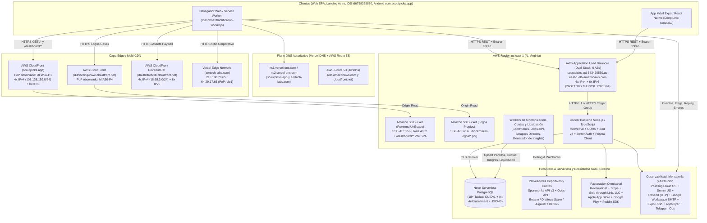

# 03. Infraestructura Cloud, DNS, Multi-CDN, Stack Backend y Esquema de Base de Datos

> **Clasificación epistemológica:** Cada afirmación técnica en este capítulo lleva etiqueta explícita `[OBSERVADO]` (dato crudo verificado en capturas de red, DNS, cabeceras HTTP, bundles o textos legales publicados), `[DERIVADO]` (conclusión determinista obtenida al cruzar artefactos observados), `[INFERIDO]` (hipótesis de alta probabilidad respaldada por huellas arquitectónicas estándar) o `[DESCONOCIDO]` (aspecto opaco desde el perímetro externo).
>
> **Política de privacidad y seguridad forense:** Cero PII y cero credenciales activas. Todos los identificadores de usuario, sesiones y claves sensibles se representan mediante marcadores redactados (`usr_redacted_...`, `sess_redacted_...`, `[REDACTED_AUTH_TOKEN]`, `user@redacted.example`).

---

## 1. Resumen Ejecutivo de Infraestructura

**Scout Picks (`https://scoutpicks.app`)**, operado por **Aertech Labs, LLC** (`EIN 35-2938733`), despliega una arquitectura cloud híbrida desacoplada sobre **Vercel**, **Amazon Web Services (`us-east-1`)** y **Neon Serverless PostgreSQL**, diseñada para optimizar simultáneamente el SEO de captación orgánica, la baja latencia global de activos estáticos y el cómputo transaccional e ingesta deportiva continua `[OBSERVADO]` `[DERIVADO]`.

| Capa Arquitectónica | Proveedor / Servicio | Dominio / Endpoint | Evidencia Primaria | Nivel |
| :--- | :--- | :--- | :--- | :--- |
| **DNS Autoritativo** | Vercel DNS (`ns1`/`ns2.vercel-dns.com`) | `scoutpicks.app`, `aertech-labs.com` | `evidence/dns-and-infra-audit.json` | `[OBSERVADO]` |
| **Landing & Legal (SSG)** | AWS CloudFront (`DFW56-P1`) + Amazon S3 (`SSE-AES256`) | `https://scoutpicks.app/{,es,pt,privacy,terms}` | `ev_74b541a57159f5b5975cfbe9c641d44f5355061d23a9f470fa1ff363bc832221` | `[OBSERVADO]` |
| **Web App SPA** | AWS CloudFront (`DFW56-P1`) + Amazon S3 (`SSE-AES256`) | `https://scoutpicks.app/dashboard/*` | `ev_036f50356d956efdf3eeea3e3b25f6651b5252264443c86dbb79c13886fdbf3a` | `[OBSERVADO]` |
| **Sitio Corporativo** | Vercel Edge Network (Next.js App Router / `v0.app`) | `https://aertech-labs.com` | `public_audit.json` (`X-Vercel-Id: cle1::...`) | `[OBSERVADO]` |
| **Ingress Backend API** | AWS Application Load Balancer (Dual-Stack, 6 AZs) | `api.scoutpicks.aertech-labs.com` -> `scoutpicks-api-343470550.us-east-1.elb.amazonaws.com` | `evidence/dns-and-infra-audit.json` | `[OBSERVADO]` |
| **Servidor de Aplicación** | Node.js + TypeScript + Helmet v8 + Zod v4 + Better Auth | `https://api.scoutpicks.aertech-labs.com/*` | `ev_03f837b1e4aec03bcac8791498a5d2cbbd06e25f39474bde43e541baa4acff52` | `[DERIVADO]` |
| **Base de Datos Primaria** | **Neon** (Serverless PostgreSQL) + **Prisma ORM** | Red privada/TLS hacia `us-east-1` | Política de Privacidad (`Neon: Database hosting`) + payloads JSON | `[OBSERVADO]` / `[DERIVADO]` |
| **CDN de Activos Propios** | AWS CloudFront (`MIA50-P4`) + Amazon S3 (`SSE-AES256`) | `https://d3tvhrcz0jw9wc.cloudfront.net/bookmaker-logos/*` | `ev_8d1fa2225983ff98a4c350ad528895985cc9cdd8f4efab6f7eceda9da4dc30cd` | `[OBSERVADO]` |
| **CDN Paywall UI** | AWS CloudFront (Route 53) de RevenueCat Billing | `https://da08ctfrofx1b.cloudfront.net/*` | `ev_d6aea026e24cc7285f592385c27b572003bb7a591dbda6be9d5c2ff8366790be` | `[OBSERVADO]` |
| **CDN Datos Deportivos** | Cloudflare CDN (Sportmonks) + FlagCDN | `https://cdn.sportmonks.com/*`, `https://flagcdn.com/*` | `ev_8d1fa2225983ff98a4c350ad528895985cc9cdd8f4efab6f7eceda9da4dc30cd` | `[OBSERVADO]` |
| **CI/CD & Versionado** | GitHub Actions (`<git-sha>-<run-id>.<attempt>`) -> S3 | `https://scoutpicks.app/dashboard/version.json` | `evidence/live-build-diff.json` | `[DERIVADO]` |
| **Observabilidad & Email** | PostHog US + Sentry US + Resend + Google Workspace + Telegram | `us.i.posthog.com`, `o4510875329757184.ingest.us.sentry.io` | `ev_d6aea026e24cc7285f592385c27b572003bb7a591dbda6be9d5c2ff8366790be` | `[OBSERVADO]` |

---

## 2. Topología Global DNS, Multi-CDN y Red Perimetral

### 2.1 Diagrama de Arquitectura Cloud y Flujo de Red



### 2.2 Auditoría Forense de Dominios y Registros DNS

La inspección directa registrada en [dns-and-infra-audit.json](file:///C:/Users/T490s/.gemini/antigravity/worktrees/PitchLab/analyze_pitchlab_competitor_rea/Reportes/scoutpicks/evidence/dns-and-infra-audit.json) y [public_audit.json](file:///C:/Users/T490s/.gemini/antigravity/brain/8e1bb7bd-e2dd-4687-97e2-e5f221d4e760/scratch/astro-landing/public_audit.json) establece la siguiente configuración por dominio `[OBSERVADO]`:

#### A. Dominio de Producto: `scoutpicks.app`
* **Delegación NS (`TTL 21600s`):** `ns1.vercel-dns.com` y `ns2.vercel-dns.com` `[OBSERVADO]`. Aunque los nombres de dominio se administran en **Vercel DNS**, el tráfico web de `scoutpicks.app` **no** pasa por servidores de Vercel, sino que apunta directamente a **Amazon CloudFront** mediante registros alias/`A`/`AAAA` de bajo TTL (`60s`) `[DERIVADO]`.
* **Direccionamiento Anycast CloudFront (`TTL 60s`):**
  * **IPv4 (`A`):** `108.138.159.55`, `108.138.159.80`, `108.138.159.86`, `108.138.159.119` `[OBSERVADO]`.
  * **IPv6 (`AAAA`):** 8 direcciones en el prefijo `2600:9000:2357::/48` (`7400`, `4c00`, `f200`, `5600`, `1e00`, `c600`, `600`, `9c00` con sufijo `2:8f7e:7240:93a1`) `[OBSERVADO]`.
* **Verificación y Correo:** Registro `TXT` (`TTL 60s`) `google-site-verification=UTgCG2Qchv_CH1aIstZjfVvKikkgAXYnOLFc1llNOSU` (Google Search Console); carece de registros `MX` dedicados (devuelve SOA `Type: 6`), por lo que el dominio `scoutpicks.app` no recibe correo entrante directo `[OBSERVADO]`.
* **Origen S3 y Enrutamiento por Prefijo:** Todas las respuestas de `https://scoutpicks.app` exponen `Server: AmazonS3`, `x-amz-server-side-encryption: AES256` y `X-Amz-Cf-Pop: DFW56-P1` (Dallas/Fort Worth) `[OBSERVADO]` en [static-files-and-worker-probe.json](file:///C:/Users/T490s/.gemini/antigravity/worktrees/PitchLab/analyze_pitchlab_competitor_rea/Reportes/scoutpicks/evidence/static-files-and-worker-probe.json). La distribución CloudFront aplica una *Response Headers Policy* uniforme (`Strict-Transport-Security: max-age=31536000`, `X-Frame-Options: SAMEORIGIN`, `X-Content-Type-Options: nosniff`, `Referrer-Policy: strict-origin-when-cross-origin`, `X-XSS-Protection: 1; mode=block`) y sirve dos aplicaciones compiladas por separado dentro de la misma jerarquía S3 `[DERIVADO]`:
  1. **Landing y Páginas Legales (Astro SSG en `/`):** Rutas prerenderizadas `/`, `/es`, `/pt`, `/privacy`, `/terms`, `/robots.txt` y `/sitemap-index.xml` con activos bajo `/_astro/*`. Cuando un objeto no existe (ej. `/sitemap.xml` o `/config.js`), CloudFront devuelve `404` (`x-cache: Error from cloudfront`) renderizando una página `404.astro` estática trilingüe (`en`/`es`/`pt` conmutada en cliente por `/_astro/404.astro_astro_type_script_index_0_lang.BkHHDTiw.js`) `[OBSERVADO]`. *Defecto operativo detectado:* `/robots.txt` declara `Sitemap: https://scoutpicks.app/sitemap-index.xml` (`200 OK`), pero este índice apunta al sub-sitemap `/sitemap-0.xml`, el cual devuelve `HTTP 404 Not Found` en producción `[OBSERVADO]`.
  2. **Aplicación Web Autenticada (Vite + React SPA en `/dashboard/*`):** Sirve `/dashboard/` (`index.html`), `/dashboard/version.json` y `/dashboard/notification-worker.js` con `Cache-Control: no-cache` para forzar revalidación ETag en CloudFront (`RefreshHit from cloudfront`), mientras que los bundles con hash de contenido bajo `/dashboard/assets/*` (`index-BZ3_gLK3.js`, `index-DPypM8__.css`) se sirven con `Cache-Control: public,max-age=31536000,immutable` y compresión Brotli (`content-encoding: br`) `[OBSERVADO]`.

#### B. Dominio Corporativo: `aertech-labs.com`
* **Alojamiento Web (`TTL 1800s`):** Registros `A` `216.198.79.65` y `64.29.17.65` servidos directamente por **Vercel** (`Server: Vercel`, `X-Vercel-Cache: HIT`, `X-Vercel-Id: cle1::2j7sh-1794929607442-e73d28a088f5`, `Strict-Transport-Security: max-age=63072000`) `[OBSERVADO]`.
* **Huella del Sitio Corporativo:** Las cabeceras `Vary: rsc, next-router-state-tree, next-router-prefetch, next-router-segment-prefetch` y `X-Nextjs-Prerender: 1`, junto con el payload RSC de `https_aertech-labs_com_.txt`, confirman una landing minimalista en **Next.js App Router** generada mediante **Vercel v0** (`<meta name="generator" content="v0.app">`) con enlaces a App Store (`id6759328850`), Google Play (`com.scoutpicks.app`) y las páginas legales en `scoutpicks.app` `[OBSERVADO]`.
* **Infraestructura de Correo:** Registro `MX` de prioridad `1` apuntando a `smtp.google.com` (`TTL 60s`), confirmando **Google Workspace** para el buzón corporativo y de soporte `team@aertech-labs.com` `[OBSERVADO]`. Paralelamente, la Política de Privacidad declara a **Resend** como proveedor transaccional para el despacho de códigos OTP de inicio de sesión y avisos de cuenta `[OBSERVADO]`.

#### C. Subdominio Backend API: `api.scoutpicks.aertech-labs.com`
* **Resolución CNAME (`TTL 60s`):** Apunta a `scoutpicks-api-343470550.us-east-1.elb.amazonaws.com`, un **AWS Application Load Balancer (ALB)** público alojado en **`us-east-1` (Norte de Virginia)** `[OBSERVADO]`.
* **Topología Multi-AZ Dual-Stack (6 Zonas de Disponibilidad):** La resolución del nombre del ALB devuelve simultáneamente **6 direcciones IPv4** (`TTL 22s`: `32.201.142.9`, `98.94.204.196`, `98.84.205.242`, `3.219.36.196`, `3.209.78.214`, `184.196.226.61`) y **6 direcciones IPv6** (`TTL 60s`) distribuidas en seis subredes `/64` consecutivas dentro de la VPC de AWS (`2600:1f18:77c4:7200::/64` hasta `2600:1f18:77c4:7205::/64`) `[OBSERVADO]`. Esta asignación de exactamente un nodo de balanceador por subred `/64` demuestra que la VPC de producción habilita las **6 Availability Zones completas de `us-east-1` (`us-east-1a` a `us-east-1f`)** `[DERIVADO]`.
* **Ausencia de CDN/WAF intermediario delante del ALB:** El cliente web conecta directamente contra el ALB de AWS sin pasar por CloudFront ni Cloudflare, delegando la terminación TLS en AWS Certificate Manager (ACM) sobre el ALB y el control CORS/seguridad en el proceso Node.js `[DERIVADO]`.

#### D. Distribuciones CloudFront Adicionales y CDNs de Terceros
1. **`d3tvhrcz0jw9wc.cloudfront.net` (Logos propios de casas de apuestas):** Resuelta durante la captura HAR (`ev_8d1fa2225983ff98a4c350ad528895985cc9cdd8f4efab6f7eceda9da4dc30cd`, 65 peticiones) hacia el PoP `MIA50-P4` (Miami), respaldada por un bucket **Amazon S3** con `x-amz-server-side-encryption: AES256` y `Cache-Control: public, max-age=31536000, immutable` `[OBSERVADO]`. Aloja `/bookmaker-logos/{betano,draftea,stake,jugabet}.png`. Notablemente, `Bet365` (`id: 1`) devuelve `logo: null` desde la API y la SPA lo sustituye localmente mediante `const XTe = { bet365: "/dashboard/assets/bet365-BH5MBRBJ.png" }` `[OBSERVADO]`.
2. **`da08ctfrofx1b.cloudfront.net` (Assets UI de Paywall RevenueCat):** Delegada en Route 53 (`ns-1672.awsdns-17.co.uk`, `ns-652.awsdns-17.net`, `ns-422.awsdns-52.com`, `ns-1153.awsdns-16.org`) con 4 IPs `18.65.3.{29,84,88,89}` (`dns-and-infra-audit.json`) `[OBSERVADO]`. En el bundle (`06_cloudfront_helper_and_rc_bridge.js`), la función `const jg = e => "https://da08ctfrofx1b.cloudfront.net/" + e` pertenece al módulo embebido de `@revenuecat/purchases-js` (componentes compilados en **Svelte** con clases `.rcb-ui-container.svelte-18ddpt0`) para cargar fuentes tipográficas y recursos de marca del checkout web `[DERIVADO]`.
3. **`cdn.sportmonks.com` y `flagcdn.com`:** Los escudos de clubes/selecciones, ligas y fotografías de jugadores (`975` peticiones en `scoutpicks_sanitized.har`) se descargan directamente desde el CDN sobre Cloudflare de **Sportmonks** (`Server: cloudflare`, `Cache-Control: max-age=2592000`), complementado con `flagcdn.com` para banderas ISO (`w80/*.png`) `[OBSERVADO]`.

---

## 3. Stack del Servidor Backend Probado por Huellas Forenses

Aunque el código fuente del servidor en `api.scoutpicks.aertech-labs.com` no es público, la combinación de cabeceras HTTP, respuestas de error `400`/`403`, esquemas de sesión y artefactos de datos permite demostrar de forma inequívoca cada pieza de su stack tecnológico:

### 3.1 Runtime Node.js / TypeScript y Trazabilidad por Petición
* Cada respuesta HTTP (incluidas preflights `OPTIONS 204`) inyecta un identificador único `x-request-id` en formato UUIDv4 (ej. `0476057b-e62a-4959-929e-f2b994dc3c27`) y comprime payloads JSON con `content-encoding: gzip` `[OBSERVADO]` en `api_response_headers_audit.json`.
* No se emite cabecera `Server` ni `X-Powered-By`, comportamiento estándar cuando **Helmet** suprime `X-Powered-By` sobre Express/Fastify o cuando se ejecuta **Hono** sobre `@hono/node-server` en contenedores ECS Fargate / EC2 detrás de AWS ALB `[INFERIDO]`.

### 3.2 Middleware de Seguridad HTTP: Huella Exacta de Helmet v8
En todas las respuestas `GET`/`POST` auditadas en `api_response_headers_audit.json` y `evidence/live-payloads/` aparecen exactamente las siguientes 11 cabeceras de endurecimiento `[OBSERVADO]`:

```http
content-security-policy: default-src 'none'; style-src 'unsafe-inline'; form-action 'self'; frame-ancestors 'none'; base-uri 'none'
cross-origin-resource-policy: cross-origin
origin-agent-cluster: ?1
referrer-policy: strict-origin-when-cross-origin
strict-transport-security: max-age=31536000; includeSubDomains
x-content-type-options: nosniff
x-dns-prefetch-control: off
x-download-options: noopen
x-frame-options: DENY
x-permitted-cross-domain-policies: none
x-xss-protection: 0
```

**Demostración forense `[DERIVADO]`:** La presencia conjunta de `origin-agent-cluster: ?1`, `x-dns-prefetch-control: off`, `x-download-options: noopen`, `x-permitted-cross-domain-policies: none`, `x-xss-protection: 0` y `strict-transport-security: max-age=31536000; includeSubDomains` (valor por defecto introducido en **Helmet v8.0.0**, que duplicó el antiguo `15552000` de Helmet v7) constituye la firma exacta de `helmet()` en Node.js con configuración personalizada de `contentSecurityPolicy`, `frameguard: { action: "deny" }`, `referrerPolicy: { policy: "strict-origin-when-cross-origin" }` y `crossOriginResourcePolicy: { policy: "cross-origin" }`.

### 3.3 Configuración CORS y Validación de Entrada con Zod v4
* **CORS (`OPTIONS 204`):** El servidor refleja dinámicamente el origen permitido (`access-control-allow-origin: https://scoutpicks.app`, `vary: Origin, Access-Control-Request-Headers`), habilita credenciales (`access-control-allow-credentials: true`), restringe las cabeceras entrantes a `authorization,x-platform`, admite los métodos `GET,HEAD,PUT,POST,DELETE,PATCH,QUERY` y expone explícitamente al navegador `x-ratelimit-limit,x-ratelimit-remaining,x-ratelimit-reset,set-auth-token,retry-after,x-retry-after,x-request-id` `[OBSERVADO]`.
* **Validación con Zod v4 (`ZodError`):** Tres payloads capturados en [GET_matches_54091_odds_player_props.json](file:///C:/Users/T490s/.gemini/antigravity/worktrees/PitchLab/analyze_pitchlab_competitor_rea/Reportes/scoutpicks/evidence/live-payloads/GET_matches_54091_odds_player_props.json) y `POST_simulations_calculate_*.json` devuelven `HTTP 400` con la estructura literal `[OBSERVADO]`:

```json
{
  "success": false,
  "error": {
    "name": "ZodError",
    "message": "[\n  {\n    \"code\": \"invalid_value\",\n    \"values\": [\"attacking\", \"cards-fouls\", \"passing\", \"defense\"],\n    \"path\": [\"category\"],\n    \"message\": \"Invalid option: expected one of \\\"attacking\\\"|\\\"cards-fouls\\\"|\\\"passing\\\"|\\\"defense\\\"\"\n  }\n]"
  }
}
```

Esta respuesta prueba dos hechos simultáneos `[DERIVADO]`:
1. El uso de **Zod v4** (`zod@^4.0.0`), reconocible por el código de issue `"invalid_value"` con propiedad `"values"` y el mensaje `"Invalid option: expected one of ..."` (en Zod v3 el código era `"invalid_enum_value"`).
2. El envoltorio `{ "success": false, "error": ZodError }` idéntico a la respuesta por defecto de `@hono/zod-validator` (`zValidator`), lo que sugiere fuertemente **Hono** (o un wrapper equivalente sobre Express/Fastify) como router HTTP en TypeScript `[INFERIDO]`.

### 3.4 Motor de Identidad: Better Auth
Cinco evidencias convergentes prueban el uso del framework TypeScript **Better Auth** (`better-auth`) `[DERIVADO]`:
1. **Cabecera CORS `set-auth-token`:** Expuesta en `access-control-expose-headers`; es la cabecera oficial del plugin `bearer()` de Better Auth para entregar tokens de sesión a clientes SPA y móviles sin depender exclusivamente de cookies.
2. **Jerarquía de rutas `/auth/*`:** Coincidencia exacta con los endpoints nativos de Better Auth y su plugin `emailOTP()`: `/auth/get-session`, `/auth/sign-in/social`, `/auth/sign-out`, `/auth/email-otp/send-verification-otp` y `/auth/sign-in/email-otp` (`ev_03f837b1e4aec03bcac8791498a5d2cbbd06e25f39474bde43e541baa4acff52`, `03_auth_and_axios.js`).
3. **Formato de Claves Primarias de 32 Caracteres:** Tanto `user.id` como `session.id` utilizan cadenas alfanuméricas aleatorias sensibles a mayúsculas de exactamente **32 caracteres** (`[A-Za-z0-9]{32}`), el generador de IDs por defecto de Better Auth `[OBSERVADO]`.
4. **Plugin `admin()`:** El objeto `user` incluye `role: "user"`, `banned: false`, `banReason: null`, `banExpires: null`, y el objeto `session` incluye `impersonatedBy: null`, que es exactamente el esquema relacional inyectado por el plugin oficial `admin` de Better Auth `[OBSERVADO]` `[DERIVADO]`.
5. **Extensiones propias (`additionalFields` y plugins custom):** Aertech Labs extendió el modelo `user` de Better Auth con `locale`, `country`, `hasCompletedOnboarding`, `hasSeenOneTimeOffer` y `deletedAt`, además de montar los endpoints personalizados `PATCH /auth/locale`, `DELETE /auth/delete-account` y `POST /auth/web-handoff/redeem` `[DERIVADO]`.

### 3.5 ORM Prisma y Base de Datos Neon Serverless PostgreSQL
* **Confirmación documental de Neon:** La Política de Privacidad publicada en `https://scoutpicks.app/privacy` declara explícitamente en su listado de subencargados: **`Neon: Database hosting`** `[OBSERVADO]`.
* **Confirmación forense de Prisma ORM sobre PostgreSQL `[DERIVADO]`:**
  * **Generación híbrida de PKs:** Mientras Better Auth genera IDs de 32 caracteres para `User`/`Session` y las tablas deportivas emplean enteros `SERIAL`/`INT` (`@id @default(autoincrement())`), los picks guardados por usuarios utilizan **CUID v1 de 25 caracteres** (`@default(cuid())` de Prisma), p. ej. `cmwk4otqf0049oh01[REDACTED]` (`ev_ed3088dec6d65a5c6d0eefd68c9e7b514067e9949919ea0896ef1ca6b08aed38`). La anatomía del CUID v1 expone el prefijo `c`, el timestamp base36 (`mwk4otqf`), el contador monotónico (`0049`) y la huella del proceso/contenedor Node.js (`oh01`).
  * **Serialización temporal `DateTime`:** Todos los campos `createdAt`, `updatedAt`, `expiresAt` y `*LastSync` se serializan en ISO 8601 UTC con precisión fija de milisegundos (`.000Z` / `.381Z`), equivalente a `TIMESTAMPTZ(3)` en Prisma.
  * **Tipos nativos PostgreSQL:** Uso intensivo de arreglos escalares nativos (`String[]` en `countryCodes`, `homeWidgetOrder`, `homeHiddenWidgets`; `Int[]` en `matchIds`, `headlineTeamIds`, `headlineLeagueIds`) y documentos `JSONB` (`kitColors`, `variants`, `termsSummary`, `pickProgressFrequencies`).
  * **Fuga de modelo crudo Prisma en `GET /matches/:id`:** El endpoint devuelve el registro completo de `prisma.match.findUnique({ include: { homeTeam, awayTeam, season, playerStats, teamStats } })` sin aplicar un DTO de proyección, filtrando **más de 80 columnas operativas internas** de sincronización, hashes de API, lotes pendientes y mapeos de casas de apuestas `[OBSERVADO]` `[DERIVADO]`.

---

## 4. Pipeline CI/CD en GitHub Actions, Redespliegue en Vivo y Telemetría

### 4.1 Anatomía de `buildId` y Captura de un Redespliegue en Caliente
El archivo `/dashboard/version.json` y las constantes compiladas en el bundle (`Brt()`, `_Pe()`, `zct()`) codifican cada versión desplegada mediante la plantilla determinista `[OBSERVADO]` `[DERIVADO]`:

$$\texttt{buildId} = \underbrace{\texttt{<40-hex-git-commit-sha>}}_{\text{Git SHA-1 completo}} \texttt{-} \underbrace{\texttt{<11-digit-run-id>}}_{\texttt{GITHUB\_RUN\_ID}} \texttt{.} \underbrace{\texttt{<attempt>}}_{\texttt{GITHUB\_RUN\_ATTEMPT}}$$

Durante la ventana de auditoría del **martes 17 de noviembre de 2026**, se capturó en vivo la transición exacta entre dos ejecuciones del pipeline de **GitHub Actions** ([live-build-diff.json](file:///C:/Users/T490s/.gemini/antigravity/worktrees/PitchLab/analyze_pitchlab_competitor_rea/Reportes/scoutpicks/evidence/live-build-diff.json) y [artifact-sha256-inventory.json](file:///C:/Users/T490s/.gemini/antigravity/worktrees/PitchLab/analyze_pitchlab_competitor_rea/Reportes/scoutpicks/evidence/artifact-sha256-inventory.json)) `[OBSERVADO]`:

| Atributo Forense | Build #1 (Inicial en pestaña abierta) | Build #2 (Redespliegue en caliente capturado) |
| :--- | :--- | :--- |
| **`buildId` completo** | `34d7fb96e12d47910688cd31cdcee47352e38c12-44092619889.1` | `cb0f6a961495fdbd12ef646d497dc3389a2ca2c7-44112075563.1` |
| **Git Commit SHA corto (`appVersion`)** | `34d7fb96e12d` (12 hex chars enviados en `/feedback`) | `cb0f6a961495` |
| **GitHub Actions `run_id` / `attempt`** | Run `44092619889`, intento `1` | Run `44112075563`, intento `1` (`+19,455,674` runs globales en GitHub) |
| **Archivo JS en S3** | `/dashboard/assets/index-BZ3_gLK3.js` | `/dashboard/assets/index--7dqLkuo.js` |
| **Tamaño exacto del bundle** | `3,361,584` bytes (`3.21 MiB`) | `3,361,584` bytes (`3.21 MiB` — idéntico al byte) |
| **SHA-256 del artefacto** | `674b3c11a894c8bc508732ad3031a2dcf3932400c252b1ce68a0ccb146d7d903` | `15bba82d3bdad2d4a99a9cc696ef6ef61ccdbdbacd05b64fc93cb7024a935f68` |
| **Diferencia de cadenas (`live-build-diff.json`)** | Eliminada: solo el string `34d7fb96...-44092619889.1` | Añadida: solo el string `cb0f6a96...-44112075563.1` |

**Secuencia atómica de subida a S3 en Build #2 (`Last-Modified` en cabeceras S3) `[OBSERVADO]`:**
1. `15:22:33 GMT`: Subida de assets inmutables con nuevo hash (`/dashboard/assets/index--7dqLkuo.js`).
2. `15:22:34 GMT`: Actualización de `/dashboard/notification-worker.js`.
3. `15:22:35 GMT`: Sobrescritura del punto de entrada `/dashboard/index.html` (`ETag: "4ad3be80e2122d41f761fc2d232c44ef"`).
4. `15:22:36 GMT`: Escritura final del centinela `/dashboard/version.json` (`ETag: "f81c6f03772a9ce85e80b4228a49c16e"`).

**Conclusión de ingeniería sobre el pipeline `[DERIVADO]`:**
* El orden de subida (assets -> worker -> `index.html` -> `version.json` al final) evita condiciones de carrera (404 de chunks) durante despliegues sin tiempo de inactividad.
* El hecho de que entre el commit `34d7fb96` y el commit `cb0f6a96` el bundle compilado de `3.36 MB` no tenga **ningún cambio funcional** salvo el `buildId` inyectado demuestra que el código vive en un **monorepo** donde el workflow de CI/CD redespliega el frontend en S3 ante commits que tocaron únicamente el backend, workers o configuración fuera de `dashboard` `[INFERIDO]`.
* En el navegador, el componente `_Pe` consulta `fetch("/dashboard/version.json", { cache: "no-store" })` cada **5 minutos** (`fPe = 300,000 ms`) y al recuperar foco; cuando detecta `deployedBuild !== currentBuild`, muestra un toast persistente (`app-update`) y emite el evento `web_app_update_*` a PostHog `[OBSERVADO]`.

### 4.2 Observabilidad, Analítica y Alertas Operativas
1. **PostHog Cloud US (`01_env_config.js`, `03_auth_and_axios.js`, `04_analytics_pricing_picks_store.js`):**
   * Endpoint de ingesta: `https://us.i.posthog.com` y `https://us-assets.i.posthog.com` con clave de proyecto `phc_AbjwluoT...[REDACTED_PUBLIC_KEY]` `[OBSERVADO]` (`ev_d6aea026e24cc7285f592385c27b572003bb7a591dbda6be9d5c2ff8366790be`).
   * Inicializado con `capture_pageview: false`, `persistence: "localStorage"` y superpropiedad `platform: "Web"`. Incluye los módulos avanzados de **Feature Flags / Experimentos A/B**, **Session Replay**, e ingesta OpenTelemetry de **Logs (`/i/v1/logs`)** y **Métricas (`/i/v1/metrics`)** comprimidas en cliente mediante `CompressionStream("gzip")` con validación CRC32 propia (`Rge`) `[OBSERVADO]`.
   * Cuando el usuario inicia sesión, `Go.identify(userId, traits)` vincula el perfil analítico con `id`, `name`, `email` y propiedades de suscripción (`is_pro`, `subscription_tier`, `subscription_status`, `is_trialing`, `subscription_plan_type`) `[OBSERVADO]`.
2. **Sentry SaaS US (`11_router_tree_and_bootstrap.js`):**
   * Organización ID **`4510875329757184`**, Proyecto ID **`4512426908057601`** (`o4510875329757184.ingest.us.sentry.io`, 41 peticiones en HAR) `[OBSERVADO]`.
   * Configurado con `environment: "production"`, `release: buildId`, `sampleRate: 1` (100% de errores), `tracesSampleRate: 0.1` (10% de trazas de navegación TanStack Router), `maxBreadcrumbs: 100`, filtro de ruido (`ResizeObserver loop`, `Can't find variable: EmptyRanges$`), descarte de `console.log` en `beforeBreadcrumb`, e inyección de `contexts.web_build = { buildId, basePath: "/dashboard/" }` `[OBSERVADO]`.
3. **Alertas Operativas Internas vía Telegram:**
   * La Política de Privacidad revela que el equipo de ingeniería/soporte utiliza **Telegram** como bus operativo interno para recibir en tiempo real los envíos de `POST /feedback` y alertas operativas junto con el `account ID`, correo, país y estado de suscripción del usuario (`Telegram: Internal messaging our team uses to receive feedback and operational alerts`) `[OBSERVADO]`.

---

## 5. Reconstrucción Forense del Esquema PostgreSQL / Prisma

### 5.1 Diagrama Entidad-Relación (ER) Reconstruido

```mermaid
erDiagram
    USER ||--o{ SESSION : "tiene sesiones"
    USER ||--o| SUBSCRIPTION : "posee estado pro"
    USER ||--o{ INSIGHT_VIEW : "guarda filtros"
    USER ||--o{ PICK : "guarda picks"
    USER ||--o{ MARKET_ALERT : "vigila mercados"
    USER ||--o{ NOTIFICATION : "recibe alertas"
    USER ||--o{ PERK_CLAIM : "reclama mes pro"
    USER ||--o{ FEEDBACK : "envia feedback"
    USER }o--o{ BOOKMAKER : "prefiere casas"

    LEAGUE ||--o{ SEASON : "contiene temporadas"
    SEASON ||--o{ MATCH : "programa partidos"
    TEAM ||--o{ MATCH : "juega local (homeTeamId)"
    TEAM ||--o{ MATCH : "juega visita (awayTeamId)"
    TEAM ||--o{ PLAYER : "club actual / seleccion"
    REFEREE ||--o{ MATCH : "arbitra (refereeId)"

    MATCH ||--o{ INSIGHT : "genera insights"
    PLAYER ||--o{ INSIGHT : "protagoniza prop"
    TEAM ||--o{ INSIGHT : "protagoniza prop"
    MATCH ||--o{ PICK : "liquida contra"
    INSIGHT o|--o{ PICK : "congela snapshot"
    MATCH o|--o{ MARKET_ALERT : "asocia partido"
    BOOKMAKER ||--o{ BOOKMAKER_OFFER : "publica campanas"
    BOOKMAKER_OFFER ||--o{ PERK_CLAIM : "origina reclamo"

    USER {
        string id PK "32-char alnum (Better Auth)"
        string email UK "Email verificado"
        boolean emailVerified "Estado verificacion"
        string name "Nombre perfil"
        string image "Avatar URL opcional"
        string role "user | admin | creator"
        boolean banned "Flag Better Auth admin"
        string banReason "Motivo bloqueo"
        datetime banExpires "Expiracion bloqueo"
        string locale "es | en | pt ..."
        string country "ISO-3166 alpha-2"
        boolean hasCompletedOnboarding "Gating onboarding"
        boolean hasSeenOneTimeOffer "Gating promo unica"
        datetime deletedAt "Soft-delete anonimizacion"
        datetime createdAt "TIMESTAMPTZ(3)"
        datetime updatedAt "TIMESTAMPTZ(3)"
    }

    SESSION {
        string id PK "32-char alnum (Better Auth)"
        string userId FK "Ref USER.id"
        string token UK "Bearer / Session token"
        datetime expiresAt "TTL 90 dias observado"
        string ipAddress "IP de inicio de sesion"
        string userAgent "UA cliente"
        string impersonatedBy "Admin impersonation"
        datetime createdAt "TIMESTAMPTZ(3)"
        datetime updatedAt "TIMESTAMPTZ(3)"
    }

    SUBSCRIPTION {
        string id PK "PK interna"
        string userId FK "Unique Ref USER.id"
        string tier "free | pro"
        string status "active | cancelled | grace_period | expired"
        string period "weekly | monthly | yearly"
        boolean isTrialing "En periodo de prueba"
        boolean isContentCreator "Flag creador"
        string productId "SKU RevenueCat / grant"
        string planType "free | one_extra_league | two_extra_leagues | all_leagues"
        int freeLeagueId FK "Ref LEAGUE.id (1 liga gratis)"
        int_array selectedLeagueIds "Ligas add-on elegidas"
        datetime worldCupPassExpiresAt "Pase Mundial temporal"
        datetime lastLeagueChangedAt "Control cooldown 30d"
        datetime expiresAt "Fin de ciclo actual"
    }

    LEAGUE {
        int id PK "Autoincrement"
        int apiId "Legacy API ID (null)"
        string name "Nombre competicion"
        string type "league | cup | international"
        string logo "URL cdn.sportmonks.com"
        int countryId "Pais / Confederacion"
        int powerPriority "Prioridad ordenamiento"
    }

    SEASON {
        int id PK "Autoincrement"
        int leagueId FK "Ref LEAGUE.id"
        string name "Ej. 2026/2027"
        int year "Ej. 2026"
        datetime startDate "Inicio temporada"
        datetime endDate "Fin temporada"
        boolean current "Temporada activa"
        jsonb structure "Fases y etapas"
    }

    TEAM {
        int id PK "Autoincrement"
        string name "Nombre completo"
        string shortName "Nombre corto"
        string code "Codigo 3 letras"
        string logo "URL cdn.sportmonks.com"
        boolean isNationalTeam "Club vs Seleccion"
        int founded "Ano fundacion"
    }

    PLAYER {
        int id PK "Autoincrement"
        string name "Nombre comun"
        string firstName "Nombres"
        string lastName "Apellidos"
        string image "URL cdn.sportmonks.com"
        string position "Goalkeeper | Defender | Midfielder | Attacker"
        string detailedPosition "CB, CM, RW, etc."
        int currentTeamId FK "Ref TEAM.id (club)"
        int nationalTeamId FK "Ref TEAM.id (seleccion)"
        boolean inNationalTeamSquad "Convocado actual"
        int height "cm"
        int weight "kg"
    }

    REFEREE {
        int id PK "Autoincrement"
        string name "Nombre arbitro"
        string photo "URL cdn.sportmonks.com"
        string countryCode "ISO pais"
    }

    MATCH {
        int id PK "Autoincrement"
        int sportmonksId UK "Fixture ID Sportmonks"
        int seasonId FK "Ref SEASON.id"
        int homeTeamId FK "Ref TEAM.id"
        int awayTeamId FK "Ref TEAM.id"
        int refereeId FK "Ref REFEREE.id"
        datetime date "Kickoff programado"
        string status "NS | 1H | HT | 2H | FT ..."
        int oddsApiEventId "Mapeo Odds-API"
        string betanoEventId "Mapeo Betano"
        string drafteaEventId "Mapeo Draftea"
        string stakeEventSlug "Mapeo Stake"
        string jugabetEventId "Mapeo JugaBet"
        string bet365EventId "Mapeo Bet365"
    }

    INSIGHT {
        string id PK "CUID o draft:p..._m..."
        string type "value_player_prop | team_prop ..."
        int matchId FK "Ref MATCH.id"
        int playerId FK "Ref PLAYER.id opcional"
        int teamId FK "Ref TEAM.id opcional"
        int oddsId "Ref cuota activa"
        string metric "tackles, goals, foulsCommitted..."
        float line "Ej. 0.5, 1.5, 2.5"
        string direction "over | under"
        string period "full_match | first_half | second_half"
        int hitRate "0..100"
        float edgePercentage "Ventaja matematica"
        string contentHash "SHA-256 deduplicacion"
    }

    INSIGHT_VIEW {
        string id PK "UUID / CUID"
        string userId FK "Ref USER.id"
        string name "Nombre filtro guardado"
        string timing "upcoming | live"
        string sortBy "recommended | odds | hitRate"
        boolean showOnHome "Anclar en inicio"
        int position "Orden visual"
        jsonb filters "leagueIds, metrics, rangos..."
    }

    PICK {
        string id PK "CUID v1 (25 chars: cmwk4otqf...)"
        string userId FK "Ref USER.id"
        int matchId FK "Ref MATCH.id"
        int oddsId "Cuota seleccionada"
        string pickKey "Clave logica compuesta unica por usuario"
        string status "pending | won | lost | void"
        float profit "Unidades netas P/L"
        boolean isCreatorSeed "Generado por Creator Calendar"
        jsonb insightSnapshot "Snapshot inmutable al guardar"
        datetime createdAt "TIMESTAMPTZ(3)"
    }

    MARKET_ALERT {
        string id PK "UUID / CUID"
        string userId FK "Ref USER.id"
        string scope "match | recurring"
        int matchId FK "Ref MATCH.id opcional"
        string family "Familia de mercado"
        string period "full_match | first_half | second_half"
        int playerId FK "Ref PLAYER.id opcional"
        int teamId FK "Ref TEAM.id opcional"
        int_array bookmakerIds "Casas vigiladas"
        string status "active | completed | cancelled | finished"
        datetime createdAt "TIMESTAMPTZ(3)"
    }

    BOOKMAKER {
        int id PK "1=Bet365, 2=Betano, 3=Draftea, 4=Stake, 5=JugaBet"
        string name UK "Nombre comercial"
        string logo "URL d3tvhrcz0jw9wc.cloudfront.net"
        string_array countryCodes "Paises soportados ISO-2"
    }

    BOOKMAKER_OFFER {
        string campaignId PK "Ej. bkc_jugabet_mx_202611"
        int bookmakerId FK "Ref BOOKMAKER.id"
        string campaignKey UK "Ej. jugabet-mx-welcome-2026-11"
        string linkId "Ej. bkl_jugabet_mx_202611"
        string url "URL afiliado CPA"
        jsonb benefits "deposit_match + scout_pro_month"
        jsonb termsSummary "Requisitos rollover"
    }

    PERK_CLAIM {
        string id PK "ID reclamo"
        string userId FK "Ref USER.id"
        int bookmakerId FK "Ref BOOKMAKER.id"
        string campaignId FK "Ref BOOKMAKER_OFFER.campaignId"
        string externalUserId UK "ID jugador en casa ([A-Za-z0-9_-]{4,64})"
        string channel "web | ios | android"
        string status "pending | approved | rejected"
        datetime createdAt "TIMESTAMPTZ(3)"
    }

    NOTIFICATION {
        string id PK "ID notificacion (<=128 chars)"
        string userId FK "Ref USER.id"
        string type "pick_progress | pick_result | match_start | market_alert..."
        int matchId FK "Ref MATCH.id opcional"
        string pickId FK "Ref PICK.id opcional"
        datetime readAt "Null si no leida"
        datetime createdAt "TIMESTAMPTZ(3)"
    }

    FEEDBACK {
        string id PK "CUID / UUID"
        string userId FK "Ref USER.id (desvinculado al borrar cuenta)"
        string kind "feedback | feature_request"
        string message "10..2000 caracteres"
        string platform "web | ios | android"
        string appVersion "12-char Git SHA"
        string locale "Codigo idioma 2 chars"
        datetime createdAt "TIMESTAMPTZ(3)"
    }
```



---

### 5.2 Reconstrucción Detallada Tabla por Tabla

#### 1. `User` ( y Preferencias de Usuario asociadas )
Reconstruida a partir de `GET /auth/get-session` (`ev_03f837b1e4aec03bcac8791498a5d2cbbd06e25f39474bde43e541baa4acff52`), `GET /users/settings` y `POST /onboarding/complete` `[OBSERVADO]`:
* **Columnas de identidad (`User`):** `id` (`VARCHAR(32)` PK generada por Better Auth, ej. `usr_redacted_0000000000000000000`), `name` (`TEXT`, cadena vacía `""` en alta por Email OTP), `email` (`TEXT UNIQUE`), `emailVerified` (`BOOLEAN`), `image` (`TEXT?`), `role` (`TEXT`, observado `"user"`), `banned` (`BOOLEAN`, default `false`), `banReason` (`TEXT?`), `banExpires` (`TIMESTAMPTZ(3)?`), `locale` (`VARCHAR(10)`, ej. `"es"`), `country` (`CHAR(2)?`), `hasCompletedOnboarding` (`BOOLEAN`), `hasSeenOneTimeOffer` (`BOOLEAN`), `deletedAt` (`TIMESTAMPTZ(3)?` — soporta el borrado lógico con purga inmediata de PII descrito en la Política de Privacidad), `createdAt` (`TIMESTAMPTZ(3)`), `updatedAt` (`TIMESTAMPTZ(3)`).
* **Columnas/tabla satélite de configuración (`UserSettings` — `1:1` vía `GET/PATCH /users/settings`) `[DERIVADO]`:** `homeWidgetOrder` (`TEXT[]`, default `["featured-picks", "market-alerts", "my-picks", "performance", "big-matches"]`), `homeHiddenWidgets` (`TEXT[]`), `preferredLeagues` (`INT[]`), `favouriteTeamId` (`INT?` FK -> `Team.id`), `favouritePlayers` (`INT[]`), `favouriteBets` (`TEXT[]`), `hasSimulatedBet` (`BOOLEAN`), `riskProfile` (`INT`, default `50`), `oddsFormat` (`TEXT`: `"decimal"` | `"american"`), más las respuestas de onboarding (`source`, `experience`, `markets`, `playStyle`, `bettingStyle`, `bettingGoal`).

#### 2. `Session` (y tablas internas Better Auth `Account` / `Verification`)
Reconstruida desde `GET /auth/get-session` `[OBSERVADO]`:
* **Columnas observadas:** `id` (`VARCHAR(32)` PK, ej. `sess_redacted_000000000000000000`), `userId` (`VARCHAR(32)` FK -> `User.id`), `token` (`TEXT UNIQUE`), `expiresAt` (`TIMESTAMPTZ(3)` — exactamente **90 días** después de `createdAt`), `ipAddress` (`TEXT?`), `userAgent` (`TEXT?`), `impersonatedBy` (`VARCHAR(32)?`), `createdAt` (`TIMESTAMPTZ(3)`), `updatedAt` (`TIMESTAMPTZ(3)`).
* **Tablas compañeras inferidas de Better Auth `[INFERIDO]`:** `Account` (vínculos OAuth `google` y `apple` eliminados en `DELETE /auth/delete-account`), `Verification` (códigos OTP de 6 dígitos con TTL de 10 minutos `kU = 600s`) y `WebHandoffToken` (tokens de un solo uso de 43 caracteres `/^[A-Za-z0-9_-]{43}$/` canjeados en `POST /auth/web-handoff/redeem`).

#### 3. `League` y 4. `Season`
Reconstruidas desde `GET /leagues` (`176` competiciones activas), `GET /leagues/116` y `GET /leagues/116/standings?seasonId=513` `[OBSERVADO]`:
* **`League`:** `id` (`INT` PK autoincremental; observados `1`..`930`), `apiId` (`INT?`, legado en `null` tras migración a Sportmonks `[INFERIDO]`), `name` (`TEXT`, ej. `"UEFA Nations League"`), `type` (`TEXT`, ej. `"league"`), `logo` (`TEXT`, URL Sportmonks), `countryId` / relación `country` (`{ id, name, code, flag }`), `powerPriority` (`INT?`).
* **`Season`:** `id` (`INT` PK autoincremental, ej. `513`, `89`), `leagueId` (`INT` FK -> `League.id`), `sportmonksId` (`INT?`), `name` (`TEXT`, ej. `"2026/2027"`), `year` (`INT`, ej. `2026`), `startDate` (`TIMESTAMPTZ(3)`), `endDate` (`TIMESTAMPTZ(3)`), `current` (`BOOLEAN`), `structure` (`JSONB` con etapas, rondas y grupos).

#### 5. `Team`, 6. `Player` y 7. `Referee`
Reconstruidas desde `GET /teams/17181`, `GET /teams/17181/squad`, `GET /players/1113` y `GET /referees/351` `[OBSERVADO]`:
* **`Team`:** `id` (`INT` PK autoincremental; observados `1125`..`67757036`, incluyendo placeholders de cruces eliminatorios como `"1st ranked"`), `sportmonksId` (`INT?`), `name` (`TEXT`), `shortName` (`VARCHAR(16)?`), `code` (`VARCHAR(8)?`, ej. `"WAL"`, `"POR"`), `logo` (`TEXT?`), `country` (`JSONB`/FK), `isNationalTeam` (`BOOLEAN`), `venue` (`JSONB?`), `founded` (`INT?`).
* **`Player`:** `id` (`INT` PK autoincremental, ej. `1113`, `3580`), `sportmonksId` (`INT?`), `name` (`TEXT`), `firstName` (`TEXT?`), `lastName` (`TEXT?`), `image` (`TEXT?`), `position` (`TEXT`: `"Goalkeeper"`, `"Defender"`, `"Midfielder"`, `"Attacker"`), `detailedPosition` (`VARCHAR(16)?`, ej. `"CB"`), `nationality` (`JSONB`/FK), `currentTeamId` (`INT?` FK -> `Team.id`), `nationalTeamId` (`INT?` FK -> `Team.id`), `inNationalTeamSquad` (`BOOLEAN`), `height` (`INT?` en cm), `weight` (`INT?` en kg), `age` / fecha de nacimiento (`INT?`). Relación de plantilla con `shirtNumber` (`INT?`) y `captain` (`BOOLEAN`).
* **`Referee`:** `id` (`INT` PK autoincremental, ej. `351` = Sven Jablonski), `sportmonksId` (`INT?`), `name` (`TEXT`), `photo` (`TEXT?`), `country` (`JSONB`/FK), con agregados calculados/materializados de carrera (`matches`, `avgYellows`, `avgReds`, `avgFouls`) y ranking percentil por liga (`competitionRank`: `rank`, `populationSize`, `percentile`).

#### 8. `Match` — Las 87 Propiedades Filtradas sin Proyección DTO (`[OBSERVADO]`)
Los payloads [GET_matches_37222996.json](file:///C:/Users/T490s/.gemini/antigravity/worktrees/PitchLab/analyze_pitchlab_competitor_rea/Reportes/scoutpicks/evidence/live-payloads/GET_matches_37222996.json) y [GET_matches_54091.json](file:///C:/Users/T490s/.gemini/antigravity/worktrees/PitchLab/analyze_pitchlab_competitor_rea/Reportes/scoutpicks/evidence/live-payloads/GET_matches_54091.json) exponen **81 columnas escalares/JSON de la tabla `Match` más 6 relaciones incluidas (`87` claves totales en el objeto raíz)**, revelando toda la maquinaria interna de ETL, sincronización multi-bookmaker y liquidación del backend:

| Grupo Funcional | Columnas Exactas Expuestas en `Match` (Tipo PostgreSQL / Prisma y Rol Forense) |
| :--- | :--- |
| **Identidad y FKs (8)** | `id` (`INT` PK), `apiId` (`INT?`, legado siempre `null` — probablemente API-Football antes de migrar a Sportmonks `[INFERIDO]`), `sportmonksId` (`INT UNIQUE`, ej. `19676648`), `seasonId` (`INT` FK), `homeTeamId` (`INT` FK), `awayTeamId` (`INT` FK), `refereeId` (`INT?` FK), `venueId` (`INT?`). |
| **Estado del Partido y Reloj en Vivo (13)** | `date` (`TIMESTAMPTZ(3)`), `effectiveKickoffDate` (`TIMESTAMPTZ(3)`), `venue` (`TEXT?`), `referee` (`TEXT?`, nombre desnormalizado), `status` (`VARCHAR(16)`: `"NS"`, `"1H"`, `"HT"`, `"2H"`, `"FT"`, etc.), `homeScore` (`INT?`), `awayScore` (`INT?`), `homeScoreHT` (`INT?`), `awayScoreHT` (`INT?`), `elapsed` (`INT?`), `livePeriodStartedAt` (`TIMESTAMPTZ(3)?`), `livePeriodCountsFrom` (`INT?`, ej. `45` en `2H`), `livePeriodTicking` (`BOOLEAN`). |
| **Estructura de Torneo Sportmonks (19)** | `round` (`TEXT?`), `roundSportmonksId` (`INT?`), `roundName` (`TEXT?`), `roundNumber` (`INT?`), `stageSportmonksId` (`INT?`), `stageName` (`TEXT?`), `stageKind` (`TEXT?`, ej. `"group_phase"`), `groupSportmonksId` (`INT?`), `groupName` (`TEXT?`), `aggregateId` (`INT?`), `leg` (`VARCHAR(8)?`, ej. `"1/1"`), `length` (`INT`, default `90`), `hasExtraTime` (`BOOLEAN?`), `wentToPenalties` (`BOOLEAN?`), `attendance` (`INT?`), `resultInfo` (`TEXT?`), `placeholder` (`BOOLEAN`), `hashtag` (`TEXT?`, ej. `"#WALPOR"`), `isNeutralVenue` (`BOOLEAN`). |
| **Metadatos Visuales y Alineaciones (5)** | `kitColors` (`JSONB?`), `lineupsConfirmed` (`BOOLEAN`), `lineupsStatus` (`TEXT`: `"pending"` \| `"synced"`), `lineupsLastSyncedAt` (`TIMESTAMPTZ(3)?`), `expectedLineupsPersistedAt` (`TIMESTAMPTZ(3)?`). |
| **Control ETL, Stats, Eventos e Insights (12)** | `createdAt` (`TIMESTAMPTZ(3)`), `updatedAt` (`TIMESTAMPTZ(3)`), `statsStatus` (`TEXT`: `"not_available"` \| `"synced"`), `statsSyncedAt` (`TIMESTAMPTZ(3)?`), `eventsStatus` (`TEXT`: `"pending"` \| `"synced"`), `eventsLastSyncedAt` (`TIMESTAMPTZ(3)?`), `injuriesLastSyncedAt` (`TIMESTAMPTZ(3)?`), `lastFetchAttemptAt` (`TIMESTAMPTZ(3)?`), `lastSettlementAttemptAt` (`TIMESTAMPTZ(3)?`), `lastApiHash` (`TEXT?`), `pendingAggregateBatchId` (`TEXT?`), `insightsGeneratedAt` (`TIMESTAMPTZ(3)?`), `draftsGeneratedAt` (`TIMESTAMPTZ(3)?`). *(13 con `draftsGeneratedAt`)* |
| **Conector Agregador Odds-API (6)** | `oddsApiEventId` (`INT?`, ej. `68932056`), `oddsApiEventDate` (`TIMESTAMPTZ(3)?`), `oddsApiEventAssignedAt` (`TIMESTAMPTZ(3)?`), `oddsApiLastSync` (`TIMESTAMPTZ(3)?`), `oddsApiLastListedAt` (`TIMESTAMPTZ(3)?`), `oddsApiLastCatalogueAt` (`TIMESTAMPTZ(3)?`). |
| **Conectores Directos de 5 Casas de Apuestas (17)** | **Betano:** `betanoEventId` (`TEXT?`), `betanoLastSync` (`TIMESTAMPTZ(3)?`).<br/>**Draftea (MX):** `drafteaEventId` (`TEXT?`, hex 24 chars), `drafteaEventDate` (`TIMESTAMPTZ(3)?`), `drafteaLeagueId` (`TEXT?`, `tnm_...`), `drafteaLastSync` (`TIMESTAMPTZ(3)?`).<br/>**Stake:** `stakeEventSlug` (`TEXT?`, `<epoch_ms>-home-away`), `stakeEventDate` (`TIMESTAMPTZ(3)?`), `stakeLastSync` (`TIMESTAMPTZ(3)?`).<br/>**JugaBet:** `jugabetEventId` (`TEXT?`), `jugabetEventDate` (`TIMESTAMPTZ(3)?`), `jugabetLastSync` (`TIMESTAMPTZ(3)?`).<br/>**Bet365:** `bet365EventId` (`TEXT?`), `bet365EventDate` (`TIMESTAMPTZ(3)?`), `bet365LastSync` (`TIMESTAMPTZ(3)?`), `bet365CompetitionId` (`TEXT?`).<br/>** Señal global de cambio de cuota:** `oddsMaterialChangeAt` (`TIMESTAMPTZ(3)?`). |
| **Relaciones Prisma `include` (6)** | `homeTeam` (`Object`), `awayTeam` (`Object`), `season` (`Object` con `league`), `penaltyShootout` (`Object?`), `playerStats` (`MatchPlayerStat[]`), `teamStats` (`MatchTeamStat[]`). |

#### 9. `Insight` y 10. `InsightView`
* **`Insight` ([GET_insights_draft_3Ap1113_m54091_tackles_0_5_over.json](file:///C:/Users/T490s/.gemini/antigravity/worktrees/PitchLab/analyze_pitchlab_competitor_rea/Reportes/scoutpicks/evidence/live-payloads/GET_insights_draft_3Ap1113_m54091_tackles_0_5_over.json)):** Utiliza un identificador híbrido: cadenas sintéticas deterministas `draft:p<playerId>_m<matchId>_<metric>_<line>_<direction>` (ej. `draft:p1113_m54091_tackles_0.5_over`) o `CUID` persistido `[OBSERVADO]`. Almacena **más de 60 atributos analíticos** precalculados por los workers: `type` (`"value_player_prop"`, etc.), `playerId`, `teamId`, `matchId`, `opponentId`, `oddsId` (`INT`, ej. `239911262`), `metric`, `line`, `direction`, `period`, `selection`, `hitRate` (`INT 0..100`), `sampleSize`, `average`, `median`, `timeWindow` (`"L10"`), `confidence`, `streak`, `trend`, `impliedProbability`, `edgePercentage`, `expectedValue`, `valueRating` (`"strong"`), `opponentRank`, `opponentAvgConceded`, `opponentLeagueAvg`, `adjustedHitRate`, `matchupScore`, `matchupRating`, `venue`, `aggregateScope`, `stageKind`, `minMinutes` (`45`), `variants` (`JSONB` con cortes L5/L10/L20/H2H/competición), `recentValues` (`NUMERIC[]`), `recentMinutesPlayed` (`INT[]`), `matchIds` (`INT[]`), `headlineTeamIds` (`INT[]`), `headlineLeagueIds` (`INT[]`), `oddsValue`, `bookmaker`, `status` (`"active"`), `expiresAt`, `saveCount` (contador social de guardados), `relevanceScore` (`DOUBLE PRECISION`, ej. `186.29196`), `hasMovementAlert`, `latestMovementId`, y `contentHash` (SHA-256 de 64 hex chars para deduplicación idempotente de re-generaciones) `[OBSERVADO]`.
* **`InsightView` (`GET/POST/PATCH/DELETE /insight-views`):** Vistas personalizadas ("Saved Filters") por usuario con `id`, `userId`, `name`, `timing` (`"upcoming"` | `"live"`), `sortBy` (`"recommended"`, etc.), `showOnHome` (`BOOLEAN`), `position` (`INT`), `filters` (`JSONB`: `propType`, `metrics[]`, `leagueIds[]`, `teamIds[]`, `countryIds[]`, `matchIds[]`, `playerPositions[]`, `minOddsValue`, `maxOddsValue`, `minHitRate`, `maxHitRate`, `direction`, `period`, `matchDateStart`, `matchDateEnd`), `createdAt`, `updatedAt` `[DERIVADO]`.

#### 11. `Pick`
Reconstruida desde `GET /picks`, `GET /picks/cmwk4otqf...` y `GET /picks/saved-keys` `[OBSERVADO]`:
* **`id`:** `VARCHAR(25)` CUID v1 (`@default(cuid())`).
* **Clave lógica de idempotencia (`key`):** El endpoint `/picks/saved-keys` devuelve `{ keys: [{ key: "player_3580_m54091_foulsCommitted_over_0.5_full_match", id: "cmwk4otqf...", oddsId: 239803551 }] }`, probando una restricción única compuesta por `(userId, matchId, entityType, entityId, metric, comparison, line, period)` `[DERIVADO]`.
* **Atributos de liquidación y auditoría:** `oddsId` (`INT?` mutable vía `PUT /picks/:id/odds` únicamente antes del kickoff), `oddsValue` (`FLOAT`), `bookmaker` (`TEXT`), `status` (`"pending"` | `"won"` | `"lost"` | `"void"`), `result` (`FLOAT?`), `voidReason` (`TEXT?`, ej. `"did_not_start"`), `profit` (`FLOAT?` en unidades planas: `+ (odds - 1)` si gana, `-1` si pierde, `0` si nulo `[DERIVADO]`), `insightSnapshot` (`JSONB?`), bandera interna de generación por herramienta de creadores (borrable selectivamente mediante `DELETE /creator/pick-calendar` sin tocar picks manuales `[DERIVADO]`), y `createdAt` (`TIMESTAMPTZ(3)`).

#### 12. `MarketAlert` (y `MarketAlertTarget` / Historial de Aperturas)
Reconstruida desde `GET /market-alerts`, `POST /market-alerts`, `POST /market-alerts/batch` y el bundle `07_app_core_part1_referees_leagues_matches_alerts.js` `[OBSERVADO]` `[DERIVADO]`:
* Permite vigilar la **apertura de mercados pre-partido** por casa de apuestas (`scope: "match"` para un `matchId` concreto o `scope: "recurring"` para futuras jornadas de ligas/equipos).
* **Columnas principales:** `id`, `userId`, `scope`, `matchId` (`INT?`), `recurringLeagueIds` (`INT[]?`), `family` (familia de mercado), `period` (`"full_match"` | `"first_half"` | `"second_half"`), `playerId` (`INT?`), `teamId` (`INT?`), `status` (`"active"` | `"completed"` | `"finished"` | `"cancelled"`), `createdAt`.
* **Relación `targets` (`MarketAlertTarget`):** Un registro por `bookmakerId` vigilado con estado individual (`"waiting"` | `"already_available"` | `"triggered"`), cuota observada de apertura (`opened: { oddsId, value, line, observedAt }`) e historial paginado en `GET /market-alerts/:id/history` `[DERIVADO]`.

#### 13. `Bookmaker`, 14. `BookmakerOffer` y 15. `PerkClaim`
Reconstruidas desde `GET /bookmakers`, `GET /bookmakers/preferences` y `GET /bookmakers/offers?channel=web` `[OBSERVADO]`:
* **`Bookmaker`:** Catálogo maestro con 5 registros activos observados: `1 = Bet365`, `2 = Betano`, `3 = Draftea`, `4 = Stake`, `5 = JugaBet`, cada uno con `logo` (`TEXT?`) y `countryCodes` (`TEXT[]` ISO-3166-1 alpha-2) `[OBSERVADO]`. Las preferencias del usuario (`selectedBookmakerIds: INT[]`) se persisten en una tabla puente `UserBookmakerPreference` consultada por `GET/PUT /bookmakers/preferences` `[DERIVADO]`.
* **`BookmakerOffer` (Campañas y Enlaces de Afiliación):** Identificadas por `campaignId` con prefijo tipado `bkc_` (ej. `bkc_stake_mx_202611`, `bkc_jugabet_mx_202611`), `linkId` con prefijo `bkl_` (`bkl_stake_mx_202611`, `bkl_jugabet_mx_202611`), `campaignKey` (`"jugabet-mx-welcome-2026-11"`), `bookmakerId`, `url`, `termsUrl`, `termsSummary` (`JSONB?`) y `benefits` (`JSONB`: arreglo de objetos `{ type: "deposit_match" | "scout_pro_month", amount, currency, percent, minDeposit, title, description }`). Además registra eventos de conversión (`clicked`, `registered`) mediante `POST /bookmakers/offers/:bookmakerId/events` `[OBSERVADO]`.
* **`PerkClaim`:** Gestiona las solicitudes de activación de `+1 mes de Scout Picks Pro gratis` (`scout_pro_month`) vía `POST /bookmakers/offers/:bookmakerId/perk-claim`. Almacena `id`, `userId`, `bookmakerId`, `campaignId`, `externalUserId` (`VARCHAR(64)` con restricción de unicidad anti-fraude validada por el código de error `PERK_CLAIM_ID_IN_USE`), `channel` (`"web"` | `"ios"` | `"android"`), `status` (`"pending"` | `"approved"` | `"rejected"`) y timestamps `[DERIVADO]`.

#### 16. `Subscription`, 17. `Notification` y 18. `Feedback`
* **`Subscription` (`GET /subscriptions/me`) `[OBSERVADO]`:** Sincronizada con webhooks de RevenueCat y reconciliación bajo demanda (`POST /subscriptions/me/reconcile`). Persiste `tier` (`"free"` | `"pro"`), `status` (`"active"` | `"cancelled"` | `"grace_period"` | `"expired"`), `expiresAt` (`TIMESTAMPTZ(3)?`), `period` (`"weekly"` | `"monthly"` | `"yearly"`), `isTrialing` (`BOOLEAN`), `isContentCreator` (`BOOLEAN`), `productId` (ej. `"scout_pro_web_yearly"` o `"scout_pro_temporary_grant"`), `worldCupPassExpiresAt` (`TIMESTAMPTZ(3)?`), `planType` (`"free"` | `"one_extra_league"` | `"two_extra_leagues"` | `"two_leagues"` | `"three_leagues"` | `"all_leagues"`), `freeLeagueId` (`INT?`), `selectedLeagueIds` (`INT[]`) y marcas de control de rotación mensual de liga (`lastChangedAt`, `cooldownDays: 30`, `inactivityDays: 7`).
* **`Notification` y `NotificationPreference` (`GET /notifications`, `PATCH /notifications/preferences`) `[OBSERVADO]` `[DERIVADO]`:** `Notification` almacena bandeja in-app paginada por offset (`id`, `userId`, `notificationType`, `matchId`, `pickId`, `title`, `body`, `readAt`, `createdAt`). `NotificationPreference` guarda interruptores booleanos (`enablePickProgress`, `enablePickResult`, `enableMatchStart`, `enableLineupAlerts`, `enableMarketAlerts`), límite de frecuencia por pick (`minMinutesBetweenUpdates`) y el mapa JSON `pickProgressFrequencies` para **16 mercados individuales** (`goals`, `assists`, `shotsOnTarget`, `shots`, `corners`, `cards`, `fouls`, `playerFouls`, `offsides`, `saves`, `passes`, `keyPasses`, `tackles`, `interceptions`, `blocks`, `dribbles`) con valores `"every_update"` | `"line_crossing"` | `"off"`.
* **`Feedback` (`POST /feedback`) `[DERIVADO]`:** Tabla de buzón de producto con `kind` (`"feedback"` | `"feature_request"`), `message` (`VARCHAR(2000)`, mínimo 10 caracteres), `platform` (`"web"`), `appVersion` (12 caracteres iniciales del SHA de Git), `locale` y `userId` nullable (desvinculado explícitamente al eliminar cuenta conforme a la Política de Privacidad) y reenvío inmediato por webhook hacia Telegram.
