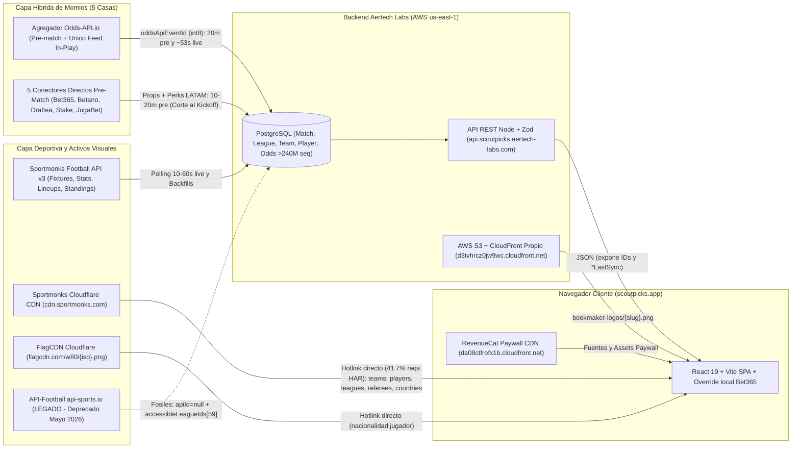

# 04 — Auditoría Forense de Proveedores de Datos, Escudos, Nombres, Ligas y Feeds de Momios (`Scout Picks`)

**Objetivo:** Determinar con precisión forense quién provee cada activo visual (escudos, fotos, logos, banderas), los datos estadísticos y nombres deportivos, el catálogo global de ligas y los feeds de momios/casas de apuestas de **Scout Picks (`https://scoutpicks.app`)**, operado por **Aertech Labs**, como insumo técnico para la arquitectura de **PitchLab**.

**Artefactos auditados y trazabilidad REA:**
- Matriz estructurada de procedencia generada en esta auditoría: [data-provenance-matrix.json](file:///C:/Users/T490s/.gemini/antigravity/worktrees/PitchLab/analyze_pitchlab_competitor_rea/Reportes/scoutpicks/evidence/data-provenance-matrix.json)
- Registro criptográfico de evidencias REA: [rea-evidence-ledger-summary.json](file:///C:/Users/T490s/.gemini/antigravity/worktrees/PitchLab/analyze_pitchlab_competitor_rea/Reportes/scoutpicks/evidence/rea/rea-evidence-ledger-summary.json) (`ev_03f837b1e4aec03bcac8791498a5d2cbbd06e25f39474bde43e541baa4acff52`, `ev_8d1fa2225983ff98a4c350ad528895985cc9cdd8f4efab6f7eceda9da4dc30cd`, `ev_df01cbb53c87b27583cfc4e68865e5b374bcc4767b2613810e7471542644d25e`, `ev_8150c3164a6116de13bb6c319f3c8c991d1c716c94639ecb702419e237b980a0`, `ev_12af56688af8dcd8ed633f02b9f0a9c7d06c84fc5cbd2b053f43228ec9120b3a`, `ev_b6a4cee9fad3dc1fed4479078d5de2a278bbd8e812e600d7fa36c9cfde5b5456`, `ev_c070dbadc8d0f222fd7dbf9e07c2e0d5594a52d986dad13a32989b438af65350`, `ev_d6aea026e24cc7285f592385c27b572003bb7a591dbda6be9d5c2ff8366790be`, `ev_abdb3cf1dbd8a7aab2a952ca236449585bd2de775d8200297a3b94e836220fb3`, `ev_036f50356d956efdf3eeea3e3b25f6651b5252264443c86dbb79c13886fdbf3a`)
- Auditoría DNS e infraestructura: [dns-and-infra-audit.json](file:///C:/Users/T490s/.gemini/antigravity/worktrees/PitchLab/analyze_pitchlab_competitor_rea/Reportes/scoutpicks/evidence/dns-and-infra-audit.json)
- Payloads vivos sanitizados (`CERO PII / CERO credenciales`): directorio [live-payloads](file:///C:/Users/T490s/.gemini/antigravity/worktrees/PitchLab/analyze_pitchlab_competitor_rea/Reportes/scoutpicks/evidence/live-payloads/)

> [!IMPORTANT]
> **Veredicto Ejecutivo (`[OBSERVADO]` + `[DERIVADO]`):** Scout Picks **no tiene un único proveedor**, sino un **stack híbrido de 4 capas**:
> 1. **Datos deportivos, calendarios, estadísticas, escudos, fotos y logos de ligas:** **Sportmonks Football API v3** (`cdn.sportmonks.com`), tras haber migrado el **15–16 de mayo de 2026** desde **API-Football (`api-sports.io`)**, dejando columnas fósiles (`apiId: null`) y un arreglo zombi de 59 IDs de API-Football en `GET /subscriptions/me`.
> 2. **Banderas geográficas:** Esquema partido entre **Sportmonks CDN** (`cdn.sportmonks.com/images/countries/png/short/*.png` para ligas/árbitros) y **FlagCDN** (`flagcdn.com/w80/*.png` para nacionalidad de jugadores).
> 3. **Momios (Odds) y mercados de apuestas:** Arquitectura dual compuesta por el agregador **Odds-API.io** (`oddsApiEventId` entero de 8 dígitos, responsable además del *live in-play*) más **5 conectores/scrapers directos pre-partido** hacia **Bet365, Betano, Draftea, Stake y JugaBet** para capturar *player/team/game props* granulares (ej. pases `19.5..122.5`, faltas recibidas, entradas) y promociones locales LATAM (`sub_cover`, `early_payout_2_goals`, `price_boost`).
> 4. **Logos de casas y Paywall:** Bucket propio en AWS S3 + CloudFront (`d3tvhrcz0jw9wc.cloudfront.net`) para 4 casas, un *override* cableado en cliente para **Bet365** (`/dashboard/assets/bet365-BH5MBRBJ.png`), y el CDN de **RevenueCat Web Billing** (`da08ctfrofx1b.cloudfront.net`) para el paywall.

---

## Arquitectura Integral de Proveedores y Flujo de Activos



---

## 1. Matriz Maestra de Atribución de Proveedores (¿Quién les da cada pieza?)

### 1.1 Resumen de Atribución por Tipo de Activo

| Categoría de Dato / Activo | Proveedor Real | Dominio / Origen Exacto | Modo de Entrega | Clasificación y Evidencia REA |
| :--- | :--- | :--- | :--- | :--- |
| **Escudos de equipos** | **Sportmonks v3** | `https://cdn.sportmonks.com/images/soccer/teams/{id%32}/{id}.png` | *Hotlinking* directo desde el navegador (sin proxy propio) | `[OBSERVADO]` `ev_8d1fa222...`, `ev_03f837b1...` |
| **Logos de ligas y copas** | **Sportmonks v3** | `https://cdn.sportmonks.com/images/soccer/leagues/{id%32}/{id}.png` (+ 5 rutas legadas `leagues/{id}.png`) | *Hotlinking* directo desde el navegador | `[OBSERVADO]` `ev_03f837b1...`, `ev_8d1fa222...` |
| **Fotos de jugadores** | **Sportmonks v3** | `https://cdn.sportmonks.com/images/soccer/players/{id%32}/{id}.png` | *Hotlinking* directo desde el navegador | `[OBSERVADO]` `ev_03f837b1...`, `ev_8d1fa222...` |
| **Fotos de árbitros** | **Sportmonks v3** | `https://cdn.sportmonks.com/images//soccer/referees/{id%32}/{id}.png` (con doble `/` literal) | *Hotlinking* directo; 99.1% cae en `placeholder.png` | `[OBSERVADO]` `ev_03f837b1...` |
| **Placeholders deportivos** | **Sportmonks v3** | `https://cdn.sportmonks.com/images/soccer/{placeholder\|team_placeholder\|league_placeholder}.png` | *Hotlinking* directo (HTTP 200 PNG gris de Sportmonks) | `[OBSERVADO]` `ev_8d1fa222...` |
| **Banderas (Ligas, Árbitros, Búsqueda)** | **Sportmonks v3** | `https://cdn.sportmonks.com/images/countries/png/short/{slug}.png` | *Hotlinking* directo (70 URLs únicas, incluye continentes) | `[OBSERVADO]` `ev_03f837b1...`, `ev_8d1fa222...` |
| **Banderas (Nacionalidad de Jugador)** | **FlagCDN (`flagpedia.net`)** | `https://flagcdn.com/w80/{iso_lower}.png` | *Hotlinking* directo a CDN público sobre Cloudflare | `[OBSERVADO]` `ev_03f837b1...`, `ev_8d1fa222...` |
| **Logos de Casas (`Betano`, `Draftea`, `Stake`, `JugaBet`)** | **Aertech Labs (Propio)** | `https://d3tvhrcz0jw9wc.cloudfront.net/bookmaker-logos/{slug}.png` | Bucket AWS S3 propio detrás de CloudFront | `[OBSERVADO]` `ev_8d1fa222...` |
| **Logo de `Bet365` (Excepción)** | **Aertech Labs (Bundle SPA)** | `https://scoutpicks.app/dashboard/assets/bet365-BH5MBRBJ.png` | `logo: null` en BD; sobreescrito en cliente vía mapa `XTe` | `[OBSERVADO]` `ev_d6aea026...`, `ev_8d1fa222...` |
| **Assets de Paywall / Checkout** | **RevenueCat Web Billing** | `https://da08ctfrofx1b.cloudfront.net/${e}` | Helper `jg(e)` dentro del runtime Svelte de RevenueCat | `[OBSERVADO]` `ev_d6aea026...`, [dns-and-infra-audit.json](file:///C:/Users/T490s/.gemini/antigravity/worktrees/PitchLab/analyze_pitchlab_competitor_rea/Reportes/scoutpicks/evidence/dns-and-infra-audit.json) |
| **Iconografía UI deportiva (estadio, silbato, marcador)** | **Aertech Labs (Bundle SPA)** | `data:image/svg+xml,...` + Lucide Icons | SVGs inline aplicados con CSS `mask-image` (126 hits HAR) | `[OBSERVADO]` `ev_8d1fa222...`, `ev_d6aea026...` |

---

### 1.2 Hotlinking Directo a `cdn.sportmonks.com` y la Regla Aritmética `sportmonks_id % 32`

`[OBSERVADO]` (`ev_8d1fa2225983ff98a4c350ad528895985cc9cdd8f4efab6f7eceda9da4dc30cd`): En la captura de red completa (`2,340` peticiones HTTP en el archivo HAR), **`975` peticiones (`41.67%` de todo el tráfico HTTP del navegador)** van directamente desde el cliente de cada usuario hacia **`https://cdn.sportmonks.com`** (`server: cloudflare`, `access-control-allow-origin: *`, `cache-control: max-age=2592000`). Aertech Labs **no utiliza proxy de imágenes, ni réplica en S3, ni Cloudflare Images propia** para escudos, fotos ni logos de ligas.

> [!WARNING]
> **Implicación operativa y comercial del *hotlinking* (`[INFERIDO]`):** Al no proxificar `cdn.sportmonks.com`, cada navegador de usuario envía la cabecera `Referer: https://scoutpicks.app/` y su IP residencial directamente al Cloudflare de Sportmonks. Esto ahorra costos de transferencia S3/CloudFront a Aertech Labs, pero le entrega a Sportmonks telemetría exacta en tiempo real de sus usuarios activos diarios (DAU/MAU) y distribución geográfica por país para negociaciones de renovación Enterprise.

`[DERIVADO]` (`ev_03f837b1e4aec03bcac8791498a5d2cbbd06e25f39474bde43e541baa4acff52`): Aunque las rutas REST de Scout Picks utilizan IDs internos autoincrementales de PostgreSQL (`/teams/17181`, `/players/1113`, `/leagues/116`, `/referees/226`), Sportmonks particiona su CDN en **32 *shards* deterministas (`0..31`)** mediante la operación módulo:

$$\text{bucket} = \text{sportmonks\_id} \bmod 32$$

Al auditar programáticamente las **`1,534` URLs únicas de `cdn.sportmonks.com`** presentes en los 93 payloads capturados (`1,167` equipos, `162` ligas con shard, `126` jugadores y `1` árbitro con foto real), **las `1,456` URLs particionadas cumplen el invariante `sportmonks_id % 32 == bucket` con `0` excepciones (`100.00%` de exactitud)**. Esto permite extraer el ID nativo de Sportmonks de cualquier entidad aunque el endpoint oculte la columna `sportmonksId`:

| Tipo de Entidad | Entidad | ID Interno Scout Picks | URL Observada en Payload | Cálculo `id % 32` | `sportmonks_id` Revelado |
| :--- | :--- | ---: | :--- | :---: | ---: |
| **Equipo** | Wales | `17181` | `https://cdn.sportmonks.com/images/soccer/teams/1/18721.png` | `18721 % 32 = 1` | **`18721`** |
| **Equipo** | Portugal | `14678` | `https://cdn.sportmonks.com/images/soccer/teams/13/18701.png` | `18701 % 32 = 13` | **`18701`** |
| **Equipo** | Real Madrid | `196` | `https://cdn.sportmonks.com/images/soccer/teams/12/3468.png` | `3468 % 32 = 12` | **`3468`** |
| **Equipo** | AFC Bournemouth | `1125` | `https://cdn.sportmonks.com/images/soccer/teams/20/52.png` | `52 % 32 = 20` | **`52`** |
| **Jugador** | António Silva | `1113` | `https://cdn.sportmonks.com/images/soccer/players/12/37354828.png` | `37354828 % 32 = 12` | **`37354828`** |
| **Jugador** | Harry Wilson | `3580` | `https://cdn.sportmonks.com/images/soccer/players/27/5403.png` | `5403 % 32 = 27` | **`5403`** |
| **Liga** | UEFA Nations League | `116` | `https://cdn.sportmonks.com/images/soccer/leagues/2/1538.png` | `1538 % 32 = 2` | **`1538`** |
| **Liga** | Liga MX | `68` | `https://cdn.sportmonks.com/images/soccer/leagues/7/743.png` | `743 % 32 = 7` | **`743`** |
| **Árbitro** | Michael Oliver | `226` | `https://cdn.sportmonks.com/images//soccer/referees/9/15273.png` | `15273 % 32 = 9` | **`15273`** |

**Anomalías reveladoras del almacenamiento *verbatim* (`[OBSERVADO]`):**
1. **Doble barra en árbitros (`images//soccer/referees/`):** En [GET_leagues_116_referees.json](file:///C:/Users/T490s/.gemini/antigravity/worktrees/PitchLab/analyze_pitchlab_competitor_rea/Reportes/scoutpicks/evidence/live-payloads/GET_leagues_116_referees.json), de los `106` árbitros de la UEFA Nations League, `105` devuelven `placeholder.png` (incluido Sven Jablonski en [GET_referees_351.json](file:///C:/Users/T490s/.gemini/antigravity/worktrees/PitchLab/analyze_pitchlab_competitor_rea/Reportes/scoutpicks/evidence/live-payloads/GET_referees_351.json)) y el único con fotografía real (Michael Oliver, `id: 226`) expone `https://cdn.sportmonks.com/images//soccer/referees/9/15273.png`. Esa doble barra es un defecto conocido del campo `image_path` crudo de Sportmonks v3, probando que el backend de Scout Picks guarda la cadena `image_path` sin sanitizarla ni reconstruirla.
2. **Cinco ligas históricas sin subcarpeta módulo-32:** En [GET_leagues_all.json](file:///C:/Users/T490s/.gemini/antigravity/worktrees/PitchLab/analyze_pitchlab_competitor_rea/Reportes/scoutpicks/evidence/live-payloads/GET_leagues_all.json), exactamente 5 ligas antiguas de Sportmonks conservan rutas planas sin shard: `Champions League` (`.../leagues/2.png`), `Eredivisie` (`.../leagues/72.png`), `Superliga Dinamarca` (`.../leagues/271.png`), `Premiership` (`.../leagues/501.png`) y `AFCON Qualifications` (`.../leagues/1118.png`).

### 1.3 Comportamiento ante Falta de Imagen: Placeholders de Sportmonks vs Avatares de 2 Letras

`[OBSERVADO]` (`ev_d6aea026e24cc7285f592385c27b572003bb7a591dbda6be9d5c2ff8366790be`): La inspección del código cliente exportado demuestra que Scout Picks **no filtra ni intercepta** la subcadena `placeholder.png` (`0` coincidencias en todo el bundle JavaScript). En consecuencia, operan dos mecanismos distintos:

1. **Cuando Sportmonks carece de imagen pero devuelve URL placeholder (`HTTP 200`):**
   - Jugadores sin retrato (ej. `Joseph Duncan`, `id: 78956` y `Aaron Collins`, `id: 19753` en [GET_teams_17181_squad.json](file:///C:/Users/T490s/.gemini/antigravity/worktrees/PitchLab/analyze_pitchlab_competitor_rea/Reportes/scoutpicks/evidence/live-payloads/GET_teams_17181_squad.json)) y el `99.1%` de árbitros cargan `https://cdn.sportmonks.com/images/soccer/placeholder.png` (`last-modified: Tue, 10 Mar 2020`).
   - Equipos por definir en llaves eliminatorias (ej. `"1st ranked"`, `id: 67757036` en [GET_teams_featured.json](file:///C:/Users/T490s/.gemini/antigravity/worktrees/PitchLab/analyze_pitchlab_competitor_rea/Reportes/scoutpicks/evidence/live-payloads/GET_teams_featured.json)) cargan `https://cdn.sportmonks.com/images/soccer/team_placeholder.png`.
   - Nueve torneos menores/clasificatorios en `GET /leagues/all` cargan `https://cdn.sportmonks.com/images/soccer/league_placeholder.png`.
2. **Cuando el campo `image`/`logo` es `null` o falla la carga en red (`Avatar.Fallback`):**
   - La SPA encapsula `@radix-ui/react-avatar` en tres primitivas (`sr` = `Root`, `or` = `Image`, `ur` = `Fallback`). Cuando `src` es nulo o da error HTTP, `ur` renderiza un círculo/cuadrado `bg-border` con **2 letras** calculadas en cliente:
     - **Jugadores, árbitros y cabeceras de equipo:** `e.name.split(" ").slice(0,2).map(n=>n[0]).join("")` (iniciales de las dos primeras palabras, ej. `"Harry Wilson"` -> `"HW"`).
     - **Filas compactas de partido:** `team.code ?? team.name.slice(0,2)` (código FIFA/club de 3 letras como `"WAL"` o primeras 2 letras).
     - **Ligas:** `c.leagueName.slice(0,2).toUpperCase()` (ej. `"UEFA Nations League"` -> `"UE"`).
     - **Perfil de usuario:** helper `tXe(name, fallback)` que toma las iniciales en mayúsculas de las dos primeras palabras.
     - **Buscador global y banderas `` sueltas:** aplican `onError: k => { k.currentTarget.hidden = !0 }` para ocultar el ícono roto sin mostrar imagen quebrada.

### 1.4 Esquema Dual de Banderas, Bucket Propio de Casas (`d3tvhrcz0jw9wc`) y Excepción `Bet365`

1. **Banderas divididas entre dos proveedores (`[OBSERVADO]`):**
   - En `GET /leagues/*`, `GET /referees/*`, `GET /matches/day-overview` y `GET /search`, el objeto `country.flag` apunta al CDN de Sportmonks: `https://cdn.sportmonks.com/images/countries/png/short/{slug}.png` (`70` variantes observadas, incluyendo regiones no-ISO como `eu.png`, `africa.png`, `asia.png`, `south-america.png`, `north-central-america.png` y subnaciones como `en.png`).
   - En cambio, en `GET /players/:id` ([GET_players_3580.json](file:///C:/Users/T490s/.gemini/antigravity/worktrees/PitchLab/analyze_pitchlab_competitor_rea/Reportes/scoutpicks/evidence/live-payloads/GET_players_3580.json), [GET_players_1113.json](file:///C:/Users/T490s/.gemini/antigravity/worktrees/PitchLab/analyze_pitchlab_competitor_rea/Reportes/scoutpicks/evidence/live-payloads/GET_players_1113.json)), `nationality.flag` se construye en el backend concatenando el código ISO 3166-1/3166-2 en minúsculas contra **FlagCDN**: `https://flagcdn.com/w80/gb-wls.png` (Gales) y `https://flagcdn.com/w80/pt.png` (Portugal).
2. **Logos de Casas de Apuestas y Cronología S3 (`[OBSERVADO]` `ev_8d1fa222...`):**
   - Cuatro de las cinco casas sirven su logotipo desde el bucket S3 propio de Aertech Labs detrás de la distribución CloudFront **`https://d3tvhrcz0jw9wc.cloudfront.net/bookmaker-logos/{slug}.png`** (`server: AmazonS3`, `cache-control: public, max-age=31536000, immutable`). Las cabeceras `Last-Modified` del HAR revelan la fecha exacta de alta en S3 de cada casa:
     - `stake.png`: `2026-09-29 18:19:15 GMT` (`ETag: "eaeab0268bf33b1dddc59ca06e7b0bf7"`)
     - `betano.png`: `2026-09-30 03:07:35 GMT` (`ETag: "0756710294abaa761b9e31ac1018f582"`)
     - `draftea.png`: `2026-09-30 16:35:42 GMT` (`ETag: "ae070285e4f31db93f224a13b1e6163b"`)
     - `jugabet.png`: `2026-10-30 23:26:57 GMT` (`ETag: "5067218168b21f9f6af74599cb7b0dea"` — incorporada exactamente un mes después).
   - **La anomalía de Bet365 (`[OBSERVADO]` `ev_d6aea026...`):** En PostgreSQL ([GET_bookmakers.json](file:///C:/Users/T490s/.gemini/antigravity/worktrees/PitchLab/analyze_pitchlab_competitor_rea/Reportes/scoutpicks/evidence/live-payloads/GET_bookmakers.json), [GET_teams_17181_odds.json](file:///C:/Users/T490s/.gemini/antigravity/worktrees/PitchLab/analyze_pitchlab_competitor_rea/Reportes/scoutpicks/evidence/live-payloads/GET_teams_17181_odds.json)), `Bet365` (`id: 1`) tiene `"logo": null` y `"bookmakerLogo": null`. Para evitar que aparezca sin ícono en la web, el bundle React inyecta un parche específico en cliente:
     ```javascript
     const QTe = "/dashboard/assets/bet365-BH5MBRBJ.png", XTe = { bet365: QTe };
     function wv(e, t) { return XTe[(e == null ? void 0 : e.trim().toLowerCase()) ?? ""] ?? t ?? null; }
     ```
     `[INFERIDO]`: Bet365 fue la primera casa integrada (`id: 1`) cuando Scout Picks era sólo app móvil nativa con el asset empaquetado localmente; al crear en septiembre de 2026 el bucket `d3tvhrcz0jw9wc` para las casas nuevas (`id: 2..5`), nunca rellenaron la columna `Bookmaker.logo` de Bet365 en base de datos y replicaron el *override* estático en Vite.
3. **Paywall de RevenueCat (`[OBSERVADO]` `ev_d6aea026...`):**
   - El módulo Svelte embebido del SDK `@revenuecat/purchases-js` define `const jg = e => "https://da08ctfrofx1b.cloudfront.net/" + e` para descargar tipografías personalizadas (`FontFace`) y recursos visuales configurados en el panel de RevenueCat Billing.

---

## 2. Arqueología de Migración Deportiva (`API-Football` → `Sportmonks v3`) y Nombres

### 2.1 Pruebas Fósiles del Nacimiento sobre `API-Football (api-sports.io)`

La correlación cruzada entre [GET_leagues_all.json](file:///C:/Users/T490s/.gemini/antigravity/worktrees/PitchLab/analyze_pitchlab_competitor_rea/Reportes/scoutpicks/evidence/live-payloads/GET_leagues_all.json), [GET_matches_54091.json](file:///C:/Users/T490s/.gemini/antigravity/worktrees/PitchLab/analyze_pitchlab_competitor_rea/Reportes/scoutpicks/evidence/live-payloads/GET_matches_54091.json), [GET_matches_54091_players.json](file:///C:/Users/T490s/.gemini/antigravity/worktrees/PitchLab/analyze_pitchlab_competitor_rea/Reportes/scoutpicks/evidence/live-payloads/GET_matches_54091_players.json) y [GET_subscriptions_me.json](file:///C:/Users/T490s/.gemini/antigravity/worktrees/PitchLab/analyze_pitchlab_competitor_rea/Reportes/scoutpicks/evidence/live-payloads/GET_subscriptions_me.json) demuestra de manera irrefutable (`[DERIVADO]`) que Scout Picks se construyó originalmente sobre **API-Football (`api-sports.io`)** antes de migrar su motor de ingesta a **Sportmonks Football API v3**:

1. **Columnas relacionales deprecadas (`[OBSERVADO]`):**
   - Tanto `League` como `Match` conservan la columna `"apiId": null` (`0` de `176` ligas tienen `apiId != null` tras el *re-seed*).
   - `Match` conserva además `"lastApiHash": null` y las columnas de texto plano `"venue"` y `"referee"`. En `GET /matches/54091/players` (que serializa la fila cruda de `Match`), `"venue": null` y `"referee": null`, mientras que `"venueId": 800` y `"refereeId": 351` están poblados; en cambio, `GET /matches/54091` hidrata `"venue": "Cardiff City Stadium"` y `"referee": "Sven Jablonski"` mediante `JOIN` a las nuevas tablas normalizadas creadas para Sportmonks.
2. **El hallazgo del arreglo zombi `accessibleLeagueIds` en `GET /subscriptions/me` (`[OBSERVADO]` + `[DERIVADO]`):**
   - En [GET_subscriptions_me.json](file:///C:/Users/T490s/.gemini/antigravity/worktrees/PitchLab/analyze_pitchlab_competitor_rea/Reportes/scoutpicks/evidence/live-payloads/GET_subscriptions_me.json), el endpoint devuelve una lista fija de **59 IDs**:
     `[39, 140, 78, 135, 61, 94, 88, 144, 203, 179, 218, 207, 197, 119, 106, 45, 48, 143, 137, 81, 66, 96, 90, 147, 181, 206, 220, 121, 199, 108, 2, 3, 307, 504, 253, 257, 262, 16, 71, 73, 128, 130, 13, 11, 239, 241, 265, 267, 242, 917, 250, 501, 281, 268, 270, 930, 299, 188, 169]`.
   - Esos 59 enteros son **exactamente los IDs canónicos de `API-Football (api-sports.io)`** para las ligas principales del mundo, y **están desincronizados respecto a la tabla actual `League` de Scout Picks**:

| ID en `accessibleLeagueIds` | Liga Real en `API-Football` (`api-sports.io`) | Qué es hoy ese `League.id` en `GET /leagues/all` (Scout Picks) | `League.id` Correcto Actual en Scout Picks (`Sportmonks ID`) |
| ---: | :--- | :--- | :--- |
| **`39`** | Premier League (Inglaterra) | Premier Division (**Irlanda**) | `id: 2` (`sm_id: 8`) |
| **`140`** | LaLiga (España) | EAFF Championship Qual. (**Asia**) | `id: 3` (`sm_id: 564`) |
| **`78`** | Bundesliga (Alemania) | Persian Gulf Pro League (**Irán**) | `id: 5` (`sm_id: 82`) |
| **`135`** | Serie A (Italia) | African Nations Champ. Qual. (**África**) | `id: 6` (`sm_id: 384`) |
| **`61`** | Ligue 1 (Francia) | WC Qualification (**Asia**) | `id: 34` (`sm_id: 301`) |
| **`2`** | UEFA Champions League | Premier League (**Inglaterra**) | `id: 1` (`sm_id: 2`) |
| **`3`** | UEFA Europa League | La Liga (**España**) | `id: 4` (`sm_id: 5`) |
| **`262`** | **Liga MX (México)** | **No existe en `League.id`** (`32/59` ausentes) | `id: 68` (`sm_id: 743`) |
| **`71`** | Brasileirão Série A (Brasil) | Primera División (**Perú**) | `id: 55` (`sm_id: 648`) |
| **`128`** | Liga Profesional (Argentina) | CONCACAF Nations League | `id: 12` (`sm_id: 636`) |
| **`253`** | Major League Soccer (EE. UU.) | **No existe en `League.id`** | `id: 73` (`sm_id: 779`) |
| **`13`** | Copa Libertadores | Copa Libertadores *(única coincidencia fortuita)* | `id: 13` (`sm_id: 1122`) |

`[DERIVADO]`: Para suscriptores `Pro` (`"planType": "all_leagues"`), el cliente evalúa el *tier* global y no bloquea por `accessibleLeagueIds`, razón por la cual esta constante legada en el microservicio de suscripciones pasó inadvertida tras el corte a Sportmonks.

### 2.2 Por qué Conviven `matchIds` de 4–5 Dígitos (`54091`) con `matchIds` de 8 Dígitos (`37222996`)

Una primera hipótesis superficial sugeriría que los `matchIds` de 8 dígitos son IDs nativos de Sportmonks mezclados con IDs propios. **La inspección de [GET_matches_37222996.json](file:///C:/Users/T490s/.gemini/antigravity/worktrees/PitchLab/analyze_pitchlab_competitor_rea/Reportes/scoutpicks/evidence/live-payloads/GET_matches_37222996.json) vs [GET_matches_54091.json](file:///C:/Users/T490s/.gemini/antigravity/worktrees/PitchLab/analyze_pitchlab_competitor_rea/Reportes/scoutpicks/evidence/live-payloads/GET_matches_54091.json) refuta esa hipótesis y demuestra el mecanismo exacto (`[DERIVADO]`):**

- Partido `id: 54091` (*Wales vs Portugal*, UEFA Nations League, kickoff `2026-11-17T19:45:00Z`): tiene `"sportmonksId": 19676648` y **`"createdAt": "2026-05-16T03:11:43.497Z"`**.
- Partido `id: 37222996` (*Qatar vs Korea Republic*, Amistoso Internacional, kickoff `2026-11-17T14:00:00Z`): tiene `"sportmonksId": 19902404` (`!= 37222996`) y **`"createdAt": "2026-11-08T14:46:43.283Z"`**.

Al ordenar los `1,210` `matchIds` únicos hallados en todos los payloads junto con sus marcas `createdAt` y `backfillPostProcessedAt`, emerge la **curva exacta de inflación de la secuencia `SERIAL` de PostgreSQL (`matches_id_seq`)**:

| Ventana Temporal (`createdAt` UTC) | Evento de Ingesta en Base de Datos | Rango Observado de `Match.id` | Ejemplo Verificado (`Match.id` → `sportmonksId`) |
| :--- | :--- | ---: | :--- |
| **`2026-05-15` a `2026-05-16`** | *Seed* fundacional de Sportmonks v3 (ligas, plantillas y calendarios 2026/27 ya sorteados en mayo) | **`216` – `68,407`** *(3 a 5 dígitos)* | `8591` (`19696153`), `33726` (`19604727`), **`54091`** (`19676648`) |
| **`2026-07-14` a `2026-07-15`** | Ola 1 de *backfill* histórico multi-temporada (`2022–2025`, ej. `Season 509/510`) | **`10,451,210` – `10,730,635`** *(8 dígitos)* | `10661126` (`18455249`, jugado en `2022-06-01`, insertado el `14-Jul-2026`) |
| **`2026-08-29` a `2026-08-31`** | Ola 2 de creación de temporadas pasadas (`Season 1791..1796`) y `backfillPostProcessedAt` | **`~20M` – `32,187,386`** *(8 dígitos)* | `Season 513` post-procesada el `2026-08-31T17:11:10.550Z` |
| **`2026-10-05`** | Ola 3 de *backfill* de amistosos históricos (`2022–2023`) | **`34,770,804` – `34,771,621`** *(8 dígitos)* | `34770804` (`18836585`, jugado en `2023-09-07`, insertado el `05-Oct-2026`) |
| **`2026-11-08` a `2026-11-17`** | Alta tardía de amistosos FIFA de noviembre y llaves eliminatorias/Liguillas | **`37,222,994` – `37,727,964`** *(8 dígitos)* | **`37222996`** (`19902404`, Qatar vs Corea); `37727964` (Liverpool vs Wanderers, Uruguay) |

> [!NOTE]
> **Causa raíz técnica (`[DERIVADO]`):** En PostgreSQL, toda sentencia `INSERT INTO "Match" (...) VALUES (...) ON CONFLICT ("sportmonksId") DO UPDATE SET ...` consume un valor de `nextval('matches_id_seq')` **incluso cuando el registro ya existe y sólo se actualiza**. Los *workers* de sincronización de Scout Picks ejecutan ~`205,000` *upserts* diarios sobre `Match`, quemando `37.7 millones` de IDs en 185 días. El mismo fenómeno afecta a `Team.id` (donde conviven `196` Real Madrid y `17181` Wales con `67,842,046` `"8th ranked"` Liga MX), `BetType.id` (`1` vs `39,642,051`), `PlayerStat.id` (`62,964,148`) y `Odds.id` (**`240,044,492`**).

### 2.3 Gestión de Nombres de Entidades e Internacionalización (`i18next` + Backend)

`[OBSERVADO]` (`ev_03f837b1...`, `ev_d6aea026...`):
- **Equipos (`Team`):** Se almacenan y muestran con el nombre internacional en inglés de Sportmonks sin localizar (`"Wales"`, `"Korea Republic"`, `"Türkiye"`, `"Republic of Ireland"`), acompañados de `shortName` y `code` de 3 letras (`"WAL"`, `"POR"`, `"RMA"`, `"BOU"`). En equipos placeholder o clubes menores donde `code` es `null` (`"2 de Mayo"`, `"ABB"`), el cliente genera abreviaturas con `name.slice(0,3).toUpperCase()` o `name.slice(0,2)`.
- **Jugadores (`Player`):** Se sirve `name` (`display_name` curado de Sportmonks, ej. `"António Silva"`, `"Se-hun Oh"`), `firstName` (`"António João Pereira Albuquerque"`), `lastName` (`"Tavares Silva"`), `position` macro (`"Goalkeeper"`, `"Defender"`, `"Midfielder"`, `"Attacker"`) y `detailedPosition` acrónimo Sportmonks (`"GK"`, `"CB"`, `"LB"`, `"RB"`, `"DM"`, `"CM"`, `"AM"`, `"LM"`, `"RM"`, `"LW"`, `"RW"`, `"CF"`, `"SS"`).
- **Ligas, Fases, Grupos, Estadios y Árbitros:** Permanecen en inglés crudo de Sportmonks (`"UEFA Nations League"`, `"Friendly International"`, `"Club Friendlies 3"`, `stageName: "League A"`, `stageKind: "group_phase"`, `groupName: "Group 4"`, `venue: "Cardiff City Stadium"` con `venueId: 800`, `referee: "Sven Jablonski"` con `refereeId: 351`).
- **Doble capa de traducción de mercados y textos analíticos:**
  1. **En el cliente (`i18next`):** El bundle `02_i18n_en_es_pt.js` empaqueta diccionarios completos estáticos para **inglés (`en`), español (`es`, con modismos rioplatenses/neutros mezclados como `"Tocá"`, `"Creá"`, `"Cuota"`) y portugués (`pt`)**, traduciendo claves `metrics.*` (`tackles` → `"Entradas"`, `sog`/`shotsOnTarget` → `"Tiros a puerta"`), `position.detailed.*` y `periods.*`.
  2. **En el backend:** Endpoints como `GET /matches/54091/odds/*` y `POST /simulations/calculate` leen el idioma activo del usuario y devuelven `metricLabel` (`"Tiros al Arco"`, `"Faltas recibidas"`, `"Tarjetas/Faltas"`) y `analysis.summary` ya redactados en español desde el servidor.

---

## 3. Arquitectura Híbrida de Momios (Odds) y Casas de Apuestas

### 3.1 Desglose Forense de las 6 Fuentes de Momios Filtradas en `Match`

Los endpoints [GET_matches_54091.json](file:///C:/Users/T490s/.gemini/antigravity/worktrees/PitchLab/analyze_pitchlab_competitor_rea/Reportes/scoutpicks/evidence/live-payloads/GET_matches_54091.json), [GET_matches_54091_players.json](file:///C:/Users/T490s/.gemini/antigravity/worktrees/PitchLab/analyze_pitchlab_competitor_rea/Reportes/scoutpicks/evidence/live-payloads/GET_matches_54091_players.json) y [GET_matches_37222996.json](file:///C:/Users/T490s/.gemini/antigravity/worktrees/PitchLab/analyze_pitchlab_competitor_rea/Reportes/scoutpicks/evidence/live-payloads/GET_matches_37222996.json) exponen sin filtrar todas las columnas internas de sincronización de momios de la tabla `Match`:

| Fuente / Conector | Columnas Expuestas en `Match` | Formato Exacto del Identificador Externo | Rol Técnico en la Arquitectura | Clasificación |
| :--- | :--- | :--- | :--- | :--- |
| **Agregador Primario: `Odds-API.io`** | `oddsApiEventId`, `oddsApiEventDate`, `oddsApiEventAssignedAt`, `oddsApiLastSync`, `oddsApiLastListedAt`, `oddsApiLastCatalogueAt` | **Entero numérico de 8 dígitos** (`68932056` en Wales–Portugal; `76169018` en Qatar–Corea) | Descubrimiento temprano de eventos (`2026-11-12`, 5 días antes), catálogo base y **único proveedor con sincronización en vivo (*in-play*)** | `[DERIVADO]` |
| **1. `Bet365` Directo** | `bet365EventId`, `bet365CompetitionId`, `bet365EventDate`, `bet365LastSync` | Strings numéricos de 9 dígitos (`eventId: "202407734"`, `competitionId: "138628513"`) | Extracción pre-partido de *player props* (`shots`, `foulsCommitted`, `foulsDrawn`, `tackles`, `saves`) y líneas alternas | `[OBSERVADO]` |
| **2. `Betano` Directo** | `betanoEventId`, `betanoLastSync` *(única sin `*EventDate`)* | String numérico de 8 dígitos de Kaizen Gaming (`"95621790"`, `"95748851"`) | Mayor volumen de props (`2,117` cuotas en `54091`), **única fuente de pases de jugador (`passes`)** y perks `sub_cover`/`acca_bonus` | `[OBSERVADO]` |
| **3. `Draftea` Directo** | `drafteaEventId`, `drafteaLeagueId`, `drafteaEventDate`, `drafteaLastSync` | **MongoDB `ObjectId` hex de 24 chars** (`"6a8cdc6539a12c38e035445a"`, cuyo prefijo `0x6a8cdc65` decodifica a `2026-08-25T00:05:57Z`) + torneo `"tnm_oKHzwWTMwKsAfsAUh"` | Conector directo indispensable para el **mercado mexicano (`MX`)**, ausente en agregadores globales; extrae props y perks `sub_cover` | `[DERIVADO]` |
| **4. `Stake` Directo** | `stakeEventSlug`, `stakeEventDate`, `stakeLastSync` | Slug compuesto `{kickoff_epoch_ms}-{home}-{away}` (`"1794944700000-wales-portugal"`, donde `1794944700000` = `2026-11-17T19:45:00Z`) | Props de ataque/defensa (`shots`, `shotsOnTarget`, `tackles`, `assists`) y monetización vía afiliados en `stake.mx` | `[DERIVADO]` |
| **5. `JugaBet` Directo** | `jugabetEventId`, `jugabetEventDate`, `jugabetLastSync` | String numérico de 8 dígitos (`"19167428"`) | Mercados nicho LATAM (única con `tackles` totales del partido y `price_boost`) + campaña estrella de afiliación con mes Pro gratis | `[OBSERVADO]` |

**¿Por qué `oddsApiEventId` identifica inequívocamente a `Odds-API.io` y NO a `The-Odds-API.com`? (`[DERIVADO]`):**
1. `the-odds-api.com` (v4) identifica eventos exclusivamente mediante cadenas hexadecimales MD5 de 32 caracteres (ej. `"e9b03c..."`), jamás enteros JSON como `68932056` o `76169018`.
2. `odds-api.io` (`/v3/events` y `/v3/odds`) emplea IDs enteros secuenciales en el rango `60,000,000–80,000,000`, separa el listado de eventos (`oddsApiLastListedAt`) del catálogo de mercados (`oddsApiLastCatalogueAt`), y estructura sus planes comerciales exactamente por cantidad de casas seleccionadas (**Starter: hasta 5 bookmakers por USD 129/mes**), coincidiendo con el tope exacto de 5 casas de Scout Picks.
3. Detalle forense adicional sobre los *workers*: `oddsApiLastSync` (`.666Z`, `.841Z`) y `drafteaLastSync` (`.655Z`, `.044Z`) conservan milisegundos reales de Node.js/TypeScript, mientras que `bet365LastSync`, `betanoLastSync`, `stakeLastSync` y `jugabetLastSync` terminan siempre en **`.000Z` exactos**, revelando truncamiento a segundos Unix (`TIMESTAMP(0)` o *workers* separados de scraping).

---

### 3.2 Medición Empírica de Cadencias de Sincronización (Pre-Match vs En Vivo)

Gracias a que el lote de captura contiene **dos instantáneas separadas por ~11 minutos del mismo partido pre-match `54091`** ([GET_matches_54091.json](file:///C:/Users/T490s/.gemini/antigravity/worktrees/PitchLab/analyze_pitchlab_competitor_rea/Reportes/scoutpicks/evidence/live-payloads/GET_matches_54091.json) a las `15:25:54Z` y [GET_matches_54091_players.json](file:///C:/Users/T490s/.gemini/antigravity/worktrees/PitchLab/analyze_pitchlab_competitor_rea/Reportes/scoutpicks/evidence/live-payloads/GET_matches_54091_players.json) a las `15:36:34Z`) además del **partido en vivo `37222996`** ([GET_matches_37222996.json](file:///C:/Users/T490s/.gemini/antigravity/worktrees/PitchLab/analyze_pitchlab_competitor_rea/Reportes/scoutpicks/evidence/live-payloads/GET_matches_37222996.json) en el minuto `69'` del 2.º tiempo a las `15:27:18Z`), podemos calcular por sustracción directa (`[DERIVADO]`) los intervalos reales de cada *cron*:

#### A. Cadencias Pre-Partido (`Match 54091` — faltando ~4h 15m para el inicio `19:45:00Z`)

| Reloj / Columna de Sincronización | Instantánea `T1` (`15:25:54Z`) | Instantánea `T2` (`15:36:34Z`) | Delta Empírico (`T2 - T1`) | Cadencia Real Derivada |
| :--- | :--- | :--- | ---: | :--- |
| **`betanoLastSync`** | `15:14:23.000Z` | `15:34:23.000Z` | **`20m 00.000s` (`1,200.0s`)** | **Cada `20 min` exactos** (`[DERIVADO]`) |
| **`bet365LastSync`** | `15:14:18.000Z` | `15:34:20.000Z` | **`20m 02.000s` (`1,202.0s`)** | **Cada `20 min` exactos** (corre en paralelo con Betano) |
| **`oddsApiLastSync`** | `15:07:57.666Z` | `15:27:56.841Z` | **`19m 59.175s` (`1,199.2s`)** | **Cada `20 min` exactos** en ventana pre-match |
| **`drafteaLastSync`** | `15:17:37.655Z` | `15:28:48.044Z` | **`11m 10.389s` (`670.4s`)** | **Cada `~10–11 min`** (`[DERIVADO]`) |
| **`stakeLastSync`** | `15:22:52.000Z` | `15:35:55.000Z` | **`13m 03.000s` (`783.0s`)** | **Cada `~12–15 min`** (`[DERIVADO]`) |
| **`jugabetLastSync`** | `15:23:28.000Z` | `15:23:28.000Z` | *Sin cambio en `13m 06s`* | **Cada `15–20 min`** (`[INFERIDO]`) |
| **`injuriesLastSyncedAt`** | `14:27:59.462Z` | `14:27:59.462Z` | *Batch global `14:28Z`* | **Cada `60–120 min`** (`37222996` corrió a las `14:28:08.742Z`, `9.28s` después) |
| **`oddsMaterialChangeAt` → `insightsGeneratedAt`** | `15:25:27.008Z` → `15:25:31.421Z` | `15:35:53.390Z` → `15:36:00.657Z` | Latencia reactiva: **`4.41s` y `7.27s`** | **Cola reactiva por evento (`1.8s–7.3s`)** tras cambio material de cuota |

#### B. Cadencias En Vivo y Regla de Corte al Kickoff (`Match 37222996` — inicio `14:00:00Z`, lectura `15:27:18Z`, `2H 69'`)

| Subsistema en Vivo | Último Timestamp Observado | Desfase vs Respuesta (`15:27:18Z`) | Comportamiento Operativo en Vivo (`[DERIVADO]`) |
| :--- | :--- | ---: | :--- |
| **Marcador y reloj (`Match.updatedAt`)** | `15:27:08.381Z` | **`9.62 seg`** | Polling `livescores/inplay` de Sportmonks cada **`~10–15 segundos`** |
| **Alineaciones (`lineupsLastSyncedAt`)** | `15:26:25.501Z` | **`52.50 seg`** | Sincronización cada **`~60 segundos`** |
| **Momios en vivo (`oddsApiLastSync`)** | `15:26:24.960Z` | **`53.04 seg`** | **`Odds-API.io` sigue activo cada `~60 segundos`** (disparando `insightsGeneratedAt` en `1.78s` a las `15:26:26.731Z`) |
| **Stats y Eventos (`statsSyncedAt` / `eventsLastSyncedAt`)** | `15:26:06.002Z` | **`72.00 seg`** | Sincronización de `playerStats` y goles/tarjetas cada **`~60–75 segundos`** |
| **5 Conectores Directos (`Bet365`, `Betano`, `Draftea`, `Stake`, `JugaBet`)** | `13:49:58Z` – `13:59:51Z` | **Detenidos al inicio (`< 14:00:00Z`)** | **CORTE ESTRICTO PRE-MATCH:** los 5 scrapers directos se apagan exactamente al *kickoff* para ahorrar proxies y evitar bloqueos anti-bot en mercados *in-play* |

---

### 3.3 Inventario Completo de Casas, Cobertura Geográfica ISO, Afiliados y Mercados

#### Catálogo de Casas de Apuestas (`GET /bookmakers` vs `GET /bookmakers/preferences` vs `GET /bookmakers/offers`)

`[OBSERVADO]`: Existe una discrepancia entre endpoints: [GET_bookmakers.json](file:///C:/Users/T490s/.gemini/antigravity/worktrees/PitchLab/analyze_pitchlab_competitor_rea/Reportes/scoutpicks/evidence/live-payloads/GET_bookmakers.json) devuelve únicamente 4 casas (`id: 1..4`), omitiendo a **JugaBet (`id: 5`)**, mientras que [GET_bookmakers_preferences.json](file:///C:/Users/T490s/.gemini/antigravity/worktrees/PitchLab/analyze_pitchlab_competitor_rea/Reportes/scoutpicks/evidence/live-payloads/GET_bookmakers_preferences.json), [GET_bookmakers_offers_channel_web.json](file:///C:/Users/T490s/.gemini/antigravity/worktrees/PitchLab/analyze_pitchlab_competitor_rea/Reportes/scoutpicks/evidence/live-payloads/GET_bookmakers_offers_channel_web.json) y todos los endpoints de momios incluyen las **5 casas**:

| `id` | Casa | Países Configurados (`countryCodes` ISO-2) | Cuotas en `Match 54091` | `perks` Promocionales Extraídos | Monetización Afiliados Observada (`MX`) |
| ---: | :--- | :--- | ---: | :--- | :--- |
| **`1`** | **Bet365** | **23 países:** `AR, AT, AU, BG, BR, CA, CY, DE, DK, EE, ES, FR, GB, GL, GR, IE, IT, MX, NL, PE, RS, SE, US` | `1,102` | *Ninguno* | Sin campaña activa en captura |
| **`2`** | **Betano** | **18 países:** `AR, BE, BG, BR, CA, CL, CO, CZ, DE, DK, EC, GB, GH, MX, NG, PE, PT, RO` | **`2,117`** *(líder)* | `acca_bonus`, `acca_insurance`, `early_payout_2_goals`, `sub_cover` | Sin campaña activa en captura |
| **`3`** | **Draftea** | **1 país:** **`MX`** *(exclusiva México)* | `422` | `early_payout_2_goals`, `sub_cover` | Sin campaña activa en captura |
| **`4`** | **Stake** | **18 países (foco LATAM + CA):** `AR, BO, BR, CA, CL, CO, CR, EC, GT, HN, MX, NI, PA, PE, PY, SV, UY, VE` | `745` | *Ninguno* | **`stake-mx-welcome-2026-11`** (`100%` hasta MXN 2,000 vía `stake.mx/?offer=scoutpicks&c=scoutpicks`) |
| **`5`** | **JugaBet** | **9 países (LATAM):** `AR, BR, CL, CO, EC, MX, PA, PE, VE` | `1,082` | `early_payout_2_goals`, `price_boost` | **`jugabet-mx-welcome-2026-11`** (`125%` hasta MXN 5,000 vía `trackinginflu.com` + **1 mes de Scout Pro gratis** enviando ID de jugador) |

**Cobertura regional consolidada (`[DERIVADO]`):** México (`MX`), Argentina (`AR`), Brasil (`BR`) y Perú (`PE`) cuentan con **4 a 5 casas simultáneas** (`MX` tiene las 5: Bet365, Betano, Draftea, Stake y JugaBet); Chile (`CL`), Colombia (`CO`) y Ecuador (`EC`) tienen **3 casas** (Betano, Stake, JugaBet); España (`ES`) y EE. UU. (`US`) sólo tienen **1 casa** (Bet365). Esto confirma que el foco comercial primario de Aertech Labs es **México y Sudamérica hispanohablante/Brasil**.

#### Matriz Exhaustiva de Mercados de Momios Soportados (`Match 54091`)

`[OBSERVADO]`: Cuando se invoca `GET /matches/54091/odds/player-props` sin query param ([GET_matches_54091_odds_player_props.json](file:///C:/Users/T490s/.gemini/antigravity/worktrees/PitchLab/analyze_pitchlab_competitor_rea/Reportes/scoutpicks/evidence/live-payloads/GET_matches_54091_odds_player_props.json)), el servidor responde `HTTP 400` con un `ZodError` que documenta literalmente el esquema de validación backend (`"attacking" | "cards-fouls" | "passing" | "defense"`):

| Endpoint REST | Categoría / Periodo | Métricas Soportadas (`metric` / `marketName`) | Rango de Líneas en `54091` | Casas que Aportan Liquidez |
| :--- | :--- | :--- | :--- | :--- |
| `/odds/gamelines` | `full_match`, `first_half`, `second_half` | `ML` (`Home`, `Draw`, `Away`), `Double Chance` (`Home/Draw`, `Home/Away`, `Draw/Away`) | N/A (`1X2` / Doble Oportunidad) | Bet365, Betano, JugaBet, Stake, Draftea |
| `/odds/player-props?category=attacking` | `Ataque` (`292` props) | `goals`, `assists`, `goalsAssists`, `shots`, `shotsOnTarget`, `offsides` | `0.5..2.5` (`goals`/`assists`/`offsides`), `0.5` (`G+A`), `0.5..9.5` (`shots`), `0.5..4.5` (`SOT`) | las 5 en `goals`/`shots`/`SOT`; sin Bet365 en `assists`/`G+A`; sólo Betano+JugaBet en `offsides` |
| `/odds/player-props?category=cards-fouls` | `Tarjetas/Faltas` (`156` props) | `foulsCommitted`, `foulsDrawn`, `yellowCards` | `0.5..5.5` (`foulsCommitted`), `0.5..6.5` (`foulsDrawn`), `0.5` (`yellowCards`) | `foulsCommitted`: Bet365+JugaBet; `foulsDrawn`: Bet365+Betano; `yellowCards`: Bet365+Betano+JugaBet |
| `/odds/player-props?category=passing` | `Pases` (`48` props) | `passes` | **`19.5..122.5` (`89` líneas distintas)** | **100% exclusivo de `Betano`** (`336` cuotas) |
| `/odds/player-props?category=defense` | `Defensa` (`56` props) | `tackles`, `saves` (porteros) | `0.5..6.5` (`tackles` y `saves`) | `tackles`: Betano, Stake, Bet365, JugaBet; `saves`: JugaBet, Draftea, Bet365, Betano |
| `/odds/team-props` | `game` (`full_match`), `half` (`first_half`) | `goals`, `corners`, `shots`, `shotsOnTarget`, `fouls`, `offsides`, `yellowCards` + `combinedProps` + `teamResultOdds` | `0.5..10.5` (`corners`), `8.5..18.5` (`shots`), `1.5..8.5` (`SOT`), `8.5..12.5` (`fouls`) | Las 5 en `goals`; 4 en `corners`; Betano+JugaBet+Bet365 en `shots`/`SOT`; sólo Betano en `offsides` |
| `/odds/game-props` | `full_match` | `goals`, `btts`, `corners`, `cards`, `bothTeamsCards`, `redCards`, `shots`, `shotsOnTarget`, `fouls`, `tackles`, `offsides` | `3.5..16.5` (`corners`), `0.5..8.5` (`goals`), `25.5..28.5` (`shots`), `28.5..32.5` (`tackles`) | Las 5 en `goals`/`corners`; sólo **JugaBet** en `tackles` totales; sólo **Betano** en `redCards` y `bothTeamsCards` |

---

## 4. Cobertura Global de Ligas y Estimación de Costos Mensuales (`COGS`)

### 4.1 Radiografía del Catálogo de `176` Ligas en `71` Países/Regiones

`[OBSERVADO]` ([GET_leagues_all.json](file:///C:/Users/T490s/.gemini/antigravity/worktrees/PitchLab/analyze_pitchlab_competitor_rea/Reportes/scoutpicks/evidence/live-payloads/GET_leagues_all.json)): El catálogo expone **`176` competiciones** distribuidas en **`71` países y confederaciones**, de las cuales **`145` (`82.4%`) tienen temporada activa (`currentSeason != null`)**, `79` tenían fecha próxima agendada al momento de la captura y `50` poseían puntaje dinámico `powerPriority`:

- **Distribución geográfica principal:** Internacionales/FIFA `World` (`13`), `Asia` (`12`), `North & Central America` (`9`), `Africa` (`8`), `England` (`8`, desde Premier League hasta 5.ª división *Enterprise National League*), `Europe` UEFA (`8`), `Argentina` (`5`, incl. Primera B Nacional), `France` (`5`), `South America` CONMEBOL (`5`), `Oceania` (`5`), `Brazil` (`4`, incl. Serie B), `Germany` (`4`, incl. 3. Liga), `Italy` (`4`), `Spain` (`4`), `Mexico` (`3`: Liga MX, Copa MX y Liga de Expansión MX), más `41` ligas de primera división de un solo torneo por país en toda América Central (`CR`, `SV`, `GT`, `HN`, `NI`, `PA`), Sudamérica (`CL`, `CO`, `EC`, `PE`, `PY`, `UY`, `BO`, `VE`), Medio Oriente (`SA`, `QA`, `AE`, `IR`, `JO`) y Asia-Pacífico (`JP`, `KR`, `CN`, `AU`, `ID`, `TH`, `VN`, `IN`).
- **Tres olas históricas de expansión de `League.id` (`[DERIVADO]`):**
  1. **Ola 1 (`id: 1..160` — `148` ligas):** Carga fundacional de mayo de 2026 (ligas top europeas, copas UEFA/FIFA/CONMEBOL/CONCACAF, Liga MX y MLS).
  2. **Ola 2 (`id: 350..359` — `10` ligas):** Adición de `Club Friendlies 1..4`, `Leagues Cup` y segundas divisiones europeas (`1. Lig` Turquía, `FNL` Rusia).
  3. **Ola 3 (`id: 1257..1293` — `18` ligas):** Expansión agresiva hacia Latinoamérica y Centroamérica (`Liga de Expansión MX`, `Primera B Nacional` Argentina, `Primera B` Colombia, ligas de Costa Rica, El Salvador, Guatemala, Honduras, Nicaragua, Panamá, Bolivia y Venezuela).
- **Bug de calidad de datos detectado (`[OBSERVADO]`):** La liga `id: 10` (`"Premiership"`, cuyo logo `https://cdn.sportmonks.com/images/soccer/leagues/501.png` corresponde en Sportmonks a la **Scottish Premiership**) aparece asignada a **`country: "Wales"` (`countryId: 9`, `code: "GB"`)** porque el script de ingesta colapsó Escocia y Gales bajo el mismo código ISO `"GB"`.

### 4.2 Estimación de Costos Fijos Mensuales de Datos e Infraestructura (`COGS`)

Cruzando las tarifas públicas vigentes de **Sportmonks** (donde el plan *Pro* de EUR 249/mes tiene un tope estricto de 120 ligas, obligando a contratar **Enterprise / Worldwide** para cubrir 176 ligas, aunque **ahorrando el add-on de xG** pues `xg === null` en el `100%` de los `109` registros `PlayerStat` auditados) y de **Odds-API.io** (planes por cantidad de casas: *Starter* USD 129/mes hasta 5 casas, *Growth* USD 239/mes hasta 10 casas, el doble con WebSockets), estimamos el **COGS mensual fijo** de Aertech Labs (`[INFERIDO]`):

| Rubro de Costo (`COGS` Mensual) | Escenario Bajo (USD/mes) | Escenario Base (USD/mes) | Escenario Alto (USD/mes) | Sustento Técnico Observado / Derivado |
| :--- | ---: | ---: | ---: | :--- |
| **Sportmonks Football API v3** *(Enterprise / Worldwide >120 ligas, sin xG)* | \$450 | **\$650** | \$950 | `176` ligas superan el límite Pro (120 ligas, ~\$270 USD); incluye stats detalladas de jugador, árbitros y alineaciones, pero sin paquete `xG` (`xg: null`). |
| **Odds-API.io** *(Starter/Growth 5 casas + posible WebSocket live)* | \$129 | **\$239** | \$478 | Exactamente 5 casas activas; polling REST cada 20m pre-match y cada ~53s en partidos en vivo. |
| **Infraestructura de Scraping Directo** *(Proxies residenciales MX/LATAM + 5 conectores)* | \$150 | **\$320** | \$650 | Al apagar los 5 scrapers directos al *kickoff* y consultar sólo cada 10–20 min pre-match, el gasto en proxies residenciales (anti-Cloudflare/anti-bot para Bet365, Betano y Draftea) es muy contenido. |
| **AWS `us-east-1`** *(ALB, cómputo API/workers, RDS PostgreSQL >240M filas `Odds`, S3 + CloudFront)* | \$220 | **\$410** | \$750 | `api.scoutpicks.aertech-labs.com` tras ALB dedicado; PostgreSQL voluminoso por histórico de cuotas; egreso CDN mínimo gracias al *hotlinking* hacia Sportmonks y FlagCDN. |
| **Observabilidad y Analítica** *(PostHog Cloud US, Sentry)* | \$0 | **\$60** | \$200 | Tiers iniciales según volumen de eventos web/móvil (excluyendo comisiones variables de Stripe/RevenueCat/App Store). |
| **TOTAL ESTIMADO (`COGS` Fijo Mensual)** | **\$949 / mes** | **\$1,679 / mes** | **\$3,028 / mes** | **Estructura de costos altamente eficiente (~USD 1.7k/mes base), financiada adicionalmente con CPA/RevShare de afiliados en Stake MX y JugaBet MX.** |

---

## 5. Lecciones Estratégicas y Ventajas de Diseño para `PitchLab`

1. **Paridad de datos deportivos a menor costo inicial (`[INFERIDO]`):** Si PitchLab arranca con un catálogo curado de **<= 120 ligas** (suficiente para cubrir todas las ligas relevantes de Europa, Liga MX, Liga Expansión MX, MLS, Conmebol, Concacaf y torneos FIFA eliminando ligas irrelevantes como *Canadian Soccer League*, *Vietnam* o *Club Friendlies 4*), puede operar sobre **Sportmonks Pro (~EUR 249/mes)** en lugar de negociar contrato Enterprise desde el día 1.
2. **Proxificar y cachear `cdn.sportmonks.com` tras CDN propio (`Cloudflare R2 / CloudFront`):** Evita filtrar tráfico, IPs y cabeceras `Referer` de usuarios reales a Sportmonks, corrige la doble barra `images//soccer/referees/` y permite reemplazar los antiestéticos `placeholder.png` grises de Sportmonks por escudos/avatares vectoriales con identidad visual propia de PitchLab.
3. **Eliminar el *anti-pattern* de quemado de secuencias PostgreSQL:** Antes de ejecutar `INSERT ... ON CONFLICT`, filtrar cambios mediante hash en memoria/Redis o usar `MERGE` / actualizaciones condicionales evita inflar `Match.id` a 37 millones y `Odds.id` a 240 millones en seis meses, previniendo además un eventual desbordamiento de `INT4` (`2,147,483,647`) en la tabla `Odds`.
4. **DTOs de salida estrictos (nunca serializar filas Prisma/ORM crudas):** `GET /matches/:id` y `GET /matches/:id/players` filtraron gratuitamente toda la arquitectura privada de proveedores de Aertech Labs (`sportmonksId`, `oddsApiEventId`, `drafteaEventId`, `bet365EventId`, `stakeEventSlug`, `jugabetEventId` y todas sus cadencias `*LastSync`). PitchLab debe proyectar exclusivamente DTOs públicos limpios.
5. **Replicar la ventaja competitiva real en México/LATAM (Props + Perks):** El verdadero diferenciador de Scout Picks frente a apps genéricas no es el `1X2`, sino combinar `Odds-API.io` (live + base) con conectores pre-partido de **Betano, Bet365, Draftea, Stake y JugaBet** que capturan **líneas alternas de pases, tiros, entradas y faltas** junto con etiquetas de valor real para el apostador latinoamericano (`Pago Anticipado +2 goles`, `Sustituto Protegido / Sub Cover` y `Cuota Mejorada`).
