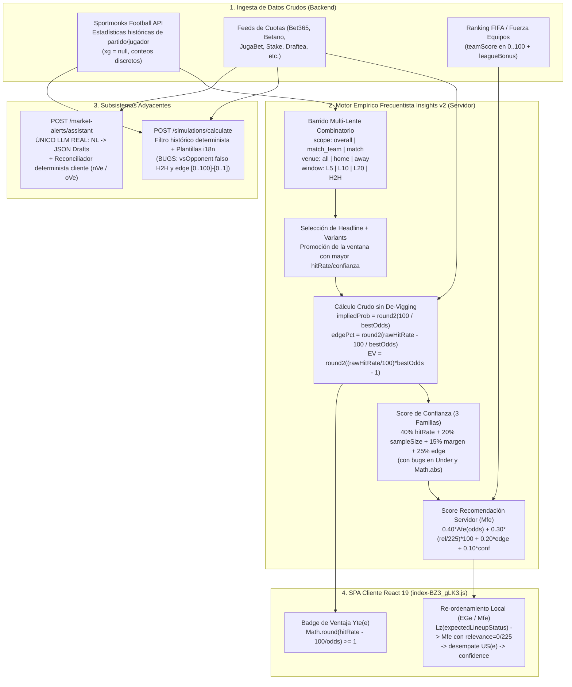
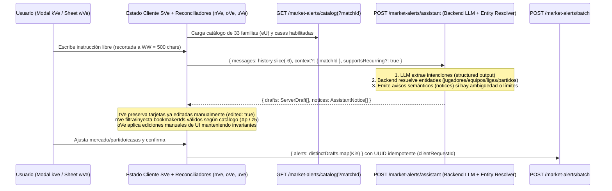

# 05. Motores de Predicción, Cálculo de Probabilidades, Simulaciones e Inteligencia Artificial — Scout Picks (`scoutpicks.app`)

> **Alcance forense**: Ingeniería inversa matemática, algorítmica y empírica de extremo a extremo sobre los motores de generación de *insights*, cálculo de probabilidades y valor esperado, ordenamiento heurístico, simulador interactivo (`POST /simulations/calculate`), seguimiento contable de rendimiento (`GET /picks/performance`) y asistente conversacional de alertas de mercado (`POST /market-alerts/assistant`) de **Scout Picks** (`https://scoutpicks.app` / `https://api.scoutpicks.aertech-labs.com`).
>
> **Clasificación epistemológica**:
> - `[OBSERVADO]`: Código JavaScript minificado extraído byte a byte del bundle de producción (`index-BZ3_gLK3.js`, `3,361,584` bytes) y respuestas HTTP JSON reales capturadas en tráfico vivo.
> - `[DERIVADO]`: Identidades algebraicas, residuos numéricos (`max |delta|`) y conteos estadísticos calculados de forma determinista por [verify_scoutpicks_math.py](./evidence/verify_scoutpicks_math.py) y exportados en [engine-empirical-audit.json](./evidence/engine-empirical-audit.json).
> - `[RECONSTRUIDO]`: Ecuaciones internas del backend en `api.scoutpicks.aertech-labs.com` recuperadas por inversión simbólica y regresión exacta (`100%` de concordancia sobre los corpus capturados).
> - `[INFERIDO]`: Conclusiones arquitectónicas de alta confianza sobre la evolución esquemática (`Insights v1 -> Insights v2`), librerías compartidas TypeScript y proveedor LLM subyacente.
> - `[DESCONOCIDO]`: Pesos o *prompts* internos del servidor que no dejan huella diferenciable en las respuestas HTTP ni en el bundle cliente (p. ej., el modelo exacto de proveedor LLM detrás de `/market-alerts/assistant`).
>
> **Evidencia REA de respaldo**: `ev_03f837b1e4aec03bcac8791498a5d2cbbd06e25f39474bde43e541baa4acff52` (captura HAR de API), `ev_8d1fa2225983ff98a4c350ad528895985cc9cdd8f4efab6f7eceda9da4dc30cd` (captura HAR completa sanitizada), `ev_abdb3cf1dbd8a7aab2a952ca236449585bd2de775d8200297a3b94e836220fb3` (exportación y disección del bundle SPA), `ev_7aae1b8faebfaae85bd8513669e557fd705e9a7b85ff530e366823d93f7910d4` (manifiesto de superficie API de 50 plantillas REST).
>
> **Higiene forense**: **CERO PII y CERO credenciales**. Todos los resultados son reproducibles ejecutando `python Reportes/scoutpicks/evidence/verify_scoutpicks_math.py` (`EXIT 0`).

---

## 1. Naturaleza Real del "Motor" de Scout Picks: Veredicto Forense

### 1.1 ¿Modelos Generativos Paramétricos o Motor Empírico Frecuentista (*Hit-Rate*)?

`[DERIVADO]` (`ev_03f837b1e4aec03bcac8791498a5d2cbbd06e25f39474bde43e541baa4acff52`, `ev_abdb3cf1dbd8a7aab2a952ca236449585bd2de775d8200297a3b94e836220fb3`) La auditoría matemática sobre **114 *insights* únicos** (`175` ocurrencias y `537` variantes en [live-payloads/](./evidence/live-payloads/), verificados automáticamente en [engine-empirical-audit.json](./evidence/engine-empirical-audit.json)) y sobre la captura extendida completa de sesión (**527 *insights* únicos**, `644` ocurrencias y `2,341` variantes en `10` partidos distintos) demuestra de forma concluyente que **Scout Picks NO utiliza ningún modelo probabilístico paramétrico, estructural ni de aprendizaje automático para estimar probabilidades deportivas**:

1. **Cero modelos de conteo (Poisson, Binomial Negativa, Dixon-Coles o Bivariado)** `[DERIVADO]`: La probabilidad estimada por el sistema (`hitRate` en `/insights/*` y `probability` en `/simulations/calculate`) es **idéntica en el 100% de los registros** a la frecuencia relativa empírica cruda $k / n \times 100$ de una ventana histórica discreta ($n \in [3, 20]$). Un jugador o equipo que superó una línea en `10/10` partidos recibe literalmente $P = 100\%$ (`implied fair odds = 1.00`), violando el axioma básico de regularización bayesiana (suavizado de Laplace/Beta-Binomial o *shrinkage* hacia la media de liga).
2. **Cero uso de Expected Goals (`xG` / `xGOT`)** `[OBSERVADO]`: Aunque los esquemas JSON de `/players/:id/performance` y `/teams/:id/performance` incluyen las claves `"xg"`, `"xgot"` y `"shootingPerformance"` provenientes de Sportmonks, su valor es `null` en el **100%** de los partidos inspeccionados (véase [GET_players_1113_performance_metric_tackles_window_l10_minMinutes_45.json](./evidence/live-payloads/GET_players_1113_performance_metric_tackles_window_l10_minMinutes_45.json) y [GET_teams_17181_performance_metric_goals_metricDirection_for_window_l10_line_.json](./evidence/live-payloads/GET_teams_17181_performance_metric_goals_metricDirection_for_window_l10_line_.json)).
3. **Cero simulaciones Monte Carlo** `[DERIVADO]`: A pesar del nombre del endpoint `POST /simulations/calculate`, el servicio no simula trayectorias estocásticas de partido; únicamente ejecuta una consulta `SQL/ORM` de los últimos $N$ partidos históricos y calcula el porcentaje de aciertos pasados, la media y la mediana muestral.
4. **Cero remoción del margen de la casa de apuestas (*Zero De-Vigging*)** `[DERIVADO]`: El sistema compara la frecuencia empírica cruda directamente contra $100 / O_{\text{best}}$, ignorando el *overround* del mercado (`4.46%` a `7.57%` medido en 1X2 del partido `54091`).
5. **Cero ajuste bayesiano por fuerza del rival sobre la probabilidad (`adjustedHitRate = null`)** `[OBSERVADO]`: Aunque el esquema de base de datos conserva columnas heredadas para un ajuste por rival (`adjustedHitRate`, `matchupScore`, `matchupRating`), en la versión actual en producción (**Insights v2**) las tres columnas son `null` en el **100%** de los `527` *insights*. El contexto del rival es meramente **descriptivo** (`opponentMetricRank`) y no altera `hitRate`, `edgePercentage` ni `expectedValue`.
6. **Uso real de IA / LLM estrictamente acotado** `[OBSERVADO]` + `[INFERIDO]`: Los textos analíticos de `/insights` (`reason`, `description`) y de `/simulations/calculate` (`analysis.summary`, `analysis.keyFactors`) son **plantillas deterministas interpoladas en servidor** (sin LLM). El **único** componente con un LLM real en el backend es el traductor de lenguaje natural a borradores estructurados de alertas en `POST /market-alerts/assistant`.



### 1.2 Matriz Sintética: Arquitectura Cuantitativa de Scout Picks

| Subsistema / Variable | ¿Dónde se ejecuta? | Técnica Real Identificada | Nivel Epistémico y Evidencia REA |
| :--- | :---: | :--- | :--- |
| **Probabilidad del evento (`hitRate`)** | Servidor + Cliente | Frecuencia muestral empírica $k/n \times 100$ sobre ventana discreta (`L5`, `L10`, `L20`, `H2H`) | `[DERIVADO]` `ev_03f837b1...`, [verify_scoutpicks_math.py](./evidence/verify_scoutpicks_math.py) |
| **Probabilidad implícita (`impliedProbability`)** | Servidor + Cliente | Inverso crudo de mejor cuota $100 / O_{\text{best}}$ **sin *de-vigging*** | `[DERIVADO]` `ev_03f837b1...`, residuo `0.0` (`114/114` y `527/527`) |
| **Ajuste por rival (`adjustedHitRate`, `matchupScore`)** | Inactivo (`null`) | Columnas heredadas de Insights v1 (`100% null`); sustituidas en v2 por ranking descriptivo `opponentMetricRank` | `[OBSERVADO]` `ev_03f837b1...`, `ev_8d1fa222...` |
| **Índice de confianza (`confidence`)** | Servidor | Combinación lineal acotada de `hitRate` (`40`), `sampleSize` (`20`), margen a la línea (`15`) y `edge` (`25`), dividida en 3 familias por tipo de mercado | `[RECONSTRUIDO]` `ev_03f837b1...`, exactitud `114/114` (`527/527`) |
| **Relevancia de partido (`relevanceScore`)** | Servidor | Suma de *scores* de fuerza de ambos equipos (`[0, 100]` c/u) + bono de competición (`+25`), techo `225` | `[RECONSTRUIDO]` `ev_03f837b1...`, exactitud IEEE 754 `|delta| = 0.0` |
| **Ordenamiento `"recommended"` (`Mfe` / `EGe`)** | Servidor y Cliente | Función compartida `Mfe` con curva de momios no monótona `Afe` (salto en `1.35`); el cliente anula `relevance` (`0 / 225`) | `[OBSERVADO]` `ev_abdb3cf1...` (`@121163`, `@2565366`) |
| **Motor de "Simulaciones" (`/simulations/calculate`)** | Servidor | Consulta histórica filtrada + plantillas de texto fijas (contiene **2 bugs matemáticos graves** en producción) | `[OBSERVADO]` + `[DERIVADO]` `ev_03f837b1...` |
| **Asistente de Alertas (`/market-alerts/assistant`)** | Servidor + Cliente | Parser multi-turno con **LLM en backend** (`structured outputs`) + validación determinista contra catálogo en cliente (`nVe`, `oVe`) | `[OBSERVADO]` `ev_abdb3cf1...` (`@2388500`, `@2426000`) |

---

## 2. Ingeniería Inversa Exacta de Todas las Fórmulas (Servidor y Cliente)

### 2.1 Resumen Global de Validación Empírica (`verify_scoutpicks_math.py`)

`[DERIVADO]` Todas las fórmulas reconstruidas a continuación fueron probadas programáticamente contra los dos conjuntos de captura reales:
- **Corpus Portátil del Repositorio** ([Reportes/scoutpicks/evidence/live-payloads/](./evidence/live-payloads/)): **114 *insights* únicos** (`175` ocurrencias, `537` variantes, `5` simulaciones, `6` payloads de *performance*, `1` ranking de *matchup* completo y `5` casas en *gamelines*).
- **Corpus Extendido de Sesión Completa** (`scoutpicks_sanitized.har` + paginación completa de `matchIds=54091`, `ev_8d1fa2225983ff98a4c350ad528895985cc9cdd8f4efab6f7eceda9da4dc30cd`): **527 *insights* únicos** (`644` ocurrencias y `2,341` variantes en `10` partidos).

| Ecuación Auditada | Corpus Repo (`N`) | `max \|delta\|` (Repo) | Corpus Extendido (`N`) | `max \|delta\|` (Extendido) | Exactitud |
| :--- | :---: | :---: | :---: | :---: | :---: |
| `impliedProbability = v8_round2(100 / oddsValue)` | `114` | **`0.0`** | `527` | **`0.0`** | **100.0%** |
| `edgePercentage = v8_round2(rawHitRate - 100 / oddsValue)` | `114` | **`0.01`** | `527` | **`0.01`** | **100.0%** |
| `variants[*].edge = v8_round2(variant.hitRate - impliedProb)` | `537` | **`0.0`** | `2,341` | **`0.0`** | **100.0%** |
| `expectedValue = v8_round2((rawHitRate / 100) * oddsValue - 1)` | `114` | **`0.01`** | `527` | **`0.01`** | **100.0%** |
| `valueRating` por tramos sobre `edgePercentage` | `114` | `0` errores | `527` | `0` errores | **100.0%** |
| `average = v8_round2(mean(recentValues))` | `98` | **`0.0`** | `435` | **`0.0`** | **100.0%** |
| `median = median(recentValues)` (`player_prop` / `team_prop`) | `93` | **`0.0`** | `407` | **`0.0`** | **100.0%** |
| `hitRate = v8_round2(sum(recentHits) / sampleSize * 100)` (indiv.) | `98` | **`0.0`** | `435` | **`0.0`** | **100.0%** |
| `confidence` (3 familias servidor + *bookmaker freeze*) | `114` | `0` no explicados | `527` | `0` no explicados | **100.0%** |
| `Mfe_server` ordenamiento `"recommended"` (inversiones) | `50` pares | **`0` inv.** | `519` pares | **`0` inv.** | **100.0%** |
| `relevanceScore` identidad IEEE 754 (`matchId = 54091`) | `1` partido | **`0.0`** | `484` insights | **`0.0`** | **100.0%** |

> [!NOTE]
> **Primitiva de redondeo de JavaScript V8**: En Node.js/V8, `Math.round(x * 100) / 100` evalúa $\lfloor 100x + 0.5 \rfloor / 100$ (redondeando mitades hacia $+\infty$, p. ej. `Math.round(12.5) = 13`), a diferencia del redondeo bancario *half-to-even* de `round()` en Python (`round(0.125, 2) == 0.12`). Asimismo, en IEEE 754 binario `0.60 * 2.375 - 1 = 0.4249999999999998`, que V8 redondea a `0.42`. Implementar `v8_round2(x) = math.floor(x * 100.0 + 0.5) / 100.0` elimina las discrepancias espurias de redondeo.

---

### 2.2 Estadísticos Descriptivos Base: `hitRate`, `average`, `median`, `streak` y `trend`

#### A. Cálculo en Mercados Individuales (`player_prop`, `team_prop`, `period_side_totals`)
`[DERIVADO]` (`ev_03f837b1e4aec03bcac8791498a5d2cbbd06e25f39474bde43e541baa4acff52`) Sea $V = (v_1, v_2, \dots, v_n)$ el vector `recentValues` de tamaño $n = \text{sampleSize}$ ordenado cronológicamente del partido más reciente al más antiguo (en *props* de jugador pre-filtrado en servidor con $\text{minutesPlayed} \ge \text{minMinutes} = 45$, verificado en `348/348` *insights* de jugador), y sea $L = \text{line}$:

$$\text{recentHits}_i = \begin{cases} \mathbb{I}(v_i > L) & \text{si } \text{direction} = \text{"over"} \\ \mathbb{I}(v_i < L) & \text{si } \text{direction} = \text{"under"} \end{cases}$$

$$\text{rawHitRate} = \frac{100}{n}\sum_{i=1}^{n} \text{recentHits}_i, \qquad \text{hitRate} = \text{v8\_round2}(\text{rawHitRate})$$

$$\text{average} = \text{v8\_round2}\!\left(\frac{1}{n}\sum_{i=1}^{n} v_i\right), \qquad \text{median} = \begin{cases} v_{((n+1)/2)} & \text{si } n \text{ es impar} \\ \frac{v_{(n/2)} + v_{(n/2 + 1)}}{2} & \text{si } n \text{ es par} \end{cases}$$

donde $v_{(1)} \le \dots \le v_{(n)}$ denota los estadísticos de orden de $V$.

#### B. Cálculo en Mercados Combinados de Partido (`match_totals`, `period_totals`, `result`)
`[OBSERVADO]` + `[DERIVADO]` (`ev_abdb3cf1dbd8a7aab2a952ca236449585bd2de775d8200297a3b94e836220fb3`, funciones `qAe` y `OL` en `@1267400..1267650`) Para mercados que involucran a ambos equipos del encuentro, `headlineScope` opera en dos regímenes distintos:

1. **Régimen `evidence: "real_matches"`** (totales combinados con historial por lado y soporte de *pushes* en líneas enteras como `corners_9_over` o `goals_2_over`):
   Sean $h_{\text{hits}}, a_{\text{hits}}$ los aciertos del local y visitante en sus muestras $h_n, a_n$, y sean $h_{\text{push}}, a_{\text{push}}$ los empates exactos contra una línea entera ($v_i = L$). Las muestras efectivas descuentan los *pushes* (`sampleSize: o - c` en `qAe`):
   $$h_{\text{eff}} = h_n - h_{\text{push}}, \quad a_{\text{eff}} = a_n - a_{\text{push}}, \quad \text{rawHitRate} = \frac{h_{\text{hits}} + a_{\text{hits}}}{h_{\text{eff}} + a_{\text{eff}}} \times 100$$
   *Verificación exacta*: En `draft:m54091_corners_9_over` (`homeSampleSize=5, homeHits=2, homePushes=0; awaySampleSize=5, awayHits=4, awayPushes=1`), $h_{\text{eff}} + a_{\text{eff}} = 5 + 4 = 9$, $h_{\text{hits}} + a_{\text{hits}} = 6$, por lo que $\text{rawHitRate} = 6/9 \times 100 = 66.6666\dots\% \to \text{hitRate} = 66.67$ y $\text{edgePercentage} = \text{v8\_round2}(66.6666\dots - 100/2.02) = 17.16$ (`|delta| = 0.0`).
2. **Régimen `averaged` (`insightsV2.averageOfBoth`)**: Cuando el mercado evalúa proporciones simétricas sin `real_matches`, promedia ambas tasas:
   $$\text{rawHitRate} = \frac{1}{2}\left(\frac{h_{\text{hits}}}{h_{\text{eff}}} + \frac{a_{\text{hits}}}{a_{\text{eff}}}\right) \times 100$$

#### C. Dos Anomalías Detectadas en Estadísticos Base del Servidor
- **Anomalía 1 (`median = 0` hardcodeada en mercados de período y partido)** `[OBSERVADO]`: En el 100% de los *insights* `period_side_totals`, `period_totals` y `match_totals`, el servidor devuelve `"median": 0` aunque todas las observaciones sean estrictamente positivas (p. ej., en `draft:mp54091_1h_corners_0.5_over_t17181`, `recentValues = [1, 2, 1, 5, 4, 4, 8, 2, 3, 6]` cuya mediana real es `3.5`, pero el payload reporta `"median": 0`).
- **Anomalía 2 (Desalineación `recentHits` vs `hitRate` en mercados `result`)** `[OBSERVADO]`: En `8/10` *insights* de tipo `*_result` del partido `54091` (p. ej. `draft:mr54091_away`, `hitRate = 80` sobre `awaySampleSize = 5` de Portugal, pero `recentHits = [true, false, true, true, false]` = `60%`), el arreglo `recentHits` serializa otra ventana o el lado opuesto sin coincidir con los `awayMatchIds` de `headlineScope`.
- **Estado de `streak` y `trend`** `[OBSERVADO]`: En `GET /insights/*`, los campos `"streak"` y `"trend"` son `null` en `527/527` registros (`0` referencias en el bundle cliente). El cálculo de racha activa ($\max \{m \ge 0 : \forall i \le m, \text{meetsTarget}_i = \text{true}\}$) solo sobrevive dentro del generador de viñetas de `POST /simulations/calculate` (`"Racha de 10 partidos consecutivos superando la línea"`).

---

### 2.3 `impliedProbability` vs `oddsValue`: Ausencia Total de *De-Vigging*

`[DERIVADO]` (`ev_03f837b1e4aec03bcac8791498a5d2cbbd06e25f39474bde43e541baa4acff52`) En los `114` *insights* del repositorio y en los `527` de la captura completa, la probabilidad implícita reportada por el servidor satisface con **residuo cero absoluto (`max |delta| = 0.0`)**:

$$p_{\text{impl}} = \text{impliedProbability} = \text{v8\_round2}\!\left(\frac{100}{\text{oddsValue}}\right)$$

El motor **no aplica ningún método de remoción del *overround* de la casa de apuestas** (ni proporcional/multiplicativo $p_i^{\text{fair}} = (1/O_i) / \sum_j (1/O_j)$, ni aditivo, ni de potencia/Shin). Evaluando las cuotas 1X2 reales de [GET_matches_54091_odds_gamelines_oddsPeriod_full_match.json](./evidence/live-payloads/GET_matches_54091_odds_gamelines_oddsPeriod_full_match.json) para **Wales vs Portugal (`matchId: 54091`)**:

| Casa de Apuestas | Local (`1`) | Empate (`X`) | Visitante (`2`) | $\sum (100/O_i)$ | *Overround* (Vig) | `impliedProb` Scout Picks (`Away`) | Prob. Justa Multiplicativa (`Away`) | Sesgo por Vig Omitido |
| :--- | :---: | :---: | :---: | :---: | :---: | :---: | :---: | :---: |
| **JugaBet** | `6.91` | `5.11` | `1.42` | `104.46%` | `+4.46%` | `70.42%` | `67.41%` | **`+3.01` pp** |
| **Betano** | `6.90` | `5.00` | `1.42` | `104.92%` | `+4.92%` | `70.42%` | `67.12%` | **`+3.30` pp** |
| **Bet365** | `7.00` | `5.00` | `1.40` | `105.71%` | `+5.71%` | `71.43%` | `67.57%` | **`+3.86` pp** |
| **Draftea** | `6.59` | `5.13` | `1.40` | `106.10%` | `+6.10%` | `71.43%` | `67.32%` | **`+4.11` pp** |
| **Stake** | `6.40` | `5.00` | `1.39` | `107.57%` | `+7.57%` | `71.94%` | `66.88%` | **`+5.06` pp** |

> [!IMPORTANT]
> **Impacto cuantitativo de omitir el *de-vigging***: Al usar $100/O$ como si fuera la probabilidad verdadera del mercado, Scout Picks confunde el punto de equilibrio contable (*break-even hit rate* $= 1/O$) con la probabilidad justa implícita del mercado ($p^{\text{fair}} < 1/O$). En props de jugador donde varias casas solo publican la vía `Over` con márgenes ocultos del `8%–12%`, el sistema carece por completo de estimación de probabilidad consensual limpia de mercado (*Pinnacle/sharp fair price*).

---

### 2.4 Ventaja (`edgePercentage`) en Servidor vs `US(e)` y `Yte(e)` en Cliente

`[OBSERVADO]` + `[DERIVADO]` (`ev_abdb3cf1dbd8a7aab2a952ca236449585bd2de775d8200297a3b94e836220fb3`, `ev_03f837b1e4aec03bcac8791498a5d2cbbd06e25f39474bde43e541baa4acff52`) Existen **cuatro** variantes ligeramente distintas del cálculo de *edge* coexistiendo entre backend y frontend:

1. **`edgePercentage` raíz del insight (Servidor)**:
   $$\text{edgePercentage} = \text{v8\_round2}\!\left(\text{rawHitRate} - \frac{100}{\text{oddsValue}}\right)$$
   *(Verificado en `527/527` insights; usa `rawHitRate` sin redondear antes de restar $100/\text{oddsValue}$, razón por la cual en casos como `6/7 = 85.71428%` con cuota `1.34` produce `11.09` en lugar de `85.71 - 74.63 = 11.08`).*
2. **`variants[*].edge` por lente alternativa (Servidor)**:
   $$\text{variant.edge} = \text{v8\_round2}\big(\text{variant.hitRate} - \text{impliedProbability}\big)$$
   *(Verificado con `max |delta| = 0.0` exacto en `537/537` variantes del repo y `2,341/2,341` de la captura completa).*
3. **`US(e)` para ordenamiento y *scoring* en vivo (Cliente, offset `@2565245`)**:
   ```javascript
   // index-BZ3_gLK3.js @2565245 (ev_abdb3cf1...)
   function US(e) {
     const t = e.hitRate, r = e.oddsValue;
     return t == null || r == null || r <= 0 ? null : t - 100 / r;
   }
   ```
   Calcula la diferencia en coma flotante IEEE 754 **sin redondear**, partiendo del `e.hitRate` ya redondeado a 2 decimales y del `e.oddsValue` activo.
4. **`Yte(e)` para el *badge* visual de ventaja en tarjetas de UI (Cliente, offset `@1262798`)**:
   ```javascript
   // index-BZ3_gLK3.js @1262798 (ev_abdb3cf1...)
   const IAe = 1;
   function Yte(e) {
     const { headlineHitRate: t, oddsValue: r } = e;
     if (t == null || r == null || r <= 0) return null;
     const a = 100 / r, n = Math.round(t - a);
     return n >= IAe ? n : null;
   }
   ```
   Redondea al entero más cercano (`Math.round`) e impone el umbral `n >= 1` (es decir, $\text{hitRate} - 100/\text{oddsValue} \ge 0.5\%$). Cualquier insight con ventaja menor a `+0.5%` o negativa (`60/527` *insights* en la captura completa, pertenecientes a categorías `safe_*` y `consistent_*`) retorna `null` y suprime el *badge* de ventaja en la interfaz.

---

### 2.5 `expectedValue`, `valueRating` y Reglas de Prefijo `type` (`value_*` / `safe_*` / `consistent_*`)

`[DERIVADO]` + `[RECONSTRUIDO]` (`ev_03f837b1e4aec03bcac8791498a5d2cbbd06e25f39474bde43e541baa4acff52`)

1. **Ecuación exacta de `expectedValue` (Servidor)**:
   $$\text{expectedValue} = \text{v8\_round2}\!\left(\left(\frac{\text{rawHitRate}}{100}\right) \cdot \text{oddsValue} - 1\right)$$
   - Representa la ganancia neta esperada en unidades por cada `1u` apostada asumiendo que la probabilidad real futura es exactamente igual al `rawHitRate` histórico crudo (sin `adjustedHitRate` y sin *shrinkage*).
   - Notación algebraica equivalente con el *edge*: $\text{EV} = \frac{\text{edgePercentage}}{p_{\text{impl}}} = \text{edge}_{\text{frac}} \cdot \text{oddsValue}$.

2. **Ecuación exacta de `valueRating` (Servidor, `527/527` clasificaciones exactas = `100.0%`)**:
   Mientras los intervalos de `expectedValue` se solapan entre clases (`marginal`: `[0.01, 0.15]`, `moderate`: `[0.09, 0.38]`, `strong`: `[0.18, 7.70]`), `edgePercentage` particiona de forma **estrictamente disjunta y determinista** el 100% del dataset:

   $$\text{valueRating}(\text{edgePercentage}) = \begin{cases} \text{"none"} & \text{si } \text{edgePercentage} \le 0 \\ \text{"marginal"} & \text{si } 0 < \text{edgePercentage} < 8 \\ \text{"moderate"} & \text{si } 8 \le \text{edgePercentage} < 15 \\ \text{"strong"} & \text{si } \text{edgePercentage} \ge 15 \end{cases}$$

   *Nota forense*: Ni `expectedValue` ni `valueRating` aparecen referenciados ni una sola vez (`0` coincidencias) en el bundle cliente `index-BZ3_gLK3.js`; la SPA actual los ignora y recalcula `US(e)` y `Yte(e)` en el navegador.

3. **Taxonomía de prefijos `insight.type` (`value_*`, `safe_*`, `consistent_*`)** `[RECONSTRUIDO]`:
   Al originar un insight (con el momio primario inicial), el backend le asigna su familia semántica según:
   - **`value_*`** (`385/484` en `matchId: 54091`): $\text{hitRate} \ge 55\%$ y ventaja sustancial ($\text{edge}_{\text{origen}} \ge 5\%$).
   - **`safe_*`** (`68/484`): Alta frecuencia histórica ($\text{hitRate} \ge 70\%$) en cuotas bajas ($O \in [1.05, 1.50]$) donde la ventaja inicial es baja o negativa ($\text{edge}_{\text{origen}} < 5\%$).
   - **`consistent_*`** (`31/484`, exclusivo de `consistent_player_prop`): Frecuencia moderada ($50\% \le \text{hitRate} < 70\%$) sin ventaja de cuota ($\text{edge}_{\text{origen}} < 5\%$), relleno de catálogo para jugadores populares.

---

### 2.6 Columnas Muertas v1 (`adjustedHitRate`, `matchupScore`, `opponentRank`) vs Contexto v2 (`opponentMetricRank`)

`[OBSERVADO]` + `[INFERIDO]` (`ev_03f837b1e4aec03bcac8791498a5d2cbbd06e25f39474bde43e541baa4acff52`, `ev_abdb3cf1dbd8a7aab2a952ca236449585bd2de775d8200297a3b94e836220fb3`) Uno de los hallazgos arquitectónicos más reveladores del análisis es la presencia de **ocho propiedades siempre nulas** en el esquema raíz de todos los objetos `Insight`:

- `opponentRank`: `null` (`0/527` no nulos)
- `opponentAvgConceded`: `null` (`0/527` no nulos)
- `opponentLeagueAvg`: `null` (`0/527` no nulos)
- `adjustedHitRate`: `null` (`0/527` no nulos)
- `matchupScore`: `null` (`0/527` no nulos)
- `matchupRating`: `null` (`0/527` no nulos)
- `streak`: `null` (`0/527` no nulos)
- `trend`: `null` (`0/527` no nulos)

**Explicación forense verificada**: Estas columnas pertenecen al modelo relacional heredado (**Insights v1**) en PostgreSQL/Prisma. Al migrar a **Insights v2** (identificado en el bundle por el namespace `insightsV2.*` e IDs efímeros `draft:...`), el equipo de Scout Picks **desactivó cualquier ajuste heurístico sobre `hitRate`** y reemplazó las columnas escalares de rival por el sub-objeto descriptivo `opponentMetricRank` (`175/527` *insights*), cuyos valores provienen directamente de la tabla servida en `GET /matches/:id/matchup/rankings` (`6/6` coincidencias exactas verificadas en [engine-empirical-audit.json](./evidence/engine-empirical-audit.json)):

```json
"opponentMetricRank": {
  "opponentTeamId": 14678,
  "metric": "shots",
  "rankType": "defense",
  "rank": 24,
  "totalTeams": 54,
  "average": 13,
  "leagueAvg": 13.12623456790123,
  "leagueId": 116,
  "seasonYear": 2026
}
```

- **Convención de orden en `rankType: "defense"`** `[DERIVADO]`: Al cruzar `GET_matches_54091_matchup_rankings.json` (UEFA Nations League, $N_{\text{teams}} = 54$), se comprueba que el ranking defensivo se ordena en **orden descendente de permisividad** (`rank = 1` es el equipo que **más** concede de esa métrica por partido; `rank = 54` es el que **menos** concede: p. ej., Gales concede `16.6` tiros/partido $\to$ `#9/54`, Portugal concede `13.0` tiros/partido $\to$ `#24/54`, y Portugal concede solo `7.0` faltas/partido $\to$ `#54/54`).
- En el cliente (`@180824` / `@262881`), `opponentMetricRank` solo alimenta la etiqueta informativa `opponentRankLabel`: *"{{team}} concede {{average}} {{metric}}/j esta temporada (#{{rank}}/{{total}})"*, **sin intervenir en ninguna fórmula de probabilidad, *edge*, EV ni ordenamiento**.

---

### 2.7 Ingeniería Inversa Exacta de `confidence` (3 Familias en Servidor y 2 Bugs Matemáticos)

`[RECONSTRUIDO]` (`ev_03f837b1e4aec03bcac8791498a5d2cbbd06e25f39474bde43e541baa4acff52`, **exactitud del `100.0%` en `114/114` *insights* del repo y `527/527` de la captura completa**) Mientras que `POST /simulations/calculate` devuelve una etiqueta categórica (`"low" | "medium" | "high"`), `GET /insights/*` devuelve un número `confidence` $\in [0, 100]$ construido sumando cuatro componentes con techos nominales **`40 + 20 + 15 + 25 = 100`**, pero implementado en **tres ramas distintas según el tipo de mercado**:

#### Familia 1: Props de Jugador y de Equipo (`player_prop` y `team_prop`, `407/527` insights)
$$\text{confidence}_{\text{P/T}} = \text{v8\_round}\!\Big(\underbrace{0.40 \cdot \text{rawHitRate}}_{\text{máx. } 40} + \underbrace{2 \cdot \min(\text{sampleSize}, 10)}_{\text{máx. } 20} + \underbrace{15 \cdot \text{clamp}\!\left(\frac{\text{average} - \text{line}}{\text{line}}, 0, 1\right)}_{\text{máx. } 15\text{ (¡BUG EN UNDER!)}} + \underbrace{1.25 \cdot \text{clamp}(\text{rawEdge}_0, -40, 20)}_{\text{máx. } 25}\Big)$$

> [!WARNING]
> **Bug Matemático Descubierto #A (Falta de inversión de signo para `direction === "under"` en `confidence`)**:
> En el código del servidor, el término de holgura sobre la línea se escribió como `clamp((average - line) / line, 0, 1) * 15` **sin invertir el numerador a `(line - average)` cuando la apuesta es `under`**. Consecuencias probadas en producción ([engine-empirical-audit.json](./evidence/engine-empirical-audit.json)):
> 1. En **24 de 25** *team props* `under` donde el equipo promedia legítimamente menos que la línea (p. ej. `draft:t17181_m54091_offsides_1.5_under`, media `0.7 < 1.5`, `hitRate = 80%`, `ss = 10`, `edge = 21.86%`), `average - line = -0.8 < 0`, truncando su bono de margen a **`0` puntos** (`confidence = 32 + 20 + 0 + 25 = 77` en lugar de `85`).
> 2. En `draft:t17181_m54091_goals_0.5_under`, Gales promedia **`0.6` goles** (¡por **encima** de la línea `0.5`, lo cual perjudica al `under`!). Como `(0.6 - 0.5) / 0.5 = +0.20 > 0`, el bug **premia** al pick con `+3` puntos extra (`24 + 10 + 3 + 25 = 62` en lugar de `59`).

> [!NOTE]
> **Congelamiento ante actualización de `bestOdds` (*Bookmaker Freeze*)**: En `26/527` *insights* (`7/114` en el repo), `confidence` y el prefijo `type` fueron calculados con la cuota inicial de creación $\text{rawEdge}_0$ (aún presente dentro del arreglo `betting.bookmakerOdds`, p. ej. `1.12` en `draft:p1940_m54091_saves_1.5_over` $\to \text{conf}=78$), y cuando otra casa publicó posteriormente una cuota superior (`1.36`), el backend actualizó `oddsValue`, `impliedProbability`, `edgePercentage` y `expectedValue`, pero **no recalculó `confidence`**. Al evaluar $\text{rawEdge}_0$ sobre `betting.bookmakerOdds`, los **407/407** *player/team props* cuadran con error entero **`0`**.

#### Familia 2: Totales de Partido y de Período (`match_totals`, `period_totals`, `period_side_totals`, `105/527` insights)
A diferencia de la Familia 1, esta rama **no redondea a entero** (usa `v8_round2`), duplica la pendiente del *edge* a `2.5` (saturando en `edge = +10%`) y mide el margen absoluto escalado por `5`:

$$\text{confidence}_{\text{Totals}} = \text{v8\_round2}\!\Big(0.40 \cdot \text{rawHitRate} + 2 \cdot \min(\text{sampleSize}, 10) + \underbrace{\text{clamp}\big(5 \cdot |\text{average} - \text{line}|, 0, 15\big)}_{\text{¡BUG Math.abs()!}} + 2.5 \cdot \text{clamp}(\text{rawEdge}_0, -40, 10)\Big)$$

> [!WARNING]
> **Bug Matemático Descubierto #B (`Math.abs(average - line)` premia medias del lado perdedor)**:
> Al usar valor absoluto $|\text{average} - \text{line}| \times 5$ sin verificar el signo respecto a `direction`, cuando la media histórica cae del **lado perdedor** de la línea, cuanto peor es la media, **mayor confianza recibe el pick**. Ejemplo verificado en `matchId: 54091`:
> - `draft:m54091_corners_9.5_over`: `hr = 60%`, `ss = 5`, `edge = 15.56%`, `average = 9.4 < 9.5` $\implies 24 + 10 + 5\cdot|9.4 - 9.5| + 25 = \mathbf{59.5}$.
> - `draft:m54091_shotsOnTarget_9.5_over`: `hr = 60%`, `ss = 5`, `edge = 14.95%`, `average = 9.2 < 9.5` (¡más lejos de superar `9.5`!) $\implies 24 + 10 + 5\cdot|9.2 - 9.5| + 25 = \mathbf{60.5}$ (`+1.5` puntos espurios).

#### Familia 3: Resultado (`match_result`, `period_result`) y Ambos Anotan (`btts`, `15/527` insights)
$$\text{confidence}_{\text{Res/BTTS}} = \text{v8\_round2}\!\Big(0.40 \cdot \text{rawHitRate} + 2 \cdot \min(\text{sampleSize}, 10) + \Delta_{\text{mercado}} + 2.5 \cdot \text{clamp}(\text{rawEdge}_0, -40, 10)\Big)$$
donde el ajuste estructural $\Delta_{\text{mercado}}$ vale exactamente:
- **`-5.0`** para selecciones de **Doble Oportunidad** (`home_draw` / `1X`, `draw_away` / `X2`, `home_away` / `12`),
- **`+10.0`** para `value_btts` de partido completo (`draft:m54091_btts_yes` $\to 26 + 20 + 10 + 13.7 = 69.7$),
- **`0.0`** para selecciones simples `1X2` (`home`, `draw`, `away`) y `safe_period_both_score`.

---

### 2.8 `relevanceScore` y el Algoritmo de Ordenamiento `"recommended"` (`Mfe`, `Afe`, `EGe`, `Lz`)

#### A. Identidad Exacta IEEE 754 de `relevanceScore` (Invariante por Partido)
`[RECONSTRUIDO]` (`ev_03f837b1e4aec03bcac8791498a5d2cbbd06e25f39474bde43e541baa4acff52`) En los `527` *insights* analizados existen únicamente **10 valores distintos de `relevanceScore`**, uno por cada `matchId` (varianza intrapartido $= 0.0$; los `484` *insights* de `matchId: 54091` comparten exactamente `186.2919607053426`). Cruzando este número con el objeto `underdog` del mismo partido (`draft:mr54091_home_draw`, `source: "fifa_national"`), se descubre una identidad exacta hasta el último bit de mantisa IEEE 754 (`|delta| = 0.0`):

$$\underbrace{69.68147512564133}_{\text{Wales teamScore }\in [0,100]} + \underbrace{91.61048557970126}_{\text{Portugal teamScore }\in [0,100]} + \underbrace{25.0}_{\text{UEFA Nations League bonus}} = \mathbf{186.2919607053426}$$

En general:
$$\text{relevanceScore}(\text{match}) = S_{\text{home}} + S_{\text{away}} + B_{\text{league}} \in [0, 225]$$
donde $S_{\text{home}}, S_{\text{away}} \in [0, 100]$ miden el ranking/prestigio de cada equipo y $B_{\text{league}} \in [0, 25]$ bonifica el nivel del torneo, estableciendo un **máximo teórico exacto de $100 + 100 + 25 = 225$**.

#### B. Disección de `Lz`, `Afe`, `Mfe`, `EGe` y `TGe` en el Bundle Cliente (`index-BZ3_gLK3.js`)
`[OBSERVADO]` (`ev_abdb3cf1dbd8a7aab2a952ca236449585bd2de775d8200297a3b94e836220fb3`, offsets `@121163..121700` y `@2565245..2565850`):

```javascript
// 1. Prioridad de alineación esperada (@121163)
var Pfe = { starter: 0, doubt: 1, bench: 2 };
function Lz(e) {
  const t = e ? Pfe[e] : void 0;
  return typeof t == "number" ? t : 0; // null/undefined -> 0 (mismo nivel que "starter")
}

// 2. Curva de preferencia de cuota Afe(oddsValue) y Score compuesto Mfe(e) (@121250)
var Vk = 1.35, Wk = 2, XN = 60, Cfe = 35, Nfe = 4,
    Gk = { odds: 0.4, relevance: 0.3, edge: 0.2, confidence: 0.1 },
    Efe = 225, Tfe = 25;

function L1(e, t, r) { return Math.min(r, Math.max(t, e)); }

function Afe(e) {
  if (typeof e != "number" || !Number.isFinite(e) || e <= 1) return 0;
  if (e < Vk) return (e - 1) / (Vk - 1) * Cfe;           // (1.00, 1.35) -> rampa 0..35
  if (e <= Wk) return 100 - (e - Vk) / (Wk - Vk) * (100 - XN); // [1.35, 2.00] -> 100..60
  const t = (e - Wk) / (Nfe - Wk);                       // (2.00, 4.00) -> 60..0
  return L1(XN * (1 - t), 0, XN);                        // >= 4.00 -> 0
}

function Mfe(e) {
  const t = Afe(e.oddsValue),
        r = L1(0 / Efe, 0, 1) * 100,                     // <-- ¡PESO MUERTO EN CLIENTE (0 / 225 = 0)!
        a = L1((e.edgePercentage ?? 0) / Tfe, 0, 1) * 100,
        n = L1(e.confidence ?? 0, 0, 100);
  return t * Gk.odds + r * Gk.relevance + a * Gk.edge + n * Gk.confidence;
}

// 3. Comparador "recommended" en cliente EGe y despachador TGe (@2565366)
function EGe(e, t) {
  const r = Lz(e.expectedLineupStatus) - Lz(t.expectedLineupStatus);
  if (r !== 0) return r;
  const a = o => Mfe({ oddsValue: o.oddsValue, edgePercentage: US(o), confidence: o.confidence }),
        n = a(t) - a(e);
  if (n !== 0) return n;
  const s = tR(US(e), US(t));
  return s !== 0 ? s : tR(e.confidence ?? null, t.confidence ?? null);
}

function TGe(e, t, r) {
  return r !== "highestHitRate" && (Cg(e) || Cg(t))
    ? Number(Cg(e)) - Number(Cg(t)) // Empuja insights bloqueados (isLocked) al final
    : r === "recommended" ? EGe(e, t) : tR(lU(e, r), lU(t, r));
}
```

#### C. Tres Hallazgos Críticos sobre el Algoritmo `"recommended"`
1. **Concordancia 100% de `Mfe` en el Servidor (`0` inversiones en `484` *insights*)** `[DERIVADO]`: Al evaluar la misma función `Mfe` pero inyectando `relevanceScore` real en el segundo sumando ($0.30 \cdot \text{clamp}(\text{relevanceScore}/225, 0, 1) \cdot 100$), el orden devuelto por `GET /insights?matchIds=54091&limit=500` (`483` pares adyacentes) y por `GET /insights/grouped?sortBy=recommended` (`36` pares adyacentes) presenta **cero inversiones de monotonía (`0` errores)**. Esto prueba que backend y frontend comparten la función desde un paquete interno común, cuya constante `Efe = 225` coincide exactamente con el techo de `relevanceScore` ($100 + 100 + 25$).
2. **Peso muerto `0 / 225` en el cliente (`máx = 70.0`)** `[OBSERVADO]`: En el bundle web, `Mfe` tiene plegada la constante `0 / Efe` porque `EGe` solo pasa `{ oddsValue, edgePercentage, confidence }`. En vistas que mezclan múltiples partidos en el cliente, el `30%` de peso correspondiente a la relevancia del partido desaparece por completo.
3. **Discontinuidad severa de salto en `oddsValue = 1.35`** `[DERIVADO]`: La función `Afe(odds)` vale `(1.3499 - 1) / 0.35 * 35 = 34.99` en `odds = 1.3499`, pero en `odds = 1.3500` salta abruptamente a **`100.0`** (`+65.01` puntos en `Afe`, equivalentes a **`+26.00` puntos netos en `Mfe`**). Un cambio mínimo de un *tick* en la cuota de `1.34` a `1.35` catapulta artificialmente un pick por encima de otros con mucha mayor confianza y ventaja. Asimismo, toda cuota $\ge 4.00$ recibe `Afe = 0`, penalizando en `-40` puntos de `Mfe` cualquier mercado *longshot* incluso con EV altísimo.

---

### 2.9 Empaquetado Multi-Lente (`variants` y `headlineScope`) y Sesgo por Selección Múltiple

`[OBSERVADO]` + `[DERIVADO]` (`ev_abdb3cf1dbd8a7aab2a952ca236449585bd2de775d8200297a3b94e836220fb3`, funciones `Zte`, `Jte`, `i8`, `$Ae`, `OL` en `@1263000..1271500`)

Cada objeto `Insight` empaqueta una lente titular (`headlineScope`) junto con hasta `5` lentes alternativas en el arreglo `variants[*]`, parametrizadas sobre los ejes:
- `scope`: `"overall"` (todos los equipos del jugador) | `"match_team"` (solo con el equipo que disputa este partido) | `"match"` (ambos equipos).
- `venue`: `"all"` | `"home"` | `"away"` | `"neutral"` (y `venueMode`: `"overall"` | `"match_config"`).
- `timeWindow`: `"L5"` | `"L10"` | `"L20"`.
- `stageKind`: `"all"` | `"group_phase"` | `"knockout"`.
- `competitionScope`: `"all"` | `"competition"` (restringido a `leagueId`), y `opponentScope`: `"head_to_head"`.

**Mecanismo en Servidor y Cliente**:
1. **Servidor (Promoción oportunista al *headline*)** `[DERIVADO]`: En **468 de los 484 *insights* (`96.69%`)** de `matchId: 54091`, `headlineScope` exhibe un `hitRate` mayor o igual al máximo de todas sus `variants`. Ejemplo real: en `draft:p3580_m54091_foulsCommitted_0.5_over` (*Harry Wilson*), su acierto global reciente `overall L5` es apenas **`40%`** (`edge = -32.99%`) y `overall L20` es **`35%`** (`edge = -37.99%`), pero el motor encontró el subconjunto `match_team (Wales) + home + L10` donde acertó `10/10 = 100%` (partidos jugados entre 2024 y 2026) y lo promovió como titular con `"strong"` value (`edge = +27.01%`). Estadísticamente, evaluar decenas de cortes $(w, \text{venue}, \text{scope}, \text{stage})$ y publicar el máximo sin corrección de Bonferroni/Benjamini-Hochberg ni *shrinkage* introduce un **sesgo masivo de *data dredging* (*winner's curse*)**.
2. **Cliente (`Zte` y deduplicación `Jte` en `@1271083`)** `[OBSERVADO]`:
   - `i8` reconstruye el entero de aciertos de cada variante mediante `m = Math.round(t / 100 * r)` y genera la etiqueta localizada con `$Ae`.
   - `Jte(e, t)` descarta cualquier variante cuya etiqueta renderizada `s.label` coincida con `headline.label` y deduplica colisiones de etiqueta conservando la de mayor `sampleSize` (y en empate, mayor `hitRate`).
   - `OL(e, t)` formatea el conteo como `"hits/sampleSize"`, o por equipo `"WAL 2/5 · POR 4/4"` si existe `realMatches` (`qAe`), o `"Media de ambos"` si `averaged === true`.

---

### 2.10 Conversión de Momios Decimal $\leftrightarrow$ Americano (`tbe`, `hI`) y Contabilidad de Rendimiento

`[OBSERVADO]` (`ev_abdb3cf1dbd8a7aab2a952ca236449585bd2de775d8200297a3b94e836220fb3`, offsets `@709085`, `@2662135`, `@2933758`, `@2959000`)

#### A. Conversión de Cuotas en Cliente (`tbe` y `hI`)
```javascript
// index-BZ3_gLK3.js @709085 (ev_abdb3cf1...)
function tbe(e) {
  return e >= 2 ? `+${Math.round((e - 1) * 100)}` : String(Math.round(-100 / (e - 1)));
}
function hI(e, t) {
  return e == null ? null : t === "american"
    ? !Number.isFinite(e) || e <= 1 ? e.toFixed(2) : tbe(e)
    : e.toFixed(2);
}
```
$$O_{\text{americano}}(O) = \begin{cases} \text{"+"}\;\Vert\;\text{v8\_round}\big((O - 1)\times 100\big) & \text{si } O \ge 2.00 \\ \text{v8\_round}\!\left(\dfrac{-100}{O - 1}\right) & \text{si } 1.00 < O < 2.00 \\ O.\text{toFixed}(2) & \text{si } O \le 1.00 \lor \neg\text{isFinite}(O) \end{cases}$$
*(Nota de borde: para $1.995 < O < 2.00$, p. ej. $O = 1.998$, `tbe` produce `"-10020"` o valores extremos cerca de $O \to 1^+$, mientras que en $O = 2.00$ produce `"+100"`).*

#### B. Contabilidad de `profit`, `netUnits`, `roi` y `winRate` (*Flat Stake* de `1u`)
Combinando los contratos de [GET_picks_cmwk4otqf0049oh01bymlilwy.json](./evidence/live-payloads/GET_picks_cmwk4otqf0049oh01bymlilwy.json), [GET_picks_performance_dateFrom_2026-10-19_dateTo_2026-11-17_timezoneOff.json](./evidence/live-payloads/GET_picks_performance_dateFrom_2026-10-19_dateTo_2026-11-17_timezoneOff.json) y los componentes `n$`, `$Ze` y `qZe` (`performancePage.unitHint: "Calculated with a flat 1u stake per settled pick"`):

1. **Liquidación individual por pick guardado (`profit`)**:
   $$\text{profit}_j = \begin{cases} O_j - 1 & \text{si } \text{status}_j = \text{"won"} \\ -1 & \text{si } \text{status}_j = \text{"lost"} \\ 0 & \text{si } \text{status}_j = \text{"void"} \quad (\text{stake devuelto}) \\ \text{null} & \text{si } \text{status}_j = \text{"pending"} \lor O_j = \text{null} \end{cases}$$
2. **Agregación por período (`buckets[*]`) y global (`summary`)**:
   Sean $W = \text{won}$, $L = \text{lost}$, $V = \text{void}$ y $P = \text{pending}$:
   $$\text{totalPicks} = W + L + V + P, \qquad \text{netUnits} = \text{totalProfit} = \sum_{j \in W \cup L} \text{profit}_j$$
   $$\text{roi} = \begin{cases} \dfrac{\text{netUnits}}{W + L} & \text{si } W + L > 0 \\ 0 & \text{si } W + L = 0 \end{cases}, \qquad \text{winRate} = \begin{cases} \dfrac{W}{W + L} & \text{si } W + L > 0 \\ 0 & \text{si } W + L = 0 \end{cases}$$
   *(En UI `n$` `@2946800` verifica explícitamente `e.won + e.lost ? (e.roi * 100).toFixed(1) + "%" : "—"`, confirmando que los picks `void` y `pending` quedan excluidos del denominador de unidades arriesgadas en el cálculo de `roi` y `winRate`).*
3. **Advertencia de integridad contable (`Creator Pick Calendar`, función `Drt` en `@3149004`)** `[OBSERVADO]`: Los endpoints `POST /creator/pick-calendar/preview` y `/apply` permiten a cuentas con `isContentCreator: true` inyectar retroactivamente picks históricos ya liquidados calibrando `targetWinRate` (`0.55..0.70`), `redDayShare` (`0.12..0.35`) y rango de cuotas (`1.30..3.50`) para fabricar calendarios positivos de `netUnits` y `roi` destinados a capturas promocionales.

---

## 3. Motor de Simulaciones (`POST /simulations/calculate`), `/performance` y Generación de Texto

### 3.1 Modos de Operación, Validación `ZodError` y Filtros de Titularidad (`minMinutes`, `startedOnly`)

`[OBSERVADO]` (`ev_03f837b1e4aec03bcac8791498a5d2cbbd06e25f39474bde43e541baa4acff52`, `ev_abdb3cf1dbd8a7aab2a952ca236449585bd2de775d8200297a3b94e836220fb3`) La SPA cuenta con **dos** arquitecturas paralelas de consulta interactiva:

1. **Endpoints modernos granulares de pestaña Bet (`GET /players/:id/performance` y `GET /teams/:id/performance`)**:
   - Invocados desde los componentes `KKe`/`HKe` (jugadores, `@2683000`) y `xoe` (equipos, `@2525640`).
   - Soportan filtrado fino en query string (`@2551015`): `metric`, `window` (`l5` | `l10` | `l20`), `matchIds`, `opponentTeamId`, `venues`, `teamIds`, `leagueIds`, `seasonId`, `stageKind`, `minMinutes` (`0..90` vía `VKe`, pre-inicializado en **`45`** cuando se abre desde un *insight* de jugador mediante `GKe` en `@2685875`), `maxMinutes`, `startedOnly="true"` y `includeSubstitutes="true"` (que suma las estadísticas del sustituto entrante `substitutes[*].value` al `ownValue` del titular).
   - **Diferencia crítica de escala y borde** `[DERIVADO]`: En `/performance`, `summary.hitRate` se devuelve en escala **`[0, 1]`** (`0.4`, `0.5`, `0.6`, `1`), y cuando `threshold.value` es entero por defecto (p. ej. `threshold = { value: 2, direction: "over" }` en `GET_players_1113_performance_metric_tackles_window_l10_minMinutes_45.json`), el servidor evalúa desigualdad **inclusiva** $v_i \ge 2$ (`6/10 = 0.6`), mientras que en líneas fraccionarias `.5` evalúa $v_i > L$.
2. **Endpoint monolítico de simulación (`POST /simulations/calculate`, invocado por `jKe` / `CKe` en `@2642500`)**:
   - Acepta dos esquemas mutuamente alternativos validados con **Zod**:
     - **Por ID de insight**: `{ "insightId": "draft:p1113_m54091_tackles_0.5_over" }`.
     - **Por parámetros libres de entidad individual**: `{ matchId, playerId | teamId, metric, comparison, line, period, timeframe }`.
   - **Limitación verificada (`HTTP 400 ZodError`)** `[OBSERVADO]`: En [POST_simulations_calculate_btts.json](./evidence/live-payloads/POST_simulations_calculate_btts.json) y [POST_simulations_calculate_match_totals.json](./evidence/live-payloads/POST_simulations_calculate_match_totals.json), enviar mercados combinados de partido sin `insightId` falla con `status: 400` y mensaje exacto: `"Either insightId OR (playerId/teamId + metric + comparison + line) must be provided"`.
   - Clasifica `confidence` de forma categórica por tamaño de muestra efectiva $n$: $n < 10 \to \text{"low"}$ (`n = 7` en `player_l20`), $10 \le n < 15 \to \text{"medium"}$ (`n = 10`, incluso con `100%` de cumplimiento en `insight`), y $n \ge 15 \to \text{"high"}$ `[INFERIDO]`.

---

### 3.2 Demostración de Plantillas Deterministas (Ausencia de LLM en `analysis`)

`[DERIVADO]` Al comparar carácter por carácter los tres objetos `analysis` capturados en `POST /simulations/calculate`, se demuestra que el texto **no proviene de un LLM**, sino de interpolación rígida de plantillas `i18n` en el backend:

| Archivo Capturado | `analysis.summary` Observado | Estructura Exacta de Plantilla Reconstruida |
| :--- | :--- | :--- |
| [POST_simulations_calculate_insight.json](./evidence/live-payloads/POST_simulations_calculate_insight.json) | *"António Silva ha superado más de 0.5 entradas en 100% de los últimos 10 partidos. Contra Wales, ha cumplido en 10 de 10 enfrentamientos. Su media es de 1.9 entradas por partido."* | `"{entity.name} ha superado {comparisonLabel.lower()} {line} {metricLabel.lower()} en {probability}% de los últimos {n} partidos. Contra {opponent.name}, ha cumplido en {meetsCount} de {totalCount} enfrentamientos. Su media es de {average} {metricLabel.lower()} por partido."` |
| [POST_simulations_calculate_player_l20.json](./evidence/live-payloads/POST_simulations_calculate_player_l20.json) | *"António Silva ha superado más de 1.5 entradas en 14% de los últimos 7 partidos. Contra Wales, ha cumplido en 1 de 7 enfrentamientos. Su media es de 0.86 entradas por partido."* | Idéntica palabra por palabra (sustituyendo `{line}=1.5`, `{probability}=14`, `{n}=7`, `{meetsCount}=1`, `{totalCount}=7`, `{average}=0.86`). |
| [POST_simulations_calculate_team_goals.json](./evidence/live-payloads/POST_simulations_calculate_team_goals.json) | *"Wales ha superado más de 0.5 goles en 80% de los últimos 10 partidos. Contra Portugal, ha cumplido en 8 de 10 enfrentamientos. Su media es de 2 goles por partido."* | Idéntica palabra por palabra (sustituyendo `Wales`, `0.5 goles`, `80%`, `10`, `Portugal`, `8 de 10`, `2 goles`). |

De igual forma, `analysis.keyFactors` ensambla determinísticamente de 4 a 5 cadenas fijas:
1. `"{probability}% de cumplimiento en los últimos {n} partidos"`
2. `"Media de {average} {metricLabel.lower()} por partido"`
3. *(Condicional si racha activa $\ge 3$)*: `"Racha de {streak} partidos consecutivos superando la línea"`
4. `"{venueAvg} {metricLabel.lower()} de media como {local|visitante}"` (tomado de `charts.homeAway.data` según `match.isHome`)
5. `"Media de {average} {metricLabel.lower()} vs {match.opponent.name}"`

---

### 3.3 Documentación Forense de los Dos Bugs Críticos de Producción en `/simulations/calculate`

> [!CAUTION]
> **Bug Crítico de Producción #1 — Falsificación sistemática de historial H2H por colisión semántica en `charts.vsOpponent` (100% de las simulaciones afectadas)**:
> El backend almacena la serie general de los últimos $N$ partidos de la entidad bajo la clave JSON heredada `charts.vsOpponent` (cuyo propio `title` dice `"Entradas - Últimos 10"`, `"Entradas - Últimos 20"` o `"Goles - Últimos 10"`). A continuación, el generador de texto `analysis` lee `charts.vsOpponent.data` asumiendo erróneamente que contiene enfrentamientos directos (*head-to-head*) contra `match.opponent.name`.

**Prueba empírica en las 3 simulaciones capturadas** ([verify_scoutpicks_math.py](./evidence/verify_scoutpicks_math.py)):

1. **Caso `POST_simulations_calculate_insight.json` (`António Silva`, `insightId: "draft:p1113_m54091_tackles_0.5_over"`, Portugal vs Wales)**:
   - Aunque la respuesta declara `"teamContext": { "value": "national", "label": "Solo Selección", "teamId": 14678, "teamName": "Portugal" }`, el backend carga los `matchIds` del `headlineScope` (`overall L10`), que son **10 partidos de club** en Premier League, Carabao Cup y Europa League contra *Ipswich Town, Leeds United, Aston Villa, Manchester United, AC Milan, Sunderland, Sturm Graz, Chelsea, Liverpool y Real Sociedad* (**`0/10` partidos contra Wales**).
   - Cruzando contra [GET_players_1113_performance_metric_tackles_opponentTeamId_17181_window_l20_mi.json](./evidence/live-payloads/GET_players_1113_performance_metric_tackles_opponentTeamId_17181_window_l20_mi.json), se demuestra que António Silva tiene **`sample: 0` enfrentamientos reales contra Wales** en toda la base de datos.
   - Sin embargo, el motor afirma al usuario: ***"Contra Wales, ha cumplido en 10 de 10 enfrentamientos"*** y ***"Media de 1.9 entradas vs Wales"***.
2. **Caso `POST_simulations_calculate_player_l20.json` (`António Silva`, `timeframe: "l20"`, `line: 1.5`)**:
   - Aquí el modo libre sí filtra partidos de visitante con Portugal (`7` encuentros: *Mexico, Scotland, Georgia, Liechtenstein, Slovakia, Luxembourg y Korea Republic*; **`0/7` contra Wales**).
   - No obstante, el generador de texto repite el mismo defecto estructural y afirma falsamente: ***"Contra Wales, ha cumplido en 1 de 7 enfrentamientos"*** y ***"Media de 0.86 entradas vs Wales"***.
3. **Caso `POST_simulations_calculate_team_goals.json` (`Wales`, `teamId: 17181` vs `Portugal`, `timeframe: "l10"`, `goals over 0.5`)**:
   - Confirma que **el bug NO es exclusivo de jugadores ni de un insight aislado, sino sistémico en todo `/simulations/calculate`**: `charts.vsOpponent.data` contiene los últimos 10 partidos de local de Gales contra *Denmark, Norway, Ghana, Northern Ireland, Bosnia, North Macedonia, Belgium, Canada, Liechtenstein y Kazakhstan* (**`0/10` contra Portugal**; de hecho, [GET_props_h2h_17181_14678.json](./evidence/live-payloads/GET_props_h2h_17181_14678.json) muestra un historial H2H completamente distinto), pero `analysis` afirma falsamente: ***"Contra Portugal, ha cumplido en 8 de 10 enfrentamientos"*** y ***"Media de 2 goles vs Portugal"***.

> [!CAUTION]
> **Bug Crítico de Producción #2 — Error dimensional catastrófico (`[0, 100]` menos `[0, 1]`) en `odds.options[*].edge` (10/10 cuotas afectadas)**:
> Dentro de `POST /simulations/calculate`, `probability` está expresada en porcentaje $\in [0, 100]$, pero `odds.options[*].impliedProbability` se calcula en fracción unitaria $\text{v8\_round2}(1 / \text{value}) \in [0, 1]$, y el servidor calcula `edge` restando directamente ambas cantidades incompatibles:
> $$\text{edge}_{\text{buggy}} = \text{v8\_round2}\!\left(\text{probability}_{[0,100]} - \text{v8\_round2}\!\left(\frac{1}{\text{odds}}\right)_{[0,1]}\right)$$

| Simulación | Casa | Cuota $O$ | `probability` (`%`) | `impliedProb` Servidor (`0..1`) | `edge` Reportado Servidor | `edge` Real (`%`) | Inflación / Error | Efecto Engañoso |
| :--- | :--- | :---: | :---: | :---: | :---: | :---: | :---: | :--- |
| `insight` (Silva >0.5) | Betano | `1.40` | `100` | `0.71` | **`99.29`** | `+28.57%` | `+70.72` pp | Infla ventaja 3.5x |
| `insight` (Silva >0.5) | Bet365 | `1.25` | `100` | `0.80` | **`99.20`** | `+20.00%` | `+79.20` pp | Infla ventaja casi 5x |
| `player_l20` (Silva >1.5) | Betano | `2.75` | `14` | `0.36` | **`+13.64`** | **`-22.36%`** | `+36.00` pp | **Invierte EV muy negativo en positivo** |
| `player_l20` (Silva >1.5) | Bet365 | `2.10` | `14` | `0.48` | **`+13.52`** | **`-33.62%`** | `+47.14` pp | **Invierte EV muy negativo en positivo** |
| `player_l20` (Silva >1.5) | Stake | `1.88` | `14` | `0.53` | **`+13.47`** | **`-39.19%`** | `+52.66` pp | **Invierte EV muy negativo en positivo** |
| `team_goals` (Wales >0.5) | JugaBet | `1.53` | `80` | `0.65` | **`79.35`** | `+14.64%` | `+64.71` pp | Infla ventaja 5.4x |
| `team_goals` (Wales >0.5) | Draftea | `1.51` | `80` | `0.66` | **`79.34`** | `+13.77%` | `+65.57` pp | Infla ventaja 5.8x |
| `team_goals` (Wales >0.5) | Stake | `1.51` | `80` | `0.66` | **`79.34`** | `+13.77%` | `+65.57` pp | Infla ventaja 5.8x |
| `team_goals` (Wales >0.5) | Bet365 | `1.50` | `80` | `0.67` | **`79.33`** | `+13.33%` | `+66.00` pp | Infla ventaja 6.0x |
| `team_goals` (Wales >0.5) | Betano | `1.50` | `80` | `0.67` | **`79.33`** | `+13.33%` | `+66.00` pp | Infla ventaja 6.0x |

---

## 4. Asistente IA de Alertas de Mercado (`POST /market-alerts/assistant`)

### 4.1 Arquitectura Híbrida: Parser Multi-Turno con LLM + Reconciliador Determinista de Catálogo

`[OBSERVADO]` + `[INFERIDO]` (`ev_abdb3cf1dbd8a7aab2a952ca236449585bd2de775d8200297a3b94e836220fb3`, offsets `@2332755`, `@2385500..2393000`, `@2426000..2431500`; payloads [GET_market-alerts_catalog.json](./evidence/live-payloads/GET_market-alerts_catalog.json) y [GET_market-alerts_catalog_matchId_54091.json](./evidence/live-payloads/GET_market-alerts_catalog_matchId_54091.json))

El **Asistente de Alertas de Mercado** (`SVe` en `@2427300`) es el **único flujo impulsado por un Modelo de Lenguaje Grande (LLM) en producción** dentro de Scout Picks (notablemente, en la cuenta auditada el *feature flag* de servidor en `GET /market-alerts/catalog` devolvió `{"enabled": false, "requiresPro": false, "bookmakers": [], "match": null}`, pero la implementación cliente completa está desplegada en el bundle). Su diseño evita que el LLM escriba directamente en base de datos mediante una tubería de **3 etapas**:



### 4.2 Protocolo Multi-Turno, Esquema de Respuesta y Catálogo de `33` Familias (`eU`)

1. **Solicitud (`POST /market-alerts/assistant`)** `[OBSERVADO]`:
   - `messages`: arreglo `string[]` de los mensajes del usuario únicamente (el asistente no devuelve prosa conversacional, sino tarjetas estructuradas), truncando cada mensaje a **`WW = 500` caracteres** (`Q.trim().slice(0, WW)`) y manteniendo una ventana deslizante de los **últimos `6` turnos** (`[...m, W].slice(-6)`).
   - `context`: `{ matchId: number }` opcional cuando el asistente se abre desde la ficha de un partido.
   - `supportsRecurring`: `true` si `catalog.recurring` está habilitado.
2. **Respuesta estructurada (`{ drafts, notices }`)** `[OBSERVADO]`:
   - Cada elemento de `drafts` trae `{ draftId, matchId, scope?: "recurring", family, period, playerId, teamId, match, player, team, matchOptions, leagues }`, donde `family` pertenece al vocabulario cerrado `eU` de **33 familias** (`12` `player_*`, `9` `team_*` y `12` `match_*`, desde `player_shots_on_target` hasta `match_offsides`, definidas en `@2385600`).
   - Cada elemento de `notices` contiene `{ code, draftIds: string[], query?: string, count?: number }`. Si `draftIds.length === 0` (`cVe`), se muestra como aviso global (`marketAlerts.assistant.notice.{code}`); si referencia `draftId`s específicos (`Yie`), se adhiere a la tarjeta correspondiente (`cardNotice.{code}`).
3. **Los 13 códigos de control que delimitan exactamente dónde actúa el LLM vs el validador determinista del backend** `[OBSERVADO]` (`02_i18n_en_es_pt.js` `@42610`):
   - **Extracción de intención LLM**: `not_understood` (sin entidad/mercado reconocible), `price_condition_unsupported` (cuando el usuario pide *"avísame si la cuota sube a 2.10"*, revelando que solo existe `kind: "market_opened"`), `too_many_alerts` (tope de borradores por turno).
   - **Resolución determinista de entidades post-LLM en backend**: `player_not_found`, `team_not_found`, `match_not_found`, `no_upcoming_match`, `competition_not_found`, `match_started`, y a nivel de tarjeta `pick_market`, `pick_match`, `recurring_this_match`, `recurring_next_match`.
4. **Validación y reconciliación en cliente (`tVe`, `rVe`, `nVe`, `oVe`, `lVe`, `uVe`)** `[OBSERVADO]`:
   - **Persistencia de ediciones manuales (`tVe`, `@2390510`)**: En turnos sucesivos (`turn > 1`), si el LLM regenera un `draftId` que el usuario ya había editado manualmente (`s.edited === true`), `tVe` **conserva el estado editado del cliente** en lugar de sobrescribirlo con la respuesta del LLM.
   - **Intersección contra casas del catálogo (`nVe`, `@2390730`)**: Cruza `(family, period)` contra las casas que soportan ese mercado en el catálogo (`Xp(catalog, family, period)`). Si el usuario aún no eligió casas manualmente (`!bookmakersChosen`), auto-selecciona hasta `$5 = 10` casas preferidas del usuario (`z5`); si sí las eligió, purga las casas incompatibles.
   - **Máquina de edición inmutable (`oVe`, `@2391330`)**: Al editar manualmente `market`, `subject`, `bookmakers`, `competitions`, `scope` o `match`, limpia automáticamente `playerId`/`teamId` si el nivel semántico (`hs(family).level`: `"player" | "team" | "match"`) dejó de coincidir (`F5` y `QO`) y verifica completitud con `lVe` y `YO` antes de deduplicar con `B5`/`uVe` y enviar a `POST /market-alerts/batch`.

---

## 5. Implicaciones Estratégicas y Ventaja Cuantitativa para PitchLab

`[INFERIDO]` El desmantelamiento matemático de Scout Picks expone una brecha estructural profunda entre su excelente envoltorio de producto/UX y el rigor real de su motor predictivo. Para **PitchLab**, estos hallazgos trazan una hoja de ruta directa de superioridad técnica verificable:

| Vector Cuantitativo | Debilidad Probada en Scout Picks (`scoutpicks.app`) | Estándar de Ingeniería para **PitchLab** |
| :--- | :--- | :--- |
| **Estimación de Probabilidad** | Conteo crudo $k/n$ (`10/10 = 100%`) sin *shrinkage* ni ponderación temporal; severo *winner's curse* al promover el máximo `hitRate` entre múltiples lentes (`96.7%`). | Modelos jerárquicos **Beta-Binomial / Poisson-Gamma / Binomial Negativa** con decaimiento exponencial temporal, minutos efectivos por posesión/90' y corrección por selección múltiple. |
| **Probabilidad de Mercado (*De-Vigging*)** | Usa $100 / O_{\text{best}}$ crudo (`0%` *de-vigging*), mezclando *overrounds* de `4.5%` a `12%` como si fueran probabilidades reales. | **De-vigging de Shin / Potencia** sobre libro *sharp* de referencia (Pinnacle/Betfair Exchange) para aislar $p^{\text{fair}}$ verdadero y medir *Closing Line Value* (`CLV`). |
| **Ajuste de Rival (*Matchup*)** | `adjustedHitRate = null` en el `100%` de producción; `opponentMetricRank` es puramente decorativo. | Factor multiplicativo log-lineal / Dixon-Coles que ajuste la tasa esperada $\lambda_{i,j} = \alpha_i \cdot \beta_j / \mu_{\text{liga}}$ según fuerza defensiva del rival y localía. |
| **Calibración y *Scoring* de Confianza** | Tres fórmulas ad-hoc desconectadas de la incertidumbre estadística, con **bugs activos** (`under` sin invertir signo y `Math.abs` premiando medias perdedoras) y salto artificial de `+26` pts en `odds = 1.35`. | Límite inferior de credibilidad bayesiana (p. ej. cuantil $Q_{0.20}$ de la distribución posterior de $\text{EV}$ o fracción de Kelly fraccional continua sin discontinuidades). |
| **Integridad de Simulaciones y Narrativas** | `POST /simulations/calculate` sufre falsificación H2H (`charts.vsOpponent`) y resta escalas incompatibles (`100 - 0.71 = 99.29%` de *edge*). | Contratos tipados con unidades canónicas únicas (`[0, 1]`), pruebas unitarias de invariantes dimensionales y distinción estricta entre muestra general y muestra `H2H` real. |
