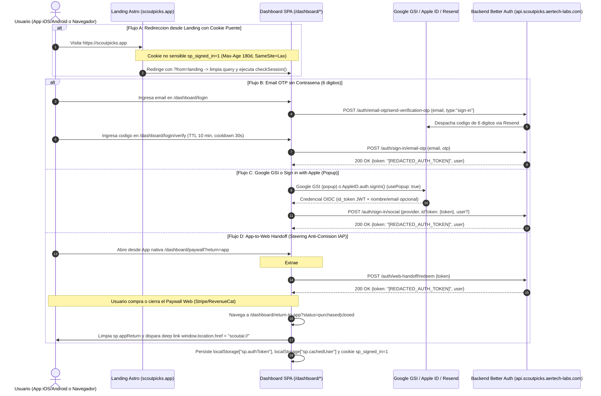
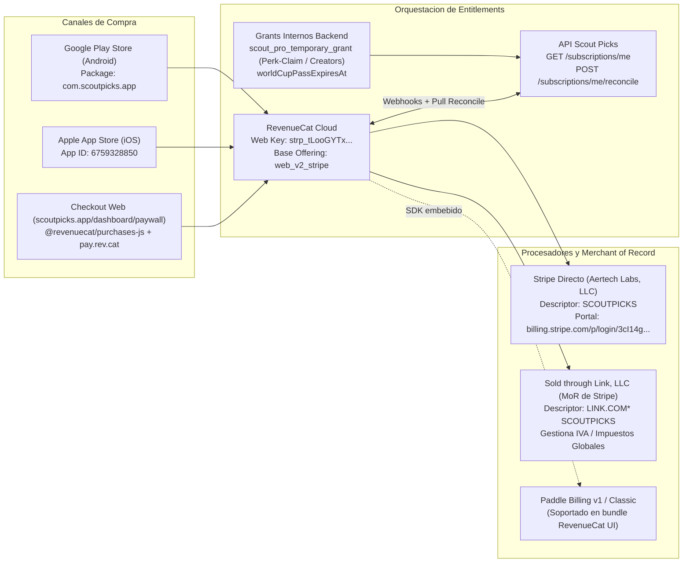

# 07. Autenticación, Pasarelas de Pago, Planes Regionales y Motores de Monetización

> **Clasificación epistemológica:** Todo hallazgo se etiqueta explícitamente como `[OBSERVADO]` (verificado en payloads vivos, capturas HAR de RevenueCat/API, bundles JS o documentos legales publicados), `[DERIVADO]` (deducción determinista por cruce de artefactos) o `[INFERIDO]` (hipótesis arquitectónica de alta confianza).
>
> **Política de privacidad:** Cero PII y cero credenciales privadas (`usr_redacted_0000000000000000000`, `[REDACTED_AUTH_TOKEN]`, `user@redacted.example`).

---

## 1. Arquitectura de Autenticación y Transferencia de Sesión App-to-Web

### 1.1 Diagrama de Secuencia Multi-Canal y Handoff Móvil-Web

### 1.2 Análisis Forense de los Cuatro Métodos de Autenticación

 Scout Picks prescinde por completo de contraseñas tradicionales en su interfaz web, operando cuatro mecanismos sobre **Better Auth** (`01_env_config.js`, `03_auth_and_axios.js`, `11_router_tree_and_bootstrap.js`, `ev_d6aea026e24cc7285f592385c27b572003bb7a591dbda6be9d5c2ff8366790be`):

1. **Email OTP de 6 dígitos (`emailOTP` + Resend) `[OBSERVADO]`:**
   * En `/dashboard/login`, el usuario introduce su correo y dispara `POST /auth/email-otp/send-verification-otp` con `{ email, type: "sign-in" }`. La Política de Privacidad confirma que el correo se entrega mediante **Resend** y que el código se almacena únicamente hasta su expiración `[OBSERVADO]`.
   * La ruta `/dashboard/login/verify` (`xQe`) renderiza 6 cajas numéricas (`inputMode="numeric"`, `autoComplete="one-time-code"` en la primera casilla con soporte de pegado completo) gobernadas por tres constantes temporales exactas `[OBSERVADO]`:
     * **Expiración del código (`kU`):** `600` segundos (**10 minutos**).
     * **Cooldown de reenvío estándar (`wU`):** `30` segundos.
     * **Cooldown penalizado ante `HTTP 429` (`vQe`):** valor de cabecera `Retry-After` en segundos o fallback de `60` segundos.
   * La verificación llama a `POST /auth/sign-in/email-otp` (`{ email, otp }`), devolviendo `{ token, user }`. En `GET_auth_get-session.json` (`ev_03f837b1e4aec03bcac8791498a5d2cbbd06e25f39474bde43e541baa4acff52`), la sesión emitida tiene una vigencia exacta de **90 días** (`createdAt: 2026-11-17T14:43:24.111Z` -> `expiresAt: 2027-02-15T14:43:24.111Z`) `[DERIVADO]`.

2. **Google Identity Services (`Google GSI`) `[OBSERVADO]`:**
   * Carga dinámicamente `https://accounts.google.com/gsi/client` e inicializa `window.google.accounts.id.initialize` con `client_id: "662210204220-u0981urd...[REDACTED_CLIENT_ID].apps.googleusercontent.com"` y `ux_mode: "popup"` `[OBSERVADO]`.
   * Superpone un botón oficial invisible/estilizado (`theme: "filled_black"`, `text: "continue_with"`, ancho adaptativo `200..400px`) sobre el componente propio `Z5`, enviando el `credential` OIDC a `POST /auth/sign-in/social` con `{ provider: "google", idToken: { token } }` `[OBSERVADO]`.

3. **Sign in with Apple JS (`com.scoutpicks.web`) `[OBSERVADO]`:**
   * Carga el SDK regionalizado de Apple `https://appleid.cdn-apple.com/appleauth/static/jsapi/appleid/1/<locale>/appleid.auth.js` mapeando 13 idiomas (`en_US`, `es_ES`, `pt_BR`, `it_IT`, `zh_CN`, `ar_SA`, `ru_RU`, `hi_IN`, `ja_JP`, `de_DE`, `tr_TR`, `el_GR`, `ro_RO`) `[OBSERVADO]`.
   * Inicializa `window.AppleID.auth.init` con `clientId: "com.scoutpicks.web"`, `scope: "name email"`, `redirectURI: "https://scoutpicks.app/dashboard/login"` y `usePopup: true`. Al autorizar, concatena `firstName` y `lastName` (que Apple solo entrega en el primer login) y los remite junto con `authorization.id_token` a `POST /auth/sign-in/social` (`provider: "apple"`). La disponibilidad de login social puede conmutarse en caliente mediante el feature flag de PostHog `social_auth_enabled` `[OBSERVADO]`.

4. **App-to-Web Handoff (`#ott=`) y Retorno `scoutai://` `[OBSERVADO]` `[DERIVADO]`:**
   * Diseñado para trasladar usuarios autenticados desde las apps iOS/Android hacia el navegador del sistema (especialmente hacia `/dashboard/paywall`) sin pedir credenciales de nuevo.
   * **Diseño criptográfico y de privacidad de logs:** La app móvil construye una URL con query `?return=app` y coloca el *One-Time Token* en el **fragmento hash** (`#ott=<token>`), validado en cliente por la expresión regular estricta `/^[A-Za-z0-9_-]{43}$/` (exactamente 32 bytes / 256 bits de entropía codificados en Base64URL sin relleno) `[DERIVADO]`. Al residir tras `#`, el token **jamás se transmite por red a CloudFront/S3 ni se filtra en cabeceras `Referer`** `[DERIVADO]`.
   * Al arrancar el bundle (`iue()`), el cliente extrae `ott`, graba `sessionStorage["sp.appReturn"] = "1"`, purga inmediatamente `?return=app` y `#ott=...` de la barra de direcciones vía `history.replaceState`, y llama a `POST /auth/web-handoff/redeem` (`{ token }`). Si en el navegador existía una sesión web previa de otra cuenta, ejecuta primero `POST /auth/sign-out` y limpia las cachés de PostHog, TanStack Query y picks antes de hidratar la nueva sesión `[OBSERVADO]`.
   * Tras completar o cerrar el flujo de pago web, la función `V(status)` redirige a `/dashboard/return-to-app?status=purchased|closed`, la cual borra `sp.appReturn` e invoca automáticamente `window.location.href = "scoutai://"` (`const H$ = "scoutai://"`), revelando que el esquema URI profundo registrado en las apps móviles conserva el nombre fundacional interno **"Scout AI"** `[OBSERVADO]` `[DERIVADO]`.

### 1.3 Persistencia Local, Sincronización entre Pestañas y Borrado de Cuenta
* **Almacenamiento de credenciales en cliente:** El token Bearer se guarda en `localStorage["sp.authToken"]` y el perfil serializado en `localStorage["sp.cachedUser"]`, respaldados por un fallback en RAM con *tombstoning* para contextos de navegación privada estricta. Un listener global sobre el evento `window.onstorage` detecta cambios en `sp.authToken` desde otras pestañas y revalida la sesión automáticamente `[OBSERVADO]`.
* **Cookie indicadora para Landing (`sp_signed_in`):** El suscriptor `gue(useAuthStore)` mantiene sincronizada en el dominio raíz `scoutpicks.app` una cookie no sensible `sp_signed_in=1; Max-Age=15552000; Path=/; SameSite=Lax; Secure` (`180 días`) que permite a la landing estática saber si el visitante ya tiene cuenta activa sin exponer el Bearer token a scripts fuera de `/dashboard/` `[DERIVADO]`.
* **Eliminación de cuenta (`DELETE /auth/delete-account`):** Requiere teclear literalmente `"DELETE"` en el modal de Zona de Peligro. Conforme a la Política de Privacidad y al texto de interfaz, purga de inmediato nombre, email, foto, respuestas de onboarding, conexiones OAuth y tokens push, pero **conserva anonimizados** los registros contables de suscripción y los picks históricos asociados solo al ID interno, advirtiendo expresamente que **borrar la cuenta no cancela una suscripción activa** `[OBSERVADO]`.

---

## 2. Arquitectura Omnicanal de Suscripciones (RevenueCat + Stripe + Link + Tiendas)

### 2.1 Topología de Facturación y Reconciliación

### 2.2 Integración Web Billing, Stripe, Link y Tiendas Nativas
1. **RevenueCat Web Billing (`strp_tLooGYTx...`):** El bundle configura `revenueCatWebApiKey: "strp_tLooGYTx...[REDACTED_PUBLIC_SDK_KEY]"` y `revenueCatWebOfferingId: "web_v2_stripe"` (`01_env_config.js`) `[OBSERVADO]`. Durante la sesión auditada (`ev_8d1fa2225983ff98a4c350ad528895985cc9cdd8f4efab6f7eceda9da4dc30cd`), el SDK consulta `https://api.revenuecat.com/v1/subscribers/<user_id>/offerings` y `https://api.revenuecat.com/rcbilling/v1/subscribers/<user_id>/products`, recibiendo URLs de checkout alojado bajo `https://pay.rev.cat/lvaxmvexblqwmywk/<user_id>?rc_source=app&package_id=%24rc_...` `[OBSERVADO]`.
2. **Doble Régimen Fiscal en Web (Stripe Directo vs. Link MoR):** Los Términos de Uso y la Política de Privacidad revelan una arquitectura dual para cobros web `[OBSERVADO]`:
   * **Modalidad Merchant of Record (`Sold through Link, LLC`):** Operada por la filial de Stripe, quien actúa como vendedor fiscal independiente, calcula/recauda IVA o *sales tax* internacional y emite cargos bajo el descriptor bancario **`LINK.COM* SCOUTPICKS`**.
   * **Modalidad Venta Directa (`Aertech Labs, LLC`):** Procesada mediante Stripe + RevenueCat bajo el descriptor **`SCOUTPICKS`**. Para la autogestión y cancelación de estas suscripciones, el bundle compila la URL fija del **Stripe Customer Portal** `https://billing.stripe.com/p/login/3cI14g8K16X6f2y4wfdwc00` (`var ahe`), utilizada por `che(sub, managementURL)` siempre que `store === "stripe"` y no sea entorno sandbox `[OBSERVADO]`.
3. **Soporte Paddle y Tiendas Móviles:** El SDK `@revenuecat/purchases-js` empaquetado incluye los adaptadores completos de **Paddle** (`https://cdn.paddle.com/paddle/paddle.js` y `v2/paddle.js`, contenedor `paddle-checkout-container`), aunque las ofertas activas observadas apuntan todas a `price_1U...` de Stripe `[OBSERVADO]` `[DERIVADO]`. En móvil, las suscripciones corren sobre **Apple App Store** (`id6759328850`, incluyendo una cláusula expresa *Consent to Share Consumption Data with Apple* para enviar telemetría de consumo a Apple al disputar reembolsos) y **Google Play** (`com.scoutpicks.app`) `[OBSERVADO]`.
4. **Reconciliación y Máquina de Estados (`GET /subscriptions/me` y `POST /subscriptions/me/reconcile`):**
   * Al finalizar un pago en el widget de RevenueCat, el cliente invoca `POST /subscriptions/me/reconcile` antes de redirigir para evitar condiciones de carrera con los webhooks asíncronos; si tras reconciliar no aparece el acceso Pro, registra en PostHog `paywall_purchase_failed` con código `"entitlement_missing"` `[OBSERVADO]`.
   * Las funciones `tl(sub)` y `Roe(sub)` (`10_app_core_part4...js`) implementan **8 estados de acceso** `[DERIVADO]`:
     1. `free`: usuario sin plan Pro vigente.
     2. `trial`: `tier === "pro"`, `status === "active"` e `isTrialing === true` (observado en vivo con `productId: "scout_pro_web_yearly"`).
     3. `renews`: suscripción Pro pagada activa con renovación automática en `expiresAt`.
     4. `cancelled`: suscripción cancelada que **conserva acceso Pro completo** mientras `new Date(expiresAt) > now`.
     5. `grace_period`: fallo de renovación de pago en periodo de gracia manteniendo acceso Pro activo.
     6. `expired`: suscripción vencida (`expiresAt <= now`).
     7. `worldCupPass`: pase temporal estacional activo cuando `worldCupPassExpiresAt > now` sin suscripción recurrente ordinaria vigente.
     8. `complimentary`: acceso Pro de cortesía otorgado sin fecha de expiración ordinaria o mediante `productId === "scout_pro_temporary_grant"` (usado para creadores y recompensas de afiliación `scout_pro_month`).

---

## 3. Precios en México, Experimentos PostHog, Matriz Global PPP y Modelo Freemium

### 3.1 Precios Reales Observados en México vs. Fallback Base USD

La consulta en vivo a `GET /app/pricing` ([GET_app_pricing.json](file:///C:/Users/T490s/.gemini/antigravity/worktrees/PitchLab/analyze_pitchlab_competitor_rea/Reportes/scoutpicks/evidence/live-payloads/GET_app_pricing.json)) junto con el catálogo de productos de RevenueCat (`ev_8d1fa2225983ff98a4c350ad528895985cc9cdd8f4efab6f7eceda9da4dc30cd`) documenta al centavo la oferta activa para **México (`country: "MX"`, `offering: "pricing-mx-2026q3-v1-treatment"`)** frente al fallback estático en **USD** incrustado en `scoutpicks.app` (`data-fallback-prices`) `[OBSERVADO]`:

| Periodicidad | Paquete RC | Stripe Price ID (MX) | RevenueCat Price ID | Precio México (`MXN`) | Equivalente Mensual (`MXN`) | Prueba Gratis (MX) | Precio Base Fallback (`USD`) |
| :--- | :--- | :--- | :--- | :--- | :--- | :--- | :--- |
| **Semanal** (`P1W`) | `$rc_weekly` | `price_1URjKM2XM6QkWhl1FflPDPk6` | `prce09d0bac082d46bbbcd9` | **`MXN $149.00`** (`14900` cts) | `~MXN $645.67/mes` | Sin prueba (`null`) | **`USD $6.99`** |
| **Mensual** (`P1M`) | `$rc_monthly` | `price_1URjKN2XM6QkWhl1Qo0MFzWj` | `prcbdc40e4a764b4682b59c` | **`MXN $299.00`** (`29900` cts) | `MXN $299.00/mes` | Sin prueba (`null`) | **`USD $19.99`** |
| **Anual** (`P1Y`) | `$rc_annual` | `price_1URjKN2XM6QkWhl1ou5FbsG4` | `prc9f310871c4c6456e84ab` | **`MXN $1,499.00`** (`149900` cts) | **`MXN $124.92/mes`** (**`-58%`** vs mensual) | **7 días gratis (`P1W`)** | **`USD $99.99`** |

**Táctica de conversión en Landing y Paywall `[DERIVADO]`:** En la variante `treatment` asignada a México, el plan preseleccionado por defecto cambia de `monthly` a **`yearly`** (`planOrder: ["annual", "monthly", "weekly"]`), y el script `LandingPage.astro` selecciona automáticamente el intervalo anual al ser el único que ofrece `trialDays: 7`, transformando el CTA principal en *"Comienza tu prueba gratis de 7 días"* (`Start your 7-day free trial`).

### 3.2 Matriz Completa de Experimentos A/B en PostHog y Catálogos RevenueCat
El objeto `zK` en `04_analytics_pricing_picks_store.js` y la respuesta completa de `/v1/subscribers/.../offerings` (`targeting: { revision: 10, rule_id: "P0J1tsgkLC" }`) exponen **15 configuraciones de catálogo y experimentación** sincronizadas entre Web (Stripe) y Google Play (`androidProductIds`) `[OBSERVADO]`:

| Offering Identifier | Experimento / Feature Flag PostHog | País / Región | Variante | Plan Default | SKUs Google Play (`scout_pro_all_v2:...`) / Stripe (`price_...`) |
| :--- | :--- | :--- | :--- | :--- | :--- |
| `pricing-baseline-v2` | `null` | Global (`*`) | `baseline` | `monthly` | GP: `baseline-v2-{weekly,monthly,yearly}` \| Stripe: `1UO35Z...` / `1UO35a...` |
| `pricing-mx-2026q3-v1-control` | `pricing-mx-2026q3-v1` | México (`MX`) | `control` | `monthly` | Usa `baseline-v2` |
| `pricing-mx-2026q3-v1-treatment` | `pricing-mx-2026q3-v1` | México (`MX`) | `treatment` | **`yearly`** | GP: `mx-2026q3-v1-{weekly,monthly,yearly}` \| Stripe: `1URjKM...` / `1URjKN...` |
| `pricing-br-2026q3-v1-control` | `pricing-br-2026q3-v1` | Brasil (`BR`) | `control` | `monthly` | Usa `baseline-v2` |
| `pricing-br-2026q3-v1-treatment` | `pricing-br-2026q3-v1` | Brasil (`BR`) | `treatment` | `monthly` | GP: `br-2026q3-v1-{weekly,monthly,yearly}` \| Stripe: `1URjKN...` / `1URjKO...` |
| `pricing-br-2026q4-v1` | `null` | Brasil (`BR`) | `baseline` | `monthly` | GP: `br-2026q4-v1-{weekly,monthly,yearly}` \| Stripe: `1URk6j...` / `1URk6k...` |
| `winback-br-2026q4-v1` | Campaña `br_ios_webapp_2026_11` | Brasil (`BR`) | `baseline` | **`yearly`** | **50% descuento anual web** para winback de iOS Brasil (`price_1UZX1B2XM6QkWhl1pKmGa3zL`) |
| `pricing-row-2026q3-v1-control` | `pricing-row-2026q3-v1` | Resto del Mundo (excl. `BR`,`MX`) | `control` | `monthly` | GP: `baseline-v2` \| Stripe: `1US0zj...` / `1US0zk...` |
| `pricing-row-2026q3-v1-treatment` | `pricing-row-2026q3-v1` | Resto del Mundo (excl. `BR`,`MX`) | `treatment` | **`yearly`** | GP: `tier2-2026q4-v1` \| Stripe: `1US0xA...` (familia `pricing-annual-discount-v1`) |
| `pricing-tier2-2026q4-v1` | `null` | PPP Tier 2 (LATAM/Europa Este/Asia) | `baseline` | **`yearly`** | GP: `tier2-2026q4-v1-{weekly,monthly,yearly}` \| Stripe: `1US0xA...` |
| `pricing-tier3-2026q4-v1` | `null` | PPP Tier 3 (Balcanes/Magreb/CEI/TH) | `baseline` | **`yearly`** | GP: `tier3-2026q4-v1-{weekly,monthly,yearly}` \| Stripe: `1US0xA...` |
| `pricing-tier4-2026q4-v1` | `null` | PPP Tier 4 (Sur de Asia/África/SEA) | `baseline` | **`yearly`** | GP: `tier4-2026q4-v1-{weekly,monthly,yearly}` \| Stripe: `1US0xB...` |
| `pricing-tier5-2026q4-v1` | `null` | PPP Tier 5 (Etiopía `ET`) | `baseline` | **`yearly`** | GP: `tier5-2026q4-v1-{weekly,monthly,yearly}` \| Stripe: `1US0xB...` / `1US0xC...` |
| `web_v2_stripe` | `null` | Checkout Web Base | `baseline` | `monthly` | URL directa `pay.rev.cat/lvaxmvexblqwmywk/...` |
| `default` / `scout-pro-pricing-experiment-1` | `scout-pro-pricing-experiment-1` | Legado v1 | `control` / `treatment` | `monthly` / `yearly` | GP legado: `scout_picks_pro:scout-picks-pro-all-leagues-*` |

### 3.3 Tabla de Precios Regionales por Paridad de Poder Adquisitivo (PPP)
El metadato `local_prices` extraído de `api.revenuecat.com/v1/subscribers/.../offerings` revela una agresiva segmentación PPP en **más de 35 monedas y 55 países** `[OBSERVADO]`:

| Nivel / Catálogo | Moneda y Países (`ISO-2`) | Semanal (`$rc_weekly`) | Mensual (`$rc_monthly`) | Anual (`$rc_annual`) |
| :--- | :--- | :--- | :--- | :--- |
| **Europa Occidental (`baseline-v2`)** | `EUR` (`DE, ES, FR, IT, NL, AT, BE, IE, FI...`) | `EUR 7.99` | `EUR 22.99` | `EUR 99.99` |
| **Brasil (`web_v2_stripe`)** | `BRL` (`BR`) | `BRL 49.90` | `BRL 129.90` | `BRL 599.90` |
| **México (`mx-2026q3-v1-treatment`)** | `MXN` (`MX`) | `MXN 149.00` | `MXN 299.00` | `MXN 1,499.00` |
| **LATAM Control (`baseline-v2` / `row-control`)** | `ARS` (`AR`) / `CLP` (`CL`) / `COP` (`CO`) / `PEN` (`PE`) | `ARS 10,450` / `CLP 7,990` / `COP 29,900` / `PEN 29.90` | `ARS 29,885` / `CLP 22,990` / `COP 99,900` / `PEN 89.90` | `ARS 149,485` / `CLP 99,990` / `COP 499,900` / `PEN 449.90` |
| **Tier 2 (`tier2-2026q4-v1` / `row-treatment`)** | `ARS` (`AR`) / `CLP` (`CL`) / `COP` (`CO`) / `PEN` (`PE`) / `CRC` (`CR`) | `ARS 10,600` / `CLP 7,990` / `COP 29,900` / `PEN 29.90` / `CRC 3,100` | `ARS 19,700` / `CLP 14,990` / `COP 59,900` / `PEN 59.90` / `CRC 5,900` | `ARS 106,000` / `CLP 79,990` / `COP 299,900` / `PEN 299.90` / `CRC 31,500` |
| **Tier 2 Europa / Asia** | `EUR` (`PT, GR, HR, BG, SK, LT, LV`) / `PLN` (`PL`) / `CNY` (`CN`) / `MYR` (`MY`) | `EUR 7.99` / `PLN 29.99` / `CNY 48` / `MYR 29.90` | `EUR 14.99` / `PLN 59.99` / `CNY 88` / `MYR 59.90` | `EUR 79.99` / `PLN 299.99` / `CNY 498` / `MYR 299.90` |
| **Tier 3 (`tier3-2026q4-v1`)** | `EUR` (`RS, BA, ME, XK`) / `TRY` (`TR`) / `UAH` (`UA`) / `THB` (`TH`) / `BOB` (`BO`) / `PYG` (`PY`) | `EUR 3.99` / `TRY 199.99` / `UAH 214.99` / `THB 149` / `BOB 46.99` / `PYG 20,000` | `EUR 8.99` / `TRY 399.99` / `UAH 429.99` / `THB 299` / `BOB 92.99` / `PYG 50,000` | `EUR 44.99` / `TRY 1,999.99` / `UAH 2,149.99` / `THB 1,490` / `BOB 464.99` / `PYG 225,000` |
| **Tier 4 (`tier4-2026q4-v1`)** | `INR` (`IN`) / `NGN` (`NG`) / `IDR` (`ID`) / `PHP` (`PH`) / `PKR` (`PK`) / `ZAR` (`ZA`) / `EGP` (`EG`) | `INR 249` / `NGN 3,900` / `IDR 49,000` / `PHP 149` / `PKR 700` / `ZAR 49.99` / `EGP 129.99` | `INR 499` / `NGN 7,900` / `IDR 99,000` / `PHP 299` / `PKR 1,300` / `ZAR 99.99` / `EGP 249.99` | `INR 2,499` / `NGN 39,900` / `IDR 499,000` / `PHP 1,490` / `PKR 6,900` / `ZAR 499.99` / `EGP 1,299.99` |
| **Tier 5 (`tier5-2026q4-v1`)** | `ETB` (`ET` — Etiopía) | `ETB 250` | `ETB 500` | `ETB 2,400` (`~USD $19/año`) |

Adicionalmente, el paywall web soporta dos mecanismos promocionales por URL (`10_app_core_part4...js`) `[OBSERVADO]`:
* **Códigos promocionales (`?promo=CODE`):** Normalizados en mayúsculas (`/^[A-Za-z0-9_-]{1,32}$/`), persistidos en `sessionStorage["scoutpicks.webPromo"]` y aplicados exclusivamente sobre el plan mensual (`oZe`), mostrando fecha límite en huso `Etc/GMT+12` (AOE).
* **Ofertas especiales de campaña (`?offer=slug`):** Validadas por `/^[a-z0-9-]{3,40}$/` y persistidas durante **30 días** en `localStorage["sp_web_offer"]`, conmutando el `offering` devuelto por `GET /app/pricing?offer=<slug>` (p. ej. descuentos anuales de retención/creadores).

### 3.4 Modelo Freemium de 1 Liga Gratis (`freeLeagueId`), Cooldown y Add-ons de Ligas
El contrato `GET /subscriptions/me` y los arreglos de productos revelan un modelo de empaquetado modular por acceso a ligas `[OBSERVADO]` `[DERIVADO]`:
1. **Plan `free` (`1 Liga Gratuita`):** Todo usuario gratuito tiene derecho a elegir **una única competición abierta** (`freeLeagueId`, controlada por `requiresFreeLeagueSelection` y `needsLeagueSelection`). Cualquier insight perteneciente a las demás ligas aparece bloqueado (`isLocked: true` o `HTTP 403` en `/insights/:id`), y los controles de filtrado avanzado, ordenamiento y vistas guardadas en `/explore` o fichas de equipo están bloqueados tras el hook `SN()` (`web_insight_filters`).
2. **Reglas Antifraude de Cambio de Liga (`leagueChangeEligibility`):** Para impedir que un usuario gratuito rote manualmente su liga libre cada día según la cartelera (ej. Champions el martes, Premier League el sábado), el servidor impone un **cooldown estricto de 30 días (`cooldownDays: 30`)** desde `lastChangedAt` hasta `nextMonthlyChangeAt`, con una **válvula de escape inteligente tras 7 días sin partidos (`inactivityDays: 7`, `inactiveLeagueIds`)** que habilita el canje anticipado cuando una competición entra en receso o finaliza temporada `[OBSERVADO]` `[DERIVADO]`.
3. **Add-ons Intermedios (`+1` y `+2` Ligas) y `World Cup Pass`:** En todos los catálogos móviles (`ow`, `rye`, `aye`, `nye`, `qy`) y en el orden de planes `plan_order` de RevenueCat coexisten dos escalones intermedios mensuales junto al plan ilimitado (`all_leagues`, que desbloquea **59 ligas** en `accessibleLeagueIds`) `[OBSERVADO]`:
   * **`one_extra_league` / `two_leagues`:** SKU `scout_pro_one_extra_v1:one-extra-v1-monthly` (liga gratuita + 1 liga adicional seleccionada en `selectedLeagueIds`).
   * **`two_extra_leagues` / `three_leagues`:** SKU `scout_pro_two_extra_v1:two-extra-v1-monthly` (liga gratuita + 2 ligas adicionales).
   * **`worldCupPassExpiresAt`:** Pase temporal de evento único diseñado para monetizar torneos de selecciones (Copa Mundial FIFA 2026) sin suscripción recurrente `[DERIVADO]`.

---

## 4. Segundo Motor de Monetización: Afiliación CPA y Sistema Perk-Claim (`scout_pro_month`)

### 4.1 Campañas Activas Capturadas en México (`Stake.mx` y `JugaBet`)
Además de las suscripciones SaaS, Scout Picks opera en producción un **motor de arbitraje de afiliación CPA (*Cost Per Acquisition* / *First-Time Deposit*)** con casas de apuestas locales, documentado íntegramente en [GET_bookmakers_offers_channel_web.json](file:///C:/Users/T490s/.gemini/antigravity/worktrees/PitchLab/analyze_pitchlab_competitor_rea/Reportes/scoutpicks/evidence/live-payloads/GET_bookmakers_offers_channel_web.json) y `05_referees_bookmakers_ui_primitives.js` `[OBSERVADO]`:

| Atributo de Campaña | Oferta #1: **Stake México** (`bookmakerId: 4`) | Oferta #2: **JugaBet México** (`bookmakerId: 5`) |
| :--- | :--- | :--- |
| **`campaignKey`** | `stake-mx-welcome-2026-11` | `jugabet-mx-welcome-2026-11` |
| **`campaignId` / `linkId`** | `bkc_stake_mx_202611` / `bkl_stake_mx_202611` | `bkc_jugabet_mx_202611` / `bkl_jugabet_mx_202611` |
| **URL de Afiliación / Red** | Directa: `https://stake.mx/?offer=scoutpicks&c=scoutpicks` | Red de Influencers (**TrackingInflu**): `https://trackinginflu.com/?serial=61372431&creative_id=7507` |
| **Bono Casa (`deposit_match`)** | **100% hasta `MXN $2,000.00`** (*"Duplicamos tu primer depósito"*) | **125% hasta `MXN $5,000.00` + 50 giros gratis** (depósito mín. `MXN $100.00`; casino: 500% + 125 giros) |
| **Condiciones Rollover (`termsSummary`)** | `null` (delegado a landing de Stake) | • Plazo activación: 3 días tras recibir bono (retiene depósito hasta cumplir rollover) • Rollover: **10x** en deportes en **10 días** • Cuota mínima: **`1.67` (`-150`)** por selección (simples/múltiples, pre-partido/live) • Ganancia máxima convertible: **3 veces el bono** |
| **Incentivo Cruzado Scout Picks** | Ninguno (`benefits` tiene solo `deposit_match`) | **`type: "scout_pro_month"` — `+1 mes de Scout Picks Pro gratis`** (*"Cuando deposites, mándanos tu ID de jugador de JugaBet y lo activamos."*) |

### 4.2 Flujo Técnico de Conversión, Cross-Sell Post-Guardado y Validación Anti-Fraude
1. **Inyección contextual al guardar un pick (`/bookmakers/offers/post-save`):** Cuando un usuario guarda un pick cuya mejor cuota pertenece a una casa afiliada donde aún no figura registrado (`!offer.registered && offer.perkClaim === null`), el cliente consulta `GET /bookmakers/offers/post-save?bookmakerId=<id>&channel=web` (`tAe`) para presentar en caliente la oferta de registro y bono justo en el momento de mayor intención de apuesta `[DERIVADO]`.
2. **Doble telemetría de atribución (`Ute` / `Hte`):**
   * Al pulsar el enlace de afiliado: envía `bookmaker_offer_cta_clicked` a PostHog (`bookmaker_id`, `bookmaker`, `campaign_key`, `surface`, `has_benefit`) y `POST /bookmakers/offers/:id/events` con `{ type: "clicked", surface, campaignId, linkId }`.
   * Al declarar que ya se registró: envía `bookmaker_offer_registered_self_reported` a PostHog y `{ type: "registered", ... }` al backend `[OBSERVADO]`.
3. **Reclamación de `scout_pro_month` (`POST /bookmakers/offers/:id/perk-claim?channel=web`):**
   * El usuario introduce su ID de jugador externo (`externalUserId`), validado en cliente con `/^[A-Za-z0-9_-]{4,64}$/` (`Lte`).
   * El backend crea un registro `PerkClaim` en estado `pending` para conciliación contra el panel de afiliados de `trackinginflu.com` (`serial=61372431`); una vez verificado el primer depósito (*FTD*), aprueba el reclamo y activa un mes de `scout_pro_temporary_grant` (cuyo costo marginal para Aertech Labs es casi nulo frente al CPA cobrado a la casa de apuestas) `[DERIVADO]`.
   * Controles anti-abuso implementados (`$te` / `YTe`): bloqueo por reclamo en revisión (`PERK_CLAIM_PENDING`), reclamo previo ya concedido (`409` / `PERK_CLAIM_ALREADY_APPROVED`) y reutilización fraudulenta del mismo ID de jugador entre distintas cuentas de Scout Picks (`PERK_CLAIM_ID_IN_USE`) `[OBSERVADO]`.

---

## 5. Marco Societario, Legal y Discrepancia Regulatoria Detectada

### 5.1 Identidad Corporativa y Blindaje Contractual de Aertech Labs, LLC
A partir de `https://scoutpicks.app/privacy`, `https://scoutpicks.app/terms` (ambos fechados el **8 de octubre de 2026**) y registros públicos corporativos (`steps/210`), la entidad operadora presenta la siguiente estructura jurídica `[OBSERVADO]`:

* **Razón Social y Registro Fiscal:** **Aertech Labs, LLC**, sociedad de responsabilidad limitada constituida en el **Estado de Delaware, EE. UU.**, con Número de Identificación del Empleador federal (**EIN**) **`35-2938733`** y domicilio registrado en **`131 Continental Dr, Newark, DE, USA`**, operando soporte y avisos legales/DMCA a través de `team@aertech-labs.com`.
* **Posicionamiento Regulatorio (*Not a Sportsbook*):** Se define estrictamente como herramienta informativa y estadística para mayores de edad legal de juego (`18+` / `21+`), declarando que no acepta apuestas, no custodia fondos, no fija cuotas ni garantiza ganancias.
* **Política de Reembolsos y Cancelación:** En compras móviles delega reembolsos exclusivamente en Apple (`reportaproblem.apple.com`) y Google Play. En compras web ofrece **reembolso íntegro dentro de los primeros 7 días** posteriores a cualquier cargo (inicial o renovación) escribiendo a `team@aertech-labs.com`, revocando el acceso Pro al instante; pasados 7 días no existen reembolsos ni créditos prorrateados.
* **Resolución de Disputas y Prescripción:** Sometimiento exclusivo a las leyes y tribunales de **Delaware**, **arbitraje individual confidencial obligatorio** bajo las reglas de consumo de la *American Arbitration Association* (**AAA**) tras un periodo de negociación previa de 30 días, **renuncia expresa a demandas colectivas (*Class Action Waiver*)** y **prescripción contractual reducida a un (1) año** para cualquier reclamación.
* **Privacidad Internacional:** Reconoce derechos bajo **CCPA** (California), **GDPR** (EEE/Reino Unido/Suiza), **LGPD** (Brasil) y **LFPDPPP** (México), excluyendo expresamente la recolección de IDFA en iOS (aunque sí recoge Android Advertising ID vía **AppsFlyer**).

### 5.2 Hallazgo Forense-Legal Crítico: Contradicción entre `Terms of Use` y Monetización CPA Activa

> [!WARNING]
> **Discrepancia contractual verificada en producción `[OBSERVADO]`:** En la sección *Third-Party Content, Links, and Services* de los Términos de Uso vigentes (`Last Updated: October 8, 2026`), **Aertech Labs, LLC** afirma textualmente:
> *"Scout Picks does not receive payment from bookmakers or sportsbooks, whether as affiliate commissions, referral fees, or paid placements. The bookmakers and odds shown in the Service are not advertisements: which bookmakers we show, and in what order, is not paid for. If this changes, we will update these Terms and clearly identify any paid relationship in the Service."*

El contraste con la evidencia runtime capturada el **17 de noviembre de 2026** (`GET /bookmakers/offers?channel=web`, campañas con sufijo `2026-11` / `202611`) demuestra que **entre octubre y noviembre de 2026 Aertech Labs desplegó en producción su programa de afiliación con casas de apuestas** (`stake.mx/?offer=scoutpicks&c=scoutpicks` y `trackinginflu.com/?serial=61372431&creative_id=7507` con incentivo de mes Pro gratis condicionado a depósito en JugaBet) **sin haber actualizado aún la cláusula de divulgación comercial en sus Términos de Uso públicos** `[DERIVADO]`. Para **PitchLab**, este hallazgo subraya tanto la rentabilidad probada del modelo híbrido **SaaS + CPA Perk-Claim** en Latinoamérica como la necesidad crítica de incluir divulgaciones explícitas de enlaces de afiliado (*affiliate disclosure*) desde el primer día de operación comercial.
