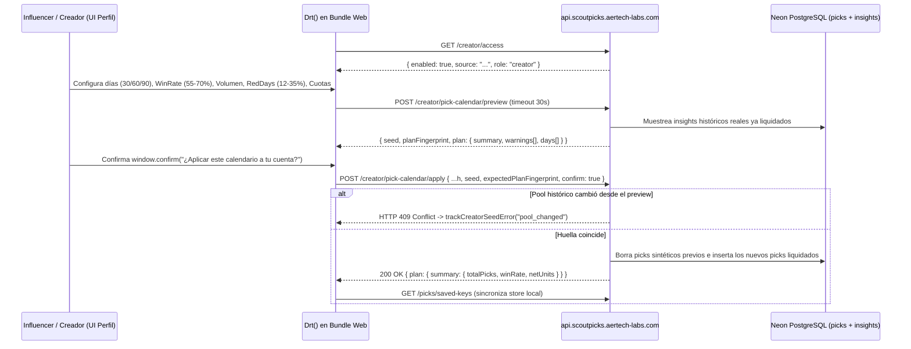

# 08 — Detalles Ocultos, Secretos Internos, Anomalías Técnicas y Bugs Reales Detectados en Scout Picks

> **Objetivo auditado:** `https://scoutpicks.app` · SPA `/dashboard/` (`Beta v0.1.0`) · API `https://api.scoutpicks.aertech-labs.com` · Sitio corporativo `https://aertech-labs.com`  
> **Enfoque metodológico:** Auditoría forense pasiva, defensiva y competitiva con **CERO PII y CERO credenciales**, sustentada en artefactos estáticos y capturas vivas verificadas con **REA** (`ev_abdb3cf1...`, `ev_d6aea026...`, `ev_03f837b1...`, `ev_7aae1b8f...`, `ev_ed3088de...`, `ev_8d1fa222...`, `ev_74b541a5...`, `ev_036f5035...`, `ev_eb381a14...`, `ev_a394dec9...`, `ev_4ff9ca99...`).  
> **Taxonomía epistémica:** `[OBSERVADO]` (verificado byte a byte en código o tráfico real), `[DERIVADO]` (calculado determinísticamente desde evidencia observada), `[INFERIDO]` (conclusión analítica de alta confianza a partir de señales convergentes), `[DESCONOCIDO]` (fuera de visibilidad cliente/red sin acceso al repositorio privado del servidor).

---

## Resumen Ejecutivo del Capítulo

La disección forense de las **11 regiones de código propio** del bundle monolítico de **Scout Picks** ([index-BZ3_gLK3.js](file:///C:/Users/T490s/.gemini/antigravity/worktrees/PitchLab/analyze_pitchlab_competitor_rea/Reportes/scoutpicks/evidence/artifact-sha256-inventory.json), `3,361,584` bytes, `ev_abdb3cf1dbd8a7aab2a952ca236449585bd2de775d8200297a3b94e836220fb3`), cruzada contra los contratos HTTP capturados en vivo (`ev_03f837b1e4aec03bcac8791498a5d2cbbd06e25f39474bde43e541baa4acff52`, `ev_7aae1b8faebfaae85bd8513669e557fd705e9a7b85ff530e366823d93f7910d4`) y los documentos legales públicos (`ev_eb381a1446763d94752838fd77caee295d4b64c43f3b7536a70f7c2183578a69`), destapó cuatro hallazgos estratégicos de primer orden:

1. **Herramienta oculta de siembra retroactiva de resultados para *influencers* (`Creator tools · Pick calendar`, función `Drt()`, `[OBSERVADO]`):** El código de producción incluye un módulo oculto en `/dashboard/profile` —activado únicamente cuando `GET /creator/access` devuelve `enabled: true`— que permite rellenar retroactivamente la cuenta de un creador de contenido con **30, 60 o 90 días** de *picks* ya liquidados a una **tasa de acierto objetivo elegida a voluntad (`55%`, `60%`, `65%` o `70%`)**, calibrando incluso una **cuota deliberada de "días rojos" perdedores (`12%`, `22%` o `35%`)** con el propósito explícito declarado en sus propios textos i18n: *"so you have a track record to screenshot"* (*"para que tengas un historial para capturar"*).
2. **ADN argentino/rioplatense detrás de una LLC de Delaware (`Aertech Labs, LLC` / `@vsratti`, `[OBSERVADO]` + `[INFERIDO]`):** Aunque la plataforma opera bajo una sociedad estadounidense en Delaware (`Aertech Labs, LLC`, `EIN 35-2938733`, `131 Continental Dr, Newark, DE`), el enlace oficial de soporte apunta al handle personal de Telegram `https://t.me/vsratti`, las traducciones internas están escritas en español rioplatense con **19 formas verbales de *voseo*** (*"Activá"*, *"Probá"*, *"Elegí"*, *"los picks que guardaste vos"*), y los únicos clubes del mundo con *assets* PNG dedicados en el bundle son **Boca Juniors** (`category-boca`), **River Plate** (`category-river`) junto a **Lautaro Martínez** (`category-lautaro`).
3. **Hoja de ruta comercial filtrada en Feature Flags y esquemas (`[OBSERVADO]`):** El cliente expone 5 *feature flags* de PostHog (`maintenance_mode`, `pick_progress_frequencies_enabled`, `social_auth_enabled`, `onboarding_quiz_enabled`, `home_customization_enabled`), un futuro **Pase del Mundial (`worldCupPassExpiresAt`)**, banderas de *downsell* móvil (`hasSeenOneTimeOffer`), soporte de suplantación administrativa (`impersonatedBy` en Better Auth) y un motor de prueba social basado en cuántos usuarios guardaron cada apuesta (`sortBySaveCount` / `saveCount`).
4. **Bugs matemáticos severos en `/simulations/calculate`, ausencia total de *de-vigging* y contradicción legal activa (`[OBSERVADO]`):** El endpoint `POST /simulations/calculate` padece un **triple bug simultáneo**: (a) etiqueta la ventana general de últimos partidos como enfrentamientos directos (`charts.vsOpponent`), afirmando que `António Silva` (*AFC Bournemouth / Portugal*) cumplió en *"10 de 10 enfrentamientos contra Wales"* cuando tiene **0 partidos históricos contra Gales**; (b) mezcla partidos de club con contexto `"Solo Selección"`; y (c) resta `impliedProbability` en escala `[0..1]` a `probability` en escala `[0..100]`, reportando **`edge: +99.29%`** e incluso convirtiendo apuestas con EV muy negativo (`-22.36%`) en falsos bordes positivos (`+13.64%`). Adicionalmente, `GET /matches/:id` filtra más de 40 columnas internas de scrapers (`SELECT *`), el frontend carece de `CSP` y guarda el Bearer token en `localStorage`, y los Términos de Uso niegan comisiones de casas de apuestas mientras la API sirve campañas CPA activas (`trackinginflu.com`).

---

## 1. La Herramienta Secreta de Influencers y Creadores (`Creator tools · Pick calendar`)

### 1.1 Control de Acceso Dual y Superficie API Oculta (`[OBSERVADO]`)

En la vista de perfil `/dashboard/profile` (`component: Wrt`, región `10_app_core_part4_nav_home_paywall_performance_creator_profile.js`, `ev_abdb3cf1dbd8a7aab2a952ca236449585bd2de775d8200297a3b94e836220fb3`), Scout Picks monta silenciosamente el componente `i.jsx(Drt, {})` entre la tarjeta de Comunidad de Telegram y la tarjeta Legal. Para cualquier suscriptor ordinario (incluso con plan `tier: "pro"` activo), `Drt()` ejecuta una consulta autenticada al endpoint `GET /creator/access` (ordinal `105` en [rea-environment-manifest.json](file:///C:/Users/T490s/.gemini/antigravity/worktrees/PitchLab/analyze_pitchlab_competitor_rea/Reportes/scoutpicks/evidence/rea/rea-environment-manifest.json), `ev_7aae1b8faebfaae85bd8513669e557fd705e9a7b85ff530e366823d93f7910d4`):

- En nuestra cuenta auditada ([GET_creator_access.json](file:///C:/Users/T490s/.gemini/antigravity/worktrees/PitchLab/analyze_pitchlab_competitor_rea/Reportes/scoutpicks/evidence/live-payloads/GET_creator_access.json) y [GET_subscriptions_me.json](file:///C:/Users/T490s/.gemini/antigravity/worktrees/PitchLab/analyze_pitchlab_competitor_rea/Reportes/scoutpicks/evidence/live-payloads/GET_subscriptions_me.json), `[OBSERVADO]`):
  - `GET /subscriptions/me` expone el booleano `isContentCreator: false`.
  - `GET /creator/access` responde `{"enabled": false, "source": null, "role": null}`.
  - Al recibir `enabled === false`, `Drt()` retorna `null` y no deja ningún rastro en el DOM visible (`[OBSERVADO]`).

Sin embargo, el código completo del generador viaja sin *code splitting* dentro del bundle público, revelando una **superficie REST dedicada de 4 endpoints** bajo `/creator/*`:

| Método y Ruta (`api.scoutpicks.aertech-labs.com`) | Timeout | Payload de Solicitud / Parámetros | Función Exacta (`[OBSERVADO]`) |
|---|---:|---|---|
| `GET /creator/access` | `10,000 ms` | Sin parámetros (`Bearer` header) | Verifica si la cuenta tiene privilegios de creador (`{ enabled, source, role }`). |
| `POST /creator/pick-calendar/preview` | `30,000 ms` | `{ days, targetWinRate, minPicksPerDay, maxPicksPerDay, redDayShare, minOdds, maxOdds, timezoneOffset: 0 }` | Ejecuta el solucionador combinatorio sobre *insights* históricos resueltos sin escribir en BD; retorna `{ seed, planFingerprint, plan: { summary, warnings, days } }`. |
| `POST /creator/pick-calendar/apply` | `30,000 ms` | `{ ...params, seed, expectedPlanFingerprint, confirm: true }` | Materializa los picks sintéticos en el historial de la cuenta del creador, reemplazando corridas previas del generador. Valida integridad con `HTTP 409` si cambió el pool. |
| `DELETE /creator/pick-calendar` | `10,000 ms` | Sin cuerpo | Purga únicamente los picks inyectados por esta herramienta (`{ deleted: number }`), dejando intactos los picks guardados manualmente por el creador. |

### 1.2 Disección Línea por Línea de la Función `Drt()` (`[OBSERVADO]`)

En el offset de caracteres `2,896,100` del bundle principal (`ev_abdb3cf1dbd8a7aab2a952ca236449585bd2de775d8200297a3b94e836220fb3`), la función `Drt()` implementa la máquina de estados completa:

```javascript
// Evidencia: index-BZ3_gLK3.js (offset 2,896,100) — ev_abdb3cf1...
function Drt() {
  const { t: e } = ue(),
    t = h$("creator", "/creator/access"),
    [r, a] = w.useState("60"),          // days: "30" | "60" | "90" (default: 60 días)
    [n, s] = w.useState("0.6"),         // targetWinRate: "0.55" | "0.6" | "0.65" | "0.7" (default: 60%)
    [o, l] = w.useState("normal"),      // volume: "light" | "normal" | "heavy"
    [c, d] = w.useState("0.22"),        // redDayShare: "0.12" | "0.22" | "0.35" (default: 22% días rojos)
    [u, p] = w.useState("balanced"),    // odds: "short" | "balanced" | "long"
    m = { light: [1, 2], normal: [2, 4], heavy: [3, 6] },
    f = { short: [1.3, 1.9], balanced: [1.45, 2.6], long: [1.8, 3.5] },
    h = {
      days: Number(r),
      targetWinRate: Number(n),
      minPicksPerDay: m[o][0],
      maxPicksPerDay: m[o][1],
      redDayShare: Number(c),
      minOdds: f[u][0],
      maxOdds: f[u][1],
      timezoneOffset: 0,                // Hardcodeado en UTC (0), ignorando huso local del creador
    },
    [g, _] = w.useState(null);          // Estado del plan previsualizado { seed, planFingerprint, plan }
  // ... mutaciones "preview" -> "apply" -> "clear" + refresco de fetchSavedKeys(userId)
}
```



### 1.3 Los Cinco Parámetros de "Ingeniería de Varianza Creíble" (`[OBSERVADO]` + `[DERIVADO]`)

El aspecto más revelador de `Drt()` no es solo que permita elegir la tasa de acierto pasada, sino que incorpore un **control explícito de proporción de días perdedores (`redDayShare`)** para evitar que el calendario en `/dashboard/performance` se vea sospechosamente perfecto (todo verde) cuando el creador graba su pantalla en TikTok, Instagram Reels o YouTube Shorts (`[INFERIDO]`):

| Parámetro en `h` | Opciones UI (`group`) | Valores Numéricos Enviados | Valor por Defecto | Propósito Operativo en el Historial Sintético (`[DERIVADO]`) |
|---|---|---|---|---|
| `days` | `days` | `30`, `60`, `90` | **`60` días** | Profundidad temporal retroactiva del historial sembrado (1, 2 o 3 meses completos). |
| `targetWinRate` | `target_win_rate` | `0.55` (`55%`), `0.6` (`60%`), `0.65` (`65%`), `0.7` (`70%`) | **`0.60` (`60%`)** | Tasa global de acierto deseada; acotada en `<= 70%` para mantener verosimilitud estadística. |
| `minPicksPerDay`, `maxPicksPerDay` | `volume` | `light`: `[1, 2]` · `normal`: `[2, 4]` · `heavy`: `[3, 6]` | **`normal` (`[2, 4]`)** | En 60 días genera entre `60` (`light`) y `360` (`heavy`) picks liquidados (`~180` en `normal`). |
| `redDayShare` | `red_day_share` | `few`: `0.12` (`12%`) · `some`: `0.22` (`22%`) · `many`: `0.35` (`35%`) | **`some` (`22%`)** | **Simulador de varianza orgánica:** fuerza que entre ~4 y ~31 jornadas del calendario cierren con pérdida neta ("días rojos") para que las capturas luzcan humanas y creíbles. |
| `minOdds`, `maxOdds` | `odds_range` | `short`: `[1.3, 1.9]` · `balanced`: `[1.45, 2.6]` · `long`: `[1.8, 3.5]` | **`balanced` (`[1.45, 2.6]`)** | Controla el perfil de beneficio neto en unidades (`netUnits`): `70%` de acierto con `long` (`1.8–3.5`) infla drásticamente el ROI acumulado mostrado en `/performance`. |
| `timezoneOffset` | *(fijo en código)* | `0` | **`0` (UTC)** | **Anomalía interna (`[OBSERVADO]`):** `Drt()` envía `timezoneOffset: 0` fijo, mientras que `GET /picks/performance` agrupa días con el `getTimezoneOffset()` real del navegador (`360` en UTC-6), pudiendo desplazar picks nocturnos de día al visualizarlos en América. |

### 1.4 Evidencia Textual Trilingüe (`en` / `es` / `pt`) y Códigos de Advertencia del Optimizador (`[OBSERVADO]`)

En la región `02_i18n_en_es_pt.js` (`offsets` `148,243`, `226,878` y `311,201` del bundle, `ev_abdb3cf1dbd8a7aab2a952ca236449585bd2de775d8200297a3b94e836220fb3`), los propios desarrolladores documentaron sin eufemismos la finalidad comercial de la herramienta:

| Clave i18n | Inglés (`en`) | Español (`es` — nótese el *voseo*) | Portugués (`pt`) |
|---|---|---|---|
| `profileParity.creator` | `"Creator tools · Pick calendar"` | `"Herramientas de creador · Calendario de picks"` | `"Ferramentas de criador · Calendário de picks"` |
| `creatorTools.pickCalendar.subtitle` | `"Build your last months of results from settled picks"` | `"Arma tus últimos meses de resultados con picks resueltos"` | `"Monte seus últimos meses de resultados com picks resolvidos"` |
| `creatorTools.pickCalendar.intro` | `"Fills your Picks calendar with settled picks taken from real insight results, so you have a track record to screenshot. Running this replaces anything you generated before — picks you saved yourself are never touched."` | `"Llena tu calendario de Picks con picks resueltos tomados de resultados reales de insights, para que tengas un historial para capturar. Al ejecutarlo se reemplaza lo que hayas generado antes: los picks que guardaste vos nunca se tocan."` | `"Preenche seu calendário de Picks com picks resolvidos tirados de resultados reais de insights, para você ter um histórico para capturar. Rodar isso substitui o que você gerou antes — os picks que você mesmo salvou nunca são tocados."` |
| `creatorTools.pickCalendar.poolChangedError` | `"New results landed since your preview, so the calendar would differ from what you saw. Preview again."` | `"Entraron resultados nuevos desde tu vista previa, así que el calendario sería distinto al que viste. Volvé a previsualizar."` | `"Novos resultados chegaram desde a sua pré-visualização, então o calendário seria diferente do que você viu. Pré-visualize de novo."` |

El motor de backend que resuelve el calendario opera como un **problema de satisfacción de restricciones con semilla determinista (`seed` + `planFingerprint`)** sobre la tabla histórica de *insights* liquidados, y emite hasta **7 códigos de advertencia (`plan.warnings[].code`)** cuando el inventario histórico de partidos no permite clavar exactamente los objetivos pedidos (`[OBSERVADO]`):

1. `day_skipped_no_candidates`: *"Algunos días no tenían resultados resueltos y quedaron vacíos."* (ej. parones de calendario sin partidos en ese rango de cuotas).
2. `day_forced_green`: *"Algunos días no tenían resultados perdedores, así que quedaron en verde."* (el algoritmo intentó fabricar un día perdedor para cumplir `redDayShare`, pero todos los candidatos válidos de ese día habían ganado).
3. `day_forced_red`: *"Algunos días solo pudieron armarse como días perdedores."*
4. `day_shortfall`: *"Algunos días recibieron menos picks de los pedidos."* (no alcanzó `minPicksPerDay`).
5. `win_rate_off_target`: *"La tasa de acierto no pudo coincidir exactamente con tu objetivo."*
6. `red_share_off_target`: *"La proporción de días perdedores difiere de tu objetivo."*
7. `pool_thin`: *"No había suficientes resultados resueltos para cubrir todo el periodo."*

Además, toda interacción queda auditada internamente en **PostHog** mediante 6 métodos dedicados (`z.trackCreatorToolOpened`, `z.trackCreatorCalendarOptionSelected`, `z.trackCreatorSeedPreviewed`, `z.trackCreatorSeedApplied`, `z.trackCreatorSeedCleared`, `z.trackCreatorSeedError`).

> [!CAUTION]
> **Diagnóstico ético y competitivo (`[DERIVADO]`):** Aunque los picks individuales existieron como *insights* históricos en la base de datos (*cherry-picking ex post* sobre miles de mercados pasados), inyectarlos retroactivamente en la cuenta personal de un promotor como si los hubiera seleccionado antes del partido para exhibir un *"track record to screenshot"* en redes sociales constituye **selección retrospectiva artificial (*hindsight fabrication*)**. Desde la perspectiva de **PitchLab**, este hallazgo refuerza el valor estratégico de nuestro `PickLedger` encadenado con `SHA-256` pre-kickoff (`src/domain/prediction/ledger.ts`), donde sembrar o borrar historial pasado es criptográficamente imposible.

---

## 2. OSINT Corporativo y Linaje del Equipo (`Aertech Labs, LLC` / `@vsratti`)

### 2.1 Topología Corporativa: Sociedad en Delaware y Despliegue Multi-Nube (`[OBSERVADO]`)

El cruce de [https_aertech-labs_com_.txt](file:///C:/Users/T490s/.gemini/antigravity/brain/8e1bb7bd-e2dd-4687-97e2-e5f221d4e760/scratch/astro-landing/https_aertech-labs_com_.txt), los textos legales (`/privacy`, `/terms` actualizados el `2026-10-08`, `ev_eb381a14...`) y la auditoría DNS ([dns-and-infra-audit.json](file:///C:/Users/T490s/.gemini/antigravity/worktrees/PitchLab/analyze_pitchlab_competitor_rea/Reportes/scoutpicks/evidence/dns-and-infra-audit.json)) revela una estructura societaria estadounidense estándar para equipos remotos de exportación de software:

- **Entidad operadora (`[OBSERVADO]`):** **`Aertech Labs, LLC`**, registrada en el Estado de **Delaware, EE. UU.**, con número de identificación fiscal federal **`EIN 35-2938733`** publicado explícitamente al pie de `/privacy` y `/terms`, y domicilio registral corporativo en **`131 Continental Dr, Newark, Delaware, USA`** (sede conocida de agentes registrados corporativos en Newark, DE, utilizada habitualmente por fundadores latinoamericanos vía plataformas tipo Stripe Atlas / Firstbase `[INFERIDO]`).
- **Sitio corporativo mínimo (`https://aertech-labs.com/`, `[OBSERVADO]`):** Una *single-page* estática en **Next.js (Turbopack)** alojada en **Vercel** (`Server: Vercel`, nameservers `ns1/ns2.vercel-dns.com`, correo corporativo en Google Workspace `smtp.google.com`), cuyo HTML incluye la etiqueta `<meta name="generator" content="v0.app"/>` —confirmando que la portada corporativa fue generada con **Vercel v0** y que **Scout Picks es el único producto público de Aertech Labs**.
- **Arquitectura de cobro dual en Web (`[OBSERVADO]` en `/terms`):** Para simplificar impuestos internacionales (IVA/Sales Tax), Aertech Labs alterna entre **`Sold through Link, LLC`** (filial de Stripe actuando como *Merchant of Record*, descriptor bancario `LINK.COM* SCOUTPICKS`) y cobro propio procesado por **RevenueCat + Stripe** (descriptor `SCOUTPICKS`).
- **Stack completo de proveedores revelado en `/privacy` (`[OBSERVADO]`):** **AWS** (`AmazonS3` + `CloudFront` en `scoutpicks.app`, `d3tvhrcz0jw9wc.cloudfront.net` para logos de casas y `da08ctfrofx1b.cloudfront.net` para fuentes de RevenueCat, más `ALB` `scoutpicks-api-343470550.us-east-1.elb.amazonaws.com` para la API), **Neon** (PostgreSQL serverless), **PostHog** (`us.i.posthog.com`), **AppsFlyer** (atribución móvil y enlaces de creadores), **RevenueCat**, **Stripe**, **Sentry** (`o4510875329757184.ingest.us.sentry.io`), **Expo** (push y OTA móvil), **Resend** (códigos OTP por email) y **Telegram**.

### 2.2 Huellas en Telegram (`@vsratti`) y Bus Operativo Interno (`[OBSERVADO]`)

Tanto en el bundle del dashboard (`offset 1,056,325`, `ev_abdb3cf1...`) como en el pie de página del landing Astro (`scoutpicks.app`, `/es`, `/pt`), los enlaces de comunidad y soporte están cableados a dos destinos de Telegram:

- **Comunidad pública:** `const NJ = "https://t.me/scoutpickschat"` (indexado también en el JSON-LD `sameAs` junto a Instagram `@scoutpicksapp`, X `@scoutpicksapp` y TikTok `@scoutpicks`).
- **Soporte directo al usuario:** `const EJ = "https://t.me/vsratti"` — en lugar de un sistema de tickets corporativo (Intercom/Zendesk) o un bot de soporte con marca, el botón *"Contact support"* / *"Contactar soporte"* (tanto en el footer público como en el `AppErrorBoundary` de caída fatal en `11_router_tree_and_bootstrap.js`) abre un chat directo con la cuenta personal de Telegram **`@vsratti`**.
- **Telegram como *backend ops bus* (`[OBSERVADO]` en `/privacy`):** La Política de Privacidad declara textualmente que el equipo reenvía eventos internos a Telegram incluyendo datos de usuario: *"Telegram: Internal messaging our team uses to receive feedback and operational alerts, which may include your account ID, email address, country, and subscription details"*.

### 2.3 Evidencia Forense del Origen Argentino / Rioplatense del Equipo (`[OBSERVADO]` + `[INFERIDO]`)

Tres vectores independientes dentro de los artefactos inspeccionados convergen de forma inequívoca en un equipo fundador o de producto de **origen argentino / rioplatense**:

1. **Voseo rioplatense sistemático en el código de la aplicación (`[OBSERVADO]` en `02_i18n_en_es_pt.js`):** A diferencia del landing público en Astro (redactado en español neutro internacional: *"Apuesta con cabeza"*, *"Ábrela"*, *"Elige tu plan"*), los módulos internos del dashboard emplean **19 verbos conjugados en *voseo* rioplatense** y pronombres propios del Cono Sur:
   - Imperativos agudos: `"Activá"`, `"Probá"`, `"Elegí"`, `"Creá"`, `"Guardá"`, `"Buscá"`, `"Seguí"`, `"Tocá"`, `"Volvé"`, `"Ingresá"`, `"Registrate"`, `"Revisá"`, `"Agregá"`, `"Empezá"`, `"abrí"`, `"ajustá"`, `"cambiá"`, `"seleccioná"`.
   - Giros morfosintácticos inequívocos: *"los picks que guardaste **vos** nunca se tocan"*, *"¿Todavía no **tenés** cuenta en {{bookmaker}}?"*, *"Copiá tu «ID de jugador» y **pegalo** arriba"*, *"Hacé tu primer depósito"*, *"Mandanos tu ID"*.
2. **Iconografía exclusiva de clubes y figuras argentinas en el bundle (`[OBSERVADO]` en `07_app_core_part1...`, `offset 2,442,417`):** El selector visual de categorías del constructor de Alertas de Mercado empaqueta exactamente **5 retratos/escudos estáticos PNG** bajo `/dashboard/assets/`:
   - Dos íconos globales inevitables: `category-mbappe-h6Oc9qYw.png` y `category-haaland-l-_yUroF.png`.
   - Tres íconos 100% argentinos: **`category-lautaro-BLFc4cw1.png`** (*Lautaro Martínez*), **`category-boca-BtLRYrS8.png`** (*Boca Juniors*) y **`category-river-UeE0nG5_.png`** (*River Plate*). Ningún club europeo (ni Real Madrid, ni Barcelona, ni Manchester City) tiene un *asset* estático equivalente en esa constante.
3. **Arquitectura SEO *Spanish-First* en Sitemaps (`[OBSERVADO]` en `sitemap-index.xml`):** El índice XML lista 55 sub-sitemaps en 9 idiomas (`es`, `en`, `fr`, `pt`, `id`, `vi`, `th`, `hi`, `ar`). El **único idioma cuyas rutas carecen de prefijo de locale** es el español (`sitemap-estadisticas-0.xml`, `sitemap-equipos-0.xml`, `sitemap-jugadores-0.xml`, `sitemap-arbitros-0.xml`, `sitemap-enfrentamientos-0.xml`, `sitemap-partidos-0.xml`), mientras que incluso el inglés requiere prefijo explícito (`sitemap-en-stats-0.xml`).

### 2.4 Madurez Móvil (`v1.5.4`, `4.8★`) vs Juventud de la Web (`Beta v0.1.0`) (`[OBSERVADO]`)

Scout Picks nació como aplicación móvil nativa en **React Native + Expo** y apenas acaba de lanzar su cliente Web:

| Dimensión | Apps Nativas (`iOS` + `Android`) | Aplicación Web (`/dashboard/`) |
|---|---|---|
| **Identificadores y Versión** | `com.scoutpicks.app` · Apple ID `id6759328850` · **`v1.5.4`** (~`4.8★` en tiendas; landing reclama `200k+ users`) | Etiqueta explícita **`Beta` `v0.1.0`** en el menú lateral (`webNav.version` en `offset 2,869,302`, `[OBSERVADO]`) |
| **Huellas de portabilidad móvil→web** | Notificaciones push vía Expo, atribución AppsFlyer, compras nativas App Store / Play Store | Namespace i18n llamado literalmente **`profileParity`** (creado para alcanzar paridad con el perfil móvil) y aviso `"These preferences control notifications sent to your mobile app"` |
| **Ritmo de despliegue en vivo** | Ciclos de revisión de tiendas + Expo OTA | **2 builds distintos capturados en vivo el mismo día (`2026-11-17`):** `index-BZ3_gLK3.js` (`buildId: 34d7fb96...-44092619889.1`, `ev_abdb3cf1...`) reemplazado a las `15:22:36 GMT` por `index--7dqLkuo.js` (`buildId: cb0f6a96...-44112075563.1`, [live-build-diff.json](file:///C:/Users/T490s/.gemini/antigravity/worktrees/PitchLab/analyze_pitchlab_competitor_rea/Reportes/scoutpicks/evidence/live-build-diff.json), `ev_d6aea026...`), además de un sondeador de `/dashboard/version.json` para forzar recarga (`webAppUpdate`) |

---

## 3. Feature Flags, Experimentos Ocultos, Pases Futuros y Constantes Internas

### 3.1 El Registro `Wd` de PostHog y Experimentos A/B (`[OBSERVADO]`)

En `04_analytics_pricing_picks_store.js` (`offset 637,848`), el cliente inicializa `posthog-js` contra `https://us.i.posthog.com` con `persistence: "localStorage"` y centraliza sus interruptores remotos en el objeto constante `Wd`, consultado mediante `ec(flag, defaultValue = false)` (`Go.isFeatureEnabled(flag)`):

| Constante en `Wd` | Clave en PostHog | Call-site en Bundle | Efecto Funcional Exacto en el Cliente (`[OBSERVADO]`) |
|---|---|---|---|
| `Wd.MAINTENANCE_MODE` | `"maintenance_mode"` | `zje` / `Fje` (`offset 1,056,495`) | Cortocircuita toda la app y renderiza a pantalla completa `<div class="maintenance-page">` disparando `trackScreenViewed("Maintenance")`. |
| `Wd.PICK_PROGRESS_FREQUENCIES_ENABLED` | `"pick_progress_frequencies_enabled"` | `Ort` (`offset 3,142,456`) | Habilita en `/notifications/preferences` el selector de cadencia de alertas en vivo por métrica (`everyUpdate` vs `everyNMinutes`: *"Máximo cada {{minutes}} min"*). |
| `Wd.SOCIAL_AUTH_ENABLED` | `"social_auth_enabled"` | `cQe` (`offset 2,809,005`) | Muestra u oculta los botones de inicio de sesión social (**Google OAuth** y **Apple Sign-In** `com.scoutpicks.web`) frente al flujo base de código OTP de 6 dígitos por email. |
| `Wd.ONBOARDING_QUIZ_ENABLED` | `"onboarding_quiz_enabled"` (`Xfe`) | `Kde` / `cdt` (`offset 3,307,794`) | Si está activo y `!hasCompletedOnboarding`, el guard `beforeLoad` de la ruta autenticada redirige forzosamente a `/dashboard/onboarding` e invalida el router en vivo si el flag cambia. |
| `Wd.HOME_CUSTOMIZATION_ENABLED` | `"home_customization_enabled"` | `xle` / `kle` (`offset 2,848,010`) | Permite personalizar el orden y visibilidad de los 5 widgets del Home (`homeWidgetOrder`: `["featured-picks", "market-alerts", "my-picks", "performance", "big-matches"]` y `homeHiddenWidgets` en [GET_users_settings.json](file:///C:/Users/T490s/.gemini/antigravity/worktrees/PitchLab/analyze_pitchlab_competitor_rea/Reportes/scoutpicks/evidence/live-payloads/GET_users_settings.json)). |

Adicionalmente, el SDK embebido mantiene habilitado el motor de **PostHog Web Experiments** (`previewWebExperiment` leyendo `?__experiment_id=...&__experiment_variant=...` en `offset 553,617`), y `GET /app/pricing` confirma experimentación activa de **precios regionales por paridad de poder adquisitivo (PPP)** en México (`country: "MX"`, `offering: "pricing-mx-2026q3-v1-treatment"`, `currency: "MXN"`, `weekly: $149`, `monthly: $299`, `yearly: $1,499` con `7` días de prueba solo en el plan anual; además de referencias en código a planes escalonados por liga `scout_pro_one_extra_v1`, `scout_pro_two_extra_v1`, `twoLeagues` y `threeLeagues`).

### 3.2 Pases Futuros, Ofertas Únicas y Señales de Prueba Social (`[OBSERVADO]`)

La inspección cruzada del código y los JSON capturados en vivo expone cinco mecanismos de producto y monetización parcialmente ocultos:

1. **`worldCupPassExpiresAt` (Pase Estacional de Mundial, `[OBSERVADO]`):** Presente con valor `null` en [GET_subscriptions_me.json](file:///C:/Users/T490s/.gemini/antigravity/worktrees/PitchLab/analyze_pitchlab_competitor_rea/Reportes/scoutpicks/evidence/live-payloads/GET_subscriptions_me.json) y procesado en el resolutor de estado de suscripción (`offset 2,575,076`: `const a = e.worldCupPassExpiresAt; return a && new Date(a) > t ? { key: "worldCupPass", date: a } : { key: "complimentary" }`), con traducciones listas en los tres idiomas (`"Pase del Mundial • Acceso hasta {{date}}"`). Demuestra que Aertech Labs diseñó pases prepagados por torneo sin recurrencia para capturar picos masivos de tráfico en torneos FIFA.
2. **`hasSeenOneTimeOffer` y `session.impersonatedBy` (`[OBSERVADO]` en `GET /auth/get-session`):** El objeto `user` devuelto por **Better Auth** incluye `hasSeenOneTimeOffer: false` —una bandera persistida en servidor para mostrar una única vez un *paywall* de descuento agresivo (*OTO / exit-intent*) en las apps nativas, aún no conectada en el bundle Web `v0.1.0` (`0` referencias en JS web)— además de los campos del plugin administrativo de Better Auth (`session.impersonatedBy: null`, `user.banned: false`, `user.banReason: null`, `user.banExpires: null`), que permiten a los operadores iniciar sesión como cualquier usuario desde su backoffice (`[DERIVADO]`).
3. **`periodInsightsEnabled` (`[OBSERVADO]` en `GET /insights/filter-ranges`):** El endpoint devuelve `{"oddsRange": {"min": 1.05, "max": 126}, "hitRateRange": {"min": 50, "max": 100}, "periodInsightsEnabled": true}`. Cuando es `true`, desbloquea en los cuatro selectores de filtros (`offsets 2,748,779`–`2,772,633`) la segmentación de *props* y totales por `first_half`, `second_half` y `both_halves` (traducido al vuelo a `"first_half,second_half"`).
4. **`hasMovementAlert`, `latestMovementId` y `MARKET_ALERT_DISABLED` (`[OBSERVADO]`):** Cada *insight* en `GET /insights` transporta `hasMovementAlert: false`, `latestMovementId: null` y `odds.hasMovementHistory: boolean`, revelando infraestructura backend de detección de movimientos de cuota. Sin embargo, las Alertas de Apertura de Mercado están restringidas por *rollout* selectivo de cuenta: nuestra sesión Pro recibió `enabled: false` en `GET /market-alerts/catalog` y `HTTP 403` (`code: "MARKET_ALERT_DISABLED"`, *"Las alertas de mercado aún no están disponibles para tu cuenta"*) en `GET /market-alerts/competitions?teamId=17181`.
5. **`sortBySaveCount` y `saveCount` (Prueba Social Cuantificada, `[OBSERVADO]`):** El carrusel principal del Dashboard (`const hR = { limit: 6, statusFilter: "upcoming", sortBySaveCount: true, sortBy: "recommended" }`, `offset 2,999,254`) y el explorador (`offset 2,715,392`) envían `sortBySaveCount=true` a `GET /insights/top`. Cada *insight* expone el entero `saveCount` (p. ej. `saveCount: 9` en `draft:p1113_m54091_tackles_0.5_over`) y renderiza el *tooltip* `"{{count}} guardaron este pick"`, creando un bucle de retroalimentación social donde los picks más guardados por otros usuarios suben a la portada.

---

## 4. Anomalías Técnicas, Filtraciones de Esquema (*Overfetching*) y Bugs Reales Detectados

### 4.1 Volcado Crudo de Columnas Internas (`SELECT *` *Overfetching*) en `GET /matches/:id` y `GET /insights` (`[OBSERVADO]`)

El controlador `GET /matches/:id` serializa directamente la fila completa del ORM (Prisma/Drizzle sobre Neon PostgreSQL) sin DTO de salida, exponiendo en [GET_matches_54091.json](file:///C:/Users/T490s/.gemini/antigravity/worktrees/PitchLab/analyze_pitchlab_competitor_rea/Reportes/scoutpicks/evidence/live-payloads/GET_matches_54091.json) (*Wales vs Portugal*) y [GET_matches_37222996.json](file:///C:/Users/T490s/.gemini/antigravity/worktrees/PitchLab/analyze_pitchlab_competitor_rea/Reportes/scoutpicks/evidence/live-payloads/GET_matches_37222996.json) (*Qatar vs Korea Republic*) toda la telemetría privada de sus *workers* de ingesta y los identificadores cruzados de **6 proveedores externos de cuotas**:

| Categoría Filtrada | Columnas Internas Expuestas en el JSON Público de `GET /matches/:id` | Valores Reales Observados (`match 54091` / `37222996`) |
|---|---|---|
| **Proveedores primarios de datos** | `apiId`, `sportmonksId`, `roundSportmonksId`, `stageSportmonksId`, `groupSportmonksId`, `season.sportmonksId` | `apiId: null` (legado API-Football migrado) · `sportmonksId: 19676648` / `19902404` (**Sportmonks** confirmado como proveedor maestro) |
| **Estado interno de *workers* y colas** | `statsStatus`, `statsSyncedAt`, `lastFetchAttemptAt`, `lastSettlementAttemptAt`, `lastApiHash`, `pendingAggregateBatchId`, `injuriesLastSyncedAt`, `lineupsStatus`, `expectedLineupsPersistedAt`, `eventsStatus`, `insightsGeneratedAt`, `draftsGeneratedAt`, `season.backfillPostProcessedAt` | `insightsGeneratedAt: "2026-11-17T15:25:31.421Z"`, `season.backfillPostProcessedAt: "2026-08-31T17:11:10.550Z"`, `lastApiHash: null`, `pendingAggregateBatchId: null` |
| **Mapeo de 6 fuentes de cuotas y *scrapers*** | 1) `oddsApiEventId` (`68932056`), `oddsApiLastSync`, `oddsApiLastListedAt`, `oddsApiLastCatalogueAt`<br>2) `betanoEventId` (`"95621790"`), `betanoLastSync`<br>3) `drafteaEventId` (`"6a8cdc6539a12c38e035445a"`), `drafteaLeagueId` (`"tnm_oKHzwWTMwKsAfsAUh"`), `drafteaLastSync`<br>4) `stakeEventSlug` (`"1794944700000-wales-portugal"`), `stakeLastSync`<br>5) `jugabetEventId` (`"19167428"`), `jugabetLastSync`<br>6) `bet365EventId` (`"202407734"`), `bet365CompetitionId` (`"138628513"`), `bet365LastSync`, `oddsMaterialChangeAt` | Revela la cadencia exacta de sus *scrapers* directos por casa (sincronizados cada `2`–`18` minutos antes del partido). |

La misma fuga ocurre en el objeto `player` anidado dentro de `GET /insights` ([GET_insights_matchIds_54091_limit_500_sample15.json](file:///C:/Users/T490s/.gemini/antigravity/worktrees/PitchLab/analyze_pitchlab_competitor_rea/Reportes/scoutpicks/evidence/live-payloads/GET_insights_matchIds_54091_limit_500_sample15.json)), que expone `searchName` (`"harry wilson harry wilson h wilson harry wilson"`), `photoStatus: "pending"`, `nationalSquadUpdatedAt`, `aggregatesRefreshedAt`, `lastStatsAt` y `backfillInvalidationToken`, contribuyendo a que una sola respuesta de `GET /insights?matchIds=54091&limit=500` pese **`6,266,801` bytes (`6.27 MB` descomprimidos)** para un único partido (`[OBSERVADO]`).

### 4.2 Exposición Cruda de `ZodError` en Respuestas `HTTP 400` (`[OBSERVADO]`)

Cuando un parámetro de consulta o cuerpo JSON no supera la validación de entrada, la API serializa el objeto `ZodError` completo sin capa de abstracción, revelando nombres de campos internos, enums permitidos y reglas condicionales del esquema:

- En [GET_matches_54091_odds_player_props.json](file:///C:/Users/T490s/.gemini/antigravity/worktrees/PitchLab/analyze_pitchlab_competitor_rea/Reportes/scoutpicks/evidence/live-payloads/GET_matches_54091_odds_player_props.json) (`GET /matches/54091/odds/player-props?category=shots` → `HTTP 400`): devuelve `"name": "ZodError"` con el arreglo JSON de *issues* detallando `"values": ["attacking", "cards-fouls", "passing", "defense"]`.
- En [POST_simulations_calculate_btts.json](file:///C:/Users/T490s/.gemini/antigravity/worktrees/PitchLab/analyze_pitchlab_competitor_rea/Reportes/scoutpicks/evidence/live-payloads/POST_simulations_calculate_btts.json) y [POST_simulations_calculate_match_totals.json](file:///C:/Users/T490s/.gemini/antigravity/worktrees/PitchLab/analyze_pitchlab_competitor_rea/Reportes/scoutpicks/evidence/live-payloads/POST_simulations_calculate_match_totals.json) (`HTTP 400`): expone la regla `.refine()` exacta del validador del simulador: `"Either insightId OR (playerId/teamId + metric + comparison + line) must be provided"`.

### 4.3 Triple Bug Crítico en `POST /simulations/calculate`: Falso H2H (`charts.vsOpponent`), Contaminación Club/Selección y Error de Escala `100x` en `edge` (`[OBSERVADO]`)

El análisis cruzado de los tres payloads exitosos de `/simulations/calculate` ([POST_simulations_calculate_insight.json](file:///C:/Users/T490s/.gemini/antigravity/worktrees/PitchLab/analyze_pitchlab_competitor_rea/Reportes/scoutpicks/evidence/live-payloads/POST_simulations_calculate_insight.json), [POST_simulations_calculate_player_l20.json](file:///C:/Users/T490s/.gemini/antigravity/worktrees/PitchLab/analyze_pitchlab_competitor_rea/Reportes/scoutpicks/evidence/live-payloads/POST_simulations_calculate_player_l20.json) y [POST_simulations_calculate_team_goals.json](file:///C:/Users/T490s/.gemini/antigravity/worktrees/PitchLab/analyze_pitchlab_competitor_rea/Reportes/scoutpicks/evidence/live-payloads/POST_simulations_calculate_team_goals.json)) contra [GET_players_1113.json](file:///C:/Users/T490s/.gemini/antigravity/worktrees/PitchLab/analyze_pitchlab_competitor_rea/Reportes/scoutpicks/evidence/live-payloads/GET_players_1113.json) y [GET_players_1113_performance_metric_tackles_opponentTeamId_17181_window_l20_mi.json](file:///C:/Users/T490s/.gemini/antigravity/worktrees/PitchLab/analyze_pitchlab_competitor_rea/Reportes/scoutpicks/evidence/live-payloads/GET_players_1113_performance_metric_tackles_opponentTeamId_17181_window_l20_mi.json) demostró **tres defectos lógicos concurrentes en producción**:

#### A. Verificación de Identidad de `playerId: 1113` (`António Silva`) y Contaminación Club vs Selección
1. **Quién es `id: 1113` en la BD (`[OBSERVADO]`):** Se trata del central portugués **António João Pereira Albuquerque Tavares Silva** (`sportmonksId: 37354828`, 23 años, `nationalTeam: Portugal` `id: 14678`). En la temporada `2026/2027` capturada por Sportmonks, figura transferido del **SL Benfica** (`id: 120`, visible aún en `lensEntities.teams` y en su ventana `L20`) al **AFC Bournemouth** (`currentTeam.id: 1125`, `gamesWithCurrentTeam: 16`), club con el que registra partidos de *Premier League*, *Carabao Cup* y *UEFA Europa League 2026/27* (`Ipswich Town`, `Sparta Praha`, `Leeds United`, `Aston Villa`, `Manchester United`, `AC Milan`, `Sunderland`, `Sturm Graz`, `Chelsea`, `Liverpool`, `Real Sociedad` en `GET /players/1113/matches`). No es un error de cruce de homónimos en Sportmonks, sino su club activo en el dataset de otoño 2026 (`[DERIVADO]`).
2. **Contaminación híbrida `teamContext: "national"` + datos de club (`[OBSERVADO]`):** Al simular `insightId: "draft:p1113_m54091_tackles_0.5_over"` para el partido de UEFA Nations League *Wales vs Portugal* (`matchId: 54091`), el backend devuelve en la raíz `"teamContext": { "value": "national", "label": "Solo Selección", "teamId": 14678, "teamName": "Portugal" }` y filtra `charts.vsTop5` solo con partidos de Portugal (`LUX: 2`, `CRO: 0`), **pero calcula `probability: 100`, `homeAway` (`1.67` / `2.25`) y `charts.vsOpponent` usando sus 10 partidos de club con el AFC Bournemouth**, ignorando que su tasa real en `L10` con la Selección de Portugal es `80%` (`variants[0]`) y en `L5` con Portugal cae a `60%` (`edge: -11.43%`, `variants[3]`).

#### B. Bug Narrativo Sistemático `charts.vsOpponent` (Falso Historial H2H)
En los **tres** casos probados, el backend llena la clave `charts.vsOpponent` con la ventana general de últimos $N$ partidos contra *cualquier* rival (`title: "Entradas - Últimos 10"`), pero el generador de texto interpreta esa lista como enfrentamientos directos (H2H) contra el rival del partido futuro (`match.opponent.name`):

| Payload Capturado | Texto Falso Generado en `analysis.summary` y `keyFactors` (`[OBSERVADO]`) | Realidad Verificada en el Propio JSON y en `/performance` (`[OBSERVADO]`) |
|---|---|---|
| `POST_simulations_calculate_insight.json` (*António Silva > 0.5 entradas*) | *"Contra **Wales**, ha cumplido en **10 de 10 enfrentamientos**"* · *"Media de 1.9 entradas vs **Wales**"* | **0 partidos contra Gales** (`GET /players/1113/performance?...&opponentTeamId=17181` devuelve `sample: 0, points: []`). Los 10 partidos son de club con Bournemouth (`Ipswich`, `Leeds`, `Aston Villa`, `Man Utd`, `AC Milan`, etc.). |
| `POST_simulations_calculate_player_l20.json` (*António Silva > 1.5 entradas, Visitante, Selección*) | *"Contra **Wales**, ha cumplido en **1 de 7 enfrentamientos**"* · *"Media de 0.86 entradas vs **Wales**"* | **0 partidos contra Gales.** Los 7 partidos listados son visitas de Portugal ante `Mexico`, `Scotland`, `Georgia`, `Liechtenstein`, `Slovakia`, `Luxembourg` y `Korea Republic`. |
| `POST_simulations_calculate_team_goals.json` (*Wales > 0.5 goles vs Portugal*) | *"Contra **Portugal**, ha cumplido en **8 de 10 enfrentamientos**"* · *"Media de 2 goles vs **Portugal**"* | **0 partidos contra Portugal** en esa serie. Los 10 partidos listados son juegos de local de Gales ante `Denmark`, `Norway`, `Ghana`, `Northern Ireland`, `Bosnia`, `North Macedonia`, `Belgium`, `Canada`, `Liechtenstein` y `Kazakhstan`. |

#### C. Bug Matemático de Escala `100x` en `odds.options[].edge` (`[OBSERVADO]` + `[DERIVADO]`)
Mientras que el endpoint `GET /insights` almacena tanto `hitRate` como `impliedProbability` en porcentaje `[0..100]`, el endpoint `POST /simulations/calculate` almacena `probability` en `[0..100]` pero guarda `odds.options[].impliedProbability` en fracción `[0..1]` (`round(1 / odds, 2)`), y ejecuta la resta directa **sin multiplicar `impliedProbability` por `100`**:

$$\text{edge}_{\text{bug}} = P_{[0..100]} - \text{round}\!\left(\frac{1}{\text{cuota}},\, 2\right)_{[0..1]} \quad \neq \quad P_{[0..100]} - \frac{100}{\text{cuota}}$$

| Simulación | `probability` | Casa y Cuota | `impliedProbability` devuelta | `edge` real bruto (sin *de-vig*) | **`edge` erróneo devuelto por Scout Picks (`[OBSERVADO]`)** | Gravedad del Error |
|---|---:|---|---:|---:|---:|---|
| António Silva `> 0.5` entradas (`L10`) | `100%` | Betano `@ 1.40` | `0.71` (`71.43%`) | `+28.57%` | **`+99.29%`** (`100 - 0.71`) | Infla el *edge* `3.47x`. |
| António Silva `> 0.5` entradas (`L10`) | `100%` | Bet365 `@ 1.25` | `0.80` (`80.00%`) | `+20.00%` | **`+99.20%`** (`100 - 0.80`) | Infla el *edge* `4.96x`. |
| António Silva `> 1.5` entradas (`L20`) | `14%` | Betano `@ 2.75` | `0.36` (`36.36%`) | **`-22.36%`** (`EV = -61.5%`) | **`+13.64%`** (`14 - 0.36`) | **Invierte el signo:** presenta una apuesta ruinosa como valor positivo. |
| António Silva `> 1.5` entradas (`L20`) | `14%` | Stake `@ 1.88` | `0.53` (`53.19%`) | **`-39.19%`** (`EV = -73.7%`) | **`+13.47%`** (`14 - 0.53`) | **Invierte el signo:** toda apuesta con `probability >= 1%` recibe `edge > 0`. |
| Wales `> 0.5` goles (`L10`) | `80%` | JugaBet `@ 1.53` | `0.65` (`65.36%`) | `+14.64%` | **`+79.35%`** (`80 - 0.65`) | Infla el *edge* `5.42x`. |

### 4.4 Ausencia Total de *De-Vigging* y Sesgo Extremo de Muestra Pequeña (`L5`/`L10`) (`[OBSERVADO]` + `[DERIVADO]`)

Incluso fuera del simulador —en el catálogo principal `GET /insights` donde las unidades sí están en `[0..100]`—, la auditoría numérica exhaustiva de los **`484` *insights*** capturados para el partido `54091` (`GET_insights_matchIds_54091_limit_500.json`) y de la función cliente `US(e)` (`offset 2,565,078`: `function US(e){const t=e.hitRate,r=e.oddsValue;return t==null||r==null||r<=0?null:t-100/r}`) demuestra que **Scout Picks no posee ningún modelo probabilístico generativo ni aplica eliminación de margen (*de-vigging*)**:

1. **Identidad exacta sin *de-vig* en `484 / 484` *insights* (`[DERIVADO]`):** Para el `100%` de los 484 *insights* (distribuidos entre Betano `295`, Bet365 `118`, JugaBet `48`, Stake `19` y Draftea `4`), se cumple con residuo máximo de redondeo $|\Delta| \le 0.01$:
   $$\text{impliedProbability} = \frac{100}{\text{oddsValue}}, \qquad \text{edgePercentage} = \text{hitRate} - \frac{100}{\text{oddsValue}}, \qquad \text{expectedValue} = \frac{\text{hitRate}}{100}\cdot\text{oddsValue} - 1$$
   Al no consultar la contraparte *Under* ni desmarginar el *overround* recreativo (que en *player props* de Betano/JugaBet/Bet365 oscila entre `7%` y `15%`), la plataforma confunde frecuencia empírica cruda con probabilidad verdadera y compara contra cuotas infladas por comisión.
2. **Sesgo severo de tamaño muestral sin contracción bayesiana (`[OBSERVADO]`):** De los `484` *insights* del partido, **`93` (`19.21%`)** reportan **`hitRate = 100%`** y **`confidence = 100`** sobre muestras minúsculas de `5` o `10` partidos. En casos extremos como `draft:p9152_m54091_foulsCommitted_0.5_over`, el sistema etiqueta `timeWindow: "L10"` con apenas **`sampleSize: 3`** (`3` aciertos en `3` partidos $\Rightarrow \hat{p} = 100\%$, `edgePercentage = +27.01%` a cuota `1.37`). Sin un prior Beta-Binomial o suavizado de Laplace, tres apariciones bastan para que Scout Picks declare `0%` de riesgo de fallo y *"27% de ventaja"*.

### 4.5 Postura de Seguridad Cliente/CDN, Bundle Monolítico de `3.36 MB` y Contradicción Legal de Afiliados (`[OBSERVADO]`)

| Hallazgo Técnico / Legal | Evidencia Forense Observada | Impacto Real |
|---|---|---|
| **Bearer Token en `localStorage` (`sp.authToken`)** | `03_auth_and_axios.js` (`const oD = "sp.authToken", lD = "sp.cachedUser"`, `offset 380,177`) persiste el token de sesión (vigencia observada de **90 días** en `GET_auth_get-session.json`: `2026-11-17` → `2027-02-15`) y el perfil completo en `window.localStorage`, inyectándolo vía `Authorization: Bearer`. | A diferencia de una cookie `HttpOnly; Secure; SameSite=Lax`, cualquier vector XSS en el origen `scoutpicks.app` exfiltra sesiones válidas por 3 meses. |
| **Ausencia de `Content-Security-Policy` (`CSP`) en S3/CloudFront** | [public_audit.json](file:///C:/Users/T490s/.gemini/antigravity/brain/8e1bb7bd-e2dd-4687-97e2-e5f221d4e760/scratch/astro-landing/public_audit.json) y [static-files-and-worker-probe.json](file:///C:/Users/T490s/.gemini/antigravity/worktrees/PitchLab/analyze_pitchlab_competitor_rea/Reportes/scoutpicks/evidence/static-files-and-worker-probe.json) confirman que `AmazonS3` + `CloudFront` envían `Strict-Transport-Security`, `X-Frame-Options: SAMEORIGIN` y `X-Content-Type-Options: nosniff`, pero **omiten por completo `Content-Security-Policy`** en todo el HTML/JS del sitio y del `/dashboard/` (mientras la API JSON sí envía `CSP: default-src 'none'`). | Agrava directamente el almacenamiento de `sp.authToken` en `localStorage`, al no restringir ejecución de scripts inline ni dominios de conexión saliente en el navegador. |
| **Monolito JS de `3.36 MB` sin *route-based code splitting* (con Svelte 5 embebido)** | `index-BZ3_gLK3.js` empaqueta **`3,361,584` bytes** en un solo archivo síncrono (tan denso que agotó el *timeout* de `300,000 ms` del analizador AST de REA en `ev_a394dec9...` / `ev_4ff9ca99...`). Solo existen *lazy imports* para 10 diccionarios secundarios (`it`, `zh`, `ar`, `ru`, `hi`, `ja`, `de`, `tr`, `el`, `ro`). Incluye **~`790 KB` (`offsets 1,380,996..2,170,985`) de `@revenuecat/purchases-js` con el runtime completo de Svelte 5** (en una app React), **~`243 KB` de PostHog**, **~`136 KB` de Sentry (`sampleRate: 1`)** y **`~960 KB` de todas las pantallas**, descargados y parseados en el arranque incluso si el usuario ya pagó Pro. | Penaliza severamente el *Time-to-Interactive* en redes móviles latinoamericanas y obliga a invalidar `3.36 MB` completos ante cada micro-despliegue (como ocurrió entre `index-BZ3_gLK3.js` e `index--7dqLkuo.js` por cambiar una sola cadena `buildId`). |
| **Rama muerta en Router (`/onboarding`) y `404` vivo en RevenueCat** | 1) En `11_router_tree_and_bootstrap.js`, `Yde` (`/onboarding`) define `validateSearch: e => ({ plan: zN(e).plan, preview: !1, flow: void 0 })`, sobrescribiendo a `false`/`undefined` los parámetros que `adt()` intenta leer (`e && t === "personalization"`), dejando ese flujo inalcanzable por URL.<br>2) En vivo, el SDK de RevenueCat dispara `GET .../rcbilling/v1/subscribers/{uid}/offerings` recibiendo `HTTP 404` (`code: 7117`, [GET_revenuecat_offerings.json](file:///C:/Users/T490s/.gemini/antigravity/worktrees/PitchLab/analyze_pitchlab_competitor_rea/Reportes/scoutpicks/evidence/live-payloads/GET_revenuecat_offerings.json)). | Fricción silenciosa en consola, peticiones fallidas innecesarias en sesión Pro y código inalcanzable en el árbol de rutas. |
| **Contradicción jurídica activa sobre comisiones de casas de apuestas** | En `/terms` (`Last Updated: October 8, 2026`), Aertech Labs declara: *"Scout Picks does not receive payment from bookmakers or sportsbooks, whether as affiliate commissions, referral fees, or paid placements"*. Sin embargo, [GET_bookmakers_offers_channel_web.json](file:///C:/Users/T490s/.gemini/antigravity/worktrees/PitchLab/analyze_pitchlab_competitor_rea/Reportes/scoutpicks/evidence/live-payloads/GET_bookmakers_offers_channel_web.json) sirve en noviembre de 2026 dos campañas de afiliación activas para México: **Stake** (`https://stake.mx/?offer=scoutpicks&c=scoutpicks`) y **JugaBet** a través de la red CPA de influencers **`https://trackinginflu.com/?serial=61372431&creative_id=7507`** con incentivo `+1 mes de Scout Picks Pro gratis` tras primer depósito (`POST /bookmakers/offers/:id/perk-claim`). | Desfase legal directo entre los Términos de Uso publicados y el modelo real de monetización por afiliación CPA desplegado un mes después. |
