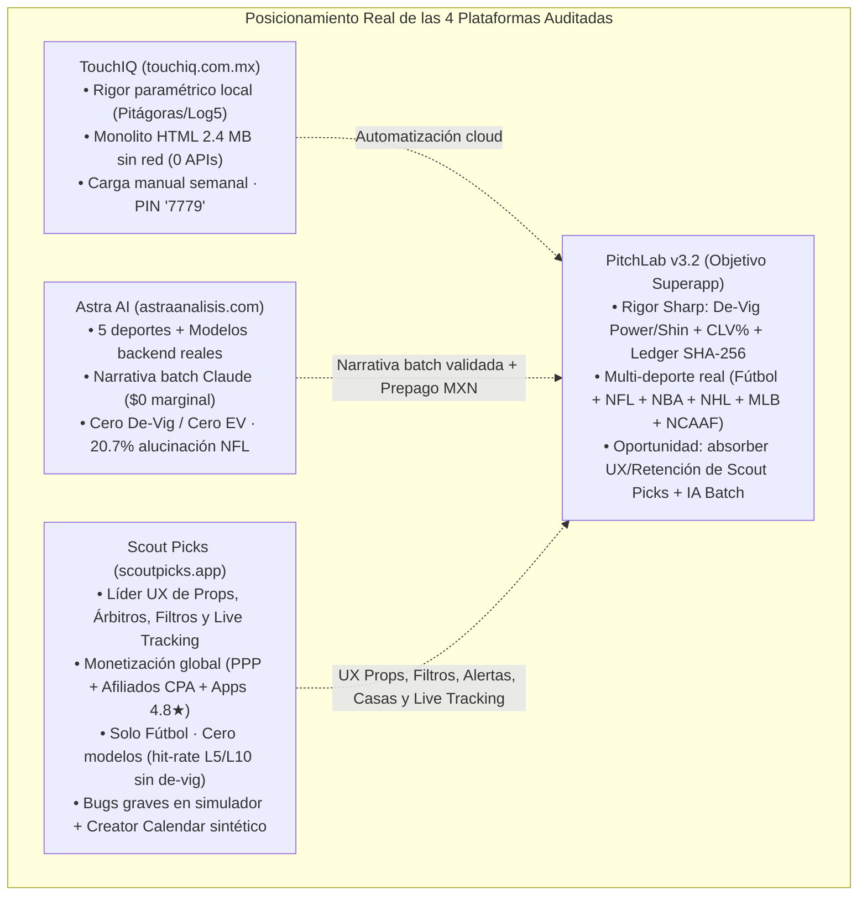

# 09 — Comparativa Estratégica Cuádruple y Hoja de Ruta de Mejoras para PitchLab

> **Alcance:** Evaluación estratégica y arquitectónica cara a cara entre **PitchLab (`v3.2.0`)**, **Scout Picks (`scoutpicks.app`)**, **Astra AI (`astraanalisis.com`)** y **TouchIQ (`touchiq.com.mx`)**, cruzando el código real de PitchLab en este repositorio con los tres dossiers forenses ejecutados mediante **REA**.  
> **Fuentes primarias verificadas (`[OBSERVADO]`):**
> - **PitchLab (`v3.2.0`):** [PROJECT_STATE.md](file:///C:/Users/T490s/.gemini/antigravity/worktrees/PitchLab/analyze_pitchlab_competitor_rea/docs/execution/PROJECT_STATE.md), [STACK_COSTO_CERO.md](file:///C:/Users/T490s/.gemini/antigravity/worktrees/PitchLab/analyze_pitchlab_competitor_rea/docs/architecture/STACK_COSTO_CERO.md), [outlook.ts](file:///C:/Users/T490s/.gemini/antigravity/worktrees/PitchLab/analyze_pitchlab_competitor_rea/src/domain/prediction/outlook.ts), [devig.ts](file:///C:/Users/T490s/.gemini/antigravity/worktrees/PitchLab/analyze_pitchlab_competitor_rea/src/domain/prediction/devig.ts), [ledger.ts](file:///C:/Users/T490s/.gemini/antigravity/worktrees/PitchLab/analyze_pitchlab_competitor_rea/src/domain/prediction/ledger.ts) y [multisport.ts](file:///C:/Users/T490s/.gemini/antigravity/worktrees/PitchLab/analyze_pitchlab_competitor_rea/src/domain/prediction/multisport.ts).
> - **Scout Picks:** Evidencias REA `ev_abdb3cf1...`, `ev_d6aea026...`, `ev_03f837b1...`, `ev_7aae1b8f...`, `ev_ed3088de...`, `ev_8d1fa222...`, `ev_74b541a5...` y Capítulo [08-detalles-ocultos-secretos-anomalias-y-bugs.md](file:///C:/Users/T490s/.gemini/antigravity/worktrees/PitchLab/analyze_pitchlab_competitor_rea/Reportes/scoutpicks/08-detalles-ocultos-secretos-anomalias-y-bugs.md).
> - **Astra AI:** [00-REPORTE-MAESTRO-ASTRA-ANALISIS.md](file:///C:/Users/T490s/.gemini/antigravity/worktrees/PitchLab/analyze_pitchlab_competitor_rea/Reportes/analisis-astra/00-REPORTE-MAESTRO-ASTRA-ANALISIS.md) (`ev_06e64c17...` y 83 registros REA verificados).
> - **TouchIQ:** [executive-summary.md](file:///C:/Users/T490s/.gemini/antigravity/worktrees/PitchLab/analyze_pitchlab_competitor_rea/Reportes/touchiq/executive-summary.md) (`ev_2464afc9...`, `ev_7d2fef6c...`).

---

## 1. Radiografía del Estado Actual de PitchLab (`v3.2.0`) Frente al Ecosistema Competitivo

La inspección directa del árbol de código de **PitchLab** en el workspace confirma que nuestro proyecto posee el **cimiento matemático, estadístico y de auditoría más riguroso de los cuatro sistemas analizados**, pero aún tiene pendiente cerrar la **capa de experiencia de producto interactiva, hábitos de retención en vivo y distribución comercial** donde Scout Picks y Astra AI ya capturan ingresos recurrentes (`[OBSERVADO]`):

1. **Núcleo cuantitativo institucional (`src/domain/prediction/*`, `services/models/*`, `[OBSERVADO]`):**
   - **Fútbol (`Tachyon` + `Dixon-Coles` unificado en `outlook.ts`):** Deriva coherentemente **11 mercados** (`1x2`, `double_chance`, `totals_1_5/2_5/3_5`, `btts`, `dnb`, `ah_±0.5/±1.0`) y `topScorelines[3]` desde una única matriz bivariada, mezclando en escala logit con apertura *sharp* desmarginada (`outlook_calibration_v3_2.json` evaluado sin fugas sobre `56,649` partidos `walk_forward_dev` + `14,163` `holdout_sealed` `"holdout consumido"`, paridad TS↔Python $|\Delta| < 10^{-12}$).
   - **NFL y Deportes Norteamericanos (`nfl_live.ts`, `multisport.ts`, `packages/engines-reference/`, `[OBSERVADO]`):** Motor activo `Minkowski v3.0` + candidato causal `model_nfl_v3_2_candidate.json` (`41` variables con EPA jugada a jugada `nflverse`, `83.83%` de cobertura viva) más los 4 motores deterministas de `Spacetime Multi-Sport v3.0` (`Curvature NHL`, `Kepler MLB`, `Tensor NBA`, `Horizon NCAAF`).
   - **Microestructura de cuotas, *de-vigging* y trazabilidad criptográfica (`devig.ts`, `stale_lines.ts`, `ledger.ts`, `[OBSERVADO]`):** Implementa desmarginación exacta `proportional`, `power`, `shin` y `adaptive` (interpolación Hermite $C^1$ entre régimen *sharp* Pinnacle `3.22%` y recreativo MX `6.62%+`), detector de líneas rezagadas de **Doble Confirmación** (`CLV% = +10.93%` en `dev`, cadencia óptima `3.69 min` en `T-60m`) y un **`PickLedger` append-only encadenado con `SHA-256`** (`GENESIS_HASH`).
2. **Brecha actual de producto en PitchLab (`PROJECT_STATE.md` §Pendiente/Bloqueos, `[OBSERVADO]`):**
   - Credenciales comerciales en espera de activación (`prospective_capture_pending` para `THE_ODDS_API_KEY`, `API_FOOTBALL_KEY`), interfaz web final aún por conectar al arreglo `outlooks` de `live_matchday_v3_snapshot.json`, ausencia de mercados de *player/referee props*, sin seguimiento en vivo de boletos/pronósticos guardados y sin embudo comercial activo.

---

## 2. Matriz Estratégica Maestra: PitchLab vs Scout Picks vs Astra AI vs TouchIQ

| Dimensión | **PitchLab (`v3.2.0`)** | **Scout Picks (`scoutpicks.app`)** | **Astra AI (`astraanalisis.com`)** | **TouchIQ (`touchiq.com.mx`)** |
|---|---|---|---|---|
| **1. Arquitectura Cliente y Móvil** | Monorepo TS modular (`packages/contracts`, `models`, `src/domain/prediction`) + Web Next.js 15 planificada (`[OBSERVADO]`) | Landing **Astro SSG** + Dashboard **React/TanStack SPA** monolítica (`3.36 MB` sin *route-splitting*) + Apps nativas **Expo iOS/Android `v1.5.4`** (`4.8★`) (`[OBSERVADO]`, `ev_abdb3cf1...`) | **Expo SDK 58 + React 19.3 Compiler** (`1.92 MB` en `25` chunks por ruta), **PWA-first** (`0` apps nativas en tiendas) (`[OBSERVADO]`, `ev_06e64c17...`) | **1 archivo HTML estático de `2.40 MB`** con micro-frontends en `iframes` `srcdoc` Base64; solo web (`[OBSERVADO]`, `ev_2464afc9...`) |
| **2. Backend, Base de Datos y Tiempo Real** | **Neon Postgres** (Drizzle) + **Cloudflare R2** (Parquet) + **Upstash Redis**; pipelines Python/TS deterministas (`[OBSERVADO]`) | API Node/TS en **AWS ALB (`us-east-1`)** + **Neon Postgres**; *polling* HTTP intensivo + `notification-worker.js` (`[OBSERVADO]`, `ev_7aae1b8f...`) | **Supabase** (`14` tablas Postgres con RLS *Soft-Null*, `4` RPCs, `7` Edge Functions) + crons cada `2 min`; *polling* `25–60 s` (`[OBSERVADO]`) | **Cero backend y `0` peticiones de red en runtime** (`ev_7d2fef6c...`); estado volátil en `localStorage` (`[OBSERVADO]`) |
| **3. Cobertura de Deportes** | **6 deportes en código:** Fútbol (`23` ligas), NFL, NHL, MLB, NBA y NCAAF (`[OBSERVADO]`) | **1 solo deporte:** exclusivamente **Fútbol** (`176` ligas en BD, `145` activas; arreglo zombi de `59` IDs legacy de API-Football en `GET /subscriptions/me`; marketing `200+`) (`[OBSERVADO]`) | **5 deportes en vivo:** Fútbol (`48` ligas), NBA, NFL, NHL y MLB (`[OBSERVADO]`) | **2 activos** (NFL, NCAAF) + Fútbol/NHL/MLB en proyecto hermano *AztecaVet* (`[OBSERVADO]`) |
| **4. Fuentes de Datos y Cuotas** | `nflverse`, `openfootball`, `football-data`, `API-Football`, `The Odds API` / `Betfair` (modo legal `api_only`, `0` evasión anti-bot) (`[OBSERVADO]`) | **Sportmonks v3** (sin add-on xG) + **6 fuentes de cuotas** (**`Odds-API.io`** + conectores directos pre-match de `Bet365`, `Betano`, `Stake`, `JugaBet`, `Draftea`) (`[OBSERVADO]`) | `API-Sports v3` (fútbol) + APIs públicas gratuitas (`ESPN`, `NHL`, `MLB`, `nflverse`, `FanGraphs`); cuotas `Marathonbet` y `DraftKings` (`[OBSERVADO]`) | Transcripción manual semanal desde *Pro-Football-Reference*, *CBS/ESPN* y *DraftKings* (`[OBSERVADO]`) |
| **5. Motor Matemático y Probabilístico** | Logit regularizado + **Dixon-Coles** unificado + mezcla logit con mercado *sharp* + EPA causal NFL + `Spacetime v3.0` (`[OBSERVADO]`) | **Sin modelo generativo:** frecuencia empírica cruda (*hit-rate* `x/N` en ventanas `L5`/`L10`/`L20`) sin contracción bayesiana ni ajuste por rival (`[OBSERVADO]`) | **Modelos reales en backend:** Dixon-Coles (`70% xG`), Binomial Negativa, Ratings+Elo (NBA/NFL), xG por tiro + Monte Carlo (NHL), `wOBA/FIP` (MLB) (`[OBSERVADO]`) | **Paramétrico clásico:** Pitágoras (`2.37` NFL / `1.70` fútbol) + contracción `Log5` + ajuste manual de lesiones + CDF Normal (`[OBSERVADO]`) |
| **6. *De-Vigging*, `fairOdds` y Cálculo de `EV`** | **Estándar institucional:** `devig.ts` (`power`/`shin`/`adaptive`), `fairOdds = 1/p`, umbrales EV empíricos y detector de líneas rezagadas (`[OBSERVADO]`) | **Sin *de-vig*:** `implied = 100/odds` crudo en `/insights`, más **bug crítico `100x` en `/simulations/calculate`** (`edge = P - 1/odds`, dando `+99.29%` o signos invertidos) (`[OBSERVADO]`) | **Desconectado:** muestra cuotas `1X2`/`ML` sin casa ni *de-vig* y jamás cruza cuota contra probabilidad (`0` cálculo de `EV` o `fairOdds`) (`[OBSERVADO]`) | Calcula `noVig`, `fairOdds = 1/p`, `EV = p·d - 1` y score `80/20` sobre cuotas ingresadas por el usuario (`[OBSERVADO]`) |
| **7. *Props* de Jugador y Árbitro** | Pendiente (`0` *props* públicos hasta reunir cierres *sharp* por jugador; `props.ts` de referencia NFL) (`[OBSERVADO]`) | **Excelencia de producto:** `22` métricas de jugador/equipo/árbitro, filtro `minMinutes=45`, `expectedLineupStatus`, `substitutionPattern` y *perks* (`sub_cover`) (`[OBSERVADO]`) | Solo proyecciones agregadas de equipo (córners/faltas) y boxscore NBA en vivo; `0` *player props* predictivos (`[OBSERVADO]`) | Módulo local de *player props* NFL (Normal para yardas, Poisson para TDs/recepciones) (`[OBSERVADO]`) |
| **8. Personalización, Filtros y Casas** | Snapshot general por liga/partido (`MatchOutlook`) (`[OBSERVADO]`) | **Muy superior:** preferencia de casas del usuario (`bookmakerPreferences`), vistas de filtros guardables (`insight-views`) y widgets reordenables (`[OBSERVADO]`) | Fijación local de ligas favoritas y pestaña `siguiendo` (`<= 20` partidos en memoria/storage) (`[OBSERVADO]`) | Sin cuentas ni preferencias en la nube (`[OBSERVADO]`) |
| **9. Seguimiento en Vivo y Liquidación** | Pre-partido (`live_matchday_v3_snapshot.json`); liquidación prospectiva en `paper_trading.py` (`[OBSERVADO]`) | **Muy superior:** progreso en vivo de cada pick guardado (`{{current}} / {{line}}`), notificaciones con límite de frecuencia y calendario de ROI automático (`[OBSERVADO]`) | Marcadores y curva `momentum` cada `2 min`, monitor de `6` métricas en vivo, pero sin cartera cuantitativa de picks del usuario (`[OBSERVADO]`) | Boleto y bankroll manual guardados en `localStorage` (`[OBSERVADO]`) |
| **10. Capa de Inteligencia Artificial** | Planificada con **DeepSeek V4.1 Flash** (`~US$0.0003`/lectura) anclada a `MatchOutlook` (`[OBSERVADO]`) | **Asistente NL de Alertas de Mercado** (`POST /market-alerts/assistant`) que convierte texto libre en alertas estructuradas; resúmenes de simulador son plantillas con bug H2H (`[OBSERVADO]`) | Narrativas pre-generadas en lote con `claude-haiku-5-5` (`$0` marginal), pero sin validador post-LLM (`20.7%` de inversiones local/visitante en NFL) (`[OBSERVADO]`) | Scraping DOM + `window.claude` opcional con *fallback* regex determinista sin red (`[OBSERVADO]`) |
| **11. Integridad y Auditoría de Resultados** | **Máxima:** `PickLedger` inmutable `SHA-256`, `holdout_sealed` de una sola apertura, curvas `ECE` y `50/50` controles Red Team (`[OBSERVADO]`) | **Comprometida en marketing:** incluye **`Creator Pick Calendar` (`Drt()`)** para sembrar `30–90` días retroactivos a `55%–70%` de acierto *"para capturar pantalla"* (`[OBSERVADO]`) | Sin *Brier/ECE* ni siquiera en `admin_dashboard()`, `WinBox` siempre verde y `astra_picks` insertados post-partido detectados en BD (`[OBSERVADO]`) | Mini-auditorías estáticas de una semana embebidas en código (`[OBSERVADO]`) |
| **12. Monetización, Precios y Seguridad** | Beta costo cero (`Better Auth` + `HttpOnly` + `CSP` planificados; `0` afiliación) (`[OBSERVADO]`) | Suscripción multi-plataforma RevenueCat/Stripe/Link (`MXN $149` sem / `$299` mes / `$1,499` año) + **Afiliación CPA (`perk-claim`)** + *App-to-Web Handoff*. Token en `localStorage` sin `CSP` (`[OBSERVADO]`) | `7` días gratis sin tarjeta → **Pase prepago `$199 MXN / 30d`** (Stripe + Mercado Pago, `0` afiliación); RLS real pero filtra `context` post-partido (`[OBSERVADO]`) | Acceso por PIN `'7779'` hardcodeado en texto plano en el HTML público (`[OBSERVADO]`) |

---

## 3. Qué Hace Mucho Mejor Scout Picks y Debemos Incorporar en PitchLab

Más allá de sus debilidades matemáticas tras bambalinas, **Scout Picks tiene la mejor ingeniería de producto, retención diaria y monetización del segmento de fútbol** (`[OBSERVADO]`). Sus apps nativas alcanzan `4.8★` porque resuelven fricciones cotidianas concretas del usuario que PitchLab debe absorber y elevar con su rigor cuantitativo:

### 3.1 *Props* Granulares de Jugador y Árbitro con Contexto Táctico Real (`minMinutes=45`, `expectedLineupStatus`, `substitutionPattern` y `perks`)
- **Qué observamos en Scout Picks (`ev_abdb3cf1...`, `ev_03f837b1...`):** Cubre **22 categorías de mercado** (remates, tiros a puerta, entradas, faltas cometidas/recibidas, pases, atajadas, tarjetas) más un **módulo dedicado de Árbitros** (`/referees/:id` con promedio histórico de amarillas, rojas, faltas y percentil de rigor dentro de su liga). Para evitar distorsiones por minutos basura, filtra el rendimiento por titularidad/`minMinutes=45`, ordena *insights* priorizando `expectedLineupStatus`, advierte patrones habituales de cambio (`"Suele salir ~{{minute}}' — entra {{name}}"`) e identifica reglas favorables por casa (`perks: ["sub_cover", "early_payout_2_goals"]`).
- **Cómo adoptarlo mejor en PitchLab:** Incorporar fichas tácticas de jugadores y árbitros con filtro `minMinutes >= 45` y alerta de sustitución temprana, pero sustituyendo el conteo ingenuo `x/10` por **estimadores empíricos bayesianos (Beta-Binomial / Poisson-Gamma con contracción hacia el prior posicional y ajuste por ritmo/rival)**.

### 3.2 Alertas de Apertura de Mercado + Copiloto Conversacional de Configuración (`Market Alerts Assistant`)
- **Qué observamos en Scout Picks (`03_auth_and_axios.js`, `07_app_core_part1...`):** Los mercados secundarios donde existe mayor ineficiencia (*tarjetas de árbitro, entradas de defensores, tiros*) no abren al mismo tiempo que el `1X2`. Scout Picks permite suscribirse a la apertura exacta de un mercado en las casas del usuario, apoyado por un **asistente IA conversacional** (`POST /market-alerts/assistant`) que convierte una petición en lenguaje natural en tarjetas estructuradas listas para confirmar.
- **Cómo adoptarlo mejor en PitchLab:** Combinar este flujo UX con nuestro detector matemático **`stale_lines.ts` (Doble Confirmación `A8`)** y **DeepSeek V4.1 Flash** como traductor de intención natural → JSON tipado validado con Zod, notificando al usuario tanto cuando **abre** un mercado como cuando aparece una **divergencia real desmarginada** respecto al ancla *sharp*.

### 3.3 Vistas de Filtros Personalizados Guardables (`insight-views` — "Mis Filtros")
- **Qué observamos en Scout Picks (`09_app_core_part3...`, `GET /insight-views`):** Permite al usuario parametrizar su propio *screener* (competiciones, países, posiciones en campo, rango de cuotas, periodo `1H`/`2H`/`FT`) y guardarlo con nombre en su cuenta para consultarlo en un clic cada jornada o vincularle notificaciones.
- **Cómo adoptarlo mejor en PitchLab:** Implementar **Vistas Guardadas sobre `MatchOutlook`** cruzando los 6 deportes de PitchLab (p. ej. *"Partidos Liga MX + NFL con cobertura alta, mercado sharp fresco y probabilidad calibrada >= 60%"*).

### 3.4 Tracking en Vivo del Progreso de cada Selección (`{{current}} / {{line}}`) con Control de Frecuencia
- **Qué observamos en Scout Picks (`02_i18n_en_es_pt.js`, `notification-worker.js`):** Guardar un pick transforma la app durante el partido: muestra barras de avance en tiempo real (`2 / 2.5 tiros`, *"Línea superada · pendiente de resultado final"*, *"Cubriendo hándicap"* o *"El jugador no fue titular"*), despacha avisos al navegador/móvil respetando un *throttling* configurable por el usuario (`everyUpdate` vs `Máximo cada N min`) y liquida automáticamente el historial diario en `/performance`.
- **Cómo adoptarlo mejor en PitchLab:** Crear el módulo **"Mi Portafolio / Seguimiento en Vivo"** para selecciones guardadas desde `MatchOutlook`, con liquidación automática de 5 estados asiáticos (`.25`/`.75` ya programados en `src/domain/prediction/markets_2way.ts` y `ledger.ts`) y alertas Web Push reales (VAPID) en vez de depender únicamente de pestañas abiertas.

### 3.5 Filtro Persistente de Casas de Apuestas del Usuario (`bookmakerPreferences`)
- **Qué observamos en Scout Picks (`GET /bookmakers/preferences`):** El usuario elige una sola vez dónde tiene cuenta (`Bet365`, `Betano`, `Draftea`, `Stake`, `JugaBet`) y toda la interfaz adapta el mejor precio ejecutable a su billetera real.
- **Cómo adoptarlo mejor en PitchLab:** Añadir selector de casas disponibles en México/LATAM para que el usuario compare instantáneamente la **`fairOdds` sin margen de PitchLab** contra el mejor momio disponible en **sus propias casas**, visualizando de inmediato la comisión implícita (*overround*) de cada operador.

### 3.6 Monetización Inteligente: Precios PPP, Pases de Torneo (`World Cup Pass`), *App-to-Web Handoff* y Evaluación Crítica de `perk-claim`
- **Qué observamos en Scout Picks (`GET /app/pricing`, `03_auth_and_axios.js`, `GET /bookmakers/offers`):**
  1. **Precios localizados PPP + Planes modulares + Pase de Mundial (`worldCupPassExpiresAt`):** Adapta moneda (`MXN`), prueba escalones por liga (`1/2/3 ligas` vs `Todas`) y prepara pases prepagados para el Mundial 2026.
  2. ***App-to-Web Handoff* (`POST /auth/web-handoff/redeem`):** Transfiere sesión móvil → checkout web Stripe en un clic sin re-login y retorna por *deep-link* (`scoutai://`), eludiendo legalmente el `15%–30%` de comisión de tiendas.
  3. **Afiliación CPA con beneficio cruzado (`perk-claim`):** Otorga `+1 mes de Pro gratis` al verificar primer depósito en casa socia. *(Nota estratégica para PitchLab: hoy nuestra regla `FD-16` mantiene independencia editorial absoluta sin afiliación con casas de apuestas; si en una fase comercial futura la dirección decidiera evaluar patrocinios B2B regulados, deberá declararse explícitamente en Términos y UI, evitando la contradicción legal detectada en Scout Picks).*

---

## 4. Dónde PitchLab Aplasta o Supera Estructuralmente a Scout Picks

1. **Multi-Deporte Real y Estacionalidad Completa vs Monocultivo de Fútbol (`[OBSERVADO]`):**
   - Scout Picks depende `100%` del calendario futbolístico; en semanas de Fecha FIFA reducida o verano sin ligas europeas su inventario cae drásticamente, y es invisible para el enorme mercado mexicano y norteamericano de **NFL, NBA, MLB, NHL y NCAAF**. PitchLab ya cuenta con motores verificados para los **6 deportes** en su capa de dominio (`engine.ts`, `nfl_live.ts`, `multisport.ts`).
2. **Verdad Matemática (`De-Vig` + Calibración OOS + `CLV%`) vs Ilusión Estadística (`Hit-Rate L5/L10` + Bugs de Simulador) (`[OBSERVADO]` + `[DERIVADO]`):**
   - Scout Picks vende rachas pasadas de `5` o `10` juegos (`19.21%` de su catálogo afirma `100%` de probabilidad, incluso con `sampleSize: 3`), ignora por completo el margen de la casa (`100 / odds`), deja en `null` el ajuste por rival (`adjustedHitRate: null`) y sufre en producción el **bug `100x` de `edge` (`+99.29%`)** y el **falso H2H `charts.vsOpponent`** en `/simulations/calculate`.
   - PitchLab desmargina rigurosamente con Power/Shin adaptativo (`devig.ts`), valida cada cambio contra `56,649` juegos históricos y cierres *sharp* de Pinnacle/Smarkets, mide `ECE` por cubeta de confiabilidad y bloquea cualquier recomendación cuyo `CLV%` prospectivo no supere el IC 95% bootstrap.
3. **Transparencia Criptográfica Auditable (`PickLedger SHA-256`) vs Historiales Sintéticos para Influencers (`Creator Pick Calendar`) (`[OBSERVADO]`):**
   - El descubrimiento de `Drt()` (`POST /creator/pick-calendar/apply`) demuestra que el historial exhibido por promotores de Scout Picks puede ser sembrado retroactivamente eligiendo tasa de acierto (`55%–70%`) y porcentaje de días rojos (`12%–35%`). PitchLab posee la antítesis exacta en `src/domain/prediction/ledger.ts`: una cadena de bloques de hashes `SHA-256` donde cada pronóstico queda sellado antes del inicio del partido y es imposible alterar o fabricar resultados pasados.
4. **Rendimiento Web Moderno, Higiene de Datos y Seguridad Defensiva (`[OBSERVADO]`):**
   - Frente al bundle único bloqueante de `3.36 MB` de Scout Picks (con Svelte 5 incrustado dentro de React), respuestas JSON de `6.27 MB` con columnas internas de *scrapers* (`SELECT *`), `ZodError` expuestos y tokens de 90 días en `localStorage` sin `CSP`, PitchLab está diseñado sobre Next.js 15 modular con contratos tipados (`packages/contracts`), sesiones `HttpOnly` en Better Auth y cabeceras de seguridad completas.

---

## 5. Hoja de Ruta Accionable (`P0`, `P1`, `P2`) de Ingeniería y Producto para PitchLab

```mermaid
flowchart LR
    subgraph P0["Prioridad P0 (Semanas 1–4): Conversión y Hábito"]
        P0A["P0.1 Filtro de Casas del Usuario\n+ Comparador FairOdds vs Cuota Real"]
        P0B["P0.2 Portafolio Live (current/line)\n+ Liquidación 5-estados + Web Push"]
        P0C["P0.3 Monetización MXN Prepago/Anual\n+ Pase Mundial + PWA/Handoff"]
    end
    subgraph P1["Prioridad P1 (Semanas 5–10): Paridad Superior"]
        P1A["P1.1 Motor Bayesiano de Props y Árbitros\n(minMinutes>=45 + XI + Contracción)"]
        P1B["P1.2 Alertas de Apertura y Stale Lines\n+ Copiloto NL (DeepSeek + Zod)"]
        P1C["P1.3 Screener Multi-Deporte Guardable\n(Saved Outlook Views)"]
    end
    subgraph P2["Prioridad P2 (Semanas 11–16): Foso Competitivo"]
        P2A["P2.1 Portal Público /verificacion\n(Ledger SHA-256 + Curvas ECE en vivo)"]
        P2B["P2.2 Blindaje API/Seguridad/Bundle\n(DTOs estrictos + CSP + <250KB gzip)"]
    end
    P0 --> P1 --> P2
```

### Prioridad `P0` — Fundamentos de Conversión, Retención Diaria y Desbloqueo Vivo
1. **`P0.1` · Preferencias de Casas del Usuario + Semáforo Transparente `FairOdds` vs Precio Real (`packages/contracts` + `apps/web`):**
   - Desbloquear `THE_ODDS_API_KEY` y `API_FOOTBALL_KEY` en el pipeline multi-tick (`cadence_scheduler.py`, `T-60m <= 3.69 min`).
   - Permitir al usuario seleccionar sus casas habituales en México/LATAM y mostrar en cada tarjeta de `MatchOutlook`: **Probabilidad Calibrada (`p`)**, **Cuota Justa sin Margen (`fairOdds = 1/p`)**, **Mejor Cuota en tus Casas** y **Comisión Implícita (*Overround*)** calculada con `src/domain/prediction/devig.ts`.
2. **`P0.2` · Seguimiento en Vivo de Selecciones Guardadas (`current / line`) y Liquidación Automática Auditada:**
   - Construir el flujo *"Guardar en mi seguimiento"* sobre `MatchOutlook` y mercados numéricos, mostrando avance en vivo (`{{current}} / {{line}}`, estado de cobertura asiática `.25`/`.75` vía `markets_2way.ts` y alerta si un titular no inicia), Web Push nativo con control de frecuencia (`Máximo cada N min`) y vista `/rendimiento` agrupada por día, deporte y mercado — separando con etiqueta inmutable lo guardado pre-kickoff y **prohibiendo por arquitectura cualquier inserción retroactiva**.
3. **`P0.3` · Esquema Comercial Adaptado a LATAM (`Pase Prepago 30d` + `Plan Anual` + `Pase Mundial`) y Distribución sin Peaje:**
   - Combinar lo mejor de Astra AI y Scout Picks: **7 días de prueba sin fricción (Google OAuth en 1 clic vía Better Auth)**, **Pase Prepago acumulable de `$199 MXN / 30 días`** (Mercado Pago + Stripe, sin renovación forzosa), **Plan Anual con descuento (`~$1,490 MXN/año`)** y **Pases de Evento (`Pase Mundial / Playoffs NFL`)**, priorizando instalación **PWA** y *App-to-Web Handoff* cuando se lancen clientes móviles para retener `~94%` del ingreso bruto.

### Prioridad `P1` — Expansión Táctica donde Scout Picks y Astra AI Tienen Brechas Matemáticas
4. **`P1.1` · Módulo Cuantitativo de Árbitros y *Props* con Contracción Bayesiana e Higiene `minMinutes >= 45`:**
   - Incorporar perfiles estadísticos de árbitros (tarjetas/faltas con *Empirical Bayes* $k=15$) y métricas granulares de equipo/jugador (córners, tiros, faltas, yardas NFL, tiros NHL, ponches MLB) filtrando apariciones con `minMinutes >= 45`, estado de alineación (`CONTRACT_XI_PUBLISHED.md`) y patrones de sustitución.
   - **Diferenciador clave frente a Scout Picks:** prohibir publicar porcentajes crudos `x/5` o `x/10` (`100%` en `N=3`); aplicar siempre contracción jerárquica Beta-Binomial / Binomial Negativa ajustada por fuerza defensiva del rival, mostrando explícitamente el tamaño muestral efectivo e intervalo de incertidumbre.
5. **`P1.2` · Alertas Inteligentes de Apertura de Mercado + Líneas Rezagadas con Copiloto NL Validado:**
   - Conectar `src/domain/prediction/stale_lines.ts` a un motor de alertas push/Telegram y exponer un asistente en lenguaje natural impulsado por **DeepSeek V4.1 Flash** (`< US$5/mes` a escala) que traduzca peticiones del usuario a reglas JSON validadas determinísticamente con Zod, más narrativas pre-generadas en lote por partido con **verificador determinista post-LLM** (cero nombres de equipos/rivales invertidos y cero falsos H2H como `charts.vsOpponent`).
6. **`P1.3` · *Screener* Multi-Deporte con Vistas Guardables (`Saved Outlook Views`):**
   - Permitir crear, guardar y compartir filtros transversales sobre los **6 deportes** (por liga, ventana horaria, nivel de cobertura `dataQuality.flag === "ok"`, discrepancia frente a cuota justa o volumen de atención en Polymarket/Kalshi tras validación `FD-20`).

### Prioridad `P2` — Foso Defensivo de Confianza Pública, Seguridad y Escala
7. **`P2.1` · Portal Público `/verificacion` ("Estándar Abierto de Transparencia Cuantitativa"):**
   - Publicar en abierto las curvas de calibración `ECE` de `outlook_calibration_v3_2.json` y un verificador interactivo de hashes `SHA-256` sobre `picks_v3_2_prospective.jsonl`, acompañado de una calculadora educativa que demuestre en 10 segundos por qué un *"hit-rate del 80% sin de-vig"* o un *"calendario sembrado de influencer"* engañan al usuario. Ningún competidor auditado (ni Scout Picks, ni Astra AI, ni TouchIQ) puede replicar esta prueba sin desmantelar su propio marketing actual.
8. **`P2.2` · Blindaje de Producción en API, Autenticación y Performance Frontend:**
   - Imponer en CI/CD: (a) DTOs explícitos de salida en cada endpoint (cero `SELECT *` ni filtración de IDs/timestamps de *scrapers* como en `GET /matches/:id`), (b) interceptor global que transforme `ZodError` en códigos de error limpios sin revelar esquemas internos, (c) test unitario de consistencia dimensional `[0..1]` en todo cálculo de probabilidad/cuota (imposibilitando errores `100x` como el de `/simulations/calculate`), (d) sesiones `HttpOnly; Secure; SameSite=Lax` con cabecera `Content-Security-Policy` estricta en CDN, y (e) *code splitting* automático por ruta manteniendo el bundle inicial `< 250 KB` comprimido.
